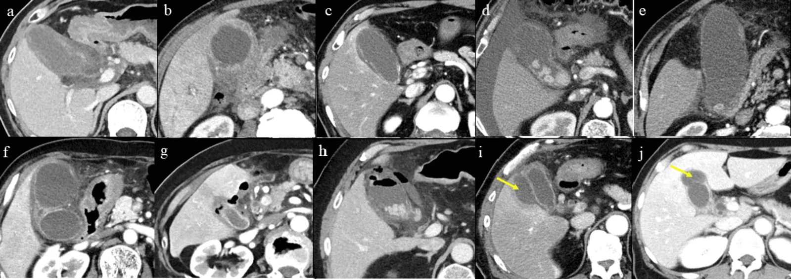

# 130 — Túi mật: sỏi, viêm cấp/mạn, adenomyomatosis vs K / Gallbladder

**Tags:** `pattern:viem-tui-mat` `vung:tui-mat`
**Mức chắc chắn (certainty):** tổng hợp y văn (literature synthesis) — nhóm tự biên từ y văn mở, chưa gắn ca nguyên văn đơn lẻ.

## 1. Tổng quan — 5 dấu CT + Murphy siêu âm

- Viêm túi mật cấp: sỏi kẹt cổ + **thành dày ≥ 5 mm CT (siêu âm > 3 mm, Tokyo ≥ 3–4 mm)** + túi căng (**ngang > 4 cm, dài > 8–10 cm**) + thâm nhiễm mỡ ≥ 5 mm + Murphy siêu âm (+) + dịch quanh.
- Sỏi cholesterol **đồng tỷ trọng dịch mật** (tàng hình CT!) vs sỏi sắc tố **vôi hóa** — TẠI SAO siêu âm/MRCP mới thấy sỏi cholesterol: CT chỉ thấy vôi.
- Ống mật chủ (CBD) thường **< 6–7 mm** (+ 1 mm mỗi thập kỷ sau 60 tuổi; sau cắt túi mật tới **8–10 mm** còn chấp nhận) — TẠI SAO giãn sinh lý theo tuổi/mất túi: mất bể chứa + giảm đàn hồi.
- 5 dấu CT nặng (Tabuchi): dày ≥ 5 mm, kém ngấm thành, mỡ ≥ 5 mm, khí trong thành/lòng, áp-xe quanh — càng nhiều điểm càng khó mổ.
- **Adenomyomatosis:** dày thành + **nang Rokitansky-Aschoff + đuôi sao chổi (comet-tail)** siêu âm — lành tính, đừng mổ oan.
- **K túi mật:** khối thay thế túi mật + xâm lấn gan/đường mật + hạch — mổ rộng khi còn khu trú.

*Dày ≥ 5 mm + kém ngấm + mỡ ≥ 5 mm + khí + áp-xe. Nguồn: Tabuchi et al., Cureus 2026 Fig. 1, CC BY 4.0.*

## 2. Gamut dày thành túi mật

- **Viêm cấp sỏi:** sỏi cổ + dày + Murphy + sốt — mổ trong 72 giờ (vàng) hoặc dẫn lưu khi quá nặng.
- **Hoại thư/khí:** khí thành + kém ngấm + nhiễm trùng nặng — mổ cấp cứu.
- **Adenomyomatosis:** đuôi sao chổi + không viêm cấp — theo dõi.
- **K túi mật:** khối + xâm lấn + hạch + sụt cân — mổ rộng/PET.

## 3. Bảng so sánh

| Thực thể (entity) | Hình ảnh | Chốt vào (rule-in) | Chốt loại (rule-out) | Gợi ý xác nhận |
|---|---|---|---|---|
| Viêm cấp | **Sỏi cổ + dày ≥ 5 mm + Murphy + mỡ** | **Đau HSP + sốt + Murphy + sỏi kẹt** | Túi xẹp + không sỏi + Murphy (−) → dày thứ phát | Mổ sớm/dẫn lưu |
| Hoại thư/khí | **Khí + kém ngấm + nặng** | **Khí thành + nhiễm trùng nặng** | Khí trước (pneumobilia) → không phải khí thành | Mổ cấp cứu |
| Mirizzi/Bouveret | **Sỏi kẹt ống túi mật ép OMC / sỏi to rò tá tràng gây tắc ruột** | **Vàng da + sỏi cổ + OMC trên hẹp; hơi + sỏi lạc chỗ tá tràng** | Sỏi OMC đơn thuần → ERCP thường | Mổ (đừng ERCP mù Mirizzi!) |
| Adenomyomatosis | **Đuôi sao chổi + nang RAS** | **Siêu âm chốt, không viêm** | Khối + xâm lấn → K | Theo dõi |
| K túi mật | **Khối + xâm lấn + hạch** | **Khối thay túi mật + sụt cân** | Đuôi sao chổi → adeno | Mổ rộng/PET |

## 4. Protocol

- **Siêu âm đầu tay** (Murphy + sỏi di động + dày thành + Doppler) — nhanh, không tia X.
- CT khi nặng/không rõ (5 dấu trên) + Tokyo grade (I/II/III) quyết định mổ/dẫn lưu.
- MRCP khi nghi sỏi OMC kèm.

## 5. Cạm bẫy

- **Dày thành do suy tim/xơ gan/giảm albumin** — toàn thân, không khu trú + không Murphy.
- **Sỏi kẹt cổ không viêm** (đau quặn mật) — cơn qua nhanh, không sốt/viêm.
- **K túi mật giai đoạn sớm** lẫn viêm mạn — khối khu trú + tuổi già + sỏi lâu năm → sinh thiết/mổ.
- **Khoảng trống tín hiệu MRCP giả sỏi:** bóng khí (pneumobilia — nổi phía trước theo trọng lực) + **flow-void dịch mật** + **động mạch gan phải bắt chéo sau ống gan chung** — sỏi thật luôn nằm thấp theo trọng lực + không đổi theo tư thế!
- **Sỏi cholesterol tàng hình CT** tưởng không sỏi — siêu âm bóng lưng + MRCP mới kết luận.

## 6. Tự lượng giá — Blind Quiz

**Ca 1 — Đau HSP + sốt + Murphy (+). Đếm dấu CT nặng.**

- Hỏi: kể 5 dấu? Ca này mổ nội soi thường hay khó? Vì sao?

<b>Bấm để hiện đáp án</b>

- **5 dấu:** dày ≥ 5 mm, kém ngấm, mỡ ≥ 5 mm, khí, áp-xe — càng nhiều điểm càng khó (mổ mở/dẫn lưu khi nặng + ASA cao + CRP cao).
- Nguồn: Tabuchi et al., Fig. 1, CC BY 4.0.

**Ca 2 — Dày thành + đuôi sao chổi + không sốt/Murphy:** viêm hay adenomyomatosis? Mổ không? *(Bảng mục 3.)*

<b>Bấm để hiện đáp án</b>

- **Adenomyomatosis:** theo dõi, không mổ.

## Bài liên quan chéo
- [100 – Tổng quan hệ Bụng](../100-tong-quan-he-bung/lesson.md)
- [131 – Tắc mật (đã có)](../131-tac-mat/lesson.md) (sỏi OMC)
- [136 – U/nang tụy (đã có)](../136-u-nang-tuy/lesson.md) (vàng da tắc mật)

> Không dùng để chẩn đoán độc lập khi chưa có người hướng dẫn.
