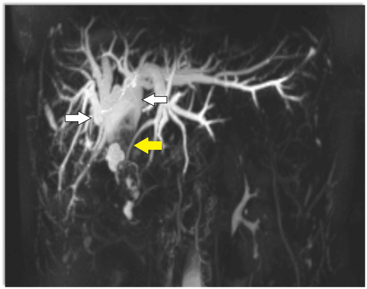
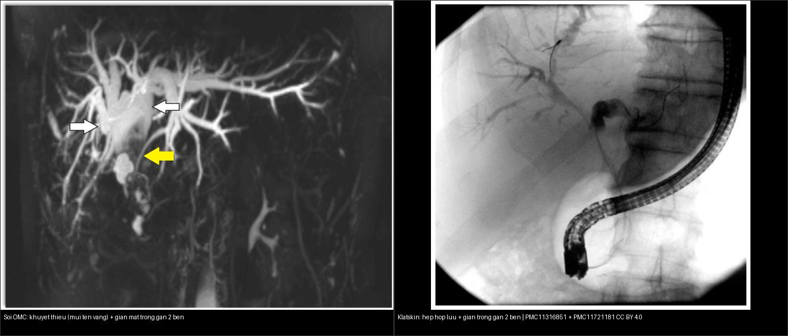

# 131 — Tắc mật: sỏi OMC, Klatskin & xơ hóa / Biliary obstruction

**Tags:** `pattern:tac-mat` `vung:duong-mat` `protocol:MRCP` `incidentaloma:gian-duong-mat`
**Mức chắc chắn (certainty):** tổng hợp y văn (literature synthesis) — nhóm tự biên từ y văn mở, chưa gắn ca nguyên văn đơn lẻ.

## 1. Tổng quan — trong gan vs ngoài gan + double-duct

- Tắc **ngoài gan** (sỏi OMC, u đầu tụy, Klatskin ngoài): giãn cả trong + ngoài gan; tắc **trong gan** khu trú: chỉ nhánh trên chỗ tắc.
- **Double-duct (dấu ống đôi):** giãn mật + giãn ống tụy + cắt cụt đột ngột cả 2 = u đầu tụy (xem ảnh bài 136).
- **Klatskin (hilar CCC):** hẹp/stricture hợp lưu + giãn trong gan 2 bên + teo thùy (thường trái) — Bismuth-Corlette I–IV (càng cao càng khó mổ).
- Ngưỡng: **OMC giãn > 6–8 mm** (sau mổ túi mật tới **8–10 mm** còn chấp nhận; +1 mm mỗi thập kỷ sau 60 tuổi); bilirubin trực tiếp tăng.
- **TẠI SAO MRCP thấy sỏi mà CT có thể bỏ:** MRCP là T2W nước–sáng — dịch mật sáng còn sỏi **tối (khuyết thiếu filling defect)**; **sỏi cholesterol đồng tỷ trọng dịch mật** nên **tàng hình trên CT** (CT chỉ thấy sỏi vôi hóa). Sỏi thật luôn **nằm thấp theo trọng lực + không đổi theo tư thế**.

*MRCP: cây đường mật giãn hai bên (mũi tên trắng) + khuyết thiếu lấp đầy trong OMC (mũi tên vàng) — sỏi OMC. Nguồn: Cureus 2024, PMC11316851, CC BY 4.0.*

## 2. Gamut vàng da tắc mật

- **Sỏi OMC:** sỏi (khuyết thiếu MRCP / cản quang CT) trong OMC giãn + cơn đau quặn + sốt (tam chứng Charcot; ngũ chứng Reynolds khi nặng) — ERCP lấy sỏi.
- **Klatskin:** stricture hợp lưu + giãn 2 bên + teo thùy — Bismuth + dẫn lưu + mổ/xạ.
- **U đầu tụy:** double-duct + cắt cụt (bài 136).
- **Xơ hóa đường mật (PSC):** hẹp rải rác + beads + viêm ruột (IBD) — MRCP theo dõi + tầm soát CCC.
- **Mimic cần biết:** **lao hạch quanh tụy**, **viêm đường mật tăng bạch cầu ái toan (eosinophilic cholangitis)**, **IgG4-sclerosing cholangitis** — đều có thể giả u đường mật.

## 3. Bảng so sánh phân biệt (ma trận đối chiếu)

| Thực thể (entity) | Hình ảnh (MRCP/CT) | Chốt vào (rule-in) | Chốt loại (rule-out) | Gợi ý xác nhận |
|---|---|---|---|---|
| Sỏi OMC | **Khuyết thiếu trong OMC giãn** (MRCP) + cơn đau/sốt | **Sỏi cản quang/khuyết thiếu + Charcot + sỏi thấp theo trọng lực** | Không đau/sốt + hẹp nhẵn dài → nghĩ Klatskin | ERCP + kháng sinh |
| Klatskin (hilar CCC) | **Stricture hợp lưu + giãn trong gan 2 bên + teo thùy** | **Hẹp tại hợp lưu + giãn 2 bên + teo thùy** | Sỏi trong lòng → không phải u | Dẫn lưu + mổ/xạ theo Bismuth I–IV |
| U đầu tụy (PDAC) | **Double-duct + cắt cụt đột ngột** | **2 ống cùng tắc (double-duct)** | Chỉ mật tắc đơn thuần → nghĩ Klatskin/sỏi | Whipple khi còn mổ được |
| PSC | **Hẹp rải rác + beads + IBD** | **Nhiều đoạn hẹp xen giãn (beads) + viêm ruột** | Hẹp đơn độc tại hợp lưu → nghĩ Klatskin | UDCA + tầm soát CCC |
| IgG4-SC / u giả viêm | **Hẹp dài, thành dày, ± tụy giả u** | **Đáp ứng steroid + IgG4 máu cao + tổn thương nhiều tạng** | Không đáp ứng steroid + hẹp tiến triển → nghĩ K | Corticosteroid thử + sinh thiết |

*Trái: sỏi OMC — khuyết thiếu (mũi tên vàng) + giãn mật trong gan 2 bên. Phải: Klatskin — hẹp tại hợp lưu + giãn trong gan 2 bên. Nguồn: PMC11316851 + PMC11721181, CC BY 4.0. Ảnh ghép letterbox.*

## 4. Protocol

- **Siêu âm đầu tay:** giãn đường mật trong gan + OMC (giãn > 6–8 mm) + sỏi túi mật kèm — nhanh, không tia X.
- **MRCP + MRI cản quang:** bản đồ đường mật không xâm lấn (stricture, sỏi, Bismuth) — **chỉ định khi nghi tắc nhưng siêu âm không kết luận**.
- **CT bụng đa thì:** u đầu tụy + hạch + mạch (xâm lấn ĐM gan/TM cửa quyết định mổ Klatskin).
- **ERCP:** vừa chẩn đoán vừa điều trị (lấy sỏi/stent) khi tắc ngoài gan.

## 5. Cạm bẫy

- **Khí sau ERCP/stent** giả sỏi khí (pneumobilia — nổi phía trước theo trọng lực) — hỏi thủ thuật.
- **Khuyết thiếu MRCP giả sỏi:** bóng khí + **flow-void dịch mật** + **ĐM gan phải bắt chéo sau ống gan chung** — sỏi thật luôn nằm thấp theo trọng lực + không đổi theo tư thế.
- **Klatskin type IV 2 bên** đừng mổ triệt căn mù — hội chẩn + dẫn lưu + xạ.
- **Viêm tụy cấp phù nề** chèn ép OMC thoáng qua — hết viêm chụp lại, đừng ERCP vội.
- **Tắc mật do lao hạch / IgG4** có thể đáp ứng steroid — đừng vội mổ triệt căn khi chưa loại trừ nguyên nhân lành tính.

## 6. Tự lượng giá — Blind Quiz (ảnh)

**Ca 1 — Vàng da + sốt + đau HSP (Charcot). MRCP thấy cây đường mật giãn 2 bên và một khuyết thiếu trong OMC.**

- Hỏi: mô tả khuyết thiếu? Chẩn đoán + thủ thuật gì? Vì sao CT có thể bỏ sót?

<b>Bấm để hiện đáp án (findings + chẩn đoán)</b>

- **Findings:** cây đường mật trong gan **giãn hai bên** (mũi tên trắng) + **khuyết thiếu lấp đầy (filling defect)** trong OMC (mũi tên vàng).
- **Chẩn đoán:** **sỏi OMC + viêm đường mật cấp** → **ERCP lấy sỏi + kháng sinh**. CT có thể bỏ sót vì **sỏi cholesterol đồng tỷ trọng dịch mật** (chỉ sỏi vôi mới thấy trên CT).
- Nguồn: Cureus 2024, PMC11316851, CC BY 4.0.

**Ca 2 — Ghép đối chiếu: hai bệnh nhân vàng da tắc mật — bên nào là sỏi, bên nào là u Klatskin?**

<b>Bấm để hiện đáp án (findings + chẩn đoán)</b>

- **Trái — sỏi OMC:** MRCP có **khuyết thiếu lấp đầy** trong lòng ống (mũi tên vàng) → dịch mật sáng, sỏi tối. **Phải — Klatskin:** **hẹp nhẵn tại hợp lưu** + giãn trong gan 2 bên (ERCP/chụp đường mật).
- **Chốt:** sỏi = khuyết thiếu **trong lòng**; u = **hẹp (stricture)** ăn lan thành ống. Nguồn: PMC11316851 + PMC11721181, CC BY 4.0.

**Ca 3 — Vàng da âm ỉ + gầy + stricture hợp lưu + giãn 2 bên + teo thùy trái:** Bismuth mấy? Mổ được không? *(Bảng mục 3.)*

<b>Bấm để hiện đáp án (findings + chẩn đoán)</b>

- **Klatskin (hợp lưu 2 bên):** Bismuth cao — dẫn lưu + hội chẩn mổ/xạ (khó triệt căn). Teo thùy trái là dấu hiệu **bệnh lan lâu** (thùy bị tắc lâu teo lại).
- Nguồn số liệu: y văn (xem `sources.md`).

## Bài liên quan chéo
- [100 – Tổng quan hệ Bụng](../100-tong-quan-he-bung/lesson.md)
- [130 – Túi mật](../130-tui-mat/lesson.md) (sỏi túi mật)
- [136 – U/nang tụy](../136-u-nang-tuy/lesson.md) (double-duct PDAC)
- [121 – LI-RADS & HCC](../121-khoi-gan-LIRADS/lesson.md) (chẩn đoán phân biệt khối gan)

## Ảnh
- Xem `images/CREDITS.md`. Ảnh bài này đều **CC BY 4.0** → được phép ghép letterbox (composite).

> Không dùng để chẩn đoán độc lập khi chưa có người hướng dẫn.
