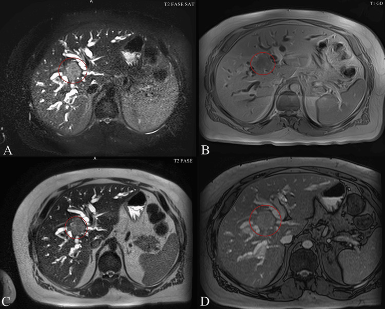
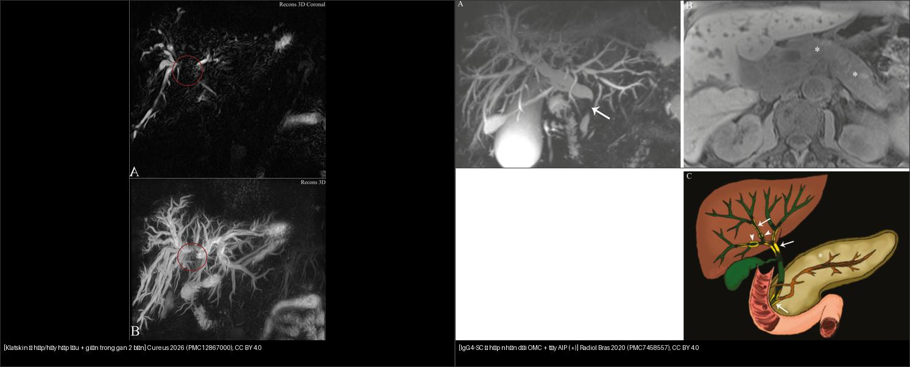
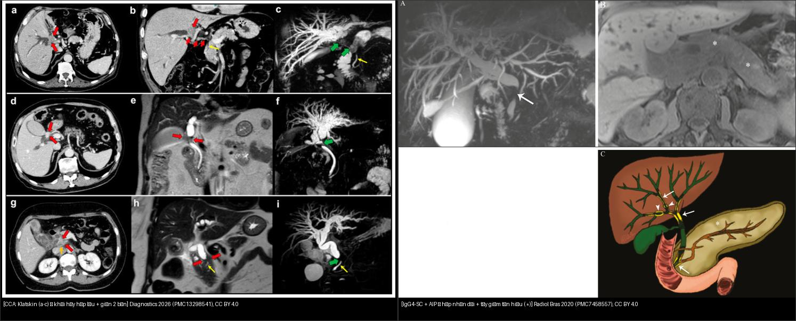
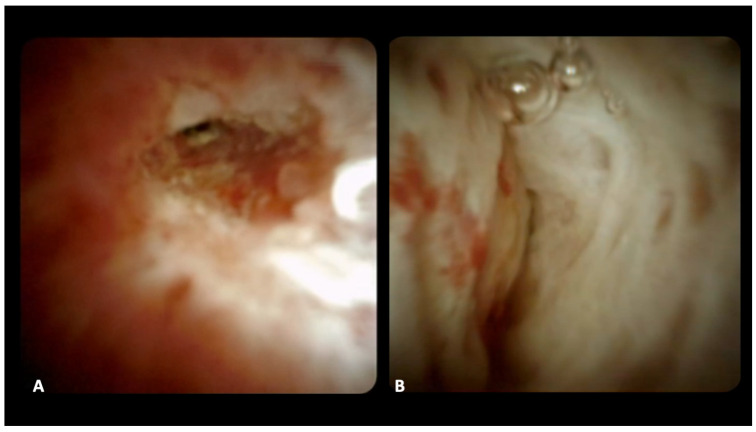
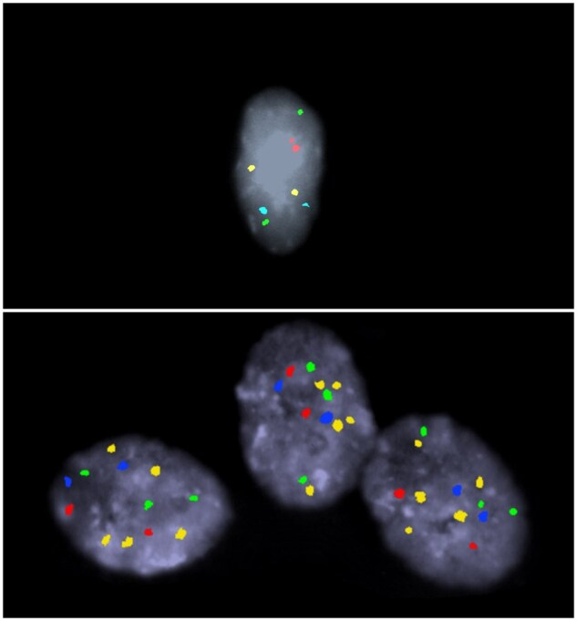
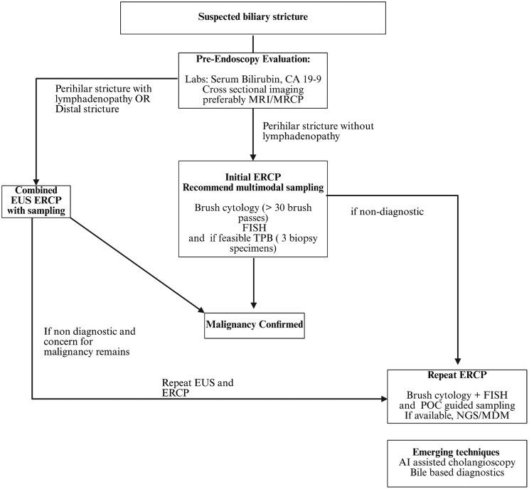
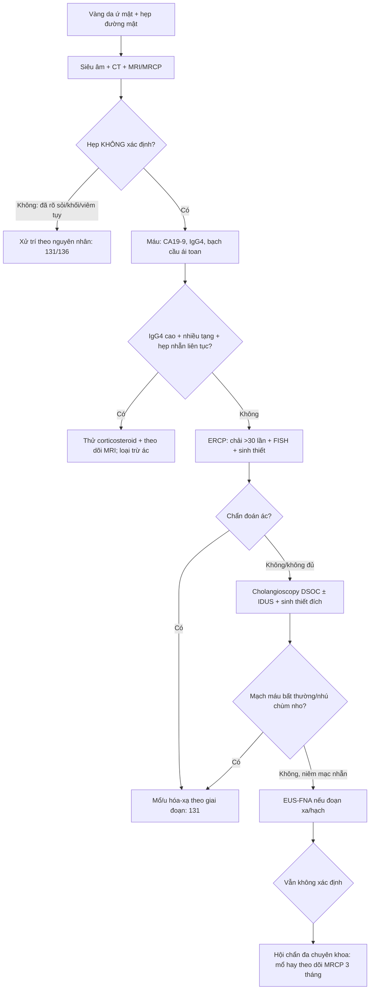
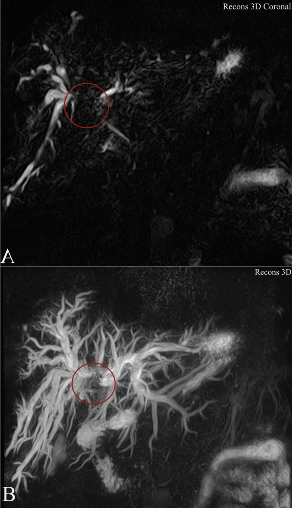
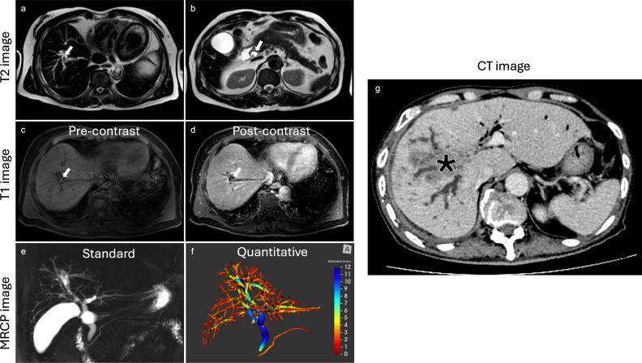

# 132 — Hẹp đường mật không xác định & vai trò cholangioscopy / Indeterminate biliary stricture

**Tags:** `pattern:hep-duong-mat` `vung:duong-mat` `protocol:MRCP` `protocol:cholangioscopy` `protocol:EUS-FNA` `score:IgG4`
**Mức chắc chắn (certainty):** tổng hợp y văn (literature synthesis) — nhóm tự biên từ y văn mở (5 bài CC BY 4.0), các ca minh họa dưới đây là **ca nguyên văn** giữ đúng chú thích gốc.

## 1. Tổng quan — "không xác định" nghĩa là gì + ngưỡng định lượng

- **Hẹp đường mật không xác định (indeterminate biliary stricture, IBS):** hẹp đường mật **chưa chốt được bản chất lành/ác** sau khi đã có **siêu âm + CT + MRI/MRCP ± ERCP chải tế bào lần đầu**. Đây không phải một bệnh mà là một **trạng thái chẩn đoán** — bước tiếp theo (theo dõi, soi sinh thiết, hay mổ) khác hẳn nhau.
- **Nguyên tắc vàng (xử trí mặc định):** hẹp không xác định **phải coi là ÁC cho tới khi chứng minh ngược lại — ~70% trong số đó thực sự là ung thư** (cholangiocarcinoma – CCA, hoặc ung thư tụy) [Dumonceau 2020, PMC7298429].
- **Nghịch lý "một nửa sự thật":** trong một nghiên cứu đa trung tâm **315 bệnh nhân IBS**, chẩn đoán **mô học** được CCA chỉ đạt **14%** — nghĩa là phần lớn ca ung thư **không** có bằng chứng tế bào học đủ mạnh nếu chỉ chải tế bào [PMC9875376].
- **Vì sao khó (TẠI SAO hình ảnh không tự chốt):** CCA thể **xơ hóa (desmoplastic)** có rất ít tế bào u nằm rải trong **mô đệm xơ dày** → chải tế bào/sinh thiết **âm giả** cao; ngược lại **IgG4-SC, PSC, cholangiopathy do thiếu máu** cũng xơ hóa → dễ **dương giả** khi soi. Hình ảnh mặt cắt chỉ đo được **hình dạng + ngấm thuốc**, không thấy tế bào.
- **Ngưỡng định lượng gợi ý ÁC trên MRI/MRCP** (Dumonceau 2020, PMC7298429): thành ống **dày ≥ 3, 4 hoặc 5 mm**; ngấm thuốc mạnh thì động mạch (duct hyperenhancement); **hạch cạnh > 1 cm**; hẹp **dài (long), không đều (irregular), bất đối xứng (asymmetric)**; có **khối**; tắc/hủy mạch. Ngược lại, phân bố **"bỏ nhảy" (skip lesions)** nhiều ổ xen giãn = nghi **PSC**.
- **MRI khuếch tán (DWI)** trên bối cảnh u tụy: độ nhạy/độ đặc hiệu **86%/82%** cho ung thư tụy (meta-analysis) [PMC7298429].
- **Chỉ số định lượng mới:** **MRCP+ (thể tích cây đường mật)** — nghiên cứu **38 ca (23 ác/15 lành)**: mọi chỉ số ống mật **cao hơn có ý nghĩa ở nhóm ác**; ca ví dụ có **thể tích cây mật 43,8 mL**, ban đầu mô học xếp **lành**, **8 tháng sau tiến triển thành CCA** [Eurboonyanun, PMC12088979] — minh chứng "âm giả" có thể trả giá bằng mạng sống.

*Cùng ca Klatskin: A/C T2 fat-sat — mật trong gan giãn; B/D T1 sau tiêm — khối ngấm ở rốn gan (vòng đỏ). Cureus 2026, PMC12867000, CC BY 4.0.*

## 2. Mẫu hình + chẩn đoán phân biệt theo vị trí hẹp (Gamut)

- **Hẹp RỐN GAN (perihilar / hilar):** **Klatskin (CCA rốn gan)** — nặng nhất; **IgG4-SC** (u giả), **PSC** (nhiều đoạn), **sỏi OMC kẹt hợp lưu**, **hạch lớn** đè. Chốt: *hủy/đè hợp lưu + giãn trong gan 2 bên + teo thùy* (xem 131).
- **Hẹp ĐOẠN XA (distal):** **ung thư đầu tụy (PDAC)** — dấu ống đôi (double-duct) + cắt cụt; **CCA đoạn xa**; **viêm tụy mạn / AIP** (tụy giả u + hẹp nhẵn, đáp ứng steroid); **sỏi OMC**, **Mirizzi**, **viêm nhú (papillary stenosis)**.
- **Hẹp LAN TỎA / nhiều ổ:** **PSC** (skip + beads + viêm ruột), **IgG4-SC**, **cholangiopathy thứ phát** (sau ghép/thiếu máu động mạch gan, sau đặt stent, sau xạ, AIDS cholangiopathy).
- **Nguyên nhân LÀNH thường gặp:** sau **cắt túi mật** (nhất là mổ nội soi — tổn thương ống mật), **sau ghép gan (hẹp miệng nối/cholangiopathy thiếu máu)**, **viêm tụy mạn/AIP**, **PSC**, **IgG4-SC**, **viêm đường mật tăng bạch cầu ái toan (eosinophilic cholangitis)**, **lao hạch**, **sỏi**.
- **Gợi nhớ theo 3 câu hỏi:** (1) **Vị trí** (rốn/xa/lan tỏa)? (2) **Có khối/ngấm/hạch không** (nghi ác)? (3) **Có bối cảnh lành** (sau mổ/ghép/IBD/đáp ứng steroid) không?

## 3. Bảng so sánh phân biệt (ma trận đối chiếu)

| Thực thể (entity) | Hình ảnh điển hình | Chốt vào (rule-in) | Chốt loại (rule-out) | Gợi ý xác nhận |
|---|---|---|---|---|
| **Klatskin / CCA** (ác) | Hẹp **hủy hợp lưu**, bờ vai, giãn trong gan 2 bên, **teo thùy**, ± khối | **Thành ≥ 3 mm + ngấm mạnh + hẹp bất đối xứng + hạch > 1 cm** | Hẹp nhẵn đều + nhiều đoạn xen giãn (skip) + IBD → nghi PSC | MRCP+MRI DWI/DCE, cholangioscopy + sinh thiết, CA19-9 |
| **PDAC** (ác, xa) | Khối giảm ngấm đầu tụy + **double-duct** + cắt cụt ống tụy | **2 ống cùng tắc (double-duct)** + phù quanh + hạch | Chỉ mật hẹp đơn thuần → nghĩ CCA/sỏi | EUS-FNA (Se cao), DWI 86%/82% |
| **PSC** (lành) | Nhiều đoạn hẹp **xen giãn "chuỗi hạt" (beads)**, bỏ nhảy | **Nhiều ổ + IBD + không khối** | Hẹp **đơn độc** tại hợp lưu + khối → nghĩ CCA | MRCP; **hẹp "trội" MỚI → nghi CCA** |
| **IgG4-SC** (lành, u giả) | Hẹp **nhẵn liên tục**, thành dày đồng tâm, ± tụy "xúc xích" | **IgG4 ≥ 135 mg/dL + tổn thương nhiều tạng + hẹp LIÊN TỤC** | Hẹp bỏ nhảy + IBD → PSC; khối + ngấm mạnh → CCA | Corticosteroid thử; CBD > 2,5 mm, GB dày |
| **Cholangiopathy thiếu máu / sau mổ** (lành) | Hẹp tại miệng nối/đoạn rốn gan sau ghép, sau cắt túi mật | **Tiền sử ghép/cắt túi mật + vị trí điển hình** | Có khối/teo thùy/ngấm mạnh → nghĩ ác | MRI + cholangioscopy theo dõi |
| **Eosinophilic cholangitis** (lành) | Hẹp nhẵn, thành dày, **tăng bạch cầu ái toan máu** | **Bạch cầu ái toan tăng + đáp ứng steroid** | Tăng BC ái toan không đáp ứng + tiến triển → CCA | Công thức máu, sinh thiết |
| **AIP type 1** (lành) | Tụy phì đại khu trú/lan tỏa + hẹp OMC dài | **Tụy "xúc xích" + hạch + IgG4 cao + đáp ứng steroid** | Không đáp ứng steroid → nghi PDAC | MRI/HISORt/ICDC |

*Trái: Klatskin — hủy hợp lưu (vòng đỏ) + giãn trong gan 2 bên (PMC12867000). Phải: IgG4-SC — hẹp nhẵn dài OMC (mũi tên trắng) + tụy AIP giảm tín hiệu (*) (PMC7458557). Cả hai CC BY 4.0. Ảnh ghép letterbox.*

*Trái: 3 ca CCA (a–c Klatskin hủy hợp lưu; d–f và g–i đoạn xa) — CT + MRI + MRCP (Diagnostics 2026, PMC13298541). Phải: IgG4-SC + AIP — hẹp nhẵn dài + tụy giảm tín hiệu T1 (Radiol Bras 2020, PMC7458557). Cả hai CC BY 4.0.*

### Nhìn TRỰC TIẾP bằng cholangioscopy — tiêu chuẩn hình thái
- **Ác:** (1) **mạch máu bất thường ("tumor vessels")** — mạch xoắn, giãn, không đều, dễ chảy máu; (2) **niêm mạc đỏ, loét, dễ chảy máu**; (3) **cấu trúc nhú dạng chùm nho (lobulated papillary/grape-like)** có mạch máu nhìn thấy [PMC10836894].
- **Lành:** niêm mạc **nhẵn, trắng, xơ hóa**, không tăng sinh mạch.

*DSOC: (A) niêm mạc không đều + mạch máu giãn bất thường = ác; (B) niêm mạc nhẵn trắng xơ = lành. Diagnostics 2024, PMC11240807, CC BY 4.0.*

*Trên: tế bào lành — dị bội (2 bản sao/locus). Dưới: tế bào ác — đa bội (nhiều bản sao tại nhiều locus). Gastroenterol Rep 2026, PMC13318222, CC BY 4.0.*

## 4. Protocol + phân tầng + flowchart

- **Bước 1 — Hình ảnh mặt cắt (không xâm lấn):** **MRI/MRCP** là xét nghiệm nền tảng (mọi ca IBS trong nghiên cứu đa trung tâm đều được chỉ định) [PMC9875376]: cần **MRCP + T2 + DWI + DCE 3 thì**. Đọc **thành ống ≥ 3 mm, ngấm mạnh, hạch > 1 cm, hẹp dài/bất đối xứng, khối**; hỏi **thể tích cây mật (MRCP+)** — cao hơn ở nhóm ác (ca lâm sàng 43,8 mL tiến triển CCA sau 8 tháng) [PMC12088979].
- **Bước 2 — Xét nghiệm máu:** **CA19-9** (thường tăng nhẹ do ứ mật, có thể **âm giả** ở người Lewis a-b) — **tăng rất cao** mới gợi ung thư tụy [PMC13298541]; **IgG4 ≥ 135 mg/dL** + tổn thương nhiều tạng gợi IgG4-RD.
- **Bước 3 — ERCP lấy bệnh phẩm (đa phương thức):** **chải tế bào > 30 lần chải (brush passes)** + **FISH** (phát hiện đa bội/CNV) + **sinh thiết qua nội soi (transpapillary biopsy)** [PMC13318222]. Độ nhạy còn hạn chế: **chải tế bào 23–56%**, **sinh thiết qua ống 33–65%** [PMC10836894]; gộp **sinh thiết forceps qua ERCP Se 48,1%/Sp 99,2%** [PMC12138359] — **âm KHÔNG loại trừ ác**.
- **Bước 4 — Cholangioscopy trực tiếp (DSOC/SpyGlass) ± IDUS:** cho **nhìn + sinh thiết đích**. Trong 57 ca IBS: **độ chính xác DSOC 89,5%** và **IDUS 82,7%**, cao hơn hẳn **chải tế bào 61,5%** (p < 0,05) [PMC11240807]. Gộp **hình ảnh POCS: Se 93% (88–96), Sp 86% (75–92)** cho hẹp ác [PMC12138359]. **AI hỗ trợ** (84.994 ảnh/129 ca): **chính xác 82,9%, Se 83,5%, Sp 82,4%, AUROC 0,92** [PMC10571941].
- **Bước 5 — EUS-FNA:** ưu tiên **hẹp đoạn xa** + hạch/khối; kết hợp EUS + ERCP khi **hẹp rốn gan có hạch hoặc hẹp đoạn xa** [PMC13318222].
- **Bước 6 — Nếu vẫn không xác định:** hội chẩn đa chuyên khoa → **phẫu thuật (mổ cắt/hạch) hoặc theo dõi**. Lưu ý: ~70% ca là ác, nhưng vẫn có một tỉ lệ **mổ oan vì lành tính** — cân nhắc kỹ ở ca hẹp trơn nhẵn, không khối.

*Thuật toán: MRI/MRCP trước; ERCP lấy bệnh phẩm đa phương thức (chải > 30 lần + FISH + TPB); nếu không chẩn đoán → lặp lại EUS/ERCP/soi đích (POC guided sampling) + NGS/MDM. Gastroenterol Rep 2026, PMC13318222, CC BY 4.0.*

## 5. Cạm bẫy

- **CA19-9 tăng nhẹ do ứ mật/viêm đường mật** — đừng mổ vì một con số; **tăng rất cao** mới đáng nghi ung thư tụy [PMC13298541].
- **IgG4-SC giả Klatskin:** hẹp **nhẵn, liên tục**, tổn thương **nhiều tạng**, **đáp ứng steroid** — thử steroid trước khi mổ triệt căn (ống mật **> 2,5 mm**, dày thành túi mật, tụy AIP kèm) [PMC7298429].
- **PSC: hẹp "trội" MỚI (dominant stricture)** ở bệnh nhân PSC = **phải nghi CCA** cho tới khi loại trừ — sinh thiết/chải dù độ nhạy thấp.
- **Hẹp lành sau mổ:** sau **cắt túi mật** (tổn thương ống gan phải cắm thấp) và **sau ghép gan** (miệng nối/cholangiopathy thiếu máu động mạch gan) — hỏi tiền sử, đừng chốt ác.
- **Bệnh phẩm âm không loại trừ ác:** chải tế bào/sinh thiết âm vì **tế bào u ít trong mô đệm xơ**; **FISH/đa bội** giúp tăng độ nhạy [PMC13318222].
- **Cholangioscopy dương giả:** viêm, sỏi, sau **đốt RFA/brachytherapy/xạ** có thể trông "không đều như ung thư" — kết hợp hình thái + sinh thiết đích.
- **Hẹp do lành tính vẫn có thể teo thùy** (tắc lâu) — teo thùy **không** đồng nghĩa ung thư, nhưng tăng nghi ngờ CCA.

## 6. Tự lượng giá — Blind Quiz

**Ca 1 — MRCP: hủy tại hợp lưu gan, giãn mật trong gan 2 bên. Mô tả trước khi xem đáp án.**

- Hỏi: tổn thương ở đâu? Bismuth? Bước tiếp theo là gì?

<b>Bấm để hiện đáp án (findings + chẩn đoán)</b>

- **Findings:** MRCP 3D coronal — **giãn/hủy hợp lưu rốn gan** (vòng đỏ) + giãn mật trong gan **hai bên**; khối không thấy rõ trên 3D.
- **Chẩn đoán:** **Klatskin (CCA rốn gan) type IIIa** — ước tính Bismuth-Corlette, cần MRI đa thì (DWI/DCE) + hạch/mạch.
- **Bước tiếp:** cholangioscopy/sinh thiết đích hoặc hội chẩn mổ, tùy giai đoạn. Nguồn: Cureus 2026, PMC12867000, CC BY 4.0.

**Ca 2 — Bệnh nhân ứ mật, tụy phì đại lan tỏa, không khối đổ mồ hôi. MRI/MRCP nào lành, cái nào ác?**

- Hỏi: bên nào ác? Vì sao? Xét nghiệm máu giúp gì?

<b>Bấm để hiện đáp án (findings + chẩn đoán)</b>

- **Trái — CCA:** khối/hủy hợp lưu (a–c), hẹp đoạn xa + hạch (d–i), ngấm mạnh, bờ vai. **Phải — IgG4-SC + AIP:** hẹp **nhẵn liên tục** OMC + tụy "xúc xích"/giảm tín hiệu T1 (*).
- **Chốt:** **kèm bệnh tụy AIP + IgG4 ≥ 135 mg/dL + đáp ứng steroid = IgG4-SC**; khối + hạch > 1 cm + hẹp bất đối xứng = **CCA**. Nguồn: PMC13298541 + PMC7458557, CC BY 4.0.

**Ca 3 — Cholangioscopy trong "hẹp không xác định": nhìn thấy gì thì chốt ác?**

- Hỏi: khác biệt giữa A và B? Sinh thiết đích có thay thế hình thái không?

<b>Bấm để hiện đáp án (findings + chẩn đoán)</b>

- **(A) Ác:** niêm mạc **không đều + mạch máu giãn bất thường** (tumor vessels) → dễ chảy máu. **(B) Lành:** niêm mạc **nhẵn trắng xơ**.
- **Chốt:** hình thái DSOC chính xác **89,5%** (cao hơn chải tế bào 61,5%); nhưng **vẫn phải sinh thiết đích** vì hình thái đơn thuần có dương giả (viêm/sau xạ). Nguồn: Diagnostics 2024, PMC11240807, CC BY 4.0.

**Ca 4 — "Hẹp không xác định" đã chải tế bào âm 2 lần, mô học ban đầu xếp LÀNH, thể tích cây mật 43,8 mL. Theo dõi thế nào?**

- Hỏi: cái gì "không khớp"? Sai lầm cần tránh?

<b>Bấm để hiện đáp án (findings + chẩn đoán)</b>

- **Bối cảnh:** ca được mô học ban đầu xếp **lành** và báo cáo hình ảnh lành, nhưng **thể tích cây đường mật 43,8 mL (cao)** — **8 tháng sau tiến triển thành CCA**.
- **Bài học:** **âm giả ở hẹp không xác định rất nguy hiểm** — cần **theo dõi sát (MRI 3 tháng)** và dùng chỉ số định lượng (MRCP+) làm còi báo; đừng đóng ca chỉ vì một lần sinh thiết âm. Nguồn: Front Oncol 2025, PMC12088979, CC BY 4.0.

## Bài liên quan chéo
- [100 – Tổng quan hệ Bụng](../100-tong-quan-he-bung/lesson.md)
- [131 – Tắc mật: sỏi OMC, Klatskin & xơ hóa](../131-tac-mat/lesson.md) (bước trước: chẩn đoán tắc + sỏi/klatskin)
- [130 – Túi mật](../130-tui-mat/lesson.md) (sỏi túi mật, Mirizzi, adenomyomatosis)
- [136 – U/nang tụy](../136-u-nang-tuy/lesson.md) (double-duct PDAC)
- [121 – LI-RADS & HCC](../121-khoi-gan-LIRADS/lesson.md) (khối gan/hạch)

## Ảnh
- Xem `images/CREDITS.md`. Ảnh bài này đều **CC BY 4.0** → được phép ghép letterbox (composite) kèm attribution.

> Không dùng để chẩn đoán độc lập khi chưa có người hướng dẫn.
