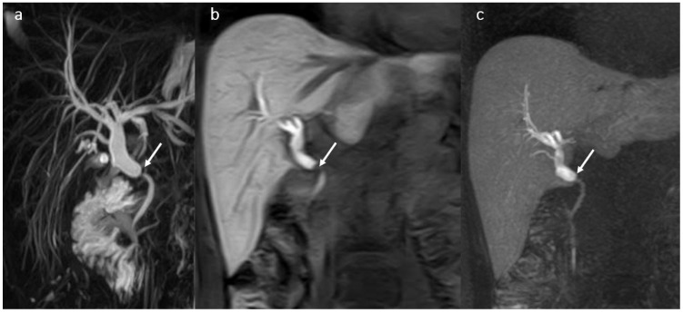
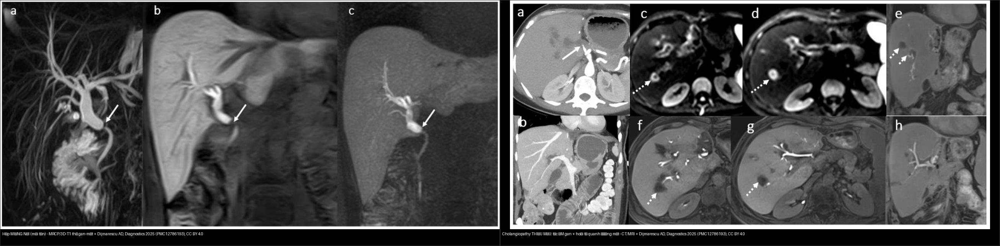
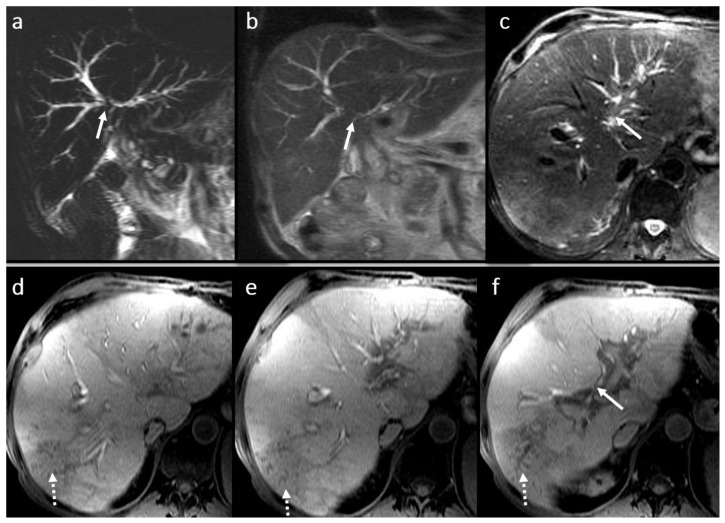
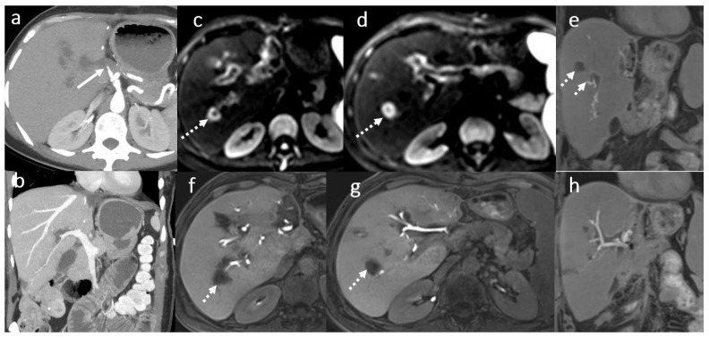
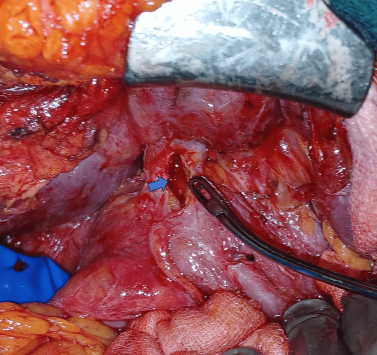
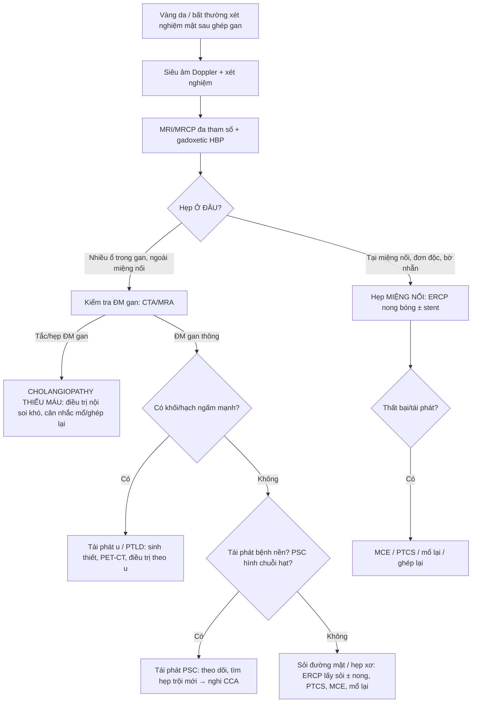
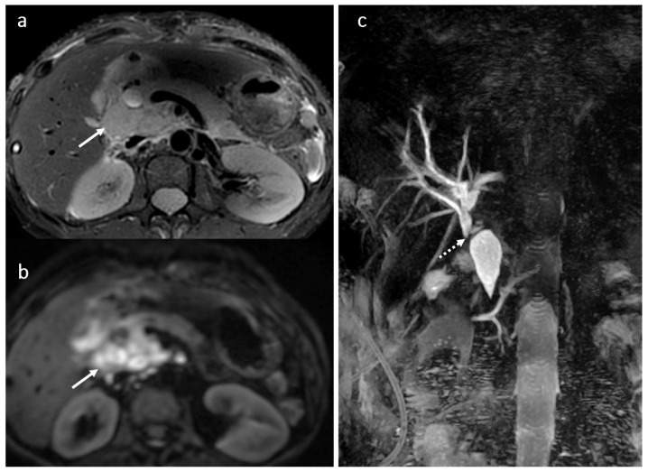

# 133 — Hẹp miệng nối đường mật & cholangiopathy thiếu máu sau ghép gan / Biliary anastomotic stricture & ischemic cholangiopathy

**Tags:** `pattern:hep-duong-mat` `pattern:hep-mieng-noi` `vung:duong-mat` `protocol:MRCP` `protocol:MRI-gadoxetic-HBP` `incidentaloma:hep-sau-ghep`
**Mức chắc chắn (certainty):** tổng hợp y văn (literature synthesis) — nhóm tự biên từ y văn mở (đều CC BY 4.0); các ca minh họa là **ca nguyên văn** của bài gốc (giữ đúng tuổi/giới/thời điểm trong chú thích).

> Đây là bước **tiếp theo của [132 – Hẹp đường mật không xác định](.../132-hop-duong-mat-khong-xac-dinh/lesson.md)**: khi đã có bối cảnh "sau mổ/ghép", câu hỏi đổi từ "lành hay ác" sang **"hẹp kiểu gì (miệng nối hay thiếu máu), khi nào nong/stent, khi nào mổ lại"**.

## 1. Tổng quan bệnh học – cơ chế hình ảnh

- **Biến chứng đường mật là biến chứng ghép gan (liver transplant – LT) hay gặp nhất, tỉ lệ 5–25%**, hay gặp nhất ở ghép gan **người cho sống thùy phải (right-lobe LDLT)**, và thường xảy ra **trong tháng đầu hậu phẫu**. Phân loại theo thời điểm: **sớm < 3 tháng** và **muộn > 3 tháng** [Diagnostics 2025, PMC12786193].
- **Phân đôi theo cơ chế — đây là chốt của cả bài:**
  - **Hẹp MIỆNG NỐI (anastomotic stricture):** hẹp **đơn độc, đúng vị trí nối**, mô sẹo xơ lành → bờ **nhẵn, thuôn dần (smooth tapering)**, giãn đường mật thượng lưu. Đáp ứng tốt với **nong bóng/stent qua ERCP**.
  - **Hẹp KHÔNG do miệng nối / do THIẾU MÁU (non-anastomotic, ischemic cholangiopathy):** tổn thương **nhiều ổ trong gan**, đặc trưng **cholangiopathy thiếu máu** vi mạch → **đa hẹp + giãn xen kẽ**, thường xuất hiện **muộn và lan tỏa**, khó điều trị nội soi, dễ dẫn tới **ghép lại**.
- **TẠI SAO (vật lý + mô bệnh):**
  - Đường mật sau ghép được nuôi **chỉ bằng động mạch gan (không có tuần hoàn bàng hệ)** → **huyết khối/hẹp động mạch gan (hepatic artery thrombosis/stenosis) là nguyên nhân hàng đầu**, chỉ điểm bằng **hoại tử quanh đường mật (peribiliary necrosis)** và **mất tín hiệu đường mật trên thì gan–mật**. Mô bệnh: thiếu máu thành ống → **xơ hóa từng đoạn** → hẹp nhiều ổ trong gan.
  - Trên **MRCP T2**: mật là dịch → **tăng tín hiệu mạnh**; chỗ hẹp **mất tín hiệu do không có dịch** → đọc được bản đồ cây mật (giãn/hẹp/khuyết).
  - **Gadoxetic acid (GD-EOB-DTPA/Primovist):** **~50% liều thải qua đường mật** → **thì gan–mật (hepatobiliary phase – HBP)** sau **20 phút** làm đường mật **sáng lên** → đánh giá **độ thông của miệng nối, rò mật, tính chức năng** mà MRCP T2 đơn thuần không thấy. Trong ứ mật nặng phải **chờ > 60 phút** [PMC12786193].
- **Ngưỡng định lượng nổi lòng (từ nhóm 317 ca sau ghép, MPMRI):** hẹp miệng nối **74%**; rò/nang mật **18%** (chủ yếu **30 ngày đầu**); **viêm đường mật thứ phát 29%**; **áp-xe gan 7%** (do hẹp miệng nối tới **78,6%**); **sỏi đường mật 8,5%**; **tái phát bệnh nền 8%**; **chèn ép đường mật từ ngoài 0,3%**. Ở nhóm theo dõi hẹp miệng nối phát hiện **tái phát ung thư gan (HCC) 24 ca** và **PTLD 1 ca** [PMC12786193].
- **Hẹp miệng nối gặp ở OLT nhiều hơn LDLT (74% vs 66%)**; **viêm đường mật mạn** được định nghĩa khi viêm/tái phát **> 6 tháng** [PMC12786193].
- **Huyết khối/hẹp động mạch gan** được ghi nhận là **nguyên nhân của 90% và 70%** các biến chứng đường mật (tương ứng) [PMC12786193].

*Bệnh nhân nam 37 tuổi, 1 năm sau OLT: (a) MRCP — hẹp tại miệng nối (mũi tên) với giãn đường mật thượng lưu; (b) 3D T1 FS thì gan–mật sau gadoxetic acid (mặt cắt vành) và (c) MIP. Dijmărescu AD et al., Diagnostics 2025 (PMC12786193), CC BY 4.0.*

## 2. Mẫu hình + chẩn đoán phân biệt theo vị trí/thời điểm (Gamut)

- **Theo VỊ TRÍ so với miệng nối:**
  - **Tại/ngay miệng nối (đơn độc, nhẵn, thuôn):** **hẹp miệng nối** — di chứng sẹo xơ (đặc biệt **sau rò mật/thiếu máu cục bộ tại chỗ**).
  - **Nhiều ổ trong gan, đoạn xa miệng nối (không tương xứng):** **cholangiopathy thiếu máu** (do huyết khối/hẹp ĐM gan, thời gian thiếu máu lạnh kéo dài, tổn thương mật bảo tồn).
  - **Lan tỏa hai bên, hình "chuỗi hạt":** **tái phát PSC** (nếu mổ vì PSC) / PSC mới.
- **Theo THỜI ĐIỂM:**
  - **< 30 ngày:** **rò mật/nang mật (biloma)**, hẹp sớm do kỹ thuật/thiếu máu cục bộ.
  - **3–12 tháng:** **hẹp miệng nối** (thường gặp nhất).
  - **> 6–12 tháng, nhiều ổ:** **cholangiopathy thiếu máu muộn**, **sỏi đường mật**, **tái phát bệnh nền**, và **tái phát u/PTLD**.
- **Gợi nhớ 4 câu hỏi:** (1) **Hẹp tại miệng nối hay nhiều ổ trong gan?** (2) **Động mạch gan còn thông không?** (3) **Có khối/hạch/ngấm không** (tái phát, PTLD)? (4) **Bối cảnh** (mổ vì bệnh gì, thời gian sau ghép)?

## 3. Bảng so sánh phân biệt (ma trận đối chiếu)

| Thực thể (entity) | Hình ảnh điển hình | Chốt vào (rule-in) | Chốt loại (rule-out) | Gợi ý xác nhận |
|---|---|---|---|---|
| **Hẹp miệng nối** (lành) | Hẹp **đơn độc tại chỗ nối**, bờ **nhẵn thuôn**, giãn thượng lưu, ± sỏi kèm | **Vị trí đúng miệng nối + bờ nhẵn + 1 ổ + mất tín hiệu HBP tại chỗ** | Hẹp **nhiều ổ trong gan/bất đối xứng** + ngấm bờ → nghĩ ác | MRCP + 3D T1 HBP; ERCP nong bóng/stent |
| **Cholangiopathy THIẾU MÁU** (non-anastomotic) | **Đa hẹp trong gan + giãn xen kẽ**, tổn thương **quanh đường mật**, hay kèm **tắc/hẹp ĐM gan** | **Huyết khối/hẹp ĐM gan + nhiều hẹp trong gan không tại miệng nối** | 1 ổ tại miệng nối + bờ nhẵn → miệng nối lành | CTA/MRA động mạch gan; MRCP; HBP |
| **Tái phát PSC** | **Chuỗi hạt (beaded)** hai bên, **đa hẹp xen giãn** ở cả trong và ngoài gan | **Tiền sử ghép vì PSC + hình chuỗi hạt muộn** | Hẹp đơn độc tại miệng nối → miệng nối | MRI/MRCP theo dõi; phát hiện **hẹp "trội" mới → nghi CCA** |
| **Tái phát u / PTLD** | **Khối/hạch rốn gan**, ngấm mạnh, chèn ép → hẹp thứ phát | **Khối ngấm mạnh + hạch > 1 cm + hẹp bất đối xứng/bờ không đều** | Bờ nhẵn thuôn + không khối → lành | CT/MRI đa thì, PET-CT, sinh thiết |
| **Sỏi đường mật sau ghép** | **Khuyết thuốc tròn trong lòng ống giãn**, T2 tối, T1 có thể sáng | **Khuyết lòng ống T2 tối + giãn đường mật** | Khuyết **di động theo tư thế** → khí; tổn thương ngấm → u | MRCP (Se sỏi OMC ~99%); ERCP |
| **Rò mật/nang mật (biloma)** | **Ổ dịch cạnh miệng nối**, T2 sáng, T1 FS tối, **ngấm thuốc mật thì HBP** nếu còn thông | **Ổ dịch cạnh miệng nối + ngấm mật muộn trên HBP** | Ổ dịch **không ngấm mật** + hoại tử quanh mật → nghĩ hoại tử do thiếu máu | 3D T1 HBP; dẫn lưu nếu nhiễm trùng |

*Trái: hẹp **MIỆNG NỐI** — 1 ổ, bờ nhẵn thuôn, giãn thượng lưu (PMC12786193 Fig 3). Phải: cholangiopathy **THIẾU MÁU** — tắc động mạch gan + hoại tử/ổ dịch quanh các ống mật nhỏ (PMC12786193 Fig 5). Cả hai CC BY 4.0, ảnh ghép letterbox.*

### Ảnh minh họa thêm — các khuôn mặt của "hẹp sau ghép"

*Nam 53 tuổi, 4 năm sau ghép: **viêm–xơ quanh miệng nối** — SSFSE (a,b), T2 FS (c) và 3D T1 FS thì gan–mật (d,e): giãn nhẹ + nhiều hẹp ngắn trong gan do xơ quanh miệng nối. Dijmărescu AD et al., Diagnostics 2025 (PMC12786193), CC BY 4.0.*

*Nữ 49 tuổi, 3 tuần sau ghép: **hoại tử quanh đường mật do tắc động mạch gan** — (a,b) CTA tắc ĐM gan (mũi tên); (c–h) ổ dịch quanh ống mật phân thùy trên DWI và 3D T1 FS thì gan–mật (mũi tên chấm). Đây là cơ chế của **cholangiopathy thiếu máu**. Dijmărescu AD et al., Diagnostics 2025 (PMC12786193), CC BY 4.0.*

## 4. Protocol + xử trí + flowchart

- **MRI/MRCP đa tham số (multiparametric MRI) là "second-line" chuẩn** sau siêu âm: **MRCP 3D + T2 FS + DWI/ADC + 3D T1 FS động (không–ĐM–cửa–chuyển tiếp) + 3D T1 FS thì gan–mật** sau **gadoxetic acid 0,1 mL/kg**, HBP **20 phút** (chờ **> 60 phút** khi vàng da ứ mật nặng). Gadoxetic acid được ưu tiên hơn Gd-BOPTA vì **thải mật ~50%** và HBP **ngắn hơn** [PMC12786193].
- **Giá trị chẩn đoán:** ghép **MRCP + 3D T1 thì gan–mật** nâng độ chính xác đánh giá giải phẫu đường mật lên **88% so với 69%** nếu chỉ dùng MRCP; **giải đoán kết hợp MRCP + 3D T1 FS đạt độ nhạy 96–97%** (thấp hơn khi đường mật chỉ giãn nhẹ hoặc có viêm đường mật tái phát). **MRCP phát hiện sỏi OMC độ nhạy ~99%** (ERCP 88,5%) [PMC12786193].
- **Điều trị:** sau khi MRI xác định, **ERCP là điều trị đầu tay** cho hẹp đường mật (nong bóng ± stent nhựa/kim loại), kết quả ngắn–dài hạn tốt [PMC12786193]. Các lựa chọn khi thất bại/tái phát:
  - **Tạo hình miệng nối / mổ lại** (revision hepaticojejunostomy) — ca loạt 7 bệnh nhân, trong đó **3 ca hẹp cao Strasberg E4**; 1 ca cần **siêu âm trong mổ đặt catheter mật qua gan** để định vị ống mật [PMC13110885].
  - **Nối áp lực từ (magnetic compression anastomosis)** — lựa chọn nội soi/mổ ít xâm lấn cho **hẹp miệng nối kháng trị sau hepaticojejunostomy** [PMC13650495].
  - **PTCS hỗ trợ (qua gan)** — nong + tái thông + lấy sỏi cho **hẹp lành tính sau mổ gan–mật** [PMC12968610].
  - **Ghép gan lại** — khi tiến triển xơ hóa/tăng áp cửa (91 ca viêm đường mật tái phát và 2 ca PSC tiến triển xơ cần chỉ định ghép lại) [PMC12786193].

*Mổ lại: miệng nối Roux-en-Y **hẹp được mở dọc** (mũi tên xanh) rồi khâu ngang kiểu **stricturoplasty**. Krishna RVV et al., Cureus 2026 (PMC13110885), CC BY 4.0.*

- **Cholangiopathy thiếu máu sau TACE** (cùng cơ chế thiếu máu vi mạch đường mật, hay bỏ sót): **106 bệnh nhân → 14 ca (13,2%)**; tổn thương thấy trên hình **trung bình 3,1 tháng** sau TACE; **42,9% không triệu chứng**; đau bụng (n = 6), sốt (n = 4); **5 ca nhập viện**, 2 ca nang mật nhiễm trùng. Định nghĩa hình ảnh: **giãn đường mật không do tắc cơ học, nang mật, hẹp đường mật, viêm túi mật thiếu máu** [Curr Oncol 2026, PMC13204766].

*Bệnh nhân xơ gan có HCC: (A) CT nền — khối HCC 48 mm sát ống gan trái; (B) MinIP — tổn thương thiếu máu đường mật; (C...) tiến triển giãn/hẹp đường mật sau TACE. **Cùng cơ chế thiếu máu vi mạch** như cholangiopathy sau ghép. Štupar S et al., Curr Oncol 2026 (PMC13204766), CC BY 4.0.*

## 5. Cạm bẫy

- **Hai câu "bẫy" của hẹp lành:**
  - **Hẹp miệng nối lành tính có bờ NHẴN, thuôn dần, không dày thành không đều** — theo hướng dẫn **BSG**, khi đánh giá hẹp/tắc mật phải **chủ động loại trừ nguyên nhân lành (cholangiopathy thiếu máu, bệnh mật do tăng áp cửa)** để tránh **chẩn đoán nhầm thành cholangiocarcinoma** [PMC13652791].
  - Ngược lại, **không thấy khối không loại trừ ác**: trong 317 ca theo dõi hẹp miệng nối phát hiện **24 ca tái phát HCC** và **1 ca PTLD** [PMC12786193] → luôn tìm **khối/hạch ngấm mạnh, hẹp bất đối xứng**.
- **Cholangiopathy thiếu máu có thể KHÔNG TRIỆU CHỨNG và phát hiện muộn (~3 tháng)**: 42,9% ca sau TACE không triệu chứng [PMC13204766] → đừng chờ vàng da mới nghĩ tới.
- **Trong ứ mật nặng, thì gan–mật muộn hơn**: nếu chụp HBP 20 phút có thể **không thấy đường mật sáng** (thải mật chậm) → phải chờ **> 60 phút** trước khi kết luận "tắc hoàn toàn" [PMC12786193].
- **Không phân biệt được "hẹp do miệng nối" và "hẹp do tiến triển xơ" bằng một lần chụp** nếu không có phim cũ → luôn **so sánh phim trước**: hẹp **mới/tiến triển** khác hẹp ổn định.
- **Coi chừng ghép lẫn: rò mật (ngấm mật trên HBP)** có thể trông như ổ dịch quanh mật đơn thuần; **hoại tử quanh mật do tắc ĐM gan** mới là dấu của cholangiopathy thiếu máu [PMC12786193].
- **Ở bệnh nhân ghép, "hẹp rốn gan + hạch" có nhiều khả năng là PTLD/u** — nhưng PTLD cũng có thể là **hạch chèn ép lành tính**; cần mô học.

## 6. Tự lượng giá — Blind Quiz

**Ca 1 — Nam 37 tuổi, 1 năm sau ghép gan, vàng da ứ mật. MRCP + 3D T1 thì gan–mật:**

- Hỏi: hẹp ở đâu? Vì sao ống mật trên chỗ hẹp giãn? Điều trị đầu tay?

<b>Bấm để hiện đáp án (findings + chẩn đoán)</b>

- **Dấu hiệu:** MRCP (a) — hẹp **đúng miệng nối** (mũi tên) với **giãn đường mật thượng lưu**; (b) 3D T1 FS thì gan–mật và (c) MIP xác nhận chỗ hẹp.
- **Chẩn đoán:** **hẹp miệng nối đường mật** (bờ nhẵn, đơn độc) — điều trị đầu tay là **ERCP nong bóng ± stent**. Nguồn: Dijmărescu AD et al., Diagnostics 2025 (PMC12786193), CC BY 4.0.

**Ca 2 — Nữ 49 tuổi, 3 tuần sau ghép gan, sốt + tăng men gan. CTA + MRI:**

- Hỏi: bất thường mạch nào? Tại sao có các ổ dịch quanh ống mật? Chẩn đoán?

<b>Bấm để hiện đáp án (findings + chẩn đoán)</b>

- **Dấu hiệu:** (a,b) CTA — **huyết khối động mạch gan** (mũi tên); (c–h) ổ dịch/hoại tử **quanh các ống mật phân thùy** trên DWI và 3D T1 FS thì gan–mật.
- **Chẩn đoán:** **hoại tử quanh đường mật do tắc động mạch gan → cholangiopathy thiếu máu**. Đường mật chỉ được nuôi bằng ĐM gan nên tắc mạch gây thiếu máu thành ống. Nguồn: Dijmărescu AD et al., Diagnostics 2025 (PMC12786193), CC BY 4.0.

**Ca 3 — Nữ 49 tuổi, 2 năm sau ghép gan, vàng da + gầy sút. CT/MRI rốn gan:**

- Hỏi: đây là hẹp lành hay không? Dấu hiệu nào buộc phải theo hướng bệnh ác?

<b>Bấm để hiện đáp án (findings + chẩn đoán)</b>

- **Dấu hiệu:** (a,b) **hạch u rốn gan** lan giữa tĩnh mạch cửa và TM chủ dưới (mũi tên); (c) MRCP — **chèn ép → giãn đường mật thứ phát** (mũi tên chấm).
- **Chẩn đoán:** **PTLD (rối loạn tăng sinh lympho sau ghép)** — nguyên nhân "hẹp" KHÔNG do miệng nối; phải **sinh thiết** và điều trị theo u. Nguồn: Dijmărescu AD et al., Diagnostics 2025 (PMC12786193), CC BY 4.0.

**Ca 4 — Nam 53 tuổi, 4 năm sau ghép, đợt viêm đường mật tái diễn. MRI:**

- Hỏi: chỗ hẹp nằm ở đâu? Cơ chế gây nhiều hẹp ngắn trong gan? Một lần chụp đã đủ chốt chưa?

<b>Bấm để hiện đáp án (findings + chẩn đoán)</b>

- **Dấu hiệu:** giãn nhẹ + **nhiều hẹp ngắn trong gan** do **xơ quanh miệng nối** (viêm đường mật mạn > 6 tháng), thấy trên SSFSE/T2 FS và 3D T1 FS thì gan–mật.
- **Chẩn đoán:** **viêm đường mật mạn có xơ quanh miệng nối** — cần **so phim cũ** và theo dõi; viêm kéo dài > 6 tháng làm tăng xơ và nguy cơ ghép lại. Nguồn: Dijmărescu AD et al., Diagnostics 2025 (PMC12786193), CC BY 4.0.

## Bài liên quan chéo
- [100 – Tổng quan hệ Bụng](../100-tong-quan-he-bung/lesson.md)
- [132 – Hẹp đường mật không xác định & cholangioscopy](../132-hop-duong-mat-khong-xac-dinh/lesson.md) (bước trước: chưa rõ lành/ác)
- [131 – Tắc mật: sỏi OMC, Klatskin & xơ hóa](../131-tac-mat/lesson.md) (nguyên nhân tắc chung)
- [130 – Túi mật](../130-tui-mat/lesson.md) (tổn thương đường mật sau cắt túi mật — Strasberg)
- [121 – LI-RADS & HCC](../121-khoi-gan-LIRADS/lesson.md) (tái phát HCC thành khối rốn gan)
- [910 – Dẫn lưu đường mật qua da (PTBD)](../910-abscess-biliary-nephrostomy/lesson.md) (xử trí khi ERCP thất bại)

## Ảnh
- Xem `images/CREDITS.md`. Ảnh bài này đều **CC BY 4.0** → được phép ghép letterbox (composite) kèm attribution.

> Không dùng để chẩn đoán độc lập khi chưa có người hướng dẫn.
