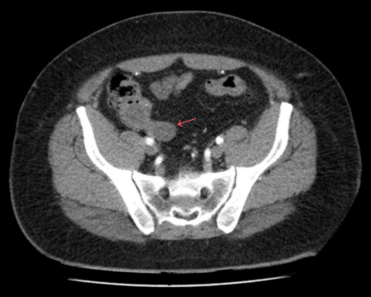
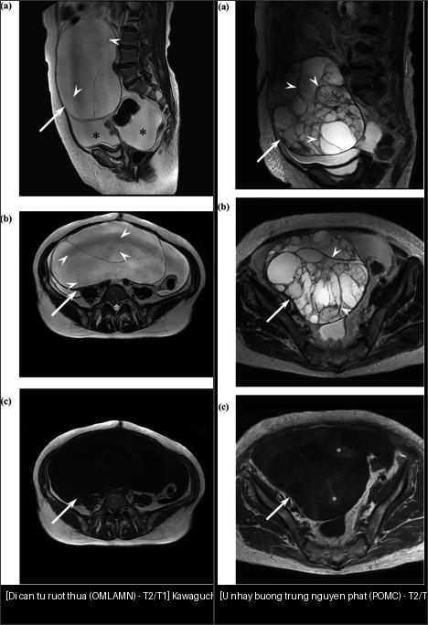
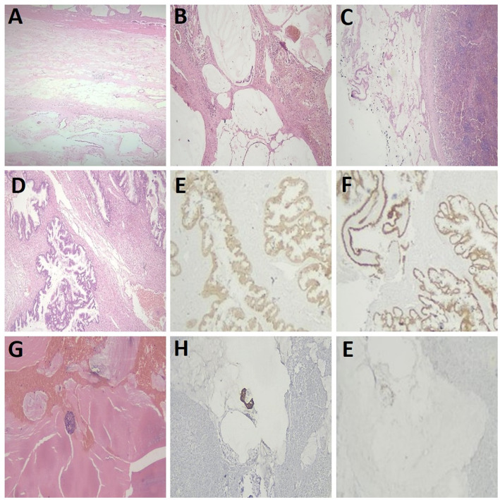
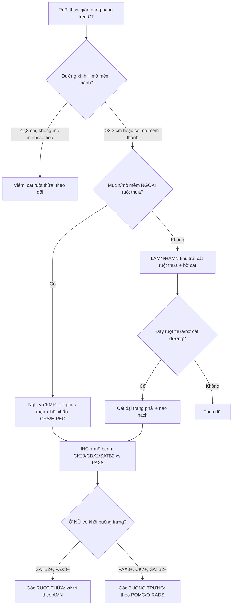
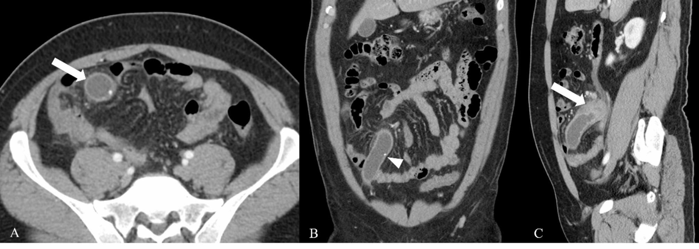
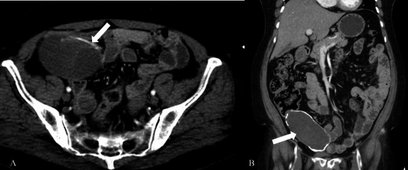
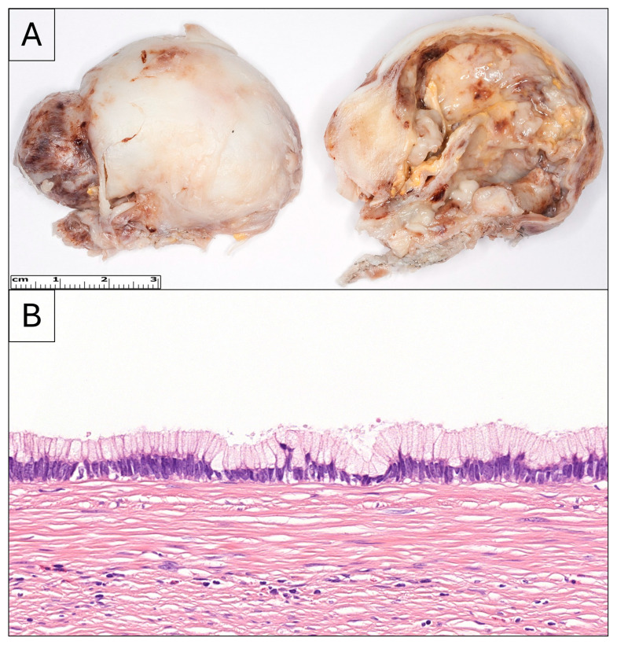
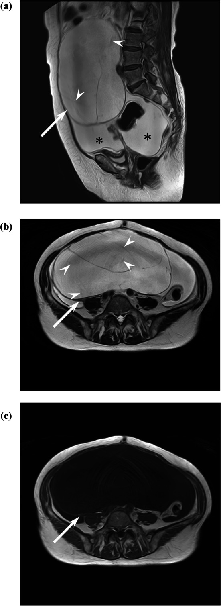
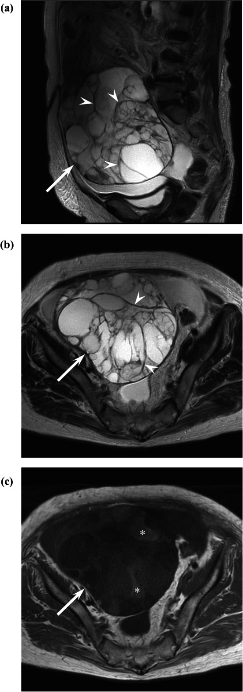

# 134 — U nhầy ruột thừa CHƯA vỡ (LAMN/HAMN) & phân biệt gốc u nhầy ruột thừa vs buồng trứng bằng hóa mô miễn dịch (IHC) / Appendiceal mucinous neoplasm & ovarian-origin workup

**Tags:** `pattern:gian-ruot-thua` `vung:ruot-thua` `pattern:u-nhay` `score:WHO-AMN` `protocol:CT-bung-co-can-quang` `protocol:MRI-chau` `incidentaloma:u-nhay-ruot-thua`
**Mức chắc chắn (certainty):** tổng hợp y văn (literature synthesis) — nhóm tự biên từ y văn mở (Cureus/Diagnostics/BMC Gastroenterol/Jpn J Radiol/Discover Oncol/Pathol Oncol Res), có ca nguyên văn minh họa trong quiz.

> **Câu chốt của bài:** một **ruột thừa giãn dạng nang (mucocele)** chưa vỡ, *tình cờ* trên CT — việc cần làm KHÔNG phải "mổ ruột thừa" đơn thuần, mà là **(1) phân biệt viêm vs tân sinh nhầy, (2) đo đường kính + tìm mô mềm/vôi hóa thành, (3) tìm mucin ngoài ruột thừa (đã vỡ → nguy cơ pseudomyxoma peritonei — PMP)**, và ở nữ giới có khối phần phụ kèm theo: **(4) xác định gốc bằng hóa mô miễn dịch (immunohistochemistry — IHC)** vì u nhầy buồng trứng "di căn từ ruột thừa" và u nhầy buồng trứng nguyên phát *trông rất giống nhau* nhưng điều trị khác hẳn.

## 1. Tổng quan bệnh học – cơ chế hình ảnh

- **Bệnh học (pathology):** u nhầy ruột thừa (appendiceal mucinous neoplasm — AMN) là tổn thương **biểu mô nhầy sản xuất mucin** làm lòng ruột thừa căng thành nang (mucocele). Phân loại **WHO 2019**: **serrated polyp / hyperplastic polyp** (lành) → **LAMN** (u nhầy ruột thừa độ thấp — low-grade appendiceal mucinous neoplasm) → **HAMN** (độ cao) → **mucinous adenocarcinoma** (đã xâm lấn mô đệm). LAMN **không** xâm lấn mô đệm nhưng **có thể đè/vỡ thành ruột thừa** → rò mucin ra phúc mạc = **pseudomyxoma peritonei (PMP, u giả nhầy phúc mạc)**. Vì vậy LAMN là "u lành bề ngoài nhưng hành vi ác khi vỡ".
- **TẠI SAO thấy dạng nang trên hình ảnh (cơ chế vật lý):**
  - **Mucin giàu nước + glycosaminoglycan** → **CT: đậm độ thấp ~0–20 HU** (đôi khi thấp hơn dịch đơn thuần), dịch đồng nhất, **không ngấm thuốc**.
  - **MRI T2: rất sáng** (nước tự do → thời gian T2 dài). **T1:** tùy độ đặc — mucin **đặc/quánh thì T1 sáng**; nhiều nang nhỏ T1 sáng rải rác tạo **"ô kính màu" (stained-glass appearance)**. Khi nghi u tân sinh mô đặc, **DWI hạn chế + ADC thấp**.
  - **Vôi hóa thành ruột thừa** = lắng đọng canxi trên thành xơ-mucin mạn (hay gặp ở LAMN hơn là viêm cấp).
- **Dịch tễ + ngưỡng định lượng:** AMN chiếm **0,4–1,7% mẫu cắt ruột thừa** và **< 1% ca ung thư**; **PMP ~22/1.000.000 người/năm** (Kawecka 2025). Tuổi trung bình **~55,8 (IQR 47,8–81)**, đường kính khối trung bình **~7,5 cm**, **80,9% nữ** trong một chuỗi LAMN/PMP (Hamdy 2025). **~30% bệnh nhân AMN được chẩn đoán trước mổ là "viêm ruột thừa cấp"**; **~50% nữ có AMN phát triển di căn buồng trứng** (Kawecka 2025). Ruột thừa bình thường **≤ 6 mm**.

## 2. Mẫu hình + chẩn đoán phân biệt theo vị trí (gamut)

- **Ruột thừa giãn dạng nang (cystic/dilated appendix) — gamut:**
  1. **Viêm** (viêm ruột thừa mủ có giãn lòng, mucocele viêm);
  2. **Tăng sản niêm mạc / nang đơn thuần** (benign mucocele);
  3. **LAMN** (là nhóm lành-tiềm ẩn hay gặp nhất);
  4. **HAMN** và **mucinous adenocarcinoma** (xâm lấn, nguy cơ phúc mạc);
  5. **U carcinoid / NET ruột thừa** (khối **đặc**, thường < 2 cm, hay ở đỉnh ruột thừa);
  6. (Hiếm) u mô đệm, endometriosis, di căn.
- **Khối phần phụ nữ dạng nang nhiều ngăn — gamut (bài 530/535/537/539):** **di căn buồng trứng từ AMN (ovarian metastasis from appendiceal mucinous neoplasm — OMLAMN)** · **u nhầy buồng trứng nguyên phát (primary ovarian mucinous carcinoma — POMC)** · u giáp biên nhầy (BOT nhầy) · **cystadenoma/cystadenofibroma** · nang lạc nội mạc · u quái.
- **Quy tắc "cờ đỏ" gợi tân sinh nhầy ác/xâm lấn:** **mô mềm/nốt đặc ở thành hoặc đáy ruột thừa** + **dịch mucin/mô mềm ngoài ruột thừa (đã vỡ)** + **"khía" (scalloping) mặt gan–lách / dịch phúc mạc khu trú** → nghi **HAMN/adenocarcinoma ± PMP**, KHÔNG được chọc/dẫn lưu ngang qua.

*Cấu trúc dạng ống chứa dịch, đậm độ thấp ở hố chậu phải = **ruột thừa giãn (mũi tên đỏ)**; không thấy vỡ, áp-xe, dịch ổ bụng hay xâm lấn. Nguồn: Silva García M et al., Cureus 2026 (PMC13300836), CC BY 4.0.*

## 3. Bảng so sánh phân biệt (ma trận đối chiếu)

| Thực thể (entity) | Hình ảnh điển hình | Chốt vào (rule-in) | Chốt loại (rule-out) | Gợi ý xác nhận |
|---|---|---|---|---|
| **Mucocele VIÊM** (viêm ruột thừa mủ giãn lòng) | Ruột thừa giãn **≤ 2,3 cm**, thành ngấm nhẹ, thâm nhiễm mỡ quanh, **không vôi hóa nội thành**, không vách | **Đường kính ≤ 2,3 cm + không mô mềm/vôi hóa/vách** (Se 71%, Sp 90%, PPV 94%) | Mô mềm thành + vôi hóa + vách → tân sinh nhầy | Lâm sàng viêm cấp, hồi phục sau cắt ruột thừa |
| **LAMN** (u nhầy độ thấp, chưa xâm lấn) | Ruột thừa giãn lớn, **vôi hóa thành 38,7%** (92% trong nhóm lành), **vách/vách trong**, mucin đồng nhất | **Vôi hóa thành + vách + không mô mềm ở đáy** | **Mô mềm ở ĐÁY ruột thừa** → nghĩ HAMN/adenocarcinoma | Mô bệnh học (không xâm lấn mô đệm), bờ cắt |
| **HAMN / mucinous adenocarcinoma** | Khối lớn, **mô mềm/nốt đặc ở thành hoặc đáy**, có thể **mucin ngoài ruột thừa/dịch phúc mạc** | **Mô mềm thành + đường kính > 2,3 cm** (p = 0,01) → cân nhắc **cắt đại tràng phải (right hemicolectomy)** | Vỏ nang thuần + không mô mềm + không mucin ngoài → LAMN/viêm | Mô bệnh + hạch, CRS/HIPEC khi có phúc mạc |
| **OMLAMN** (di căn buồng trứng từ AMN) | Khối **< POMC (trung vị 129 vs 182 mm)**, **dịch thuần nhiều ngăn**, **vách MỜ (faint septa) 94% (dày > 50% vách: 75%)**, **dịch ổ bụng 93%**, không "ô kính màu" | **Vách mờ + dịch ổ bụng + không "ô kính màu" + CEA cao (22 vs 6,5 ng/mL)** | **"Ô kính màu" + nang T1 sáng (81%)** → POMC | **IHC CDX2+/CK20+/SATB2+ (PAX8−, CK7−)** |
| **POMC** (u nhầy buồng trứng nguyên phát) | Khối **lớn hơn (182 mm)**, **nang T1 sáng 81%**, **"ô kính màu" 72%**, ít dịch ổ bụng (11%) | **"Ô kính màu" + nang T1 sáng + không vách mờ** | Vách mờ + dịch ổ bụng + CEA cao → OMLAMN | **IHC CK7+/PAX8+ (SATB2−, CK20 ít)** |

*Trái: OMLAMN — khối nang thuần nhiều ngăn, **vách mờ** (đầu mũi tên), dịch ổ bụng (dấu *), **không** "ô kính màu". Phải: POMC — nang nhiều ngăn với **"ô kính màu" trên T1** (dấu *). Nguồn: Kawaguchi M et al., Jpn J Radiol 2026 (PMC13400669), CC BY 4.0. Ảnh ghép letterbox.*

### Bảng hóa mô miễn dịch (IHC) — chốt GỐC u (bắt buộc ở nữ có khối phần phụ kèm AMN)
| Dấu ấn (marker) | LAMN/HAMN (gốc ruột thừa) | Mucinous adenocarcinoma ruột thừa | POMC (gốc buồng trứng) |
|---|---|---|---|
| **CK20** | 90–100% dương | 96–100% dương | ít gặp |
| **CDX2** | 92–100% dương | 93% dương | có thể dương (chồng lấn!) |
| **SATB2** (đặc hiệu nhất cho u ruột thừa) | **96–100% dương** | 83–100% dương | **âm** |
| **CK7** | 14–36% dương (thường âm) | 28–50% dương | **dương** |
| **PAX8** | **âm** | âm | **dương** (gợi ý gốc buồng trứng/Müller) |

> Bộ dấu ấn thực hành hay dùng: **CK7 + CK20 + CDX2 + PAX8 + SATB2**. Mấu chốt: **SATB2 dương + PAX8 âm + CK7 âm = gốc ruột thừa**; **PAX8 dương + CK7 dương + SATB2 âm = gốc buồng trứng**. **CDX2 một mình không đủ** (có thể dương ở POMC). Đột biến **KRAS/GNAS/TP53** hay gặp ở AMN/PMP (không đặc hiệu trên hình ảnh).

*LAMN di căn: (D) mô u trong buồng trứng, **IHC dương CK20 (E) và CDX2 (F)** — xác nhận gốc ruột thừa. Nguồn: Hamdy O et al., Discover Oncology 2026 (PMC13066059), CC BY 4.0.*

## 4. Protocol chụp + phân độ + flowchart

- **CT bụng–chậu có cản quang** (chuẩn đầu tiên): đo **đường kính lớn nhất của ruột thừa (mm)**, tìm **vôi hóa nội thành**, **vách**, **nốt/mô mềm thành hoặc đáy**, **dịch-mucin ngoài ruột thừa**, đánh giá **phúc mạc** ("khía" mặt gan–lách, đóng bánh mạc nối = PMP). **KHÔNG chọc/dẫn lưu qua mucocele** (nguy cơ gieo rắc mucin).
- **MRI chậu** (khi khối phần phụ hoặc cần phân biệt gốc): **T2W + T1W (đánh giá "ô kính màu") + T1W fat-sat + DWI/ADC**.
- **Ngưỡng đường kính (Khandwala 2025, n = 31):** > **1,4 cm** Se 90%/Sp 50%; > **3,0 cm** Sp 100%/Se 43%; **viêm vs tân sinh: cắt ≤ 2,3 cm** (Se 71%, Sp 90%, PPV 94%). **Mô mềm thành → ác (p = 0,01)**; **vôi hóa thành** gặp **38,7%**, **92% trong nhóm lành**; **cắt đại tràng phải** khi **mô mềm + đường kính > 2,3 cm**.
- **Phân độ WHO 2019 (AMN) + xử trí:** LAMN/HAMN **khu trú, chưa vỡ** → **cắt ruột thừa** (± bờ cắt âm); **vỡ/ có mucin ngoài ruột thừa / có phúc mạc** → đánh giá **CRS (cytoreductive surgery) + HIPEC**; **xâm lấn đáy/bờ cắt dương** → **cắt đại tràng phải + nạo hạch**.

## 5. Biến thể bình thường và cạm bẫy

- **Ruột thừa chứa đầy dịch** (sau viêm khu trú, sau cắt túi mật) có thể bị đọc nhầm mucocele — **thiếu vôi hóa/vách/mô mềm** và bờ đều hơn.
- **Dấu "vỏ hành" (onion-skin sign)** trên siêu âm (các lớp hồi âm đồng tâm do mucin/vách) gợi mucocele nhưng **không phân biệt được viêm vs tân sinh**.
- **CẤM chọc hút/dẫn lưu mucocele mù** — có thể biến LAMN khu trú thành PMP toàn ổ bụng.
- **Vôi hóa thành KHÔNG đồng nghĩa ác** — thực tế 92% vôi hóa nằm trong nhóm **lành/LAMN**; tín hiệu ác mạnh hơn là **mô mềm thành/đáy**.
- **U carcinoid ruột thừa là khối ĐẶC**, không phải dạng nang — nhưng có thể kèm AMN đồng thời (ca hiếm, xem quiz ca 6).
- **Bẫy hình thái buồng trứng:** OMLAMN và POMC chồng lấn; **CDX2 dương ở cả hai** → phải phối hợp **SATB2/PAX8/CK7**, và **CEA/CA125** hỗ trợ (CEA cao hơn trong OMLAMN).
- **"Khía" mặt gan–lách (scalloping)** = dấu hiệu **PMP** nhưng có thể nhầm với báng tự do (mặt tạng nhẵn) hoặc carcinomatosis (nốt đặc xâm lấn) — xem bài 539.

## 6. Tự lượng giá — Blind Quiz (ảnh trơn ngoài, đáp án giấu trong thẻ bấm-mở)

**Ca 1 — Nam 57 tuổi, đau hạ vị, CT có cản quang:**

- Câu hỏi: Ruột thừa có gì bất thường? Dấu hiệu nào gợi **tân sinh nhầy** thay vì viêm? Nguy cơ cần loại trừ?

<b>Bấm để hiện đáp án (findings + chẩn đoán)</b>

- **Dấu hiệu:** ruột thừa giãn chứa dịch, **vôi hóa nội thành nhỏ** (đầu mũi tên, B) và **dày mô mềm bờ mờ ở ĐÁY ruột thừa** (mũi tên, C) + thâm nhiễm mỡ quanh nhẹ (A).
- **Chẩn đoán:** **mucocele ruột thừa** — mô bệnh là **mucinous adenocarcinoma**. Đáy ruột thừa có mô mềm là **cờ đỏ** gợi tân sinh ác/xâm lấn (p = 0,01); cần loại trừ **mucin ngoài ruột thừa → PMP** (xem mục 4).
- **Vì sao:** mucin đậm độ thấp, không ngấm; vôi hóa thành + mô mềm đáy phân tầng nguy cơ.
- Nguồn: **Khandwala K et al.**, BMC Gastroenterol 2025 (PMC11776275), CC BY-NC-ND 4.0 (nguyên bản, không ghép).

**Ca 2 — Nữ 68 tuổi, đau bụng mơ hồ, CT:**

- Câu hỏi: Mô tả hai dấu hiệu trên thành nang. Nghĩ nhóm nào (viêm hay tân sinh)? Xử trí?

<b>Bấm để hiện đáp án</b>

- **Dấu hiệu:** **vôi hóa thành** và **vách/vách ngăn trong** một khối nang lớn >> 2,3 cm ở hố chậu phải (A, B).
- **Chẩn đoán:** **LAMN** (u nhầy ruột thừa độ thấp) — mô bệnh xác nhận.
- **Xử trí:** LAMN khu trú chưa vỡ → **cắt ruột thừa** với bờ cắt âm; nếu đáy/bờ cắt dương → **cắt đại tràng phải**. **Vôi hóa + vách** hướng nhóm lành/LAMN (92% vôi hóa nằm trong nhóm lành) — nhưng vẫn phải kiểm tra mucin ngoài ruột thừa.
- Nguồn: **Khandwala K et al.**, BMC Gastroenterol 2025 (PMC11776275), CC BY-NC-ND 4.0 (nguyên bản).

**Ca 3 — Nữ trung niên, siêu âm vùng hố chậu phải vì đau bụng + sốt:**

- Câu hỏi: Dấu hiệu trên siêu âm? Kích thước? Nghi gì và cần làm gì trước mổ?

<b>Bấm để hiện đáp án</b>

- **Dấu hiệu:** siêu âm thấy **ruột thừa giãn dạng nang** với **vôi hóa trong thành (intramural calcifications)**, khối lớn nhất **5 cm**; lâm sàng giống viêm ruột thừa cấp.
- **Chẩn đoán:** **mucocele ruột thừa** → **LAMN**. Mô tả đại thể khớp (túi mucin).
- **Xử trí:** cắt ruột thừa nguyên khối, tránh làm vỡ; không chọc/dẫn lưu.
- Nguồn: **Csonka B et al.**, Diagnostics 2026 (PMC12840484), CC BY 4.0.

**Ca 4 — Nữ 71 tuổi, MRI chậu vì khối phần phụ (bối cảnh có LAMN ruột thừa):**

- Câu hỏi: Khối nang này là nguyên phát buồng trứng hay di căn ruột thừa? Ba dấu hiệu MRI nào chốt?

<b>Bấm để hiện đáp án</b>

- **Dấu hiệu:** khối **nang thuần nhiều ngăn, không thành phần đặc**, **vách rất mờ (< 2 mm, > 50% vách)**, **dịch ổ bụng nhiều** (dấu *), T1 **KHÔNG** "ô kính màu".
- **Chẩn đoán:** **di căn buồng trứng từ AMN (OMLAMN)**. Ba chốt: **vách mờ (94% vs 31%)** · **vách mờ > 50% (75% vs 3%)** · **dịch ổ bụng (93% vs 11%)**; ngược lại POMC hay có **"ô kính màu" (72%) + nang T1 sáng (81%)**. Cỡ OMLAMN **nhỏ hơn** POMC (trung vị **129 vs 182 mm**). Xác nhận: **IHC SATB2+/CDX2+/CK20+, PAX8−, CK7−**.
- Nguồn: **Kawaguchi M et al.**, Jpn J Radiol 2026 (PMC13400669), CC BY 4.0.

**Ca 5 — Nữ 82 tuổi, MRI chậu vì khối nang lớn phần phụ:**

- Câu hỏi: Dấu hiệu đặc trưng trên T1? Chẩn đoán? IHC dự kiến?

<b>Bấm để hiện đáp án</b>

- **Dấu hiệu:** khối **nang nhiều ngăn lớn** với **"ô kính màu" (stained-glass appearance)** trên T1 (dấu *), **không** vách mờ nổi bật.
- **Chẩn đoán:** **POMC — u nhầy buồng trứng nguyên phát**. IHC dự kiến: **CK7+/PAX8+ (SATB2−)**. "Ô kính màu" 72% ở POMC vs 25% ở OMLAMN.
- **Cạm bẫy phản biện:** **CDX2 có thể dương ở POMC** → không dùng CDX2 đơn độc; phải có **PAX8/CK7/SATB2**.
- Nguồn: **Kawaguchi M et al.**, Jpn J Radiol 2026 (PMC13400669), CC BY 4.0.

**Ca 6 — Nam, ruột thừa có cả tổn thương dạng nang VÀ mô đặc (bối cảnh hiếm):**

- Câu hỏi: Một ruột thừa có thể chứa đồng thời hai loại u không? Chốt chẩn đoán bằng gì?

<b>Bấm để hiện đáp án</b>

- **Trả lời:** Có — đã ghi nhận **LAMN đồng thời với u thần kinh nội tiết biệt hóa cao (well-differentiated neuroendocrine tumor — WDNET)** của ruột thừa, thậm chí biểu hiện **PMP**. Phần nang = LAMN (biểu mô nhầy nhú), phần **đặc** = WDNET/chromogranin-synaptophysin dương.
- **Chốt:** mô bệnh học + IHC (mucin/CK20-CDX2 cho LAMN; **synaptophysin/chromogranin** cho NET) — hình ảnh một mình không tách được hai thành phần.
- Nguồn (chỉ trích ca, không lấy ảnh): **Stevens T et al.**, Cureus 2026 (PMC13570431), CC BY 4.0.

## Bài liên quan chéo
- [100 – Tổng quan hệ Bụng](../100-tong-quan-he-bung/lesson.md)
- [539 – Pseudomyxoma peritonei & u nhầy ruột thừa (đã lan phúc mạc)](../539-pseudomyxoma-peritonei/lesson.md)
- [535 – Ung thư buồng trứng, phúc mạc & u Krukenberg](../535-ung-thu-buong-trung-phuc-mac-krukenberg/lesson.md)
- [537 – U buồng trứng giáp biên (borderline)](../537-u-buong-trung-giap-bien/lesson.md)
- [530 – Phần phụ O-RADS (US/MRI)](../530-buong-trung-ORADS-sieu-am-MRI/lesson.md)
- [162 – Tắc ruột & mạc treo](../162-tac-ruot/lesson.md) (bài toán ruột thừa giãn/viêm)
- [141 – Phúc mạc](../141-phuc-mac/lesson.md)

## Ảnh
- `134_mucocele-ngam-thuoc_CT_PMC11776275.jpg`, `134_mucocele-lanh-voi-hoa_CT_PMC11776275.jpg` — Khandwala K et al., BMC Gastroenterol 2025, CC BY-NC-ND 4.0 (nguyên bản).
- `134_di-can-tu-ruot-thua_MRI_PMC13400669.jpg`, `134_u-nhay-buong-trung-nguyen-phat_MRI_PMC13400669.jpg` — Kawaguchi M et al., Jpn J Radiol 2026, CC BY 4.0.
- `134_IHC-CK20-CDX2_PMC13066059.jpg` — Hamdy O et al., Discover Oncology 2026, CC BY 4.0.
- `134_sieu-am-voi-hoa_PMC12840484.jpg` — Csonka B et al., Diagnostics 2026, CC BY 4.0.
- `134_mucocele-CT-truc_PMC13300836.jpg` — Silva García M et al., Cureus 2026, CC BY 4.0.
- `composite_di-can-ruot-thua-vs-u-nhay-buong-trung.jpg` — ảnh ghép letterbox (CC BY 4.0, tác phẩm phái sinh từ PMC13400669).
- Nguồn + giấy phép từng ảnh: `images/CREDITS.md`.

> **Disclaimer y tế:** Không dùng để chẩn đoán độc lập khi chưa có người hướng dẫn.
