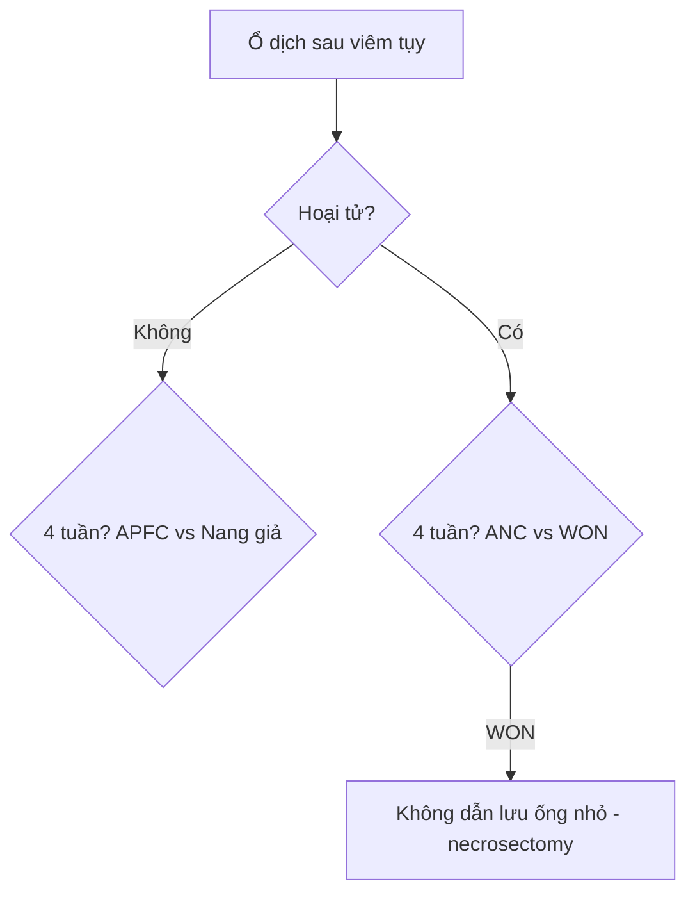

# 135 — Viêm tụy cấp Atlanta 2012 & Balthazar / Acute pancreatitis

**Tags:** `pattern:viem-tuy` `vung:tuy` `score:Atlanta`
**Mức chắc chắn (certainty):** tổng hợp y văn (literature synthesis) — nhóm tự biên từ y văn mở, chưa gắn ca nguyên văn đơn lẻ.

## 1. Tổng quan — men tụy tự tiêu + chụp đúng thời điểm

- Viêm tụy phù nề mô kẽ (không hoại tử) vs hoại tử (nhu mô/mỡ quanh). TẠI SAO CT phải sau **> 72 giờ**: chụp < 24 giờ co mạch che mất vùng hoại tử → bỏ sót ANC/WON.
- Protocol: CT cản quang **thì tụy 40–45s + cửa 70s** (vùng không ngấm = hoại tử); Balthazar CTSI (A–E + % hoại tử) tiên lượng.
- Ngưỡng can thiệp: nhiễm trùng hoại tử (khí trong ổ) → kháng sinh + dẫn lưu tối thiểu; WON vô khuẩn → chờ vỏ chắc (≥ 4 tuần) mới xử trí.

## 2. Ma trận 4 ổ dịch Atlanta (4 tuần + hoại tử)

| Ổ dịch | Thời gian | Nền | Đồng nhất? | Vỏ? | Chốt |
|---|---|---|---|---|---|
| Tụ dịch cấp quanh tụy (APFC) | **< 4 tuần** | Phù nề | **Đồng nhất (chỉ dịch)** | **Chưa vỏ** | Tự tan, theo dõi |
| Nang giả tụy (Pseudocyst) | **≥ 4 tuần** | Phù nề | **Đồng nhất (chỉ dịch)** | **Vỏ xơ rõ**, ngoài tụy | Dẫn lưu nội soi khi có triệu chứng |
| Tụ dịch hoại tử cấp (ANC) | **< 4 tuần** | Hoại tử | **KHÔNG đồng nhất** (dịch + mô/mỡ hoại tử) | **Chưa vỏ** | Kháng sinh + theo dõi |
| Hoại tử có vỏ (WON) | **≥ 4 tuần** | Hoại tử | **KHÔNG đồng nhất** | **Vỏ dày ngấm thuốc** | **Necrosectomy (ống nhỏ tắc ngay!)** |

⚠️ Bẫy sống còn: ổ không đồng nhất tuần thứ 5 sau hoại tử = **WON, không phải nang giả** — dẫn lưu ống nhỏ tắc ngay, cần lấy mô hoại tử.

## 3. Bảng biến chứng

| Biến chứng | Hình ảnh | Xử trí |
|---|---|---|
| Chảy máu nang giả (giả phình ĐM lách) | Máu lan sau phúc mạc + liên quan đuôi tụy | Nút mạch cấp cứu (xem ảnh dưới) |
| Nhiễm trùng hoại tử | Khí trong ổ ANC/WON + sốt | Kháng sinh + dẫn lưu tối thiểu |
| Hẹp/tắc ống mật-tá tràng | Giãn mật + dày tá tràng | Stent/giải áp |

*Máu lan sau phúc mạc từ nang giả đuôi tụy. Nguồn: Hellerhoff, CC BY-SA 3.0.*

## 4. Protocol + flowchart

- CT thì tụy 40–45s + cửa 70s sau > 72 giờ; Balthazar CTSI; MRCP khi nghi sỏi/ống tụy.
- Ổ dịch không đồng nhất + sốt → chọc hút (nhiễm trùng?); WON vô khuẩn → chờ ≥ 4 tuần.

## 5. Cạm bẫy

- **Chụp < 24 giờ** bỏ sót hoại tử → chụp lại sau 72 giờ khi nặng lên.
- **WON đọc nhầm nang giả** (bẫy trên) — không đồng nhất + vỏ dày = WON.
- **Thông ống tụy chính + nang** = u nhầy nhú nội ống tụy (IPMN), không phải nang giả (bài 136 dự kiến).

## 6. Tự lượng giá — Blind Quiz

**Ca 1 — Nang đuôi tụy + máu lan sau phúc mạc. Đọc CT.**

- Hỏi: đồng nhất hay không? Biến chứng gì? Xử trí đầu?

<b>Bấm để hiện đáp án</b>

- **Nang giả chảy máu:** máu lan sau phúc mạc từ đuôi tụy — nút mạch động mạch lách cấp cứu (không dẫn lưu mù).
- Nguồn: Hellerhoff, CC BY-SA 3.0.

**Ca 2 — Ổ không đồng nhất có vỏ tuần thứ 5 sau hoại tử:** nang giả hay WON? Dẫn lưu ống nhỏ được không? *(Bảng mục 2.)*

<b>Bấm để hiện đáp án</b>

- **WON:** ống nhỏ tắc ngay — can thiệp lấy mô hoại tử.

## Bài liên quan chéo
- [100 – Tổng quan hệ Bụng](../100-tong-quan-he-bung/lesson.md)
- [110 – Giải phẫu bụng](../110-giai-phau-bung/lesson.md) (khoang trước thận)
- [136 – U/nang tụy (dự kiến)](../136-u-nang-tuy/lesson.md) (IPMN/MCN/SCN)

> Không dùng để chẩn đoán độc lập khi chưa có người hướng dẫn.
