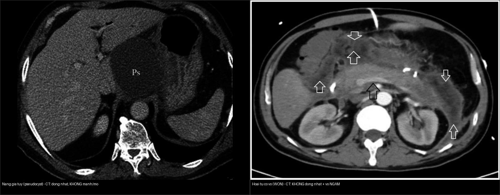
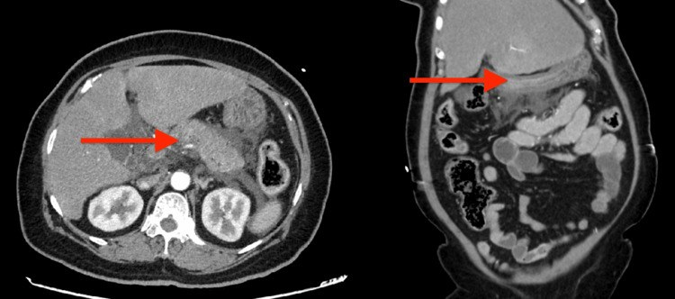
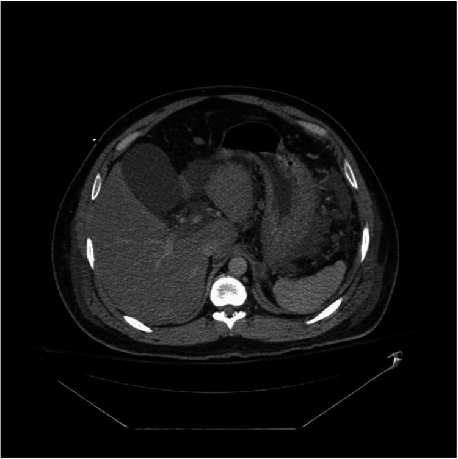
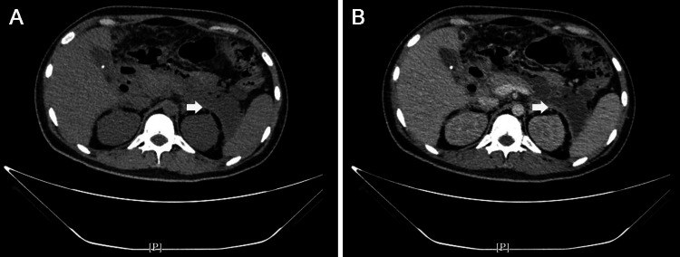
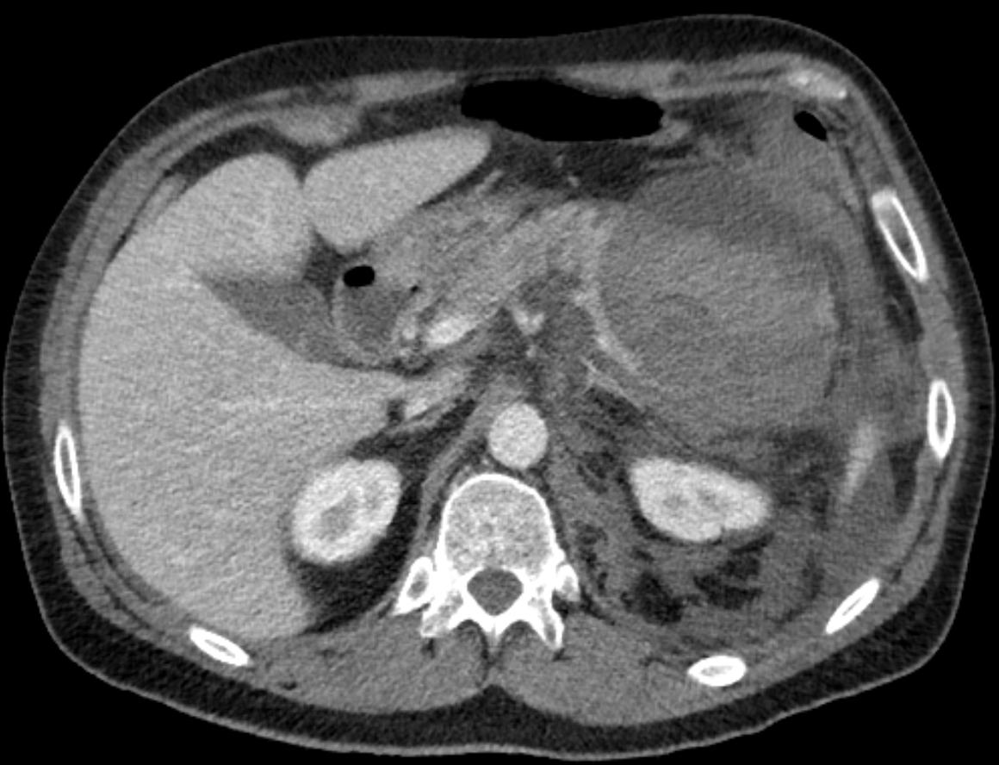
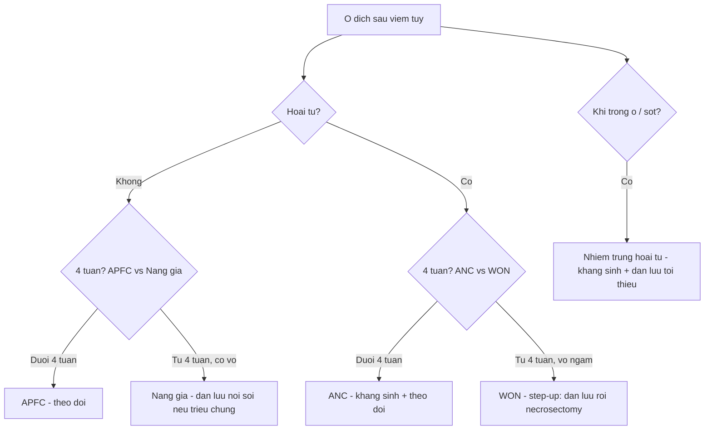

# 135 — Viêm tụy cấp Atlanta 2012 & Balthazar / Acute pancreatitis

**Tags:** `pattern:viem-tuy` `vung:tuy` `score:Atlanta` `protocol:CT-tuy-da-thi`
**Mức chắc chắn (certainty):** tổng hợp y văn (literature synthesis) — nhóm tự biên từ y văn mở + ca nguyên văn CC BY (Cureus 2026, Front Med 2026, Wikimedia).

## 1. Tổng quan — men tụy tự tiêu + vì sao phải CHỤP ĐÚNG THỜI ĐIỂM

- Viêm tụy cấp chia 2 thể theo **Atlanta 2012**: **phù nề mô kẽ (interstitial edematous)** (không hoại tử, ~**80–85%**) vs **hoại tử (necrotizing)** (hoại tử nhu mô ± mỡ quanh tụy).
- **TẠI SAO CT phải sau > 72 giờ:** sớm (< 24 giờ) co mạch + phù làm **mất ranh giới vùng hoại tử** → CT giả "bình thường"/"nhẹ", bỏ sót ANC/WON. Sau **72–96 giờ** vùng hoại tử hiện rõ thành **ổ không ngấm** (đậm độ thấp trong nhu mô ngấm).
- **Vật lý hình ảnh:** CT **thì tụy 40–45s + cửa 70s**: nhu mô tụy ngấm mạnh, **vùng hoại tử KHÔNG ngấm** (thiếu mạch) → tương phản đậm độ; dịch/mủ **~0–20 HU**, mỡ hoại tử **âm (mỡ)**, máu cấp **> 40 HU**.
- **Ngưỡng tiên lượng định lượng:** **CRP > 150 mg/L** ở 48 giờ và **hematocrit > 44%** lúc nhập viện gợi viêm tụy nặng; **Balthazar CTSI** (A–E + % hoại tử: **0% = 0 điểm; < 30% = 2; 30–50% = 4; > 50% = 6**) — CTSI **≥ 7** tiên lượng nặng.
- **Ngưỡng can thiệp:** nhiễm trùng hoại tử (khí trong ổ) → kháng sinh + **dẫn lưu tối thiểu**; WON **vô khuẩn** → chờ vỏ chắc (**≥ 4 tuần**) mới xử trí.

## 2. Ma trận 4 ổ dịch Atlanta 2012 (4 tuần + hoại tử)

| Ổ dịch | Thời gian | Nền | Đồng nhất? | Vỏ? | Chốt vào (rule-in) | Chốt loại (rule-out) |
|---|---|---|---|---|---|---|
| **Tụ dịch cấp quanh tụy (APFC)** | **< 4 tuần** | Phù nề | **Đồng nhất (chỉ dịch)** | **Chưa vỏ** | Dịch quanh tụy **thuần nhất**, không vỏ, < 4 tuần | Không đồng nhất/mảnh mỡ hoại tử trong ổ → ANC |
| **Nang giả tụy (Pseudocyst)** | **≥ 4 tuần** | Phù nề | **Đồng nhất (chỉ dịch)** | **Vỏ xơ rõ**, không có biểu mô | **Vỏ rõ + dịch thuần nhất + ≥ 4 tuần + KHÔNG mảnh hoại tử** | Có **mảnh hoại tử/mỡ** trong ổ → WON |
| **Tụ dịch hoại tử cấp (ANC)** | **< 4 tuần** | Hoại tử | **KHÔNG đồng nhất** (dịch + mô/mỡ hoại tử) | **Chưa vỏ** | Ổ **không đồng nhất** + mảnh mỡ/hoại tử, chưa vỏ, < 4 tuần | Đồng nhất thuần dịch → APFC |
| **Hoại tử có vỏ (WON)** | **≥ 4 tuần** | Hoại tử | **KHÔNG đồng nhất** | **Vỏ dày NGẤM thuốc** | **Vỏ ngấm + dịch KHÔNG đồng nhất + ≥ 4 tuần** | Ống nhỏ dẫn lưu tắc ngay — không điều trị như nang giả |

*Trái: **nang giả tụy** — ổ dịch ĐỒNG NHẤT, thành mỏng, KHÔNG mảnh hoại tử. Phải: **WON** — ổ KHÔNG đồng nhất (mảnh hoại tử trong ổ), **vỏ NGẤM**. Nguồn: Pandey 2026 (PMC13266385) + Li 2026 (PMC13333689), CC BY 4.0. Ảnh ghép letterbox.*

⚠️ **Bẫy sống còn:** ổ **không đồng nhất** ở tuần thứ 5 sau hoại tử = **WON, KHÔNG phải nang giả** — dẫn lưu bằng ống nhỏ **tắc ngay**, cần **lấy mô hoại tử (necrosectomy / step-up approach)**.

## 3. Gamut ổ dịch tụy + biến chứng (kèm ảnh)

- **Viêm tụy phù nề mô kẽ (interstitial edematous) — APFC:**

*Tụy phù nề + dịch quanh tụy; nhánh mạch máu nuôi còn bắt thuốc đều. Nguồn: Puri P et al., Cureus 2026, PMC13094300, CC BY 4.0.*

- **Viêm tụy hoại tử (necrotizing) — ANC/WON:**

*Hoại tử nhu mô đầu–thân–đuôi tụy + ổ dịch quanh tụy dạng thùy, có thể chảy máu khu trú trong thân/đuôi. Nguồn: Gade P et al., Cureus 2026, PMC13142762, CC BY 4.0.*

- **WON nhiễm trùng (khí trong ổ):**

*Ổ quanh tụy giới hạn rõ, **vỏ ngấm** + **khí bên trong** = **hoại tử nhiễm trùng** → kháng sinh + dẫn lưu tối thiểu. Nguồn: Renaldi K et al., Cureus 2026, PMC13372196, CC BY 4.0.*

| Biến chứng | Hình ảnh | Xử trí |
|---|---|---|
| **Chảy máu nang giả (giả phình ĐM lách/ĐM vị tá tràng)** | Máu lan sau phúc mạc + liên quan đuôi tụy/thân | **Nút mạch cấp cứu** (xem ảnh dưới) — KHÔNG dẫn lưu mù |
| **Nhiễm trùng hoại tử** | **Khí trong ổ ANC/WON** + vỏ ngấm + sốt | Kháng sinh + dẫn lưu tối thiểu / necrosectomy |
| **Hẹp/tắc ống mật–tá tràng** | Giãn đường mật + dày/chít tá tràng | Stent/giải áp |
| **Rò tụy (fistula)** | Dịch màng phổi/màng tim/ổ bụng nhiều amylase | Dẫn lưu + giảm tiết (octreotide) |

*Máu lan sau phúc mạc từ nang giả đuôi tụy. Nguồn: Hellerhoff, Wikimedia Commons, CC BY-SA 3.0.*

## 4. Protocol + flowchart

- **Siêu âm đầu tay** (sỏi mật, giãn đường mật); **CT thì tụy 40–45s + cửa 70s sau > 72 giờ** khi bệnh nặng/lâm sàng xấu đi; **MRCP** khi nghi sỏi ống tụy/ống tụy đứt.
- **Balthazar CTSI** = điểm viêm tụy (A–E) + điểm hoại tử (0/2/4/6); theo dõi biến chứng cục bộ theo **Atlanta 2012**.
- **Ngưỡng xử trí:** ổ dịch không đồng nhất + sốt → **chọc hút** (cấy, tìm nhiễm trùng); APFC/nang giả vô khuẩn < 6 cm → theo dõi (**40–50% tan tự nhiên trong 6 tuần**); nang giả có triệu chứng ≥ 4–6 tuần → dẫn lưu nội soi/stent; **WON vô khuẩn → chờ ≥ 4 tuần** rồi step-up (dẫn lưu → necrosectomy).
- **Dịch tễ định lượng:** nang giả tụy gặp ở **5–16%** sau viêm tụy cấp, tới **20–40%** ở viêm tụy mạn; dẫn lưu qua da tái phát tới **45,5%** → phẫu thuật/nội soi mở thông dạ dày (cystogastrostomy) cho nang trưởng thành có triệu chứng (PMC13266385).

## 5. Biến thể bình thường và cạm bẫy

- **Chụp < 24 giờ bỏ sót hoại tử** → chụp lại sau **72 giờ** khi bệnh nặng lên.
- **WON đọc nhầm nang giả** (bẫy trên) — **không đồng nhất + vỏ dày ngấm = WON**; ống nhỏ tắc ngay.
- **Thông ống tụy chính + nang** = u nhầy nhú nội ống tụy (**IPMN**), không phải nang giả (bài 136).
- **Nang giả vs WON trên siêu âm/CT đơn thuần:** mảnh mỡ/hoại tử trong ổ là điểm phân biệt — **siêu âm nội soi (EUS)** giúp.
- **Phù tụy lan "giả u"** đợt cấp: đừng đọc thành khối u — đối chiếu lâm sàng + chụp lại sau điều trị.
- **Giả phình mạch (pseudoaneurysm)** có thể xuất hiện **trong ổ WON/nang giả** — luôn tìm mạch/ngấm **trước khi** can thiệp dẫn lưu (nguy cơ chảy máu chết người).

## 6. Tự lượng giá — Blind Quiz

**Ca 1 — Nữ 52 tuổi, viêm tụy cấp mức độ nặng, CTA bụng ngày 1.**

- Hỏi: thể viêm tụy? Có dấu hiệu hoại tử chưa? Nếu ổ dịch này còn nguyên sau 4 tuần và đồng nhất thì gọi là gì?

<b>Bấm để hiện đáp án (findings + chẩn đoán)</b>

- **Findings:** tụy **phù nề lan tỏa** + **dịch quanh tụy**, không có vùng nhu mô không ngấm → **viêm tụy phù nề mô kẽ (interstitial edematous)**.
- **Chốt:** ổ dịch thuần nhất < 4 tuần = **APFC**; nếu còn và có vỏ ≥ 4 tuần, đồng nhất → **nang giả tụy**. **Lưu ý: chụp < 72 giờ có thể bỏ sót hoại tử.**
- Nguồn: Puri P et al., Cureus 2026, Fig. 1, PMC13094300, CC BY 4.0.

**Ca 2 — Nam 40 tuổi, tăng triglyceride máu, CT bụng nhiều ổ dịch quanh tụy.**

- Hỏi: đây là thể nào? Hoại tử nằm ở đâu? Nguy cơ nếu ổ này vỏ hóa mà bên trong không đồng nhất?

<b>Bấm để hiện đáp án (findings + chẩn đoán)</b>

- **Findings:** **hoại tử nhu mô đầu–thân–đuôi tụy** + ổ dịch quanh tụy **dạng thùy, KHÔNG đồng nhất**, có vùng chảy máu khu trú thân/đuôi.
- **Chẩn đoán:** **viêm tụy hoại tử cấp (ANC)** < 4 tuần. Nếu vỏ hóa ≥ 4 tuần mà vẫn không đồng nhất → **WON** (không dẫn lưu ống nhỏ).
- Nguồn: Gade P et al., Cureus 2026, Fig. 1, PMC13142762, CC BY 4.0.

**Ca 3 — Bệnh nhân nằm viện 4 tuần sau hoại tử, sốt, CT bụng cản quang.**

- Hỏi: nang giả hay WON? Dấu hiệu nào chốt nhiễm trùng? Bước xử trí đầu?

<b>Bấm để hiện đáp án (findings + chẩn đoán)</b>

- **Findings:** ổ quanh tụy giới hạn rõ, **vỏ NGẤM** + **khí bên trong** = **hoại tử nhiễm trùng (WON nhiễm trùng)**.
- **Chốt:** **khí trong ổ** = nhiễm trùng; **không đồng nhất + vỏ ngấm** = WON (không phải nang giả). Xử trí: kháng sinh + **dẫn lưu tối thiểu**, cân nhắc necrosectomy.
- Nguồn: Renaldi K et al., Cureus 2026, Fig. 2, PMC13372196, CC BY 4.0.

**Ca 4 — Đối chiếu: bên nào là nang giả, bên nào là WON?**

<b>Bấm để hiện đáp án (findings + chẩn đoán)</b>

- **Trái — nang giả tụy:** ổ dịch **đồng nhất**, thành mỏng, **không mảnh hoại tử** → theo dõi/dẫn lưu nội soi khi có triệu chứng.
- **Phải — WON:** ổ **không đồng nhất** (mảnh mỡ/hoại tử) + **vỏ ngấm** → **step-up** (dẫn lưu rồi necrosectomy), KHÔNG dùng ống nhỏ đơn thuần.
- Nguồn: Pandey 2026 (PMC13266385) + Li 2026 (PMC13333689), CC BY 4.0.

**Ca 5 — Nang đuôi tụy + máu lan sau phúc mạc. Đọc CT.**

- Hỏi: đồng nhất hay không? Biến chứng gì? Xử trí đầu?

<b>Bấm để hiện đáp án (findings + chẩn đoán)</b>

- **Nang giả chảy máu:** máu lan sau phúc mạc từ đuôi tụy — **nút mạch động mạch lách cấp cứu** (không dẫn lưu mù).
- Nguồn: Hellerhoff, Wikimedia Commons, CC BY-SA 3.0.

**Ca 6 — Bệnh nhân viêm tụy cấp sau 5 tuần: ổ dịch không đồng nhất, có vỏ dày.**
(nội dung bảng mục 2)

<b>Bấm để hiện đáp án (findings + chẩn đoán)</b>

- **WON:** vỏ ngấm + không đồng nhất; **ống nhỏ tắc ngay** — can thiệp lấy mô hoại tử (step-up/necrosectomy).
- Đối chiếu nếu ổ **đồng nhất** + vỏ mỏng ≥ 4 tuần → **nang giả tụy** (dẫn lưu nội soi khi có triệu chứng).

## Bài liên quan chéo
- [100 – Tổng quan hệ Bụng](../100-tong-quan-he-bung/lesson.md)
- [110 – Giải phẫu bụng](../110-giai-phau-bung/lesson.md) (khoang trước thận)
- [136 – U/nang tụy (IPMN/MCN/SCN)](../136-u-nang-tuy/lesson.md)
- [102 – Viêm tụy cấp sau ERCP](../102-viem-tui-mat-va-viem-tuy-sau-stent-mat-ercp/lesson.md) (PEP, dự phòng & phân độ)
- [140 – Lách & chấn thương tạng đặc](../140-lach-tang-dac/lesson.md) (giả phình ĐM lách)

## Ảnh
- Tên file: `135_slug_Modality_SourceID.jpg`. Nguồn + giấy phép từng ảnh trong `images/CREDITS.md`.
- Ảnh **CC BY 4.0** (PMC13094300/PMC13142762/PMC13266385/PMC13333689/PMC13372196) được phép ghép letterbox; ảnh **CC BY-SA 3.0** (Wikimedia Hellerhoff) giữ nguyên bản.

> Không dùng để chẩn đoán độc lập khi chưa có người hướng dẫn.
