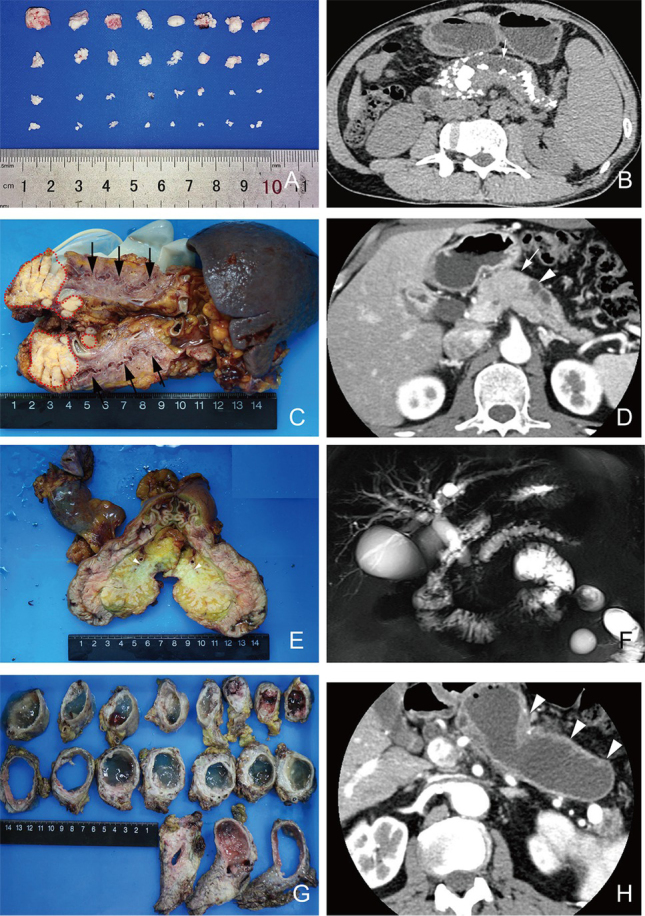

# 136 — U đặc & nang tụy: PDAC, pNET, IPMN/MCN/SCN / Pancreatic tumors & cysts

**Tags:** `pattern:u-tuy` `vung:tuy`
**Mức chắc chắn (certainty):** tổng hợp y văn (literature synthesis) — nhóm tự biên từ y văn mở, chưa gắn ca nguyên văn đơn lẻ.

## 1. Tổng quan — double-duct + thông ống chính + xơ đặc

- **PDAC đầu tụy:** khối giảm ngấm (xơ đặc) + **cắt cụt đột ngột mật + tụy (double-duct)** + teo thân đuôi + xâm lấn mạch (SMA/SMV/TC).
- **pNET:** ngấm mạnh ĐM (trừ kém biệt hóa) — insulinoma nhỏ (< 2 cm) + hạ đường huyết.
- **IPMN:** **thông ống tụy chính** (nhánh, chính, hỗn hợp) — nhánh < 3 cm không nốt theo dõi; chính ≥ 10 mm/nốt/vàng da = mổ.
- **MCN (nang bà ngoại/mẹ):** nữ trung niên + thân đuôi + **không thông ống** + vôi hóa vỏ trứng; **SCN:** tổ ong + sẹo sao trung tâm + không thông ống — lành tính.
- TẠI SAO mổ được hay không do mạch: bao > 180° SMA/TC hoặc tắc SMV không tái tạo = không cắt được.

## 2. Gamut khối/nang tụy

- **PDAC:** giảm ngấm + double-duct + teo + xâm lấn mạch — CA19-9 + Whipple khi còn mổ.
- **pNET:** ngấm mạnh + hội chứng hormone — Ga-68 DOTATATE + mổ/cắt chọn lọc.
- **IPMN:** thông ống chính + nốt trong nang — nhánh theo dõi, chính mổ.
- **MCN/SCN:** nữ + thân đuôi; MCN không thông ống (mổ khi lớn), SCN tổ ong sẹo sao (theo dõi).

*E–F: double-duct PDAC + MRCP; G–H: IPMN giãn ống chính lan tỏa. Nguồn: Bian et al., J Transl Int Med 2022 Fig. 4, CC BY-NC-ND 3.0 (giữ nguyên bản).*

## 3. Bảng so sánh

| Thực thể (entity) | Hình ảnh | Chốt | Xử trí |
|---|---|---|---|
| PDAC | **Giảm ngấm + double-duct + teo + xâm lấn SMA/SMV** | Cắt cụt 2 ống + CA19-9 | Whipple khi mạch còn được |
| pNET | **Ngấm mạnh ĐM** + hội chứng hormone | Ngấm + insulinoma/gastrinoma | DOTATATE + mổ |
| IPMN | **Thông ống chính** + nốt/vàng da | Ống chính ≥ 10 mm/nốt = mổ | Nhánh < 3 cm theo dõi |
| MCN/SCN | **Không thông ống**; MCN đơn ổ nữ, SCN tổ ong sẹo sao | Vỏ trứng MCN / sẹo sao SCN | MCN mổ, SCN theo dõi |

## 4. Protocol

- CT thì tụy 40–45s (PDAC giảm ngấm) + MRI/MRCP (ống, nang, thông ống) + EUS-FNA khi cần mô bệnh.
- Đánh giá mạch: SMA/TC bao > 180°, SMV tắc/tái tạo — quyết định Whipple.

## 5. Cạm bẫy

- **Viêm tụy khu trú giả PDAC** (double-duct cả 2) — IgG4 + đáp ứng steroid thử + sinh thiết.
- **Nang giả thông ống giả** sau viêm — tiền sử viêm tụy + không nốt (bài 135).
- **pNET kém biệt hóa giảm ngấm** giả PDAC — Ga-68 DOTATATE + Ki-67.

## 6. Tự lượng giá — Blind Quiz

**Ca 1 — Vàng da + gầy + cắt cụt 2 ống. Đọc MRCP + mô bệnh.**

- Hỏi: panel nào là PDAC? Panel nào là IPMN? Dấu chung và khác?

<b>Bấm để hiện đáp án</b>

- **E–F: PDAC** (khối xơ + cắt cụt 2 ống); **G–H: IPMN** (giãn ống chính lan tỏa + nhầy) — chung double-duct, khác khối đặc vs thông ống.
- Nguồn: Bian et al., Fig. 4, CC BY-NC-ND 3.0 (nguyên bản).

**Ca 2 — Nang thân đuôi 4 cm + vôi hóa vỏ trứng + không thông ống, nữ 45 tuổi:** IPMN/MCN/SCN? Mổ không? *(Bảng mục 3.)*

<b>Bấm để hiện đáp án</b>

- **MCN:** mổ (nguy cơ ác + không thông ống).

## Bài liên quan chéo
- [100 – Tổng quan hệ Bụng](../100-tong-quan-he-bung/lesson.md)
- [131 – Tắc mật](../131-tac-mat/lesson.md) (vàng da tắc mật)
- [135 – Viêm tụy Atlanta](../135-viem-tuy-Atlanta/lesson.md) (nang giả vs IPMN)

> Không dùng để chẩn đoán độc lập khi chưa có người hướng dẫn.
