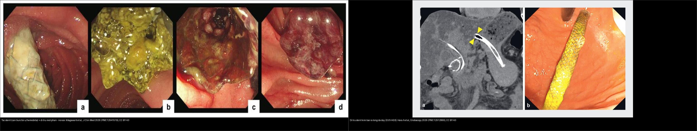
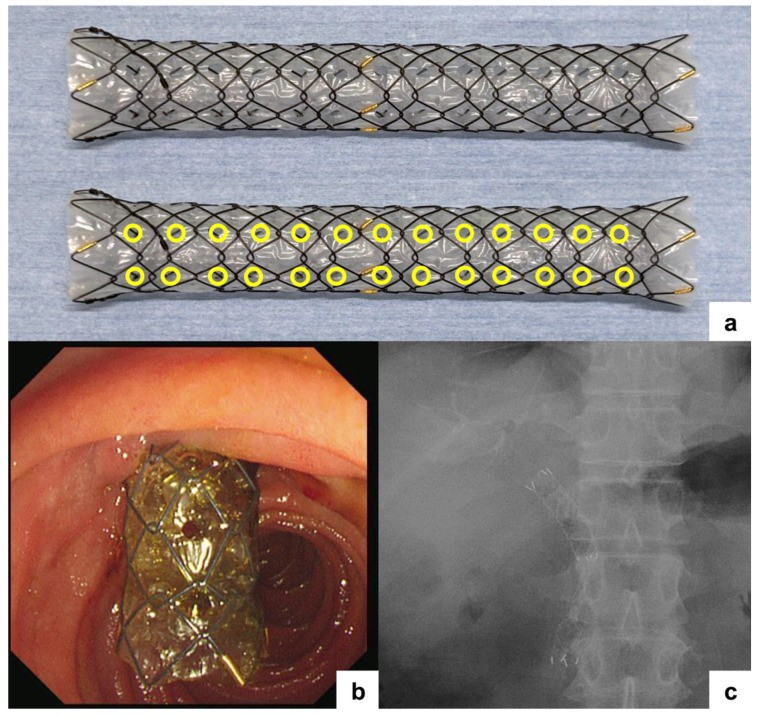
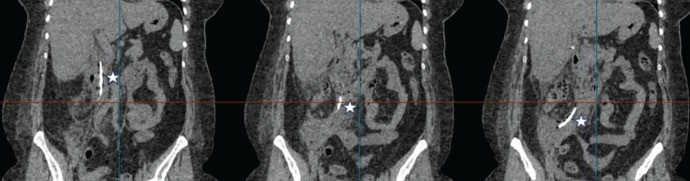
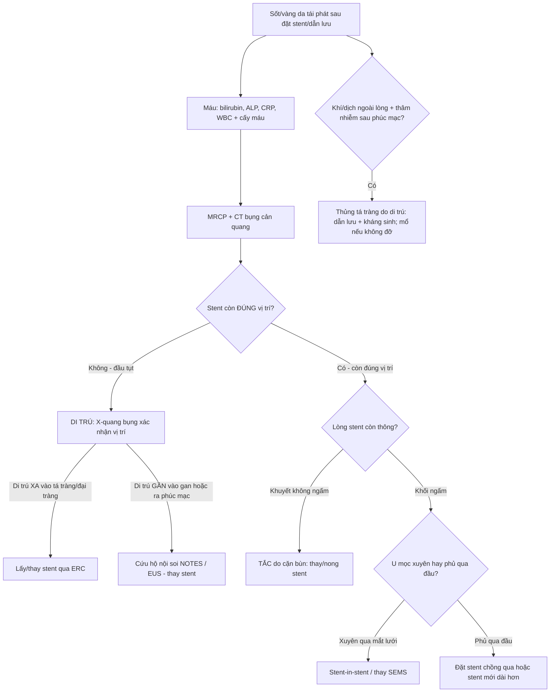
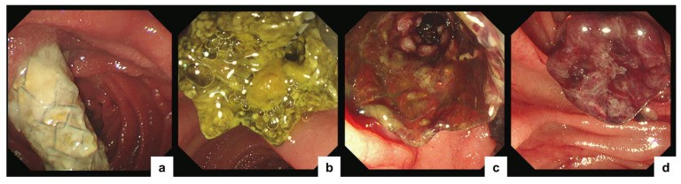
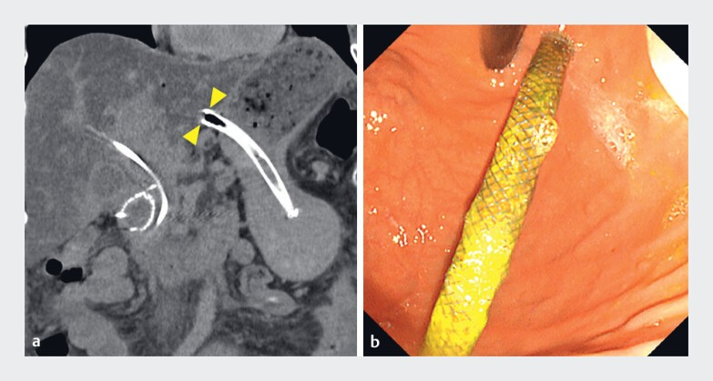
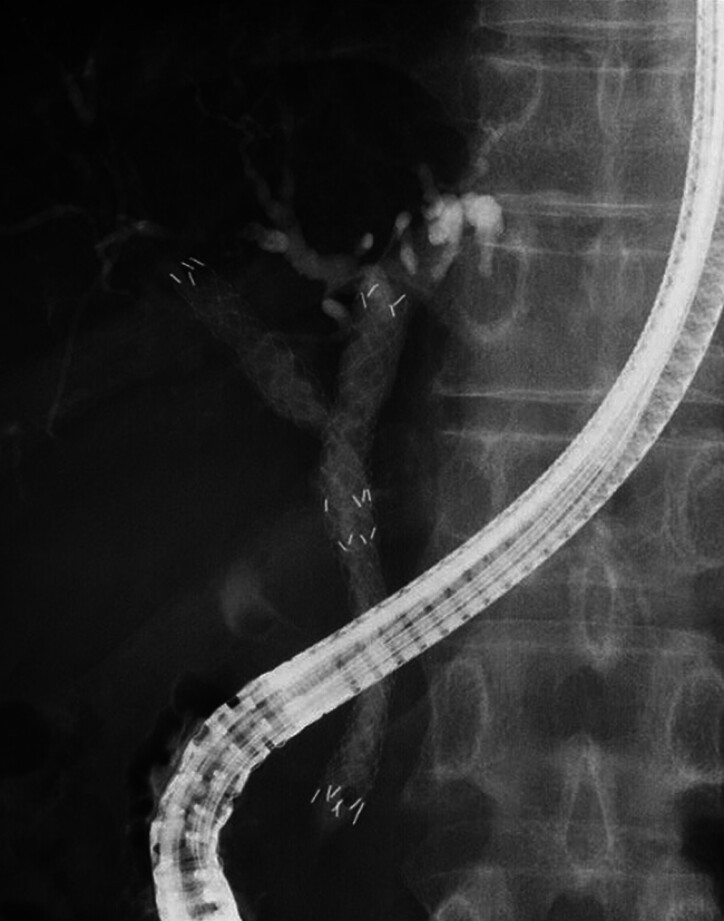
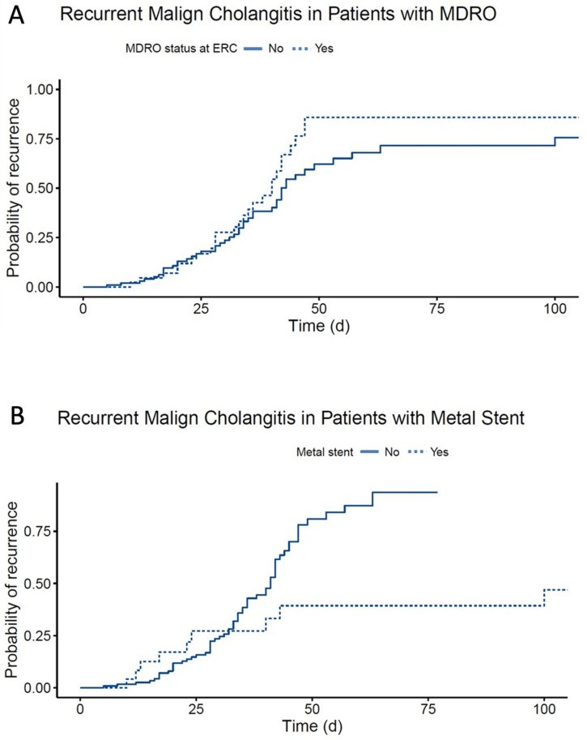
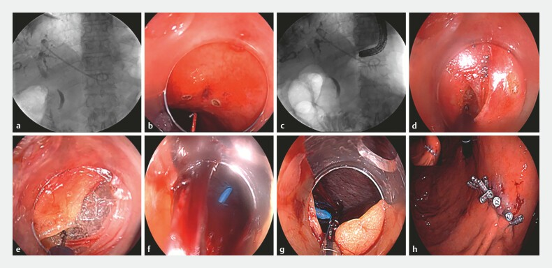
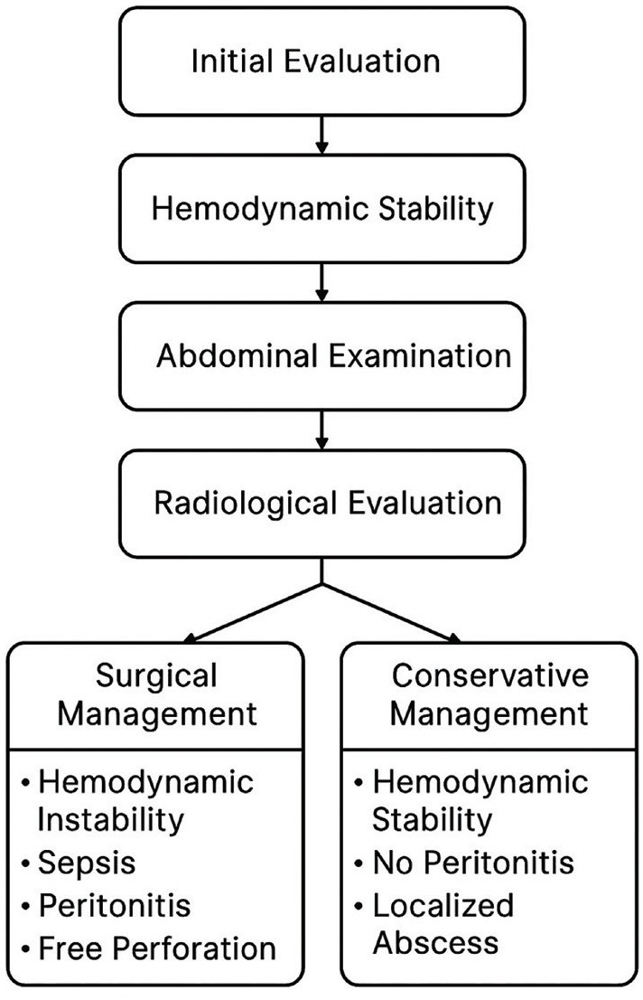

# 137 — Theo dõi sau dẫn lưu/stent đường mật: di trú, tắc & viêm đường mật tái phát / Follow-up of biliary drainage & stents: migration, occlusion & recurrent cholangitis

**Tags:** `pattern:tac-mat` `pattern:bien-chung-stent` `pattern:di-tru-stent` `vung:duong-mat` `protocol:ERCP` `protocol:MRCP` `protocol:PTBD` `incidentaloma:stent-di-tru`
**Mức chắc chắn (certainty):** tổng hợp y văn (literature synthesis) — nhóm tự biên từ y văn mở (CC BY 4.0 và CC BY-NC 4.0); các ca minh họa là **ca nguyên văn** của bài gốc (giữ đúng tuổi/thời điểm trong chú thích).

> Đây là **bước tiếp theo của [131 – Tắc mật](../131-tac-mat/lesson.md), [132 – Hẹp đường mật không xác định](../132-hop-duong-mat-khong-xac-dinh/lesson.md) và [133 – Hẹp miệng nối sau ghép gan](../133-hep-mieng-noi-duong-mat-sau-ghep/lesson.md)**: sau khi đã đặt stent/dẫn lưu, câu hỏi đổi từ "mở đường mật" sang **"stent còn thông không, có di trú không, và vì sao bệnh nhân lại sốt/vàng da?"**.

## 1. Tổng quan bệnh học – cơ chế hình ảnh

- **Đặt stent/dẫn lưu đường mật** là điều trị tạm thời hay tạm ổn cho **tắc mật ác tính** (u đầu tụy, u đường mật, di căn hạch rốn gan) và một số **hẹp lành tính**. Các loại chính: **stent nhựa (plastic stent – PS)**, **stent kim loại tự bung (self-expandable metal stent – SEMS)** — không phủ (U-SEMS), phủ một phần (PC-SEMS), phủ toàn bộ (FC-SEMS) — và **dẫn lưu qua nội soi siêu âm (EUS-guided: choledochoduodenostomy – CDS / hepaticogastrostomy – HGS)**.
- **Biến chứng lõi gọi chung là "tắc stent tái phát" (recurrent biliary obstruction – RBO)**, gồm **hai cơ chế**: (1) **TẮC (occlusion)** và (2) **DI TRÚ (migration)**. Khoảng thời gian tới RBO gọi là **TRBO (time to recurrent biliary obstruction)** — đây là thước đo kết cục chuẩn của mọi nghiên cứu stent.
- **TẠI SAO (vật lý + mô bệnh):**
  - **Stent nhựa** có lòng nhỏ (~7–10 Fr) nên mật dễ ứ → **màng sinh học (biofilm) + cặn bùn (sludge)** bám kín lòng trong vài tuần → tắc sớm.
  - **U-SEMS** không phủ: u **mọc xuyên qua mắt lưới (tumor ingrowth)** → tắc muộn; **FC-SEMS** phủ kín: ngăn u mọc xuyên nhưng **không có chỗ bám** nên trượt — nhất là khi hóa trị làm u nhỏ đi (**co u → nới lỏng → di trú**).
  - **MH-SEMS (multi-hole SEMS)** đục các **lỗ phụ đường kính 1,8 mm** trên màng phủ: cho **biểu mô đường mật mọc vào giới hạn qua lỗ** để **neo** stent nhưng vẫn chặn u. Số lỗ nhiều quá lại để u mọc xuyên → thiết kế **thế hệ 2 giảm ~30% số lỗ** [J Clin Med 2026, PMC12941519].
  - **MRCP (T2 3D)**: mật là dịch → **tăng tín hiệu mạnh**; **cặn bùn/sỏi/u** nằm trong lòng ống = **khuyết tín hiệu T2**, còn chỗ tắc hoàn toàn **mất tín hiệu**. **CT đa thì**: khuyết thuốc trong lòng ống giãn; **stent kim loại gây giả ảnh beam-hardening** quầng sáng/tối quanh stent → dễ che mất tổn thương sát stent.
- **Ngưỡng định lượng nổi lòng:**
  - **PC-SEMS vs FC-SEMS** (ung thư tắc mật xa, n = 81): **di trú 3% vs 36%** (p < 0,001); **RBO 21% vs 43%** (p = 0,036); **u mọc xuyên 10% vs 0%**; **tỉ lệ KHÔNG RBO lúc 6 tháng 90% vs 68%**; sống toàn bộ trung vị **247 vs 307 ngày** [DEN Open 2025, PMC11923903].
  - **MH-SEMS**: **TRBO trung vị 479 ngày**; **di trú có triệu chứng 2,6%** so với **FC-SEMS 15,8%**; một nghiên cứu khác **RBO 21%, TRBO 446 ngày, di trú 1,9%**; **viêm tụy cấp sau đặt 5–10%**, **viêm túi mật ~5%** [J Clin Med 2026, PMC12941519].
  - **Viêm đường mật tái phát sau ERC vì hẹp ác tính** (n = 124 bệnh nhân / 183 đợt): **tái phát 73/183 = 40%**; dùng **kháng sinh NGẮN ≤ 6 ngày** tái phát **37/74 = 50%** so với **DÀI ≥ 7 ngày 36/109 = 33%** → **đừng cắt kháng sinh quá sớm**; **vi khuẩn đa kháng (MDRO) 25%**; đặt stent **96%**, dẫn lưu "hoàn tất" về mặt nội soi chỉ **73%** [J Clin Med 2023, PMC10648096].

## 2. Mẫu hình + chẩn đoán phân biệt theo cơ chế (Gamut)

- **Theo CƠ CHẾ hỏng stent:**
  - **Tắc do CẶN BÙN (sludge/biofilm):** hay gặp nhất với **stent nhựa** (và cả SEMS) — MRCP/CT: **khuyết lòng ống trong stent không ngấm**.
  - **U MỌC XUYÊN (tumor ingrowth):** **U-SEMS** — u lấp lòng qua mắt lưới, hay **tắc muộn**.
  - **U PHỦ QUA ĐẦU (tumor overgrowth):** u mọc vượt bờ trên/dưới stent — gặp với **PC-SEMS** (nghiên cứu PC-SEMS 10% vs FC-SEMS 0%).
  - **DI TRÚ (migration):** **di trú XA (distal)** xuống tá tràng; **di trú GẦN (proximal)** vào trong gan; nguy cơ cao nhất với **FC-SEMS** (36%) và với **EUS-HGS** (thành dạ dày–gan không cố định).
  - **HEMOBILIA:** máu chảy từ mắt lỗ stent → giả khuyết lòng ống.
  - **Biến chứng cơ học:** stent **đâm thủng tá tràng → viêm phúc mạc sau phúc mạc** (do di trú), **viêm túi mật**, **viêm tụy cấp**.
- **Theo BỐI CẢNH lâm sàng:**
  - **Sốt + vàng da tái phát** → **viêm đường mật** do tắc/di trú → cấy máu, kháng sinh, soi lại.
  - **Đau bụng + trướng + sốt ở người vừa ERC** → nghĩ **thủng tá tràng sau phúc mạc** (biến chứng di trú).
  - **Tăng men gan đơn thuần, không sốt** → cặn bùn/tắc dần, chưa nhiễm trùng.
- **4 câu hỏi khi đọc hình sau đặt stent:** (1) **stent còn đúng vị trí không** (đầu trên dưới)? (2) **lòng trong stent còn thông không** (khuyết/mất tín hiệu)? (3) **cơ chế** là cặn bùn, u mọc xuyên/phủ hay di trú? (4) **có biến chứng cơ học** (thủng, viêm túi mật, viêm tụy)?

## 3. Bảng so sánh phân biệt (ma trận đối chiếu)

| Thực thể (entity) | Hình ảnh điển hình | Chốt vào (rule-in) | Chốt loại (rule-out) | Gợi ý xác nhận |
|---|---|---|---|---|
| **Tắc do cặn bùn (sludge)** | Khuyết **không ngấm** trong lòng stent, T2 tối, thường stent nhựa cũ | **Khuyết lòng trong stent + thành ống mảnh, không khối ngấm** | Khối **ngấm mạnh** lấp lòng → nghĩ u mọc xuyên/sarcoma, không phải bùn | MRCP + ERC; thay stent |
| **U mọc xuyên (ingrowth)** | **U-SEMS**; u lấp qua mắt lưới, tắc **muộn** | **Khối ngấm trong lòng U-SEMS + tắc muộn** | FC-SEMS phủ kín → khó mọc xuyên; có lỗ phụ → ingrowth giới hạn | Soi + cholangioscopy + sinh thiết |
| **U phủ qua đầu (overgrowth)** | U vượt **bờ trên/dưới** stent, tắc đầu stent | **Mô ngấm ở đầu stent, giãn thượng lưu** | U ở **giữa** lòng stent → nghĩ bùn/ingrowth | CT/MRI đa thì + ERC |
| **Di trú XA (distal migration)** | Đầu trên stent **tụt xuống**, đầu dưới vào **tá tràng**, có khi ra phân | **Thay đổi vị trí so phim cũ + thấy stent trong tá tràng/đại tràng** | Vị trí **không đổi** qua 2 phim → không di trú | So phim cũ; X-quang bụng; soi lại |
| **Di trú GẦN (proximal migration)** | Đầu dưới tụt lên **trong gan**; EUS-HGS có thể ra **khoang phúc mạc** qua dạ dày | **Đầu dưới mất khỏi thành tá tràng/dạ dày + stent cao trong gan** | Stent còn bắc qua miệng nối → không di trú | Fluoroscopy/CT; cứu hộ nội soi (NOTES) |
| **Thủng tá tràng sau phúc mạc** | **Khí/mật ngoài lòng** quanh D2–D3, thâm nhiễm mỡ sau phúc mạc, **stent đâm thủng thành** | **Khí ngoài lòng + stent xuyên thành tá tràng + sốt/đau** | Chỉ thấy stent **song song** thành (không xuyên) → không thủng | CT cản quang; thuật toán bảo tồn vs mổ |
| **Viêm đường mật tái phát** | Giãn đường mật tái diễn **dù còn stent**, ± khuyết lòng; tăng bilirubin/CRP | **Sốt + vàng da + giãn mật tái phát + cấy máu/VRE-MDRGN** | Giãn mật **không tăng** + CRP bình thường → theo dõi | Cấy máu; ERC; kháng sinh đủ dài (≥ 7 ngày) |

*Trái: RBO trên nội soi — (a) di trú một phần, (b) tắc do cặn bùn, (c) u mọc xuyên qua lỗ, (d) hemobilia (Kitagawa K et al., J Clin Med 2026, PMC12941519). Phải: (a) CT stent kim loại phủ di trú vào lòng dạ dày, (b) nội soi xác nhận (Hara A et al., Endoscopy 2026, PMC12912860). Cả hai CC BY 4.0 — ảnh ghép letterbox.*

### Ảnh minh họa cơ chế

*MH-SEMS (HANAROSTENT Biliary Multi-hole NEO): (a) **6 hàng lỗ phụ dọc** trên màng phủ, mỗi lỗ **1,8 mm**; (b) đặt nội soi; (c) fluoroscopy xác nhận — cho **biểu mô mọc vào lỗ để neo** mà vẫn chặn u. Kitagawa K et al., J Clin Med 2026 (PMC12941519), CC BY 4.0.*

*Nữ 49 tuổi sau **cắt túi mật nội soi** rồi đặt stent: CT — **stent đường mật đâm xuyên tá tràng chạy vào khoang sau phúc mạc** (dấu sao). Sönmez RE et al., Turk J Surg 2025 (PMC12406606), CC BY-NC 4.0.*

## 4. Protocol + xử trí + flowchart

- **Theo dõi sau đặt stent:** lâm sàng + **xét nghiệm (bilirubin, ALP, CRP, WBC)**; khi nghi hỏng stent → **MRCP** (bản đồ cây mật, khuyết lòng) và/hoặc **CT bụng cản quang đa thì** (biến chứng cơ học, thủng, tụy/túi mật). **ERC** là tiêu chuẩn vàng điều trị (thay stent/nong). Với ca phức tạp: **cholangioscopy (mắt rắn)** phân biệt bùn vs u mọc xuyên, **EUS** nếu cần.
- **Khi nghi thủng:** **CT cản quang** đánh giá khí/dịch ngoài lòng, thâm nhiễm sau phúc mạc — phân tầng **bảo tồn (dẫn lưu + kháng sinh) vs mổ** theo thuật toán [Turk J Surg 2025, PMC12406606].
- **Viêm đường mật tái phát:** cấy máu **trước kháng sinh**; kháng sinh theo **hướng dẫn Tokyo 2018** nhưng **tránh cắt ≤ 6 ngày** nếu chưa kiểm soát nguồn — dữ liệu cho thấy **kháng sinh ngắn tái phát 50%** so với dài **33%** [J Clin Med 2023, PMC10648096].
- **Đặt stent lần đầu để giảm biến chứng dài hạn:** chọn thiết kế theo cơ chế — **u ác tính tắc xa**: PC-SEMS giảm di trú; nếu cần **tháo stent** (lành tính/vàng da cải thiện): FC-SEMS/MH-SEMS tháo được; **MH-SEMS** giảm di trú mà vẫn chặn ingrowth [PMC12941519].
- **Khi di trú ra khoang phúc mạc** (EUS-BD): **cứu hộ nội soi NOTES** — mở thành dạ dày, lấy stent dưới fluoroscopy, đóng bằng clip (thay vì mổ mở) [Endoscopy 2025, PMC12712473].

## 5. Biến thể bình thường và cạm bẫy

- **Giả ảnh kim loại (metal artifact):** stent SEMS gây **beam-hardening** che lấp u/ống mật sát bên → đọc **MRCP T2/T1 FS** song song, không kết luận "hết u" chỉ vì CT bị che.
- **"Stent còn nằm đó" không có nghĩa là "còn thông":** tắc do bùn/u mọc xuyên vẫn giữ nguyên vị trí; phải nhìn **lòng trong**.
- **Di trú GẦN ở EUS-HGS** có thể không thấy khuyết lòng mà biểu hiện bằng **vàng da tăng lại + mất đường thoát** → so fluoroscopy/CT với phim ngay sau đặt.
- **Viêm đường mật tái phát "muộn" sau khi đã cấy âm tính** vẫn có thể do **MDRO/VRE (25%)** → đừng bỏ qua cấy lại.
- **Sốt sau ERC ở người ung thư** dễ bị đổ cho "sốt do u" — luôn loại trừ **thủng sau phúc mạc** (khí ngoài lòng) trước khi dùng thêm corticoid/giảm đau.
- **Cạm bẫy mặt cắt:** **stent di trú ra ổ phúc mạc** có thể trông như "khối/dị vật" cạnh gan — đối chiếu vị trí đường đi của stent và phim cũ; **cặn bùn đậm độ cao** trên CT có thể bị đọc nhầm là sỏi canxi hóa.

## 6. Tự lượng giá — Blind Quiz

**Ca 1 — BN ung thư tắc mật, sau đặt SEMS phủ, nay sốt + vàng da tái phát. Nội soi: mô tả trước khi mở đáp án.**

- Hỏi: (a)–(d) là những cơ chế nào của tắc stent? Vì sao "đúng vị trí" vẫn có thể "hỏng"?

<b>Bấm để hiện đáp án (findings + chẩn đoán)</b>

- **Dấu hiệu:** (a) **di trú một phần**, (b) **tắc do cặn bùn**, (c) **u mọc xuyên qua lỗ phụ**, (d) **hemobilia** từ mắt lỗ.
- **Chẩn đoán:** **tắc stent tái phát (RBO)** — có thể xảy ra nhiều cơ chế cùng lúc; "stent vẫn nằm đúng vị trí" **không loại trừ** tắc do bùn/ingrowth/hemobilia.
- Nguồn: Kitagawa K et al., J Clin Med 2026 (PMC12941519), CC BY 4.0.

**Ca 2 — BN ung thư tụy đặt FC-SEMS điều trị hóa chất, 3 tháng sau vàng da lại. CT + nội soi:**

- Hỏi: (a) stent lạc về đâu? Vì sao nhóm stent phủ toàn bộ dễ di trú?

<b>Bấm để hiện đáp án (findings + chẩn đoán)</b>

- **Dấu hiệu:** (a) **CT: stent di trú vào lòng dạ dày**; (b) nội soi trên xác nhận.
- **Chẩn đoán:** **di trú stent (migration)** — FC-SEMS không có chỗ bám; **hóa trị làm u co nhỏ → nới lỏng**. Xử trí: đặt lại stent (cứu hộ bằng MH-SEMS). Nguồn: Hara A et al., Endoscopy 2026 (PMC12912860), CC BY 4.0.

**Ca 3 — Nữ 49 tuổi sau cắt túi mật + đặt stent, đau bụng + sốt. CT:**

- Hỏi: dấu sao chỉ gì? Đây là biến chứng gì và cơ chế?

<b>Bấm để hiện đáp án (findings + chẩn đoán)</b>

- **Dấu hiệu:** dấu sao = **stent đường mật đâm xuyên tá tràng vào khoang sau phúc mạc**.
- **Chẩn đoán:** **thủng tá tràng sau phúc mạc do di trú stent** — biến chứng hiếm nhưng nặng; ca này **xử trí bảo tồn (dẫn lưu + kháng sinh, can thiệp điện quang)** hiệu quả ở bệnh nhân được chọn. Nguồn: Sönmez RE et al., Turk J Surg 2025 (PMC12406606), CC BY-NC 4.0.

**Ca 4 — BN hẹp ác tính rốn gan, sau nhiều lần thay stent. Đặt stent chồng (stent-in-stent):**

- Hỏi: vì sao dùng kỹ thuật stent-in-stent? Dấu hiệu nào trên nội soi 6 tháng cho thấy thành công?

<b>Bấm để hiện đáp án (findings + chẩn đoán)</b>

- **Dấu hiệu:** FC-SEMS có lỗ phụ đặt ở **ống gan phải** bằng kỹ thuật **stent-in-stent**.
- **Chẩn đoán:** **chặn u mọc xuyên (ingrowth)** cho hẹp rốn gan. **Theo dõi cholangioscopy 6 tháng: u mọc xuyên bị chặn hoàn toàn**; tắc còn lại là do **u lan bên (lateral spread)** chứ không phải ingrowth. Nguồn: Ogura T et al., Endoscopy 2025 (PMC11798663), CC BY 4.0.

**Ca 5 — BN hẹp ác tính đã đặt stent, sốt tái phát nhiều đợt. Biểu đồ tích lũy:**

- Hỏi: hai yếu tố nào làm tăng viêm đường mật tái phát trên biểu đồ? Điều này đổi xử trí ra sao?

<b>Bấm để hiện đáp án (findings + chẩn đoán)</b>

- **Dấu hiệu:** (A) nhóm **có vi khuẩn đa kháng (MDRO)** tái phát nhiều hơn; (B) nhóm **đặt stent kim loại** khác biệt so với nhóm khác.
- **Chẩn đoán/xử trí:** **viêm đường mật tái phát** — **MDRO 25%** và yếu tố stent ảnh hưởng; **kháng sinh ngắn ≤ 6 ngày tái phát 50% so với dài ≥ 7 ngày 33%** → **điều trị đủ dài + kiểm soát nguồn + cấy máu**. Nguồn: Ferstl PG et al., J Clin Med 2023 (PMC10648096), CC BY 4.0.

**Ca 6 — Ca di trú stent ra khoang phúc mạc trong EUS-BD:**

- Hỏi: stent di trú đi đâu? Cách lấy stent mà không cần mổ?

<b>Bấm để hiện đáp án (findings + chẩn đoán)</b>

- **Dấu hiệu:** (a) đầu **gần** còn trong đường mật trong gan, đầu **xa** lọt ra **khoang phúc mạc qua khe gan–dạ dày**; (b)–(h) mở thành dạ dày, lấy stent dưới fluoroscopy/nhìn trực tiếp, đóng bằng clip.
- **Chẩn đoán:** **di trú stent vào phúc mạc sau EUS-BD** — **cứu hộ bằng nội soi xuyên lòng NOTES** thay cho mổ. Nguồn: Ding W et al., Endoscopy 2025 (PMC12712473), CC BY 4.0.

**Ca 7 — BN ung thư tụy đặt stent, đau bụng + sốt sau ERC. Cần quyết định bảo tồn hay mổ:**

- Hỏi: thuật toán dựa trên những tiêu chí nào để chọn bảo tồn vs mổ?

<b>Bấm để hiện đáp án (findings + chẩn đoán)</b>

- **Dấu hiệu:** **thuật toán quyết định** cho **thủng tá tràng sau phúc mạc do di trú stent**.
- **Chẩn đoán/xử trí:** phân tầng theo **mức lan nhiễm trùng/khoang sau phúc mạc, ổn định huyết động, đáp ứng dẫn lưu–kháng sinh** — **bảo tồn** bằng **dẫn lưu + kháng sinh (vai trò điện quang can thiệp)** ở ca chọn lọc; **mổ** khi nhiễm trùng lan rộng/không đỡ. Nguồn: Sönmez RE et al., Turk J Surg 2025 (PMC12406606), CC BY-NC 4.0.

## Bài liên quan chéo
- [100 – Tổng quan hệ Bụng](../100-tong-quan-he-bung/lesson.md)
- [131 – Tắc mật: sỏi OMC, Klatskin & xơ hóa](../131-tac-mat/lesson.md) (chỉ định đặt stent)
- [132 – Hẹp đường mật không xác định & cholangioscopy](../132-hop-duong-mat-khong-xac-dinh/lesson.md) (mắt rắn phân biệt lành/ác)
- [133 – Hẹp miệng nối & cholangiopathy thiếu máu sau ghép gan](../133-hep-mieng-noi-duong-mat-sau-ghep/lesson.md) (theo dõi sau nối/stent)
- [138 – Sỏi trong gan & viêm đường mật mủ tái phát](../138-soi-trong-gan-viem-duong-mat-mu/lesson.md) (viêm đường mật tái phát nhiều đợt)
- [134 – U nhầy ruột thừa chưa vỡ (giãn ruột thừa)](../134-u-nhay-ruot-thua-chua-vo/lesson.md) (đối chiếu ổ "khuyết lòng ống")
- [130 – Túi mật](../130-tui-mat/lesson.md) (viêm túi mật sau đặt FC-SEMS)
- [102 – Viêm túi mật & viêm tụy cấp sau ERCP](../102-viem-tui-mat-va-viem-tuy-sau-stent-mat-ercp/lesson.md) (chẩn đoán phân biệt đau sau ERCP)
- [910 – Dẫn lưu đường mật qua da (PTBD)](../910-abscess-biliary-nephrostomy/lesson.md) (khi ERCP/EUS thất bại)

## Ảnh
- Xem `images/CREDITS.md`. Phần lớn ảnh **CC BY 4.0** → được phép ghép letterbox (composite) kèm attribution; **1 ảnh CC BY-NC 4.0** giữ nguyên bản, không ghép.

> Không dùng để chẩn đoán độc lập khi chưa có người hướng dẫn.
