# 138 — Sỏi trong gan & viêm đường mật mủ tái phát / Hepatolithiasis & recurrent pyogenic cholangitis

**Tags:** `pattern:soi-trong-gan` `pattern:hep-duong-mat` `vung:duong-mat-trong-gan` `protocol:MRCP` `protocol:CT-bung-co-can-quang` `incidentaloma:soi-trong-gan`
**Mức chắc chắn (certainty):** tổng hợp y văn (literature synthesis) — nhóm tự biên từ y văn mở; các ca minh họa là **ca nguyên văn** của bài gốc (giữ đúng tuổi/giới trong chú thích).

## 1. Tổng quan bệnh học – cơ chế hình ảnh

- **Định nghĩa:** **sỏi trong gan (hepatolithiasis)** là sỏi mật nằm **trong đường mật trong gan, phía trên chỗ hợp lưu ống gan phải–trái (hilar confluence)** — khác **sỏi ống mật chủ (choledocholithiasis)** ở đường mật ngoài gan [World J Hepatol 2024, PMC11036492].
- **Dịch tễ:** đặc hữu **Đông và Đông Nam Á**, nơi **tỉ lệ mắc tới 30%**; tại Nhật giảm từ **4,1% (1970–1977) → 1,7% (1995)**; Đài Loan ~**20%**. Ở phương Tây hiếm và thường là **thứ phát** (do hẹp/ứ mật: PSC, u, biến chứng sau mổ, nang ống mật chủ). Một nghiên cứu Brazil tại trung tâm tuyến 3 báo **2,1%**; mổ tử thi ở Thụy Điển: **1,9%** sỏi ống gan và **0,6%** sỏi trong gan ở người có sỏi mật [PMC11036492].
- **Cơ chế "vòng xoáy tự duy trì" (TẠI SAO):** ứ mật + **nhiễm khuẩn đường mật** (vi khuẩn sinh **beta-glucuronidase** → lắng đọng **calci bilirubinate**) + **hẹp đường mật** → sỏi → tắc → nhiễm trùng mới → hẹp thêm. Đây chính là **hội chứng viêm đường mật mủ tái phát (recurrent pyogenic cholangitis – RPC**, còn gọi "Oriental cholangiohepatitis") [PMC11036492].
- **TẠI SAO tín hiệu trên hình (vật lý):**
  - Sỏi trong gan thường là **sỏi sắc tố calci bilirubinate** (không phải sỏi cholesterol) → **tăng đậm độ trên CT nếu vôi hóa**; **T2 rất tối** (cấu trúc giàu canxi/xơ, ít nước); **T1 thay đổi theo thành phần**: sỏi **cholesterol T1 tối**, sỏi **sắc tố T1 sáng** [PMC13652791].
  - **Sỏi KHÔNG vôi hóa có thể KHÔNG thấy trên CT** → CT dễ âm giả [PMC11036492]; **MRCP/MRI T2 mới là chìa khóa** (thấy sỏi như **khuyết tín hiệu trong lòng ống giãn**).
  - **Dấu hiệu phụ trợ quan trọng:** **ngấm thuốc tạm thời nhu mô gan cạnh ống mật thì động mạch** (transient arterial enhancement) do viêm quanh đường mật — gợi ý sỏi đang gây viêm (hình ảnh giả u, dễ nhầm khối ác) [PMC13652791].
  - **MRCP** mô tả chính xác **mức giãn, vị trí sỏi và quan hệ sỏi–hẹp**; **CT năng lượng kép (dual-energy CT)** tạo ảnh theo vật liệu, **tăng phát hiện cả sỏi vôi hóa và không vôi hóa** [PMC13652791].
- **Biến chứng định lượng:** **xơ gan mật thứ phát tới 14,1%**; **ung thư đường mật trong gan (intrahepatic cholangiocarcinoma – iCCA) tới 21,2%** trong một số loạt; một thuần tập cho **tỉ lệ mắc tích lũy iCCA 2,0% (5 năm) – 4,0% (10 năm) – 6,2% (15 năm)** [PMC11036492].
- **Yếu tố nguy cơ iCCA (đa biến):** tuổi **≥ 63** (HR **3,334**), **còn sỏi sót sau điều trị** (HR **2,445**), **xuất hiện hẹp đường mật khi theo dõi** (HR **4,350**). Nghiên cứu bệnh–chứng Trung Quốc: **hút thuốc OR 1,931**, **tiền sử gia đình ung thư OR 5,175**, **triệu chứng > 10 năm OR 2,348** [PMC11036492].
- **Bệnh nhân sỏi trong gan có tỉ lệ sỏi túi mật cao 15–30%** (so với **5%** ở quần thể cùng tuổi) [PMC11036492].

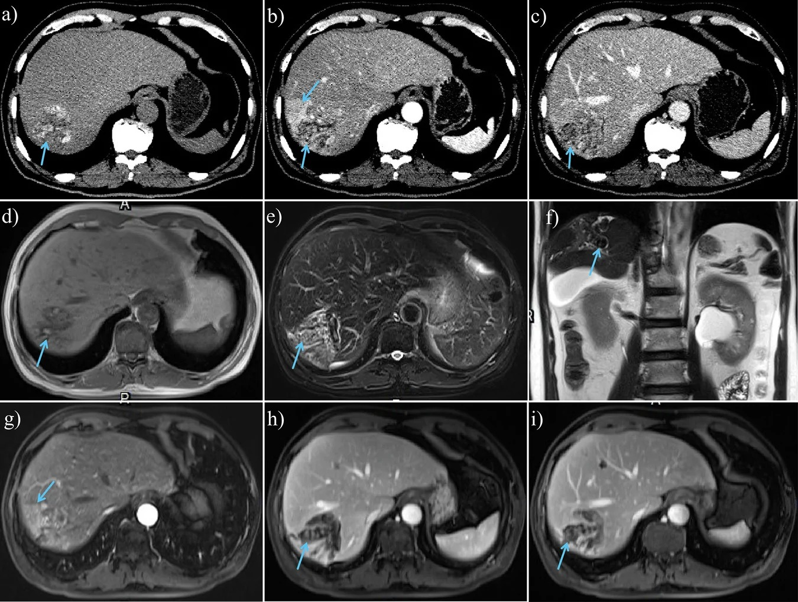
*Nam 67 tuổi nhiều sỏi trong gan: (a) CT không cản quang, (b) thì ĐM, (c) thì TM cửa — sỏi **tăng đậm độ/đồng đậm độ** (mũi tên); (d) T1W sỏi **tín hiệu thay đổi**; (e,f) T2W **tối** (mũi tên); (b,g) **ngấm tạm thời nhu mô gan cạnh ống mật thì ĐM** (mũi tên). Cen Y et al., Insights Imaging 2026 (PMC13652791), CC BY 4.0.*

## 2. Mẫu hình + chẩn đoán phân biệt theo vị trí (Gamut)

- **Mẫu hình chủ đạo: GIÃN ĐƯỜNG MẬT TRONG GAN KHU TRÚ (localized intrahepatic bile duct dilatation – LIBD)** — phải trả lời **3 câu hỏi**: **(1) giãn có "thông" với cây mật bình thường không? (2) có sỏi/khuyết lòng ống không? (3) có khối ngấm trong lòng ống không?**
- **Gamut theo "thông hay không thông" + sỏi/khối:**
  - **Nang khu trú THÔNG với cây mật (communicating) + central dot:** **bệnh Caroli / hội chứng Caroli (CD/CS)** — bẩm sinh; **central dot sign** = nhánh tĩnh mạch cửa/động mạch gan nhỏ nằm trong lòng ống giãn; **nguy cơ CCA ~7%**.
  - **Ống giãn có SỎI tăng đậm độ/T2 tối trong lòng:** **sỏi trong gan (RPC)**.
  - **Khuyết lòng ống "con sán" di động:** **sán lá gan (clonorchiasis)** — T2/MRCP thấy khuyết trong ống giãn.
  - **Đa hẹp xen giãn "chuỗi hạt":** **PSC** (viêm xơ đường mật nguyên phát).
  - **Nốt/khối NGẤM trong lòng ống giãn:** **IPNB (u nhú nội ống mật)** — liên quan tới **sỏi trong gan, sán lá, PSC**; 5–29% không triệu chứng.
  - **Khối đặc trong gan ± giãn đường mật thượng lưu:** **iCCA** (thể khối/gọt cây/thâm nhiễm ống).
  - **Khối gan + huyết khối/u trong lòng ống mật:** **HCC xâm lấn ống mật (BDTT)** — chiếm **0,53–12%** các ca HCC; **giãn đường mật trong gan làm dấu chỉ điểm có Se 93,33%/Sp 98,57%**.
- **Gợi nhớ theo "ổ giãn + nội dung trong ống":** mật thuần (Caroli) → sỏi (hepatolithiasis) → sán (clonorchiasis) → mủ/mảnh hoại tử (cholangitis/abscess) → khối ngấm (IPNB/ICC/BDTT).

## 3. Bảng so sánh phân biệt (ma trận đối chiếu)

| Thực thể (entity) | Hình ảnh điển hình | Chốt vào (rule-in) | Chốt loại (rule-out) | Gợi ý xác nhận |
|---|---|---|---|---|
| **Sỏi trong gan (RPC)** | Ống trong gan giãn khu trú + **sỏi tăng đậm độ trên CT**, **T2 tối**, T1 thay đổi; **ngấm thì ĐM nhu mô cạnh ống** | **Khuyết lòng ống T2 tối nằm trong ống giãn + sỏi tăng đậm độ CT** | Khuyết ống **không thấy trên CT** vẫn có thể là sỏi (không vôi hóa) → cần MRCP | MRCP (± dual-energy CT), cấy mật, nội soi ống mật |
| **Bệnh Caroli** | **Giãn nang trong gan THÔNG với cây mật** + **central dot sign** | **Nang thông với cây mật + central dot** | Không thông cây mật + không central dot → nghĩ nang đơn thuần/di căn | MRI/MRCP; tìm nang thận, xơ gan, tăng áp cửa |
| **Sán lá gan (clonorchiasis)** | Ống giãn + **khuyết dạng "con sán" trong lòng**, sánh viền | **Hình sán trong ống giãn ở vùng dịch tễ** | Khuyết cố định có tăng đậm độ = sỏi | T2/MRCP; huyết thanh/ phân; tiền sử ăn cá sống |
| **PSC** | **Đa hẹp xen giãn "chuỗi hạt"** cả trong và ngoài gan | **Nhiều đoạn hẹp + IBD + không sỏi khu trú** | Sỏi khu trú một thùy + giãn thượng lưu → sỏi trong gan | MRCP; **hẹp "trội" MỚI → nghi CCA** |
| **IPNB** | **Nốt/khối NGẤM mạnh trong lòng ống giãn**, ± sỏi kèm | **Khối ngấm trong lòng ống + ống giãn (type 1 lan rộng do nhầy; type 2 giãn gần do tắc)** | Khuyết **không ngấm** = sỏi/mật đặc | MRI/MRCP, DWI, cholangioscopy + sinh thiết |
| **iCCA** | **Khối đặc trong gan ± giãn thượng lưu**, thâm nhiễm ống, teo thùy | **Khối ngấm + teo thùy + bờ không đều/hẹp bất đối xứng** | Sỏi tăng đậm độ trong ống giãn không khối → sỏi | MRI đa thì + MRCP + CA19-9 + sinh thiết |
| **HCC xâm lấn ống mật (BDTT)** | **Khối gan + khối/u trong lòng ống mật**, điển hình ở nền xơ gan | **Khối HCC + BDTT ngấm ĐM, thải thuốc + giãn đường mật trong gan** | Khối **dạng "bọc/quanh ống" + nền không xơ** → nghĩ CCA ống | MRI (Primovist), AFP, mô bệnh |

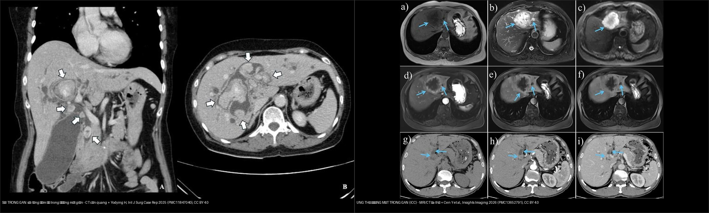
*Trái: **sỏi trong gan** — sỏi tăng đậm độ nhiều ổ trong đường mật giãn, không khối (Yodying H, Int J Surg Case Rep 2025, PMC11847040, CC BY 4.0). Phải: **iCCA thể khối** — khối giảm tín hiệu T1, tăng T2/DWI, ngấm dần rồi thải (Cen Y et al., Insights Imaging 2026, PMC13652791, CC BY 4.0). Ảnh ghép letterbox.*

### Ảnh minh họa gamut "giãn đường mật trong gan khu trú"
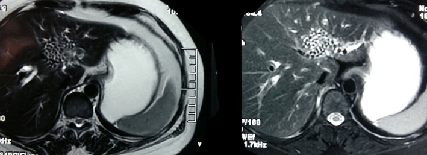
*RPC: MRI T2 — **nhiều ổ sỏi tối tín hiệu trong ống gan trái tạo hình "đám đông" (conglomerate appearance)**. Pandit N & Neupane D, Clin Case Rep 2023 (PMC10268216), CC BY 4.0.*

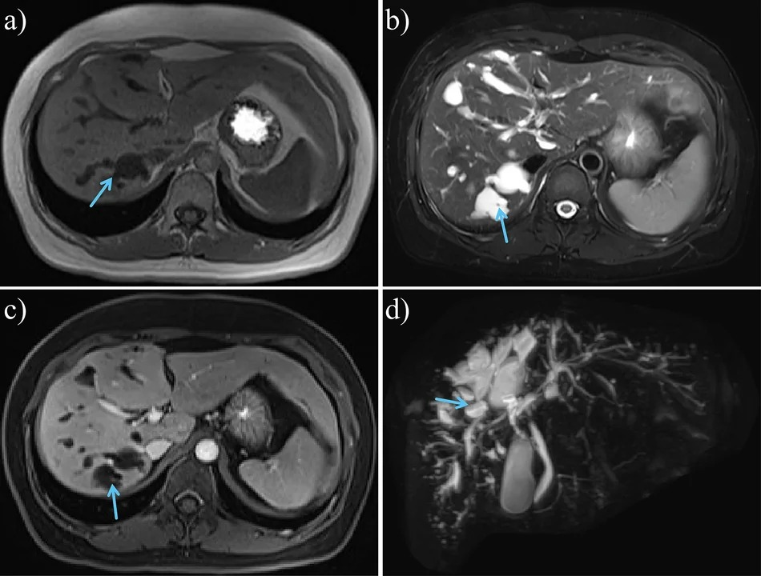
*Nữ 37 tuổi bệnh Caroli: (a) T1W và (d) MRCP — giãn nang đường mật trong gan **thông với cây mật** (mũi tên), kèm nang thận hai bên, tăng áp cửa. Chốt với nang đơn thuần là **sự thông với cây mật** + **central dot**. Cen Y et al., Insights Imaging 2026 (PMC13652791), CC BY 4.0.*

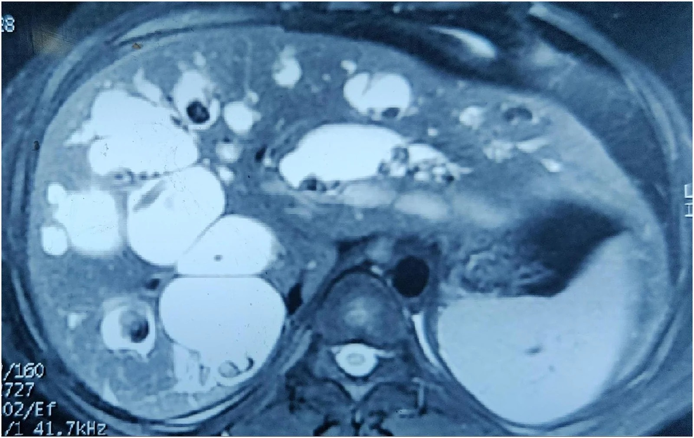
*Caroli + sỏi: đường mật trong gan giãn **rất lớn**, ưu thế gan phải, chứa **nhiều sỏi tối tín hiệu**. Sah S et al., J Surg Case Rep 2026 (PMC13546763), CC BY 4.0.*

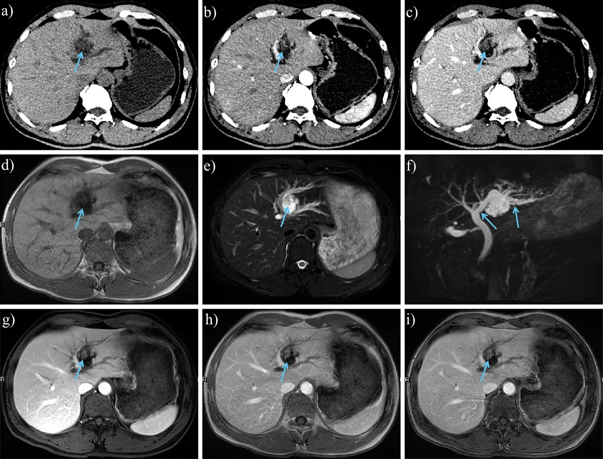
*Nam 49 tuổi: (a) CT không cản quang — nốt **giảm đậm độ trong lòng ống mật**; (b) thì ĐM — nốt **ngấm mạnh**, thải thuốc ở thì muộn (c) = **IPNB** (khác sỏi: khuyết lòng ống **không ngấm**). Cen Y et al., Insights Imaging 2026 (PMC13652791), CC BY 4.0.*

## 4. Protocol + phân loại + flowchart

- **Thứ tự hình ảnh:** **siêu âm đầu tay** (sỏi, giãn ống, áp-xe) → **MRCP** để đánh giá **cây mật + hẹp + giãn** (tốt hơn siêu âm) → **CT bụng có cản quang** khi cần **sỏi vôi hóa, teo thùy, áp-xe, tăng áp cửa**; **dual-energy CT** để **tăng phát hiện sỏi (cả không vôi hóa)**. **Sỏi không vôi hóa không thấy trên CT thường** → không được loại trừ chỉ vì CT âm [PMC11036492, PMC13652791].
- **Phân loại đã dùng (chọn theo mục đích điều trị):** **Nakayama (1982)** — độ hẹp **S0 (không), S1 (nhẹ, đường kính > 2 mm), S2 (nặng, < 2 mm)**; **Tsunoda (1985)**; **Dong** (theo vị trí sỏi, teo gan, thay đổi mật, sỏi ngoài gan, cơ vòng Oddi); **LHO (Wang 2023)** — **L0/L1/L2** (theo khả năng cắt gan), **H1/H2** (quanh rốn gan), **O0/O1/O2** (cơ vòng Oddi) [PMC11036492].
- **Tiên lượng theo mức độ nặng (Suzuki, thuần tập Nhật 18 năm):** sống 5 năm **Grade 1 = 97,6%**, **Grade 2 = 89,2%**, **Grade 3 = 57,1%** [PMC11036492].
- **Điều trị (mục tiêu: hết sỏi + giải quyết hẹp + dự phòng viêm đường mật → chặn tiến triển CCA):**
  - **Sạch sỏi hoàn toàn:** **cắt gan 83,3%** > **PTCSL 63,9%** > **POCS (SpyGlass) 57,1%**; **PTCSL** đạt tới **85%** nhưng **tái phát > 50%**; phối hợp **tán sỏi ngoài cơ thể (ESWL)** đẩy lên **~90%**; khi **có teo gan/hẹp** chỉ còn **58%** [PMC11036492].
  - **Cắt gan (hepatectomy)** giảm **tái phát sỏi** và **tiến triển CCA** — dùng khi **có teo nhu mô**; sau cắt gan **15,6% cần thăm dò đường mật lại**, **38,5% tái phát sỏi**; **~70%** kèm sỏi ngoài gan [PMC11036492].
  - **Nội soi ống mật/qua gan (POCS/PTCSL)** + **laser/thulium** cho sỏi lớn trong gan; ví dụ ca nguyên văn **nữ 65 tuổi** sỏi trong gan lớn, điều trị **choledochoscopy qua nội soi + thulium laser** + **choledochoduodenostomy**, 6 tháng không triệu chứng dù còn ít sỏi sót [PMC11847040].
  - **Ghép gan** khi xơ gan mật thứ phát + tăng áp cửa/suy gan.

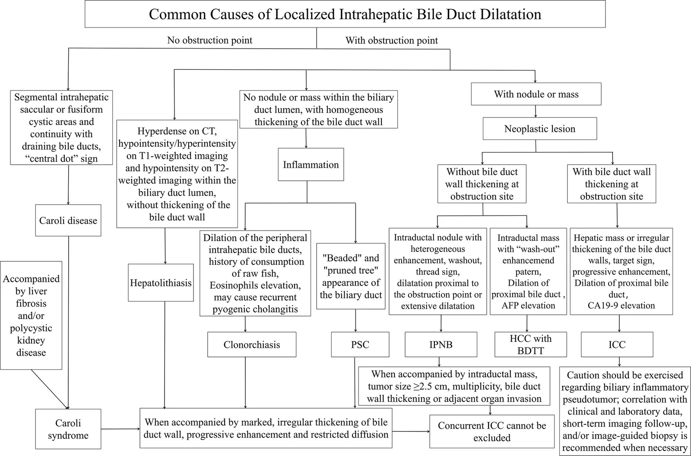
*Thuật toán tiếp cận có cấu trúc cho các bệnh gây giãn đường mật trong gan khu trú (CD/CS, sỏi trong gan, clonorchiasis, PSC, IPNB, ICC, HCC–BDTT). Cen Y et al., Insights Imaging 2026 (PMC13652791), CC BY 4.0.*

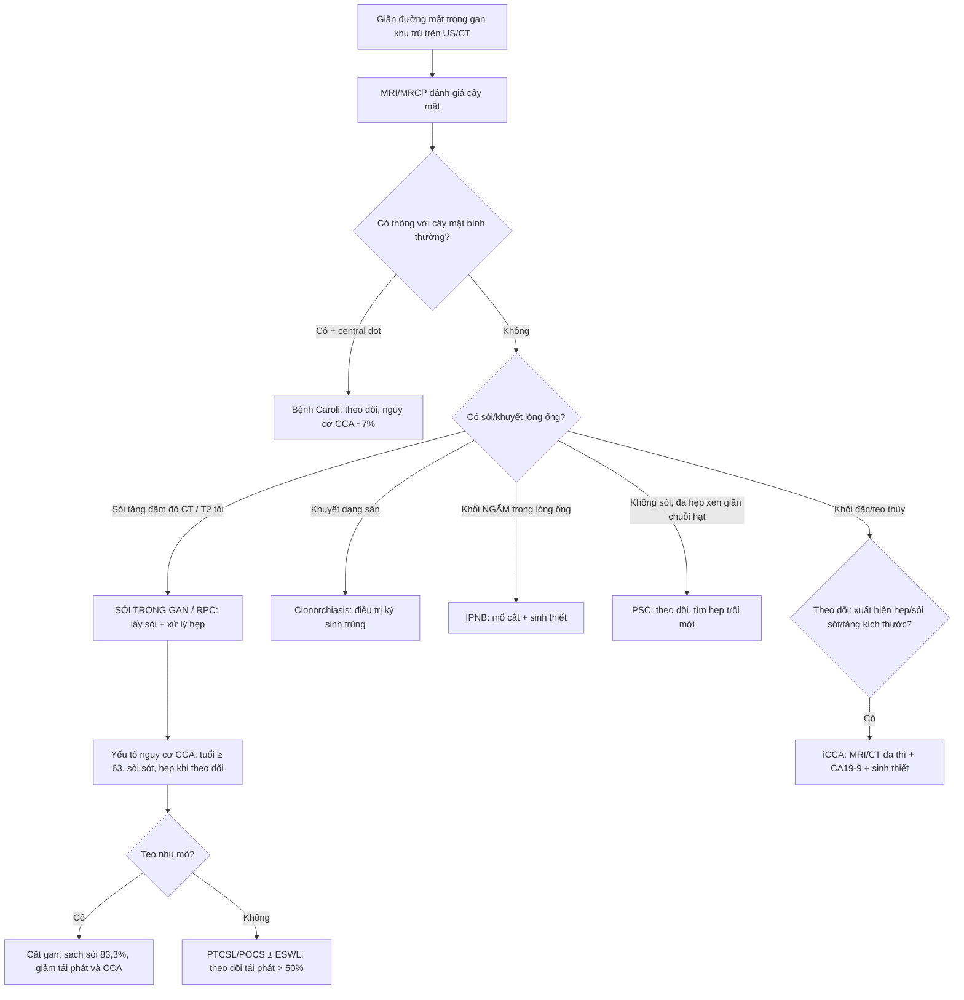

## 5. Cạm bẫy

- **Sỏi không vôi hóa "tàng hình" trên CT:** CT âm **không loại trừ** sỏi trong gan — phải **MRCP**; cân nhắc **dual-energy CT** để tăng phát hiện [PMC11036492, PMC13652791].
- **Đừng gọi sỏi trong gan là "u":** **ngấm tạm thời nhu mô gan cạnh ống mật thì ĐM** do viêm có thể **giả khối**; ngược lại **iCCA/IPNB cũng có thể kèm sỏi** → khi có **khối ngấm trong lòng ống** hoặc **teo thùy**, phải chủ động tìm ác chứ không dừng ở "sỏi" [PMC13652791].
- **Bệnh Caroli vs nang đơn thuần:** chốt là **thông với cây mật + central dot**; Caroli **kèm CCA ~7%** nên phải theo dõi, không coi là nang lành.
- **PSC:** hẹp **"trội" MỚI** ở bệnh nhân PSC **phải nghi CCA** cho tới khi loại trừ.
- **HCC xâm lấn ống mật (BDTT) hay bị bỏ sót:** nền xơ gan + **giãn đường mật trong gan** + khối gan → nghĩ BDTT (Se 93,33%/Sp 98,57% cho dấu giãn đường mật); phân biệt với CCA ống bằng **khối dạng quanh ống/bọc** vs **thâm nhiễm**.
- **Sỏi sót/tái phát là quy luật, không phải ngoại lệ:** PTCSL **tái phát > 50%**, sau cắt gan **38,5% tái phát** → theo dõi bằng hình ảnh định kỳ, đánh giá **teo gan/hẹp** vì đây vừa gây thất bại điều trị vừa là **yếu tố nguy cơ CCA** [PMC11036492].
- **Tiền sử quan trọng:** vùng dịch tễ + **ăn cá sống** (clonorchiasis) + **viêm đường mật tái diễn** đổi hẳn cách đọc hình.

## 6. Tự lượng giá — Blind Quiz

**Ca 1 — Nam 67 tuổi, đau hạ sườn phải tái diễn + sốt. CT 3 thì + MRI:**

- Hỏi: tổn thương ở đâu? Tín hiệu trên T1/T2 nói gì về thành phần sỏi? Dấu hiệu nào gợi ý đang viêm?

<b>Bấm để hiện đáp án (findings + chẩn đoán)</b>

- **Dấu hiệu:** (a–c) CT — sỏi **tăng/đồng đậm độ** trong đường mật trong gan giãn (mũi tên); (d) T1W **tín hiệu thay đổi**; (e,f) T2W **tối**; (b,g) **ngấm tạm thời nhu mô gan cạnh ống mật thì ĐM** = dấu viêm quanh đường mật.
- **Chẩn đoán:** **sỏi trong gan (hepatolithiasis)** — sỏi **sắc tố calci bilirubinate** (T2 tối, T1 thay đổi theo thành phần). Nguồn: Cen Y et al., Insights Imaging 2026 (PMC13652791), CC BY 4.0.

**Ca 2 — Nữ 65 tuổi, RPC 2 năm, sỏi trong gan lớn; CT cản quang:**

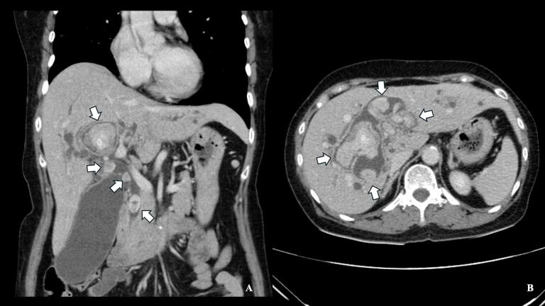

- Hỏi: mô tả bất thường chính? Vì sao gọi là "viêm đường mật mủ tái phát"? Hướng điều trị?

<b>Bấm để hiện đáp án (findings + chẩn đoán)</b>

- **Dấu hiệu:** (A coronal, B axial) **nhiều cấu trúc tăng đậm độ (sỏi)** trong lòng ống mật trong gan **giãn**.

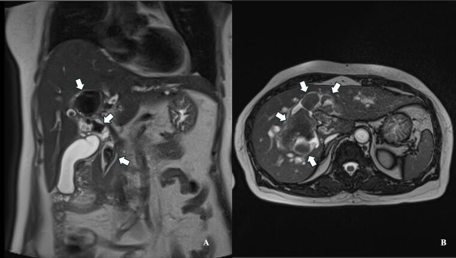
*Cùng ca: (A) vành, (B) trục — T2W thấy **khuyết tín hiệu trong lòng ống giãn** (mũi tên trắng) tương ứng sỏi.*

- **Chẩn đoán:** **recurrent pyogenic cholangitis (RPC)** — vòng xoáy sỏi–hẹp–nhiễm trùng tái diễn. Hướng điều trị: **lấy sỏi + dẫn lưu** (ca gốc: choledochoscopy + thulium laser + choledochoduodenostomy). Nguồn: Yodying H, Int J Surg Case Rep 2025 (PMC11847040), CC BY 4.0.

**Ca 3 — Bệnh nhân sỏi trong gan, MRI T2 gan trái:**

- Hỏi: dấu hiệu đặc trưng trên T2? Chẩn đoán? Điều gì quyết định phải mổ?

<b>Bấm để hiện đáp án (findings + chẩn đoán)</b>

- **Dấu hiệu:** nhiều **ổ tối tín hiệu T2** trong ống gan trái giãn → **hình "đám đông" (conglomerate appearance)** = chùm sỏi sắc tố.
- **Chẩn đoán:** **sỏi trong gan/RPC**. **Teo nhu mô** và/hoặc **hẹp quanh rốn gan** là chỉ định **cắt gan** (giảm tái phát và nguy cơ CCA). Nguồn: Pandit N & Neupane D, Clin Case Rep 2023 (PMC10268216), CC BY 4.0.

**Ca 4 — Bệnh nhân sỏi trong gan 15 năm, sụt cân; MRI/CT đa thì:**

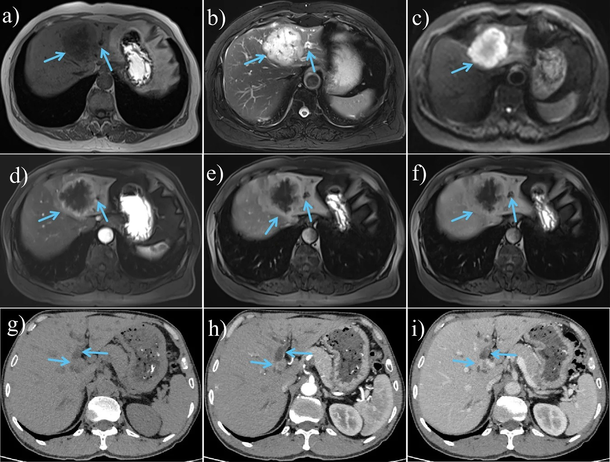

- Hỏi: vì sao phải tìm ung thư ở người sỏi trong gan lâu năm? Dấu hiệu nào rẽ hướng sang iCCA?

<b>Bấm để hiện đáp án (findings + chẩn đoán)</b>

- **Dấu hiệu:** **khối giảm T1, tăng T2/DWI, ngấm dần rồi thải** ở gan — **iCCA thể khối**, ± giãn đường mật thượng lưu.
- **Chẩn đoán:** **ung thư đường mật trong gan (iCCA)**. **Sỏi trong gan lâu năm là yếu tố nguy cơ iCCA** (mắc tích lũy **2,0%/5 năm → 6,2%/15 năm**); **tuổi ≥ 63, sỏi sót, hẹp khi theo dõi** là yếu tố nguy cơ độc lập. Nguồn: Cen Y et al., Insights Imaging 2026 (PMC13652791) + World J Hepatol 2024 (PMC11036492), CC BY 4.0 / BY-NC 4.0.

## Bài liên quan chéo
- [100 – Tổng quan hệ Bụng](../100-tong-quan-he-bung/lesson.md)
- [131 – Tắc mật: sỏi OMC, Klatskin & xơ hóa](../131-tac-mat/lesson.md) (sỏi đường mật ngoài gan)
- [132 – Hẹp đường mật không xác định & cholangioscopy](../132-hop-duong-mat-khong-xac-dinh/lesson.md) (phân biệt lành/ác)
- [133 – Hẹp miệng nối & cholangiopathy thiếu máu sau ghép](../133-hep-mieng-noi-duong-mat-sau-ghep/lesson.md) (sỏi & hẹp sau mổ)
- [123 – Nang gan & bệnh gan đa nang (Caroli/von Meyenburg)](../123-nang-gan-va-benh-gan-da-nang/lesson.md) (Caroli, nang thông mật)
- [121 – LI-RADS & HCC](../121-khoi-gan-LIRADS/lesson.md) (HCC xâm lấn ống mật – BDTT)

## Ảnh
- Xem `images/CREDITS.md`. Ảnh bài này đều **CC BY 4.0** → được phép ghép letterbox (composite) kèm attribution.

> Không dùng để chẩn đoán độc lập khi chưa có người hướng dẫn.
