# 139 — Sán lá gan (nang sán / hepatic cystic echinococcosis): phân độ WHO-IWGE CE1–CE5, dấu màng tách – hoa súng, PAIR & albendazole

**Tags:** `pattern:nang` `pattern:hoa-sung` `vung:gan` `score:WHO-IWGE-CE` `protocol:US` `incidentaloma:nang-gan`
**Mức chắc chắn (certainty):** tổng hợp y văn (literature synthesis) — nhóm tự biên từ y văn mở, có ca nguyên văn CE1 (PMC10047450) và ca CE1–CE3a (PMC13163135); số liệu lấy nguyên từ bài gốc, ghi PMCID tại chỗ.

> **Câu chốt:** nang sán không phải "nang gan đơn thuần có màng". **Phân độ WHO-IWGE quyết định điều trị**: CE1/CE3a → **PAIR**, CE2/CE3b → **mổ/MoCAT**, CE4/CE5 → **theo dõi**. **Chọc hút mà không loại trừ thông mật = nguy cơ viêm xơ đường mật và sốc phản vệ**.

## 1. Tổng quan bệnh học – cơ chế hình ảnh

### 1.1 Chu kỳ và cấu trúc nang

- **Tác nhân:** *Echinococcus granulosus* (sán dây chó). **Chó/cáo là ký chủ chính**, trứng bài qua phân; người **nhiễm ngẫu nhiên** qua thức ăn/nước nhiễm trứng. Trứng nở ở ruột → ấu trùng theo tĩnh mạch cửa tới **gan (cơ quan thường gặp nhất)**, rồi phổi/cơ quan khác (PMC13163135).
- **Cấu trúc 3 lớp (từ ngoài vào):**
  1. **Pericyst (vỏ xơ của ký chủ)** — mô xơ–viêm, **không phải mô sán**; đây là phần còn lại sau điều trị, có thể xẹp và vôi hóa.
  2. **Ectocyst / laminated membrane** — màng **không bào, dai**, cho dinh dưỡng thấm qua.
  3. **Endocyst / germinal membrane** — **lớp sinh sản**, sinh **brood capsules, protoscoleces, nang con (daughter cysts)** và **cát sán (hydatid sand)** (PMC13163135).
- **Vì sao nang "lành" về hình ảnh:** nang lớn **chậm, đồng tâm**, vỏ xơ bao quanh **không xâm lấn** nhu mô → bờ nhẵn, không phù, không ngấm thuốc. Nhưng bên trong có thể **hoạt động mạnh** (CE1–CE3).

### 1.2 TẠI SAO tín hiệu/hình ảnh như vậy (vật lý + mô bệnh)

- **Dịch nang:** nước + protein + protoscoleces → **T1 tối, T2 rất sáng**, **CT gần 0–15 HU**, **không ngấm cản quang**.
- **Màng tách (detached germinal membrane):** màng endocyst **mỏng, không mạch**, tách khỏi vỏ xơ → trên MRI là **đường T2 TỐI, lượn sóng** nổi trong dịch sáng; khi tách hoàn toàn và xẹp → **dấu hoa súng (water-lily sign)** (PMC13163135).
- **Nang con (daughter cysts):** dịch có **nồng độ protein/điện giải khác** nang mẹ → **T2 thấp hơn nang mẹ một chút**, viền tối; trên US là **"tổ ong" (honeycomb)**, **"hoa hồng" (rosette)**, **"bánh xe" (spoke-wheel)** (PMC13122038, PMC10047450).
- **Vôi hóa vỏ:** canxi lắng ở **pericyst** → **tăng đậm độ CT**, **T1/T2 tối**, không ngấm; **vôi hóa một phần KHÔNG đồng nghĩa sán chết** (chỉ vôi hóa dày đặc gần toàn bộ mới coi là ngừng hoạt động) (PMC13122038).
- **DWI:** báo cáo cũ cho rằng CE1 có **ADC thấp hơn nang đơn thuần** do protoscoleces/đại phân tử; nghiên cứu lớn gần đây **không thấy khác biệt có ý nghĩa** → **KHÔNG dùng ADC để phân biệt nang sán với nang đơn thuần** (PMC13163135).

### 1.3 Ngưỡng định lượng quan trọng

- **Phân độ WHO-IWGE:** **CL, CE1, CE2** = hoạt động; **CE3a, CE3b** = chuyển tiếp; **CE4, CE5** = ngừng hoạt động (PMC13122038).
- **Huyết thanh học phụ thuộc giai đoạn** (ELISA, tổng hợp 14 nghiên cứu — PMC8081258):
  - **CE1: 75%** (95% CI 58–92) · **CE2: 94%** (85–100) · **CE3a: 97%** (85–100) · **CE3b: 89%** (65–100) · **CE4: 57%** (34–81) · **CE5: 56%** (24–88).
  - **Hệ quả:** **huyết thanh âm không loại trừ CE4/CE5**; ngược lại **CE2/CE3a thường dương**.
- **Điều trị:** PAIR cho **CE1/CE3a**; **MoCAT/PEVAC** cho **CE2/CE3b**; **mổ** cho **CE2/CE3b > 5 cm** hoặc biến chứng; **CE4/CE5 theo dõi** (PMC13122038).
- **Biến chứng thủ thuật (so sánh 734 mổ vs 255 PAIR — PMC12865369):** **sốc phản vệ 1,6% vs 0,3%**; **tái tích dịch 4,7% vs 1,2%**; **rò mật–nang 14,6% vs 14,9%**; nằm viện **7,3 vs 3,1 ngày**. **Thể tích nang lớn (~700 mL so với ~350 mL) làm tăng nguy cơ rò mật**.
- **Theo dõi:** chụp lại **3–6 tháng**, sau đó **hằng năm ≥ 5 năm**; **đáp ứng hoàn toàn chỉ đánh giá được sau 12 tháng** (PMC13122038).

## 2. Mẫu hình + chẩn đoán phân biệt theo vị trí (Gamut)

### 2.1 Theo "độ phức tạp" của nang

- **Một ngăn, thành mỏng, không vách:** nang gan đơn thuần, **CE1**, **CL**, nang biểu mô, di căn nang một ổ.
- **Nhiều ngăn/nang con:** **CE2**, **CE3b**, MCN-L, cystadenofibroma, nang nhầy, di căn nang (neuroendocrine).
- **"Đặc giả u":** **CE4** (bóng len/cerebroid), **CE5** (vôi hóa dày), áp-xe mạn, u hoại tử, máu tụ cũ.
- **Có màng tách/mức dịch–màng:** **CE3a** (hoa súng), máu tụ đang tiêu, nang xuất huyết.

### 2.2 Theo vị trí & bối cảnh

- **Gan phải, dưới bao:** dễ vỡ do chấn thương → **sốc phản vệ, gieo rắc phúc mạc**.
- **Gan trái/hạ phân thùy:** chèn ép dạ dày, tá tràng, đường mật.
- **Rốn gan/ống mật:** **vỡ vào đường mật** → vàng da, viêm đường mật, **mảnh màng trong OMC** (PMC13163135 Fig10/13).
- **Ngoài gan:** phổi (ho ra máu, **hoa súng**), lách, thận, tim, xương — cùng nguyên lý nhưng **không dùng phân độ CE cho xương** (thể xương xâm lấn).

### 2.3 Mnemonic "CYST"

- **C**ystic (một ngăn) → CE1/nang đơn thuần.
- **Y**oung cysts (nang con) → CE2/CE3b.
- **S**eparated membrane → CE3a.
- **T**otal calcification → CE5 (ngừng hoạt động).

## 3. Bảng so sánh phân biệt (ma trận đối chiếu)

| Thực thể (entity) | Hình ảnh điển hình | Chốt vào (rule-in) | Chốt loại (rule-out) | Gợi ý xác nhận |
|---|---|---|---|---|
| **CE1** | Nang một ngăn, **màng đôi (double-wall)**, có thể "bông tuyết" (cát sán) | **Màng đôi + cát sán + huyết thanh dương** | Vách/nốt ngấm, màng tách rõ → giai đoạn khác/u | US + ELISA; PAIR nếu > 5 cm |
| **CE2** | **Nang con** chiếm toàn bộ nang mẹ: "tổ ong", "hoa hồng", "bánh xe" | **Nang con + không ngấm + huyết thanh thường dương (94%)** | Nang con không thấy, chỉ vách mảnh → MCN | US/CT/MRI; mổ hoặc MoCAT |
| **CE3a** | **Màng tách lượn sóng** trong dịch, **hoa súng** | **Màng tách + màng T2 tối + không ngấm** | Màng tách giả do vách/u nhú ngấm → MCN/IPNB | MRI/MRCP; PAIR |
| **CE3b** | **Vài nang con** trong **mô đặc không mạch** ("phô mai Thụy Sĩ") | **Nang con + matrix đặc không ngấm** | Thành phần đặc **ngấm thuốc** → u | CE-CT/MRI; mổ/MoCAT |
| **CE4** | **Khối giả đặc**, bóng len/cerebroid, **không nang con**, không ngấm | **Đặc + không ngấm + vỏ mỏng + huyết thanh có thể âm** | Ngấm thuốc, xâm lấn → ung thư | MRI/CT đa thì; theo dõi |
| **CE5** | **Vôi hóa dày đặc vỏ**, bóng sau, không ngấm | **Vôi hóa gần toàn bộ + không ngấm** | Vôi hóa một phần → còn hoạt động | CT; theo dõi |
| **Nang gan đơn thuần** | 0–15 HU, thành không thấy, không vách/nốt | **Thuần dịch + không ngấm + không màng** | Màng đôi/nang con/màng tách → sán | US; không cần điều trị |
| **MCN-L** | Nang lớn nhiều ngăn, **vách ngấm**, nữ trung niên | **Vách/đặc ngấm + nữ + lớn** | Nang con/màng tách/không ngấm → sán | MRI; **cắt trọn**, không hút |
| **Áp-xe gan** | Dày thành, phù quanh, **hạn chế khuếch tán**, khí trong ổ | **Sốt + đau + thành ngấm + khí** | Nang con/màng tách → sán | CT/MRI + cấy; dẫn lưu |

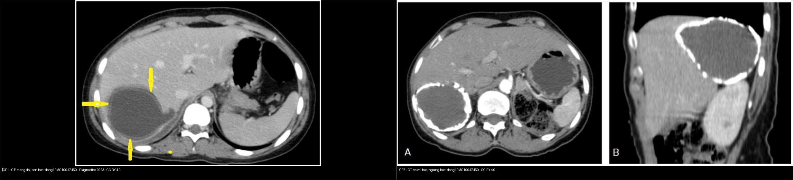
*Trái: CE1 — nang một ngăn, màng đôi (mũi tên), dịch đồng nhất. Phải: CE5 — vỏ vôi hóa dày gần toàn bộ, không còn hoạt động. Cả hai CC BY 4.0; ảnh ghép letterbox giữ nguyên tỷ lệ.*

### 3.1 Đọc phân độ theo 3 câu hỏi

1. **Có nang con không?** → có = CE2/CE3b.
2. **Có màng tách không?** → có = CE3a (nếu màng tách đơn thuần) hoặc CE3b (nếu kèm matrix đặc/nang con).
3. **Có đặc/vôi hóa không?** → đặc không ngấm = CE4; vôi hóa dày = CE5.

## 4. Protocol chụp + hệ phân độ/điểm chuẩn hóa

### 4.1 Protocol

- **Siêu âm bụng:** **phương thức đầu tay** và là nền của phân độ WHO-IWGE; đánh giá thành, vách, nang con, màng tách, cát sán.
- **CT bụng có/không cản quang:** khi nang lớn, nghi biến chứng, cần đánh giá vôi hóa, chèn ép, rò mật, hoặc trước can thiệp. **CE4 giả u cần CT/MRI có cản quang để chứng minh KHÔNG ngấm**.
- **MRI gan mật + MRCP:** khi nghi **thông mật/rò mật–nang**, nang không điển hình, hoặc cần phân biệt với MCN/ung thư. MRI cho thấy **màng tách T2 tối**, **nang con tín hiệu thấp hơn nang mẹ**, **matrix đặc không ngấm** (PMC13163135).
- **Huyết thanh:** ELISA/hemagglutination/western blot; **âm không loại trừ CE4/CE5**; **dương không chứng minh còn hoạt động** (kháng thể tồn tại sau điều trị).
- **Trước can thiệp:** **bắt buộc loại trừ thông mật–nang** bằng xét nghiệm **bilirubin trong dịch hút**, soi dịch có mật, hoặc **bơm cản quang thấy đường mật**. Nếu có thông mật → **không dùng scolicidal qua PAIR**, chuyển **S-CAT/ERCP** (PMC13122038).

### 4.2 Phân độ & xử trí (WHO-IWGE)

- **CE1/CE3a:**
  - **< 5 cm:** benzimidazole (albendazole **10–15 mg/kg/ngày**, chia 2 lần) **3–6 tháng**.
  - **5–10 cm:** **PAIR + benzimidazole**.
  - **> 10 cm:** **PAIR hoặc S-CAT + benzimidazole**; mổ là lựa chọn thay thế.
- **CE2/CE3b:**
  - **< 5 cm:** benzimidazole, theo dõi sát; thất bại → mổ.
  - **> 5 cm:** **mổ** (ưu tiên); **MoCAT/PEVAC** là thay thế ở trung tâm có kinh nghiệm.
- **CE4/CE5:** **theo dõi ("watch and wait")** nếu không triệu chứng; can thiệp khi chèn ép/vỡ/nhiễm trùng.
- **Benzimidazole quanh thủ thuật:** bắt đầu **1 ngày trước**, tiếp tục **1 tháng sau** nếu không có tràn dịch trong mổ (PMC13122038).
- **Chống chỉ định/không nên:** nang **thông mật** (PAIR), **thai 3 tháng đầu**, nang **không tiếp cận được**, rối loạn đông máu.
- **Theo dõi sau điều trị:** **3–6 tháng**, sau đó **hằng năm ≥ 5 năm**; đáp ứng hoàn toàn đánh giá **sau 12 tháng**.

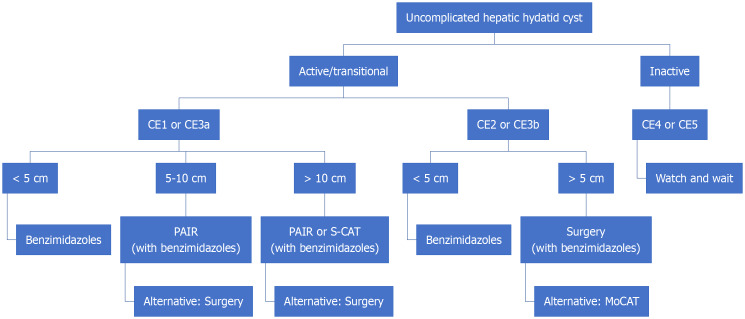
*Sơ đồ tóm tắt: CE1/CE3a → PAIR; CE2/CE3b > 5 cm → mổ (MoCAT là thay thế); CE4/CE5 → theo dõi. Nguồn: Agarwal D et al., World J Radiol 2026, PMC13122038, CC BY-NC 4.0 (giữ nguyên bản).*

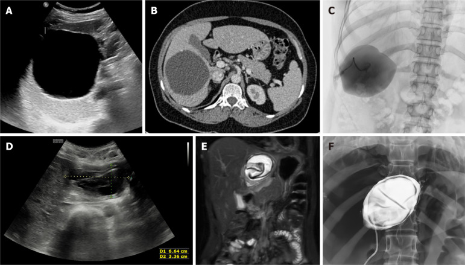
*US/CT xác định CE1; fluoroscopy bơm cản quang xác nhận **không thông mật–nang** rồi mới bơm scolicidal; sau PAIR, màng tách còn lại trong khoang. Nguồn: PMC13122038, CC BY-NC 4.0 (giữ nguyên bản).*

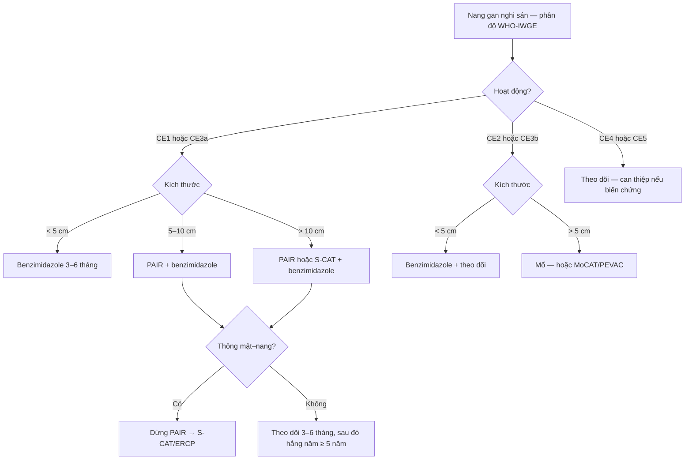

## 5. Biến thể bình thường và cạm bẫy

- **CL vs nang đơn thuần:** CL **không có vỏ rõ**, hình ảnh **không phân biệt được** với nang gan lành → **không chẩn đoán sán chỉ dựa vào hình ảnh** khi không có bối cảnh dịch tễ/huyết thanh (PMC13163135).
- **Vôi hóa một phần ≠ chết:** chỉ **vôi hóa dày đặc gần toàn bộ** mới coi là CE5 ngừng hoạt động; vôi hóa vỏ rải rác vẫn có thể còn nang con hoạt động (PMC13122038).
- **Huyết thanh âm ở CE4/CE5:** **Se chỉ ~56–57%** → **âm không loại trừ**; đừng bỏ theo dõi.
- **Màng tách vs vách:** màng tách **không ngấm**, mỏng, lượn sóng, di động trong dịch; **vách MCN ngấm thuốc**, dày, cố định. Nhầm → chọc/hút sai.
- **Rò mật–nang:** có thể **không thấy trên CT**; phải **kiểm tra bilirubin dịch hút** trước khi bơm scolicidal. Bơm nhầm → **viêm xơ đường mật**.
- **Vỡ nang:** đau đột ngột, sốc phản vệ, gieo rắc phúc mạc/phổi; **không chọc hút nang dưới bao lớn** khi chưa chuẩn bị hồi sức.
- **Sán phổi:** dấu hoa súng/liềm khí; **không nhầm với áp-xe phổi** — bối cảnh dịch tễ + huyết thanh.
- **Sán thể hang (alveolar echinococcosis):** khác hoàn toàn — **xâm lấn, không vỏ**, nhiều vi nang T2 tối, **ngấm thuốc viền**, FDG-PET dương; **không dùng PAIR** (PMC13163135).

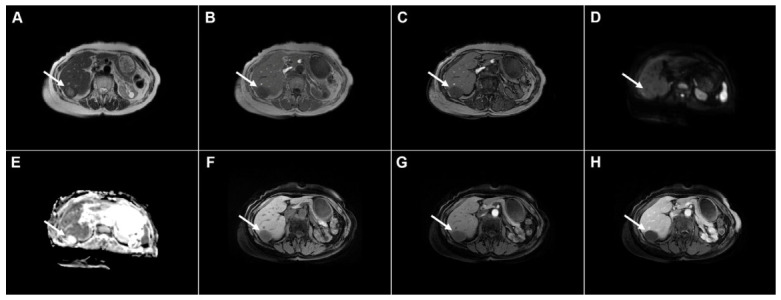
*CE4 trên MRI: tổn thương giả đặc, tín hiệu hỗn hợp, **không ngấm thuốc** ở thì động mạch/TM cửa và không hạn chế khuếch tán — điểm phân biệt với ung thư. Nguồn: Djokic Kovač J et al., Diagnostics (Basel) 2026, PMC13163135, CC BY 4.0.*

## 6. Tự lượng giá — Blind Quiz

**Ca 1 — Nữ 15 tuổi, đau bụng phải, CT có nang gan. Mô tả trước khi mở đáp án.**

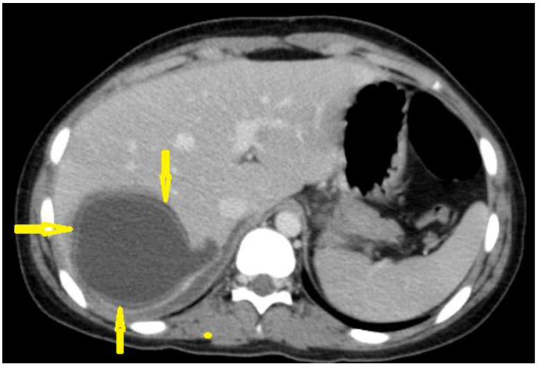

- Hỏi: dấu hiệu nào gợi nang sán? Chẩn đoán phân biệt với nang đơn thuần dựa vào đâu?

<b>Bấm để hiện đáp án</b>

- **Findings:** nang **một ngăn**, dịch đồng nhất, **màng đôi** (hai đường viền mảnh, mũi tên), **không ngấm thuốc**, không nang con.
- **Chẩn đoán:** **CE1** (hoạt động).
- **Vì sao:** màng đôi = **endocyst + pericyst**; nang đơn thuần chỉ có một thành mỏng, không tách lớp. **Huyết thanh ELISA hỗ trợ** (Se CE1 ~75%).
- **Xử trí:** nếu > 5 cm → **PAIR + albendazole**; < 5 cm → albendazole.
- **Nguồn:** Alshoabi SA et al., *Diagnostics (Basel)* 2023, PMC10047450, CC BY 4.0.

**Ca 2 — Nữ 17 tuổi, đau bụng, siêu âm gan phải có nang "nhiều ngăn".**

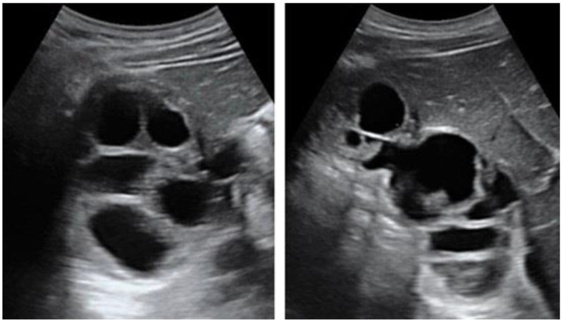

- Hỏi: gọi tên dấu hiệu; phân độ WHO? Điều trị khác CE1 ở đâu?

<b>Bấm để hiện đáp án</b>

- **Findings:** nang lớn chứa **nhiều nang con** hình tròn, vách mảnh → **"tổ ong"/"bánh xe"**.
- **Chẩn đoán:** **CE2** (hoạt động).
- **Điều trị:** **CE2 > 5 cm → mổ** (hoặc MoCAT/PEVAC); **không PAIR** vì nang con làm dẫn lưu không hoàn toàn, dễ tái tích dịch.
- **Nguồn:** PMC10047450, CC BY 4.0.

**Ca 3 — Nữ 47 tuổi, nang gan phải, MRI T2 có "sợi lượn sóng" trong dịch.**

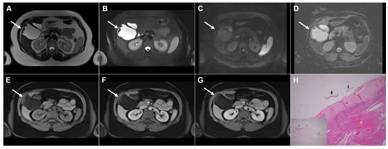

- Hỏi: dấu hiệu tên gì? Vì sao màng tối trên T2? Xử trí?

<b>Bấm để hiện đáp án</b>

- **Findings:** nang T2 rất sáng, **màng mỏng T2 tối, lượn sóng**, bám/di động trong dịch; không ngấm.
- **Chẩn đoán:** **CE3a** — **dấu hoa súng (water-lily sign)** khi màng xẹp hoàn toàn.
- **Vì sao tối:** màng **không có nước tự do**, cấu trúc protein/fibrous → **T2 ngắn**.
- **Xử trí:** **PAIR + albendazole** (CE3a đáp ứng tốt).
- **Nguồn:** Djokic Kovač J et al., *Diagnostics (Basel)* 2026, PMC13163135, CC BY 4.0.

**Ca 4 — Nam 50 tuổi, nang gan trái, CT có vôi hóa vỏ. Có cần điều trị?**

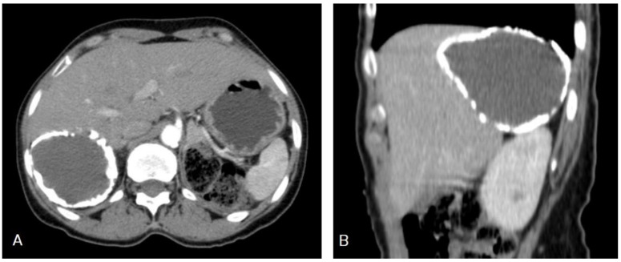

- Hỏi: phân độ? Vì sao không cần PAIR? Theo dõi thế nào?

<b>Bấm để hiện đáp án</b>

- **Findings:** nang một ngăn, **vôi hóa dày gần toàn bộ vỏ**, không nang con, không ngấm.
- **Chẩn đoán:** **CE5** (ngừng hoạt động).
- **Xử trí:** **theo dõi**, không PAIR/mổ nếu không triệu chứng; huyết thanh có thể **âm** (Se ~56%).
- **Cạm bẫy:** vôi hóa **một phần** không đủ kết luận chết.
- **Nguồn:** PMC10047450, CC BY 4.0.

**Ca 5 — Nam 38 tuổi, sốt, đau hạ sườn phải; MRI có khối "giả đặc" trong gan.**

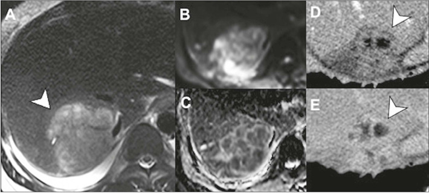

- Hỏi: vì sao không phải CE4? Dấu hiệu nào chốt áp-xe?

<b>Bấm để hiện đáp án</b>

- **Findings:** tổn thương **thành dày**, phù quanh, **hạn chế khuếch tán trung tâm**, **ngấm viền**; bệnh cảnh sốt.
- **Chẩn đoán:** **áp-xe gan** (không phải CE4).
- **Chốt:** CE4 **không ngấm thuốc**, không phù quanh, không hạn chế khuếch tán mạnh; áp-xe **ngấm viền + DWI sáng + sốt**.
- **Nguồn:** Gomes MM et al., *Radiol Bras* 2025, PMC12071424, CC BY 4.0.

**Ca 6 — Sơ đồ: đọc phân độ và chọn điều trị theo WHO.**

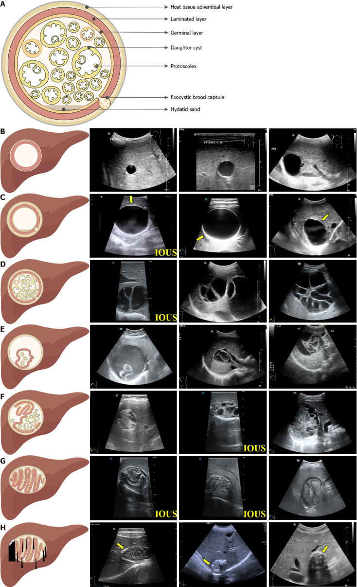

- Hỏi: từ trên xuống, các hàng B–H tương ứng giai đoạn nào? Hàng nào cần PAIR?

<b>Bấm để hiện đáp án</b>

- **Giải mã:** sơ đồ cấu trúc (A) + các giai đoạn: **B = CL/CE1** (một ngăn), **C = CE1** (màng đôi), **D = CE2** (nang con), **E = CE3a** (màng tách/hoa súng), **F = CE3b** (nang con + matrix đặc), **G = CE4** (bóng len), **H = CE5** (vôi hóa).
- **PAIR:** **CE1 và CE3a** (thường > 5 cm).
- **Nguồn:** Tao Y et al., *World J Gastroenterol* 2024, PMC11514533, **CC BY-NC 4.0** (giữ nguyên bản).

## Bài liên quan chéo
- [100 – Tổng quan hệ Bụng](../100-tong-quan-he-bung/lesson.md)
- [123 – Nang gan & bệnh gan đa nang](../123-nang-gan-va-benh-gan-da-nang/lesson.md)
- [129 – IPNB & u nhầy đường mật](../129-IPNB-va-u-nhay-duong-mat/lesson.md)
- [131 – Tắc mật](../131-tac-mat/lesson.md)
- [621 – Nang sán lá phổi ở trẻ](../621-nang-san-la-phoi-o-tre/lesson.md)
- [900 – Đại cương can thiệp](../900-ir-fundamentals-biopsy/lesson.md) (dẫn lưu/PAIR)

## Ảnh
- Tên file: `139_..._PMCxxxxx-FigN.jpg`; nguồn + giấy phép từng ảnh trong `images/CREDITS.md`.
- Ảnh **CC BY-NC** (PMC13122038, PMC11514533) **giữ nguyên bản**, không ghép/cắt.
- Ảnh ghép `composite_139_CE1-hoat-dong-vs-CE5-ngung-hoat-dong.jpg` chỉ dùng ảnh **CC BY 4.0**, letterbox nền đen, giữ tỷ lệ gốc.

> Không dùng để chẩn đoán độc lập khi chưa có người hướng dẫn.
