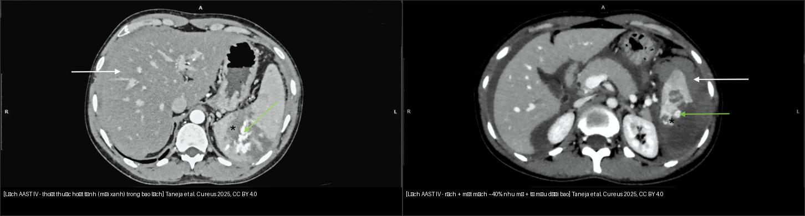
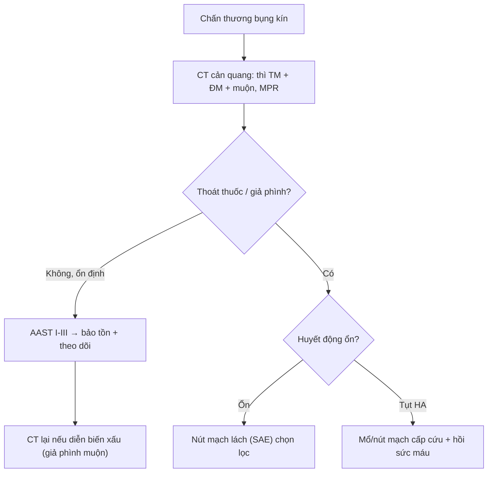
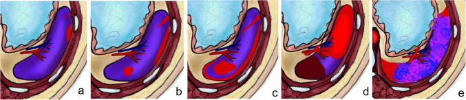
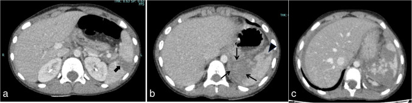
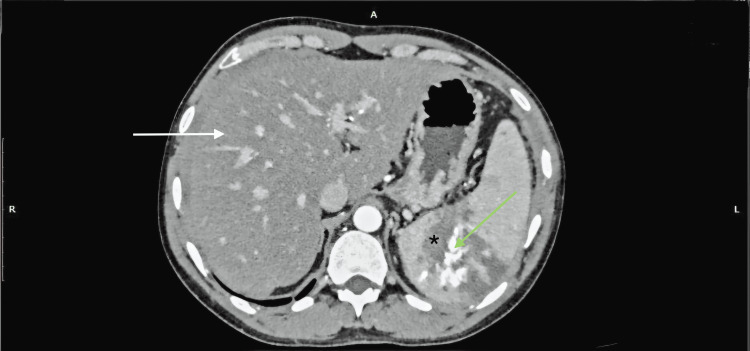
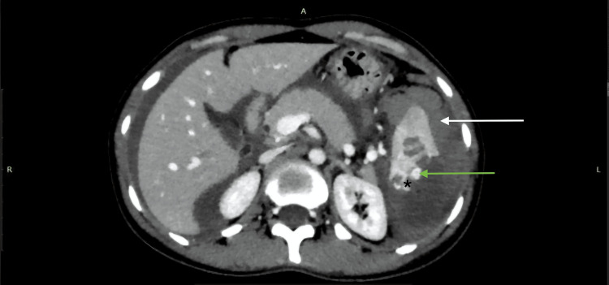

# 140 — Lách & chấn thương tạng đặc: AAST + thoát thuốc / Spleen & Solid organ trauma

**Tags:** `pattern:chan-thuong-bung` `vung:lach` `score:AAST` `protocol:CT-bung-cap-cuu`
**Mức chắc chắn (certainty):** tổng hợp y văn (literature synthesis) — nhóm tự biên từ y văn mở (review + guideline có số), chưa gắn ca nguyên văn đơn lẻ; 4 ca quiz lấy từ các bài CC BY có số liệu mô tả nguyên văn.

## 1. Tổng quan — AAST I–V + thoát thuốc hoạt tính quyết định mổ/nút

- **AAST-OIS 2018 (lách/gan/thận):** I (dưới bao < 10%/rách bao < 1 cm) → II (10–50%/rách 1–3 cm) → III (> 50%, máu trong nhu mô ≥ 5 cm, rách > 3 cm) → IV (**rách mạch thùy/cuống → mất mạch > 25%**, giả phình/AVF, **đường máu đang chảy nhưng CÒN trong bao**) → V (vỡ nát/cuống mạch; **máu đang chảy ĐÃ vượt bao vào ổ bụng**). Điểm sửa 2018: bỏ grade VI, V là cao nhất; thêm thì động mạch để bắt tổn thương mạch.
- **TẠI SAO (vật lý CT):** phân biệt 3 thứ cùng "tăng tỷ trọng" trong nhu mô vỡ:
  - **Thoát thuốc hoạt tính (active extravasation):** máu đang chảy → ổ **tăng tỷ trọng lan rộng và to dần giữa các thì** → nút/mổ cấp cứu.
  - **Giả phình (pseudoaneurysm):** túi mạch **giữ hình tròn, không to thêm**, ngấm đồng thì với ĐM → **nút mạch chọn lọc** (vỡ muộn chết người nếu bỏ sót).
  - **Nhồi máu/mất mạch (devascularization):** vùng **không ngấm ở MỌI thì** (khác đụng dập sẽ ngấm lại thì muộn) → đánh dấu mức độ nặng (grade IV khi > 25%).
- **Ngưỡng xử trí:** huyết động **ổn + không thoát thuốc = bảo tồn**; **thoát thuốc/giả phình + tụt HA = nút mạch/mổ cấp cứu**. Phần lớn chấn thương lách kín ở trẻ **điều trị bảo tồn** (nhất là khi huyết động ổn) — quyết định dựa trên **huyết động**, không chỉ độ AAST.
- **Máu cục canh gác (sentinel clot) 45–70 HU** kề tạng vỡ nhất — TẠI SAO: máu đông đặc nhất ở gần nguồn chảy, loãng dần ra xa; chỉ đúng tạng vỡ trong đa chấn thương.

## 2. Gamut sau chấn thương bụng

- **Rách lách + thoát thuốc:** nút mạch lách (giữ lách, ngừa nhiễm trùng sau cắt — OPSI).
- **Giả phình ĐM lách:** nốt ngấm khu trú + chấn thương cũ — nút mạch (vỡ muộn chết người).
- **Vỡ gan/thận độ cao + tụt HA:** mổ/nút mạch theo AAST + huyết động.
- **Tụ máu dưới bao ổn định:** bảo tồn + CT lại (theo dõi giả phình muộn).
- **Khe lách bẩm sinh / lách phụ (splenule):** không phải vỡ — bờ nhẵn, có vỏ bao, không máu quanh.

## 3. Bảng so sánh phân biệt (ma trận đối chiếu)

| Thực thể (entity) | Hình ảnh điển hình | Chốt vào (rule-in) | Chốt loại (rule-out) | Gợi ý xác nhận |
|---|---|---|---|---|
| Rách lách độ thấp (I–III) | Rách bao/nhu mô ≤ 3 cm hoặc dưới bao < 50%; **không ngấm lan** | Ổn định + **không thoát thuốc** | Ổ tăng tỷ trọng **to dần giữa các thì** → thoát thuốc | CT thì TM; theo dõi |
| Thoát thuốc hoạt tính | Vệt tăng tỷ trọng **lan rộng ở thì muộn**, kèm tụ máu | **Ổ to dần giữa các thì** + tụt HA | Ổ giữ hình tròn, không to thêm → giả phình | CT 2 thì (ĐM + TM); nút/mổ |
| Giả phình ĐM lách | Nốt **tròn ngấm khu trú** đồng thì ĐM, không lan | Nốt tròn giữ hình + chấn thương cũ | Vệt lan rộng → thoát thuốc | CT/CTA; **nút mạch chọn lọc** (vỡ muộn) |
| Nhồi máu/mất mạch (grade IV) | Vùng **không ngấm MỌI thì**, hình chêm; > 25% nhu mô | Không ngấm ở cả thì ĐM/TM/muộn | Ngấm lại thì muộn → đụng dập | CT 3 thì; đánh giá % mất mạch |
| Vỡ nát / vượt bao (grade IV–V) | Rách phức tạp, máu **vượt bao vào ổ bụng** | Máu ngoài bao + mất mạch lan rộng | Máu còn trong bao → grade IV | CT; mổ/nút cấp cứu |
| Khe lách bẩm sinh (cleft) | Đường giảm tỷ trọng **bờ nhẵn**, có vỏ bao | Bờ nhẵn, **không máu quanh** | Bờ sắc + máu quanh → vỡ thật | CT; so phim cũ |
| Lách phụ (splenule) | Nốt nhu mô **cùng tỷ trọng lách** ở rốn lách | Cùng ngấm như lách | Khác tỷ trọng/ngấm → u/hạch | CT; tiền sử cắt lách |

*Trái: thoát thuốc hoạt tính (mũi xanh) trong bao lách — máu đang chảy. Phải: rách lớn + mất mạch ~40% nhu mô + tụ máu dưới bao. Nguồn: Taneja et al., Cureus 2025 (CC BY 4.0). Ảnh ghép letterbox.*

## 4. Protocol + hệ phân độ

- **CT cản quang chấn thương:** **thì tĩnh mạch (TM) là nền tảng**; thêm **thì ĐM** để bắt thoát thuốc/giả phình/mạch, **thì muộn** để bắt rò nước tiểu (thận) — luôn **MPR/3D**. Ở trẻ ưu tiên **ALARA** (hạn chế chụp lặp vô ích).
- **Xử trí lách (2018 + thực hành):** huyết động ổn → **điều trị bảo tồn**; throát thuốc/giả phình → **nút mạch lách (SAE)** ưu tiên hơn cắt lách để giữ chức năng miễn dịch; cắt lách → tiêm ngừa phế cầu/meningococcus/Hib (ngừa OPSI).
- Giả phình + tụt HA muộn sau chấn thương = **vỡ giả phình** → CTA + nút mạch ngay.

## 5. Cạm bẫy

- **Thoát thuốc tĩnh mạch** (muộn mới hiện) giả động mạch — phải so **2 thì**.
- **Lách phụ (splenule)** giả hạch/u — cùng tỷ trọng lách + tiền sử cắt lách.
- **Bảo tồn quá đà khi thoát thuốc + tụt HA** — nút/mổ, đừng chờ.
- **Khe lách bẩm sinh (cleft)** giả vỡ — bờ nhẵn + vỏ bao lót + không máu quanh (vỡ là bờ sắc + máu!).
- **Lách da báo thì động mạch sớm (zebra spleen)** giả đụng dập — thì cửa đồng nhất lại là chốt (đụng dập thật vẫn khuyết!).
- **Sentinel clot** giúp định vị tạng vỡ trong đa chấn thương — đừng bỏ qua cục máu tăng tỷ trọng 45–70 HU.

## 6. Tự lượng giá — Blind Quiz (ảnh trơn ngoài, đáp án ẩn trong khối chi tiết)

**Ca 1 — Bảng phân độ: nhìn hình, gọi tên độ AAST lách (a–e) trước khi mở đáp án.**

- Câu hỏi: Dấu hiệu nào nâng độ từ III lên IV? IV khác V ở điểm nào?

<b>Bấm để hiện đáp án (findings + chẩn đoán)</b>

- **a = I** (dưới bao < 10%/rách bao < 1 cm); **b = II** (dưới bao 10–50%, máu trong nhu mô < 5 cm); **c = III** (> 50%, rách > 3 cm); **d = IV** (**tổn thương mạch thùy/cuống → mất mạch > 25%**, giả phình/AVF, máu chảy còn trong bao); **e = V** (vỡ nát/cuống; máu **vượt bao vào ổ bụng**).
- **Chốt nâng III→IV:** mạch máu bị tổn thương (mất mạch phân thùy > 25% / giả phình). **IV vs V:** máu còn trong bao (IV) vs đã vượt bao (V).
- Nguồn ảnh: Mohammad et al., Pediatr Radiol 2025 (PMC12513975) — CC BY 4.0.

**Ca 2 — Ba trẻ chấn thương bụng: đọc lách, xác định độ nặng nhất.**

- Câu hỏi: Panel nào là lách vỡ nát (grade V)? Có thoát thuốc không?

<b>Bấm để hiện đáp án (findings + chẩn đoán)</b>

- **(a)** bé trai 9 tuổi: rách xuyên từ mặt bao này sang mặt bao kia > 3 cm = **grade III**; **(b)** bé trai 8 tuổi: máu trong nhu mô + rách ngắn, **không thoát thuốc** = grade III; **(c)** bé trai 9 tuổi: **nhiều đường rách + vỡ nát = grade V**.
- Không có thoát thuốc hoạt tính trong các panel → hướng **bảo tồn** nếu huyết động ổn.
- Nguồn ảnh: Mohammad et al., Pediatr Radiol 2025 (PMC12513975) — CC BY 4.0.

**Ca 3 — Nam 33 tuổi tai nạn: có dấu hiệu gì trong nhu mô lách và cần làm gì?**

- Câu hỏi: Đây là thoát thuốc hay giả phình? Vì sao cần thì thứ hai? Hướng xử trí?

<b>Bấm để hiện đáp án (findings + chẩn đoán)</b>

- **Thoát thuốc hoạt tính** (mũi xanh) trong **bao lách** + đường rách lớn tới rốn lách (dấu sao đen) → **AAST grade IV**; kèm **thoái hóa mỡ gan** (mũi tên trắng, ngấm kém hơn).
- **Thoát thuốc lan rộng giữa các thì** phân biệt với giả phình (giữ hình, không lan) → cần **thì ĐM + TM**.
- Xử trí: huyết động ổn → **nút mạch lách chọn lọc**; tụt HA → mổ/nút cấp cứu.
- Nguồn ảnh: Taneja et al., Cureus 2025 (PMC12574477) — CC BY 4.0.

**Ca 4 — Nữ 31 tuổi tai nạn: đọc độ AAST và các thành phần.**

- Câu hỏi: Vì sao gọi grade IV chứ không phải III? Các thành phần tổn thương?

<b>Bấm để hiện đáp án (findings + chẩn đoán)</b>

- **Rách lớn + mất mạch ~40% nhu mô** (dấu sao đen) = tổn thương mạch thùy → **grade IV** (chốt so với III); kèm **tụ máu dưới bao** (mũi tên trắng) và **ổ thoát thuốc nhỏ giới hạn trong bao** (mũi xanh).
- Chẩn đoán grade IV **không dựa vào độ sâu đường rách** mà dựa vào **% mất mạch (ở đây ~40% > 25%)**.
- Nguồn ảnh: Taneja et al., Cureus 2025 (PMC12574477) — CC BY 4.0.

## Bài liên quan chéo
- [100 – Tổng quan hệ Bụng](../100-tong-quan-he-bung/lesson.md)
- [110 – Giải phẫu bụng](../110-giai-phau-bung/lesson.md) (khoang quanh thận)
- [080 – Chấn thương ngực](../080-chan-thuong-nguc/lesson.md) (đa chấn thương)
- [636 – Cấp cứu niệu–sinh dục nhi (AAST thận & xoắn)](../636-cap-cuu-nieu-sinh-duc-nhi/lesson.md) (AAST thận + then chốt huyết động)

## Ảnh
- Chi tiết nguồn + giấy phép từng ảnh: `images/CREDITS.md` và `sources.md`.
- Tất cả ảnh bài này là **CC BY 4.0** (ghi nguồn); ảnh ghép dùng `tools/make_composite.py` (letterbox, giữ aspect).

> Không dùng để chẩn đoán độc lập khi chưa có người hướng dẫn.
