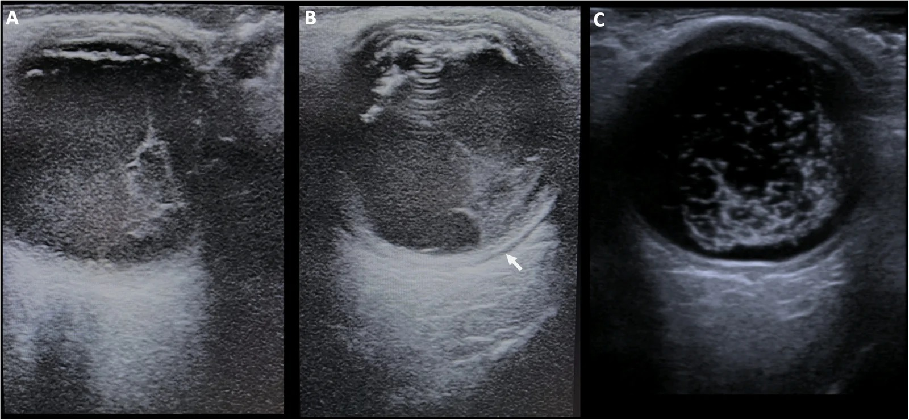
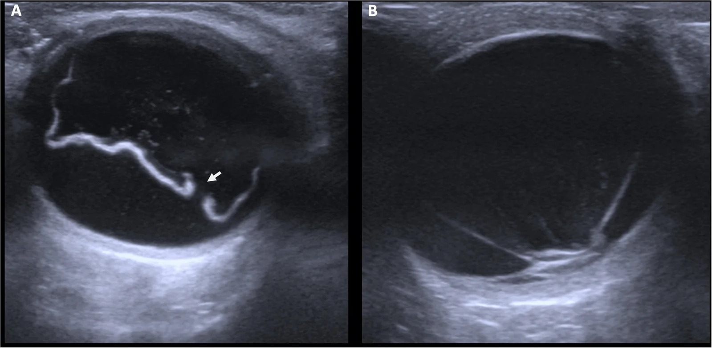
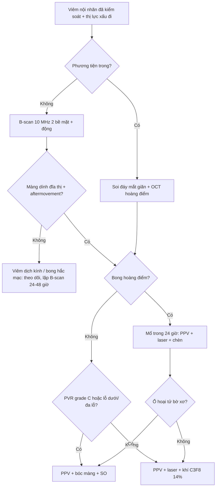
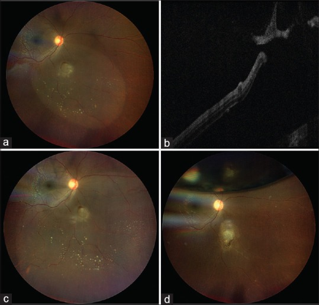

# 1402 — Bong võng mạc sau viêm nội nhãn: lỗ hoại tử vs màng co kéo, khi nào mổ và chọn dầu hay khí / Retinal detachment after endophthalmitis

**Tags:** `pattern:bong-vong-mac` `pattern:lo-hoai-tu` `pattern:co-keo` `pattern:viem-noi-nhan` `pattern:manh-dich-kinh` `vung:vong-mac` `vung:dich-kinh` `vung:hoang-diem` `score:PVR` `protocol:sieu-am-B-scan` `protocol:OCT-hoang-diem` `protocol:PPV` `protocol:dau-silicone`
**Mức chắc chắn (certainty):** tổng hợp y văn (literature synthesis) — nhóm tự biên từ: đoàn hệ 108 ca viêm nội nhãn/16 ca bong võng mạc ở Đại học Michigan (CC BY-NC 3.0, PMC8053519), đoàn hệ 116 mắt 23G PPV Hamburg–Tübingen (CC BY 4.0, PMC8638527), so sánh bong đồng thời vs bong muộn 121 mắt Sankara Nethralaya (Dove, PMC9833315), tổng quan hệ thống vai trò dầu silicone (CC BY 4.0, PMC9505397), RCT khả thi EVIAN về cắt dịch kính sớm (CC BY 4.0, PMC13421665), ca nguyên văn MRSA hậu sản (CC BY-NC-SA 4.0, PMC13043155) và tổng quan B-scan (CC BY 4.0, PMC13672910).

> **Vì sao bài này quan trọng:** các bài **463/474/475** dạy *nhận diện và diệt vi trùng/nấm* trong nhãn cầu, nhưng đều kết thúc bằng "theo dõi". Thứ giết thị lực **sau** khi nhiễm trùng đã được kiểm soát là **bong võng mạc (retinal detachment — RD)**: **8,3–25%** các ca viêm nội nhãn, trung vị **27 ngày**, và **81,3% xảy ra trong 2 tháng đầu** (PMC8053519). Khi đã bong, **31,3% phải bỏ mắt** (so với 8,7% nếu không bong, p = 0,024) và chỉ **56,3%** gắn lại được võng mạc. Với bác sĩ CĐHA, câu hỏi thực hành là: **màng trong dịch kính trên B-scan là mủ hay là võng mạc đã bong?** — vì một bên chờ, một bên mổ trong 24 giờ.

## 1. Tổng quan bệnh học – cơ chế hình ảnh – vì sao bong sau viêm nội nhãn lại khác bong thường

- **Hai cơ chế song song, cho hai kiểu bong khác nhau:**
  1. **Hoại tử độc (toxic necrosis) → bong rách (rhegmatogenous, RRD):** độc tố vi khuẩn + protease của bạch cầu trung tính phá hủy **toàn bộ bề dày võng mạc tại ổ viêm hắc mạc–võng mạc (chorioretinitis)**. Trong ca nguyên văn MRSA hậu sản, ổ chorioretinitis **1 đường kính đĩa** tiến triển thành **lỗ toàn bộ bề dày + bong khu trú chỉ sau 2 ngày** (PMC13043155, Fig. 1a–b). Đây là lý do ổ hoại tử **tự nó là lỗ rách**, không cần rách hình móng ngựa do co kéo dịch kính.
  2. **Viêm màng → tăng sinh co kéo (tractional, TRD/PVR):** fibrin, tế bào viêm và yếu tố tăng trưởng trong dịch kính tạo **giàn giáo xơ**; khi viêm lắng xuống, màng co lại kéo võng mạc. Đây là cơ chế của bong **muộn** (sau 2 tháng) — tương ứng **PVR 18,8%** trong đoàn hệ 16 ca (PMC8053519).
- **TẠI SAO dịch kính là "lò phản ứng":** dịch kính là **gel vô mạch, không có hệ miễn dịch tại chỗ**, thể tích ~4 mL; vi khuẩn/nấm nhân lên không bị cản, kháng sinh toàn thân khó thấm (hàng rào máu–dịch kính) → **nồng độ độc tố cao, kéo dài**; đồng thời **RPE bị bộc lộ** (do võng mạc hoại tử) là nguồn tế bào chuyển dạng cơ–nguyên bào (myofibroblast) → PVR. Vì vậy **viêm nội nhãn tạo ra cả hai cơ chế cùng lúc**, và tổn thương **không dừng khi hết mủ**.
- **Con số nằm lòng (phân tầng nguy cơ):**
  - **Tần suất bong sau viêm nội nhãn:** Endophthalmitis Vitrectomy Study (EVS) **8,3%**; các loạt khác **9–21%**; Michigan **14,8% (16/108)**; Hamburg–Tübingen sau 23G PPV **21,55% (25/116)**, bong trung bình **25 ngày** sau viêm nội nhãn (PMC8638527).
  - **Thời điểm:** trung vị **27 ngày** (khoảng 1–581 ngày; IQR 25,3); **81,3% trong 2 tháng**; chỉ **1/16** bong sau 1 năm (PMC8053519).
  - **Kiểu bong:** RRD **50%**, TRD **37,5%**, bong tiết dịch (ERD) **6,25%**, phối hợp RRD/TRD **6,25%**; **38%** đã bong hoàng điểm lúc chẩn đoán.
  - **Yếu tố nguy cơ có ý nghĩa:** **không có thể thủy tinh (aphakia) p = 0,014** và **dính đồng tử sau (posterior synechiae) p = 0,023**; **hypopyon và độc lực vi khuẩn KHÔNG tương quan** với bong trong loạt này (ngược trực giác — vì vậy không được dùng "mủ ít" để trấn an).
  - **Kết cục:** gắn lại võng mạc **56,3%**; **bỏ mắt 31,3%** (p = 0,024 so với 8,7%); thị lực cuối **≥ 20/400 chỉ 37,5%** ở nhóm bong (54,5% nếu không tính ca bỏ mắt); **PVR 18,8%**, nhãn áp thấp ≤ 5 mmHg **18,8%**.
  - **Tác nhân độc lực cao:** *S. aureus* kháng methicillin (MRSA) — bong **> 50%** trong các loạt MRSA nội sinh (dẫn qua PMC13043155); nấm men **30,6%** và nấm mốc **12,5%** (bài 463).
- **Vật lý hình ảnh — vì sao B-scan vẫn là "mắt thay thế" khi dịch kính đục:**
  - Siêu âm **10 MHz** cho **độ phân giải trục ~0,1–0,2 mm** (B-scan chuẩn nhãn cầu 10 MHz; UBM 35–50 MHz cho tiền phòng). Võng mạc bong là **đường hồi âm cao, mảnh, mượt**, **dính về phía đĩa thị** và **rung sau khi ngừng đầu dò (aftermovement)**; màng dịch kính có **hồi âm thấp hơn, dày không đều, không dính đĩa**, và **di động mạnh** hơn.
  - **OCT** (độ phân giải trục 5–7 µm) chỉ dùng được khi **phương tiện trong suốt**; đúng lúc cần (mủ dịch kính) thì **không làm được** → B-scan quyết định. Khi đã nhìn được: OCT chứng minh **lỗ toàn bộ bề dày** (mất liên tục các lớp, dịch dưới võng mạc) như Fig. 1b của PMC13043155.
  - **Dầu silicone** (1000–5000 cSt) có **âm học rất khác** dịch kính: trong mắt đã bơm dầu, **sóng âm xuyên qua dầu** nhưng **tốc độ truyền khác** → **đo trục nhãn cầu sai** nếu không hiệu chỉnh chế độ dầu; đây là cạm bẫy khi so kích thước tổn thương.

## 2. Mẫu hình + chẩn đoán phân biệt theo cơ chế và thời điểm (Gamut)

- **Theo thời điểm (quyết định cách xử trí):**
  - **Bong đồng thời (concurrent, lúc nhập viện):** 45/121 mắt trong loạt Sankara Nethralaya; thường **RRD do lỗ hoại tử** hoặc **TRD do màng viêm đã dày**; tỷ lệ gắn lại **77,7%**.
  - **Bong muộn (delayed, sau điều trị):** 76/121; đa số **trong 2 tháng**; gắn lại **84,3%** — **không khác có ý nghĩa** so với bong đồng thời (p = 0,376), tức **thời điểm không phải yếu tố tiên lượng độc lập**; yếu tố quyết định là **PVR và tình trạng hoàng điểm**.
  - **Bong rất muộn (> 1 năm):** hiếm (1/16), cơ chế **PVR tiến triển** hoặc lỗ mới — phải tìm **lỗ nguyên phát mới**, không mặc định "di chứng cũ".
- **Theo hình thái (gamut hình ảnh):**
  - **Bong rách (RRD):** đường bong **lồi, gấp nếp ("corrugated")**, di động, **dính đĩa thị**, thấy **lỗ trong võng mạc bong** (Fig. 6A PMC13672910) → mổ + laser + chèn.
  - **Bong co kéo (TRD):** **màng căng, bong nông, "mặt bàn" (table-top)**, võng mạc **kém di động**, thường có **màng trước võng mạc** → cần **bóc màng**, chèn dầu.
  - **Bong tiết dịch (ERD):** **dịch di chuyển theo tư thế**, **không có lỗ**, thường **do độc tố/viêm toàn thân** → **không mổ**; điều trị nguyên nhân.
  - **Bong hắc mạc (choroidal detachment) — giả bong:** **hình vòm, dày, hồi âm trong cao**, **không dính đĩa thị** (chừa cực sau), thường kèm **nhãn áp thấp** → **không phải RD**, nhưng có thể **cùng tồn tại** với RD (Fig. 9 PMC13672910).
- **Mnemonic "3 lớp – 3 câu hỏi" khi đọc B-scan mắt viêm nội nhãn:** **(1) màng đó có dính đĩa thị không? (2) có di động/aftermovement không? (3) có lỗ và bong hoàng điểm không?** — trả lời 3 câu này phân biệt được dịch kính – võng mạc – hắc mạc trong > 90% ca có phương tiện đục.

## 3. Bảng so sánh phân biệt (ma trận đối chiếu)

| Thực thể (entity) | Hình ảnh điển hình (B-scan / OCT / đáy mắt) | Chốt vào (rule-in) | Chốt loại (rule-out) | Gợi ý xác nhận |
|---|---|---|---|---|
| **RRD sau lỗ hoại tử** | Đường bong **mảnh, hồi âm cao, gấp nếp**, dính đĩa; **lỗ toàn bộ bề dày** ngay tại ổ chorioretinitis cũ; OCT mất liên tục mọi lớp + dịch dưới võng mạc | **Lỗ nằm đúng ổ viêm cũ** + bong khu trú lan nhanh (ngày) | Võng mạc dính đĩa nhưng **không thấy lỗ** và **không di động** → nghĩ TRD | Soi đáy mắt giãn đồng tử + OCT vùng lỗ; B-scan khi đục |
| **TRD/PVR sau viêm** | Màng **dày, hồi âm trung bình–cao, kém di động**, bong **nông, căng**, "table-top"; PVR grade B–C (màng + co rút) | **Màng trước võng mạc co kéo** + bong **muộn** (> 2 tháng) sau viêm | Bong **lồi, di động, có lỗ** → RRD | B-scan động + OCT; đánh giá PVR trước mổ |
| **ERD do độc tố/viêm** | Bong **nhẵn, không lỗ**, **dịch đổi vị trí theo tư thế**, có thể **2 bên** | **Dịch di chuyển khi nghiêng đầu** + không lỗ | Có lỗ/màng co kéo → không phải ERD thuần | Đổi tư thế khi siêu âm; điều trị nội khoa |
| **Bong hắc mạc (giả RD)** | **Hình vòm dày**, hồi âm trong **cao/không đều**, **chừa cực sau**, nhãn áp thấp | **Không dính đĩa thị** + vòm dày + nhãn áp ≤ 5 mmHg | Dính đĩa + mảnh + di động → RD | B-scan 2 bề mặt; đo nhãn áp |
| **Viêm dịch kính đơn thuần** | **Màng/mảng lơ lửng trong dịch kính**, **hồi âm thấp**, **không dính đĩa**; hắc mạc dày, dịch dưới bao Tenon (Fig. 12 PMC13672910) | **Màng trong dịch kính, võng mạc còn áp** phía sau | Màng **dính đĩa + aftermovement** → RD | Theo dõi 24–48 giờ, lặp B-scan; không mổ vì "màng" |

*Ba mặt cắt B-scan 10 MHz ở bệnh nhân viêm nội nhãn (A, B) và giả màng do tinh thể (C). Nguồn: Raharja A et al., Eur J Ophthalmol 2026 (PMC13672910) Fig. 12, CC BY 4.0.*

*(A) Bong rách: võng mạc lồi, gấp nếp, thấy lỗ nguyên phát (mũi tên trắng). (B) Bong co kéo ở bệnh nhân đái tháo đường: màng căng, bong nông. Nguồn: Raharja A et al., Eur J Ophthalmol 2026 (PMC13672910) Fig. 6, CC BY 4.0.*

## 4. Protocol chụp – thời điểm mổ – chọn dầu hay khí

- **Khi nào chụp gì:**
  - **Đáy mắt giãn đồng tử + OCT** là bước 1 **nếu phương tiện còn trong** — tìm **lỗ tại ổ viêm cũ**, đánh giá **hoàng điểm còn áp hay đã bong** (quyết định mổ cấp cứu trong 24 giờ nếu macula-on).
  - **B-scan 10 MHz (2 bề mặt trực giao + đầu dò động)** là bước 1 **nếu dịch kính đục/mủ**: trả lời 3 câu hỏi ở mục 2; **không đè đầu dò** trên mắt vừa mổ; ghi rõ **có/không bong hoàng điểm**, **dính đĩa**, **aftermovement**.
  - **Khi nghi nhiễm trùng lan tỏa:** siêu âm **không** thay được **cấy dịch kính**; B-scan dày hắc mạc + dịch dưới Tenon là dấu hiệu viêm nặng, không phải dấu hiệu "hết nhiễm".
- **Thời điểm cắt dịch kính (PPV):**
  - **PPV sớm + kháng sinh nội nhãn** là lựa chọn khi **thị lực ≤ đếm ngón tay/LP**, **viêm dịch kính đặc**, hoặc **đã có bong**; RCT khả thi **EVIAN** (63 bệnh nhân, PPV trong **48–96 giờ** so với tiêm kháng sinh lặp lại) chứng minh **tính khả thi** và **tín hiệu cải thiện thị lực**, chưa đủ cỡ mẫu để kết luận cứng (PMC13421665).
  - **Nếu đã bong:** mổ **sớm** — gắn lại chỉ **56,3%**, và **hoàng điểm bong** là yếu tố tiên lượng xấu; **không chờ "hết viêm"** vì màng xơ sẽ dày thêm.
  - **Bơm khí bơm–hút (pneumatic retinopexy) đơn thuần KHÔNG đủ** cho lỗ hoại tử hậu cực: trong ca nguyên văn, bơm **0,3 mL C3F8 100%** thất bại sau 4 ngày, phải chuyển PPV + laser + **C3F8 14%** (PMC13043155) — vì lỗ **hoại tử bờ không dính** và còn **dịch tiết dưới võng mạc**.
- **Chọn vật liệu chèn (tamponade) — bằng chứng định lượng:**
  - **Dầu silicone (SO):** tổng quan hệ thống 44 bài cho thấy khi PPV + SO, **bong sau mổ 0–6,2%** so với **25,5–76,6%** ở nhóm chứng (PMC9505397); SO **giữ được laser**, **ngăn nhãn áp thấp nặng**, và có **hoạt tính ức chế vi khuẩn/nấm in vitro ở 5/7 nghiên cứu**.
  - **Mặt trái của SO:** **chia ngăn nhãn cầu (compartmentalization)** làm **thuốc nội nhãn phân bố kém và thải chậm**, **độc tính võng mạc/thị đĩa** đã báo cáo, **tăng nhãn áp**, **đục thủy tinh thể**, phải **lấy dầu** (lần mổ thứ hai) — vì vậy **không dùng SO cho mọi ca**.
  - **Khí (C3F8 14% / SF6 20%):** chọn khi **một lỗ phía trên, hoàng điểm còn áp, không PVR**; **không** chọn khi **lỗ dưới/đa lỗ/PVR** hoặc bệnh nhân **không hợp tác tư thế** (khí tan 6–8 tuần với C3F8).
  - **Nguyên tắc thực hành:** *bong + PVR + lỗ hoại tử bờ xơ → **SO**; bong + một lỗ + không PVR → **khí**; bong tiết dịch thuần → **không chèn, điều trị nguyên nhân***.
- **Phân độ PVR (Machemer):** **grade A** (đục dịch kính, tế bào) → **grade B** (màng + cuộn bờ võng mạc) → **grade C** (màng co rút toàn bộ bề dày, **C1–C3 theo số giờ**). **P = posterior, A = anterior, C = complex**; **grade C** là ngưỡng cân nhắc **PPV + SO + bóc màng** thay vì đai củng mạc.

## 5. Biến thể bình thường và cạm bẫy

- **Cạm bẫy 1 — "màng trong dịch kính = bong võng mạc":** viêm nội nhãn tạo **màng fibrin lơ lửng**, hồi âm thấp, **không dính đĩa**, di động mạnh; võng mạc phía sau vẫn áp (Fig. 12A–B PMC13672910). **Mổ vì màng này = mổ vào mắt còn nhiễm** → thất bại và bỏ mắt.
- **Cạm bẫy 2 — bỏ sót bong hắc mạc:** vòm dày hồi âm cao **chừa cực sau** dễ bị đọc là "võng mạc dày"; kiểm **nhãn áp thấp** và **dính đĩa** để phân biệt; bong hắc mạc + bong võng mạc **có thể cùng tồn tại** (Fig. 9 PMC13672910).
- **Cạm bẫy 3 — dùng "hypopyon ít" để trấn an:** trong đoàn hệ 108 ca, **hypopyon không tương quan** với bong; **dính đồng tử sau** mới là dấu hiệu viêm mạn → **không** dùng tiền phòng sạch để loại trừ.
- **Cạm bẫy 4 — bỏ qua mắt không có thể thủy tinh:** **aphakia** là yếu tố nguy cơ (p = 0,014) vì hàng rào và màng sau bị mất; **không** coi "đã mổ thể thủy tinh rồi thì yên tâm".
- **Cạm bẫy 5 — chẩn đoán "bong tiết dịch" khi có lỗ khuất:** dịch **đổi theo tư thế** mới là ERD; nếu **không đổi** và có **màng co kéo**, phải tìm lỗ — **bỏ sót lỗ = mổ chậm**.
- **Cạm bẫy 6 — hẹn chụp lại quá lâu:** **81,3% bong xảy ra trong 2 tháng**; lịch theo dõi hợp lý sau viêm nội nhãn là **1 tuần, 2 tuần, 1 tháng, 2 tháng** rồi 3–6 tháng (dựa trên phân bố thời gian, không phải RCT).
- **Cạm bẫy 7 — tưởng dầu silicone "che" được nhiễm trùng:** SO **có thể** làm **thuốc nội nhãn kém thấm**; nếu bơm SO khi **ổ nhiễm còn hoạt tính**, nguy cơ **viêm nội nhãn tái phát dưới dầu** — phải **kiểm soát nhiễm trước**, rồi mới tính chèn.

## 6. Tự lượng giá — Blind Quiz

**Ca 1 — Nữ ~30 tuổi, 2 tuần sau sinh, sốt + đau ngực; ngày 3 nhập viện thấy mờ mắt phải. Đáy mắt: tổn thương chorioretinitis 1 đường kính đĩa cạnh đĩa thị. Hai ngày sau:**

- Gợi ý: cấy máu mọc **MRSA**; thị lực 20/60 → 20/200.
- Câu hỏi: (1) Mô tả tổn thương ở (a) và (b)? (2) Vì sao bong xuất hiện **nhanh** như vậy? (3) Ba chẩn đoán phân biệt và dấu hiệu chốt?

<b>Bấm để hiện đáp án (findings + chẩn đoán)</b>

- (a) **Ổ hoại tử trung tâm** với **lỗ toàn bộ bề dày** + **bong rách khu trú** + **dịch tiết trong và dưới võng mạc** quanh tổn thương; (b) **OCT** qua ổ: **mất liên tục toàn bộ các lớp võng mạc** + **dịch dưới võng mạc**.
- Cơ chế: **hoại tử độc tố MRSA** phá hủy toàn bộ bề dày tại ổ chorioretinitis → **lỗ hoại tử**, không cần rách do co kéo; **2 ngày** là nhịp điển hình của tụ cầu độc lực cao.
- Phân biệt: **bong co kéo do PVR** (màng, kém di động, xuất hiện muộn) — **loại** vì lỗ rõ và bong khu trú; **bong tiết dịch** — **loại** vì có lỗ + dịch không đổi tư thế; **u hắc mạc hoại tử** — **loại** bằng bối cảnh nhiễm khuẩn huyết + cấy máu.
- Diễn tiến trong ca: bơm **C3F8 100% 0,3 mL + kháng sinh nội nhãn** → **thất bại sau 4 ngày** (bong đe dọa hoàng điểm) → **PPV + laser + C3F8 14%** → **4 tuần: dính, 20/40**.
- Nguồn ảnh: Temkar S et al., Oman J Ophthalmol 2026 (PMC13043155) Fig. 1, **CC BY-NC-SA 4.0** — nguyên bản, không crop/ghép.

**Ca 2 — Bệnh nhân viêm nội nhãn sau tiêm nội nhãn, dịch kính đục không soi được đáy mắt. B-scan:**

- Câu hỏi: Có bong võng mạc không? Dấu hiệu nào quyết định? Nếu là màng dịch kính thì xử trí thế nào?

<b>Bấm để hiện đáp án</b>

- **Không có bong võng mạc** trong 2 mặt cắt đầu: màng **lơ lửng trong dịch kính**, **khu trú thành ổ (loculated)**, **hồi âm thấp**, **không dính đĩa thị**; kèm **hắc mạc dày** và **dịch dưới bao Tenon** (mũi tên trắng) — dấu hiệu viêm nặng.
- **Chốt loại RD:** võng mạc phía sau **còn áp**, **không aftermovement kiểu màng võng mạc**, **không dính đĩa**.
- **Xử trí:** tiếp tục kháng sinh nội nhãn/theo dõi, **lặp B-scan sau 24–48 giờ**; **không mổ** chỉ vì "có màng"; mổ khi **màng dính đĩa + bong hoàng điểm** hoặc **viêm dịch kính đặc không cải thiện**.
- Nguồn ảnh: Raharja A et al., Eur J Ophthalmol 2026 (PMC13672910) Fig. 12A–B, **CC BY 4.0**.

**Ca 3 — B-scan ở mắt đục thể thủy tinh, không rõ tiền sử:**

- Câu hỏi: (A) khác (B) ở điểm nào? Kiểu nào cần **bóc màng + dầu**?

<b>Bấm để hiện đáp án</b>

- (A) **Bong rách**: võng mạc **lồi, gấp nếp, di động**, thấy **lỗ nguyên phát** trong võng mạc bong (mũi tên) → **PPV + laser + khí/dầu** tùy vị trí lỗ.
- (B) **Bong co kéo**: **màng căng, bong nông "table-top"**, võng mạc **kém di động** (bệnh nhân đái tháo đường có xuất huyết dịch kính) → phải **bóc màng + dầu silicone**, đai củng mạc đơn thuần **thất bại**.
- Nguồn ảnh: Raharja A et al., Eur J Ophthalmol 2026 (PMC13672910) Fig. 6, **CC BY 4.0**.

## Bài liên quan chéo
- [400 – Tổng quan Mắt & thị giác](../400-tong-quan-mat-thi-giac/lesson.md)
- [411 – Siêu âm nhãn cầu: bong võng mạc vs xuất huyết dịch kính](../411-sieu-am-nhan-cau/lesson.md)
- [445 – Bong võng mạc: rách vs co kéo vs tiết dịch](../445-bong-vong-mac/lesson.md)
- [463 – Viêm nội nhãn nội sinh do nấm](../463-viem-noi-nhan-noi-sinh-nam/lesson.md)
- [474 – Kháng nấm nội nhãn: chọn thuốc theo loài](../474-khang-nam-noi-nhan-chon-thuoc-theo-loai/lesson.md)
- [475 – Viêm nội nhãn nội sinh do vi khuẩn](../475-viem-noi-nhan-noi-sinh-vi-khuan/lesson.md)

> Không dùng để chẩn đoán độc lập khi chưa có người hướng dẫn.
