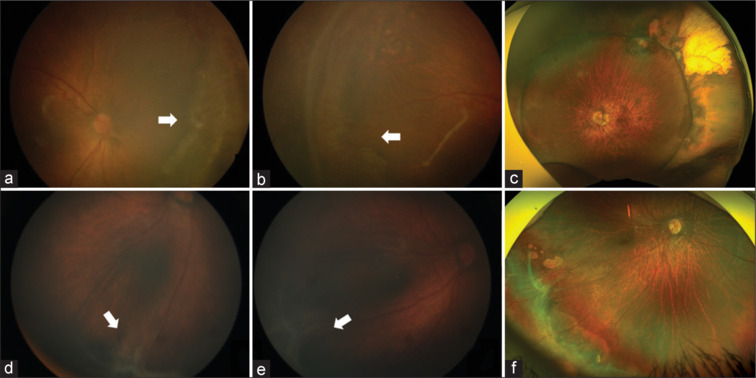
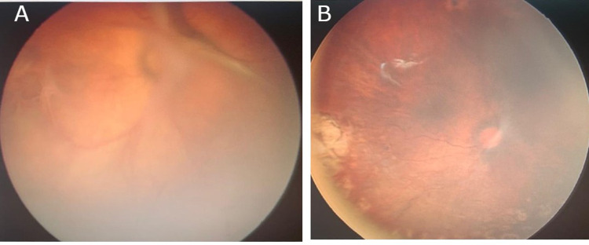
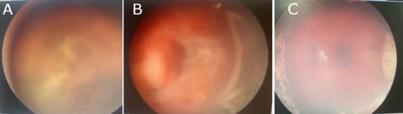
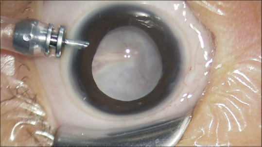
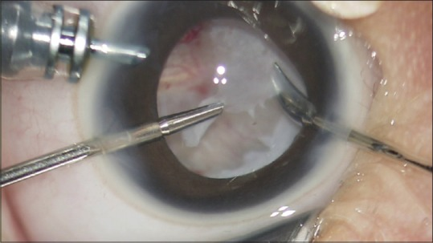

# 1403 — Phẫu thuật ROP giai đoạn 4–5: đai củng mạc vs cắt dịch kính chừa thể thủy tinh vs cắt thể thủy tinh / Surgery for stage 4–5 retinopathy of prematurity: scleral buckle vs lens-sparing vitrectomy vs lensectomy-vitrectomy

**Tags:** `pattern:bong-vong-mac` `pattern:co-keo` `pattern:rop` `vung:vong-mac` `vung:dich-kinh` `score:ICROP` `protocol:phau-thuat-rop` `incidentaloma:rop`
**Mức chắc chắn (certainty):** tổng hợp y văn (literature synthesis) — tự biên từ 1 thuần tập 105 mắt đai củng mạc (PMC13271555), 1 tổng quan hệ thống 10 nghiên cứu/1.179 mắt cắt dịch kính (PMC11267137), 2 thuần tập cắt dịch kính 31 và 17 mắt (PMC10759917, PMC2908825), 2 nghiên cứu dài hạn về thị lực – khúc xạ sau cắt dịch kính (PMC12373698, PMC9916407) và 1 bài kỹ thuật có ảnh nội soi (PMC6302567); định nghĩa giai đoạn theo **ICROP 3rd edition 2021** (PMID 34247850). Chưa gắn một ca nguyên văn đơn lẻ của nhóm.

> **Bài này nối tiếp [456 – Bệnh võng mạc trẻ sinh non: zone–stage–plus & AP-ROP](../456-benh-vong-mac-tre-sinh-non/lesson.md), [461 – Chọn thuốc & phác đồ anti-VEGF cho ROP](../461-chon-thuoc-phac-do-anti-vegf-cho-rop/lesson.md) và [458 – Di chứng & theo dõi dài hạn sau ROP](../458-di-chung-theo-doi-dai-han-sau-rop/lesson.md).** 456 phủ **phân loại và sàng lọc**; 461 phủ **anti-VEGF**; 458 phủ **di chứng muộn**. Bài 1403 trả lời phần còn trống: **khi võng mạc đã bong (stage 4–5), chọn đai củng mạc hay cắt dịch kính, có lấy thể thủy tinh hay không, thời điểm và tiên lượng theo giai đoạn.**

## 1. Tổng quan bệnh học – cơ chế hình ảnh

- **Sinh lý bệnh (pathophysiology):** ROP tiến triển qua **pha mạch máu (vasoproliferative)** — thiếu oxy võng mạc chưa trưởng thành → **VEGF** ↑ → tân mạch ở ranh giới võng mạc có mạch/không mạch. Khi tân mạch kèm **mô xơ (fibrovascular proliferation)** co rút, **võng mạc bị kéo bong** — **bong võng mạc co kéo (tractional retinal detachment — TRD)**. Đây là **bong không do rách** ở giai đoạn đầu; rách có thể xuất hiện muộn do co kéo hoặc do can thiệp.
- **ICROP 3rd edition (2021) — định nghĩa quyết định mổ (PMID 34247850):**
  - **Stage 4A:** bong võng mạc **một phần, CHƯA bắt hoàng điểm**.
  - **Stage 4B:** bong **một phần, ĐÃ bắt hoàng điểm**.
  - **Stage 5A:** bong **toàn bộ, phễu mở (open funnel)** — còn thấy vùng hoàng điểm/đĩa thị ở đáy phễu.
  - **Stage 5B:** bong **toàn bộ, phễu đóng (closed funnel)** — mất hoàn toàn khoang dưới võng mạc, hai lá võng mạc dính nhau.
  - **Plus disease / AP-ROP:** giãn – vằn xoắn mạch ở **≥ 2 góc phần tư**; **AP-ROP** tiến triển nhanh, thường **vùng I**, cần điều trị **khẩn** — đây là nhóm dễ bỏ qua "cửa sổ vàng" trước khi bong.
- **TẠI SAO phẫu thuật có tác dụng — cơ chế cơ học:**
  - **Đai củng mạc (scleral buckle):** đẩy thành củng mạc vào trong, **giảm lực kéo ngoại vi** và **đưa võng mạc ngoại vi áp lại**; hiệu quả khi **co kéo chủ yếu ở ngoại vi** (stage 4A, > 6 giờ đồng hồ), **không giải quyết được màng co kéo ra sau hoàng điểm**.
  - **Cắt dịch kính chừa thể thủy tinh (lens-sparing vitrectomy — LSV):** cắt **dịch kính – màng trước võng mạc**, **gỡ lực kéo** trực tiếp lên hoàng điểm; giữ **thể thủy tinh** để tránh **nhược thị do mất điều tiết** và giảm nguy cơ **glaucoma** — ưu tiên **stage 4A/4B**.
  - **Cắt thể thủy tinh + cắt dịch kính (lensectomy-vitrectomy — LV):** cần khi **màng sau thể thủy tinh dày (retrolental membrane)**, **đồng tử hẹp**, **đục thể thủy tinh**, hoặc **stage 5** không tiếp cận được màng co kéo. Đánh đổi: **mất điều tiết**, nguy cơ **glaucoma**, cần **kính áp tròng/thể thủy tinh nhân tạo** sau này.
- **Ngưỡng định lượng nằm lòng (theo giai đoạn):**
  - **Đai củng mạc — 105 mắt (90 trẻ), GA 30,05 ± 2,73 tuần, BW 1.383 ± 411 g; 85 mắt đai quanh, 20 mắt đai đoạn; 75 mắt stage 4A:** thành công giải phẫu **90,5% (đai quanh)** — **4A 93,9%, 4B 78,9%**; **90% (đai đoạn)** — **4A 88,8%, 4B 90,9%**. Cầu tương đương trung bình **−6,00 D (đai quanh) vs −3,12 D (đai đoạn)**; **thị lực chức năng (central, steady, maintained) 32% vs 55%**; di chứng thường gặp: **kéo đĩa thị (disc drag), lệch hoàng điểm (macular ectopia)**, kèm **cận thị, lác, rung giật** (Susvar P et al., *Indian J Ophthalmol* 2026, PMC13271555).
  - **Cắt dịch kính — tổng quan hệ thống 10 nghiên cứu, 1.179 mắt:** **72% LSV, 28% LV**; LSV chủ yếu **stage 4**, LV chủ yếu **stage 5**; thành công giải phẫu và chức năng **cao hơn ở 4A/4B so với 5**; yếu tố tiên lượng tốt: **không plus, stage 4, đã laser/anti-VEGF trước đó, giữ thể thủy tinh** (Casey A et al., *J Ophthalmic Vis Res* 2024, PMC11267137).
  - **Cắt dịch kính — 31 mắt (19 trẻ), GA 29,4 ± 2,1 tuần:** thành công **90,9% (4A), 57,1% (4B), 33,3% (5A)**; chung **64,5%**; biến chứng: **xuất huyết dịch kính 16,1%, đục thể thủy tinh 16,1%, cắt dịch kính lần hai 9,7%, glaucoma thứ phát 22,6%** (Bahrani HM et al., *Clin Ophthalmol* 2023, PMC10759917).
  - **LSV — 17 trẻ:** thành công chung **58,8%**; **4A 75%, 4B 66,7%, stage 5 25%**; trong 10 mắt võng mạc áp, **6 mắt có form vision**, **3 mắt theo dõi ánh sáng**, **1 mắt không cảm nhận ánh sáng** (Yu EY et al., *Korean J Ophthalmol* 2006, PMC2908825).
  - **Thị lực dài hạn sau cắt dịch kính stage 4 — 42 mắt (35 mắt 4A, 7 mắt 4B), theo dõi ≥ 8 năm:** ở **4A**, logMAR **0,83 (20/135) → 0,63 (20/85)** giữa 5 và 8 tuổi (P < 0,001); **61,8%** dịch chuyển cận thị **≥ 1 D**; **4B không cải thiện đáng kể**; mắt **còn thể thủy tinh** và **mắt trội** có thị lực tốt hơn (Tachibana EH et al., *Graefes Arch Clin Exp Ophthalmol* 2025, PMC12373698).
  - **LSV stage 4A — 61 mắt, tuổi khám cuối 10,1 ± 3,3 năm:** thị lực thập phân trung bình **0,23 ± 0,26**; **54,1% đạt ≥ 0,4**; **75,5% cận thị cao > −6 D**, trung bình **−10,1 ± 5,0 D** (Iwahashi M et al., *Int J Mol Sci* 2023, PMC9916407).
- **Vai trò của hình ảnh học:** chẩn đoán và phân giai đoạn chủ yếu bằng **soi đáy mắt gián tiếp + chụp đáy mắt góc rộng (RetCam)**. **Siêu âm B-scan** là bắt buộc khi **môi trường đục** (xuất huyết dịch kính, màng sau thể thủy tinh) để xác định **bong võng mạc, phễu mở/đóng, màng co kéo**. **MRI sọ–hốc mắt** chỉ khi **leukocoria chưa rõ nguyên nhân** hoặc nghi **retinoblastoma/u** — không dùng thay soi đáy mắt. **CT** hạn chế vì **xạ** ở trẻ non tháng.

## 2. Mẫu hình + chẩn đoán phân biệt theo giai đoạn – vị trí co kéo (gamut)

- **Stage 4A — bong ngoại vi chưa bắt hoàng điểm:** co kéo **ngoại vi > 6 giờ đồng hồ**, hoàng điểm **còn áp**. Lựa chọn: **đai củng mạc** (nếu co kéo ngoại vi, đai quanh/đoạn) hoặc **LSV** (nếu co kéo ra sau hơn). Đây là nhóm **tiên lượng tốt nhất**, thành công **~90%**.
- **Stage 4B — bong đã bắt hoàng điểm:** **LSV** là lựa chọn chính; **đai củng mạc đơn thuần không đủ** vì lực kéo đã ra sau hoàng điểm. Thành công thấp hơn 4A (**57–79%** tùy nghiên cứu).
- **Stage 5A — phễu mở:** **LV** (thường phải cắt thể thủy tinh) + **bóc màng (membrane peeling)/delamination**; thành công **thấp (~25–33%)**; mục tiêu là **áp võng mạc giải phẫu**, thị lực thường **rất kém**.
- **Stage 5B — phễu đóng:** tiên lượng **rất xấu**; phẫu thuật chọn lọc, chủ yếu **giải phẫu**; cần tư vấn **khả năng không có thị lực hữu ích**.
- **AP-ROP/plus nặng:** ưu tiên **laser/anti-VEGF trước** nếu chưa bong; nếu đã bong, **kiểm soát hoạt tính mạch máu** trước/trong mổ để giảm **xuất huyết** — không mổ trong tình trạng tân mạch đang hoạt động mạnh nếu trì hoãn được an toàn.
- **Bệnh giả ROP (pseudo-ROP) — phải loại trừ trước khi mổ:**
  - **Retinoblastoma:** khối **vôi hóa thô**, **< 5 tuổi**, có thể **leukocoria**; **siêu âm/MRI** và **không mổ như ROP**.
  - **Coats disease:** **xuất huyết – tiết dịch**, **KHÔNG vôi hóa điển hình**, thường **một bên**, trẻ trai; **không có tiền sử sinh non**.
  - **PFV/PHPV:** **dây xơ từ sau thể thủy tinh**, **nhãn cầu nhỏ**, một bên; khác ROP.
  - **FEVR (familial exudative vitreoretinopathy):** bong co kéo **hai bên**, **tiền sử gia đình**, không có sinh non — dễ nhầm stage 4–5.
  - **Toxocariasis:** u hạt **một bên**, **bạch cầu ái toan**, tiếp xúc đất/chó mèo.
  - **Norrie disease:** **mù bẩm sinh + điếc + chậm phát triển**, di truyền **X-linked**.

## 3. Bảng so sánh phân biệt (ma trận đối chiếu)

| Thực thể/chiến lược (entity) | Hình ảnh – lâm sàng điển hình | Chốt vào (rule-in) | Chốt loại (rule-out) | Gợi ý xác nhận |
|---|---|---|---|---|
| **Đai củng mạc (scleral buckle)** | Stage 4A, co kéo **ngoại vi > 6 giờ**, hoàng điểm chưa bắt; đai quanh hoặc đoạn | **Co kéo ngoại vi + hoàng điểm còn áp + không có màng sau thể thủy tinh dày** | **4B/5, co kéo ra sau hoàng điểm, màng dày** → cần cắt dịch kính | Soi đáy mắt góc rộng, B-scan; đánh dấu giờ đồng hồ; theo dõi độ lồi đai |
| **LSV (cắt dịch kính chừa thể thủy tinh)** | Stage 4A/4B, co kéo **ra sau**, hoàng điểm bị kéo; thể thủy tinh còn trong | **4B hoặc 4A có co kéo trung tâm + thể thủy tinh trong** | **Màng sau thể thủy tinh dày/đồng tử hẹp/đục thể thủy tinh** → chuyển LV | Siêu âm B-scan, soi đáy mắt; đánh giá khả năng tiếp cận màng |
| **LV (cắt thể thủy tinh + cắt dịch kính)** | Stage 5A/5B, **màng trước võng mạc dày**, đồng tử hẹp, đục thể thủy tinh | **Stage 5 hoặc không tiếp cận được màng qua thể thủy tinh** | **Stage 4 còn thể thủy tinh trong, không có chống chỉ định** → ưu tiên LSV | Soi đáy mắt/trong mổ; B-scan; đánh giá phễu mở/đóng |
| **Anti-VEGF đơn thuần** | Plus/AP-ROP **chưa bong**, tân mạch hoạt động | **Chưa có bong võng mạc + plus nặng** | **Đã bong (stage 4–5)** → anti-VEGF không thay thế mổ | Soi đáy mắt, chụp góc rộng; theo dõi tái hoạt |
| **Theo dõi (stage 3 thoái triển)** | Gờ xơ, tân mạch **thoái triển**, không bong | **Không bong + không plus tiến triển** | **Bong mới, plus tăng, màng co kéo** → can thiệp | Soi đáy mắt định kỳ 1–2 tuần khi còn nguy cơ |
| **Retinoblastoma (giả ROP)** | Khối **vôi hóa thô**, leukocoria, không tiền sử sinh non | **Vôi hóa trong khối + < 5 tuổi** | **Tiền sử sinh non + bong co kéo hai bên điển hình** → ROP | Siêu âm/MRI, khám chuyên khoa u; **không mổ như ROP** |

*Bệnh nhân stage 4A/4B: (a,b) co kéo võng mạc ngoại vi **> 6 giờ đồng hồ** trước mổ; (c) ảnh góc rộng sau đai — võng mạc áp, còn **lệch hoàng điểm**. Nguồn: Susvar P et al., Indian J Ophthalmol 2026 (PMC13271555 Fig. 1), CC BY-NC-ND 4.0, giữ nguyên bản.*

### Ba câu hỏi trước mọi ca stage 4–5
1. **Hoàng điểm đã bị bắt chưa?** (4A vs 4B) — quyết định **đai** hay **cắt dịch kính**.
2. **Lực kéo ở đâu?** Ngoại vi (đai) vs ra sau/hoàng điểm (LSV).
3. **Có tiếp cận được màng qua thể thủy tinh không?** Nếu không → **LV**.

## 4. Protocol chụp/đánh giá + thuật toán phẫu thuật

### 4.1. Đánh giá trước mổ (bắt buộc)

- **Soi đáy mắt gián tiếp** với **ấn củng mạc (scleral indentation)** — xác định **vùng (zone), giai đoạn, giờ đồng hồ co kéo, hoàng điểm**.
- **Chụp đáy mắt góc rộng (RetCam)** để lưu **baseline** và so sánh; ghi rõ **4A/4B/5A/5B**.
- **Siêu âm B-scan** khi **môi trường đục** (xuất huyết dịch kính, màng sau thể thủy tinh): xác định **bong, phễu mở/đóng, màng co kéo, vôi hóa**.
- **Đánh giá toàn thân:** **BPD, tăng áp phổi, tim bẩm sinh, ngưng thở** — phối hợp **gây mê nhi**; cân nhắc **mổ tuần tự hai mắt** ở trẻ nguy cơ cao gây mê, với điều kiện kiểm soát được đường thở và theo dõi sau mổ.
- **Loại trừ giả ROP** trước khi mổ: **tiền sử sinh non – cân nặng – tuần thai**, **tính chất hai bên**, **vôi hóa**, **tiền sử gia đình**, **siêu âm/MRI**.

### 4.2. Thuật toán chọn phẫu thuật

```mermaid
flowchart TD
  A["ROP: xác định vùng, giai đoạn, plus"] --> B{"Đã bong võng mạc?"}
  B -->|"Chưa"| C["Stage 1–3: laser/anti-VEGF theo chỉ định"]
  B -->|"Rồi"| D{"Hoàng điểm bị bắt?"}
  D -->|"Chưa &#40;4A&#41;"| E{"Co kéo ngoại vi > 6 giờ?"}
  E -->|"Có"| F["Đai củng mạc quanh/đoạn"]
  E -->|"Không, co kéo ra sau"| G["LSV: cắt dịch kính chừa thể thủy tinh"]
  D -->|"Rồi &#40;4B&#41;"| G
  G --> H{"Màng sau thể thủy tinh dày, đồng tử hẹp?"}
  H -->|"Có"| I["LV: cắt thể thủy tinh + cắt dịch kính"]
  H -->|"Không"| J["Tiếp tục LSV"]
  I --> K["Theo dõi: nhãn áp, võng mạc, khúc xạ, nhược thị"]
  J --> K
  F --> K
```

### 4.3. Kỹ thuật và theo dõi

- **Đai củng mạc:** đai **quanh (encircling)** cho co kéo lan rộng, **đoạn (segmental)** cho co kéo khu trú; **không siết quá chặt** gây **thiếu máu/hoại tử**; theo dõi **độ lồi đai, nhãn áp, tưới máu**. Có thể **tháo đai sau khi võng mạc ổn định** để giảm **cận thị do đai** — theo dõi sát sau tháo (Hình 2 của PMC13271555).
- **LSV:** **23G/25G/27G**, trocar đặt **sau rìa giác mạc thích hợp ở trẻ nhỏ**, tránh **chạm thể thủy tinh**; cắt dịch kính trước, **bóc màng co kéo (delamination)** từ ngoại vi vào trung tâm; **kiểm tra võng mạc chu biên** tìm **rách iatrogenic**; **cầm máu** bằng áp lực/đốt nhẹ.
- **LV:** chỉ định khi **không thể bảo tồn thể thủy tinh** hoặc **stage 5**; sau mổ cần **kính áp tròng/thể thủy tinh nhân tạo** và **theo dõi glaucoma**.
- **Sau mổ:** **ngày 1–3** kiểm tra **nhãn áp, tiền phòng, võng mạc**; **1 tuần, 1 tháng, 3 tháng, 6 tháng**, sau đó **hằng năm**. Mỗi lần: **thị lực (tuổi), khúc xạ lý liệt, nhãn áp, soi đáy mắt**, tìm **glaucoma, đục thể thủy tinh, tái bong, co kéo hoàng điểm**.
- **Phối hợp:** điều trị **nhược thị** khi trẻ đủ tuổi; **kính đủ độ**; theo dõi **lác** (bài 469/472) và **cận thị nặng** (bài 458).

## 5. Biến thể bình thường và cạm bẫy

- **Phân giai đoạn sai vì môi trường đục:** xuất huyết dịch kính che hoàng điểm → dễ gọi **4A** trong khi thực tế **4B**. **B-scan** và **soi lại sau khi máu lắng** là bắt buộc trước khi chọn đai.
- **Mổ quá muộn:** thành công giảm mạnh từ **4A (~90%) → 4B (~57–79%) → 5 (~25–33%)**; **chờ "võng mạc tự áp"** ở stage 4 là mất cơ hội.
- **Mổ khi tân mạch còn hoạt động mạnh:** nguy cơ **xuất huyết dịch kính** và **co kéo tái phát**; cân nhắc **laser/anti-VEGF** trước nếu an toàn.
- **Chạm thể thủy tinh trong LSV:** gây **đục thể thủy tinh** — biến chứng **16,1%** trong một thuần tập (PMC10759917); dùng **đường vào phù hợp, kiểm soát áp lực**.
- **Rách võng mạc iatrogenic:** kiểm tra **chu biên 360°** cuối mổ; nếu có rách → **đai/cắt dịch kính + laser**.
- **Glaucoma thứ phát:** **22,6%** sau cắt dịch kính (PMC10759917); theo dõi **nhãn áp suốt đời**, đặc biệt sau **LV**.
- **Cận thị nặng sau mổ:** **75,5% > −6 D**, trung bình **−10,1 D** sau LSV stage 4A (PMC9916407); không quy kết do "kính sai" — cần **khúc xạ lý liệt** và **theo dõi trục nhãn cầu**.
- **Bỏ sót mắt thứ hai:** ROP thường **hai bên**; khám **cả hai mắt** mỗi lần, kể cả khi một mắt đã mổ.
- **Nhầm với retinoblastoma:** **vôi hóa thô + không tiền sử sinh non** → **không mổ như ROP**; siêu âm/MRI và chuyển chuyên khoa u.
- **Tưởng "mổ xong là hết":** thị lực có thể **cải thiện tiếp đến 8 tuổi** ở 4A, nhưng **4B không cải thiện** — cần **theo dõi dài hạn** và **phục hồi chức năng**.

## 6. Tự lượng giá — Blind Quiz

**Ca 1 — Trẻ sinh non 28 tuần, 6 tháng tuổi (tuổi chỉnh), đáy mắt phải: co kéo võng mạc ngoại vi, hoàng điểm còn áp; mắt trái đã laser.**

- Hỏi: giai đoạn nào? Chọn **đai** hay **cắt dịch kính**? Vì sao? Kết cục giải phẫu kỳ vọng?

<b>Bấm để hiện đáp án (findings + chẩn đoán)</b>

- **(A)** ảnh trước mổ: **bong võng mạc co kéo (TRD) stage 4A**, hoàng điểm còn áp; **(B)** sau **LSV**: võng mạc áp, còn **lệch hoàng điểm**.
- **Chọn LSV** nếu co kéo lan ra sau; **đai củng mạc** nếu co kéo **ngoại vi > 6 giờ** và hoàng điểm chưa bị kéo. Ca này ảnh sau mổ cho thấy **LSV** đã được dùng.
- **Tiên lượng:** stage 4A là nhóm tốt nhất — đai **~90%**, LSV **~75–91%** tùy nghiên cứu; nhưng vẫn có **cận thị nặng** và **nhược thị** về sau.
- Nguồn ảnh: Bahrani HM et al., Clin Ophthalmol 2023 (PMC10759917 Fig. 2), CC BY-NC 3.0.

**Ca 2 — Trẻ 4 tháng tuổi (tuổi chỉnh), đáy mắt trái: xuất huyết dịch kính + bong võng mạc đã bắt hoàng điểm.**

- Hỏi: vì sao đây là **4B** chứ không phải 4A? Thành công giải phẫu thấp hơn 4A bao nhiêu? Biến chứng cần cảnh báo?

<b>Bấm để hiện đáp án (findings + chẩn đoán)</b>

- **(A)** xuất huyết dịch kính + **màng co kéo bắt hoàng điểm** → **4B**; **(B,C)** sau cắt dịch kính: võng mạc áp một phần, còn **co kéo/màng tồn dư**.
- **Thành công 4B thấp hơn 4A rõ:** **57,1% vs 90,9%** (PMC10759917); tổng quan 10 nghiên cứu cũng xác nhận **stage 4 > stage 5** và **4A > 4B** (PMC11267137).
- **Cảnh báo:** **xuất huyết dịch kính, đục thể thủy tinh, glaucoma thứ phát, cắt dịch kính lần hai**; thị lực lâu dài ở 4B **không cải thiện đáng kể** sau 5 tuổi (PMC12373698).
- Nguồn ảnh: Bahrani HM et al., Clin Ophthalmol 2023 (PMC10759917 Fig. 4), CC BY-NC 3.0.

**Ca 3 — Trẻ 5 tháng tuổi, đồng tử trắng, siêu âm: bong võng mạc toàn bộ, phễu mở; không thấy vôi hóa.**

- Hỏi: chẩn đoán? Vì sao phải **cắt thể thủy tinh**? Tiên lượng thị lực và cần loại trừ gì?

<b>Bấm để hiện đáp án (findings + chẩn đoán)</b>

- Ảnh: **màng trắng sau thể thủy tinh (retrolental fibroplasia)** + **bong võng mạc toàn bộ** → **stage 5A** (phễu mở trên siêu âm).
- **Phải LV** vì màng sau thể thủy tinh dày, không tiếp cận được màng co kéo qua thể thủy tinh; ảnh trong mổ cho thấy **cắt thể thủy tinh + bóc màng**.

- **Tiên lượng:** thành công **~25–33%**; thị lực thường **rất kém**, mục tiêu chính là **áp võng mạc giải phẫu** và giữ nhãn cầu.
- **Loại trừ:** **retinoblastoma** (vôi hóa thô, < 5 tuổi), **Coats**, **PFV**, **FEVR** — siêu âm/MRI trước khi mổ.
- Nguồn ảnh: Kusaka S et al., Taiwan J Ophthalmol 2018 (PMC6302567 Fig. 4–5), CC BY-NC-SA 4.0, giữ nguyên bản.

## Bài liên quan chéo
- [456 – Bệnh võng mạc trẻ sinh non: zone–stage–plus & AP-ROP](../456-benh-vong-mac-tre-sinh-non/lesson.md) (phân loại, sàng lọc)
- [461 – Chọn thuốc & phác đồ anti-VEGF cho ROP](../461-chon-thuoc-phac-do-anti-vegf-cho-rop/lesson.md) (anti-VEGF trước/ sau mổ)
- [458 – Di chứng & theo dõi dài hạn sau ROP](../458-di-chung-theo-doi-dai-han-sau-rop/lesson.md) (cận thị, lác, nhược thị)
- [468 – Sàng lọc ROP từ xa & AI](../468-tele-rop-sang-loc-ai-theo-doi/lesson.md) (phát hiện sớm trước khi bong)
- [472 – Phẫu thuật lác ở trẻ sinh non/ROP](../472-phau-thuat-lac-tre-sinh-non-rop/lesson.md) (lác sau ROP)
- [412 – U trong nhãn cầu](../412-u-trong-nhan-cau/lesson.md) (retinoblastoma — giả ROP)

## Ảnh
- Ảnh lấy từ **Europe PMC/PMC** (bản open access), giữ **nguyên bản**, không crop/ghép; nguồn – giấy phép từng file trong `images/CREDITS.md`.
- Tên file: `1403_rop-gd<...>_<nội dung>_PMC<ID>-Fig<k>.jpg`.

> Không dùng để chẩn đoán độc lập khi chưa có người hướng dẫn.
