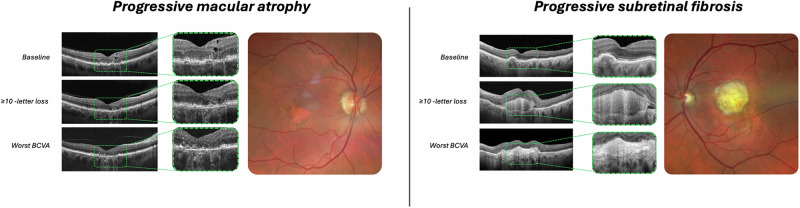
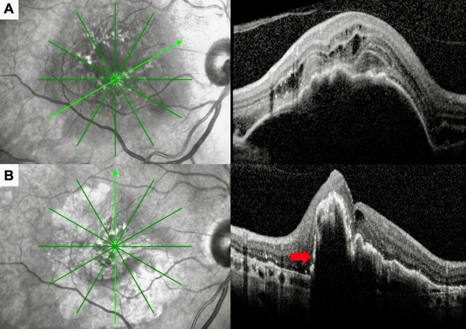
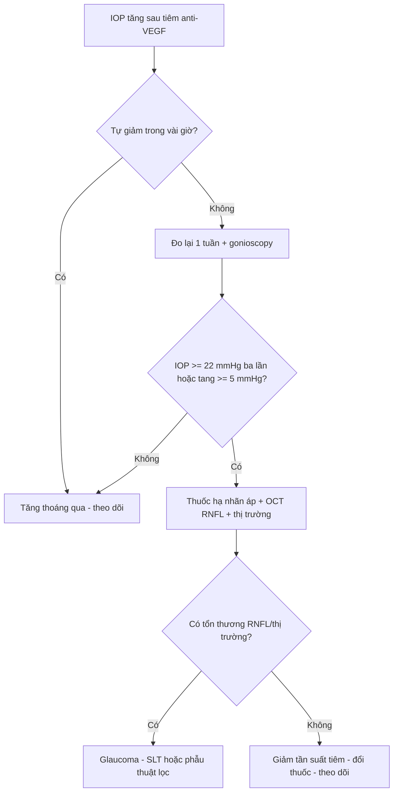

# 1404 — Biến chứng mạn của tiêm anti-VEGF nội dịch kính / Chronic complications of intravitreal anti-VEGF therapy

**Tags:** `pattern:bien-chung-sau-tiem` `pattern:teo-hoang-diem` `pattern:tang-nhan-ap` `vung:hoang-diem` `vung:vong-mac` `protocol:OCT` `protocol:anti-VEGF` `score:IOP`
**Mức chắc chắn (certainty):** tổng hợp y văn (literature synthesis) — gộp 4 nghiên cứu mở (PMC13135659, PMC13062072, PMC12886595, PMC13343135); chưa có ca nguyên văn của nhóm.

## 1. Tổng quan — vì sao tiêm anti-VEGF lặp lại gây hại mạn tính

- **Bối cảnh:** anti-VEGF nội dịch kính là điều trị chuẩn của nAMD, phù hoàng điểm do đái tháo đường, tắc tĩnh mạch võng mạc, ROP. Mỗi mũi tiêm đưa **0,05 mL** vào dịch kính (aflibercept 8 mg: **0,07 mL**); bệnh nhân điển hình nhận **6–12 mũi/năm**, có người **> 50 mũi** trong nhiều năm — nên "biến chứng mạn" là bài toán của **tổng liều và thời gian**, không phải của một mũi đơn lẻ.
- **TẠI SAO tăng nhãn áp (IOP) thoáng qua:** thể tích tiêm làm tăng thể tích nhãn cầu tức thời; nếu **không có trào ngược qua đường vào củng mạc (reflux)**, IOP có thể **> 25 mmHg trong 30 phút đầu**, đặc biệt ở **mắt ngắn trục (thể tích dịch kính nhỏ)**, **mắt giả thủy tinh thể khác nhau**, tiền sử glaucoma, kim cỡ lớn.
- **TẠI SAO tăng IOP KÉO DÀI:** ba cơ chế cộng lại — (1) **tắc lưới bè (trabecular meshwork)** bởi giọt dầu silicone (**68–78%** mắt có giọt silicone trong dịch kính sau tiêm lặp lại) và **protein aggregates**; (2) **tác động trực tiếp lên tế bào lưới bè/Schlemm** (thụ thể VEGF có ở đây; ức chế VEGF làm giảm NO và thay đổi tính co của tế bào); (3) **giả thuyết "2 đòn"**: mắt đã có **suy dẫn lưu thủy dịch tiềm ẩn** thì mới bị tăng IOP kéo dài — giải thích vì sao chỉ **một thiểu số** bệnh nhân bị. Bằng chứng dịch tễ: bệnh nhân nhận **≥ 7 mũi/năm** có tỷ lệ **phẫu thuật dẫn lưu glaucoma** cao hơn (nghiên cứu dân số Canada).
- **TẠI SAO teo hoàng điểm (macular atrophy, MA):** ức chế VEGF kéo dài làm **giảm tưới máu hắc mạc (choriocapillaris)** và mất dần RPE/tế bào cảm thụ; tổn thương tích lũy theo số mũi tiêm và thời gian theo dõi. Số liệu dài hạn: **tỷ lệ MA tích lũy 79,8% sau 10 năm** (148 mắt, phác đồ PRN); ở nhóm "đáp ứng kém" (70 mắt, ≥ 7 mũi năm đầu, giảm ≥ 10 chữ ETDRS): MA **7,1% → 41,4% → 81,4%** tại 3 thời điểm, **xơ dưới võng mạc 11,4% → 25,7% → 57,1%**; **20–30%** bệnh nhân nAMD có suy giảm thị lực tiến triển dù hình thái ổn định. Hệ quả: mắt có MA giảm thị lực nhanh hơn (**−1,96 so với −1,42 chữ/năm**).
- **TẠI SAO rách RPE (RPE tear):** khi **bong biểu mô sắc tố (PED)** cao và căng, anti-VEGF làm CNV co lại → lực kéo ngang xé RPE. Nguy cơ **1,9–7%**, cao nhất khi **PED > 400 µm**, PED lớn, PED có mạch máu; thường xảy ra **sau mũi đầu hoặc trong tháng đầu**.
- **TẠI SAO viêm/xơ hóa mạn:** phản ứng miễn dịch với thuốc, tá dược, giọt silicone và protein aggregates → **viêm nội nhãn vô khuẩn 0,02–0,37%**, hiếm khi **viêm mạch võng mạc tắc nghẽn**; đồng thời quá trình xơ hóa dưới võng mạc tiến triển độc lập với kiểm soát dịch.
- **Ngưỡng định lượng cần nhớ:** endophthalmitis nhiễm khuẩn **0,02–0,05%/mũi**; bong võng mạc **~0,01%**; đục thủy tinh thể do chạm kim **~0,006%**; tắc mạch võng mạc **rất hiếm**; viêm nội nhãn vô khuẩn **0,02–0,37%**; rách RPE **1,9–7%**; MA **79,8%/10 năm**.

## 2. Mẫu hình + chẩn đoán phân biệt theo trục thời gian và cấu trúc

- **Phút 0–30 (cấp, sau mỗi mũi):** **tăng IOP thoáng qua** (thể tích, reflux), bong hắc mạc thoáng qua, xuất huyết dưới kết mạc.
- **Ngày 1–7 (cấp):** **endophthalmitis nhiễm khuẩn** (đau, giảm thị lực, hypopyon), **viêm nội nhãn vô khuẩn** (khởi phát 1–3 ngày, đáp ứng corticoid), rách võng mạc/bong võng mạc.
- **Tuần 2–8 (bán cấp):** **viêm màng bồ đào do thuốc**, **rách RPE** (sau mũi 1–2), **viêm mạch võng mạc tắc nghẽn** (thuốc thế hệ mới).
- **Tháng 3–24 (muộn sớm):** **tăng IOP kéo dài/glaucoma**, **MA/teo địa lý**, **xơ dưới võng mạc**, đục thủy tinh thể tiến triển, **đáp ứng giảm dần (tachyphylaxis/tolerance)**.
- **> 24 tháng (muộn):** MA lan vào hoàng điểm, teo hắc mạc, glaucoma cần phẫu thuật, giảm thị lực không hồi phục dù kiểm soát CNV.
- **Gamut "IOP tăng sau tiêm":** thể tích tiêm (0,05–0,07 mL) · reflux kém · giọt silicone/protein · glaucoma có sẵn · corticoid phối hợp (nếu dùng) · góc hẹp/mắt ngắn trục.
- **Gamut "teo hoàng điểm mới":** MA do anti-VEGF · tiến triển teo địa lý · **rách RPE** · teo tại chỗ tiêm · thoái triển PCV/polyp.
- **Gamut "không đáp ứng dù tiêm đều":** tachyphylaxis · CNV hoạt động dai dẳng · chẩn đoán sai (PNV/PCV) · xơ hóa không hồi phục · MA thay thế võng mạc lành.

## 3. Bảng so sánh phân biệt (ma trận đối chiếu)

| Thực thể (entity) | Hình ảnh điển hình | Chốt vào (rule-in) | Chốt loại (rule-out) | Gợi ý xác nhận |
|---|---|---|---|---|
| **Tăng IOP thoáng qua** | Đo IOP **> 25 mmHg trong 30 phút**, có thể phù giác mạc nhẹ, tự hết | **Đo ngay sau tiêm + tự về bình thường trong vài giờ** | IOP tăng và **không giảm sau 1 tuần** → tăng kéo dài | Đo lại 30 phút và 1 tuần; kiểm tra reflux |
| **Tăng IOP kéo dài/glaucoma** | IOP **≥ 22 mmHg** nhiều lần, **RNFL mỏng dần**, ONH lõm | **IOP tăng ≥ 3 lần đo + tổn thương RNFL/thị trường** | IOP về bình thường, RNFL ổn định → loại | Thị trường 24-2, OCT RNFL, gonioscopy; ≥ 7 mũi/năm là yếu tố nguy cơ |
| **Teo hoàng điểm do anti-VEGF** | OCT: **mỏng RPE + mất EZ/ELM**, tăng phản âm mờ; FAF: **giảm huỳnh quang**; không dịch | **Mất EZ/RPE tiến triển theo thời gian + không có dịch/không ngấm** | Có dịch dưới võng mạc + ngấm hoạt động → CNV đang hoạt động | OCT + FAF mỗi 3–6 tháng; đo diện tích mm² |
| **Xơ dưới võng mạc** | OCT: **mô tăng phản âm dưới võng mạc, co kéo**, mất ranh giới lớp; ảnh màu: mảng trắng xám | **Mô xơ + co kéo + mất EZ** | Chỉ dày RPE không co kéo → không phải xơ | OCT B-scan, theo dõi 3 tháng |
| **Rách RPE** | OCT: **bờ RPE gấp/cuộn (rolled edge)**, vùng RPE mất, PED xẹp đột ngột; ảnh màu: mảng sẫm bờ rõ | **PED > 400 µm + mất RPE đột ngột sau tiêm + bờ cuộn** | RPE còn liên tục, PED giảm dần → không rách | OCT + FAF; so ảnh ngay trước tiêm |
| **Viêm nội nhãn vô khuẩn** | Tế bào tiền phòng/vitritis, **có thể phù hoàng điểm**, **không hypopyon lớn** | **Khởi phát 1–3 ngày + đáp ứng corticoid trong 1–2 tuần + cấy âm** | Hypopyon/fibrin + đau dữ + cấy dương → endophthalmitis | SUN grading; cấy dịch kính trước khi tiêm |
| **Endophthalmitis nhiễm khuẩn** | Đục dịch kính, **hypopyon/fibrin**, không đọc được OCT | **Đau + giảm thị lực 1–7 ngày + hypopyon** | Không đau, chỉ tăng IOP thoáng qua → loại | Chọc dịch kính + cấy + kháng sinh nội dịch kính |
| **Tachyphylaxis/đáp ứng kém** | OCT: **dịch dai dẳng hoặc tái phát nhanh** dù khoảng tiêm ngắn; CRT không giảm | **Cần rút ngắn khoảng tiêm liên tục + vẫn còn dịch** | Dịch đã hết, thị lực giảm do MA/xơ → không phải tachyphylaxis | OCT mỗi lần tiêm; xem lại chẩn đoán (PNV/PCV) |

*Hai kiểu thoái triển cấu trúc ở bệnh nhân "đáp ứng kém" (≥ 7 mũi năm đầu, giảm ≥ 10 chữ ETDRS): **trái — teo hoàng điểm tiến triển** (mất dần lớp võng mạc ngoài, OCT + ảnh màu); **phải — xơ dưới võng mạc tiến triển** (mảng xơ trắng, co kéo). Cả hai đều tiếp tục xấu dù kiểm soát dịch. Nguồn: Lolli I et al., *Eye (Lond)* 2026, PMC13062072 Fig. 2, CC BY 4.0.*

*Trước (A) và sau (B) mũi ranibizumab thứ hai: PED cao căng, dịch dưới võng mạc; sau tiêm **PED xẹp đột ngột, bờ RPE cuộn lên (mũi tên đỏ)** = **rách RPE**. Nguy cơ tăng khi **PED > 400 µm**. Nguồn: Koksaldi S et al., *Med Hypothesis Discov Innov Ophthalmol* 2026, PMC13135659 Fig. 4, CC BY-NC 4.0 — nguyên bản, không crop/ghép.*

## 4. Protocol theo dõi + xử trí

- **Trước mỗi mũi tiêm:** đo **IOP nền**; hỏi tiền sử glaucoma; với mắt **ngắn trục/glaucoma**, đo **IOP 30 phút sau tiêm**; kiểm tra **reflux** (nếu không có reflux → nguy cơ tăng IOP cao hơn).
- **Theo dõi định kỳ:** **IOP mỗi lần thăm khám**; **OCT hoàng điểm mỗi 1–3 tháng** (tùy phác đồ treat-and-extend); **FAF + OCT** mỗi **3–6 tháng** khi nghi MA; **thị trường 24-2 + OCT RNFL** nếu IOP tăng kéo dài hoặc ≥ 7 mũi/năm.
- **Ngưỡng hành động:**
  - IOP **> 25 mmHg** sau tiêm mà không tự giảm → nhỏ thuốc hạ nhãn áp, hẹn đo lại.
  - IOP **≥ 22 mmHg** ở **≥ 3 lần đo** hoặc tăng **≥ 5 mmHg** so nền → điều trị glaucoma, gonioscopy, cân nhắc **giảm tần suất tiêm/đổi thuốc**.
  - **MA mới** trên OCT/FAF → không tiêm chỉ vì MA; **giảm tần suất** nếu không còn dịch, theo dõi sát.
  - **PED > 400 µm** → cảnh báo nguy cơ rách RPE, chụp OCT ngay sau mũi đầu.
- **Xử trí biến chứng:** rách RPE — tiếp tục anti-VEGF nếu CNV còn hoạt động (ổn định thị lực), không có bằng chứng cải thiện thị lực; glaucoma — thuốc → laser (SLT) → phẫu thuật lọc; viêm vô khuẩn — corticoid tại chỗ/toàn thân; endophthalmitis — chọc dịch kính + kháng sinh (xem bài 481).
- **Phòng ngừa:** kỹ thuật tiêm chuẩn (tránh chạm thể thủy tinh), **kim nhỏ/đúng cỡ**, **kiểm tra reflux**, **tránh tiêm quá nhanh**, dùng **bơm tiêm không silicone/lọc thuốc** khi có thể (giảm tăng IOP sau tiêm).

- **Lịch theo dõi gợi ý sau nhiều năm tiêm:** mỗi **3–6 tháng** đánh giá đồng thời **hoạt động CNV (OCT) + MA (FAF/OCT) + IOP/RNFL** — vì ba quá trình này tiến triển độc lập và quyết định khác nhau (tiêm tiếp, giảm liều, hay điều trị glaucoma).

## 5. Biến thể bình thường và cạm bẫy

- **Biến thể bình thường:** **IOP tăng nhẹ thoáng qua** sau tiêm là sinh lý (thể tích 0,05 mL) — không gọi là glaucoma; **giọt silicone lơ lửng** trong dịch kính gây ruồi bay, không phải viêm.
- **Cạm bẫy 1 — điều trị "teo" bằng cách tiêm tiếp:** MA không có dịch, không ngấm → **không có chỉ định anti-VEGF**; tiêm thêm chỉ làm teo nhanh hơn. Nhưng nếu còn **dịch/ngấm** thì vẫn phải điều trị CNV.
- **Cạm bẫy 2 — bỏ sót tăng IOP vì chỉ đo IOP lúc khám định kỳ:** đỉnh IOP xảy ra **30 phút sau tiêm**, không phải lúc khám; mắt ngắn trục/glaucoma cần đo đúng thời điểm.
- **Cạm bẫy 3 — nhầm rách RPE với "PED xẹp tốt":** PED xẹp đột ngột kèm **bờ RPE cuộn** và **mảng sẫm trên ảnh màu** = rách, tiên lượng thị lực xấu; đừng ghi nhận là "đáp ứng tốt".
- **Cạm bẫy 4 — viêm vô khuẩn vs endophthalmitis:** tần suất **0,02–0,37%** so với **0,02–0,05%**, nhưng viêm vô khuẩn **không hypopyon lớn**, đáp ứng corticoid; tiêm kháng sinh mù quáng vào mắt viêm vô khuẩn gây hại thêm.
- **Cạm bẫy 5 — tachyphylaxis giả:** "không đáp ứng" có thể do **chẩn đoán sai** (PNV/PCV thay vì nAMD) hoặc do **xơ/teo** đã thay thế võng mạc — đổi thuốc không giúp.
- **Cạm bẫy 6 — thỏa mãn tìm kiếm:** thấy CNV khô và hết dịch là dừng theo dõi, bỏ sót **glaucoma do tiêm** và **MA lan vào hoàng điểm** — hai nguyên nhân giảm thị lực muộn hàng đầu.

## 6. Tự lượng giá — Blind Quiz

**Ca 1 — Bệnh nhân nAMD, 4 năm tiêm đều, thị lực giảm dần 6 tháng dù OCT "không còn dịch".**

- Gợi ý: ≥ 7 mũi/năm; không đau, không đỏ mắt.
- Câu hỏi: Hai kiểu thoái triển cấu trúc trên hình là gì? Có nên tăng tần suất tiêm? Dấu hiệu nào trên OCT quyết định?

<b>Bấm để hiện đáp án (findings + chẩn đoán)</b>

- **Dấu hiệu:** trái = **teo hoàng điểm tiến triển** (mất lớp võng mạc ngoài, mỏng RPE, không dịch); phải = **xơ dưới võng mạc** (mô tăng phản âm co kéo).
- **Chẩn đoán:** biến chứng **mạn do anti-VEGF** — không phải CNV hoạt động.
- **Xử trí:** **không tăng tần suất tiêm**; giảm tần suất/theo dõi FAF-OCT; tiêm chỉ khi có dịch/ngấm hoạt động.
- **Số liệu:** MA **7,1% → 41,4% → 81,4%**, xơ **11,4% → 25,7% → 57,1%** trong nhóm đáp ứng kém; MA làm giảm thị lực **−1,96 vs −1,42 chữ/năm**.
- Nguồn: Lolli I et al., *Eye (Lond)* 2026, PMC13062072 Fig. 2, CC BY 4.0.

**Ca 2 — PED cao, sau mũi anti-VEGF thứ hai đột ngột nhìn mờ, OCT có bờ RPE cuộn.**

- Câu hỏi: Dấu hiệu chốt trên OCT? Yếu tố nguy cơ nào cần đo trước tiêm? Tiên lượng và hướng xử trí?

<b>Bấm để hiện đáp án (findings + chẩn đoán)</b>

- **Dấu hiệu:** PED cao căng trước tiêm; sau tiêm **PED xẹp, bờ RPE cuộn (mũi tên đỏ), vùng mất RPE** = **rách RPE**.
- **Nguy cơ:** **PED > 400 µm**, PED lớn/có mạch máu; thường sau **mũi đầu/tháng đầu**.
- **Tiên lượng:** thị lực thường xấu đi; tiếp tục anti-VEGF nếu CNV còn hoạt động nhưng **không cải thiện thị lực**.
- **Tần suất:** rách RPE **1,9–7%**.
- Nguồn: Koksaldi S et al., *Med Hypothesis Discov Innov Ophthalmol* 2026, PMC13135659 Fig. 4, CC BY-NC 4.0 (nguyên bản).

## Bài liên quan chéo
- [400 – Tổng quan Mắt & thị giác](../400-tong-quan-mat-thi-giac/lesson.md)
- [481 – Biến chứng nội nhãn sau liệu pháp gene & tiêm nội dịch kính](../481-bien-chung-noi-nhan-lieu-phap-gene-tiem-noi-dich-kinh/lesson.md)
- [482 – Tân mạch hắc mạc sau CSCR mạn (PNV): chọn anti-VEGF/PDT](../482-tan-mach-hac-mac-sau-cscr-man/lesson.md)
- [442 – Glaucoma trên OCT](../442-glaucoma-OCT/lesson.md)
- [444 – Tắc mạch võng mạc](../444-tac-mach-vong-mac/lesson.md)

## Ảnh
- `images/1404_bien-chung-man-anti-vegf_OCT_PMC13062072.jpg` — OCT + ảnh màu, PMC13062072 Fig. 2, CC BY 4.0.
- `images/1404_anti-vegf_RPE-tear_OCT_PMC13135659.jpg` — OCT trước/sau rách RPE, PMC13135659 Fig. 4, CC BY-NC 4.0 (nguyên bản).
- Nguồn + giấy phép chi tiết: `images/CREDITS.md`.

> Không dùng để chẩn đoán độc lập khi chưa có người hướng dẫn.
