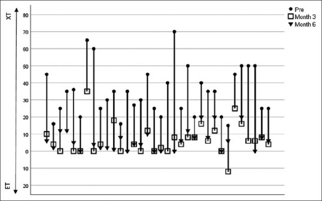
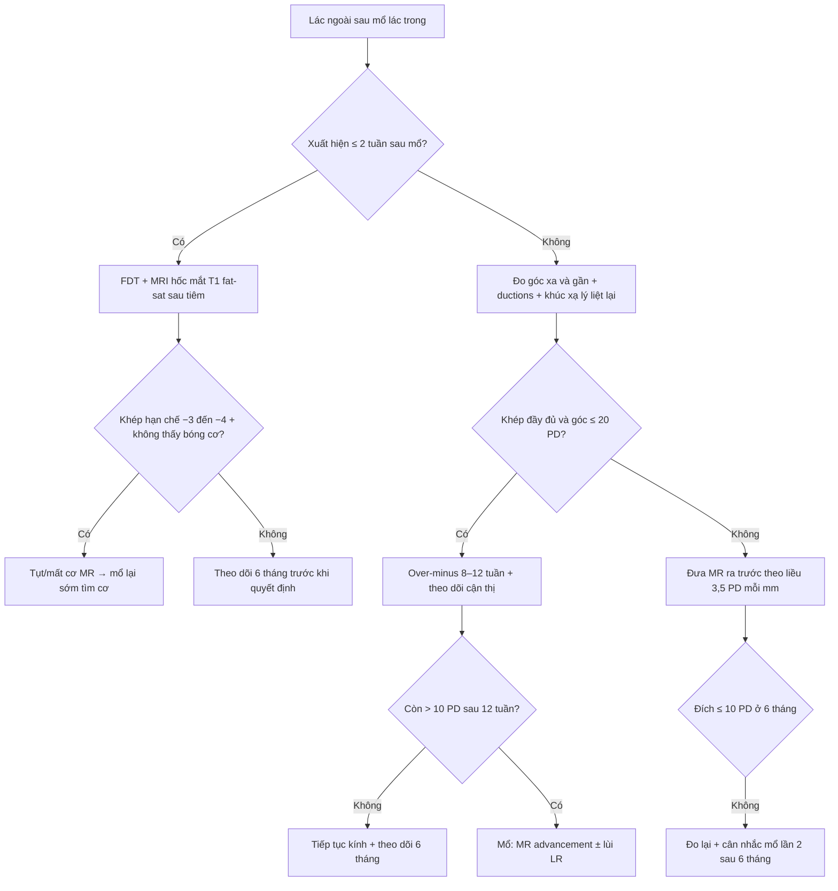
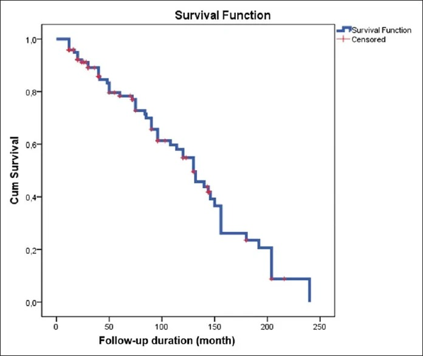
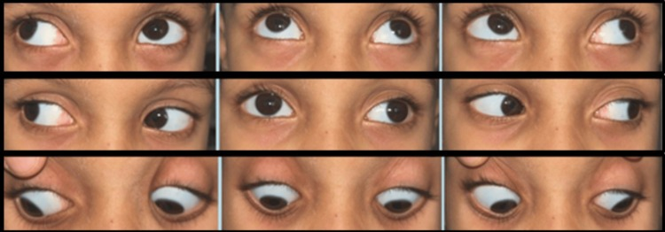

# 1405 — Lác ngoài thứ phát sau mổ lác trong: nhận diện, over-minus, khi nào mổ lại và chọn cơ / Consecutive exotropia after esotropia surgery: recognition, over-minus, reoperation timing and muscle choice

**Tags:** `pattern:lac` `pattern:lac-ngoai` `pattern:lac-thu-phat` `vung:mat` `anatomy:co-van-nhan` `protocol:do-goc-lac` `score:goc-lac-PD`

**Mức chắc chắn (certainty):** tổng hợp y văn (literature synthesis) — tự biên từ 1 tổng quan can thiệp 30 ca (PMC8772490), 1 phân tích sống còn 121 trẻ lác trong sơ sinh sau lùi cơ trực trong hai bên (PMC13524386), 2 nghiên cứu lác ngoài thứ phát "tự phát" ở trẻ viễn thị điều chỉnh kính (PMC11866981, PMC13431220), 1 nghiên cứu yếu tố nguy cơ (PMC10325677), 2 nghiên cứu kết quả mổ (PMC10024867, PMC9392484), 1 đoàn hệ trẻ bại não (PMC13511224) và 1 tổng quan hệ thống can thiệp lác ngoài trẻ em (PMC13245429). Chưa gắn một ca nguyên văn đơn lẻ.

> **Bài này nối tiếp [486 – Lác trong điều tiết theo dõi sau kính](../486-lac-trong-dieu-tiet-theo-doi-sau-kinh/lesson.md) (P5 "quá chỉnh/tái phát" chỉ mới nêu một dòng), [485 – Khúc xạ lý liệt](../485-khuc-xa-ly-liet-dieu-tiet-tre-mam-non/lesson.md) (đo và kê kính) và [472 – Phẫu thuật lác ở trẻ sinh non/ROP](../472-phau-thuat-lac-tre-sinh-non-rop/lesson.md) (kỹ thuật mổ, tái mổ).** 486 dạy **theo dõi sau khi đeo kính**; bài này trả lời câu hỏi còn trống: **khi mắt đã "quá chỉnh" thành lác ngoài thì đây là biến chứng gì, có phải luôn do mổ tay quá không, over-minus có cơ sở không, chờ bao lâu và mổ cơ nào.**

> **Câu chốt:** Lác ngoài thứ phát (consecutive exotropia — CXT) **không phải một biến cố, mà là một quá trình trôi dần theo năm**: sau lùi cơ trực trong (medial rectus — MR) hai bên ở lác trong sơ sinh, **thành công động học 95,9% ở 1 năm chỉ còn 54,9% ở 10 năm**, trung vị 130 tháng, và **14,0% quá chỉnh** ở lần khám cuối (PMC13524386). Vì vậy câu hỏi đúng không phải "mổ có sai không" mà là **"trôi bao nhiêu, trôi vì cơ hay vì khúc xạ, và đã đủ 6 tháng ổn định chưa"**.

## 1. Tổng quan bệnh học – cơ chế hình ảnh

- **Định nghĩa:** CXT = **lác ngoài (exodeviation) xuất hiện sau khi đã quá chỉnh một lác trong (esodeviation)** — thường được tính khi **≥ 6 tháng sau mổ lác trong** và **góc > 15 PD** (tiêu chuẩn nhập của PMC8772490). Tỷ lệ trong y văn **4% – 29%**, dao động lớn vì khác định nghĩa (góc nào, mốc thời gian nào, có tính lác ngoài "tự phát" không).
- **Hai thể khác hẳn nhau về cơ chế — đừng gộp:**
  1. **CXT sau mổ (postoperative CXT)** — hậu quả của **lùi MR quá tay** và/hoặc **sẹo giãn dần ở vị trí khâu gân**: mô sẹo thay gân chắc bằng tổ chức xơ mỏng, MR **yếu dần theo năm**, kèm **hạn chế khép (adduction limitation)** và **yếu quy tụ (convergence weakness)**.
  2. **CXT "tự phát" (spontaneous CXT)** — trẻ **lác trong điều tiết** đeo kính viễn thị đủ độ, **không mổ**, vẫn chuyển thành lác ngoài sau **7,53 ± 1,49 năm** (PMC11866981) hoặc **6,40 ± 3,50 năm** sau khi chỉnh viễn thị (PMC13431220). Cơ chế: **viễn thị giảm theo tuổi** (nhãn cầu dài ra) trong khi kính vẫn giữ độ cũ → **quy tụ do điều tiết giảm** → mất cân bằng, cộng thêm **AC/A thấp hơn có ý nghĩa** ở nhóm chuyển thành lác ngoài (P ≤ 0,001) và **điểm quy tụ gần xa (remote NPC) 27,2% vs 0%** (P = 0,03).
- **Bốn yếu tố nguy cơ đã lượng hóa:**
  - **Liều lùi MR:** lùi **≥ 6 mm** là yếu tố độc lập dự báo thất bại (P = 0,022); góc lệch ban đầu lớn (P = 0,035) và **giới nam** (P = 0,009) cũng vậy (PMC13524386, Cox).
  - **Mất chức năng hai mắt:** nhóm **không có dung hợp (fusion)** có nguy cơ CXT cao (P < 0,001), **không có lập thể (stereoacuity)** P = 0,029; ngược lại **97,44% (38/39) trẻ không bị CXT vẫn còn dung hợp** (PMC10325677).
  - **Lệch dọc kèm theo (vertical deviation):** P = 0,001 — dấu hiệu mất cân bằng cơ theo trục thứ hai.
  - **Viễn thị ban đầu cao** (P = 0,01 mắt phải / 0,04 mắt trái) và **tăng hoạt cơ chéo dưới (inferior oblique overaction)** P = 0,03 (PMC11866981).
- **TẠI SAO hình ảnh học gần như không đo được bệnh này:** góc lác là **đại lượng quang học**, không phải đậm độ mô. **1 PD (prism diopter) = dịch chuyển 1 cm trên bia ở 1 m**; cùng một mắt có thể đo **góc xa khác góc gần** vì trạng thái điều tiết khác nhau, và **góc thay đổi theo hướng nhìn**. CT/MRI không "thấy" lác; chúng chỉ trả lời **câu hỏi cơ học** khi nghi ngờ: **cơ có còn nằm trên nhãn cầu không (lost/slipped muscle)**, **đường đi cơ có bị dính vào thành hốc mắt/vật liệu ghép không**, **cơ có teo không**. Với câu hỏi đó, **MRI hốc mắt T1 fat-sat sau tiêm + T2 fat-sat, lát ≤ 1 mm** mới là protocol (mục 4); **CT chỉ dùng khi có chống chỉ định MRI hoặc cần xương**.
- **Vì sao "quá chỉnh" không đồng nghĩa "mổ hỏng":** trong đoàn hệ 121 trẻ, **33,1% còn lác trong (under-corrected)** và **14,0% quá chỉnh** ở lần khám cuối; **quá chỉnh tăng có ý nghĩa theo thời gian theo dõi (P = 0,001)** — nghĩa là **cùng một liều mổ, thời gian càng dài càng lộ ra trôi**. Đây là lý do phải hẹn khám dài hạn chứ không phải "5 năm ổn là xong".

## 2. Mẫu hình + chẩn đoán phân biệt theo "thời điểm xuất hiện lác ngoài" (gamut)

Cùng một hình ảnh "mắt lác ra ngoài", nhưng **mốc thời gian** quyết định gamut:

- **P1 — Ngay sau mổ (0–2 tuần):** **tụt/trượt cơ (slipped muscle)**, **mất cơ (lost muscle)** khi phẫu tích, **lùi quá liều ngay**, **đo sai góc trước mổ**, **máu tụ hốc mắt**. Đây là **biến cố kỹ thuật**, xử trí khác hoàn toàn CXT muộn.
- **P2 — Muộn (≥ 6 tháng, thường 2–10 năm):** **sẹo giãn ở chỗ khâu** → MR yếu dần, **hạn chế khép**, **góc tăng dần**. Đây là thể chiếm phần lớn và là chủ đề bài này.
- **P3 — "Tự phát" ở trẻ lác trong điều tiết đang đeo kính:** viễn thị giảm theo tuổi, AC/A thấp, NPC xa dần (mục 1).
- **P4 — Lác ngoài ở trẻ có bệnh thần kinh (bại não, chậm phát triển):** **đồng hành (comitant), ductions đầy đủ**, dung hợp kém; ở 73 trẻ bại não, **CXT chỉ xuất hiện ở nhóm mổ vì lác trong: 39,1% vs 0%** (P = 0,001) (PMC13511224).
- **P5 — Lác ngoài KHÔNG đồng nhất (incomitant):** góc khác nhau theo hướng nhìn, có hạn chế cơ học hoặc liệt thần kinh (VI, cơ học do chấn thương, bệnh cơ hốc mắt) → **đây là nhóm bắt buộc chụp MRI**.

**Gamut theo trạng thái khép (adduction) — câu hỏi thứ hai sau khi đã xác định CXT:**

- **Có hạn chế khép (MR underaction)** → cơ chế cơ, hướng tới **đưa MR ra trước (advancement) ± cắt ngắn**, có thể kèm **lùi cơ trực ngoài (LR)** nếu góc lớn.
- **Khép đầy đủ, góc nhỏ** → nghiêng về **thành phần khúc xạ/điều tiết** → thử **over-minus** (mục 4) trước khi nghĩ tới mổ.
- **Khép đầy đủ nhưng góc rất lớn** → **CXT thể hỗn hợp**; dữ liệu cho thấy **MR một bên đưa ra trước + lùi LR cùng bên** tốt hơn **đưa MR hai bên ra trước** ở góc ~56 PD (73,33% vs 52,63%, p = 0,22 — chưa đủ lực để kết luận).

## 3. Bảng so sánh phân biệt (ma trận đối chiếu)

| Thực thể (entity) | Hình ảnh / dấu hiệu điển hình | Chốt vào (rule-in) | Chốt loại (rule-out) | Gợi ý xác nhận |
|---|---|---|---|---|
| **CXT muộn sau lùi MR** | Góc ngoài tăng dần theo năm; **hạn chế khép nhẹ–vừa**; sẹo kết mạc ở vị trí khâu cũ | **Tiền sử mổ lác trong + góc ngoài ≥ 15 PD sau ≥ 6 tháng + khép yếu** | Góc xuất hiện trong 48 giờ đầu → nghi tụt/mất cơ, không phải thể muộn | Đo góc xa/gần + ductions + **MRI T1 fat-sat sau tiêm** nếu khép hạn chế nhiều |
| **Tụt/mất cơ MR (slipped/lost)** | Góc ngoài **lớn, đột ngột ngay sau mổ**; khép **hạn chế nặng (−3 đến −4)** | **Xuất hiện ≤ 2 tuần sau mổ + khép hạn chế nặng** | Xuất hiện sau nhiều tháng → không phải tụt cơ cấp | **MRI hốc mắt: không thấy bóng cơ MR trên nhãn cầu** + **forced duction test (FDT)** |
| **Lùi MR quá liều, không yếu cơ** | Góc ngoài ổn định sớm rồi đứng yên; **khép đầy đủ** | **Khép đầy đủ + góc hằng định từ tuần thứ 2** | Khép yếu tiến triển → sẹo giãn | Đo góc 3 lần cách 2 tuần; đối chiếu liều mổ đã dùng |
| **CXT tự phát ở lác trong điều tiết** | **Không có tiền sử mổ**; đang đeo kính viễn thị; **AC/A thấp**, NPC xa | **Tiền sử chỉ đeo kính + chuyển lác sau 6–8 năm + AC/A thấp** | Có tiền sử mổ → CXT sau mổ | So khúc xạ lý liệt hiện tại với độ kính đang đeo |
| **Lác ngoài cảm giác (sensory XT)** | Mắt **giảm thị lực nặng/mù** lác ra ngoài; thường **góc lớn, ổn định** | **Thị lực mắt lác rất kém + không có tiềm năng dung hợp** | Hai mắt thị lực tốt → không phải cảm giác | Khúc xạ lý liệt + đáy mắt + OCT/ERG nếu cần |
| **Lác ngoài ở trẻ bại não/chậm phát triển** | **Đồng hành, ductions đầy đủ**, thường kèm lệch dọc/DVD | **Bệnh thần kinh + góc đồng hành + ductions đầy đủ** | Góc không đồng nhất + đau → tìm nguyên nhân hốc mắt | Đo góc ở 5 hướng nhìn; không cần chụp nếu đồng hành điển hình |
| **Lác ngoài gián đoạn (intermittent XT) bị chẩn nhầm** | Lúc thẳng lúc lác; **cover test 30–45 phút làm lộ góc** | **Có lúc thẳng hoàn toàn + góc tăng sau che mắt** | Lác hằng định mọi lúc → không phải gián đoạn | **Prolonged cover test** trước khi kết luận góc thật |
| **Hội chứng Duane thể lác trong đã mổ** | Hẹp khe mi khi khép, **co rút nhãn cầu**; sau lùi MR có thể lác ngoài | **Hẹp khe mi + co rút khi khép** | Không có dấu hiệu co rút → không phải Duane | Đo khe mi khi khép; MRI nếu cần phân loại |

*Mỗi cột là một bệnh nhân: **tròn đen = trước mổ (XT)**, **vuông rỗng = tháng 3**, **tam giác đen = tháng 6**. Đường nối cho thấy phần lớn ca về gần 0 PD ở tháng 3 rồi **trôi ngược ra ngoài ở tháng 6** — chính là "exodrift" làm thành công giảm từ 93% (tuần 1) xuống 73% (tháng 6). Nguồn: Rajavi Z et al., *J Curr Ophthalmol* 2022 (PMC8772490) Fig. 1, CC BY-NC-SA 4.0, giữ nguyên bản.*

## 4. Protocol đo – theo dõi – can thiệp + ngưỡng quyết định

### 4.1 Đo góc (làm đủ 6 bước, không rút gọn)

1. **Khúc xạ lý liệt trước** (cyclopentolate 1%, xem bài 485) — vì **độ viễn thị đang đeo có thể đã sai** sau nhiều năm.
2. **Đo góc xa (6 m) và gần (33 cm)** bằng **prism alternate cover test**; trẻ khó hợp tác → **Krimsky** (đặt lăng kính trước mắt đang nhìn).
3. **Prolonged cover test 30–45 phút** khi nghi lác ngoài gián đoạn — góc thật chỉ lộ sau khi phá dung hợp.
4. **Đo ductions/versions 6 hướng**, ghi hạn chế khép theo thang **0 đến −4**.
5. **Forced duction test (FDT)** khi vào mổ: **FDT âm** (cơ di động tự do) mới cho phép đưa MR ra trước; **FDT dương** → có dính, phải xử lý sẹo trước.
6. **Chức năng hai mắt:** Titmus/Worth 4-dot, ghi **trung tâm (< 100 giây cung) / ngoại vi (100–3000) / ức chế (> 3000)**.

### 4.2 Ngưỡng quyết định (theo thứ tự)

| Bước | Ngưỡng | Hành động | Nguồn |
|---|---|---|---|
| Xác định CXT | **> 15 PD** và **≥ 6 tháng** sau mổ lác trong | Đủ tiêu chuẩn can thiệp | PMC8772490 |
| Thử nội khoa | Góc **≤ 20 PD**, khép đầy đủ, còn dung hợp | **Over-minus thử 8–12 tuần** (giảm +0,50 đến +1,00 D mỗi lần, không quá **−2,00 D** tương đối) + theo dõi cận thị | PMC13245429 (gián tiếp) |
| Chỉ định mổ | Góc **> 15–20 PD** hoặc **> 10 PD kèm dung hợp kém**, thất bại nội khoa | Mổ | PMC8772490, PMC10024867 |
| Liều MR | **1 mm MR advancement ≈ 3,5 PD** (giả định phẫu thuật); thực đo **4,7 ± 3,3 PD** ở tháng 3 | Tính liều rồi **giảm 10–15%** nếu góc gần > góc xa | PMC8772490 |
| Góc rất lớn (~56 PD) | Cân nhắc **MR một bên + lùi LR cùng bên** thay vì MR hai bên | Thành công **73,33% vs 52,63%** (p = 0,22 — chưa đủ lực) | PMC9392484 |
| Đích thành công | **≤ 10 PD** ở xa (và gần) | Đánh giá lại ở **6 tháng**, không sớm hơn | PMC10024867, PMC8772490 |

**Về over-minus — nói đúng mức bằng chứng:** over-minus (kê **kém dương/thiên cận** hơn khúc xạ lý liệt để "kéo" điều tiết–quy tụ) được dùng rộng rãi, và trong tổng quan 34 nghiên cứu/3.643 trẻ lác ngoài, **over-minus đạt thành công 80,63% sau 2,15 năm** — nhưng **góc thường quay lại như cũ khi bỏ kính over-minus** và cần **theo dõi tiến triển cận thị** (PMC13245429). **Chưa có RCT riêng cho CXT sau mổ** → dùng như **bắc cầu 8–12 tuần**, không phải điều trị triệt để, và **không áp dụng khi khép đã hạn chế** (cơ đã yếu thì giảm dương chỉ làm mờ thêm).

### 4.3 Lưu đồ quyết định

### 4.4 Theo dõi dài hạn (đây là phần hay bị bỏ)

- **Sau mổ lác trong sơ sinh:** khám **3 tháng, 6 tháng, 12 tháng**, sau đó **hằng năm tới hết tuổi thiếu niên** — vì **quá chỉnh tăng theo thời gian theo dõi** và **thành công động học rơi từ 95,9% (1 năm) xuống 54,9% (10 năm)** (PMC13524386).
- **Trẻ lác trong điều tiết đeo kính (không mổ):** đo lại **khúc xạ lý liệt mỗi 6–12 tháng**; cảnh báo gia đình **nguy cơ chuyển lác ngoài sau 6–8 năm**, đặc biệt nếu **viễn thị ban đầu cao** hoặc có **tăng hoạt cơ chéo dưới** (PMC11866981).
- **Sau mổ CXT:** **6 tháng là mốc đánh giá**, vì **exodrift chủ yếu xảy ra trong 3 tháng đầu** rồi chậm lại nhưng **không dừng** (PMC8772490).

## 5. Biến thể bình thường và cạm bẫy

- **Giả lác ngoài (pseudoexotropia):** **khoảng cách đồng tử rộng**, **góc kappa dương**, **lồi mắt**; Hirschberg đọc "ngoài" nhưng **cover test thấy thẳng** → **cover test là chốt**, không phải ánh đồng tử.
- **DVD (dissociated vertical deviation) giả lác ngoài:** mắt "trôi lên và ra" khi bị che; nếu chỉ đo bằng Hirschberg sẽ ghi nhầm lác ngoài. **Che–bỏ che luân phiên** phân biệt: DVD **lên khi che**, không phải ra.
- **Đo góc gần khi trẻ đang điều tiết:** không thêm **+3,00 D** vào kính khi đo gần sẽ **đo thiếu** lác ngoài ở gần (trẻ quy tụ bù). Ngược lại, đo xa mà trẻ **không đeo kính đủ độ** sẽ **đo thừa**.
- **Krimsky ở trẻ khó hợp tác:** sai số **±5–10 PD**; **không dùng Krimsky để quyết định liều mổ** nếu có thể đo lăng kính.
- **Bỏ sót lệch dọc (satisfaction of search):** đã thấy lác ngoài là dừng; nhưng **lệch dọc là yếu tố nguy cơ CXT (P = 0,001)** và **ảnh hưởng liều mổ** — phải đo cả trục đứng và xoắn.
- **Over-minus ở trẻ còn tiềm năng dung hợp:** over-minus **làm mờ** và có thể **đẩy nhanh cận thị**; chỉ dùng **ngắn hạn có mốc đánh giá**, không dùng như "kính đeo lâu dài".
- **"Đã mổ 1 lần rồi thì không mổ lại được":** sai — nhưng **mổ lại sau 6 tháng ổn định**, và **kết quả mổ CXT thấp hơn mổ lác nguyên phát** (48–72% trong y văn; 80,6% ở một loạt 59 ca) → phải **tư vấn trước**.
- **Chụp MRI tràn lan cho mọi CXT:** chỉ định **hẹp** (mục 2, P1/P5). CXT đồng hành điển hình với khép đầy đủ **không cần chụp**; chụp thừa không đổi quyết định và với trẻ nhỏ thường phải gây mê.

## 6. Tự lượng giá — Blind Quiz ngay trên trang tĩnh

**Ca 1 — trôi dần theo năm sau mổ lác trong sơ sinh**

- Gợi ý lâm sàng: trẻ lác trong sơ sinh, mổ **lùi cơ trực trong hai bên** lúc **24 tháng**, mẹ hỏi "mổ xong có ổn mãi không?".
- Câu hỏi: Đường cong này nói gì về **bản chất của "thành công"** trong mổ lác? **Trung vị** thành công là bao nhiêu tháng, và **tỉ lệ quá chỉnh** ở lần khám cuối?

<b>Bấm để hiện đáp án (findings + chẩn đoán)</b>

- **Findings:** Kaplan–Meier **giảm đơn điệu** từ 1,0 xuống ~0,05 ở ~240 tháng; các vạch đỏ là ca bị cắt cụt (censored).
- **Số liệu:** thành công động học **95,9% ở 1 năm → 54,9% ở 10 năm**, **trung vị 130 tháng**; ở lần khám cuối **33,1% còn lác trong, 14,0% quá chỉnh**, quá chỉnh **tăng theo thời gian theo dõi (P = 0,001)** (n = 121, theo dõi 77,8 ± 59,6 tháng).
- **Chẩn đoán:** "thành công" của mổ lác là **trạng thái động**, phải hẹn khám dài hạn; **không hứa "mổ một lần là xong"**.
- Nguồn ảnh: Güvenç U et al., *Children (Basel)* 2026 (PMC13524386) Fig. 1, CC BY 4.0, giữ nguyên bản.

**Ca 2 — mắt lác ra ngoài 45 PD ở trẻ chậm phát triển, ductions đầy đủ**

- Gợi ý lâm sàng: bé gái **5 tuổi**, chậm phát triển toàn thể; người nhà thấy mắt "lệch ra ngoài" từ lâu, **không đau**, **không sụp mi**.
- Câu hỏi: Đây có phải **lác ngoài thứ phát sau mổ** không? **Ba dấu hiệu** nào trên 9 hướng nhìn giúp loại **tụt/mất cơ** và **bệnh cơ hốc mắt**? Có cần MRI không?

<b>Bấm để hiện đáp án (findings + chẩn đoán)</b>

- **Findings:** lác ngoài **đồng hành ~45 PD**, **đầy đủ mọi hướng nhìn**, không hạn chế khép, không co rút nhãn cầu.
- **Chẩn đoán:** **lác ngoài đồng hành ở trẻ chậm phát triển** — không phải CXT sau mổ (không tiền sử mổ), không phải tụt cơ (khép đầy đủ), không phải bệnh cơ hốc mắt (không đau, không hạn chế vận nhãn).
- **Vì sao không cần MRI:** hình ảnh **đồng hành + ductions đầy đủ + không đau** không đòi hỏi chẩn đoán hình ảnh; MRI chỉ khi **không đồng nhất, đau, sụp mi, hoặc nghi tụt cơ**.
- **Lưu ý phản biện:** ca gốc là **lác ngoài đồng hành ở trẻ chậm phát triển**, **không phải CXT**; dùng ở đây để dạy **cách loại trừ bằng ductions**, không được trích làm bằng chứng cho CXT.
- Nguồn ảnh: Singh M et al., *Cureus* 2025 (PMC12640464) Fig. 1, CC BY 4.0, giữ nguyên bản.

**Ca 3 — trẻ lác trong điều tiết đeo kính 8 năm, nay lác ra ngoài**

- Gợi ý lâm sàng: bé gái **12 tuổi**, lác trong điều tiết từ **22 tháng tuổi**, **chưa từng mổ**, đeo kính **+4,50 D** từ 3 tuổi. Nay mắt lệch ra ngoài, mẹ nói "kính vẫn đeo đều".
- Câu hỏi: **Cơ chế** nào giải thích lác ngoài xuất hiện **dù không mổ**? Hai biến số đo được nào ủng hộ chẩn đoán, và **việc đầu tiên** phải làm trước khi nghĩ tới mổ?

<b>Bấm để hiện đáp án (findings + chẩn đoán)</b>

- **Chẩn đoán:** **CXT tự phát (spontaneous CXT) ở lác trong điều tiết** — không phải biến chứng phẫu thuật.
- **Cơ chế:** viễn thị **giảm theo tuổi** trong khi kính giữ độ cũ → **quy tụ do điều tiết giảm**; **AC/A thấp hơn có ý nghĩa (P ≤ 0,001)** và **remote NPC 27,2% vs 0%** (P = 0,03) là hai biến số ủng hộ (PMC13431220); khoảng cách lác trong → lác ngoài **7,53 ± 1,49 năm** (PMC11866981) hoặc **6,40 ± 3,50 năm** (PMC13431220).
- **Việc đầu tiên:** **đo lại khúc xạ lý liệt** và **so với độ kính đang đeo**; nếu viễn thị đã giảm, **giảm độ kính theo khúc xạ mới** rồi đo lại góc — nhiều ca chỉ cần bước này.
- **Yếu tố nguy cơ cần nhớ:** **viễn thị ban đầu cao** (P = 0,01/0,04) và **tăng hoạt cơ chéo dưới** (P = 0,03).
- Nguồn: PMC11866981, PMC13431220 (không kèm ảnh).

## Bài liên quan chéo
- [486 – Lác trong điều tiết theo dõi sau kính](../486-lac-trong-dieu-tiet-theo-doi-sau-kinh/lesson.md) (P5 "quá chỉnh/tái phát", lăng kính, ngưỡng mổ phần còn lại)
- [485 – Khúc xạ lý liệt điều tiết ở trẻ mầm non](../485-khuc-xa-ly-liet-dieu-tiet-tre-mam-non/lesson.md) (đo và kê kính viễn thị)
- [472 – Phẫu thuật lác ở trẻ sinh non/ROP](../472-phau-thuat-lac-tre-sinh-non-rop/lesson.md) (kỹ thuật mổ, tái mổ)
- [469 – Lác & nhược thị ở trẻ sinh non/ROP](../469-lac-nhuoc-thi-tre-sinh-non-rop/lesson.md) (bịt mắt/atropine)
- [477 – Bệnh thị giác hai mắt](../477-benh-ty-the-thi-giac-tai/lesson.md) (lập thể và dung hợp)
- [1412 – Đo khúc xạ lý liệt ở trẻ có nhu cầu đặc biệt](../1412-do-khuc-xa-ly-liet-tre-dac-biet/lesson.md) (Down, bại não, tự kỷ — nhóm P4)

## Ảnh
- Ảnh lấy từ **Europe PMC/PMC** (bản open access), giữ **nguyên bản**, **không crop/ghép** (2/3 ảnh là CC BY-NC-SA/CC BY-NC-ND).
- Tên file: `1405_lac-ngoai-thu-phat_<nội dung>_PMC<ID>-Fig<k>.jpg`; nguồn – giấy phép từng file trong `images/CREDITS.md`.

> Không dùng để chẩn đoán độc lập khi chưa có người hướng dẫn.
