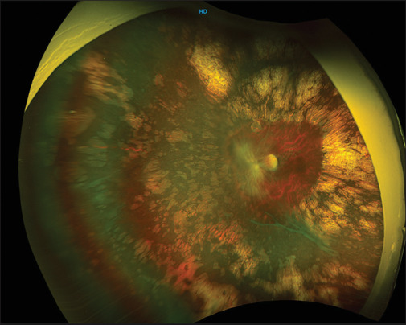
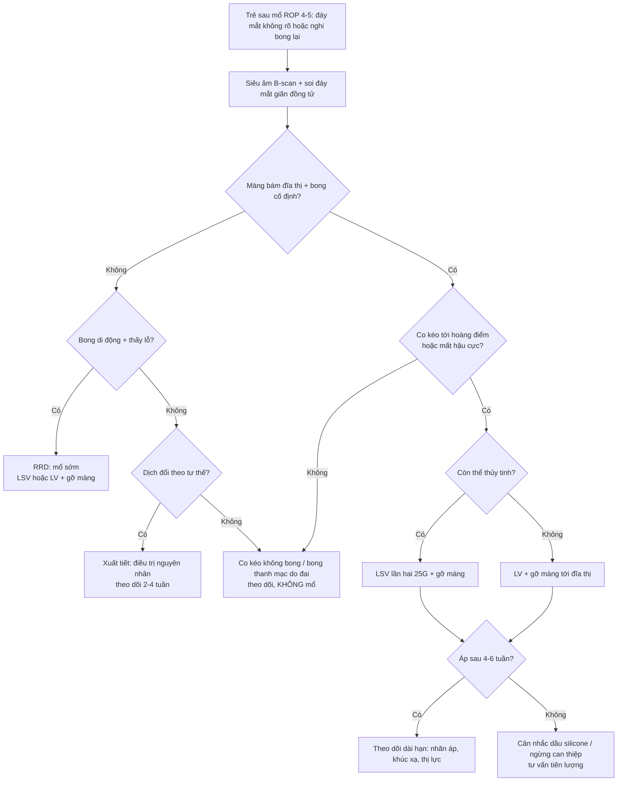
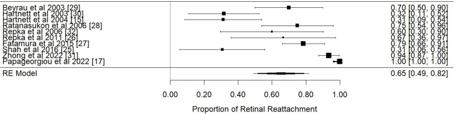
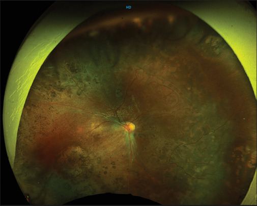
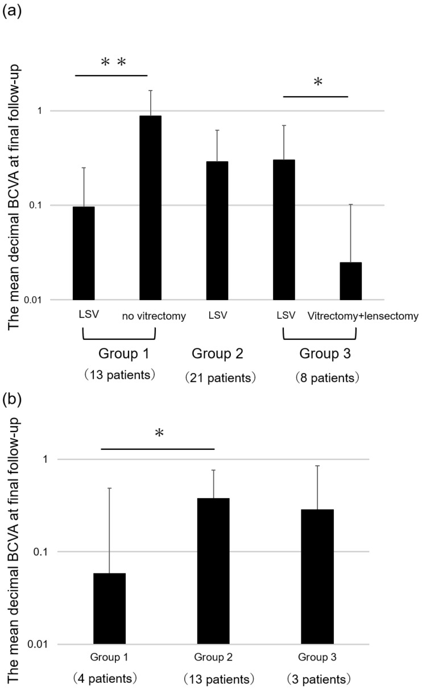

# 1406 — Tái bong & co kéo sau mổ ROP giai đoạn 4–5: phân biệt co kéo – rách mới – xuất tiết, khi nào mổ lại và chọn đường nào / Recurrent retinal detachment and persistent traction after surgery for stage 4–5 retinopathy of prematurity

**Tags:** `pattern:tai-bong` `pattern:co-keo` `pattern:rop` `vung:vong-mac` `vung:dich-kinh` `score:ICROP` `protocol:phau-thuat-rop` `protocol:sieu-am-B-scan` `incidentaloma:rop`

**Mức chắc chắn (certainty):** tổng hợp y văn (literature synthesis) — tự biên từ 1 thuần tập dài hạn **84 mắt/60 trẻ, theo dõi trung bình 9,27 năm** (PMC12659832), 1 thuần tập **23 mắt sau cắt dịch kính chừa thể thủy tinh (LSV) theo dõi 7,36 năm** (PMC11834901), 1 thuần tập **31 mắt** cắt dịch kính stage 4–5 (PMC10759917), 1 tổng quan hệ thống **10 nghiên cứu/1.179 mắt** (PMC11267137), 1 phân tích gộp đai củng mạc **10 nghiên cứu/214 mắt** (PMC11743321) và 1 nghiên cứu thị lực – khúc xạ sau LSV (PMC9916407). **Không có RCT**; phần chưa có số liệu ghi rõ "chưa rõ".

> **Câu chốt:** sau mổ ROP, "thành công" **không phải một trạng thái mà là một quá trình suy giảm**: thành công giải phẫu **94,2% lúc 6 tuần → 88,2% sau ~9 năm** ở stage 4A, và **63,6% → 30,3%** ở stage 5 — nghĩa là **1/3 mắt stage 5 "đã áp" sẽ bong lại**. Ba câu quyết định mổ lại: **(1) co kéo còn tiến triển tới hoàng điểm không? (2) có rách mới (RRD) hay chỉ co kéo? (3) mắt còn tiềm năng thị giác và tiền phòng/ nhãn áp còn dùng được không?**

## 1. Tổng quan bệnh học – cơ chế hình ảnh

- **Vì sao bong lại (pathophysiology) — 4 cơ chế chồng lấn:**
  1. **Co kéo tồn dư (residual traction):** màng fibrovascular sau thể thủy tinh **không lấy hết** (đặc biệt khi mổ qua đồng tử hẹp ở stage 5) → lực kéo tiếp tục.
  2. **Võng mạc không "lớn" theo nhãn cầu:** võng mạc là mô thần kinh **không tăng sinh theo thể tích nhãn cầu**; khi nhãn cầu lớn dần, võng mạc chịu **lực căng thường trực**, và chỗ yếu nhất — **hoàng điểm** — dễ rách. Đây là lý do **tái bong xuất hiện muộn, nhiều năm sau mổ**, không chỉ trong 6 tuần đầu (PMC12659832).
  3. **Rách mới (rhegmatogenous — RRD):** rách trong mổ hoặc sau mổ; trong loạt 84 mắt có **rách trong mổ 4 mắt**, **thủng hoàng điểm (macular hole) 1 mắt**, **chạm thể thủy tinh 3 mắt** khi định làm LSV (PMC12659832). **Rách làm tiên lượng xấu rõ rệt** (OR 0,21 cho thành công giải phẫu, PMC11267137).
  4. **Xuất tiết/viêm:** laser–cryo quá mức, bong thanh mạc, tăng áp lực tĩnh mạch sau đai — bong **dịch chuyển theo tư thế**, **không có lỗ**.
- **Vì sao "áp võng mạc" chưa đủ để yên tâm:** trong loạt 84 mắt, **thành công type 1** (áp toàn bộ, có thể còn nếp gấp) bền hơn nhiều so với **type 2** (áp một phần, hậu cực áp): chuyển thành thất bại **1/19 (4A), 1/6 (4B), 1/8 (stage 5)** với type 1, nhưng **1/13 (4A), 1/8 (4B) và 10/13 (stage 5)** với type 2 (PMC12659832). **Type 2 ở stage 5 gần như là "bong lại chắc chắn".**
- **Ngưỡng định lượng nằm lòng:**
  - **Thành công giải phẫu theo giai đoạn** (định nghĩa: 4A = áp hoàn toàn, hoàng điểm không/ít biến dạng; 4B = áp hoàn toàn hoặc bong ngoại vi tồn dư **không tới hoàng điểm**; 5 = **bất kỳ phần nào của hậu cực áp**):
    - **84 mắt, theo dõi 9,27 năm:** 6 tuần — **94,2% (4A) · 82,35% (4B) · 63,6% (stage 5)**; cuối theo dõi — **88,2% · 70,59% · 30,3%** (PMC12659832).
    - **31 mắt:** **90,9% (4A) · 57,1% (4B) · 33,3% (5A)**, chung **64,5%** (PMC10759917).
    - **Đai củng mạc, gộp 10 nghiên cứu/214 mắt:** áp võng mạc **65% (95% CI 49–82)**, **I² = 95,88%**; thị lực thuận lợi **41% (29–52)**; tuổi sau sinh hiệu chỉnh lúc mổ **42,5 tuần**, theo dõi trung bình **28,3 tháng** (PMC11743321).
  - **Tỉ lệ phải mổ lại:** **16/70 mắt (22,9%)** cần can thiệp thêm — **19,4% (4A), 22,2% (4B), 50% (stage 5)**; **7/88 mắt (8%)** cần **mổ lần hai** (PMC11267137). Loạt 31 mắt: **cắt dịch kính lần hai 9,7%** (PMC10759917). Loạt 84 mắt: **10 mắt mổ lại võng mạc** (2 mắt có dầu silicone), **17 mắt tháo/cắt đai**, **4 mắt mổ glaucoma**, **2 mắt lấy thể thủy tinh** (PMC12659832).
  - **Thời điểm mổ lại:** trung bình **6,4 tuần** khi do **xuất huyết dịch kính sau mổ**, và **43,5 tuần** khi là **mổ theo kế hoạch nhiều thì để tăng diện tích áp** (dẫn qua PMC11267137). Đây là lý do **lịch theo dõi phải kéo dài ≥ 1 năm**, không dừng ở mốc 6 tuần.
  - **Yếu tố tiên lượng (OR, PMC11267137):** **stage 4 OR 5,8**; **đã điều trị trước (laser/anti-VEGF) OR 2,3**; **giữ thể thủy tinh (LSV) OR 7**; **25G OR 1,7**; **có rách võng mạc OR 0,21** (bất lợi).
  - **Hậu quả chức năng:** sau LSV stage 4 theo dõi **7,36 năm** — võng mạc áp **82,61%**, **thể thủy tinh còn trong 69,57%**, thị lực **≥ 6/24 ở 34,78%**, **≥ 1/60 ở 69,56%**, khúc xạ cầu tương đương **−8,50 ± 6,39 D**, **cận thị cao ≥ 7 D ở 43,47%**, **mù hai mắt 18,75%** (PMC11834901). Thị lực tốt nhất đạt được: **6/9 (4A), 6/18 (4B), 6/60 (stage 5)** (PMC12659832).
- **Vai trò của hình ảnh học (khi nào chụp gì):**
  - **Siêu âm B-scan:** bắt buộc khi **môi trường đục** (xuất huyết dịch kính, màng sau thể thủy tinh, đục thể thủy tinh) — trả lời **áp/bong, phễu mở hay đóng, màng co kéo bám đĩa thị hay không**. **Dấu hiệu chốt: màng dính đĩa thị + di động theo mắt (aftermovement) = võng mạc; màng không dính đĩa thị = màng dịch kính, KHÔNG mổ.**
  - **Chụp đáy mắt góc rộng (RetCam/UWF):** theo dõi **co kéo tồn dư, kéo hoàng điểm (macular drag), tân mạch tái hoạt**; ảnh chuỗi theo thời gian quan trọng hơn 1 ảnh đơn.
  - **OCT cầm tay (handheld OCT):** phân biệt **bong võng mạc thật vs ly thượng võng mạc (retinoschisis)** và **nếp gấp/co kéo hoàng điểm** khi đáy mắt nhìn được; hữu ích khi **B-scan không phân định được**.
  - **FA (fluorescein angiography):** khi nghi **tái hoạt tân mạch** ở vùng ngoại vi chưa laser hết — quyết định **laser bổ sung** thay vì mổ lại.

## 2. Mẫu hình + chẩn đoán phân biệt theo "kiểu bong lại" (gamut)

- **Nhóm 1 — co kéo tồn dư tiến triển (tractional):** bong **hình vòm/ phễu**, **không di động**, **màng bám đĩa thị**, **không có lỗ**; thường **sau mổ stage 4B/5**, trong **vài tuần đến vài tháng**; **chỉ định mổ lại** khi **co kéo tiến tới hoàng điểm** hoặc **làm mất phần hậu cực còn lại**.
- **Nhóm 2 — rách mới/RRD trên nền ROP:** bong **di động, gợn sóng**, **có lỗ** (thường ở **hoàng điểm** hoặc **chu vi võng mạc mỏng**), xuất hiện **muộn (nhiều tháng–nhiều năm)** khi nhãn cầu lớn; **tiên lượng kém nhất** (OR 0,21) — vẫn phải mổ nhưng **tư vấn trung thực**.
- **Nhóm 3 — bong xuất tiết:** **dịch chuyển theo tư thế**, **không lỗ**, kèm **viêm/bỏng lạnh quá mức**; **không mổ ngay** — điều trị nguyên nhân, theo dõi.
- **Nhóm 4 — co kéo nhưng KHÔNG bong (macular drag/fold):** võng mạc áp, **mạch máu duỗi thẳng**, **hoàng điểm lệch** — **theo dõi**, không mổ (Hình 3).
- **Nhóm 5 — bong "giả" do đai củng mạc:** **gờ đai** + **bong thanh mạc (choroidal detachment)** hình vòm trơn, **không qua hoàng điểm**; **không mổ**, theo dõi — đai thường được **tháo/cắt ở ~1 tuổi** (PMC12659832).
- **Nhóm 6 — bong do nguyên nhân khác:** **bong thanh mạc sau tháo dầu**, **xuất huyết dưới võng mạc**, **glaucoma ác tính** (nhãn áp thấp, tiền phòng nông) — **không phải chỉ định cắt dịch kính**.

## 3. Bảng so sánh phân biệt (ma trận đối chiếu)

| Thực thể (entity) | Hình ảnh điển hình (B-scan / đáy mắt / OCT) | Chốt vào (rule-in) | Chốt loại (rule-out) | Gợi ý xác nhận |
|---|---|---|---|---|
| **Co kéo tồn dư (tractional)** | B-scan: **màng dày bám đĩa thị**, bong **hình phễu/vòm**, **không di động**; đáy mắt: màng trắng xám co rút | **Màng dính đĩa thị + co kéo tiến tới hoàng điểm trên 2 lần khám** | **Không có màng bám đĩa thị**, bong **di động** → nghĩ RRD/xuất tiết | So ảnh 2–4 tuần; B-scan lặp; cân nhắc OCT |
| **RRD do rách mới** | B-scan: bong **di động, gợn sóng**, có thể thấy **lỗ**; đáy mắt: **lỗ hoàng điểm/chu vi**, thường **muộn** | **Thấy lỗ + bong di động + dịch dưới võng mạc lan** | **Bong cố định, không lỗ, màng bám đĩa** → co kéo | Soi đáy mắt giãn đồng tử ± FA; B-scan khi đục |
| **Bong xuất tiết** | Bong **trơn, dịch chuyển theo tư thế**, **không lỗ**, kèm viêm/laser–cryo rộng | **Dịch đổi vị trí khi nghiêng đầu/đổi tư thế** | **Bong cố định + màng co kéo** → không phải xuất tiết | Đổi tư thế trên B-scan; đáp ứng corticoid |
| **Macular drag (áp, không bong)** | Đáy mắt: **mạch máu duỗi thẳng**, **hoàng điểm lệch về phía màng**, **võng mạc áp** | **Võng mạc áp toàn bộ + hoàng điểm lệch, thị lực ổn định** | **Bong dưới hoàng điểm** → không phải drag đơn thuần | Ảnh UWF chuỗi; OCT cầm tay |
| **Bong thanh mạc do đai** | **Gờ đai** + vòm trơn **không qua hoàng điểm**; B-scan: dịch dưới thanh mạc, **không di động cùng màng** | **Có gờ đai + vòm trơn ngoại vi + nhãn áp bình thường/thấp** | **Màng bám đĩa thị + bong trung tâm** → bong thật | B-scan qua gờ đai; theo dõi 2–4 tuần |
| **Glaucoma sau mổ (bẫy)** | Giác mạc mờ, **nhãn áp cao**, **tiền phòng nông**, đau, chảy nước mắt | **Nhãn áp cao + giác mạc mờ ở trẻ sau mổ ROP** | **Nhãn áp bình thường + đáy mắt rõ** | Đo nhãn áp mỗi lần khám (glaucoma **11/84 mắt**, **22,6%** loạt 31 mắt) |

*Hình 1 — **(A)** trước mổ: xuất huyết dịch kính + bong co kéo bắt hoàng điểm (stage 4B); **(B)** sau **cắt dịch kính lần 1**: còn **màng sau và co kéo tồn dư** — đây là hình ảnh "thất bại một phần" điển hình; **(C)** sau **mổ lại lần 2**: võng mạc áp, không còn co kéo. Nguồn: Bahrani HM et al., *Clin Ophthalmol* 2023 (PMC10759917) Fig. 4, CC BY-NC 3.0.*

*Hình 2 — mắt trái sau LSV: **co kéo phía mũi tới đĩa thị**, **hoàng điểm bị kéo về phía đĩa**, võng mạc **áp**; laser bao quanh tạo **teo sắc tố rộng**. Đây là "co kéo tồn dư không bong" — **theo dõi, không mổ**. Nguồn: Gopal L et al., *Indian J Ophthalmol* 2025 (PMC11834901) Fig. 6, CC BY-NC-SA 4.0.*

## 4. Protocol theo dõi + tiêu chuẩn mổ lại + chọn đường mổ

- **Lịch theo dõi sau mổ (tối thiểu):** **ngày 1, tuần 1, tuần 4–6** (mốc đánh giá "thành công sớm"), rồi **mỗi 1–3 tháng trong năm đầu**, **mỗi 3–6 tháng đến 3 tuổi**, **hằng năm đến ≥ 10 tuổi** — vì **tái bong có thể xuất hiện sau nhiều năm** (84 mắt: 6 tuần 94,2% → cuối 88,2% ở 4A; **63,6% → 30,3%** ở stage 5).
- **Mỗi lần khám phải có:** **nhãn áp** (glaucoma **11/84**, **22,6%** loạt 31 mắt), **khúc xạ** (cận thị cao **43,47%**), **soi đáy mắt giãn đồng tử** (hoặc **B-scan nếu đục**), **đánh giá thị lực theo tuổi** (fix–follow, Teller, Snellen).
- **Tiêu chuẩn mổ lại (đủ 1 trong các điều kiện):**
  1. **Co kéo tiến triển tới hoàng điểm** hoặc **bong mới bắt hoàng điểm** trên 2 lần khám cách 2–4 tuần.
  2. **RRD có lỗ** (kể cả lỗ hoàng điểm) — mổ **sớm**, không chờ.
  3. **Xuất huyết dịch kính dai dẳng + bong** không tự cải thiện sau **6–8 tuần**.
  4. **Glaucoma không kiểm soát** cần can thiệp (đồng thời hoặc riêng).
- **Chọn đường mổ lại:**
  - **Còn thể thủy tinh + co kéo khu trú:** **LSV lần hai** (giữ thể thủy tinh — OR 7 cho thành công, PMC11267137); dùng **25G** (OR 1,7).
  - **Màng dày lan rộng, đồng tử hẹp, đục thể thủy tinh, stage 5:** **cắt thể thủy tinh + cắt dịch kính (LV)**, gỡ màng tới đĩa thị.
  - **Co kéo ngoại vi ưu thế, chưa bong trung tâm:** **đai củng mạc** (gộp **65% áp**) — nhớ **tháo/cắt đai ~1 tuổi** và tư vấn **cận thị do đai**.
  - **RRD phức tạp/đã thất bại 2 lần:** **dầu silicone** (trong loạt 84 mắt chỉ **2 mắt** cần dầu; **đều đã lấy dầu sau đó**).
  - **Không mổ** khi: **co kéo ổn định không tới hoàng điểm**, **bong thanh mạc do đai**, **mắt không còn tiềm năng thị giác + đau** (cân nhắc giảm đau/mổ bỏ mắt thay vì mổ lại).
- **Tư vấn gia đình (bắt buộc ghi hồ sơ):** thành công giải phẫu **không đồng nghĩa thị lực tốt** — chỉ **34,78% đạt ≥ 6/24** sau LSV stage 4; **18,75% mù hai mắt**; **khúc xạ −8,50 D** trung bình; cần **kính, theo dõi nhược thị, và lịch hẹn dài hạn**.

*Hình 4 — gộp **10 nghiên cứu/214 mắt**: áp võng mạc sau **đai củng mạc** ở ROP tiến triển **65% (95% CI 49–82)**, **I² = 95,88%** (dao động 30%–100% giữa các loạt). Nguồn: Kottaridou E et al., *Cureus* 2024 (PMC11743321) Fig. 2, CC BY.*

## 5. Biến thể bình thường và cạm bẫy

- **Cạm bẫy 1 — "áp võng mạc ở 6 tuần = thành công":** sai. Ở stage 5, **63,6% lúc 6 tuần rơi còn 30,3%** về lâu dài; **type 2 success** (áp một phần) là **dấu hiệu báo động**, không phải kết quả.
- **Cạm bẫy 2 — mổ lại vì "còn màng":** **co kéo tồn dư ổn định, không tới hoàng điểm** (Hình 2) **không phải chỉ định** — mổ thêm ở mắt non tháng làm tăng **glaucoma, đục thể thủy tinh, mù**.
- **Cạm bẫy 3 — B-scan đọc màng dịch kính dày thành "võng mạc bong":** dùng **aftermovement** và tìm **điểm bám đĩa thị**; nếu không chắc → **OCT cầm tay** hoặc **soi đáy mắt khi đục đã tan**.
- **Cạm bẫy 4 — bỏ sót glaucoma:** **11/84 mắt** (loạt dài hạn) và **22,6%** (loạt 31 mắt) bị glaucoma; trẻ **không kêu đau**, **giác mạc mờ** dễ bị cho là "bong tái phát". **Đo nhãn áp mọi lần khám.**
- **Cạm bẫy 5 — nhầm cận thị do đai với "bong lại":** đai gây **cận thị −6 D** và **gờ đai**; ảnh B-scan qua gờ đai dễ tạo **bóng giả**. So **2 bình diện**, đọc cùng ảnh đáy mắt.
- **Cạm bẫy 6 — tư vấn "mổ là sẽ thấy":** **thành công giải phẫu ≠ thị lực**; **34,78% đạt ≥ 6/24** sau LSV stage 4, **18,75% mù hai mắt**. Nói rõ **khả năng phải mổ lại 8–23%** và **cần theo dõi ≥ 10 năm**.
- **Biến thể bình thường:** **nếp gấp võng mạc nhẹ quanh đĩa thị** sau mổ, **teo sắc tố do laser** (Hình 2), **đục thể thủy tinh nhẹ tiến triển**, **lác/rung giật** — không phải tái bong.

## 6. Tự lượng giá — Blind Quiz

**Ca 1 — Trẻ 3 tháng tuổi (sinh 27 tuần), sau cắt dịch kính stage 4B 4 tuần: đáy mắt mờ, B-scan nghi bong. Nhìn Hình 1, mô tả A→B→C.**

- Gợi ý: (B) là ảnh sau **lần mổ đầu tiên**.
- Câu hỏi: (B) cho thấy gì? Đây là "thành công" hay "thất bại một phần"? Khi nào mổ lại?

<b>Bấm để hiện đáp án (findings + chẩn đoán)</b>

- **(A)** xuất huyết dịch kính + **bong co kéo bắt hoàng điểm** (stage 4B). **(B)** sau mổ lần 1: **màng sau và co kéo tồn dư** — võng mạc chưa áp hoàn toàn. **(C)** sau mổ lại lần 2: **áp, không còn co kéo**.
- **Chẩn đoán:** **co kéo tồn dư** — không phải "thành công"; mổ lại khi **co kéo tiến tới hoàng điểm** hoặc **bong mới bắt hoàng điểm** trên 2 lần khám cách 2–4 tuần.
- Nguồn ảnh: Bahrani HM et al., *Clin Ophthalmol* 2023, PMC10759917 Fig. 4, CC BY-NC 3.0.

**Ca 2 — Trẻ 6 tuổi, ROP stage 4A đã LSV 5 năm trước, thị lực 6/60, võng mạc áp. Nhìn Hình 2 và Hình 3, có mổ không?**

- Gợi ý: cả hai ảnh đều **võng mạc áp**.
- Câu hỏi: gọi tên dấu hiệu? Vì sao **không mổ**? Cần theo dõi gì?

<b>Bấm để hiện đáp án</b>

- **Co kéo tồn dư không bong** + **macular drag**: **mạch máu duỗi thẳng**, **hoàng điểm lệch về phía màng**, **võng mạc áp**, laser teo sắc tố rộng.
- **Không mổ:** mổ thêm không cải thiện thị lực đã mất do **hoàng điểm lệch + nhược thị**, nhưng tăng nguy cơ **glaucoma/đục thể thủy tinh/bong thật**. Theo dõi **nhãn áp, khúc xạ (cận thị cao 43,47%), thị lực, ảnh UWF mỗi 6–12 tháng**.
- **Bối cảnh số liệu:** sau LSV stage 4 theo dõi 7,36 năm, **82,61% áp**, **69,57% còn thể thủy tinh**, **34,78% ≥ 6/24**.
- Nguồn ảnh: Gopal L et al., *Indian J Ophthalmol* 2025, PMC11834901 Fig. 6 và Fig. 3, CC BY-NC-SA 4.0.

**Ca 3 — Hội chẩn: "Đai củng mạc cho stage 4A thì bao nhiêu % áp? Có nên chọn đai thay cắt dịch kính?" Nhìn Hình 4 và Hình 5.**

- Gợi ý: Hình 5 so **mắt được LSV** với **mắt còn lại** (nhóm 1), và **LSV** với **cắt thể thủy tinh** (nhóm 3).
- Câu hỏi: đai củng mạc đạt bao nhiêu %? Vì sao **giữ thể thủy tinh** lại quan trọng tới vậy?

<b>Bấm để hiện đáp án</b>

- **Đai củng mạc:** gộp **10 nghiên cứu/214 mắt**, áp **65% (49–82)**, **I² = 95,88%**; thị lực thuận lợi **41% (29–52)** — tức **1/3 mắt vẫn bong** và **hơn một nửa thị lực kém**.
- **Giữ thể thủy tinh:** Hình 5a — nhóm 1, **LSV 0,1** so với **mắt không mổ 0,9** (p < 0,001); nhóm 3, **LSV 0,3** so với **cắt thể thủy tinh + cắt dịch kính 0,02** (p < 0,05). Trong tổng quan hệ thống: **LSV OR 7** cho thành công giải phẫu.
- **Kết luận:** đai hợp khi **co kéo ngoại vi, chưa bong trung tâm**; LSV khi **cần gỡ màng sau** — nhưng **cả hai đều là "kiểm soát", không phải "chữa khỏi"**: phải tư vấn **mổ lại 8–23%**, theo dõi **≥ 10 năm**.
- Nguồn ảnh: Kottaridou E et al., *Cureus* 2024, PMC11743321 Fig. 2, CC BY; Iwahashi C et al., *Int J Mol Sci* 2023, PMC9916407 Fig. 1, CC BY.

## Bài liên quan chéo
- [1403 – Phẫu thuật ROP giai đoạn 4–5: đai củng mạc vs LSV vs LV](../1403-phau-thuat-rop-giai-doan-4-5/lesson.md) (mổ lần đầu, chọn đường)
- [456 – Bệnh võng mạc trẻ sinh non: zone–stage–plus & AP-ROP](../456-benh-vong-mac-tre-sinh-non/lesson.md) (phân loại, sàng lọc)
- [458 – Di chứng & theo dõi dài hạn sau ROP](../458-di-chung-theo-doi-dai-han-sau-rop/lesson.md) (cận thị, lác, nhược thị)
- [1402 – Bong võng mạc sau viêm nội nhãn](../1402-bong-vong-mac-sau-viem-noi-nhan/lesson.md) (màng co kéo vs lỗ hoại tử, dầu silicone)

## Ảnh
- 5 ảnh lấy từ **Europe PMC/PMC** bản open access, giữ **nguyên bản** — **không crop, không ghép** (2 ảnh CC BY-NC-SA của PMC11834901 đặc biệt không được chỉnh sửa); nguồn – giấy phép từng file trong `images/CREDITS.md`.
- Tên file: `1406_tai-bong_<nội dung>_<loại>_PMC<ID>-Fig<k>.jpg`.

> Không dùng để chẩn đoán độc lập khi chưa có người hướng dẫn.
