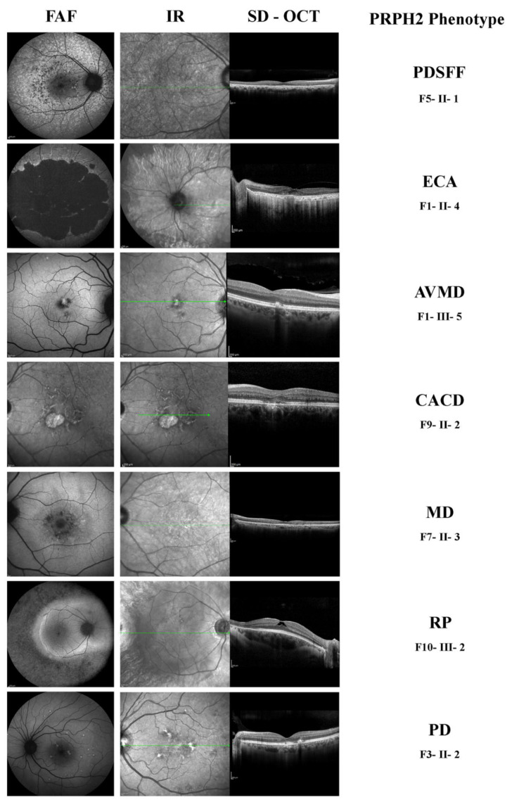
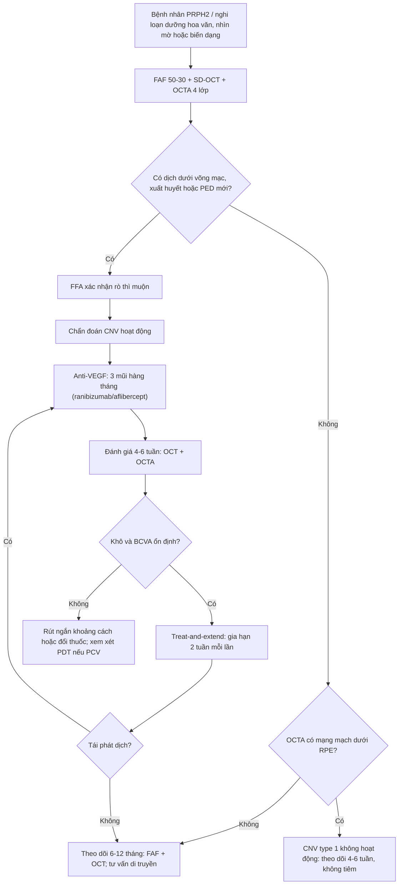
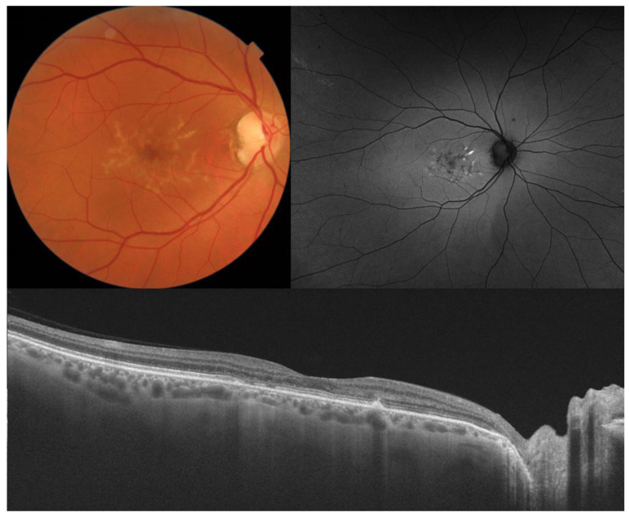
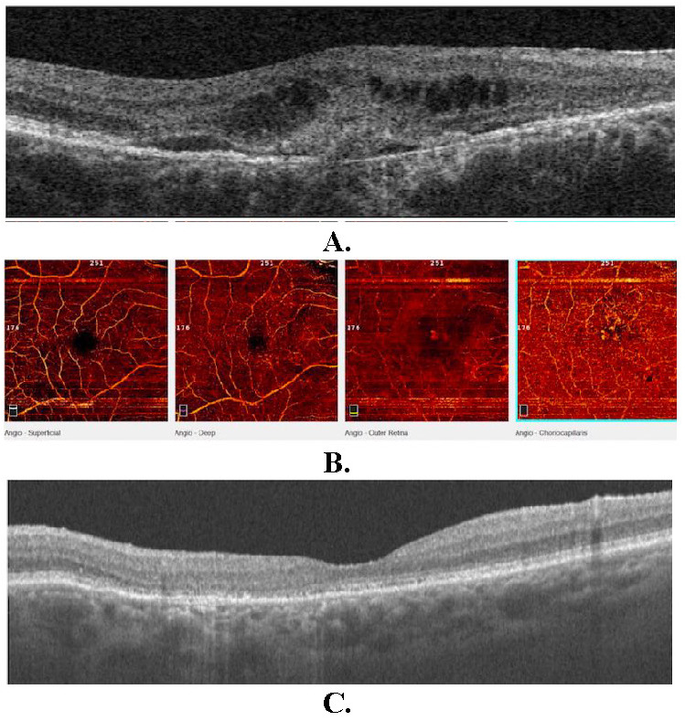
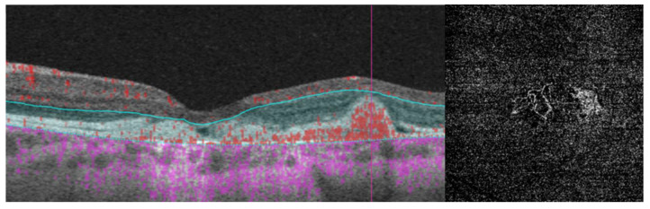

# 1407 — Tân mạch hắc mạc (CNV) trên nền loạn dưỡng hoa văn PRPH2: "dịch dưới võng mạc" là u mạch hay vật liệu lipofuscin? / Choroidal neovascularization in PRPH2 pattern dystrophy

**Tags:** `pattern:tan-mach-hac-mac` `pattern:bong-thanh-dich` `pattern:faf-tang-huyuynh-quang` `pattern:ez-day` `vung:hoang-diem` `vung:hac-mac` `protocol:FAF-SD-OCT` `protocol:OCTA` `protocol:FA-ICGA` `protocol:anti-VEGF` `protocol:di-truyen-PRPH2`
**Mức chắc chắn (certainty):** tổng hợp y văn (literature synthesis) — đọc trực tiếp toàn văn 5 bài mở qua Europe PMC/PMC (*Diagnostics* 2022; *Diagnostics* 2024; *Genes* 2025; *Rom J Ophthalmol* 2023; *IOVS* 2024) + 1 bài về dấu hiệu OCT (*Int J Retina Vitreous* 2025). **3 ca nguyên văn** dùng cho Blind Quiz (ảnh CC BY 4.0).

## 1. Tổng quan — vì sao PRPH2 gây loạn dưỡng, vì sao loạn dưỡng lại sinh tân mạch

- **Gen và protein:** **PRPH2** (peripherin-2, trước đây gọi **rd2/ peripherin**), nằm ở **6p21.1**, mã hóa glycoprotein xuyên màng **cần cho sự hình thành–ổn định–tái tạo đĩa đoạn ngoài tế bào quang thụ (photoreceptor outer segment discs)** bằng cách "dính" vành đĩa (disc rim) với **ROM1** (*Rom J Ophthalmol* 2023; *Genes* 2025). Đột biến tập trung ở **vòng D2** (tới **82%** các biến thể) (*Genes* 2025).
- **Vì sao ứ lipofuscin:** khi PRPH2 hỏng, **đĩa đoạn ngoài bị lỗi cấu trúc** → biểu mô sắc tố (RPE) **thực bào không hiệu quả** → **lipofuscin tích tụ dưới võng mạc/ trong RPE** → **tăng huỳnh quang trên FAF (hyperautofluorescence)**. Đây là lý do **FAF là phương thức nhạy nhất để nhận diện sớm** loạn dưỡng hoa văn (*Diagnostics* 2022).
- **Vì sao "hoa văn":** lipofuscin phân bố **theo hình mẫu** (cánh bướm, hình trứng, hình mạng lưới, hạt "pulverulentus") → tên gọi **pattern dystrophy (PD)**. Tổn thương **thường đối xứng hai mắt nhưng không bắt buộc**; cùng một đột biến có thể cho **nhiều kiểu hình khác nhau trong cùng gia đình** (*Diagnostics* 2022).
- **Vì sao xuất hiện CNV — cơ chế mô học (không phải "biến chứng ngẫu nhiên"):**
  1. **RPE–Bruch bị tổn thương mạn tính** bởi vật liệu lipofuscin/ drusen-like → **mất hàng rào** và **viêm mạn** (cytokine, complement).
  2. **Thiếu máu hắc mạc ngoài** do mất lớp mao mạch (choriocapillaris) → tăng **VEGF**.
  3. Kết quả: **tân mạch từ hắc mạc xuyên qua Bruch** → **CNV type 1** (dưới RPE) hoặc **type 2** (dưới võng mạc), gây **dịch/ xuất huyết/ xơ hóa** (*Diagnostics* 2024; *IOVS* 2024).
- **Tần suất CNV trong bệnh PRPH2 (định lượng):**
  - **17% (5/29 bệnh nhân)** có **CNV một mắt**, xuất hiện trên nhiều kiểu hình (PD, CACD, ECA) (*Diagnostics* 2022) — **cao hơn nhiều so với con số "hiếm gặp"** thường được dạy.
  - **1/36 bệnh nhân** trong đoàn hệ Oxford có **CNV hai mắt**, điều trị **ranibizumab** (*Genes* 2025).
  - Trong đoàn hệ PRPH2 dài hạn (theo dõi trung bình **14 năm**), **2 ca** kiểu hình **butterfly PD** phát triển **tân mạch hoàng điểm** và cần **nhiều mũi anti-VEGF** (*IOVS* 2024).
  - **PRPH2 chiếm 3,5–10,3%** các bệnh võng mạc di truyền tùy quốc gia (Pháp **10,3%**, Mỹ **9%**, Ý **9%**, Nhật **5%**, Bắc Mỹ **3,5%**) (*Diagnostics* 2022); **bệnh võng mạc di truyền nói chung 1/2.500–1/3.000** (*Genes* 2025).
- **Vì sao CNV ở PRPH2 dễ bị bỏ sót:** bệnh nhân **đã có bất thường RPE/ EZ từ trước**, nên **dịch mỏng dưới võng mạc** bị quy cho "loạn dưỡng tiến triển"; và **PED "nằm thấp" (low-lying) không kèm exudate** có thể **che giấu CNV** — chỉ **OCTA** mới thấy dòng chảy (*IOVS* 2024). Đây là **cạm bẫy trung tâm của bài**.

## 2. Mẫu hình + chẩn đoán phân biệt theo vị trí (gamut)

- **Khuôn 1 — Vật liệu vàng dưới võng mạc (vitelliform) ở hoàng điểm, OCT có "vật liệu" nhưng KHÔNG dịch.** Gamut: **AVMD/ PD thể vitelliform** vs **bệnh Best** vs **drusen lớn/ drusenoid PED** vs **CNV type 1 không exudate**. Chốt: **FAF tăng huỳnh quang hình trứng, EZ còn, không dịch, không xuất huyết** → vật liệu lipofuscin; **OCTA có võng mạch dưới RPE** → CNV ẩn.
- **Khuôn 2 — Hình "cánh bướm" (butterfly) trung tâm.** Gamut: **butterfly-shaped PD** vs **loạn dưỡng do HCQ/ chloroquine** vs **dystrophy do ABCA6/ CTNNA1** vs **AMD thể teo**. Chốt: **đối xứng, tăng huỳnh quang hình cánh bướm + tiền sử gia đình trội** → PD; **tiền sử thuốc, tổn thương ngoài hoàng điểm hình vòng** → độc chất.
- **Khuôn 3 — Dịch dưới võng mạc MỚI (subretinal fluid) ở mắt đã có loạn dưỡng.** Gamut: **CNV** vs **viêm hắc mạc (CSCR, VKH)** vs **bong thanh dịch do tăng áp lực** vs **dịch sau tiêm**. Chốt: **OCTA có mạng mạch + FFA rò thì muộn + xuất huyết/ lipid** → CNV; **OCTA không mạng mạch, FA không rò** → không phải CNV.
- **Khuôn 4 — Teo RPE/ hắc mạc lan rộng (ECA, CACD) không dịch.** Gamut: **CACD/ ECA do PRPH2** vs **teo địa lý do AMD** vs **loạn dưỡng hắc mạc trung tâm**. Chốt: **FAF giảm huỳnh quang đối xứng, không drusen điển hình, tuổi khởi phát < 50** → PRPH2; **drusen + tuổi > 65 + tổn thương không đối xứng** → AMD.
- **Khuôn 5 — "Vết nứt hoàng điểm" (foveal crack sign) trên OCT.** Gamut: **biến đổi loạn dưỡng hoa văn** vs **lỗ hoàng điểm sắp hình thành** vs **CNV co kéo**. Chốt: **đường tăng phản xạ dọc xuyên lớp võng mạc ngoài sau bong dịch kính sau** → dấu hiệu thoái hóa, **không phải mạng mạch**; theo dõi, **không tiêm anti-VEGF** (*Int J Retina Vitreous* 2025).

## 3. Bảng so sánh phân biệt (ma trận đối chiếu)

| Thực thể (entity) | Hình ảnh điển hình (FAF/ SD-OCT/ OCTA/ FA) | Chốt vào (rule-in) | Chốt loại (rule-out) | Gợi ý xác nhận |
|---|---|---|---|---|
| **CNV trên PD (PRPH2)** | **FAF**: vùng tăng huỳnh quang mờ + **giảm huỳnh quang do xuất huyết**; **OCT**: **dịch dưới võng mạc/ nội bào**, **vật liệu tăng phản xạ dưới võng mạc**, PED; **OCTA**: **mạng mạch dưới RPE/ dưới võng mạc** | **Mạng mạch trên OCTA + dịch/ xuất huyết mới** (hoặc PED "nằm thấp" không exudate nhưng có flow) | **Không có mạng mạch + FFA không rò** → không phải CNV | OCTA + FFA; theo dõi 4–6 tuần nếu nghi ngờ |
| **Vật liệu vitelliform (AVMD/ PD)** | **FAF tăng huỳnh quang hình trứng/ tròn**, OCT: **vật liệu đồng nhất dưới võng mạc**, **không dịch**, EZ còn | **Tăng huỳnh quang + không dịch + không flow** | **Có flow trên OCTA hoặc FFA rò** → CNV | OCT định kỳ, OCTA khi có triệu chứng mới |
| **Butterfly PD (không CNV)** | **FAF hình cánh bướm đối xứng**; OCT: **bất thường RPE/ EZ, không dịch, độ dày võng mạc bảo tồn** | **Đối xứng + không dịch + FAF điển hình** | **Dịch/ xuất huyết một bên** → tìm CNV | CFP + FAF + OCT; gen PRPH2 |
| **Teo hắc mạc lan rộng (ECA/ CACD)** | **FAF giảm huỳnh quang rộng**, OCT: **mất RPE, EZ, ONL**, không dịch | **Teo đối xứng + không drusen + tiền sử gia đình** | **Drusen điển hình + không đối xứng + tuổi cao** → AMD | Gen; so sánh hai mắt |
| **AMD thể tân mạch (bệnh giả)** | Drusen, CNV, dịch; **không đối xứng**, **không có hình mẫu bướm/ trứng** | **Tuổi > 65 + drusen + CNV** | **Hình mẫu đối xứng + khởi phát < 50 + gia đình** → PD | FAF (hình mẫu), gen, tiền sử |
| **Foveal crack sign** | OCT: **đường tăng phản xạ dọc xuyên võng mạc ngoài**, không dịch, không flow | **Sau bong dịch kính sau + không mạng mạch** | **Có mạng mạch/ dịch tiến triển** → CNV/ lỗ hoàng điểm | OCT theo dõi; **không tiêm** |

- Ảnh đối chiếu kiểu hình: `images/1407_cnv-loan-duong-hoa-van-prph2_FAF-OCT_diagnostics-f001.jpg` (7 kiểu hình PRPH2).

## 4. Protocol chụp + hệ phân độ/ điểm chuẩn hóa + điều trị

**4.1. Bộ ảnh tối thiểu (mỗi lần khám)**

| Bước | Phương thức | Thông số/ ngưỡng | Vì sao |
|---|---|---|---|
| 1 | **FAF 50° và 30°** | So sánh **hình mẫu** hai mắt; tăng huỳnh quang = lipofuscin hoạt động, giảm = teo RPE | Nhạy nhất để **nhận diện kiểu hình và theo dõi teo** (*Diagnostics* 2022) |
| 2 | **SD-OCT** (máy Spectralis/ Cirrus) | Đo **độ dày vùng hoàng điểm (CMT)**, tìm **dịch dưới võng mạc/ nội bào**, **PED**, **vật liệu tăng phản xạ**, **EZ** | Phát hiện **hoạt tính CNV** và biến chứng |
| 3 | **OCTA** (4 lớp: nông, sâu, võng mạc ngoài, choriocapillaris) | Tìm **mạng mạch** ở **lớp võng mạc ngoài/ choriocapillaris**; **type 1 = giữa RPE và Bruch**, **type 2 = dưới võng mạc** | **Không cần thuốc cản quang**, phát hiện CNV **kể cả khi không có exudate** |
| 4 | **FFA ± ICGA** | **Rò thì muộn** = hoạt tính; ICGA cho **PCV/ mạng mạch hắc mạc** | Xác nhận hoạt tính khi OCTA không rõ; dùng khi định **PDT** |
| 5 | **Gen PRPH2** (NGS panel IRD) | Xác định biến thể + **tư vấn di truyền trội** | Kiểu hình đơn độc không đủ; ảnh hưởng tiên lượng và sinh sản |

**4.2. Ngưỡng và cách gọi "CNV hoạt động"**

- **Hoạt động** = **có mạng mạch trên OCTA/ FFA** **VÀ** ít nhất một dấu hiệu: **dịch dưới võng mạc/ nội bào mới**, **xuất huyết**, **lipid**, **tăng CMT so lần trước**, hoặc **PED tăng kích thước**.
- **Không hoạt động** = mạng mạch **không đổi ≥ 3–6 tháng**, **không dịch**, **không xuất huyết** → **theo dõi**, không tiêm.
- **Bẫy "PED nằm thấp"**: PED **thấp, không exudate** vẫn có thể là **CNV type 1** → nếu **OCTA có flow**, coi là CNV và **theo dõi sát 4–6 tuần**; **không chờ đến khi có dịch** (*IOVS* 2024).

**4.3. Điều trị anti-VEGF (dữ liệu thực tế từ ca PRPH2)**

| Phác đồ | Số liệu | Nguồn |
|---|---|---|
| **3 mũi hàng tháng ranibizumab 0,5 mg**, sau đó theo dõi 4–6 tuần | **CMT 323 → 247 µm**, **BCVA 6/12 → 6/6**, **hết dịch dưới võng mạc**, **không tái hoạt 12 tháng** | *Case Rep Ophthalmol* 2012 (PMC3331880 — chỉ số liệu; giấy phép NC-ND nên **không dùng ảnh**) |
| **3 mũi ranibizumab cách 6 tuần** | **BCVA 0,6 → 0,7**, **hết dịch/ hết CNV trên OCT**, **ổn định 26 tháng** | *Rom J Ophthalmol* 2023 (PMC10385706, CC BY) |
| **Nhiều mũi anti-VEGF** ở butterfly PD tiến triển | **2 ca** trong đoàn hệ 14 năm; **dịch tồn dư** ở một ca | *IOVS* 2024 (PMC11668351 — chỉ số liệu) |

- **Quy tắc thực hành:** khởi đầu **3 mũi hàng tháng**, đánh giá **hoạt tính** rồi **treat-and-extend** (gia hạn 2 tuần/lần khi khô, rút ngắn khi tái phát); **mục tiêu là giữ EZ/ BCVA**, không phải "làm sạch FAF" — vì **teo RPE vẫn tiến triển** dù kiểm soát CNV.
- **Không tiêm khi**: không có mạng mạch, chỉ có vật liệu vitelliform, hoặc **foveal crack sign** đơn thuần.

## 5. Biến thể bình thường và cạm bẫy

- **Biến thể bình thường/ lành tính:**
  - **Drusen nhỏ hai bên hoàng điểm ở người trẻ** với FAF tăng nhẹ — nếu **đối xứng + hình mẫu** và **không có tiền sử gia đình rõ**, vẫn có thể là **PDSFF**; theo dõi chứ không điều trị.
  - **PED lành tính không dịch** ở đáy loạn dưỡng **không phải CNV** — OCTA là chốt.
  - **Tăng huỳnh quang FAF quanh hoàng điểm** có thể do **lipofuscin lan rộng**, không đồng nghĩa hoạt động.
- **Cạm bẫy (pitfall) hay gặp nhất:**
  1. **Gọi "AMD" và bỏ qua bệnh di truyền**: bệnh nhân **50–60 tuổi** với CNV + teo **hai mắt đối xứng**, **không drusen điển hình**, **hình mẫu bướm** → **PRPH2**. Chẩn đoán sai dẫn tới **không tư vấn di truyền** và **không theo dõi mắt còn lại/ con cái** (*Diagnostics* 2022).
  2. **Điều trị "dịch" mà không chứng minh mạng mạch**: **vật liệu vitelliform** có thể trông như dịch; tiêm anti-VEGF lặp lại vô ích và **tăng nguy cơ teo** — luôn có **OCTA/ FFA** trước khi tiêm.
  3. **Bỏ qua CNV "không exudate"**: PED **nằm thấp**, **không dịch**, nhưng **OCTA có flow** → vẫn là CNV; nếu không theo dõi, bệnh nhân đến muộn với **xơ hóa dưới võng mạc** (*IOVS* 2024).
  4. **Nhầm foveal crack sign với CNV**: đường tăng phản xạ dọc **không có flow**, thường sau **bong dịch kính sau**; **không tiêm** (*Int J Retina Vitreous* 2025 — 8/56 mắt có dấu hiệu, chỉ **1** tiến triển lỗ hoàng điểm, **p = 0,1429** so với nhóm không có dấu hiệu).
  5. **Đánh giá "đáp ứng" chỉ bằng BCVA**: BCVA có thể **giữ nguyên** trong khi **CMT tăng** hoặc **EZ mỏng dần**; theo dõi **OCT định lượng (CMT, EZ)** mới phát hiện tái phát.
  6. **Quên mắt thứ hai**: CNV có thể **một mắt** (17% trong đoàn hệ Ý) — **khám và chụp cả hai mắt mỗi lần**, vì mắt còn lại có **nguy cơ tương tự**.
  7. **Tư vấn tiên lượng sai**: PRPH2 là bệnh **tiến triển chậm nhưng không ngừng**; **kiểm soát CNV không ngăn được teo** — cần nói rõ để tránh thất vọng điều trị.
- **Phản biện trung thực nguồn:** **tần suất CNV 17%** đến từ một đoàn hệ nhỏ (**29 bệnh nhân**, Ý) và **1/36** từ đoàn hệ Oxford — **khoảng tin cậy rộng**, nên chỉ nên nói **"khoảng 3–17% tùy đoàn hệ"**, **không** dùng con số đơn lẻ để tư vấn nguy cơ cá nhân. Tương tự, **hiệu quả anti-VEGF** ở PRPH2 chỉ có **ca báo/ loạt nhỏ**, **không có RCT** — không suy rộng ra "mọi CNV do loạn dưỡng đều đáp ứng tốt".

## 6. Tự lượng giá — Blind Quiz ngay trên trang tĩnh

**Ca 1 — Nam 50 tuổi, nhìn mờ nhẹ hai mắt, không biến dạng**

- Gợi ý lâm sàng: **50 tuổi**, **BCVA 20/25**, **không biến dạng**, **không tiền sử thuốc**; hai mắt có tổn thương tương tự.
- Câu hỏi: (a) Mô tả hình mẫu trên FAF? (b) OCT có dịch không? (c) Có chỉ định anti-VEGF ngay không, vì sao?

<b>Bấm để hiện đáp án (findings + chẩn đoán)</b>

- Dấu hiệu: **FAF có vùng tăng huỳnh quang hình cánh bướm** ở hoàng điểm; **OCT: bất thường RPE và EZ, KHÔNG có dịch dưới võng mạc, độ dày võng mạc bảo tồn**.
- Chẩn đoán: **butterfly-shaped pattern dystrophy (PRPH2)** — lipofuscin tích tụ theo hình mẫu, chưa có tân mạch.
- Trả lời: **không tiêm anti-VEGF**; cần **OCTA + FFA** để loại CNV ẩn, rồi **theo dõi 6–12 tháng** (FAF + OCT), **tư vấn di truyền trội** và **khám mắt còn lại**.
- Nguồn ảnh: *Diagnostics* 2024;14:878, Figure 7 — PMC11083341, **CC BY 4.0** (Gómez-Benlloch A et al.).

**Ca 2 — Nam 66 tuổi, nhìn mờ + biến dạng mắt phải 8 tháng**

- Gợi ý lâm sàng: **66 tuổi**, **BCVA 0,6 mắt phải/ 1,0 mắt trái**, **8 tháng** nhìn mờ và biến dạng; **không có tiền sử gia đình**; đang dùng latanoprost.
- Câu hỏi: (a) Mô tả 3 dấu hiệu trên OCT? (b) OCTA cho thấy gì và ở lớp nào? (c) Chẩn đoán + phác đồ?

<b>Bấm để hiện đáp án (findings + chẩn đoán)</b>

- Dấu hiệu: **(A)** **gián đoạn RPE**, **vật liệu tăng phản xạ dưới võng mạc**, **dịch dưới võng mạc**, **nang nội bào**, **tăng độ dày võng mạc**; **(B)** OCTA 4 lớp cho **mạng mạch ở lớp võng mạc ngoài và choriocapillaris**; **(C)** sau điều trị: **hết dịch, độ dày giảm**.
- Chẩn đoán: **butterfly-shaped PD hai mắt + CNV hoạt động mắt phải** — lipofuscin hình mẫu hai bên + tân mạch type 1/2 một bên; **FFA rò thì muộn** xác nhận.
- Phác đồ: **ranibizumab 0,5 mg × 3 mũi cách 6 tuần** → **BCVA 0,7**, **hết dịch**, **ổn định 26 tháng**; theo dõi OCT/ OCTA mỗi 4–6 tuần giai đoạn đầu.
- Nguồn ảnh: *Rom J Ophthalmol* 2023;67:185–190, Figure 2 — PMC10385706, **CC BY** (Świerczyńska M et al.).

**Ca 3 — Nữ 22 tuổi, nhìn mờ một mắt, tiền sử "loạn dưỡng hoàng điểm"**

- Gợi ý lâm sàng: **22 tuổi**, **BCVA 20/100**, tiền sử **loạn dưỡng hoàng điểm dạng vitelliform**, **mới xuất hiện biến dạng**.
- Câu hỏi: (a) OCTA cho thấy gì? (b) Vì sao **OCT thường** có thể bỏ sót? (c) Điều trị và theo dõi?

<b>Bấm để hiện đáp án (findings + chẩn đoán)</b>

- Dấu hiệu: **angio B-scan** cho thấy **mạng mạch type 1 nằm giữa RPE và màng Bruch**; **ảnh en face lớp võng mạc ngoài** thấy **các mạch thật** — tức **tân mạch dưới RPE**.
- Vì sao dễ sót: **CNV type 1 nằm dưới RPE**, có thể chỉ là **PED "nằm thấp" không exudate**; trên OCT thường chỉ thấy **RPE dày lên nhẹ** — **không có dịch** nên dễ bỏ qua. **OCTA** phát hiện **dòng chảy**.
- Điều trị: **anti-VEGF** (3 mũi hàng tháng rồi treat-and-extend), theo dõi **OCT + OCTA 4–6 tuần**; nếu không có flow/ dịch → **theo dõi, không tiêm**.
- Lưu ý nguồn: ca gốc là **bệnh Best (bestrophin)** — dùng để minh họa **hình thái OCTA của MNV type 1**, **không** đại diện PRPH2; cơ chế và cách đọc lớp **giống nhau**.
- Nguồn ảnh: *Diagnostics* 2024;14:878, Figure 6 — PMC11083341, **CC BY 4.0** (Gómez-Benlloch A et al.).

## Bài liên quan chéo
- [489 – Loạn dưỡng hoa văn & teo võng mạc ngoài di truyền](../489-loan-duong-hoa-van-vs-doc-tinh-thuoc/lesson.md)
- [482 – Tân mạch hắc mạc sau CSCR mạn (PNV)](../482-tan-mach-hac-mac-sau-cscr-man/lesson.md)
- [444 – Tắc mạch võng mạc](../444-tac-mach-vong-mac/lesson.md)
- [447 – Đốm trắng võng mạc](../447-dom-trang-vong-mac/lesson.md)
- [443 – Võng mạc đái tháo đường](../443-vong-mac-dai-thao-duong/lesson.md)
- [441 – OCT hoàng điểm](../441-OCT-hoang-diem/lesson.md)
- [400 – Tổng quan Mắt & thị giác](../400-tong-quan-mat-thi-giac/lesson.md)

## Ảnh
- `images/1407_cnv-loan-duong-hoa-van-prph2_FAF-OCT_diagnostics-f001.jpg` — 7 kiểu hình PRPH2 (FAF/ IR/ OCT).
- `images/1407_cnv-loan-duong-hoa-van-prph2_FAF-OCT_diagnostics-f007.jpg` — butterfly PD: màu, FAF, OCT không dịch.
- `images/1407_cnv-loan-duong-hoa-van-prph2_OCT-OCTA_rjo-f002.jpg` — CNV trên butterfly PD: OCT trước/ sau, OCTA 4 lớp.
- `images/1407_cnv-loan-duong-hoa-van-prph2_OCTA_diagnostics-f006.jpg` — MNV type 1 trên OCTA (minh họa hình thái).
- Nguồn + giấy phép từng ảnh: `images/CREDITS.md`; link gốc: `sources.md`.

> Không dùng để chẩn đoán độc lập khi chưa có người hướng dẫn.
