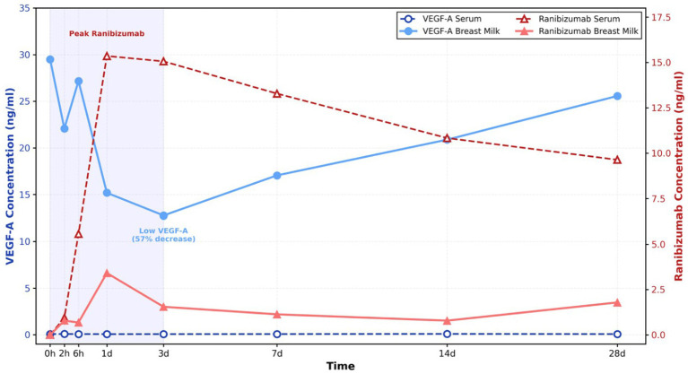
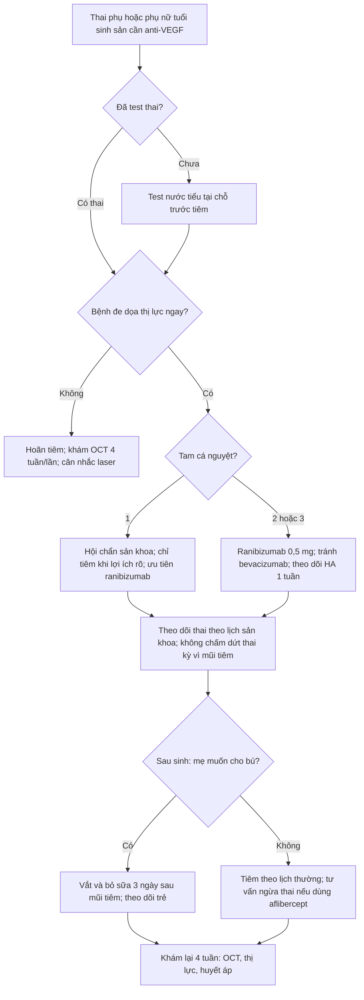
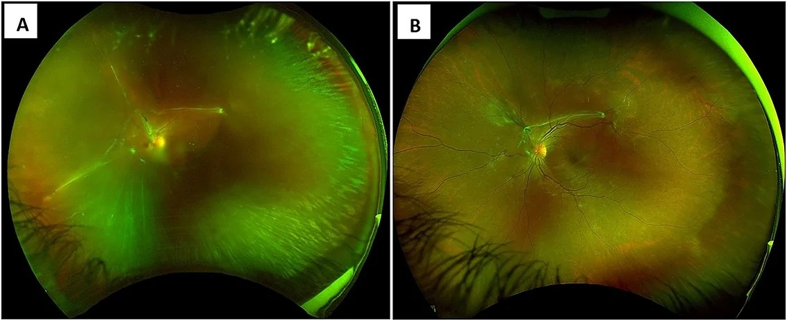
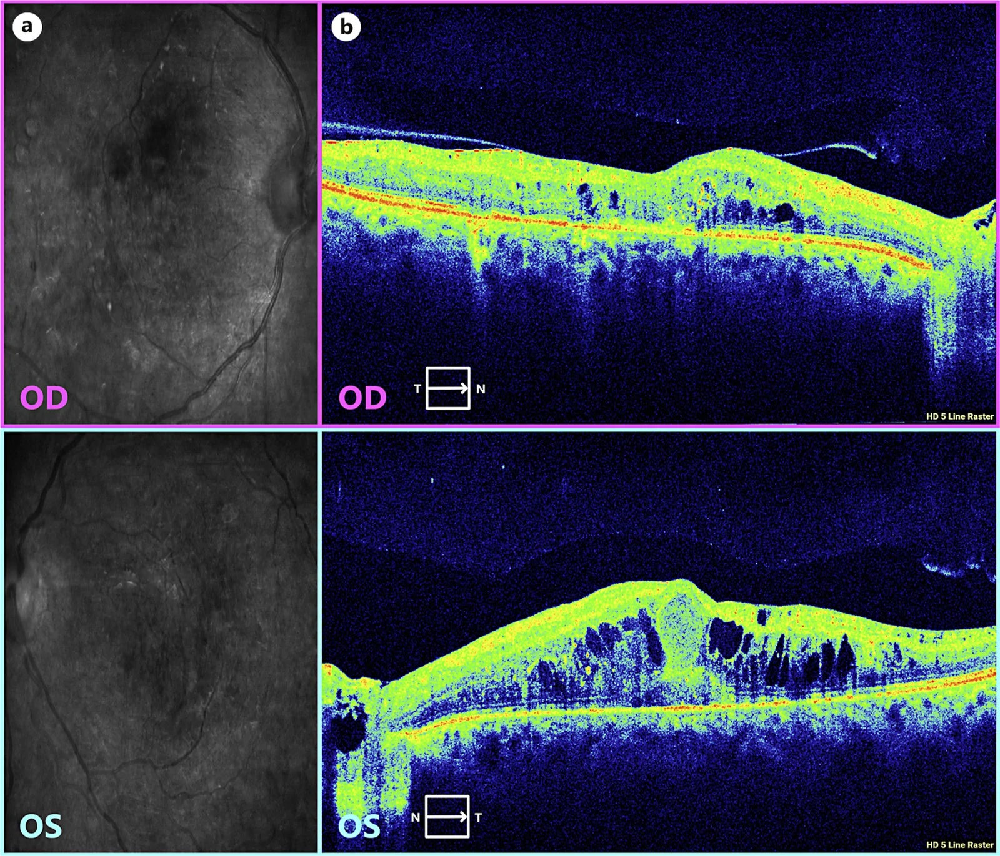

# 1408 — Anti-VEGF nội dịch kính trong THAI KỲ & cho con bú: chọn phân tử theo "có Fc hay không", không theo giá / Intravitreal anti-VEGF in pregnancy and lactation

**Tags:** `pattern:tan-mach-vong-mac` `pattern:phu-hoang-diem` `pattern:xuat-huyet-dich-kinh` `vung:vong-mac` `vung:hoang-diem` `vung:thai-nhi` `protocol:anti-VEGF` `protocol:OCT` `protocol:laser-PRP` `protocol:test-thai`

**Mức chắc chắn (certainty):** tổng hợp y văn (literature synthesis) — đọc trực tiếp toàn văn 4 bài mở qua Europe PMC/PMC (*Ophthalmol Ther* 2025; *Eye* 2026; *Front Med* 2026; *Oxf Med Case Reports* 2026; *Case Rep Ophthalmol* 2026). **3 ca nguyên văn** có ảnh dùng cho Blind Quiz. Phần **tính "liều tương đối cho trẻ bú" (RID)** và phần **khoảng cách tiêm trước sinh** là **suy luận** (inference) từ dược động học — ghi rõ tại chỗ, không có khuyến cáo chính thức.

## 1. Tổng quan — vì sao "tiêm tại mắt" vẫn là chuyện toàn thân

### 1.1. Vật lý của phân tử quyết định số phận toàn thân (đây là lõi của bài)

Anti-VEGF không "nằm yên trong mắt". Sau khi tiêm vào thể thủy tinh, thuốc **thoát qua hàng rào máu–võng mạc** vào tuần hoàn. **Tốc độ và mức thoát phụ thuộc hai đặc tính vật lý**, không phụ thuộc "thuốc mạnh hay yếu":

1. **Có phân đoạn Fc hay không** → quyết định **tái chế qua thụ thể FcRn** ở nội mô. FcRn gắn IgG trong endosome và **đưa trở lại tuần hoàn** → thuốc **tồn tại lâu trong máu** (t½ plasma tính bằng **tuần**). Phân tử **không có Fc** bị **phân giải protein (proteolysis)** và **thải qua thận** → t½ plasma tính bằng **giờ**.
2. **Khối lượng phân tử** → ngưỡng lọc cầu thận **~ 60–70 kDa**. Phân tử **< 60 kDa** (Fab 48 kDa, single-chain 26 kDa) **qua được cầu thận**, bị đào thải nhanh; phân tử **115–150 kDa không qua được** → phải chờ phân giải.

| Thuốc | Cấu trúc | **KLPT** | **Fc** | t½ thể thủy tinh | **t½ plasma** | Liều |
|---|---|---|---|---|---|---|
| **Bevacizumab** | kháng thể đơn dòng toàn phần | **149 kDa** | **Có** | 6–10 ngày | **21 ngày** | 1,25 mg |
| **Ranibizumab** | **Fab** người hóa | **48 kDa** | **Không** | 7,1 ngày | **0,25 ngày (~6 giờ)** | 0,5 mg |
| **Aflibercept** | protein dung hợp thụ thể–Fc | **115 kDa** | **Có** | 4,5–4,7 ngày | **18 ngày** | 2 mg |
| **Faricimab** | kháng thể bispecific, **Fc biến đổi giảm gắn FcRn/FcγR** | **150 kDa** | Có (biến đổi) | 6,7–12 ngày | **12 ngày** | 6 mg |
| **Brolucizumab** | mảnh kháng thể chuỗi đơn | **26 kDa** | **Không** | 4,4–5,6 ngày | **6 ngày** | 6 mg |

*(Bảng dựng theo bảng 2 của *Ophthalmol Ther* 2025, PMC12271010.)*

- **Suy ra hệ quả lâm sàng ngay:** **ranibizumab là phân tử "thoát ra toàn thân ít nhất và ngắn nhất"**, **bevacizumab là nhiều nhất và dài nhất**. Không có **tích lũy** giữa mũi 1 và mũi 3 với ranibizumab, nhưng **có tích lũy** với bevacizumab và aflibercept (tổng quan *Ophthalmol Ther* 2025).
- **Vì sao điều này quan trọng với thai:** VEGF **cần cho tạo mạch bánh nhau và phôi**; ức chế VEGF toàn thân kéo dài = nguy cơ lý thuyết lên **nhau thai, thai và huyết áp mẹ**. Vì vậy **thời gian phơi nhiễm (t½), chứ không phải "nồng độ trong mắt"**, là biến số quyết định.

### 1.2. Qua nhau thai: Fc là "vé vào"

- IgG mẹ → thai **không phải khuếch tán thụ động** mà qua **vận chuyển tích cực nhờ FcRn ở nguyên bào nuôi**. Vì vậy **bevacizumab, aflibercept, faricimab (có Fc) có đường vào nhau thai**, còn **ranibizumab (Fab, không Fc)** **không dùng được "vé" này** → **tỉ lệ qua nhau thai thấp hơn** (*Ophthalmol Ther* 2025).
- **Nói chính xác điều chưa biết:** **không có** nghiên cứu dược động thai–nhau đủ lớn ở người với bất kỳ thuốc nào trong nhóm; kết luận "ranibizumab ít qua nhau thai" dựa trên **cơ chế + nghiên cứu động vật + nồng độ máu cuống rốn lẻ tẻ**, không phải thử nghiệm có đối chứng.

### 1.3. Cho con bú: có thuốc trong sữa, nhưng **bao nhiêu** và **bé hấp thu được không**

- **Ca nguyên văn đo trực tiếp** (nữ 30 tuổi, đang cho con bú 6 tháng, tiêm **ranibizumab 0,5 mg** cho phù hoàng điểm do tắc nhánh tĩnh mạch võng mạc): nồng độ **ranibizumab trong MÁU mẹ đạt đỉnh 15,35 ng/mL**, trong **SỮA đạt đỉnh 3,14 ng/mL**, đều **tăng nhanh trong ngày đầu**; **VEGF-A trong sữa giảm từ 29,49 → 12,75 ng/mL trong 3 ngày đầu (giảm ~57%)** rồi trở về gần mức trước tiêm; **VEGF-A trong máu mẹ ổn định** (*Front Med* 2026, PMC12900737).
- **Ước tính "liều tương đối cho trẻ" (suy luận — inference):** trẻ bú ~**150 mL/kg/ngày** × 3,14 ng/mL = **471 ng/kg/ngày = 0,47 µg/kg/ngày**; liều mẹ **500 µg** chia theo **60 kg** = **8,3 µg/kg** → **RID ≈ 5,6%** (dưới ngưỡng thận trọng thường dùng **10%**). Thêm nữa, **Fab là protein** → **sinh khả dụng đường uống gần bằng 0** (bị phân giải trong dạ dày). Vì vậy **nguy cơ hệ thống cho trẻ bú là rất thấp**; **nhưng** đây **không phải** kết luận từ thử nghiệm, và **VEGF-A trong sữa giảm** vẫn là thay đổi sinh lý chưa rõ hậu quả.
- **Dữ liệu trên các thuốc khác:** **bevacizumab** làm **VEGF-A trong sữa giảm ~35% ở 2 tuần** sau tiêm (McFarland, dẫn trong *Ophthalmol Ther* 2025) — tức **kéo dài hơn nhiều** so với nhịp 24 giờ của ranibizumab. **Aflibercept** làm giảm VEGF-A huyết tương mạnh hơn ranibizumab → **kém ưu tiên** khi cho bú.
- **Chiến lược "pump and dump 3 ngày"** (Basilious): vắt và **bỏ sữa 3 ngày** sau tiêm rồi cho bú lại → **ranibizumab không đo được trong máu trẻ**, VEGF-A của trẻ **tương đương nhóm chứng** (*Ophthalmol Ther* 2025).

### 1.4. Dữ liệu thai kỳ — ngưỡng định lượng để tư vấn (không phải để trấn an)

| Nghiên cứu | Thiết kế | Thuốc | Kết quả chính |
|---|---|---|---|
| Polizzi 2015 | loạt **3 ca** | bevacizumab, tiêm **tam cá nguyệt 2–3** | **3 trẻ đủ tháng khỏe mạnh**; 1 ca có yếu tố nguy cơ sảy thai |
| Fossum 2018 | loạt **3 ca** | ranibizumab, tiêm lúc **8, 10 và 21 tuần** | **3 trẻ khỏe mạnh**, không dị tật |
| Ong 2022 | hồi cứu **42 thai kỳ** | ranibizumab, aflibercept | **40% (16/41) không biết mình có thai khi tiêm**; **81% sinh sống (34/42)**, **12% sảy thai (5/42)**, **7% thai lưu (3/42)** — phần lớn ở thai kỳ nguy cơ cao |

*(Bảng 7 của *Ophthalmol Ther* 2025, PMC12271010.)*

- **Đọc đúng bảng này:** **12% sảy thai** và **7% thai lưu** nằm trong **nền sảy thai tự nhiên 10–20%** của dân số chung → **không chứng minh được quan hệ nhân quả**, nhưng **cũng không loại trừ**. Đây là lý do khuyến cáo thực hành: **tránh tiêm trong tam cá nguyệt 1**, đặc biệt ca nguy cơ cao; và **test thai trước tiêm** ở phụ nữ tuổi sinh sản (*Ophthalmol Ther* 2025; *Eye* 2026).
- **Ca phản diện (để cân bằng):** một ca DME nặng tiêm **3 mũi bevacizumab** trong thai kỳ, có **đợt suy tim sung huyết (CHF)** sau các mũi tiêm và **thai lưu**; chính nhóm tác giả kết luận **thai lưu nhiều khả năng do đái tháo đường kiểm soát kém + tăng huyết áp + CHF**, **không phải do bevacizumab** (*Case Rep Ophthalmol* 2026, PMC13688658). Bài học: **đừng quy nhân quả một chiều**, nhưng cũng **đừng bỏ qua** khả năng tác dụng toàn thân.

## 2. Mẫu hình + chẩn đoán phân biệt theo vị trí (gamut)

- **Khuôn 1 — "Thai phụ nhìn mờ + dịch dưới võng mạc"**: gamut **CNV (cận thị/AMD/do viêm)** vs **CSCR** vs **VKH** vs **bong thanh dịch do tiền sản giật** vs **choroidal osteoma biến chứng**. Chốt: **OCT có dịch dưới võng mạc + dịch dưới RPE + xuất huyết** → CNV; **FA/ICGA rò thì muộn**, **OCTA có mạng mạch**; **không có mạng mạch + tự hết** → CSCR.
- **Khuôn 2 — "Thai phụ đái tháo đường, xuất huyết dịch kính"**: gamut **PDR tiến triển do thai** vs **DME nặng lên** vs **bệnh võng mạc do tiền sản giật** vs **tắc tĩnh mạch**. Chốt: **tân mạch đĩa/trước võng mạc + xuất huyết dịch kính** → PDR; **phù hoàng điểm không tân mạch** → DME.
- **Khuôn 3 — "Triệu chứng toàn thân sau mũi tiêm"**: gamut **tác dụng toàn thân của anti-VEGF (tăng HA, protein niệu, CHF)** vs **tiền sản giật** vs **bệnh nền (ĐTĐ, bệnh tim)**. Chốt: **thời điểm trùng mũi tiêm + tăng HA mới + phù** → nghĩ anti-VEGF; **tiểu cầu giảm, AST/ALT tăng, protein niệu > 300 mg/24h** → tiền sản giật.
- **Khuôn 4 — "Phụ nữ tuổi sinh sản, chưa biết có thai"**: gamut **tiêm rồi mới phát hiện thai** vs **hoãn tiêm** vs **chuyển laser**. Chốt: **test thai nước tiểu trước tiêm**; nếu đã tiêm → **tư vấn, không chỉ định chấm dứt thai kỳ** vì chưa có bằng chứng dị tật.
- **Khuôn 5 — "Hậu sản, đang cho bú, cần tiêm"**: gamut **ranibizumab + pump-and-dump 3 ngày** vs **hoãn đến khi cai sữa** vs **laser**. Chốt: **bệnh đe dọa thị lực + mẹ muốn duy trì sữa** → ranibizumab + bỏ sữa 3 ngày.

## 3. Bảng so sánh phân biệt (ma trận đối chiếu)

| Thực thể (lựa chọn) | Đặc điểm phân tử | Chốt vào (rule-in) | Chốt loại (rule-out) | Gợi ý xác nhận |
|---|---|---|---|---|
| **Ranibizumab** | **Fab 48 kDa, không Fc**, t½ plasma **0,25 ngày** | **Cần tiêm khi đang mang thai/cho bú**, đặc biệt **tam cá nguyệt 1** hoặc ngay sau sinh | **Bệnh cần tác dụng kéo dài 12–16 tuần** (thì kém phù hợp) | Nồng độ sữa đỉnh **3,14 ng/mL**; **pump-and-dump 3 ngày** |
| **Aflibercept** | **Fusion 115 kDa, có Fc**, t½ **18 ngày** | **Không mang thai, cần giãn khoảng tiêm** | **Đang mang thai** — tích lũy, giảm VEGF huyết tương mạnh | Tránh trong thai kỳ nếu có lựa chọn khác |
| **Bevacizumab** | **IgG1 149 kDa, có Fc**, t½ **21 ngày** | Bệnh nặng, không có lựa chọn khác, **đã tư vấn** | **Thai kỳ/cho bú nếu còn lựa chọn** — phơi nhiễm toàn thân cao nhất; **không có chỉ định tiêm nội nhãn chính thức** | Theo dõi HA, protein niệu, tim mạch |
| **Faricimab** | **Bispecific 150 kDa, Fc biến đổi**, t½ **12 ngày** | **Cần giãn khoảng tiêm 12–16 tuần** ở người không mang thai | **Không dùng làm "lựa chọn an toàn"** — dữ liệu thai kỳ chỉ **1 ca** | Chỉ dùng sau hội chẩn sản–mắt |
| **Laser PRP / laser điểm** | Không dùng thuốc | **PDR nguy cơ cao / DME** ở thai phụ — **không phơi nhiễm thai** | **Xuất huyết dịch kính đặc che đáy mắt** → không đốt được | Ưu tiên khi bệnh đáp ứng; nhược điểm: **ám điểm ám điểm thị trường** |
| **Corticoid nội nhãn (implant)** | Tác dụng tại chỗ, **tan chậm** | **Phù hoàng điểm do viêm** khi cần che phủ cả thai kỳ | **Tăng nhãn áp, glaucoma, tiền sử nhiễm herpes** | Theo dõi **nhãn áp 4–6 tuần** |

- Ảnh minh họa dược động (mục 6, ca 1) là **biểu đồ nồng độ thuốc trong máu và sữa**, không phải ảnh đáy mắt — đặt ở đây để đối chiếu **"mắt" với "toàn thân"**.

## 4. Protocol chụp + hệ phân độ/điểm chuẩn hóa + quy trình quyết định

### 4.1. Trước khi tiêm: 4 bước bắt buộc

| Bước | Việc làm | Ngưỡng/ghi chú |
|---|---|---|
| 1 | **Hỏi + test thai nước tiểu** (mọi nữ 15–50 tuổi, kể cả đang dùng biện pháp tránh thai) | **40% (16/41) thai kỳ trong loạt Ong 2022 không được biết lúc tiêm** |
| 2 | **Phân tầng khẩn cấp:** bệnh **đe dọa thị lực ngay** (CNV dưới hoàng điểm, PDR có xuất huyết dịch kính) vs **có thể hoãn 3–6 tháng** | Hoãn được → **hoãn đến sau tam cá nguyệt 1**, khám lại 4 tuần/lần |
| 3 | **Chọn phân tử theo Fc** | Ưu tiên **ranibizumab**; **tránh bevacizumab** nếu còn lựa chọn; **faricimab = chưa đủ dữ liệu** |
| 4 | **Hội chẩn sản khoa** trước mũi tiêm đầu tiên | Ghi vào hồ sơ: tuần thai, HA, protein niệu, đường huyết |

### 4.2. Trong và sau tiêm

- **Kỹ thuật:** tiêm **0,05 mL** qua pars plana, **povidone-iodine 5%**, không khác người không mang thai; **không dùng gây mê toàn thân**.
- **Theo dõi 1 tuần:** **huyết áp**, phù, khó thở, đau ngực — đây là cửa sổ **nồng độ thuốc toàn thân cao nhất (ngày 1–3)**.
- **Theo dõi thai:** siêu âm thai theo lịch sản khoa; **không cần** siêu âm thêm chỉ vì mũi tiêm nếu thai bình thường.
- **Sau sinh:** nếu mẹ muốn cho bú → **vắt và bỏ sữa 3 ngày** (pump-and-dump), sau đó cho bú lại; hoặc **hoãn mũi tiêm đến sau khi cai sữa** nếu bệnh cho phép.

### 4.3. Khoảng cách tiêm trước sinh (suy luận — inference, không có khuyến cáo)

- **Nguyên lý:** nồng độ đỉnh toàn thân ở **ngày 1–3**; với **bevacizumab t½ 21 ngày**, cần **~5 chu kỳ bán thải ≈ 105 ngày** để giảm > 95%. Vì vậy **nếu bệnh cho phép hoãn**, tránh mũi **bevacizumab trong ~3 tháng cuối**; với **ranibizumab** (t½ 6 giờ) **không cần** khoảng cách này.
- **Nhưng:** mũi tiêm **gần ngày sinh** không phải chống chỉ định tuyệt đối — **mất thị lực do PDR tiến triển nhanh trong thai** cũng là biến cố thật. Quyết định theo **cân bằng lợi ích mẹ–thai**, ghi rõ trong hồ sơ.

### 4.4. Phân độ dùng trong quyết định

- **Bệnh võng mạc đái tháo đường:** **ETDRS/ICDR** (mức 1–4 tăng sinh) + **phân loại DME** theo vị trí trung tâm; **PDR nguy cơ cao = tân mạch đĩa ≥ 1/3 diện tích đĩa hoặc tân mạch trước võng mạc + xuất huyết dịch kính**.
- **CNV:** **phân loại type 1/2/3** trên OCTA; **hoạt tính** = dịch + xuất huyết + mạng mạch (xem bài 1407).
- **Thai kỳ:** không có "score" riêng; dùng **tuần thai + phân tầng nguy cơ sản khoa** (tiền sản giật, ĐTĐ, bệnh tim) và **mức độ khẩn cấp thị lực**.
- **Sau tiêm:** **CTCAE v5.0** cho tăng huyết áp và biến cố tim mạch.

## 5. Biến thể bình thường và cạm bẫy

- **Biến thể/ hiện tượng sinh lý dễ nhầm:**
  1. **Thai kỳ làm bệnh võng mạc ĐTĐ nặng lên** (tăng thể tích huyết tương, tăng yếu tố tăng trưởng, thay đổi huyết áp) — **nặng lên không có nghĩa "thuốc thất bại"**.
  2. **VEGF-A trong sữa dao động sinh lý** — giảm **~57% trong 3 ngày** sau mũi ranibizumab rồi **tự hồi phục**; đây là thay đổi **tạm thời**, không phải "sữa mất chất".
  3. **Tăng huyết áp thai kỳ** phổ biến — không phải mọi tăng HA sau tiêm đều do thuốc.
- **Cạm bẫy (pitfall):**
  1. **Tin rằng "thuốc tại mắt thì không vào máu".** Sai về định lượng: **15,35 ng/mL trong máu mẹ** sau một mũi ranibizumab 0,5 mg (*Front Med* 2026).
  2. **Quy mọi sảy thai cho mũi tiêm.** Nền sảy thai tự nhiên **10–20%**; loạt 42 thai kỳ có **12% sảy thai, 7% thai lưu** — không phân biệt được nhân quả. Ngược lại, **đừng dùng con số này để trấn an tuyệt đối**.
  3. **Dùng bevacizumab vì "rẻ, tác dụng lâu".** Đây là phân tử **phơi nhiễm toàn thân cao nhất**, **không có chỉ định tiêm nội nhãn**, và **tích lũy** qua các mũi.
  4. **Không test thai trước tiêm.** **40%** thai kỳ trong loạt Ong 2022 **không được biết** lúc tiêm — đây là sai sót hệ thống, không phải ca hiếm.
  5. **Coi faricimab là "an toàn vì mới".** Toàn bộ dữ liệu thai kỳ của faricimab hiện là **1 ca** (tiêm lúc **29 tuần 6 ngày**, sinh mổ **37 ngày sau**, không biến cố) — **không đủ** để khuyến cáo.
  6. **Cắt sữa hoàn toàn** thay vì **pump-and-dump 3 ngày** — mất lợi ích nuôi con bằng sữa mẹ mà không thêm an toàn.
  7. **Bỏ qua tim mạch:** ca DME có **3 đợt CHF** trùng các mũi bevacizumab; dù tác giả quy cho bệnh nền, **theo dõi HA/tim là bắt buộc** ở thai phụ có bệnh tim.
  8. **Ngừng điều trị vì "đang mang thai"** trong khi bệnh đang tiến triển nhanh — **mù vĩnh viễn** cũng là biến cố thai kỳ.
- **Phản biện trung thực nguồn:** toàn bộ bằng chứng ở đây là **báo cáo ca, loạt nhỏ và tổng quan tự chọn** — **không có RCT, không có registry đủ lớn**; các tổng quan khác nhau **cùng dữ liệu nhưng kết luận mạnh yếu khác nhau** (ví dụ *Eye* 2026 nói "ranibizumab có lẽ ưu tiên", trong khi *Ophthalmol Ther* 2025 nói "có thể coi là lựa chọn an toàn hơn"). Vì vậy **không được trích một câu khuyến cáo để biến thành "chuẩn điều trị"**.

## 6. Tự lượng giá — Blind Quiz ngay trên trang tĩnh

**Ca 1 — Nữ 30 tuổi, đang cho con bú 6 tháng, phù hoàng điểm do tắc nhánh tĩnh mạch võng mạc**

- Gợi ý lâm sàng: **một mũi ranibizumab 0,5 mg**; mẹ **muốn tiếp tục cho bú**; bé 6 tháng khỏe mạnh.
- Câu hỏi: (a) Đọc đỉnh nồng độ thuốc trong **máu** và **sữa**? (b) Tỉ lệ thuốc trong sữa so với máu là bao nhiêu? (c) Tư vấn cho bú thế nào, và **VEGF-A trong sữa** thay đổi ra sao?

<b>Bấm để hiện đáp án (findings + chẩn đoán)</b>

- Dấu hiệu: **ranibizumab máu đỉnh 15,35 ng/mL (ngày 1)**, **sữa đỉnh 3,14 ng/mL** → **sữa/máu ≈ 20%**; **VEGF-A trong sữa 29,49 → 12,75 ng/mL trong 3 ngày (giảm ~57%)** rồi hồi phục; **VEGF-A máu mẹ ổn định**.
- Ước tính: **RID ≈ 5,6%** theo cân nặng (suy luận), cộng với **sinh khả dụng đường uống của Fab ≈ 0** → **nguy cơ hệ thống cho bé rất thấp**.
- Tư vấn: **vắt và bỏ sữa 3 ngày** (pump-and-dump) rồi cho bú lại; hoặc hoãn mũi tiêm nếu bệnh cho phép; **theo dõi bé** về bú, cân nặng.
- Nguồn ảnh: *Front Med* 2026;13:1730208, Figure 1 — PMC12900737, **CC BY 4.0** (Zhang J et al.).

**Ca 2 — Nữ 27 tuổi, ĐTĐ type 1, thai 28 tuần 1 ngày, mắt trái mất thị lực đột ngột**

- Gợi ý lâm sàng: **xuất huyết dịch kính dày đặc** che đáy mắt → **không đốt laser toàn võng mạc được**; thị lực **đếm ngón tay**; huyết áp bình thường.
- Câu hỏi: (a) Dấu hiệu chính trên ảnh? (b) Vì sao laser không thực hiện được? (c) Chọn thuốc, thời điểm, và theo dõi gì?

<b>Bấm để hiện đáp án (findings + chẩn đoán)</b>

- Dấu hiệu: **xuất huyết dịch kính đang tan** sau tiêm, lộ **màng xơ** và **tân mạch đĩa (NVD) lan dọc mạch thượng thời**; đáy mắt còn mờ do máu cũ.
- Vì sao không laser: **máu trong dịch kính che võng mạc** → không đốt được; đồng thời thai kỳ làm PDR tiến triển nhanh.
- Quyết định: **một mũi faricimab 6 mg lúc 29 tuần 6 ngày**, sau hội chẩn sản–mắt → **1 tháng sau thị lực 20/25**, xuất huyết tan; **sinh mổ 37 ngày sau tiêm (36 tuần 1 ngày)**, **không biến cố do thuốc**.
- Lưu ý nguồn: đây là **ca faricimab đầu tiên trong thai kỳ** — **không** biến thành khuyến cáo dùng faricimab; lựa chọn ưu tiên vẫn là **ranibizumab** khi có thể.
- Nguồn ảnh: *Oxf Med Case Reports* 2026;10:omag195, Figure 1 — PMC13676271, **CC BY-NC** (tạp chí 2026, PMCID).

**Ca 3 — Nữ 37 tuổi, ĐTĐ type 1 kiểm soát kém, thai 20 tuần, nhìn mờ hai mắt, đã tiêm 3 mũi bevacizumab**

- Gợi ý lâm sàng: **CTMT trung tâm tăng**, thị lực **20/400 (OD) và 20/100 (OS)**; có **3 đợt suy tim sung huyết** trong thai kỳ.
- Câu hỏi: (a) Mô tả OCT? (b) Vì sao phù nặng lên **dù đã tiêm anti-VEGF**? (c) Có nên quy thai lưu sau đó cho bevacizumab?

<b>Bấm để hiện đáp án (findings + chẩn đoán)</b>

- Dấu hiệu: **phù nội bào (CME) dạng nang lớn hai mắt**, **mất lõm hoàng điểm**, **dịch dưới võng mạc**, kèm **xuất tiết cứng và vi phình mạch** trên ảnh LSO; mức độ **nặng hơn ở mắt phải**.
- Vì sao nặng lên: thai kỳ gây **tăng tính thấm mao mạch, tăng yếu tố tăng trưởng, thay đổi huyết động**; **kiểm soát đường huyết kém** và **bệnh tim** là yếu tố chính — anti-VEGF **không đủ** khi bệnh nền mất kiểm soát.
- Về nhân quả: **không quy một chiều**. Tác giả kết luận thai lưu nhiều khả năng do **ĐTĐ kém kiểm soát + tăng HA + CHF**; nhưng **bevacizumab có phơi nhiễm toàn thân cao nhất** nên **tránh** nếu có lựa chọn — và **theo dõi tim mạch** là bắt buộc.
- Nguồn ảnh: *Case Rep Ophthalmol* 2026, Figure 2 — PMC13688658, **CC BY-NC** (Juratli LN et al.).

## Bài liên quan chéo
- [490 – Bệnh võng mạc đái tháo đường trong thai kỳ](../490-vong-mac-dai-thao-duong-trong-thai-ky/lesson.md)
- [488 – Hydroxychloroquine trong thai kỳ và cho con bú](../488-hcq-trong-thai-ky-va-cho-con-bu/lesson.md)
- [481 – Biến chứng nội nhãn sau điều trị gen/tiêm nội nhãn](../481-bien-chung-noi-nhan-lieu-phap-gene-tiem-noi-dich-kinh/lesson.md)
- [482 – Tân mạch hắc mạc sau CSCR mạn](../482-tan-mach-hac-mac-sau-cscr-man/lesson.md)
- [443 – Võng mạc đái tháo đường](../443-vong-mac-dai-thao-duong/lesson.md)
- [400 – Tổng quan Mắt & thị giác](../400-tong-quan-mat-thi-giac/lesson.md)

## Ảnh
- `images/1408_anti-vegf-thai-ky_PK-serum-sua_FrontMed-f001.jpg` — dược động ranibizumab trong máu/sữa và VEGF-A (ca 1).
- `images/1408_anti-vegf-thai-ky_Fundus_OMCR-f001.jpg` — đáy mắt sau faricimab trong thai kỳ (ca 2).
- `images/1408_anti-vegf-thai-ky_OCT_CaseRep-f002.jpg` — OCT phù hoàng điểm hai mắt ở thai phụ (ca 3).
- Nguồn + giấy phép từng ảnh: `images/CREDITS.md`; link gốc: `sources.md`.

> Không dùng để chẩn đoán độc lập khi chưa có người hướng dẫn.
