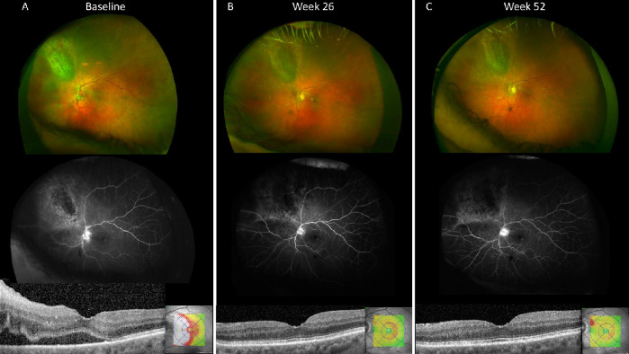
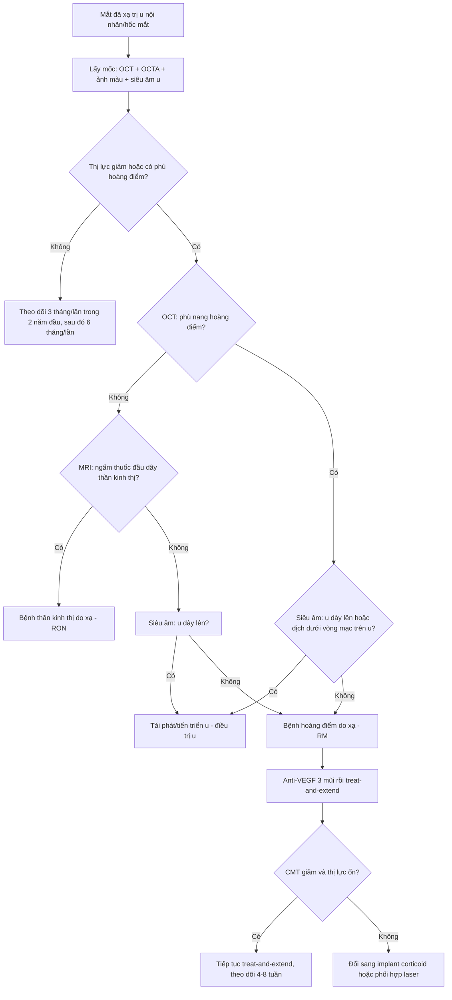
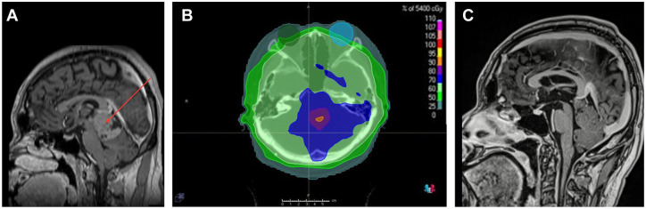
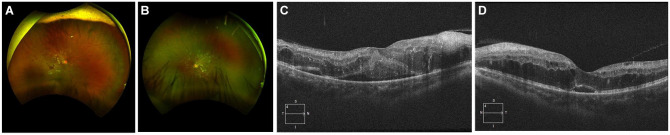
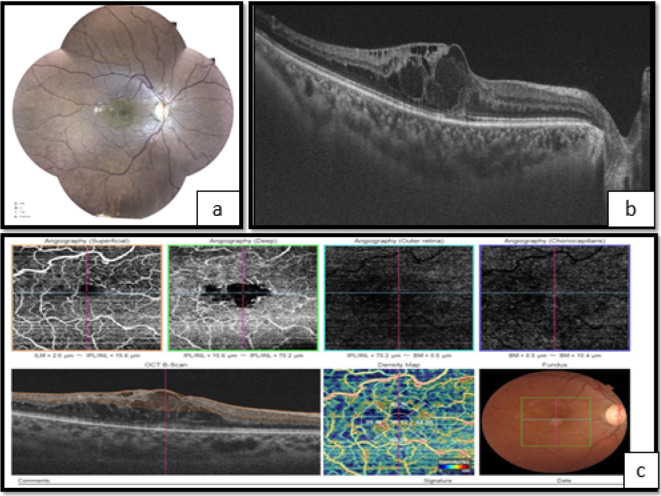
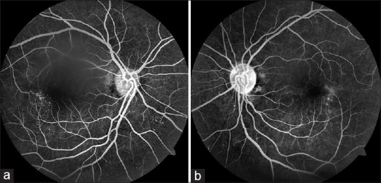

# 1409 — Bệnh võng mạc do xạ sau xạ trị u nội nhãn/hốc mắt: phân biệt tổn thương do xạ với TÁI PHÁT U / Radiation retinopathy after radiotherapy for intraocular or orbital tumors

**Tags:** `pattern:vi-mach-tac` `pattern:phu-hoang-diem` `pattern:xuat-huyet-vong-mac` `vung:vong-mac` `vung:hoang-diem` `vung:dia-thi` `protocol:OCT-OCTA` `protocol:FA-FAF` `protocol:anti-VEGF` `protocol:laser-PRP`

**Mức chắc chắn (certainty):** tổng hợp y văn (literature synthesis) — đọc trực tiếp toàn văn 9 bài mở qua Europe PMC/PMC. **3 ca nguyên văn** (verbatim case) dùng cho Blind Quiz. Phần **phân biệt tổn thương do xạ với tái phát u** và phần **tính liều tương đương sinh học (BED)** là **suy luận (inference)** từ cơ chế + dữ liệu liều–phân liều, ghi rõ tại chỗ; không có thử nghiệm đối chứng nào trả lời trực tiếp.

## 1. Tổng quan bệnh học – cơ chế hình ảnh

### 1.1. Bản chất: bệnh vi mạch TẮC NGHẼN tiến triển, không phải "viêm do xạ"

- **Bệnh học (pathology):** tia ion hóa gây **đứt sợi đôi DNA** ở **tế bào nội mô mao mạch và tế bào cận mao mạch (pericyte)** — hai loại tế bào có tốc độ phân bào đủ để tích lũy tổn thương. Hệ quả là **mất dần giường mao mạch, huyết khối vi mạch, thiếu máu cục bộ võng mạc**, tăng sinh **VEGF**, phá vỡ **hàng rào máu–võng mạc** (*J Contemp Brachytherapy* 2023, PMC10669920; *Clin Ophthalmol* 2021, PMC8436254).
- **Vì sao hình ảnh giống võng mạc đái tháo đường:** cùng một chuỗi **tắc mao mạch → thiếu máu → phù → tân mạch**, nhưng **nguyên nhân là liều xạ tại chỗ**, không phải tăng đường huyết toàn thân. Đây là lý do **bệnh sử xạ trị là chốt chẩn đoán**, không phải hình thái tổn thương.

### 1.2. Vì sao có "thời gian ủ bệnh" 6 tháng – 3 năm (dao động 1 tháng – 15 năm)

- Tổn thương không biểu hiện ngay vì **mao mạch có dự trữ chức năng**: chỉ khi số tế bào nội mô mất vượt ngưỡng mới xuất hiện **vùng không tưới máu (nonperfusion)** nhìn thấy được.
- **Vì sao liều mỗi phân liều (fraction) quan trọng hơn tổng liều:** mô mạch muộn có **α/β ≈ 2–3 Gy**. Tính **liều tương đương sinh học BED = nd(1 + d/(α/β))** với α/β = 2 Gy:
  - **20 Gy chia 2 phân liều 10 Gy** → BED₂ = 20 × (1 + 10/2) = **120 Gy₂**;
  - **50 Gy chia 25 phân liều 2 Gy** → BED₂ = 50 × (1 + 2/2) = **100 Gy₂**.
  - Nghĩa là **20 Gy nhưng 10 Gy/lần "nặng" hơn 50 Gy chuẩn 2 Gy/lần**. Đây chính là ca nguyên văn: **nữ 44 tuổi, proton 20 Gy trong 2 lần × 10 Gy vào hoàng điểm**, xuất hiện **bệnh thần kinh thị do xạ (RON) + bệnh võng mạc do xạ sau 18 tháng**, dù tổng liều "dưới ngưỡng an toàn 50 Gy" (*Am J Ophthalmol Case Rep* 2016, PMC5757416).
  - Ngược lại, **siêu phân liều < 1,9 Gy/lần làm giảm nguy cơ** bệnh võng mạc do xạ (PMC8436254).

### 1.3. Vì sao OCT/FA/OCTA cho đúng những dấu hiệu đó

| Hiện tượng | Cơ chế mô – vật lý | Dấu hiệu trên hình ảnh |
|---|---|---|
| **Phù hoàng điểm dạng nang** | VEGF làm tăng tính thấm mao mạch → dịch vào lớp nội bào; dịch tích trong lớp plexiform/INL tạo **khoang giảm phản xạ (hyporeflective)** | SD-OCT: khoang giảm phản xạ nội võng mạc, dày trung tâm hoàng điểm (CMT) **> 300 µm**; có thể kèm dịch dưới võng mạc |
| **Xuất tiết cứng (hard exudate)** | Rò lipid + protein theo dịch lâu ngày, đọng ở lớp ngoài | Đốm **tăng phản xạ, có bóng lưng (posterior shadowing)** trên OCT; vàng sáng trên ảnh màu |
| **Nốt bông (cotton-wool spot)** | Nhồi máu lớp sợi thần kinh (RNFL) do tắc tiểu động mạch | Đốm trắng mờ bờ không rõ; OCT: **dày + tăng phản xạ RNFL** |
| **Vi phình mạch / giãn mạch dạng telangiectasia** | Thành mao mạch mất tế bào cận mao mạch → giãn, rò | FA: **chấm tăng huỳnh quang sớm**, rò muộn; OCTA: mất mạng mao mạch quanh hoàng điểm, **FAZ giãn rộng** |
| **Vùng không tưới máu** | Tắc mao mạch thật (không phải co thắt) | FA: **vùng tối (hypofluorescent)**; OCTA: **mất tín hiệu dòng chảy** trong slab tương ứng |
| **Tân mạch đĩa/võng mạc** | Thiếu máu → VEGF → tăng sinh | FA: **rò mạnh thì muộn**, đĩa NVD/NVE; dễ **xuất huyết dịch kính** |

### 1.4. Những con số phải nhớ (liều – tần suất – thời điểm)

| Tình huống | Liều / phân liều | Hệ quả định lượng | Nguồn |
|---|---|---|---|
| Xạ ngoài vào ≥ 1/2 võng mạc | **45–55 Gy** | **53%** bệnh võng mạc do xạ | Parsons, dẫn trong PMC8436254 |
| Xạ ngoài | **> 50 Gy vào > 60% võng mạc** | Nguy cơ cao hơn rõ rệt | Takeda, dẫn trong PMC8436254 |
| Xạ toàn não (globe nằm trong trường) | Trung vị **40,7 Gy (30–50 Gy)** | **13 ca / 25 mắt** vẫn có bệnh võng mạc do xạ; **không ca nào đái tháo đường** | PMC12370669 |
| Xạ ngoài / proton | **20 Gy trong 2 lần × 10 Gy** | **RON + bệnh võng mạc sau 18 tháng** (BED₂ ≈ 120 Gy₂) | PMC5757416 |
| Brachytherapy mảng (plaque) | Liều đỉnh u, tùy vị trí u | Bệnh võng mạc do xạ **20–53%** | PMC10669920 |
| Plaque điều trị melanoma màng mạch | Theo COMS | **43%** thị lực ≤ 20/200 lúc **3 năm** | COMS, dẫn trong PMC10577260 |
| Yếu tố u (plaque) | Đáy u **≥ 10 mm**, dày **> 8 mm**, liều đáy **≥ 33.300 cGy**, liều tới đĩa thị tăng | Dự báo thị lực xấu dài hạn | Shields, dẫn trong PMC8436254 |
| Đái tháo đường đồng thời | — | **Tăng nguy cơ mất thị lực ~300%** (hiệp lực tổn thương nội mô + cận mao mạch) | PMC8436254 |
| Thời điểm khởi phát | — | Thường **6 tháng – 3 năm**; toàn khoảng **1 tháng – 15 năm**; thể tăng sinh trung bình **32 tháng**, **7%** xuất hiện ở **10–15 năm** | PMC8436254 |

- **Cạm bẫy số 1 về liều:** "dưới 50 Gy là an toàn" là **sai** khi phân liều lớn hoặc khi **globe nằm trong trường chiếu toàn não/toàn trục thần kinh** — trường hợp xạ toàn não trung vị 40,7 Gy vẫn gây bệnh (PMC12370669).
- **Mắt đối bên không được miễn trừ:** tán xạ + trường chiếu rộng có thể gây tổn thương **hai mắt**, kể cả **17 năm sau** xạ vòm họng (PMC10155549).

## 2. Mẫu hình + chẩn đoán phân biệt theo vị trí (gamut)

### 2.1. Mẫu hình chung

**Bệnh vi mạch tắc nghẽn + phù hoàng điểm ở mắt có tiền sử xạ trị trong trường chiếu**, phân bố **theo hình chiếu của chùm tia** (sector/địa lý), **không theo lãnh thổ mạch máu**, tiến triển **chậm trong nhiều tháng–năm**, thường **kèm tổn thương da/mi/mô mềm cùng vùng chiếu**.

### 2.2. Gamut theo vị trí tổn thương

| Vị trí | Thực thể | Manh mối chốt |
|---|---|---|
| **Hoàng điểm** | **Bệnh hoàng điểm do xạ (radiation maculopathy, RM)** | Phù nang hoàng điểm + vùng không tưới máu quanh hoàng điểm; **không có khối u tại hoàng điểm**; đáp ứng anti-VEGF |
| **Đĩa thị** | **Bệnh thần kinh thị do xạ (radiation optic neuropathy, RON)** | Phù đĩa thị + xuất huyết quanh đĩa, **giảm thị lực không đau**, xuất hiện **trung bình 18 tháng**; MRI: **ngấm thuốc đầu dây thần kinh thị** (PMC5757416) |
| **Võng mạc ngoại vi** | **Bệnh võng mạc do xạ thể tăng sinh** | Tân mạch đĩa/võng mạc, xuất huyết dịch kính, dính võng mạc; thường **sau vùng chiếu**; có thể tiến triển tới **glaucom tân mạch** |
| **Tiền phòng / bề mặt nhãn cầu** | Viêm giác mạc do xạ, **đục thể thủy tinh sau dưới bao (PSC)**, khô mắt | **Đồng thời với RM** ở ca xạ 75 Gy (PMC10523097) — đừng quy mọi giảm thị lực cho võng mạc |
| **Hắc mạc** | Teo hắc mạc – võng mạc do xạ, bong thanh dịch | Vùng teo khớp hình chiếu; **không dày hắc mạc** (khác u) |

### 2.3. Gamut theo "phù hoàng điểm ở mắt đã xạ trị"

1. **Bệnh hoàng điểm do xạ** (phù do rò VEGF).
2. **Tái phát u / u tiến triển** (melanoma, lymphoma, di căn) — dịch dưới võng mạc do u, **kèm dày u trên siêu âm**.
3. **Phù do đái tháo đường** (nếu có ĐTĐ — hiệp lực, không loại trừ nhau).
4. **Tắc tĩnh mạch võng mạc** (CRVO/BRVO) — một vùng theo lãnh thổ, đĩa thị phù, không có tiền sử xạ.
5. **Hội chứng thiếu máu mắt (ocular ischemic syndrome)** — hẹp động mạch cảnh, dòng chảy đảo, phù + tân mạch tiền phòng.
6. **Bệnh hoàng điểm liên quan tuổi (AMD) / CNV** — tiến triển nhanh, có màng tân mạch trên OCTA.
7. **Viêm nội nhãn/TASS sau tiêm hoặc sau mổ** — khởi phát **cấp trong 1–3 ngày**, khác hoàn toàn.

## 3. Bảng so sánh phân biệt (ma trận đối chiếu)

| Thực thể (entity) | Hình ảnh điển hình (màu / FA / OCT / OCTA) | Chốt vào (rule-in) | Chốt loại (rule-out) | Gợi ý xác nhận |
|---|---|---|---|---|
| **Bệnh hoàng điểm do xạ (RM)** | Xuất huyết chấm + vi phình mạch + telangiectasia quanh hoàng điểm; FA: chấm tăng huỳnh quang sớm, **rò muộn**; OCT: **phù nang nội võng mạc**, CMT **> 300 µm**; OCTA: **FAZ giãn, mất mạng mao mạch sâu/nông** | **Tiền sử xạ trong trường chiếu + tổn thương khớp hình chiếu + không có khối u mới**; đáp ứng **anti-VEGF** (CMT giảm) | **Không dày u trên siêu âm**; **không ngấm thuốc khối** trên MRI; thị lực giảm **từ từ, không đau** | So **bản đồ liều xạ** với vùng tổn thương; chụp lại OCT sau 4–6 tuần điều trị |
| **Tái phát / tiến triển u màng mạch** | Siêu âm: **dày u tăng ≥ 1–2 mm** so với lần trước; OCT: **dịch dưới võng mạc trên u**, không phù nang lan tỏa; FAF: **quầng cam (orange pigment)** mới | **Khối u dày lên theo thời gian** + dịch dưới võng mạc khu trú **trên u** + tăng sinh mạch trong u | U **không đổi kích thước** qua 2 lần đo; **không có dịch dưới võng mạc mới** | **Siêu âm A/B cùng người đo**, so ảnh cũ; MRI hốc mắt khi nghi lan ngoài nhãn cầu |
| **Bệnh thần kinh thị do xạ (RON)** | Đĩa thị phù, xuất huyết quanh đĩa; OCT RNFL dày; **MRI: ngấm thuốc đầu dây thần kinh thị** | **Tiền sử xạ gần đĩa thị** + phù đĩa **không đau** + **ngấm thuốc đầu dây thần kinh** trên MRI | **Không có khối u đĩa thị**; không thiếu máu thị thần kinh động mạch (không đau, không altitudinal) | MRI hốc mắt có cản quang; theo dõi RNFL/OCT |
| **Bệnh võng mạc đái tháo đường** | Xuất huyết, vi phình mạch, xuất tiết cứng **hai bên đối xứng**; FA: thiếu máu lan tỏa | **ĐTĐ + HbA1c** + tổn thương **đối xứng hai mắt**, không khớp trường chiếu | **Không tiền sử xạ**; tổn thương ngoài vùng chiếu | Xét nghiệm HbA1c; so hai mắt |
| **Tắc tĩnh mạch võng mạc (CRVO/BRVO)** | Xuất huyết **theo lãnh thổ**, đĩa thị phù; FA: **rò muộn theo vùng tắc** | **Phân bố theo lãnh thổ mạch** + **một mắt**; khởi phát **đột ngột** | **Không tiền sử xạ**; tổn thương không khớp hình chiếu | FA/CT mạch máu; khám mạch cảnh nếu trẻ |
| **Hội chứng thiếu máu mắt** | Phù hoàng điểm + tân mạch tiền phòng; FA: **dòng chảy chậm, đảo** | **Hẹp động mạch cảnh cùng bên**; triệu chứng thần kinh | **Không có hẹp mạch cảnh** trên CTA/DSA | Siêu âm Doppler mạch cảnh, CTA |
| **Viêm nội nhãn sau tiêm** | Mủ tiền phòng, fibrin, **giảm thị lực nhanh trong 1–3 ngày** | **Khởi phát cấp sau tiêm** + viêm tiền phòng | Khởi phát **chậm nhiều tháng**, không viêm tiền phòng | Chọc dịch kính cấy; xử trí cấp cứu |

- **Ảnh đối chiếu đáp ứng điều trị** (aflibercept treat-and-extend, 39 mắt): CMT **484,4 → 326,5 µm** sau 52 tuần (p < 0,001), thị lực tăng trung bình **+4,3 chữ ETDRS** (p = 0,07), **96,7%** đạt ≥ 20/200, **30%** tăng ≥ 10 chữ (*Invest Ophthalmol Vis Sci* 2023, PMC10292667).

## 4. Protocol chụp + hệ phân độ/điểm chuẩn hóa

### 4.1. Protocol theo dõi mắt đã xạ trị

| Thời điểm | Bộ hình ảnh tối thiểu | Mục đích |
|---|---|---|
| **Trước xạ** | Ảnh màu đáy mắt, **SD-OCT hoàng điểm (ETDRS 1 mm + 6 mm)**, **OCTA 3 × 3 mm và 6 × 6 mm**, FA/FAF nếu có xuất tiết; **siêu âm A/B** với u nội nhãn | Lấy mốc nền; phát hiện bệnh vi mạch **dưới lâm sàng** |
| **3 tháng/lần trong 2 năm đầu** | OCT + OCTA; ảnh màu; đo thị lực ETDRS | Bệnh võng mạc do xạ thường khởi phát **6 tháng – 3 năm** |
| **6 tháng/lần từ năm 3** | OCT + ảnh màu; siêu âm u | Bắt **tái phát u** và thể **muộn 10–15 năm** |
| **Khi thị lực giảm / nhìn mờ** | OCT + FA + OCTA + **MRI hốc mắt có cản quang** | Phân biệt **RM / RON / tái phát u** |
| **Nghi RON** | MRI hốc mắt **T1 fat-sat sau tiêm**; OCT RNFL | **Ngấm thuốc đầu dây thần kinh thị** là dấu hiệu RON (PMC5757416) |

- **Nguyên tắc hình ảnh:** OCTA phát hiện **giảm mật độ mao mạch quanh hoàng điểm và giãn FAZ** *trước* khi có tổn thương thấy trên đèn khe — đây là lợi ích chính so với FA (PMC10669920, PMC10523097). FA vẫn cần để **định lượng vùng không tưới máu** và **phát hiện tân mạch**.
- **Đo lường trên OCT:** CMT (trung bình vùng 1 mm trung tâm), **chiều cao nang lớn nhất**, **mức độ gián đoạn dải ellipsoid (EZ/IS-OS)**, **teo RPE hoàng điểm**.

### 4.2. Phân độ CJA (cyst – junction – atrophy) cho bệnh hoàng điểm do xạ

| Tham số | Ý nghĩa | Cách đo |
|---|---|---|
| **C** (cyst) | Chiều cao **nang hoàng điểm lớn nhất** | µm trên SD-OCT, lát qua trung tâm hoàng điểm |
| **J** (junction) | **Gián đoạn dải IS/OS (ellipsoid zone)** | Có/không + chiều dài đoạn gián đoạn (µm) |
| **A** (atrophy) | **Teo RPE vùng hoàng điểm** | Có/không trên ảnh màu + FAF |

*(Bảng dựng theo phân độ CJA trong PMC10669920; đây là công cụ mô tả, **chưa phải hệ phân độ có ngưỡng điều trị được xác nhận độc lập**.)*

### 4.3. Ngưỡng điều trị thực hành

- **Phù hoàng điểm có triệu chứng** (CMT **> 300 µm** hoặc tăng **≥ 10%** kèm giảm ≥ 5 chữ ETDRS) → **anti-VEGF nội dịch kính**: bevacizumab **1,25 mg**, ranibizumab **0,5 mg**, aflibercept **2 mg**; khởi đầu **3 mũi hàng tháng** rồi **treat-and-extend** (PMC10292667, PMC10669920).
- **Đáp ứng kém/rái cáy** → **implant dexamethasone 0,7 mg** hoặc **fluocinolone 0,19 mg**; corticoid có tác dụng chống phù nhưng **không sửa được thiếu máu** (PMC10669920).
- **Thể tăng sinh** → **laser quang đông toàn võng mạc (PRP)** ± anti-VEGF; **xuất huyết dịch kính không tan** → **cắt dịch kính**.
- **Dự phòng bằng anti-VEGF** (meta 4 nghiên cứu, **2.109 bệnh nhân**): giảm **bệnh hoàng điểm do xạ OR 0,50 (0,34–0,74)**, **RON OR 0,62 (0,42–0,90)**, **thị lực cuối xấu OR 0,50 (0,37–0,68)** — bằng chứng **độ chắc chắn thấp**, chưa thành chỉ định thường quy (PMC10577260).

## 5. Biến thể bình thường và cạm bẫy

- **Dấu "vòng củ hành" (onion ring sign) — thể mạn, không phải tái phát:** các **lắng đọng tăng phản xạ xếp lớp ngang trong khoang nang nội võng mạc**, **không có bóng lưng**, nằm ở **lớp võng mạc trong**. Ca nguyên văn theo dõi **19 năm** sau xạ trị melanoma màng mạch cho thấy dấu này xuất hiện ở bệnh võng mạc do xạ **rái cáy điều trị**, phản ánh **tổn thương mạch mạn + phù kéo dài**, **không phải khối u** (*Cureus* 2025, PMC12740121).
- **Cạm bẫy "một nguyên nhân cho mọi giảm thị lực":** ca 75 Gy có **đồng thời khô mắt, đục thể thủy tinh PSC, bệnh võng mạc do xạ và bệnh thần kinh thị do xạ**; anti-VEGF **không cải thiện thị lực** vì tổn thương **thần kinh đã cố định** (PMC10523097). Phải khám **toàn bộ nhãn cầu**, không chỉ OCT hoàng điểm.
- **Cạm bẫy "hai mắt = bệnh toàn thân":** bệnh võng mạc do xạ **có thể hai bên** khi trường chiếu rộng (vòm họng, toàn não) và **có thể xuất hiện 17 năm sau** — **không** vì thế mà loại trừ nguyên nhân do xạ (PMC10155549).
- **Cạm bẫy "đái tháo đường loại trừ do xạ":** hai bệnh **cộng hưởng**; ĐTĐ làm **tăng nguy cơ mất thị lực ~300%**, không phải bằng chứng chống lại do xạ (PMC8436254).
- **Cạm bẫy "phù hoàng điểm = tái phát u":** dịch dưới võng mạc do u thường **khu trú trên u**, kèm **u dày lên**; phù do xạ **lan tỏa quanh hoàng điểm**, không kèm u dày. Chốt bằng **siêu âm cùng người đo** + so ảnh cũ.
- **Cạm bẫy liều:** "20–40 Gy là an toàn" **sai** với phân liều lớn hoặc globe trong trường toàn não; luôn đọc **bản đồ liều** (ảnh dưới) thay vì chỉ nghe tổng liều.

## 6. Tự lượng giá — Blind Quiz ngay trên trang tĩnh

**Ca 1 — nam 24 tuổi, mờ mắt sau xạ toàn trục thần kinh**

- Gợi ý lâm sàng: u tuyến tùng, đã xạ sọ–tủy; thị lực **20/150 mắt phải, 20/40 mắt trái**.
- Câu hỏi: Mô tả dấu hiệu chính trên ảnh màu và OCT? Ba chẩn đoán phân biệt? Dấu hiệu nào chốt nguyên nhân do xạ?

<b>Bấm để hiện đáp án (findings + chẩn đoán)</b>

- Dấu hiệu (findings): **xuất huyết nội võng mạc và nốt bông (cotton-wool spots) ở hai mắt**; OCT mắt phải **phù hoàng điểm dạng nang (cystoid macular edema)**. Tổn thương **khớp vùng chiếu xạ**, không theo lãnh thổ mạch.
- Chẩn đoán (diagnosis): **bệnh võng mạc do xạ thể tăng sinh (proliferative radiation maculopathy)** sau xạ sọ–tủy — vì tia xạ làm mất mao mạch → thiếu máu → VEGF → phù và tân mạch; đã điều trị **bevacizumab hàng tháng + PRP hai mắt**, phù cải thiện.
- Bối cảnh định lượng: tổng quan 13 ca/25 mắt sau xạ toàn não, **liều trung vị 40,7 Gy (30–50)**, **không ca nào đái tháo đường** — chứng minh "liều thấp" vẫn gây bệnh khi globe trong trường.
- Nguồn ảnh: *J Vitreoretin Dis* 2025, Figure 2 — PMC12370669, **CC BY 4.0**.

**Ca 2 — nữ 31 tuổi, ung thư vòm họng, xạ 75 Gy, hai mắt mờ dần**

- Gợi ý lâm sàng: khô mắt, đục thể thủy tinh sau dưới bao, thị lực giảm tiến triển hai bên nhiều năm sau xạ.
- Câu hỏi: OCTA cho thấy gì mà đèn khe không thấy? Vì sao 3 mũi anti-VEGF không cải thiện thị lực?

<b>Bấm để hiện đáp án (findings + chẩn đoán)</b>

- Dấu hiệu (findings): **FAZ giãn rộng**, **mất mạng mao mạch nông và sâu quanh hoàng điểm**, phù hoàng điểm rõ hơn mắt phải; đáy mắt có giãn xoắn mạch ngoại vi, mất phản xạ trung tâm hoàng điểm, đĩa thị nhợt nhẹ.
- Chẩn đoán (diagnosis): **bệnh võng mạc do xạ + bệnh thần kinh thị do xạ** sau xạ 75 Gy cho ung thư vòm họng. Anti-VEGF chỉ sửa **phần rò (permeability)**, **không tái tạo mạng mao mạch đã mất** và **không hồi phục tổn thương thần kinh thị** → thị lực không cải thiện.
- Bài học: OCTA phát hiện **bệnh vi mạch dưới lâm sàng** (giảm mật độ mao mạch, giãn FAZ) trước khi có dấu hiệu trên đèn khe.
- Nguồn ảnh: *F1000Research* 2023, Figure 1 — PMC10523097, **CC BY 4.0**.

**Ca 3 — nam 40 tuổi, mờ mắt phải 1 tuần, tiền sử xạ 34 Gy cách đây 17 năm**

- Gợi ý lâm sàng: ung thư vòm họng đã xạ **34 Gy**; thị lực **20/40 phải, 20/20 trái**; hai mắt có telangiectasia khu trú, mắt phải phù hoàng điểm.
- Câu hỏi: Dấu hiệu trên FFA? Vì sao gọi là "khởi phát cực muộn"? Điều gì giải thích tái phát sau 3 mũi bevacizumab?

<b>Bấm để hiện đáp án (findings + chẩn đoán)</b>

- Dấu hiệu (findings): FFA thì muộn: **vi phình mạch dạng chấm tăng huỳnh quang sớm**, **telangiectasia mao mạch quanh hoàng điểm**, **rò muộn (late leakage)**, **không có tân mạch**.
- Chẩn đoán (diagnosis): **bệnh võng mạc do xạ hai mắt khởi phát cực muộn (17 năm)** với phù hoàng điểm mắt phải. Ba mũi **bevacizumab 1,25 mg** cải thiện ban đầu, nhưng **bỏ theo dõi trong đại dịch** → phù tái phát; điều trị lại.
- Bài học: bệnh võng mạc do xạ là **bệnh mạn, cần treat-and-extend**, không phải "tiêm 3 mũi là khỏi"; và **khoảng trễ có thể tới 17 năm**, nên tiền sử xạ xa vẫn có giá trị.
- Nguồn ảnh: *Indian J Ophthalmol* 2023, Figure 2 — PMC10155549, **CC BY-NC-SA 4.0**.

## Bài liên quan chéo

- [493 – U lympho nguyên phát của hắc mạc](../493-u-lympho-nguyen-phat-hac-mac/lesson.md) — chẩn đoán phân biệt khối hắc mạc và theo dõi sau xạ.
- [481 – Biến chứng sau liệu pháp gen nội nhãn](../481-bien-chung-noi-nhan-lieu-phap-gene-tiem-noi-dich-kinh/lesson.md) — viêm/dịch sau can thiệp nội nhãn.
- [495 – Viêm nội nhãn nấm ngoại sinh vs TASS](../495-viem-noi-nhan-nam-ngoai-sinh-vs-TASS/lesson.md) — phân biệt viêm cấp sau tiêm.
- [1404 – Biến chứng mạn của anti-VEGF nội dịch kính](../1404-bien-chung-man-anti-vegf/lesson.md) — theo dõi dài hạn sau tiêm lặp lại.
- [1408 – Anti-VEGF nội dịch kính trong thai kỳ & cho con bú](../1408-anti-vegf-thai-ky-cho-con-bu/lesson.md) — chọn phân tử anti-VEGF.

## Ảnh

- `1409_benh-vong-mac-do-xa_Fundus-OCT_PMC12370669.jpg` — ảnh màu hai mắt + OCT phù nang; *J Vitreoretin Dis* 2025, PMC12370669, **CC BY 4.0**.
- `1409_benh-vong-mac-do-xa_CT-xa-tri_PMC12370669.jpg` — CT quy hoạch + bản đồ liều, hai nhãn cầu trong trường; cùng bài, **CC BY 4.0**.
- `1409_benh-vong-mac-do-xa_OCTA_PMC10523097.jpg` — OCTA mắt phải; *F1000Research* 2023, PMC10523097, **CC BY 4.0**.
- `1409_benh-vong-mac-do-xa_FFA_PMC10155549.jpg` — FFA thì muộn hai mắt; *Indian J Ophthalmol* 2023, PMC10155549, **CC BY-NC-SA 4.0**.
- `1409_benh-vong-mac-do-xa_OCT-aflibercept_PMC10292667.jpg` — OCT trước/sau aflibercept; *Invest Ophthalmol Vis Sci* 2023, PMC10292667, **CC BY-NC-ND 4.0** (nguyên bản, không cắt/ghép).

> Không dùng để chẩn đoán độc lập khi chưa có người hướng dẫn. Bệnh võng mạc do xạ là chẩn đoán **lâm sàng + tiền sử liều xạ**, hình ảnh chỉ xác nhận mức độ thiếu máu và phù.
