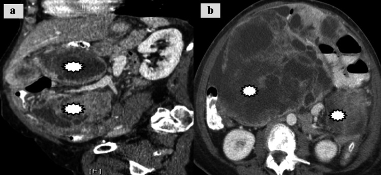
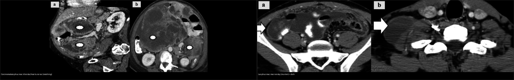
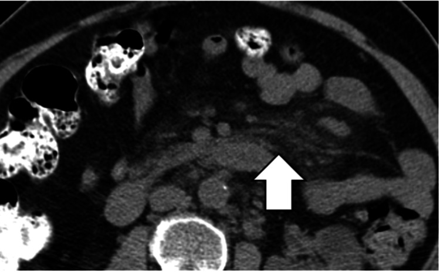
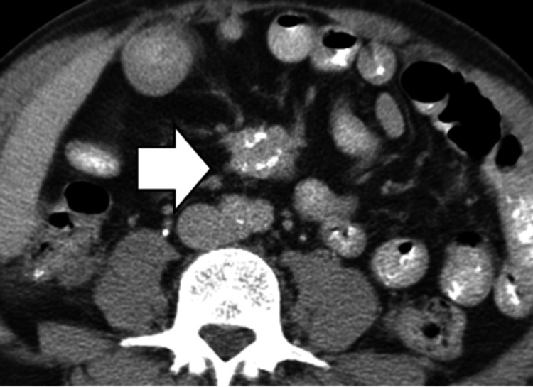
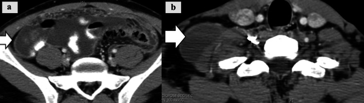

# 141 — Phúc mạc: cổ trướng, carcinomatosis vs lao / Peritoneum

**Tags:** `pattern:phuc-mac` `vung:phuc-mac` `protocol:CT-bung-tiem` `incidentaloma:dich-o-bung`
**Mức chắc chắn (certainty):** tổng hợp y văn (literature synthesis) — tổng hợp từ bài luận ảnh CT phúc mạc cấp (Louviere CD et al., Cureus 2025, PMC12640149) + ca lao phúc mạc giả carcinomatosis (Cureus 2026, PMC13502480); ca minh họa là ca nguyên văn lấy từ bài gốc.

## 1. Tổng quan — dịch + nốt + mạc nối là 3 chữ ký

- Cổ trướng đơn thuần (xơ gan/suy tim): dịch + **không nốt** + mạc nối mỏng.
- **Carcinomatosis:** nốt phúc mạc + **bánh mạc nối (omental cake)** + dịch + K nguyên phát (buồng trứng/dạ dày/đại tràng). Trên CT, tổn thương là **khối đặc/hoại tử rải rác (matching)** bám phúc mạc và mạc nối.
- **Lao phúc mạc:** dịch + nốt + **hạch vôi hóa** + viêm + lao phổi cũ — **adenosine deaminase (ADA)** dịch cao; hình thái CT có thể **mạc nối dày** (thể ướt *wet*) giống carcinomatosis.
- TẠI SAO bánh mạc nối quyết định: mạc nối dày đặc + nốt = gieo rắc ác tính đến khi chứng minh ngược lại (lao cũng có nhưng kèm vôi hóa/hạch + bối cảnh).

## 2. Gamut dịch + nốt phúc mạc

- **Carcinomatosis:** bánh mạc nối + K nguyên phát — CA-125 + PET + sinh thiết.
- **Lao phúc mạc:** nốt + hạch vôi + ADA cao + lao cũ — kháng lao (đừng mổ bụng vô ích).
- **Mesothelioma phúc mạc:** dày + amiăng + tiền sử — sinh thiết.
- **Viêm xơ mạc treo (sclerosing mesenteritis) / viêm mô mỡ mạc treo (mesenteric panniculitis):** đám mờ mạc treo (“misty mesentery”) có thể giả khối, xơ hóa và **làm tắc tĩnh mạch mạc treo trên** — không phải ung thư nhưng dễ nhầm.
- **Cổ trướng đơn thuần:** không nốt + xơ gan/suy tim — điều trị nguyên nhân.

## 3. Bảng so sánh phân biệt (ma trận đối chiếu)

| Thực thể (entity) | Hình ảnh điển hình (CT) | Chốt vào (rule-in) | Chốt loại (rule-out) | Xử trí |
|---|---|---|---|---|
| Carcinomatosis | **Bánh mạc nối + nốt/matching + dịch + K nguyên phát** | **Omental cake + K đã biết + nốt đặc bám phúc mạc** | **Không nốt, mạc nối mỏng, nguyên nhân xơ gan rõ → cổ trướng đơn thuần** | PET + sinh thiết + hóa trị |
| Lao phúc mạc | Nốt + **hạch vôi + mạc nối dày (thể ướt)** + dịch | **ADA dịch > 35–40 U/L + vôi hóa/lao cũ + CA-125 tăng nhẹ** | **K nguyên phát + bánh mạc nối rõ → nghi carcinomatosis** | Kháng lao, không mổ bụng |
| Cổ trướng đơn thuần | Dịch + mạc nối mỏng + xơ gan/suy tim | **Không nốt + SAAG ≥ 1,1 g/dL + nguyên nhân rõ** | **Nốt/omental cake → tìm nguyên nhân ác tính** | Lợi tiểu + albumin |
| Viêm xơ mạc treo / panniculitis | Đám mờ mạc treo, **giả bao (pseudocapsule)** mờ, nốt nhỏ lan tỏa; có thể **vôi hóa + tắc tĩnh mạch mạc treo** | **Misty mesentery + pseudocapsule + không có K nguyên phát** | **Bánh mạc nối đặc + ổ hoại tử → nghĩ carcinomatosis** | Theo dõi/sinh thiết nếu nghi |
| Mesothelioma phúc mạc | Dày phúc mạc lan tỏa, dạng “bọc” (rind) | **Tiền sử phơi nhiễm amiăng + dày phúc mạc lan tỏa** | **Có K nguyên phát di căn → carcinomatosis** | Sinh thiết + hóa trị |

<b>Bấm để hiện đáp án (nhãn bệnh trong ảnh ghép)</b>

- **Trái (carcinomatosis):** các khối đặc/hoại tử rải rác bám phúc mạc, di căn từ K nội mạc tử cung — Nguồn: Louviere CD et al., Cureus 2025 (PMC12640149, Fig. 16), CC BY.
- **Phải (lao phúc mạc):** mạc nối dày (mũi tên) kèm dịch, thể ướt — Nguồn: Louviere CD et al., Cureus 2025 (PMC12640149, Fig. 7), CC BY.

## 4. Protocol

- CT cản quang (nốt + mạc nối + nguyên phát) + dịch chọc (tế bào + ADA + SAAG).
- **SAAG ≥ 1,1 g/dL = tăng áp cửa**; < 1,1 g/dL = viêm/ác tính/lao. **ADA dịch > 35–40 U/L** gợi lao phúc mạc.
- Khi nghi carcinomatosis: PET-CT tìm K nguyên phát + **sinh thiết** định mô học; PET cũng dùng để ước lượng tải bệnh phúc mạc (PCI).

## 5. Biến thể bình thường và cạm bẫy

- **Lao gọi nhầm carcinomatosis** → mổ bụng vô ích — đọc **ADA + vôi hóa + tiền sử lao** trước khi mổ.
- **“Misty mesentery” (viêm mô mỡ mạc treo) là bình thường/giả bệnh ở nhiều người** — có giả bao mờ, nốt < 5 mm, kèm viêm mô mỡ; **không đồng nghĩa ung thư**. Chỉ theo dõi nếu không có dấu hiệu báo động.

- **Viêm xơ mạc treo** nặng có thể xơ co kéo và **tắc tĩnh mạch mạc treo trên** — nhìn như khối ác tính.
- **Cổ trướng giả do dịch màng phổi** (bài 110: dấu crus lệch/bare area) — xác định đúng khoang trước kết luận.
- **Mesothelioma phúc mạc** hiếm nhưng có — amiăng + sinh thiết.

## 6. Tự lượng giá — Blind Quiz

**Ca 1 — Bệnh nhân có K nội mạc tử cung đã biết, đau bụng, dịch ổ bụng. Đọc CT.**

- Gợi ý lâm sàng: K nguyên phát đã biết, bụng chướng.
- Câu hỏi: Mô tả tổn thương phúc mạc? 3 phân biệt (carcinomatosis/lao/mesothelioma)? Bước tiếp theo?

<b>Bấm để hiện đáp án (findings + chẩn đoán)</b>

- Dấu hiệu (findings): các **khối đặc/hoại tử rải rác (matching)** bám phúc mạc thành bụng và mạc nối, kèm dịch ổ bụng.
- Chẩn đoán (diagnosis): **carcinomatosis phúc mạc** — có K nguyên phát + bánh mạc nối; bước tiếp: **PET-CT + sinh thiết + hóa trị** (không phải lao khi đã có K nguyên phát).
- Nguồn ảnh: Louviere CD et al., Cureus 2025 (PMC12640149, Fig. 16), CC BY.

**Ca 2 — Nữ trẻ, dịch ổ bụng + mạc nối dày, ADA 60 U/L, có lao phổi cũ. Đọc CT.**

- Gợi ý lâm sàng: ADA dịch cao, tiền sử lao.
- Câu hỏi: Lao hay carcinomatosis? Dấu hiệu nào giúp phân biệt?

<b>Bấm để hiện đáp án (findings + chẩn đoán)</b>

- Dấu hiệu (findings): **mạc nối dày** (mũi tên) kèm dịch — thể ướt của lao phúc mạc; kèm **hạch thượng đòn** cùng bên trong ca gốc.
- Chẩn đoán (diagnosis): **lao phúc mạc** — ADA dịch **> 35–40 U/L** + tiền sử lao + hạch/vôi hóa; điều trị **kháng lao**, tránh mổ bụng chẩn đoán.
- Nguồn ảnh: Louviere CD et al., Cureus 2025 (PMC12640149, Fig. 7), CC BY.

## Bài liên quan chéo
- [100 – Tổng quan hệ Bụng](../100-tong-quan-he-bung/lesson.md)
- [110 – Giải phẫu bụng](../110-giai-phau-bung/lesson.md) (crus/bare area — dịch màng phổi vs cổ trướng)
- [535 – Ung thư buồng trứng, phúc mạc & u Krukenberg](../535-ung-thu-buong-trung-phuc-mac-krukenberg/lesson.md) (PCI, gieo rắc phúc mạc)
- [040 – Tràn dịch màng phổi](../040-tran-dich-mang-phoi/lesson.md) (dịch 2 khoang)
- [162 – Tắc ruột](../162-tac-ruot/lesson.md) (lao/xơ mạc treo gây tắc)

## Ảnh
- Tên file `141_..._PMC12640149-FigN-...jpg`, nguồn + giấy phép từng ảnh trong `images/CREDITS.md`. Toàn bộ ảnh: **CC BY 4.0** (Louviere CD et al., Cureus 2025, PMCID PMC12640149).
- Ảnh ghép `images/composite_carcinomatosis-vs-lao-phuc-mac.jpg` tạo bằng `tools/make_composite.py`, letterbox nền đen, giữ tỷ lệ.
- Không tải Google Images / AuntMinnie; nguồn đóng chỉ dẫn link tại `sources.md`.

> Không dùng để chẩn đoán độc lập khi chưa có người hướng dẫn.
