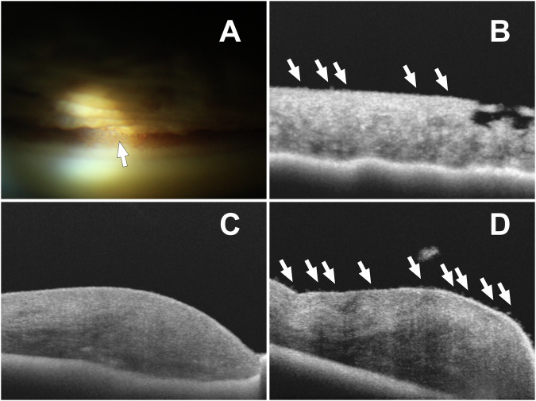
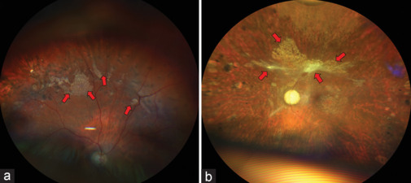
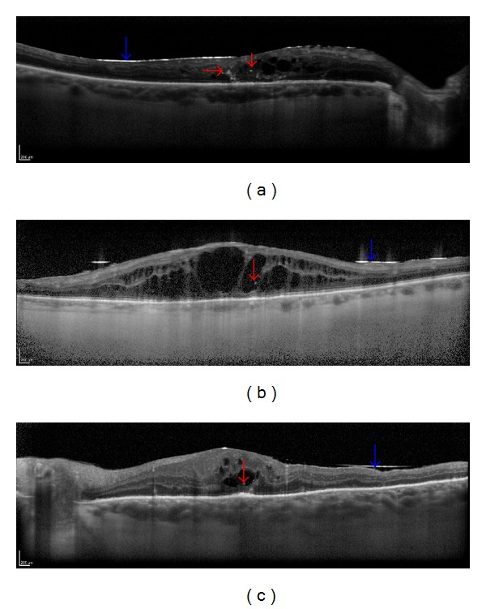
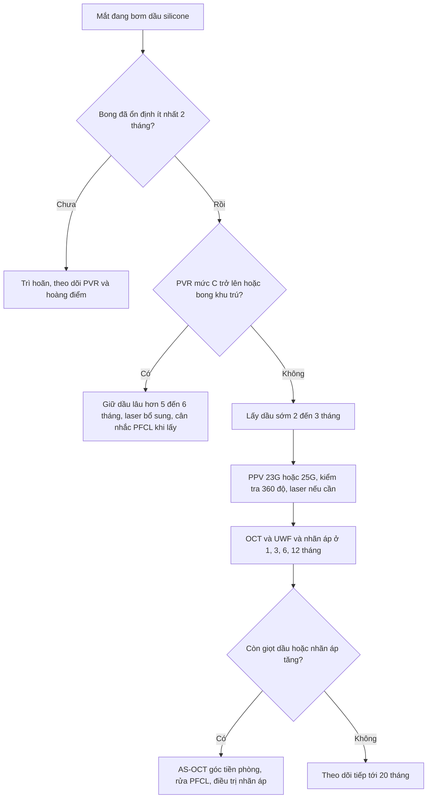
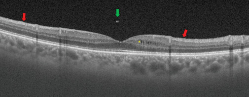
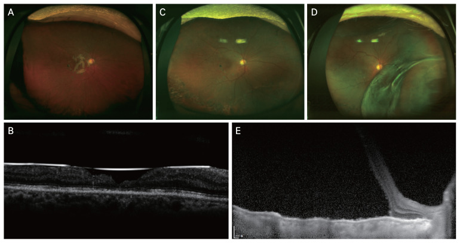

# 1410 — Lấy dầu silicone & biến chứng dầu tồn lưu: khi nào lấy, nhũ tương hóa trên OCT/AS-OCT, và bong tái phát sau lấy / Silicone oil removal and retained-oil complications

**Tags:** `pattern:dau-silicone` `pattern:nhu-tuong-hoa` `pattern:giot-hyperreflective` `pattern:bong-tai-phat` `pattern:tang-nhan-ap` `vung:dich-kinh` `vung:vong-mac` `vung:hoang-diem` `vung:tien-phong` `score:PVR` `protocol:OCT-hoang-diem` `protocol:AS-OCT` `protocol:sieu-am-B-scan` `protocol:PPV`
**Mức chắc chắn (certainty):** tổng hợp y văn (literature synthesis) — nhóm tự biên từ: tổng quan hệ thống về nhũ tương hóa và vai trò widefield/UWF–OCT (CC BY-NC-SA 4.0, PMC11232747), tổng quan biến chứng dầu silicone (CC BY 4.0, PMC13169982), nghiên cứu OCT theo thời điểm 24 mắt (CC BY, PMC4052149), nghiên cứu AS-OCT tiền phòng (CC BY 4.0, PMC11543845), ba đoàn hệ lấy dầu 147/161/58 mắt (CC BY-NC 4.0, PMC11321828; CC BY-NC-ND 4.0, PMC11325823; CC BY 4.0, PMC12516905), RCT 66 mắt lấy sớm 2 tháng vs muộn 6 tháng (CC BY 4.0, PMC13019722), kỹ thuật rửa dầu nhũ tương bằng PFCL 20 mắt (CC BY-NC 4.0, PMC13050964) và ca pupillary block do dầu (CC BY-NC-SA 4.0, PMC10062094).

> **Vì sao bài này quan trọng:** bài **1402** dạy *chọn dầu hay khí* lúc mổ; bài này dạy **sau khi đã bơm dầu** — phần quyết định thị lực dài hạn. Dầu silicone không phải "bơm rồi để đó": nhũ tương hóa (emulsification) khởi phát trung bình **13,2 ± 4,8 tháng** (5–24 tháng), dấu hiệu đầu tiên có thể từ **2 tháng**; giọt **< 1 µm không thấy được trên đèn khe** nhưng **90,9% (10/11) mắt có dầu** thấy giọt tăng phản xạ trên OCT. Lấy dầu là một **cửa sổ nguy hiểm thứ hai**: bong võng mạc tái phát **14,9–22,4%** (y văn **5–31,4%**). Với bác sĩ CĐHA, câu hỏi thực hành là: **giọt sáng trên OCT/B-scan là dầu tồn lưu, asteroid hyalosis hay xuất huyết?** và **bong sau lấy dầu là bong thật hay màng co kéo?**

## 1. Tổng quan bệnh học – cơ chế hình ảnh – vì sao dầu "già" lại độc

- **Vật lý của dầu silicone (silicone oil, SO):** tỷ trọng **0,97 g/cm³** ở 25 °C (nhẹ hơn nước → nổi lên trên, đây là cơ sở của tamponade tư thế), sức căng bề mặt **21,2–21,3 mN/m**, độ nhớt động học **1.000–5.700 mPa·s** (1.000 cSt đến 5.000 cSt), chiết suất **n = 1,40** (so với dịch kính 1,336). Chênh chiết suất này vừa gây **dịch chuyển khúc xạ viễn thị** khi dầu còn trong mắt, vừa là lý do giọt dầu **tán xạ mạnh** trên OCT.
- **Nhũ tương hóa (emulsification) là gì:** dầu bị **lực cắt (shear)** của chuyển động mắt phá vỡ thành giọt nhỏ tại mặt phân cách dầu–nước. Giọt càng nhỏ càng bền; **giọt < 1 µm** nằm dưới giới hạn phân giải của đèn khe và gonioscopy nên **không thấy được** dù đã có. Yếu tố thúc đẩy: **rung giật nhãn cầu** (nhũ tương hóa sớm và nặng hơn), **vitreous còn sót** (dầu tạo giọt nhỏ, bền hơn khi gặp dịch kính so với nước), **bơm không đầy** (diện tiếp xúc dầu–nước lớn), **laser argon** (in vitro làm dầu dễ nhũ tương hóa), **tạp chất phân tử lượng thấp (LMWC)**. Yếu tố bảo vệ: **đai củng mạc** giữ bọt dầu ổn định khi mắt chuyển động; độ nhớt cao (5.000 cSt) ít nhũ tương hóa hơn **trong phòng thí nghiệm**, nhưng **khác biệt trên lâm sàng không rõ** vì surfactant trong mắt chi phối.
- **Thời điểm — con số quyết định:** khởi phát trung bình **13,2 ± 4,8 tháng** (5–24 tháng); các loạt khác ghi nhận **4,3–5 tháng**; dấu hiệu đầu tiên **sớm nhất 2 tháng**. Trên SD-OCT 24 mắt bơm dầu cho bong có PVR: **1 tháng = 0/24** có giọt; **3 tháng = 6/24** (1 trên thần kinh thị + 5 trong khoang nang nội võng mạc); **6 tháng = 9/24** (thêm 3 mắt có giọt trên đĩa thị). Tức **nhũ tương hóa và di chuyển bắt đầu trong khoảng 3 tháng**, không phải sau nhiều năm.
- **Vì sao giọt dầu gây hại (cơ chế mô bệnh):**
  - **Bè củng mạc (trabecular meshwork):** giọt dầu bít lỗ bè → tăng nhãn áp (ocular hypertension, OHT) **11–56%** ở mắt bơm dầu (so với **4,2–19,2%** sau cắt dịch kính không tamponade).
  - **Nội mô giác mạc:** giọt bám nội mô → apoptosis, mất tế bào nội mô, phù giác mạc, **bệnh giác mạc do dầu 2–30%**. Đáng chú ý: **confocal** phát hiện bất thường nội mô ở **tới 75%** mắt có dầu tiền phòng và **~40%** toàn bộ mắt bơm dầu **dù đèn khe bình thường**.
  - **Võng mạc:** giọt vào khoang nang (intraretinal), dưới võng mạc (subretinal) hoặc dưới màng trước võng mạc → viêm, hoại tử tế bào, mất tổ chức.
  - **Thần kinh thị:** giọt trên đĩa thị/trong thần kinh thị góp phần gây **mất thị lực không giải thích được (silicone oil-related visual loss, SORVL)** — **3,3–50%**, mất **> 2 dòng Snellen** trung tâm, kèm **mỏng lớp trong hoàng điểm, tổn thương bó nhú–hoàng điểm, giảm mật độ mạch máu hoàng điểm**.
  - **Thể thủy tinh:** đục thể thủy tinh tới **90%** nếu theo dõi đủ dài; **phù hoàng điểm dạng nang (CME) 14–36%**; **màng trước võng mạc (ERM) 12,3–70,6%** ở mắt bơm dầu.
- **Vì sao LẤY dầu cũng là một biến cố:** dầu đang giữ võng mạc bằng tamponade; khi rút, **lực co kéo của PVR còn đó**, **hàng rào tamponade mất**, và **PVR khởi phát trung vị 2 tháng** sau mổ. Kết quả: bong tái phát **14,9%** (161 mắt), **15,6%** (147 mắt), **22,4%** (58 mắt); y văn **5–31,4%**, Silicone Study **14%**. **Tiền sử mổ thất bại** là yếu tố nguy cơ độc lập duy nhất trong đoàn hệ 161 mắt: **OR 4,8** (95% CI 1,5–19,0; p = 0,02).
- **Vì sao lấy SỚM có lợi:** nhũ tương hóa, OHT và SORVL đều **tăng theo thời gian giữ dầu**. RCT 66 mắt bong nguyên phát (PVR ≤ B): lấy ở **2 tháng** so với **6 tháng** cho **tỉ lệ gắn võng mạc tương đương** (p = 0,237), **thị lực tương đương** (logMAR 0,83 ± 0,26 vs 0,91 ± 0,29; p = 0,147) nhưng **độ nhạy võng mạc trên microperimetry tốt hơn** ở vùng ngoài (p < 0,001), giữa (p = 0,013) và toàn hoàng điểm (p = 0,029). Đoàn hệ 147 mắt: **thời gian giữ dầu càng dài, thị lực sau lấy càng kém** (OR 1,226 mỗi tháng; 95% CI 1,073–1,402; p = 0,003) và bong tái phát làm giảm thị lực **OR 3,400** (1,311–8,817; p = 0,012).

## 2. Mẫu hình + chẩn đoán phân biệt theo khoang (Gamut)

- **Theo khoang giải phẫu — cùng một chất, bốn bộ mặt hình ảnh:**
  1. **Tiền phòng (anterior chamber, AC):** giọt nhũ tương bám **góc tiền phòng, mặt trước mống mắt, nội mô/stroma giác mạc**; thấy rõ trên **AS-OCT** dưới dạng **điểm/nốt tăng phản xạ** trên bề mặt mống mắt, trong khi mắt bên kia bình thường. Bọt dầu **không nhũ tương** (lớn, tròn, óng ánh) có thể gây **pupillary block** — ca 24 tuổi thể thủy tinh còn, **2 tuần** sau bơm dầu, **nhãn áp 67 mmHg**, 2 bọt dầu lớn ở bờ đồng tử, phải **cắt dịch kính + lấy dầu + rửa tiền phòng** mới hạ được nhãn áp.
  2. **Dịch kính (vitreous cavity) — dầu tồn lưu sau lấy:** trên **widefield/UWF** là **đám giọt xếp thành cụm như "đảo nổi" (floating islands)**; trên **OCT hậu cực** là **một điểm tăng phản xạ đơn độc trong dịch kính trước hoàng điểm**, có thể kèm CME và ERM.
  3. **Nội võng mạc (intraretinal):** giọt nằm **trong khoang nang**, đường kính vài chục µm, **tăng phản xạ, tròn, bờ rõ**, có thể có **bóng (shadowing)** phía sau; phân bố rải rác hoặc thành chùm.
  4. **Dưới võng mạc (subretinal):** dầu đi qua **lỗ võng mạc, lỗ hoàng điểm hoặc coloboma đĩa thị**; biểu hiện **bong võng mạc khu trú + bọt dầu dưới võng mạc**, có thể **muộn** sau khi đã lấy dầu.
- **Theo hậu quả (gamut thực hành):**
  - **Tăng nhãn áp/glaucoma do dầu:** OHT **11–56%**, cơ chế bít bè + pupillary block; nhãn áp có thể **vẫn cao sau khi lấy dầu** (14/16 ca trong đoàn hệ 58 mắt vẫn cần thuốc hạ nhãn áp).
  - **Bệnh giác mạc do dầu:** **2–30%**; đèn khe có thể chỉ thấy "giọt lấm tấm" nhưng AS-OCT/confocal thấy tổn thương nội mô.
  - **SORVL:** **3,3–50%**; hình ảnh **mỏng lớp trong hoàng điểm**, **tổn thương bó nhú–hoàng điểm**, **giảm mật độ mạch máu** trên OCTA — không tương xứng với tổn thương võng mạc nhìn thấy.
  - **Bong tái phát sau lấy dầu:** **14,9–22,4%**, phần lớn trong **20 tháng đầu** sau lấy; cơ chế **PVR + lỗ mới + mất tamponade**.
- **Ảnh minh họa 1 — dầu trong tiền phòng: gonioscopy thấy giọt ở góc, AS-OCT thấy giọt trên mặt mống mắt và trong stroma giác mạc (mũi tên trắng):**

  

  Nguồn: Karsten M et al., *Eye (Lond)* 2024 (PMC11543845) Fig. 1 — CC BY 4.0, nguyên bản.

- **Mẫu hình "giọt sáng" trên OCT — gamut 4 thực thể:** dầu nhũ tương (tròn, rời, tăng phản xạ mạnh, trong dịch kính/nang) → asteroid hyalosis (nhiều hạt lớn, phân bố khắp dịch kính, **di động theo mắt**, không nằm trong nang) → xuất huyết dịch kính (lan tỏa, hồi âm thấp–trung bình, không tròn đều) → foci tăng phản xạ trong bệnh hoàng điểm (nằm **trong võng mạc**, không trong dịch kính).

## 3. Bảng so sánh phân biệt (ma trận đối chiếu)

| Thực thể (entity) | Hình ảnh điển hình (OCT / AS-OCT / B-scan / UWF) | Chốt vào (rule-in) | Chốt loại (rule-out) | Gợi ý xác nhận |
|---|---|---|---|---|
| **Dầu nhũ tương tồn lưu trong dịch kính** | Điểm **tăng phản xạ, tròn, rời** trong dịch kính trước hoàng điểm; UWF: cụm giọt kiểu "đảo nổi"; B-scan: **hồi âm mạnh** | **Tiền sử bơm dầu** + giọt tròn tăng phản xạ **không dính võng mạc**, xuất hiện **≥ 3 tháng** sau bơm; **90,9%** mắt bơm dầu có giọt trên OCT | Không có tiền sử dầu; hạt **di động toàn bộ** theo mắt, không khu trú trước hoàng điểm | OCT hậu cực + UWF; đối chiếu ngày bơm dầu |
| **Dầu trong tiền phòng (nhũ tương)** | AS-OCT: **điểm tăng phản xạ trên mặt mống mắt/góc**; gonioscopy: giọt óng ánh ở góc; có thể phù giác mạc | **Tiền sử bơm dầu** + giọt ở góc/mặt mống mắt; **confocal bất thường nội mô tới 75%** dù đèn khe bình thường | Không có dầu; phản xạ **dạng dải** của mống mắt, tinh thể, hay mảnh IOL | AS-OCT tiền phòng + gonioscopy + đếm tế bào nội mô |
| **Pupillary block do bọt dầu không nhũ tương** | Bọt **lớn, tròn, không nhũ tương** ở bờ đồng tử; tiền phòng nông; **nhãn áp rất cao** (ca điển hình **67 mmHg**) | Bơm dầu + **đau, nhãn áp tăng cấp**, bọt dầu kẹt đồng tử, **2 tuần** sau mổ | Nhãn áp tăng do **bít bè đơn thuần** (không có bọt kẹt đồng tử); glôcôm góc đóng nguyên phát không có dầu | Soi góc + AS-OCT; thử hạ nhãn áp nội khoa, nếu thất bại → **lấy dầu + rửa tiền phòng** |
| **Asteroid hyalosis** | Nhiều hạt **tăng phản xạ**, kích thước lớn hơn, **rải khắp dịch kính**, di động mạnh; B-scan "starry night" | Hạt **di động đồng bộ với mắt**, **không khu trú**, **không tiền sử dầu**, thường một mắt ở người già | Có tiền sử bơm dầu; giọt khu trú trước hoàng điểm/trong nang | UWF + B-scan động; OCT |
| **Xuất huyết dịch kính** | Hồi âm **thấp–trung bình, lan tỏa**, có thể lắng; OCT bị che; không có giọt tròn rời | Khởi phát **đột ngột**, đái tháo đường/tăng huyết áp/chấn thương; B-scan hồi âm **yếu hơn** dầu | Giọt **tròn, tăng phản xạ mạnh, rời** + tiền sử dầu | B-scan động; OCT khi media trong |
| **Bong tái phát sau lấy dầu** | Bong **khu trú hoặc toàn bộ**, thường từ ngoại vi; **không có màng co kéo dày**; có thể thấy lỗ mới | Bong trong **20 tháng đầu** sau lấy dầu; **tiền sử mổ thất bại OR 4,8**; bong **hoàng điểm** nếu tới trung tâm | Bong **tiết dịch** (không lỗ, di chuyển theo tư thế); bong **co kéo** do màng dày | UWF + OCT + B-scan; tìm lỗ nguyên phát trước khi mổ |
| **Bong co kéo/PVR tiến triển** | Màng **dày, tăng phản xạ**, cố định nếp gấp, "table-top"; bong **không di chuyển** | **PVR ≥ C**, màng dày, nếp gấp cố định, co kéo rõ | Bong **không có màng**, di động theo tư thế | OCT + B-scan; đánh dấu PVR trước mổ |

- **Ảnh minh họa 2 — giọt dầu trên widefield và OCT sau khi đã lấy dầu:**

  

  Nguồn: Valentín-Bravo FJ et al., *Saudi J Ophthalmol* 2024 (PMC11232747) Fig. 1 — CC BY-NC-SA 4.0, nguyên bản.

- **Ảnh minh họa 3 — dầu nội võng mạc (giọt trong khoang nang) 3 tháng sau bơm:**

  

  Nguồn: Odrobina D, Laudańska-Olszewska I. *Biomed Res Int* 2014 (PMC4052149) Fig. 1 — CC BY, nguyên bản.

## 4. Protocol chụp + hệ phân độ/điểm chuẩn hóa + quyết định lấy dầu

- **Bộ hình ảnh tối thiểu khi theo dõi mắt bơm dầu (đề xuất thực hành, suy ra từ các nghiên cứu trên):**
  1. **Đèn khe + gonioscopy** mỗi lần khám: tìm giọt ở góc, mặt mống mắt, nội mô; đo **nhãn áp**.
  2. **AS-OCT (anterior segment OCT)** khi nghi dầu tiền phòng: phát hiện giọt **trên mặt mống mắt/góc** mà đèn khe bỏ sót; đánh giá **độ dày giác mạc, nội mô**.
  3. **OCT hậu cực (SD-OCT/SS-OCT)** ở **1, 3, 6 tháng** và mỗi 6–12 tháng: tìm **giọt tăng phản xạ trong dịch kính/nội võng mạc**, CME, ERM, mỏng lớp trong hoàng điểm.
  4. **Widefield/UWF ± OCT ngoại vi** khi nghi giọt ngoại vi hoặc "floating islands": UWF cho thấy cụm giọt **ngoài tầm nhìn của OCT trung tâm**.
  5. **B-scan 10 MHz** khi phương tiện đục (giác mạc phù, dầu chưa lấy): dầu **hồi âm mạnh**, giọt rời; đồng thời kiểm tra **bong võng mạc** và **tình trạng đĩa thị**. Lưu ý **tốc độ âm trong dầu khác mô** → đo trục nhãn cầu/ IOL bằng A-scan phải **hiệu chỉnh chế độ dầu**.
- **Thời điểm lấy dầu — bằng chứng hiện có:**
  - **Trung vị giữ dầu** trong thực hành: **3 tháng** (147 mắt) và **5,9 tháng** (161 mắt).
  - **≤ 3 tháng:** một đoàn hệ 161 mắt thấy xu hướng bong **cao hơn** (35,3% vs 12,5%; p = 0,06 — **không có ý nghĩa**); đoàn hệ 58 mắt và RCT 66 mắt **không thấy tăng bong** khi lấy sớm (≤ 12 tuần hoặc 2 tháng), và RCT cho **microperimetry tốt hơn**.
  - **Kết luận thực hành:** lấy sớm **không làm tăng bong** ở bệnh nhân đã ổn định, **PVR ≤ B**; nhưng **không lấy** khi võng mạc chưa ổn định, PVR tiến triển, hoặc mới mổ < 2 tháng. Cá thể hóa theo **PVR, tình trạng hoàng điểm, nhãn áp, mắt độc nhất**.
- **Kỹ thuật lấy dầu:** PPV **23G/25G**, rút dầu chủ động, kiểm tra **360° ngoại vi** tìm lỗ/rách mới, **laser bổ sung** nếu có bong khu trú/lỗ mới, **khí/air** chỉ đặt khi cần (không thường quy). Với **dầu nhũ tương khó lấy**, kỹ thuật **rửa có hỗ trợ PFCL (perfluorocarbon liquid)**: 20 mắt, **85% sạch hoàn toàn giọt nhìn thấy**, 15% còn giọt vi thể không triệu chứng, **không mắt nào nhãn áp > 21 mmHg**, **65% tăng ≥ 2 dòng Snellen**, theo dõi trung bình **24,2 tháng**.
- **Cạm bẫy bằng chứng về laser:** trong đoàn hệ 147 mắt, **laser nội nhãn trong lúc lấy dầu** gắn với **giảm** tỉ lệ thành công giải phẫu (**OR 0,309**; 0,106–0,898; p = 0,031) — nhưng đây là **confounding by indication** (mắt có bong khu trú/PVR mới cần laser), không phải laser gây bong; đoàn hệ 161 mắt **không thấy** 360° laser làm thay đổi tỉ lệ bong. **Không dùng số OR này để từ chối laser khi có chỉ định.**

## 5. Biến thể bình thường và cạm bẫy

- **"Đã lấy hết dầu" không có nghĩa là hết giọt:** sau khi rút dầu, **giọt < 1 µm** vẫn nằm trong dịch kính/nội võng mạc; OCT còn điểm tăng phản xạ **không phải là biến chứng mới** mà là **dầu tồn lưu**. Đừng leo thang điều trị chỉ vì một điểm sáng.

  

  Nguồn: Valentín-Bravo FJ et al., *Saudi J Ophthalmol* 2024 (PMC11232747) Fig. 4 — CC BY-NC-SA 4.0, nguyên bản.

- **Đèn khe âm tính không loại trừ dầu tiền phòng:** **confocal** thấy bất thường nội mô ở **tới 75%** mắt có dầu tiền phòng và **~40%** toàn bộ mắt bơm dầu **dù đèn khe bình thường**. Khi có phù giác mạc không giải thích được ở mắt bơm dầu → **AS-OCT/gonioscopy**.
- **B-scan: dầu hồi âm mạnh có thể che võng mạc** — đừng kết luận "võng mạc áp" chỉ vì không thấy đường bong; hạ gain và quét nhiều hướng.
- **Đo trục nhãn cầu/IOL sai khi còn dầu:** tốc độ truyền âm trong dầu khác mô; A-scan phải dùng **chế độ dầu** hoặc đo bằng **quang học (IOLMaster)** khi có thể.
- **Sau lấy dầu, nhãn áp có thể vẫn cao:** 14/16 ca tăng nhãn áp trong đoàn hệ 58 mắt **vẫn cần thuốc** sau lấy dầu — không quy "hết dầu là hết glôcôm".
- **Bong tái phát có thể muộn:** Kaplan–Meier cho thấy phần lớn bong trong **20 tháng đầu**, nhưng vẫn có ca muộn — **theo dõi ≥ 2 năm**, không chỉ 3 tháng.
- **Đừng nhầm "floating islands" với mảng xuất tiết/tân mạch:** cụm giọt dầu trên UWF **di chuyển theo tư thế đầu** và **không có mạch máu**; FA/OCTA giúp phân biệt.
- **Bong sau lấy dầu ≠ bong tiết dịch:** bong tiết dịch **di chuyển theo tư thế**, **không có lỗ**, thường trong bệnh lý toàn thân/viêm; bong sau lấy dầu thường **khu trú ngoại vi, có lỗ hoặc PVR** → **tìm lỗ trước khi mổ**.

## 6. Tự lượng giá — Blind Quiz (bấm để hiện đáp án)

**Ca 1 — 55 tuổi, đã lấy dầu silicone 8 tháng, nhìn mờ nhẹ, không đau.**

- Gợi ý: tiền sử bong võng mạc đã mổ + bơm dầu, dầu đã lấy; khám thấy nhiều "đốm trắng" ở ngoại vi (ảnh OCT tương ứng ở mục 5).
- Câu hỏi: Mô tả dấu hiệu chính? Ba chẩn đoán phân biệt? Dấu hiệu nào chốt?

<b>Bấm để hiện đáp án (findings + chẩn đoán)</b>

- Dấu hiệu: **cụm giọt nhỏ xếp thành đám** ở ngoại vi, giống "đảo nổi" trên widefield; trên OCT là **điểm tăng phản xạ đơn độc trong dịch kính trước hoàng điểm**.
- Chẩn đoán: **dầu silicone nhũ tương tồn lưu** — giọt < 1 µm không thấy trên đèn khe nhưng tán xạ mạnh trên OCT vì chênh chiết suất dầu (n = 1,40) với dịch kính (1,336).
- Phân biệt: asteroid hyalosis (hạt di động toàn bộ, không khu trú), xuất huyết dịch kính (lan tỏa, hồi âm thấp), foci tăng phản xạ trong bệnh hoàng điểm (nằm trong võng mạc).
- Nguồn ảnh: Valentín-Bravo FJ et al., *Saudi J Ophthalmol* 2024 (PMC11232747) Fig. 1 — CC BY-NC-SA 4.0.

**Ca 2 — 62 tuổi, bơm dầu 3 tháng vì bong có PVR, OCT hoàng điểm định kỳ.**

- Gợi ý: không triệu chứng mới; đèn khe không thấy giọt trong dịch kính.
- Câu hỏi: Dấu hiệu trên OCT? Vì sao xuất hiện đúng vào mốc 3 tháng? Có cần mổ lại ngay không?

<b>Bấm để hiện đáp án (findings + chẩn đoán)</b>

- Dấu hiệu: **giọt tròn tăng phản xạ trong khoang nang nội võng mạc** (mũi tên đỏ), dưới **đường dầu tăng phản xạ** (mũi tên xanh); có thể kèm bóng phía sau.
- Chẩn đoán: **dầu nhũ tương hóa nội võng mạc** — trong 24 mắt theo dõi, **1 tháng 0/24**, **3 tháng 6/24**, **6 tháng 9/24** có giọt; nhũ tương hóa khởi phát trung bình **13,2 ± 4,8 tháng** nhưng có thể sớm từ **2 tháng**.
- Xử trí: **không mổ lại ngay** nếu võng mạc áp, không CME tiến triển; theo dõi OCT và **cân nhắc lấy dầu sớm** để giảm nguồn giọt — lấy sớm không làm tăng bong trong RCT (PVR ≤ B).
- Nguồn ảnh: Odrobina D, Laudańska-Olszewska I. *Biomed Res Int* 2014 (PMC4052149) Fig. 1 — CC BY.

**Ca 3 — 73 tuổi, lấy dầu sau 3 tháng; 4 tháng sau lấy dầu nhìn mờ đột ngột.**

- Gợi ý: mắt đã laser hàng rào ngoại vi; lúc lấy dầu võng mạc áp tốt.
- Câu hỏi: Dấu hiệu ở ảnh D–E? Chẩn đoán? Yếu tố nguy cơ nào phải hỏi lại?

<b>Bấm để hiện đáp án (findings + chẩn đoán)</b>

- Dấu hiệu: (A–B) trước lấy dầu võng mạc áp, có laser hàng rào; (C) 1 tháng sau lấy dầu còn áp; (D–E) **bong võng mạc tái phát từ góc dưới–mũi, đã bong hoàng điểm** trên fundus và OCT.
- Chẩn đoán: **bong võng mạc tái phát sau lấy dầu** — tỉ lệ **14,9–22,4%**; **tiền sử mổ thất bại OR 4,8**; thời gian giữ dầu dài làm thị lực sau lấy kém hơn (OR 1,226/tháng).
- Xử trí: **PPV + laser hàng rào + bơm dầu lại** (như ca nguyên văn); tìm **lỗ nguyên phát mới** và đánh giá PVR trước khi mổ.
- Nguồn ảnh: Park HW et al., *Korean J Ophthalmol* 2024 (PMC11321828) Fig. 1 — CC BY-NC 4.0.

## Bài liên quan chéo
- [1402 – Bong võng mạc sau viêm nội nhãn: chọn dầu hay khí](../1402-bong-vong-mac-sau-viem-noi-nhan/lesson.md)
- [445 – Bong võng mạc: rách, co kéo, tiết dịch](../445-bong-vong-mac/lesson.md)
- [411 – Siêu âm nhãn cầu (B-scan)](../411-sieu-am-nhan-cau/lesson.md)
- [441 – OCT hoàng điểm](../441-OCT-hoang-diem/lesson.md)
- [400 – Tổng quan Mắt & thị giác](../400-tong-quan-mat-thi-giac/lesson.md)

## Ảnh
- Tên file: `1410_slug_Modality_SourceID.jpg`. Nguồn + giấy phép từng ảnh trong `images/CREDITS.md`.
- Không tải được (EyeWiki, Retina Image Bank, AuntMinnie, Radiopaedia): **chỉ dẫn link** — xem `sources.md`.
- Không tạo composite: 5 ảnh thuộc **3 giấy phép khác nhau** (CC BY, CC BY-NC, CC BY-NC-SA) — giữ nguyên từng file, không crop/ghép.

> Không dùng để chẩn đoán độc lập khi chưa có người hướng dẫn.
