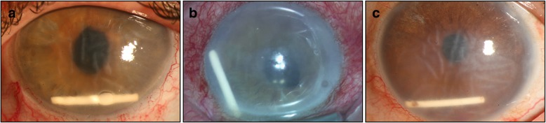
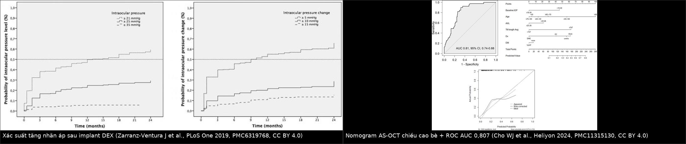
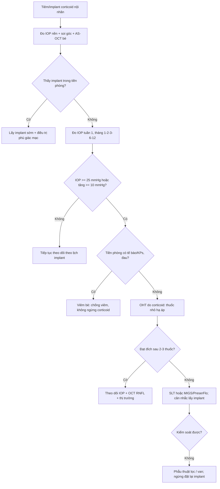
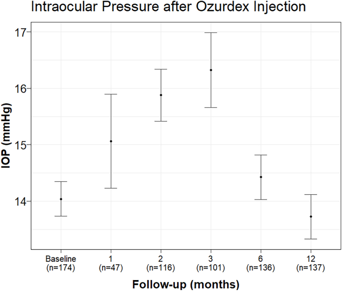

# 1411 — Tăng nhãn áp do corticoid nội nhãn & implant dexamethasone/fluocinolone / Steroid-induced ocular hypertension with intravitreal steroid implants

**Tags:** `pattern:tang-nhan-ap` `pattern:giot-implant` `pattern:phu-giac-mac` `vung:tien-phong` `vung:dich-kinh` `protocol:AS-OCT` `protocol:gonioscopy` `protocol:do-nhan-ap` `score:IOP`
**Mức chắc chắn (certainty):** tổng hợp y văn (literature synthesis) — gộp 3 đoàn hệ lớn về implant dexamethasone (**705 mũi/429 mắt**, PMC6319768; **309 mắt**, PMC12340189; **171 mũi**, PMC13047022), một nghiên cứu nomogram AS-OCT **154 mắt** (PMC11315130), một loạt **64 mũi** có đường cong IOP theo tháng (PMC11872671), một loạt **16 mắt** đặt PreserFlo (PMC11765877), loạt **15 mắt** SLT sau implant fluocinolone (PMC13487927) và loạt **640 mũi** về di lệch implant vào tiền phòng (PMC6537356). Chưa có ca nguyên văn của nhóm.

> **Vì sao bài này quan trọng:** mắt được tiêm corticoid nội nhãn **không phải "tiêm rồi về"**. Tăng nhãn áp (ocular hypertension, OHT) sau implant dexamethasone (DEX-I) xuất hiện ở **20,9%/12 tháng** (23,3% theo mũi tiêm) ở một loạt 74 mắt, **37,9%** ở đoàn hệ Thụy Điển 309 mắt, và xác suất **tích lũy** tới **50–60% với IOP ≥ 21 mmHg, 25–30% với ≥ 25 mmHg, 6–7% với ≥ 35 mmHg ở 12–24 tháng**. Điểm chốt: **đỉnh tăng áp ở tháng 2–3**, phần lớn đáp ứng thuốc nhỏ, nhưng **0,9% phải mổ glaucoma** — và một nhóm nhỏ lại tăng áp vì **implant di lệch vào tiền phòng** (0,63%), nơi xử trí là **lấy implant**, không phải tăng thuốc. Bài này dạy phân biệt hai con đường đó.

## 1. Tổng quan bệnh học – cơ chế hình ảnh – vì sao corticoid làm tắc "cửa thoát" thủy dịch

- **Giải phẫu–sinh lý quyết định mọi thứ:** thủy dịch (aqueous humour) do thể mi tiết ra, thoát **85–90% qua đường bè – ống Schlemm (trabecular/conventional outflow)** và 10–15% qua đường bàng bè (uveoscleral). Nhãn áp **IOP = F/C + P_ev** (F = lưu lượng tiết, C = khả năng thoát, P_ev = áp lực tĩnh mạch thượng củng mạc). Vì vậy **bất kỳ thứ gì bít bè đều tăng IOP mà không cần "viêm"**.
- **Cơ chế tại bè (trabecular meshwork, TM) — vì sao không phải "phù" mà là "xơ hóa":** glucocorticoid gắn thụ thể GR trong tế bào bè → **tăng tổng hợp chất nền ngoại bào (ECM)**: fibronectin, laminin, collagen IV, versican; **giảm hoạt proteolytic** (MMP) và **tăng chất ức chế** (TIMP) → ma trận dày lên trong **vùng áp (cribriform)** và **thành trong ống Schlemm**; đồng thời tế bào bè **tăng co rút** và tạo **mạng actin liên kết chéo (cross-linked actin networks, CLANs)**. Trục phân tử đã được lập bản đồ: DEX → **SP1** tăng phiên mã **ANGPTL7** → **RhoA/ROCK** → CLANs (PMC8826420); knock-down ANGPTL7 làm giảm CLANs. Hệ quả định lượng: **giảm khả năng thoát (outflow facility)**, chứ không phải tăng tiết thủy dịch.
- **Vì sao có người đáp ứng mạnh, người không:** kiểu hình **"responder"** mang tính cá thể (khác biệt phiên mã của tế bào bè ở người đáp ứng vs không đáp ứng — PMC9140469); vì vậy **tiền sử đáp ứng corticoid ở mắt bên kia hoặc ở đợt tiêm trước là dữ kiện mạnh nhất**, mạnh hơn mọi thông số hình ảnh.
- **Tại sao hình ảnh lại quan trọng:** bè không nhìn thấy trên OCT thường, nhưng **AS-OCT (anterior segment OCT)** đo được **chiều cao bè** và bề dày ECM; đưa chiều cao bè vào mô hình dự báo làm **AUC tăng từ 0,644 lên 0,807** (95% CI 0,737–0,877; n = 154 mắt, 39 mắt SIOH; PMC11315130). Đây là ví dụ sạch của nguyên lý: **mô bệnh (ECM dày) → thông số đo được (chiều cao bè) → nguy cơ lâm sàng**.
- **Dược động của 3 loại implant (quyết định thời gian tăng áp):**
  - **Dexamethasone 0,7 mg (Ozurdex)** — polymer PLGA **tự phân hủy**, giải phóng **~6 tháng**; đỉnh IOP **tháng 2–3**, giảm dần khi implant tan. Vì thế **tháng 2–3 là cửa sổ phải đo**, không phải ngày 1.
  - **Fluocinolone acetonide 0,19 mg (Iluvien) / 0,18 mg (Yutiq)** — **không phân hủy**, tác dụng **18–36 tháng**: tăng áp **không tự hết khi hết "đợt"**, mà **kéo dài suốt thời gian implant còn tác dụng** → cần SLT hoặc phẫu thuật nếu thuốc nhỏ không đủ.
  - **Triamcinolone acetonide (TA)** tiêm nội dịch kính — tinh thể lắng, tồn tại **1–3 tháng**. So sánh trực tiếp trên cơ sở dữ liệu lớn (**1.665** bệnh nhân DEX-I vs **3.866** bệnh nhân TA): **8,8% vs 7,3%** cần điều trị OHT; sau **40 ngày**, DEX-I có nguy cơ **cao hơn** TA (**HR 1,41; 95% CI 1,08–1,86; p = 0,01**) — tức "implant" **không** an toàn hơn TA như nhiều người tưởng (PMC13216112).
- **Vì sao tăng áp "vô hại" lại đáng sợ:** IOP tăng mạn làm tổn thương **bó nhú–hoàng điểm và lớp sợi thần kinh (RNFL)** trong khi thị lực trung tâm còn tốt; do đó **theo dõi bằng OCT RNFL/đĩa thị và thị trường**, không bằng "bệnh nhân thấy bình thường". Đồng thời **implant nằm trong tiền phòng** tiếp xúc nội mô → **phù giác mạc không hồi phục** nếu không lấy ra sớm.

## 2. Mẫu hình + chẩn đoán phân biệt theo vị trí (gamut)

- **Mẫu hình 1 — "tăng áp đơn thuần, góc mở, không viêm" (steroid response):** IOP tăng **từ tuần 2–4, đỉnh tháng 2–3** với DEX-I; **góc mở**, **không dính góc**, **không tế bào tiền phòng**, **không giảm thị lực cấp**; mắt bên kia (nếu có tiêm) thường tăng tương tự.
- **Mẫu hình 2 — "tăng áp + implant lạc vào tiền phòng" (AC migration):** thấy **thanh implant trắng–vàng, hình que (rod)** nằm ở **góc dưới tiền phòng**, **chạm nội mô**, kèm **phù giác mạc lan tỏa + nếp gấp màng Descemet**; đây là **cấp cứu nhãn khoa** (Hình 1). Tần suất **0,63% (4/640 mũi)**, **100% là mắt đã cắt dịch kính + thể thủy tinh nhân tạo**, và **yếu tố quyết định là mất toàn vẹn bao/zinn** (so với mắt cắt dịch kính còn bao nguyên: p = 0,008; so với mắt còn thể thủy tinh: p = 0,009).
- **Mẫu hình 3 — "tăng áp do viêm bè (trabeculitis)":** tế bào tiền phòng, **tỳ vết (KPs) trên nội mô**, dính góc, đau; đây là **bệnh đang hoạt động**, xử trí **khác hoàn toàn** (chống viêm, không ngừng corticoid).
- **Mẫu hình 4 — "tăng áp do nguyên nhân không do corticoid":** thể keo (viscoelastic) còn lại (tăng ngay **6–24 giờ**, tự hết); xuất huyết dịch kính/tế bào ma (ghost cell) ở mắt cắt dịch kính; **glaucoma tân mạch** ở RVO/ĐTĐ thiếu máu (rubeosis, dính góc); **pupillary block** do khí/dầu/implant lớn kẹt đồng tử.
- **Gamut theo mốc thời gian sau tiêm — cách nhớ nhanh:**
  - **< 24 giờ:** thể keo, bong hắc mạc, phản ứng viêm cấp, (hiếm) tắc động mạch trung tâm.
  - **1–7 ngày:** viêm bè, viêm nội nhãn (đau + giảm thị lực + mủ), implant di lệch sớm.
  - **2 tuần – 3 tháng:** **đỉnh của steroid response**; đồng thời là lúc implant co lại và **có thể trôi qua bao/zinn yếu vào tiền phòng**.
  - **> 3 tháng:** tăng áp do FAc kéo dài, glaucoma tiến triển trên mắt có tổn thương sẵn, **phù giác mạc do implant nằm lâu trong tiền phòng**.

## 3. Bảng so sánh phân biệt (ma trận đối chiếu)

| Thực thể (entity) | Hình ảnh / dấu hiệu điển hình | Chốt vào (rule-in) | Chốt loại (rule-out) | Gợi ý xác nhận |
|---|---|---|---|---|
| **Tăng áp do corticoid (steroid response)** | Góc **mở**, không dính; tiền phòng **không tế bào**; AS-OCT: **chiều cao bè tăng**, ECM dày | **IOP tăng ≥ 10 mmHg hoặc ≥ 25 mmHg** sau tiêm, **đỉnh tháng 2–3**, **không đau, không viêm**, mắt bên kia tương tự | Implant **thấy trong tiền phòng**, có **tế bào/KPs**, hoặc **rubeosis** | Đo IOP **đúng lịch tháng 1–2–3**; gonioscopy; AS-OCT bè; đáp ứng thuốc nhỏ |
| **Implant lạc tiền phòng (AC migration)** | **Thanh implant hình que ở góc dưới**, chạm nội mô; **phù giác mạc + nếp Descemet**; có thể implant "đi rồi về" | Thấy implant trong tiền phòng trên **đèn khe/AS-OCT**; tiền sử **cắt dịch kính + thể thủy tinh nhân tạo**, đặc biệt **IOL cố định củng mạc / zinn yếu** (p = 0,008) | Chỉ tăng áp **không thấy implant**; giác mạc trong | Soi đèn khe **toàn chu vi góc dưới**, AS-OCT; **lấy implant sớm** nếu chạm nội mô |
| **Viêm bè (trabeculitis)** | Tế bào tiền phòng, **KPs**, dính góc, đau, có thể giảm thị lực | **Tế bào/KPs** + tiền sử viêm màng bồ đào; đáp ứng **corticoid** chứ không phải ngừng corticoid | Tiền phòng **trong**, không đau, IOP tăng đơn thuần | Đèn khe + đáp ứng điều trị; phân biệt với viêm nội nhãn (mủ, giảm thị lực nhanh) |
| **Thể keo tồn lưu** | IOP tăng **ngay 6–24 giờ**, tiền phòng sâu, không viêm | Tăng áp **≤ 24 giờ** sau tiêm, **tự hết trong 24–48 giờ**, không cần điều trị dài | Tăng áp **kéo dài > 1 tuần**; có dấu hiệu viêm | Theo dõi 24 giờ; không vội dùng thuốc hạ áp kéo dài |
| **Glaucoma tân mạch (RVO/ĐTĐ)** | **Rubeosis mống mắt/góc**, dính góc, IOP rất cao, đau | **Mạch tân sinh ở góc/đồng tử**; tiền sử thiếu máu võng mạc | Góc mở sạch, không rubeosis | Gonioscopy + FA/ OCTA võng mạc; điều trị **anti-VEGF + panretinal photocoagulation** |
| **Pupillary block** | Tiền phòng **nông**, đồng tử giãn cố định, **IOP tăng cấp**, đau | Chênh IOP **> 8 mmHg giữa hai mắt**, tiền phòng nông khu trú, thấy **bọt khí/dầu/implant** kẹt đồng tử | Tiền phòng sâu, không chênh, góc mở | Soi góc mắt bên; nếu do **dầu/khí** → tư thế + lấy bớt; nếu do implant → lấy |
| **Tăng áp kéo dài do fluocinolone** | IOP tăng **không giảm sau 6 tháng**, không có đợt "tan" implant; AS-OCT bè dày | **OHT 24,6%** (42/171 mắt); yếu tố: **tuổi trẻ hơn** (p = 0,036), **OHT/glaucoma có sẵn** (p = 0,034) | Implant DEX (tự tan) với IOP đã về bình thường sau 6 tháng | Theo dõi IOP **suốt 18–36 tháng**; SLT khi thuốc nhỏ không đủ |

- **Ảnh 1 — biến chứng "thấy được" của corticoid nội nhãn: implant di lệch vào tiền phòng.**

  

  Nguồn: Röck D et al., *BMC Ophthalmol* 2019 (PMC6537356) Fig. 1 — CC BY 4.0, nguyên bản.

- **Ảnh ghép — hai mô hình định lượng của cùng một quyết định ("có cần điều trị và điều trị bao lâu").**

  

  Nguồn từng ô: Zarranz-Ventura J et al., *PLoS One* 2019 (PMC6319768) Fig. 2 — CC BY 4.0; Cho WJ et al., *Heliyon* 2024 (PMC11315130) Fig. 1 — CC BY 4.0.

## 4. Protocol chụp/đo + hệ phân độ & lịch theo dõi

- **Lịch đo IOP (bắt buộc, đúng "nhịp" dược động):** **trước tiêm** (nền) → **1 tuần** → **1, 2, 3, 6, 12 tháng** (đúng bộ mốc của nghiên cứu nomogram PMC11315130). Với **DEX-I**, **tháng 2 và 3 là bắt buộc** vì đó là đỉnh; với **FAc**, theo dõi **suốt 18–36 tháng** vì implant không tan.
- **Đo bằng gì:** **Goldmann applanation** là chuẩn; nếu **giác mạc phù/dày** hoặc vừa mổ, ghi rõ phương pháp (Tonopen/ICare) và **không so sánh trực tiếp** hai phương pháp. Luôn **đo cả hai mắt** — chênh lệch là dữ kiện chẩn đoán (pupillary block, steroid response một bên).
- **AS-OCT tiền phòng:** đo **chiều cao bè**, **độ mở góc (TISA, AOD)**, **bề dày ECM**, và **vị trí implant** (dịch kính vs tiền phòng); đây là công cụ vừa **dự báo** (AUC 0,807) vừa **xác nhận cơ chế**.
- **Phân tầng nguy cơ trước tiêm (dùng được ngay trên giấy):**
  1. **Tiền sử đáp ứng corticoid** (mắt bên kia, đợt tiêm trước, corticoid nhỏ kéo dài) — yếu tố mạnh nhất.
  2. **Glaucoma/OHT có sẵn** (FAc: p = 0,034).
  3. **Tuổi trẻ hơn** với FAc (p = 0,036).
  4. **Nam giới** với DEX-I (aOR **2,53**, PMC12340189).
  5. **IOP nền cao** (yếu tố độc lập trong PMC12340189).
  6. **Mắt đã cắt dịch kính + thể thủy tinh nhân tạo/zinn yếu** → nguy cơ **implant lạc tiền phòng**.
- **Ngưỡng hành động (ba mức, dùng thống nhất):**
  - **OHT (định nghĩa nghiên cứu):** IOP **≥ 25 mmHg** *hoặc* **tăng ≥ 10 mmHg** so với nền (dùng trong PMC12340189 và PMC13047022).
  - **Cần điều trị:** IOP **≥ 25–28 mmHg** hoặc **tăng ≥ 10 mmHg kèm nguy cơ** (glaucoma có sẵn, RNFL mỏng, một mắt).
  - **Cần can thiệp (không chỉ thuốc):** IOP **không đạt đích sau 2–3 loại thuốc**, hoặc **implant nằm trong tiền phòng**, hoặc **tổn thương thị trường/RNFL tiến triển**.
- **Thang điều trị (bậc thang có số liệu):**
  1. **Thuốc nhỏ hạ áp** — giải quyết phần lớn: **31–54%** mắt phải khởi động thuốc trong 12–24 tháng; ở loạt Thụy Điển **30,5%** cần điều trị, chủ yếu là thuốc nhỏ.
  2. **SLT (selective laser trabeculoplasty)** — sau FAc: **15 mắt**, IOP giảm trung bình **14,2 mmHg**, theo dõi **32 ± 17,7 tháng**, an toàn và lặp lại được; đặt SLT **trước** implant cho kiểm soát tốt hơn và ít dao động (PMC13487927).
  3. **Phẫu thuật lọc/MIGS** — PreserFlo ở mắt tăng áp kháng trị sau DEX-I: **IOP 27 → 13 mmHg ở 12 tháng** (giảm **50,1–51,5%**), thành công hoàn toàn **75% (12/16)**, và **75%** vẫn tiếp tục được tiêm DEX-I (PMC11765877). Tỉ lệ phải mổ glaucoma chung chỉ **0,9% (4/429)**.
  4. **Lấy implant** — **bắt buộc** nếu implant trong tiền phòng chạm nội mô; nếu còn trong dịch kính mà gây tăng áp không kiểm soát, có thể **lấy qua pars plana** (kỹ thuật đã mô tả, PMC7394078).
  5. **Ngừng/đổi corticoid** — chuyển sang thuốc không phải corticoid (anti-VEGF) khi bệnh lý cho phép; **không** đặt lại implant khi chưa kiểm soát IOP và chưa có "kế hoạch hạ áp" (SLT trước, thuốc nhỏ, hoặc MIGS).

## 5. Biến thể bình thường và cạm bẫy

- **Biến thể bình thường (normal variant):** **tăng nhẹ 2–4 mmHg trong 1–2 tuần đầu** sau tiêm là phổ biến và tự hết; **chênh lệch IOP giữa hai mắt tới 2–3 mmHg** vẫn bình thường. **Không** gọi là OHT nếu < 25 mmHg và tăng < 10 mmHg **và** không có tổn thương thần kinh thị.
- **Cạm bẫy 1 — "giác mạc phù che mất con số":** khi có **phù giác mạc**, đo IOP bằng GAT có thể **thấp giả** hoặc không đo được; phải dùng **Tonopen/đo qua mí** và **ghi rõ phương pháp**. Đây là lý do nhiều ca "IOP 18 mmHg mà thị lực mất" thực chất là IOP thật cao hơn.
- **Cạm bẫy 2 — "implant nằm ở góc dưới, dễ bị bỏ qua khi đồng tử nhỏ/giác mạc mờ":** phải **soi toàn chu vi góc dưới** và **AS-OCT** mỗi lần đo; implant "đi rồi về" được mô tả trong y văn, nên **một lần không thấy không loại trừ**.
- **Cạm bẫy 3 — quy oan cho corticoid:** tăng áp ở mắt **đã cắt dịch kính + dầu/khí** có thể do **pupillary block** hoặc **dầu vào tiền phòng**; ở mắt **RVO/ĐTĐ** có thể do **glaucoma tân mạch**. Gọi là "steroid response" mà bỏ qua **rubeosis** là bỏ sót chỉ định **PRP**.
- **Cạm bẫy 4 — hết implant ≠ hết nguy cơ:** với **FAc không phân hủy**, IOP có thể tăng **nhiều tháng sau** và **không tự hết**; ngược lại với **DEX-I**, tăng áp thường **giảm sau tháng 6** — dùng lẫn hai mô hình sẽ **ngừng theo dõi quá sớm** (FAc) hoặc **mổ oan** (DEX).
- **Cạm bẫy 5 — "hai mắt cùng tăng áp thì không phải do thuốc":** sai. **Steroid response thường đối xứng**, đặc biệt khi tiêm hai mắt; đừng loại trừ chỉ vì hai mắt giống nhau.
- **Cạm bẫy 6 — satisfaction of search:** đã thấy implant trong tiền phòng thì vẫn phải soi **võng mạc/góc** — bệnh nhân có thể đồng thời có **bong võng mạc** hoặc **tân mạch**.

## 6. Tự lượng giá — Blind Quiz (mở trên Pages để tự đoán trước)

**Ca 1 — nam 68 tuổi, đã cắt dịch kính + IOL cố định củng mạc, tiêm DEX-I 6 tuần trước, nay đau nhẹ, nhìn mờ.**

- Câu hỏi: Dấu hiệu chính? Ba chẩn đoán phân biệt? Dấu hiệu nào chốt chẩn đoán và **việc cần làm ngay**?
- Gợi ý: chú ý **hình dạng – vị trí – tương quan với nội mô**, và **tiền sử mổ** có ý nghĩa gì.

<b>Bấm để hiện đáp án (findings + chẩn đoán)</b>

- Dấu hiệu: **thanh implant hình que ở góc dưới tiền phòng, chạm nội mô** (a); ở (b) và (c) **phù giác mạc lan tỏa với nếp gấp màng Descemet**.
- Chẩn đoán: **implant dexamethasone di lệch vào tiền phòng** — tần suất **0,63% (4/640 mũi)**, **100% ở mắt đã cắt dịch kính + thể thủy tinh nhân tạo**, và nguy cơ tăng khi **mất toàn vẹn bao/zinn** (p = 0,008 so với mắt còn bao nguyên).
- Việc cần làm: **lấy implant sớm** (trước khi nội mô mất bù) + điều trị phù giác mạc; **không** chỉ tăng thuốc hạ áp.
- Nguồn ảnh: Röck D et al., *BMC Ophthalmol* 2019 (PMC6537356) Fig. 1 — CC BY 4.0.

**Ca 2 — nữ 62 tuổi, phù hoàng điểm do ĐTĐ, tiêm DEX-I; IOP 16 → 34 mmHg ở tháng 2, tiền phòng trong, góc mở.**

- Câu hỏi: Cơ chế tăng áp? Vì sao đỉnh lại ở **tháng 2–3**? Xử trí bậc 1 và ngưỡng chuyển bậc?
- Gợi ý: nghĩ tới **khả năng thoát (outflow facility)**, không phải tiết thủy dịch.

<b>Bấm để hiện đáp án (findings + chẩn đoán)</b>

- Dấu hiệu: IOP tăng đơn thuần, **góc mở, tiền phòng không tế bào**; đường cong IOP cho thấy **đỉnh tháng 2–3**, sau đó giảm dần khi implant PLGA tan.
- Chẩn đoán: **OHT do corticoid (steroid response)** — DEX làm tăng ECM + CLANs ở bè (ANGPTL7–SP1–RhoA/ROCK) → **giảm khả năng thoát**.
- Xử trí: **thuốc nhỏ hạ áp**; nếu **không đạt đích sau 2–3 thuốc** hoặc có tổn thương RNFL/thị trường → **SLT/MIGS**. Ghi nhận **31–54%** mắt phải khởi động thuốc, chỉ **0,9%** phải mổ.
- Nguồn ảnh: Xiao J, Qiu M. *Am J Ophthalmol Case Rep* 2025 (PMC11872671) Fig. 1 — CC BY-NC-ND 4.0, nguyên bản.

**Ca 3 — nam 70 tuổi, tiêm FAc 0,19 mg vì phù hoàng điểm; IOP 26 mmHg ở tháng 9, vẫn cao dù đã 3 thuốc nhỏ.**

- Câu hỏi: Vì sao tăng áp **không tự hết** ở thuốc này mà lại tự hết ở thuốc kia? Hai lựa chọn tiếp theo (có số liệu)?
- Gợi ý: so sánh **khả năng phân hủy của polymer**, và nhìn **chiều cao bè** như một biến dự báo.

<b>Bấm để hiện đáp án (findings + chẩn đoán)</b>

- Dấu hiệu: OHT **24,6% (42/171)** sau FAc; yếu tố nguy cơ **tuổi trẻ hơn** (p = 0,036) và **OHT/glaucoma có sẵn** (p = 0,034); **SLT 7,0%**, **mổ 3,5%**, thuốc nhỏ đơn thuần **57%** ca tăng áp.
- Chẩn đoán: **tăng áp kéo dài do fluocinolone** — implant **không phân hủy**, tác dụng **18–36 tháng**, nên ECM ở bè không "tự giãn" khi hết đợt.
- Xử trí: **SLT** (15 mắt: giảm **14,2 mmHg**, theo dõi **32 ± 17,7 tháng**) hoặc **MIGS/PreserFlo** (27 → 13 mmHg, thành công hoàn toàn **75%**) — và **vẫn có thể tiếp tục implant** nếu kiểm soát được (75% ca trong loạt PreserFlo).
- Nguồn ảnh: Zarranz-Ventura J et al. (PMC6319768) Fig. 2 — CC BY 4.0; Cho WJ et al. (PMC11315130) Fig. 1 — CC BY 4.0; ghép bằng `tools/make_composite.py`.

## Bài liên quan chéo
- [1404 – Biến chứng mạn của tiêm anti-VEGF nội dịch kính](../1404-bien-chung-man-anti-vegf/lesson.md)
- [1410 – Lấy dầu silicone & biến chứng dầu tồn lưu (tăng nhãn áp, dầu tiền phòng)](../1410-lay-dau-silicone-va-dau-ton-luu/lesson.md)
- [442 – Glaucoma trên OCT (RNFL/GCL)](../442-glaucoma-OCT/lesson.md)
- [414 – Glaucoma & nhãn cầu nhỏ trong PFV](../414-glaucoma-va-nhan-cau-nho-o-pfv/lesson.md)
- [1643 – Glaucoma sau mổ đục thể thủy tinh bẩm sinh](../1643-glaucoma-sau-mo-duc-thuy-tinh-the-bam-sinh/lesson.md)
- [1425 – Viêm nội nhãn sau tiêm nội nhãn (phân biệt với viêm bè)](../1425-viem-noi-nhan-sau-tiem-noi-nhan/lesson.md)

## Ảnh
- `images/1411_sioht_implant-tien-phong_Slitlamp_PMC6537356-Fig1-CCBY.jpg` — đèn khe, implant trong tiền phòng (CC BY 4.0).
- `images/1411_sioht_IOP-sau-tiem_PMC11872671-Fig1-CCBYNCND.jpg` — đường cong IOP 12 tháng (CC BY-NC-ND 4.0, **nguyên bản**).
- `images/1411_sioht_IOP-tich-luy_PMC6319768-Fig2-CCBY.jpg` và `images/1411_sioht_Nomogram-ROC_PMC11315130-Fig1-CCBY.jpg` — hai mô hình định lượng (CC BY 4.0).
- `images/composite_sioht_mo-hinh-du-bao.jpg` — composite từ 2 ảnh CC BY 4.0 ở trên.
- Nguồn + giấy phép từng file: `images/CREDITS.md`.

> **Disclaimer:** bài học dùng cho đào tạo/tra cứu, **không dùng để chẩn đoán độc lập** khi chưa có bác sĩ nhãn khoa hướng dẫn.
