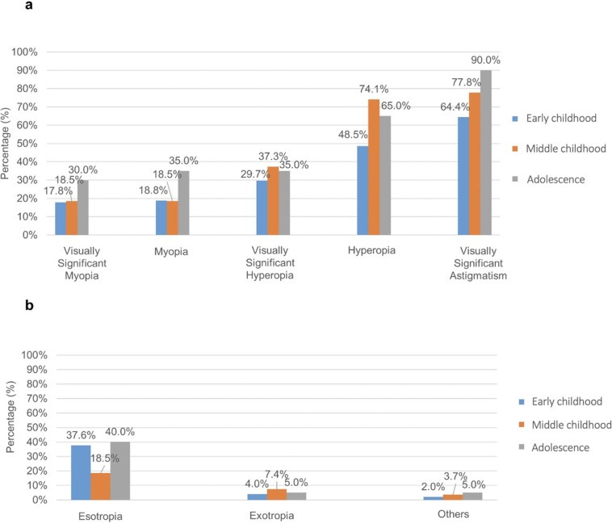
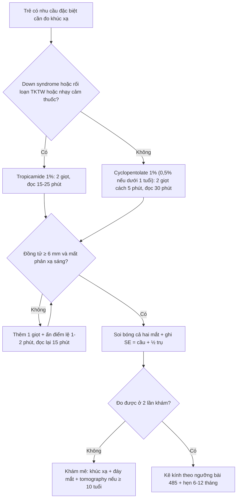
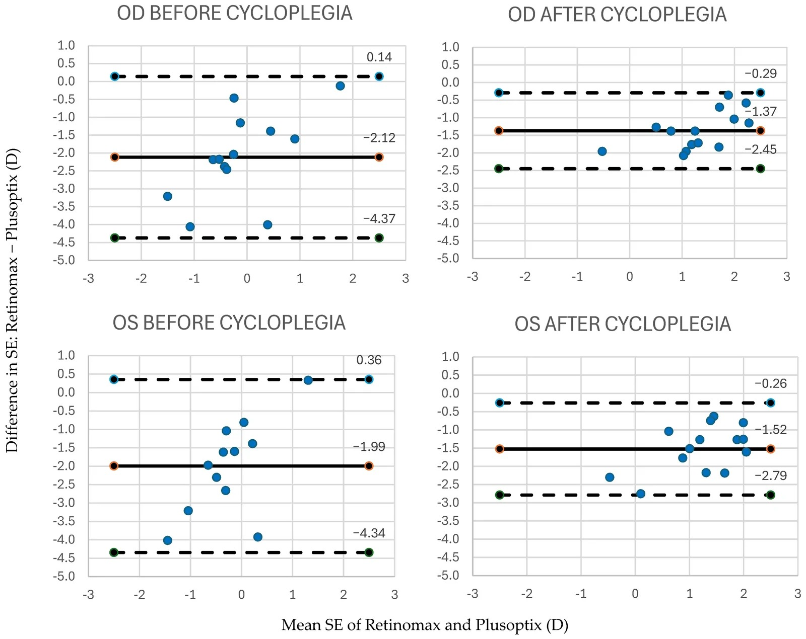
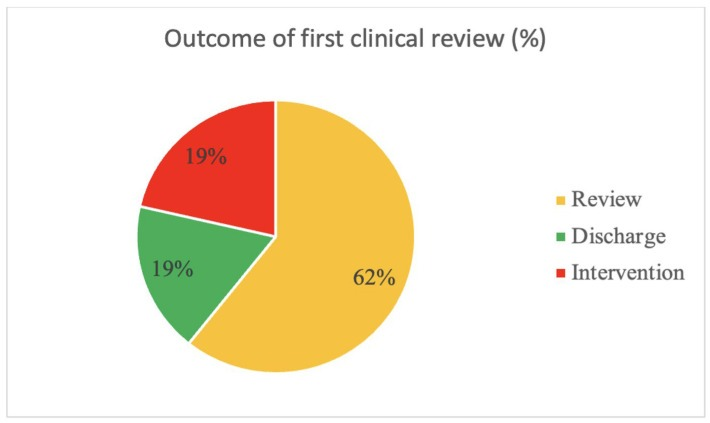

# 1412 — Đo khúc xạ lý liệt ở trẻ Down syndrome, bại não và tự kỷ: chọn thuốc, kỹ thuật, keratoconus và khi nào gây mê / Cycloplegic refraction in children with Down syndrome, cerebral palsy and autism: agent choice, technique, keratoconus and when to sedate

**Tags:** `pattern:khuc-xa` `pattern:nhuoc-thi` `vung:mat` `protocol:khuc-xa-ly-liet` `protocol:atropine` `score:SE` `incidentaloma:khuc-xa-tre`

**Mức chắc chắn (certainty):** tổng hợp y văn (literature synthesis) — tự biên từ 1 bài thực hành lý liệt ở trẻ (PMC11141127), 1 đoàn hệ 148 trẻ Down syndrome (PMC12094766), 1 chương trình sàng lọc keratoconus 27 trẻ Down (PMC11941047), 1 tổng quan keratoconus ở Down (PMC12764348), 1 nghiên cứu 210 trẻ tự kỷ (PMC12566500), 1 nghiên cứu so sánh hai máy đo ở 23 trẻ tự kỷ (PMC13705275) và 1 đoàn hệ 100 trẻ chậm phát triển (PMC12640464). Chưa gắn một ca nguyên văn đơn lẻ.

> **Bài này nối tiếp [485 – Khúc xạ lý liệt ở trẻ mầm non](../485-khuc-xa-ly-liet-dieu-tiet-tre-mam-non/lesson.md) (chọn thuốc, kỹ thuật, quy tắc kê kính) và [483 – Sàng lọc thị lực trẻ mầm non](../483-sang-loc-thi-luc-tre-mam-non/lesson.md) (phát hiện).** 485 giả định **trẻ hợp tác và hợp tác được**; bài này trả lời phần còn trống: **khi trẻ Down, bại não hoặc tự kỷ thì thuốc nào, đo bằng cách nào, khi nào phải gây mê — và cái gì dễ bị bỏ sót vì "đổ cho khúc xạ"**.

> **Câu chốt:** Ở trẻ có nhu cầu đặc biệt, **khúc xạ sai là quy luật, không phải ngoại lệ**: **75,7%** trẻ Down có tật khúc xạ có ý nghĩa thị lực (**loạn thị 70,3%**), **84%** trẻ chậm phát triển có tật khúc xạ, **22,3%** trẻ tự kỷ có tật khúc xạ — trong khi **23,8%** trẻ tự kỷ **chưa từng được khám mắt** (PMC12094766, PMC12640464, PMC12566500). Nhưng **thuốc lý liệt mặc định của trẻ bình thường (cyclopentolate) không phải mặc định ở nhóm này**: với **Down syndrome hoặc rối loạn hệ thần kinh trung ương**, hướng dẫn thực hành khuyên **tropicamide 1%** là lựa chọn thay thế hợp lý (PMC11141127).

## 1. Tổng quan bệnh học – cơ chế hình ảnh

- **Vì sao phải lý liệt — và vì sao ở nhóm này càng bắt buộc:** trẻ **3–6 tuổi có biên độ điều tiết 10–15 D**; khi đo không lý liệt, trẻ **tự điều tiết** để "nhìn cho đúng" → **viễn thị bị đo thiếu, cận thị bị đo thừa**. Trẻ **chậm phát triển/tự kỷ** còn có thêm hai lý do: **không hiểu yêu cầu "nhìn xa"** (nên điều tiết không kiểm soát được) và **không phản hồi được với thử kính chủ quan** (nên chỉ còn khúc xạ khách quan). Nói cách khác, **lý liệt không phải bước tùy chọn mà là điều kiện để có bất kỳ con số nào dùng được**.
- **Cơ chế thuốc (vật lý – dược lý):** lý liệt là **đối kháng muscarinic M3** ở **cơ thể mi (ciliary muscle)** → cơ giãn → **dây zinn căng** → **thủy tinh thể dẹt** → điểm xa lùi ra vô cực; đồng thời **liệt cơ vòng mống mắt** → giãn đồng tử. **Cyclopentolate 1%**: khởi phát **~30 phút**, kéo dài **tới 24 giờ**. **Tropicamide 1%**: khởi phát **15–25 phút**, **yếu hơn và ngắn hơn** (1–2 giờ) → **dùng được cho phần lớn trẻ lớn**, nhưng **không đủ** khi **viễn thị cao, lác, hoặc kết quả không khớp lâm sàng** (PMC11141127). **Atropine 1%**: mạnh nhất, kéo dài **nhiều ngày**, dùng khi **mống mắt rất sẫm** và cyclopentolate thất bại.
- **Điểm khác biệt của từng nhóm (số liệu định lượng):**
  - **Down syndrome (n = 148, Đài Loan):** tật khúc xạ có ý nghĩa thị lực **75,7%**; **loạn thị 70,3%**, **viễn thị 31,8%**, **cận thị 19,6%**; **thay đổi khúc xạ −0,16 ± 0,65 D/năm**, phụ thuộc **tuổi** và **SE ban đầu** (PMC12094766). Hình 1 của bài đó cho thấy xu hướng **theo tuổi**: loạn thị có ý nghĩa **64,4% (nhỏ) → 90,0% (thiếu niên)**, viễn thị có ý nghĩa **48,5% → 77,8%**, cận thị **17,8% → 30,0%**.
  - **Chậm phát triển toàn thể (n = 100, 4 tháng–5 tuổi):** **tật khúc xạ 84%**, **viễn thị 78%**, **loạn thị 45%**, **cận thị 18%**; **lác 12%**; **suy giảm thị lực 66%** (PMC12640464).
  - **Tự kỷ (n = 210, 8,18 ± 4,99 tuổi):** **tật khúc xạ 22,3%** (**loạn thị 15,2%**, **cận thị 5,2%**, **viễn thị 1,9%**), **lác 11,9%**; **49,5% không hoàn thành được test lập thể**; **23,8% chưa từng khám mắt** (PMC12566500).
  - **Keratoconus ở Down:** trong chương trình sàng lọc **27 trẻ 9–18 tuổi**, **8/54 mắt (15%)** đã có keratoconus sớm trên tomography, **tuổi chẩn đoán trung bình 14,6**; giác mạc **mỏng và dốc hơn ngay từ đầu** (**CCT 479 µm vs 536 µm**, **Kmax 49,2 D vs 45,8 D**) (PMC11941047).
- **TẠI SAO máy đo tự động không thay được lý liệt — bằng chứng định lượng:** ở **23 trẻ tự kỷ** (14 trẻ có cặp đo đủ), **Retinomax K-plus 3** cho **SE cận thị hơn Plusoptix A09** một cách hệ thống: **OD −1,21 ± 1,25 D vs +0,91 ± 0,67 D** trước lý liệt; sau **tropicamide 1%** vẫn lệch (**+0,63 ± 0,94 D vs +2,00 ± 0,63 D**). Bland–Altman: **bias −2,12 D (OD) trước lý liệt, còn −1,37 D sau lý liệt** (PMC13705275). **Hai máy không thay thế nhau được**, và **lý liệt chỉ thu hẹp chứ không xóa chênh** — nghĩa là **luôn phải ghi rõ đo bằng máy nào** khi so sánh hai lần khám.
- **TẠI SAO keratoconus là "cạm bẫy khúc xạ" ở Down:** giác mạc **mỏng, dốc, loạn thị không đều** → **kính cầu–trụ thường quy không cải thiện thị lực**, và **SE trông "bình thường" trong khi thị lực vẫn kém**. Nếu chỉ đo khúc xạ rồi kết luận "đã chỉnh đủ", sẽ **bỏ sót keratoconus tiến triển** — trong khi **cross-linking (CXL) có thể chặn tiến triển** nếu phát hiện sớm (PMC12764348, PMC11941047).

## 2. Mẫu hình + chẩn đoán phân biệt theo nhóm trẻ (gamut)

- **G1 — Down syndrome:** **loạn thị là tật khúc xạ phổ biến nhất (70,3%)**, kèm viễn thị; **keratoconus tuổi thiếu niên**; khe mi hẹp, **nếp da góc mắt (epicanthus)**, **hẹp lệ đạo** (thuốc nhỏ dễ trôi); **nhạy cảm với tác dụng toàn thân của atropine** (khuyến cáo dùng tropicamide thay thế — PMC11141127). **Chốt:** luôn **soi bóng + ghi cả trục loạn thị**, và **tomography giác mạc ở tuổi thiếu niên giữa**.
- **G2 — Bại não (cerebral palsy):** **viễn thị cao + lác** (75,3% lác trong trong đoàn hệ 73 trẻ — PMC13511224); **kiểm soát đầu kém**, **co cứng**, dễ **co cơ mi** khi nhỏ thuốc; thường kèm **suy giảm thị giác vỏ (CVI)** → thị lực kém **dù khúc xạ đã chỉnh đủ**.
- **G3 — Tự kỷ (ASD):** **loạn thị và dị khúc xạ** nổi bật hơn viễn thị; **khó hợp tác**, **quá tải cảm giác**, **không đeo kính được** nếu gọng không phù hợp; **thiết bị sàng lọc cho kết quả khác nhau có hệ thống** (mục 1).
- **G4 — Chậm phát triển toàn thể không rõ nguyên nhân:** **tật khúc xạ 84%**, thường **viễn thị + loạn thị**; đây là nhóm **hưởng lợi nhiều nhất từ khám mê** vì không đo được thị lực.
- **G5 — "Hàng giả" phải loại trước khi kê kính:**
  - **Giả lác trong (pseudoesotropia)** do **epicanthus + sống mũi thấp** (rất hay gặp ở Down) → **cover test thẳng**.
  - **Giả cận thị (pseudomyopia)** do điều tiết → **đo lại sau lý liệt**.
  - **Kém thị lực do keratoconus** chứ không phải do độ kính → **tomography**.
  - **Kém thị lực do CVI** ở bại não → khúc xạ đúng vẫn kém; **không tăng độ kính vô ích**.
  - **Sai số thiết bị** (Retinomax vs Plusoptix, bias tới **−2,12 D**) → **không đổi kết luận chỉ vì đổi máy**.

## 3. Bảng so sánh phân biệt (ma trận đối chiếu)

| Thực thể (entity) | Hình ảnh / dấu hiệu điển hình | Chốt vào (rule-in) | Chốt loại (rule-out) | Gợi ý xác nhận |
|---|---|---|---|---|
| **Down syndrome — khúc xạ** | **Loạn thị (70,3%)** + viễn thị (31,8%); khe mi hẹp; epicanthus | **Trẻ Down + khúc xạ lý liệt bất thường theo ngưỡng kê kính của bài 485** | Khúc xạ lý liệt trong giới hạn bình thường theo tuổi và thị lực tương xứng | Soi bóng sau lý liệt + ghi **trục loạn thị**; lặp mỗi **6–12 tháng** (biến đổi trung bình **−0,16 D/năm**) |
| **Keratoconus ở Down** | Giác mạc **mỏng hơn (CCT 479 µm vs 536 µm)** + **dốc hơn (Kmax 49,2 D vs 45,8 D)** so với chứng; loạn thị không đều; thị lực kém **không cải thiện với kính** | **Tomography giác mạc bất thường (BAD-D tăng, Kmax ~49 D, CCT ~479 µm) ở trẻ Down tuổi thiếu niên** | Giác mạc dày, loạn thị đều, thị lực cải thiện đủ với kính | **Topography/tomography giác mạc**; **CXL** nếu tiến triển |
| **Bại não — khúc xạ + CVI** | **Viễn thị cao**, lác trong, kiểm soát đầu kém; thị lực kém **không tương xứng khúc xạ** | **Bại não + viễn thị sau lý liệt + thị lực kém dù đã chỉnh** | Thị lực cải thiện đủ sau chỉnh → không phải CVI | Khúc xạ lý liệt + đánh giá chức năng thị giác (fixation, visual behavior) |
| **Tự kỷ — khúc xạ** | **Loạn thị 15,2%**, cận thị 5,2%, viễn thị 1,9%; lác 11,9% | **ASD + kết quả lý liệt khác kết quả không lý liệt ≥ 1,00 D** | Hai lần đo trùng nhau và khớp lâm sàng | Lý liệt + **ghi rõ máy đo**; không trộn kết quả hai thiết bị |
| **Chậm phát triển toàn thể** | **Viễn thị 78%**, loạn thị 45%; không đo được thị lực | **Không đo được thị lực + khúc xạ lý liệt bất thường** | Đo được thị lực và khúc xạ bình thường → sàng lọc định kỳ | Khám mê khi cần; soi đáy mắt cùng lúc |
| **Giả lác trong (epicanthus)** | Nếp da góc mắt trong che một phần củng mạc; **ánh đồng tử cân xứng** | **Epicanthus + cover test không lác** | Cover test lác thật → không phải giả | **Cover–uncover** là chốt; Hirschberg chỉ hỗ trợ |
| **Giả cận thị do điều tiết** | Đo khô **−1,00 D**, sau lý liệt **+0,50 D** | **Chênh ≥ 1,00 D giữa khô và lý liệt** | Chênh < 0,50 D → khúc xạ ổn định | Lặp lý liệt; không kê kính cận từ số đo khô |
| **Sai số thiết bị (Retinomax vs Plusoptix)** | Lệch hệ thống **−2,12 D** trước lý liệt, **−1,37 D** sau lý liệt | **Đổi máy mà kết quả lệch > 1,00 D** | Cùng máy, cùng điều kiện → không phải sai số thiết bị | Ghi model máy; so sánh bằng soi bóng |

*Panel a: tỉ lệ tật khúc xạ **có ý nghĩa thị lực** tăng theo tuổi — **loạn thị 64,4% (nhỏ) → 90,0% (thiếu niên)**, **viễn thị có ý nghĩa 48,5% → 77,8%**, **cận thị 17,8% → 30,0%**. Panel b: **lác trong 37,6% / 18,5% / 40,0%** theo ba nhóm tuổi; lác ngoài chỉ **4,0–7,4%**. Nguồn: Chen CP et al., *PLoS One* 2025 (PMC12094766) Fig. 1, CC BY 4.0, giữ nguyên bản.*

## 4. Protocol — chọn thuốc theo nhóm, kỹ thuật và ngưỡng gây mê

### 4.1 Chuẩn bị (quyết định một nửa thành công)

- **Giải thích trước bằng hình ảnh/trò chơi** (social story) cho trẻ tự kỷ; **không giữ ghì** — giữ ghì làm tăng co cơ mi và **tăng phản xạ chớp** khi nhỏ thuốc.
- **Tư thế:** trẻ **ngồi lòng cha mẹ**; đầu tựa vai — giảm lo lắng và cố định nhẹ nhàng.
- **Nói "cảm giác lạ"**, **tránh từ "đau/xót"** (PMC11141127).
- **Down syndrome:** kiểm tra **hẹp lệ đạo** (nếu có, thuốc trôi xuống mũi nhiều hơn) và **khe mi hẹp** (khó nhỏ thuốc, khó soi bóng).

### 4.2 Chọn thuốc (bảng quyết định)

| Nhóm trẻ | Thuốc đầu tay | Liều / thời điểm đọc | Vì sao | Lưu ý |
|---|---|---|---|---|
| Trẻ thường ≥ 1 tuổi | **Cyclopentolate 1%** | 2 giọt cách **5 phút**, đọc sau **30 phút** | Lý liệt mạnh, thời gian hợp lý | Thêm 1 giọt nếu đồng tử chưa giãn (mống mắt sẫm) |
| Trẻ < 1 tuổi | **Cyclopentolate 0,5%** | Như trên | Giảm nguy cơ toàn thân | Theo dõi 30 phút sau nhỏ |
| **Down syndrome / rối loạn TKTW / nhạy cảm thuốc** | **Tropicamide 1%** | 2 giọt, đọc sau **15–25 phút** | Khuyến cáo thực hành thay thế an toàn hơn (PMC11141127) | **Không đủ** nếu **viễn thị cao hoặc lác** → cân nhắc cyclopentolate/atropine có theo dõi |
| **Mống mắt rất sẫm, cyclopentolate thất bại** | **Atropine 1%** | 2 lần/ngày × 3–4 ngày + 1 giọt ngày khám | Lý liệt mạnh nhất | **Độc toàn thân**: 1 tuýp mỡ 1% **3 g có thể gây tử vong nếu trẻ nhỏ nuốt phải** |
| Trẻ không hợp tác sau 2 lần | **Khám/gây mê** | Một buổi: khúc xạ lý liệt + soi đáy mắt + tomography | Tránh lặp lại nhiều buổi thất bại | Đánh giá **ngưng thở khi ngủ/đường thở** trước mê (đặc biệt Down) |

- **Ấn điểm lệ (punctal occlusion) 1–2 phút** sau mỗi giọt, **lau thuốc thừa** — đây là biện pháp **giảm hấp thu toàn thân** quan trọng nhất, rẻ nhất.
- **Xác nhận đủ lý liệt:** đồng tử **≥ 6 mm** và **mất phản xạ ánh sáng trực tiếp**; nếu **sau 15 phút đồng tử chưa giãn** ở trẻ mống mắt sẫm → **thêm 1 giọt** rồi đọc lại (PMC11141127).

### 4.3 Đo và ghi kết quả

- **Soi bóng (retinoscopy)** là chuẩn ở nhóm khó hợp tác; **autorefractor chỉ là hỗ trợ** và **phải ghi model**.
- Soi bóng ở **2/3 m (0,67 m)** → **trừ 1,50 D**; đo **cả hai mắt**, ghi **cầu, trụ, trục** và **SE = cầu + ½ trụ**.
- **Đo loạn thị theo trục** (không chỉ ghi "loạn thị") — vì **trục quyết định kính đúng**, và loạn thị là **tật khúc xạ phổ biến nhất ở Down (70,3%)**; kính sai trục = **kém thị lực dai dẳng** dù "đã đeo kính".

### 4.4 Lưu đồ chọn thuốc → đo → gây mê

### 4.5 Theo dõi và ngưỡng chuyển tuyến

- **Down syndrome:** khúc xạ lý liệt **mỗi 6–12 tháng** (biến đổi trung bình **−0,16 ± 0,65 D/năm**, nhưng **phương sai lớn** — có trẻ đổi nhanh); **tomography giác mạc từ ~10–14 tuổi** và **ngay** nếu thị lực kém không giải thích được (PMC12094766, PMC11941047).
- **Tự kỷ:** nếu **không đeo được kính** sau 2 lần thử → chuyển **hướng dẫn đeo/gọng thể thao** thay vì tăng độ; **không đổi số kính để "thuyết phục" trẻ đeo**.
- **Bại não:** khúc xạ đúng + **đánh giá CVI**; thị lực kém **không phải lý do tăng độ**.
- **Khi nào gây mê:** **≥ 2 buổi thất bại**, hoặc **cần soi đáy mắt + tomography + khúc xạ trong cùng một buổi**, hoặc **nghi keratoconus ở trẻ không hợp tác**. Với **Down**, đánh giá **ngưng thở khi ngủ, bất thường cột sống cổ, tim bẩm sinh** trước mê.

## 5. Biến thể bình thường và cạm bẫy

- **Epicanthus + sống mũi thấp (Down) = giả lác trong:** đừng gửi mổ lác vì Hirschberg; **cover test** là chốt.
- **Đồng tử không giãn dù đã nhỏ thuốc:** ở trẻ **mống mắt sẫm** cần **thêm giọt**; ở trẻ **Down** có thể do **khe mi hẹp làm thuốc trôi ra ngoài** → nhỏ vào **cùng đồ dưới** và **giữ mi** 10–15 giây.
- **Nhầm tác dụng kháng muscarinic với dị ứng:** **sốt, đỏ bừng, nhịp nhanh** sau atropine là **tác dụng dược lý**, không phải dị ứng — nhưng **sốt cao, lơ mơ, co giật** là **ngộ độc**, phải xử trí.
- **Atropine dạng mỡ:** **1 tuýp 1% 3 g có thể gây tử vong** nếu trẻ nhỏ nuốt — **cất xa tầm tay**, không đưa cả tuýp cho gia đình.
- **Autorefractor "hai máy hai số":** bias **−1,37 D vẫn còn sau lý liệt** (PMC13705275) → **không so sánh hai lần khám khác máy** mà không ghi model.
- **Kết luận "khúc xạ bình thường nên thị lực kém là do nhận thức":** đây là **lỗi bỏ sót keratoconus/CVI** hay gặp nhất; phải **loại trừ bằng tomography** trước khi quy kết tâm lý – nhận thức.
- **Sàng lọc bằng máy ảnh (photoscreener) thay khám lý liệt:** chỉ để **phát hiện và chuyển tuyến**; **không dùng để kê kính** — đặc biệt ở nhóm có **loạn thị cao**, nơi photoscreener bỏ sót nhiều.

## 6. Tự lượng giá — Blind Quiz ngay trên trang tĩnh

**Ca 1 — trẻ Down 14 tuổi, thị lực kém dù "đã đeo đúng số"**

- Gợi ý lâm sàng: bé trai **14 tuổi**, Down syndrome, đeo kính **+2,50 −2,00 × 180** hai mắt; mẹ nói "cháu vẫn dụi mắt, nhìn gần kém".
- Câu hỏi: Nhìn biểu đồ, **loại tật khúc xạ nào tăng mạnh nhất ở tuổi thiếu niên**? Với bệnh cảnh này, **hai bước** nào phải làm **trước khi tăng độ kính**?

<b>Bấm để hiện đáp án (findings + chẩn đoán)</b>

- **Findings:** panel a cho thấy **loạn thị có ý nghĩa thị lực 64,4% (nhỏ) → 90,0% (thiếu niên)** — tăng mạnh nhất; **viễn thị có ý nghĩa 48,5% → 77,8%**; **cận thị 17,8% → 30,0%**.
- **Hai bước trước khi tăng độ:** (1) **đo lại khúc xạ lý liệt** (không dùng số khô) và **kiểm tra trục loạn thị**; (2) **tomography giác mạc** — vì **15% mắt trẻ Down 9–18 tuổi đã có keratoconus sớm**, với **CCT 479 µm** và **Kmax 49,2 D** (PMC11941047).
- **Chẩn đoán cần nghĩ:** **keratoconus trên nền Down** — dụi mắt là dấu hiệu hành vi quan trọng; **CXL** có thể chặn tiến triển.
- Nguồn ảnh: Chen CP et al., *PLoS One* 2025 (PMC12094766) Fig. 1, CC BY 4.0, giữ nguyên bản.

**Ca 2 — hai máy đo cho hai con số khác nhau ở trẻ tự kỷ**

- Gợi ý lâm sàng: bé gái **6 tuổi**, tự kỷ, không hợp tác soi bóng; phòng khám có **Retinomax** và **Plusoptix**. Kết quả: Retinomax **−1,50 D**, Plusoptix **+1,00 D** (mắt phải).
- Câu hỏi: **Tin máy nào**? Bias trung bình là bao nhiêu **trước** và **sau** lý liệt? Kết luận thực hành là gì?

<b>Bấm để hiện đáp án (findings + chẩn đoán)</b>

- **Findings:** Bland–Altman (Retinomax − Plusoptix): **OD bias −2,12 D trước lý liệt, −1,37 D sau lý liệt**; **OS −1,99 D → −1,52 D**. Trước lý liệt: Retinomax **−1,21 ± 1,25 D** vs Plusoptix **+0,91 ± 0,67 D**; sau **tropicamide 1%**: **+0,63 ± 0,94 D vs +2,00 ± 0,63 D**.
- **Kết luận:** **không tin tuyệt đối máy nào**; **lý liệt làm giảm nhưng không xóa chênh** → **phải soi bóng** (hoặc khám mê) khi hai máy lệch **> 1,00 D**, và **luôn ghi model máy** trong hồ sơ.
- **Chẩn đoán:** **sai số thiết bị + điều tiết tồn dư**, không phải "trẻ tự kỷ khó đo nên số nào cũng được".
- Nguồn ảnh: Modrzejewska M et al., *J Clin Med* 2026 (PMC13705275) Fig. 1, CC BY 4.0, giữ nguyên bản.

**Ca 3 — chương trình sàng lọc keratoconus ở trẻ Down**

- Gợi ý lâm sàng: phòng khám mở **buổi sàng lọc keratoconus** cho **27 trẻ Down 9–18 tuổi**.
- Câu hỏi: Nhìn biểu đồ, **bao nhiêu phần trăm** phải **can thiệp ngay** ở buổi đầu? Con số đó nói gì về **ngưỡng tuổi sàng lọc**?

<b>Bấm để hiện đáp án (findings + chẩn đoán)</b>

- **Findings:** **19% can thiệp**, **62% hẹn theo dõi**, **19% cho ra** ở buổi khám đầu; tương ứng **8/54 mắt (15%)** có keratoconus sớm trên tomography, **tuổi chẩn đoán trung bình 14,6**.
- **Ngưỡng tuổi:** nhóm tác giả khuyến nghị **sàng lọc tomography ở tuổi thiếu niên giữa (mid-teens)** cho **mọi trẻ Down**, vì **15% đã có tổn thương cần CXL ngay lần đầu**.
- **Vì sao quan trọng:** **CXL chặn tiến triển**; bỏ sót = **mờ giác mạc + ghép giác mạc** với **nguy cơ cao hơn ở Down** (dụi mắt, nhiễm trùng, tuân thủ kém).
- Nguồn ảnh: Power B et al., *Diagnostics (Basel)* 2025 (PMC11941047) Fig. 1, CC BY 4.0, giữ nguyên bản.

## Bài liên quan chéo
- [485 – Khúc xạ lý liệt điều tiết ở trẻ mầm non](../485-khuc-xa-ly-liet-dieu-tiet-tre-mam-non/lesson.md) (chọn thuốc, quy tắc kê kính viễn thị)
- [483 – Sàng lọc thị lực trẻ mầm non](../483-sang-loc-thi-luc-tre-mam-non/lesson.md) (phát hiện và chuyển tuyến)
- [450 – Mắt nhi: ROP, Coats, PHPV](../450-mat-nhi/lesson.md) (bệnh võng mạc nhi)
- [1405 – Lác ngoài thứ phát sau mổ lác trong](../1405-lac-ngoai-thu-phat-sau-mo-lac-trong/lesson.md) (nhóm bại não, theo dõi dài hạn)
- [497 – Theo dõi sau cấy ốc tai ở trẻ](../497-theo-doi-sau-cay-oc-tai-tre/lesson.md) (trẻ có nhu cầu đặc biệt, phối hợp chuyên khoa)

## Ảnh
- Ảnh lấy từ **Europe PMC/PMC** (bản open access, **CC BY 4.0**), giữ **nguyên bản**, không crop/ghép.
- Tên file: `1412_khuc-xa-ly-liet_<nội dung>_PMC<ID>-Fig<k>.jpg`; nguồn – giấy phép từng file trong `images/CREDITS.md`.

> Không dùng để chẩn đoán độc lập khi chưa có người hướng dẫn.
