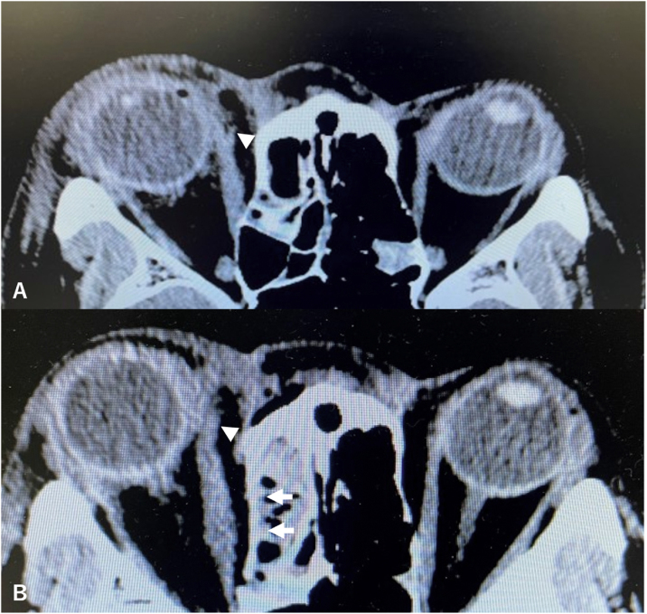
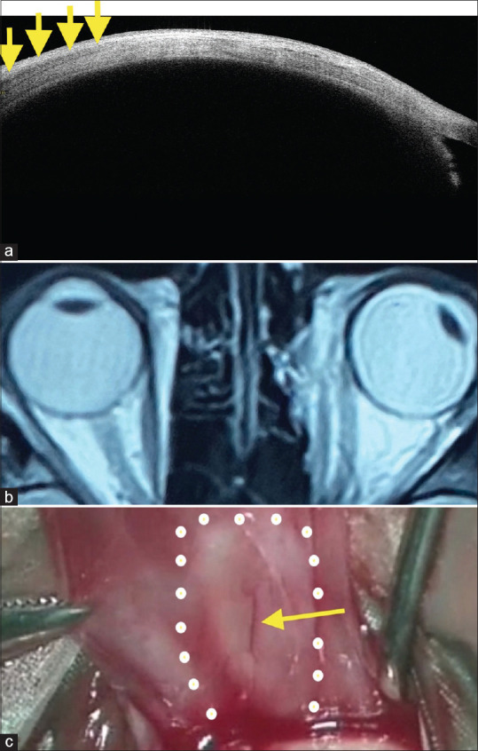
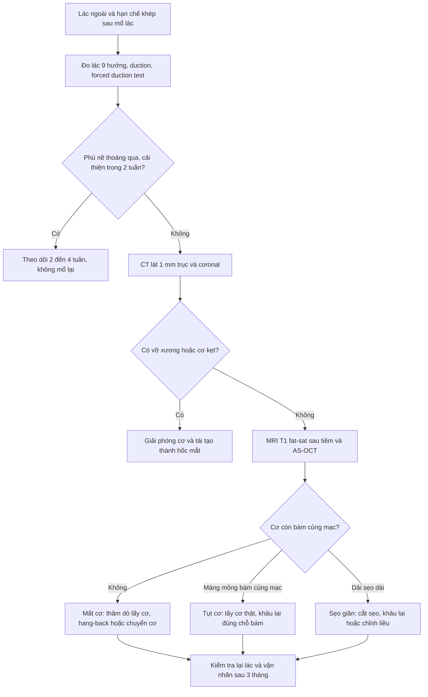
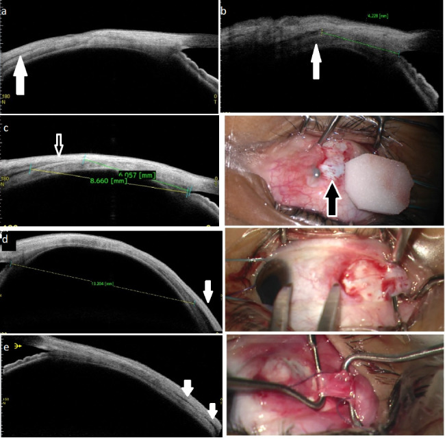

# 1413 — Tụt và mất cơ trực trong sau mổ lác: nhận diện, MRI/AS-OCT định vị, khi nào mổ lại / Slipped and lost medial rectus after strabismus surgery: recognition, imaging localization and reoperation timing

**Tags:** `pattern:lac` `pattern:lac-ngoai` `pattern:han-che-khep` `pattern:mat-co-truc-trong` `pattern:tut-co` `vung:mat` `vung:hoc-mat` `anatomy:co-van-nhan` `protocol:MRI-hoc-mat` `protocol:CT-hoc-mat` `protocol:AS-OCT`
**Mức chắc chắn (certainty):** tổng hợp y văn (literature synthesis) — số liệu từ một loạt tiến cứu 6 mắt tụt cơ trực trong được hướng dẫn bằng AS-OCT, một loạt 47 cơ tái mổ, một loạt 7 ca tổn thương cơ sau phẫu thuật xoang, và các ca lấy lại cơ đã đứt. **Không có RCT** so sánh “mổ lại sớm” với “chờ”; phần chọn thời điểm là tổng hợp có suy luận, đã ghi rõ.

> **Vì sao bài này quan trọng:** bài **1405** đã chốt **lác ngoài thứ phát sau mổ lác trong** do **sẹo giãn (stretched scar)** xuất hiện muộn, và chỉ nêu **tụt/mất cơ** như một hàng của gamut. Nhưng đó là **biến cố cấp tính trong 2 tuần đầu**, có **quy trình hình ảnh riêng** (cơ còn bám nhãn cầu hay đã co vào hốc mắt?) và **quyết định mổ lại trong ngày–tuần**. Bỏ sót hoặc mổ lại mù sẽ làm cơ co sâu thêm, xơ hóa và **mất cơ vĩnh viễn** — trong khi phân biệt đúng **tụt (slipped)** với **mất (lost)** và **sẹo giãn** lại quyết định có mổ ngay hay theo dõi.

## 1. Tổng quan bệnh học – cơ chế hình ảnh – vì sao cơ trực trong dễ “mất” nhất

- **Giải phẫu quyết định rủi ro:** cơ trực trong bám vào nhãn cầu **gần rìa giác mạc nhất** trong bốn cơ thẳng (khoảng **5,5 mm** so với **6,9 mm** của cơ trực ngoài, **6,5 mm** cơ trực dưới, **7,7 mm** cơ trực trên). Vì vậy trong chấn thương mi/hốc mắt, **phản xạ Bell** đưa nhãn cầu lên trên ra ngoài, để lộ **cơ trực trong** — đây là cơ bị đứt nhiều nhất. Nó cũng là **cơ thẳng duy nhất không có cơ chéo kề bên**, nên khi đứt không có “dây neo” giải phẫu; đầu cơ co ngay vào **khoang dưới bao Tenon** ra sau hốc mắt.
- **Ba hình thái giải phẫu — ba tiên lượng khác nhau:**
  - **Mất cơ (lost muscle):** **không còn bất kỳ phần nào của cơ hoặc bao cơ bám vào củng mạc**; cơ và bao cùng co vào sau hốc mắt.
  - **Tụt cơ (slipped muscle):** cơ đứt khỏi chỗ khâu nhưng **một màng mỏng trong suốt (bao cơ) còn dính củng mạc** ở vị trí đã đặt; cơ thật nằm sau, **lực co không truyền được** vào nhãn cầu.
  - **Sẹo giãn (stretched scar):** cơ dính củng mạc qua một **dải sẹo vô định hình (pseudo-tendon)**; vẫn “dính” nhưng truyền lực kém.
- **Vì sao hình ảnh khó:** ba hình thái trên **cùng biểu hiện lác và hạn chế vận nhãn**, khác nhau ở **vị trí đầu cơ so với củng mạc**. CT chỉ thấy **mô mềm đậm độ đồng nhất**, không phân biệt được bao cơ với cơ; MRI **T1 fat-sat** tách cơ (đậm độ trung gian) khỏi mỡ hốc mắt (tín hiệu cao) và **choroid/củng mạc**; AS-OCT độ phân giải **~10 µm** thấy **lớp giảm hồi âm đặc hiệu cơ** ở độ sâu **vài mm** tính từ rìa, nhưng **xuyên nông** nên không thấy phần sau hốc mắt.
- **Vì sao mất cơ gây lác lớn tức thì:** cơ đối vận (trực ngoài) không còn lực cân bằng → nhãn cầu lệch **theo hướng cơ đối vận**; mô xơ co theo thời gian làm **lác tăng dần** và **hạn chế vận nhãn ngược hướng** trở thành **hạn chế cơ học cố định**.
- **Ngưỡng định lượng cần nhớ:**
  - **Mất cơ:** lác lớn **ngay trong giờ–ngày đầu**, hạn chế vận nhãn **lớn** theo hướng cơ mất; thường **> 30–45 PD**.
  - **Tụt cơ:** lác **trung bình–lớn** nhưng hạn chế vận nhãn **nhỏ–trung bình** (vì bao cơ còn giữ một phần).
  - **AS-OCT:** phát hiện cơ trực trong ở **5/6 mắt (83,33%)**, sai lệch so với mổ **1–2 mm**; chiều dài cơ trực trong thấy được tới **9 mm** trước, trực ngoài **14 mm**, trực dưới **6 mm**, trực trên **5 mm**.
  - **Loạt tái mổ 47 cơ/28 bệnh nhân:** AS-OCT đo chỗ bám **sai lệch ± 1 mm ở 78,7%**; **thay đổi quyết định mổ ở 39,2%**; xác định **mắt đã mổ 100%** so với **60,8%** khám lâm sàng; xác định **cơ nào đã mổ 97,8%** so với **57,5%**.
  - **PITS (pulled-in-two syndrome — cơ đứt khi đang kéo chỉ):** **cực hiếm**, y văn mô tả như biến cố **1 lần trong 10–30 năm thực hành** của phẫu thuật viên; không có tỷ lệ quần thể đáng tin.
  - **Biến chứng hốc mắt của phẫu thuật xoang (FESS):** toàn bộ **0,031–3,1%**; biến chứng **nặng 0,36%** ở mổ lần đầu và **0,46%** ở mổ lại.

*CT trục hốc mắt. (A) Trước mổ: **đầu cơ trực trong bị đứt** (đầu mũi tên trắng) — không thấy dải cơ liên tục bám vào củng mạc mặt trong. (B) Sau mổ: cơ đã được lấy lại và tái tạo (đầu mũi tên trắng), thành trong hốc mắt được tái tạo (mũi tên). Đây là dạng **mất cơ thật** — cần can thiệp, không tự hồi phục. Nguồn: Takabayashi K et al., *Braz J Otorhinolaryngol* 2022 (PMC9800948) Fig. 1, **CC BY 4.0**.*

## 2. Mẫu hình + chẩn đoán phân biệt theo cơ chế và vị trí (Gamut)

Bốn câu hỏi trước khi mổ: **(1) lác xuất hiện ngay sau mổ hay muộn? (2) hạn chế vận nhãn lớn hay nhỏ so với độ lác? (3) CT/MRI thấy cơ còn bám củng mạc không? (4) có chấn thương/xoang/Entrapment kèm theo không?**

- **Nhóm A — mất cơ sau mổ lác (lost muscle):** lác lớn **ngay**, hạn chế khép **lớn**; CT/MRI **không thấy cơ** ở vị trí giải phẫu; đầu cơ co sâu trong hốc mắt.
- **Nhóm B — tụt cơ sau mổ lác (slipped muscle):** lác **trung bình–lớn**, hạn chế khép **nhỏ hơn kỳ vọng**; AS-OCT/MRI thấy **màng mỏng** bám củng mạc, cơ thật ở sau.
- **Nhóm C — sẹo giãn (stretched scar):** lác tăng **từ từ trong nhiều tháng–năm**; cơ vẫn “bám” nhưng qua **pseudo-tendon**; AS-OCT thấy **dải sẹo** dài bất thường.
- **Nhóm D — đứt cơ do chấn thương xuyên mi/hốc mắt hoặc FESS:** có **vết thương mi trong**, **dập góc mắt**, **chảy máu hốc mắt**; CT thấy **vỡ thành trong** hoặc cơ **kẹt vào ổ gãy** (entrapment) — cần **giải phóng** trước khi nghĩ tới chuyển cơ.
- **Nhóm E — PITS (đứt cơ trong lúc mổ):** xảy ra **ngay trên bàn mổ** khi kéo chỉ hoặc cơ thoái hóa (cận thị nặng, myopic strabismus fixus, xơ hóa bẩm sinh); nhận ra khi **đầu cơ tuột vào hốc mắt**.
- **Nhóm F — liệt cơ do thần kinh/tổn thương cơ:** lác nhưng **không có bằng chứng đứt cơ**; có thể do **hematoma trong cơ**, **myositis**, **liệt dây III**, **bệnh cơ tuyến giáp**; vận nhãn hạn chế nhưng **cơ còn nguyên trên hình ảnh** — điều trị khác hoàn toàn.
- **Nhóm G — phù nề/viêm sau mổ thoáng qua:** hạn chế vận nhãn nhẹ, **cải thiện dần trong 2–4 tuần**; không có lác lớn cố định; đây là lý do **không mổ lại ngay** nếu chưa có bằng chứng đứt cơ.

## 3. Bảng so sánh phân biệt (ma trận đối chiếu)

| Thực thể (entity) | Hình ảnh/lâm sàng điển hình | Chốt vào (rule-in) | Chốt loại (rule-out) | Gợi ý xác nhận |
|---|---|---|---|---|
| **Mất cơ trực trong (lost)** | Lác ngoài **> 30–45 PD ngay sau mổ**; hạn chế khép **lớn**; CT/MRI **không thấy dải cơ** bám củng mạc mặt trong | **Không có mô cơ bám củng mạc + lác lớn tức thì + hạn chế khép lớn** | Còn dải cơ/màng mỏng bám củng mạc → tụt cơ, không phải mất hoàn toàn | CT/MRI trục + coronal; thăm dò thì đầu |
| **Tụt cơ (slipped)** | Lác **trung bình–lớn**, hạn chế khép **nhỏ hơn kỳ vọng**; AS-OCT thấy **màng mỏng giảm hồi âm** bám củng mạc, cơ thật ở sau | **Màng/bao cơ còn bám củng mạc + cơ co ra sau** | Không còn màng nào → mất cơ | AS-OCT + MRI T1 fat-sat; đo khoảng cách từ rìa |
| **Sẹo giãn (stretched scar)** | Lác tăng **nhiều tháng–năm**; cơ vẫn bám qua **dải sẹo dài**; AS-OCT thấy pseudo-tendon | **Dải sẹo dài bất thường, không có cơ co sau** | Cơ co sau + màng mỏng → tụt cơ | AS-OCT; so phim cũ; đo chỗ bám |
| **Entrapment sau vỡ thành trong** | Sau chấn thương/FESS; hạn chế vận nhãn **cơ học**, đau khi liếc; CT **vỡ xương + cơ kẹt** | **CT thấy cơ trong ổ gãy hoặc thành xương lệch** | Không có tổn thương xương → không phải entrapment | CT lát **≤ 1 mm** trục + coronal |
| **Hematoma cơ/hốc mắt** | Lồi mắt, đau, hạn chế vận nhãn; MRI **T1/T2 tăng trong cơ** ở giai đoạn bán cấp | **Khối trong cơ/tổ chức hốc mắt + lồi mắt** | Cơ teo/đứt, không khối → loại trừ | MRI T1/T2 fat-sat; theo dõi |
| **Myositis/viêm cơ** | Đau khi vận nhãn, đỏ mi, hạn chế nhiều hướng; MRI **cơ to, ngấm thuốc, cả gân** | **Cơ to + ngấm thuốc + đau** | Cơ bình thường/teo → loại trừ | MRI; đáp ứng corticoid |
| **Liệt dây III** | Lác ngoài + **sụp mi + giãn đồng tử** (nếu hoàn toàn); hạn chế khép **và** các hướng khác | **Sụp mi + đồng tử giãn + hạn chế nhiều cơ** | Đồng tử bình thường, chỉ khép → nghĩ cơ học | Khám thần kinh; MRI sọ |
| **Phù nề sau mổ thoáng qua** | Hạn chế nhẹ, **cải thiện trong 2–4 tuần**, không lác lớn cố định | **Cải thiện theo thời gian + không bằng chứng đứt cơ** | Lác lớn cố định + hạn chế nặng → không phải phù nề | Theo dõi 2–4 tuần; chụp nếu không cải thiện |

*Ca thứ ba: (a) AS-OCT thấy **lớp giảm hồi âm đặc hiệu cơ rất mờ ở 11,4 mm từ góc mắt** (vẫn là cơ ở đúng độ sâu); (b) **MRI hốc mắt** thấy **vỡ thành trong** và một phần mô kẹt, cơ có vẻ liên tục nhưng **không thấy được chỗ bám trên củng mạc trước**; (c) hình trong mổ xác nhận vị trí cơ. Bài học: **MRI giỏi phần sau, AS-OCT giỏi phần trước** — thiếu một trong hai dễ bỏ sót. Nguồn: Pujari A et al., *Indian J Ophthalmol* 2023 (PMC10538837) Fig. 2, **CC BY-NC-SA 4.0**, nguyên bản.*

## 4. Protocol: khám, chụp, thời điểm mổ và kỹ thuật lấy cơ

**Khám (làm đủ trước khi chụp):**
- **Đo lác** bằng Hirschberg và prism alternate cover, **cả 9 hướng nhìn**, ghi **PD**.
- **Duction/version** và **forced duction test (FDT)** ngay lần khám đầu: FDT **dương** = hạn chế cơ học (kẹt/xơ); FDT **âm** + hạn chế vận nhãn = **yếu cơ** (đứt/tụt).
- **Active force generation test** khi hợp tác được: cảm nhận lực cơ khi bệnh nhân nhìn về hướng cơ — lực yếu gợi ý đứt/tụt.
- Tìm **sẹo kết mạc, vết thương mi, dấu Bell**, và **so sánh ảnh trước mổ**.

**Chụp:**
- **CT hốc mắt lát ≤ 1 mm, trục + coronal, không cản quang** khi nghi **vỡ xương/kẹt cơ** — CT là chuẩn cho **xương**.
- **MRI hốc mắt:** **T1 fat-sat sau tiêm + T2 fat-sat, coronal và axial**, lớp **≤ 2–3 mm**, mắt ở **tư thế nhìn thẳng**; đánh giá **bụng cơ, chỗ bám, mô xơ, máu tụ bán cấp**. MRI là chuẩn cho **mất mô và sẹo**, nhưng **không thay** AS-OCT ở phần bám sát củng mạc.
- **AS-OCT (SS-ASOCT, CASIA-2):** quét **dọc** và **ngang** qua cơ, cho bệnh nhân **nhìn sang bên đối diện** để đưa cơ trực trong ra trước; đo **khoảng cách từ rìa đến lớp giảm hồi âm đặc hiệu cơ**; so với mắt lành. Đây là công cụ **bổ sung**, không thay thăm dò thì đầu.

**Thời điểm và kỹ thuật:**
1. **Nhận ra ngay trên bàn mổ (PITS):** lấy lại **ngay** — mô còn mới, mặt phẳng giải phẫu rõ nhất. Nếu **không tìm được**, **đừng thăm dò mù** (gây chảy máu, mỡ tràn vào, xơ thêm): đóng lại, hẹn mổ lại, và **ghi rõ vào hồ sơ**.
2. **Mổ lại sớm (< 2 tuần):** nếu **không cải thiện** vận nhãn trong **2 tuần** sau chấn thương/tổn thương, thăm dò và giải phóng/khâu lại cơ có lợi.
3. **Mổ lại muộn (2–3 tháng):** chấp nhận được khi **đã có sẹo ổn định**; ca PITS cận thị nặng được mổ lại **3 tháng** sau, kết cục **lác ngoài 14 PD, không song thị** ở 1,5 năm.
4. **Đường vào:** **sub-Tenon** cho đầu ngoại vi; **rạch kết mạc rộng** hoặc **orbitotomy thành trong qua da** cho đầu cơ co sâu; **nội soi xoang** khi cơ lạc vào **xoang sàng/hốc mũi** — ca báo cáo dùng **phối hợp 3 đường** (nội soi mũi, orbitotomy thành trong, sub-Tenon) và lấy lại được cơ.
5. **Khâu:** **hang-back** để bắc cầu khuyết cơ, hoặc **khâu trực tiếp** đầu cơ vào củng mạc; với sẹo giãn, **cắt sẹo + khâu lại** đúng chỗ bám.

## 5. Biến thể bình thường và cạm bẫy

- **“MRI bình thường là cơ còn nguyên”:** sai. Trong loạt 6 mắt, **4 ca** MRI thấy được đường đi cơ trong hốc mắt nhưng **không thấy chi tiết chỗ bám trên củng mạc**; chi tiết đó phải do **AS-OCT** hoặc thăm dò thì đầu cung cấp. **MRI âm không loại trừ tụt cơ**.
- **“Lác càng lớn thì càng chắc mất cơ”:** không tuyệt đối. **Tụt cơ** có thể gây lác lớn nhưng hạn chế vận nhãn **nhỏ hơn kỳ vọng**; ngược lại **sẹo giãn** gây lác tăng từ từ. Độ lác **không** thay thế được hình ảnh.
- **“Thăm dò mù để tìm cơ”:** sai và nguy hiểm — gây **chảy máu, mỡ tràn vào**, làm mất mặt phẳng giải phẫu và khiến lần mổ sau khó hơn. Nếu không thấy cơ trong 10–15 phút, **dừng**, đóng lại và chuyển tuyến có kinh nghiệm.
- **“Chờ vài tháng mọi ca”:** với **mất cơ thật**, chờ làm cơ co sâu và xơ hóa → khó lấy hơn; ưu tiên **mổ lại sớm** khi đã xác định. Ngược lại, **phù nề/viêm** sau mổ nên **chờ 2–4 tuần**.
- **“Mắt nhìn thẳng là hết bệnh”:** có thể còn **song thị ở hướng nhìn bên** và **hạn chế khép**; đánh giá bằng **9 hướng nhìn** và **ductions**, không chỉ góc lác nguyên phát.
- **Cạm bẫy giả ảnh:** CT/MRI chụp khi mắt **lệch hướng** làm cơ trông “mất” hoặc “dày” giả; luôn chụp **nhìn thẳng**, lát mỏng, và so **hai mắt**.
- **Cạm bẫy thỏa mãn tìm kiếm (satisfaction of search):** thấy vỡ thành trong trên CT rồi dừng lại, bỏ qua **đứt cơ** hoặc **máu tụ** đi kèm — đọc lại toàn bộ chuỗi cơ, không chỉ chỗ xương gãy.
- **“Diplopia sau mổ là do đứt cơ”:** không phải mọi song thị đều do đứt cơ. Một nghiên cứu sau mí mắt cho thấy song thị do tổn thương cơ thoáng qua **hết trong 1 tháng ở 24%**, **1–3 tháng ở 33%**, **sau 3 tháng ở 37%** — nên theo dõi trước khi kết luận, trừ khi có bằng chứng đứt cơ.

## 6. Tự lượng giá — Blind Quiz

**Ca 1 — Nam 45 tuổi, mổ lác trong 4 ngày trước; nay lác ngoài 45 PD ngay sau mổ, không khép được mắt phải quá đường giữa. Không có vết thương mi, không đau, CT trục thấy đầu cơ trực trong co vào sau hốc mắt, không thấy dải cơ bám củng mạc.**

- Câu hỏi: (1) Chẩn đoán? (2) Có nên chờ 3 tháng không? (3) Kỹ thuật và đường vào?

<b>Bấm để hiện đáp án (findings + chẩn đoán)</b>

- Dấu hiệu: **lác ngoài 45 PD ngay sau mổ**, **hạn chế khép lớn**, CT **không thấy cơ bám củng mạc** — phù hợp **mất cơ trực trong (lost muscle)**, khác **tụt cơ** (còn màng mỏng bám) và **sẹo giãn** (lác tăng từ từ).
- **Không nên chờ 3 tháng**: mất cơ thật cần **lấy lại sớm** trước khi cơ co sâu/xơ hóa; ca báo cáo được mổ **ngay ngày hôm sau** và lấy lại được cơ.
- Kỹ thuật: **sub-Tenon** tìm đầu ngoại vi; nếu đầu cơ co sâu → **orbitotomy thành trong** hoặc **nội soi mũi** khi cơ lạc vào xoang; khâu **hang-back** bắc cầu khuyết; kiểm tra **FDT** sau khâu.
- Nguồn ảnh: Takabayashi K et al., *Braz J Otorhinolaryngol* 2022 (PMC9800948) Fig. 1, CC BY 4.0.

**Ca 2 — Nữ 22 tuổi, 4 năm sau mổ lác trong; lác ngoài 90 PD, hạn chế khép nhẹ; AS-OCT thấy nửa trên cơ bám ở 10,5 mm, nửa dưới mất lớp cơ; MRI không thấy rõ chỗ bám.**

- Câu hỏi: (1) Vì sao lác lớn mà hạn chế khép chỉ nhẹ? (2) AS-OCT bổ sung gì cho MRI? (3) Hướng mổ?

<b>Bấm để hiện đáp án</b>

- Hình thái **tụt cơ bán phần**: nửa trên cơ còn bám **10,5 mm**, nửa dưới mất lớp cơ → lực truyền **không đối xứng**, lác lớn nhưng hạn chế khép **nhẹ hơn kỳ vọng** so với mất cơ hoàn toàn.
- AS-OCT cho **vị trí và độ sâu lớp cơ tính bằng mm từ rìa** — thứ MRI **không thấy** vì MRI chỉ thấy đường đi trong hốc mắt, không thấy chi tiết bám sát củng mạc; trong loạt này MRI thiếu chi tiết chỗ bám ở **4/6 ca**.
- Hướng mổ: **lấy phần cơ còn lại, khâu lại/advance**, cân bằng hai nửa; nếu thiếu mô nhiều → **hang-back** hoặc **chuyển cơ chéo**; theo dõi lác 3–6 tháng.
- Nguồn ảnh: Pujari A et al., *Indian J Ophthalmol* 2023 (PMC10538837) Fig. 2, CC BY-NC-SA 4.0.

**Ca 3 — Nam 60 tuổi, mổ lác cận thị nặng; trong mổ, khi kéo chỉ cơ trực trong thì đầu cơ tuột vào hốc mắt, không tìm thấy sau 15 phút. Sau mổ lác ngoài 45 PD, hạn chế khép nặng.**

- Câu hỏi: (1) Biến cố này tên gì? (2) Nên làm gì ngay lúc đó? (3) Kế hoạch tiếp theo?

<b>Bấm để hiện đáp án</b>

- **PITS (pulled-in-two syndrome)** — cơ đứt trong lúc kéo chỉ, cực hiếm; y văn mô tả như biến cố **1 lần trong 10–30 năm thực hành**. Cận thị nặng/myopic strabismus fixus là bối cảnh thuận lợi vì cơ đã thoái hóa, căng.
- Ngay lúc đó: **ngừng thăm dò mù** (tránh chảy máu, mỡ tràn vào); nếu không lấy được trong thời gian hợp lý → **đóng lại**, ghi hồ sơ, hẹn mổ lại. Không cố kéo thêm làm tổn thương nặng hơn.
- Kế hoạch: **mổ lại sau 2–3 tháng** khi sẹo ổn định, dùng **AS-OCT/MRI để định vị đầu cơ**, đường vào **sub-Tenon ± orbitotomy thành trong**; ca tương tự mổ lại **3 tháng** đạt **lác ngoài 14 PD, không song thị** ở 1,5 năm.
- Nguồn ảnh: Kaur S et al., *BMC Ophthalmol* 2025 (PMC11748875) Fig. 2, CC BY-NC-ND 4.0, nguyên bản.

## Bài liên quan chéo
- [1405 – Lác ngoài thứ phát sau mổ lác trong: over-minus, sẹo giãn, khi nào mổ lại](../1405-lac-ngoai-thu-phat-sau-mo-lac-trong/lesson.md)
- [420 – Võ sản học mắt: đo lác, duction và các nghiệm pháp](../420-vo-san-hoc-mat/lesson.md)
- [472 – Phẫu thuật lác ở trẻ sinh non/ROP](../472-phau-thuat-lac-tre-sinh-non-rop/lesson.md)
- [486 – Lác trong điều tiết: theo dõi sau kính](../486-lac-trong-dieu-tiet-theo-doi-sau-kinh/lesson.md)
- [421 – Lồi mắt Graves: chừa gân, định vị trong/ngoài nón](../421-loi-mat-Graves/lesson.md)
- [422 – Viêm giả u hốc mắt: cơ và gân cùng bị](../422-viem-gia-u/lesson.md)

## Ảnh
- `1413_mat-co-truc-trong_CT_PMC9800948-Fig1-CCBY.jpg` — Takabayashi K et al., *Braz J Otorhinolaryngol* 2022 (PMC9800948) Fig. 1, **CC BY 4.0**, nguyên bản.
- `1413_mat-co-truc-trong_AS-OCT-MRI_PMC10538837-Fig2-CCBYNCSA.jpg` — Pujari A et al., *Indian J Ophthalmol* 2023 (PMC10538837) Fig. 2, **CC BY-NC-SA 4.0**, nguyên bản (không crop/ghép).
- `1413_mat-co-truc-trong_AS-OCT_PMC11748875-Fig2-CCBYNCND.jpg` — Kaur S et al., *BMC Ophthalmol* 2025 (PMC11748875) Fig. 2, **CC BY-NC-ND 4.0**, nguyên bản (không crop/ghép).
- Không tải ảnh từ Radiopaedia/AuntMinnie/Retina Image Bank; chỉ dẫn link ở `sources.md`.

> Không dùng để chẩn đoán độc lập khi chưa có người hướng dẫn.
