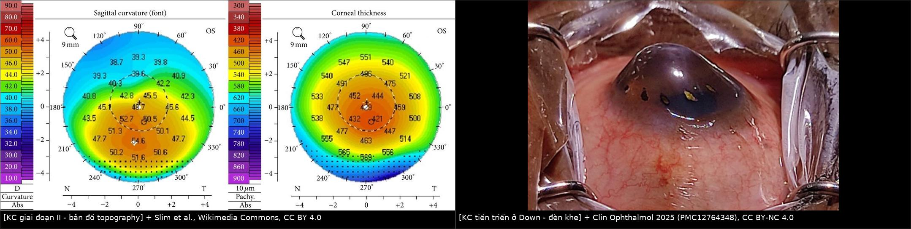
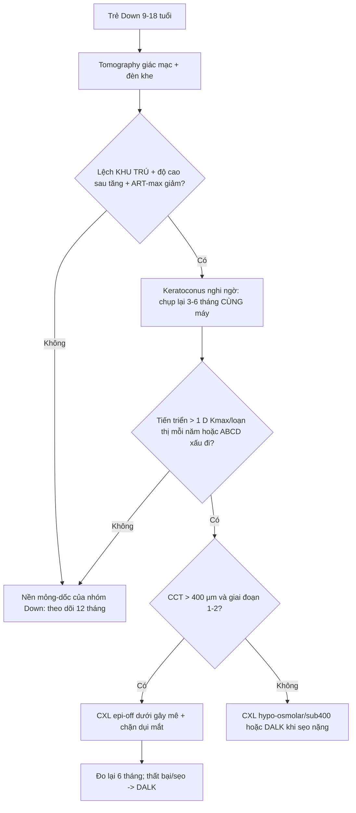
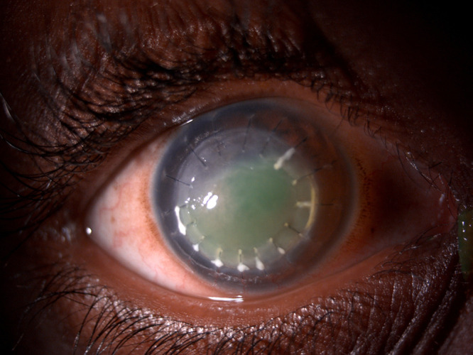
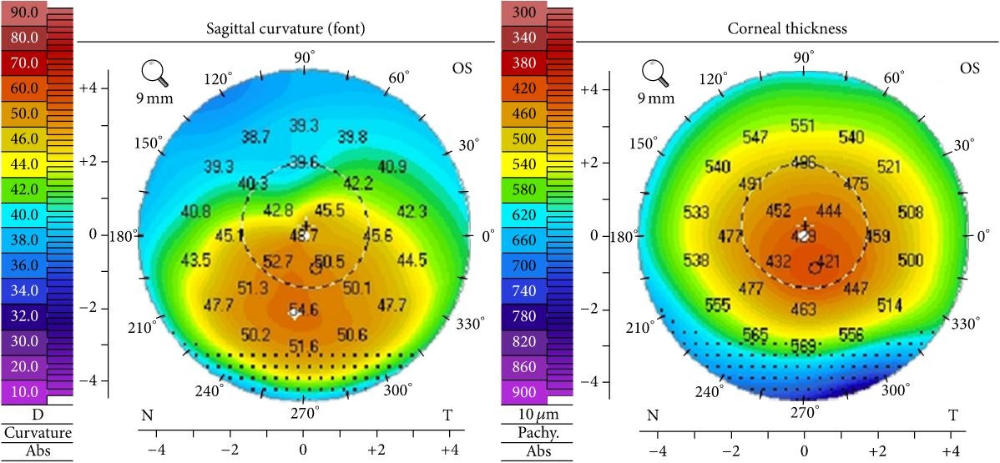
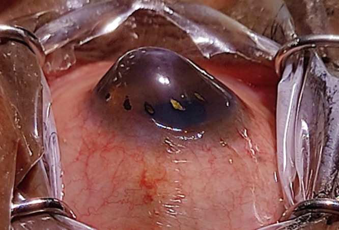
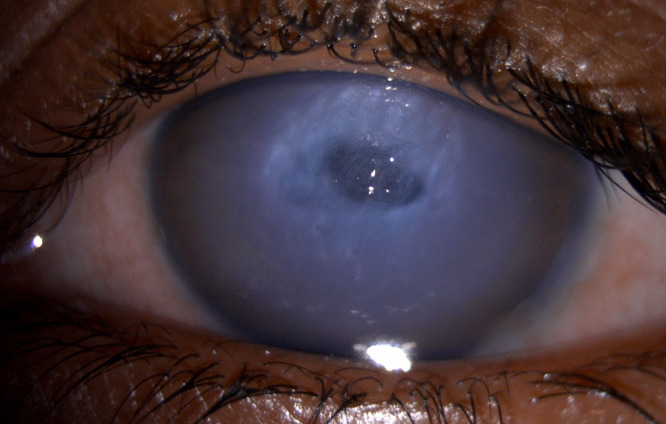

# 1414 — Keratoconus ở trẻ Down syndrome: sàng lọc bằng tomography, ngưỡng "bình thường" riêng của nhóm, chỉ định CXL và giới hạn của ghép giác mạc / Keratoconus in Down syndrome: tomography screening, population-specific thresholds, CXL and the limits of keratoplasty

**Tags:** `pattern:ectasia-giac-mac` `pattern:loi-khuc-xa-khong-deu` `vung:mat` `vung:giac-mac` `score:BAD-D` `score:Belin-ABCD` `protocol:tomography-giac-mac` `protocol:CXL` `incidentaloma:keratoconus-tre`

**Mức chắc chắn (certainty):** tổng hợp y văn (literature synthesis) — tự biên từ **chương trình sàng lọc 27 trẻ Down 9–18 tuổi (54 mắt)** (PMC11941047, CC BY 4.0), **tổng quan tự sự keratoconus ở Down** (PMC12764348, CC BY-NC 4.0), **đồng thuận ERN-EYE 2026 về keratoconus trẻ em** (PMC13518778, CC BY-NC 4.0) và **nghiên cứu độ lặp lại của Pentacam ở nhóm Down** (PMC12612933). Chưa gắn một ca nguyên văn đơn lẻ.

> **Bài này là phần "đo và quyết định" của [1412 – Đo khúc xạ lý liệt ở trẻ Down/bại não/tự kỷ](../1412-do-khuc-xa-ly-liet-tre-dac-biet/lesson.md).** 1412 đã chốt **khúc xạ lý liệt** (thuốc nào, kỹ thuật nào) và chỉ ra **15% mắt trẻ Down 9–18 tuổi đã có keratoconus sớm**; bài này trả lời phần còn trống: **đo bằng thông số nào, ngưỡng nào là "bất thường" ở một giác mạc vốn đã mỏng–dốc, khi nào đủ chắc để CXL, và vì sao ghép giác mạc ở nhóm này là phương án cuối**.

> **Câu chốt:** Ở trẻ Down syndrome, **giác mạc "bình thường" của nhóm đã giống keratoconus của người khác**: **CCT 479 µm vs 536 µm** và **Kmax 49,2 D vs 45,8 D** so với chứng cùng tuổi (p < 0,01), **BAD-D trung bình của cả nhóm sàng lọc là 2,5** — vượt ngưỡng **BAD-D > 1,6** mà chính chương trình dùng để sàng lọc (PMC11941047). Vì vậy **không được chẩn đoán keratoconus vì một tham số bất thường**: chương trình này chỉ gọi **keratoconus sớm khi ≥ 3 tham số bất thường** trong bộ **zonal Kmax > 48 D · IS > 1,4 · BAD-D > 1,6 · độ cao bề mặt sau > 10 µm tại điểm mỏng nhất**, rồi **hội chẩn với bác sĩ giác mạc**. Chốt cuối cùng vẫn là **thay đổi THEO THỜI GIAN trên cùng một máy** cộng với **dấu hiệu lâm sàng**.

## 1. Tổng quan bệnh học – cơ chế hình ảnh

- **Vì sao giác mạc Down khác về bản chất, không chỉ "khó đo":** trisomy 21 kèm bất thường **collagen và chất nền ngoại bào** (giảm tổng collagen, giảm độ cứng, tăng mật độ mô) → giác mạc **mỏng hơn, dốc hơn, loạn thị không đều hơn** ngay từ đầu. Số liệu đối chứng cùng tuổi: **CCT 479 µm (95% CI 455–502) vs 536 µm (532–542)**, **Kmax 49,2 D (47,7–50,6) vs 45,8 D (45,6–46)**, K1 **45,2 vs 42,3 D**, K2 **47,3 vs 45,1 D**; loạn thị trung bình lại **thấp hơn** (2,1 vs 2,8 D, p = 0,3) — nghĩa là **dốc không đồng nghĩa loạn thị đều** (PMC11941047).
- **Vì sao BAD-D của nhóm này bị "thổi" — vật lý của phép đo:** tomography Scheimpflug dựng **bề mặt trước và sau** rồi so với **mặt cầu/quy chiếu tốt nhất (best-fit sphere)**; **BAD-D (Belin–Ambrósio Display total deviation)** là **độ lệch chuẩn hóa so với cơ sở dữ liệu người bình thường** — mà cơ sở dữ liệu đó **không phải người Down**. Một giác mạc mỏng–dốc bẩm sinh sẽ có **độ lệch cao dù không ectasia**. Hệ quả thực hành: **BAD-D trung bình 2,5 ở cả 54 mắt sàng lọc**, tức **vượt ngưỡng 1,6 ở phần lớn mắt "không keratoconus"** → **dương tính giả hàng loạt** nếu dùng ngưỡng người lớn (PMC11941047).
- **Vì sao bề mặt SAU là chốt sớm:** lớp nhu mô sau mỏng hơn và chịu ít lực hơn lớp trước; trong ectasia, **độ cao bề mặt sau (posterior elevation)** và **ART-max (Ambrosio relational thickness)** lệch **trước khi** Kmax thay đổi rõ. Đây là lý do một bài toán chỉ nhìn **Kmax** sẽ bỏ sót giai đoạn sớm — đúng cảnh báo của đồng thuận trẻ em: **thay đổi 1 D Kmax là tiêu chuẩn kém** (PMC13518778).
- **Cơ chế tiến triển — hai lực đẩy cùng lúc:** (1) **yếu cấu trúc** (collagen/độ cứng); (2) **tải cơ học lặp lại** do **dụi mắt**. Trong đoàn hệ sàng lọc, **30% trẻ dụi mắt**, **26% có viêm mũi dị ứng/atopy**, **11% hen**, **11% eczema** (PMC11941047). **Dụi mắt là yếu tố duy nhất can thiệp được bằng hành vi** — và ở trẻ Down, dụi mắt thường **không được báo** vì trẻ không nói được.
- **Vì sao chẩn đoán muộn là quy luật:** trẻ Down **không mô tả được "nhìn mờ tiến triển"**, lại có **tật khúc xạ nền rất cao** (loạn thị 70,3% trong 148 trẻ — PMC12094766) nên **giảm thị lực bị quy cho "độ kính"**. Kết quả là keratoconus ở Down thường **đến ở giai đoạn trung bình–nặng**, khi **CXL đã quá muộn**.
- **Tần suất — dải số phải nhớ:** tổng quan ghi **0–71%**, trong đó **nghiên cứu topography 10–30%**; **sổ bộ Norway 5,5%** (≈ **30 lần** dân số chung), **Brazil 27,2% trong 1.207 người Down**, trong khi **một nghiên cứu 123 trẻ Down châu Á không tìm thấy ca nào** (PMC12764348). Sự phân tán này **không phải mâu thuẫn — nó phản ánh tiêu chuẩn chẩn đoán và tuổi**: sàng lọc chủ động ở tuổi thiếu niên tìm được **15% mắt (8/54) và 19% trẻ (5/27)**, tuổi trung bình **13,8 (9–18)**, và **8 mắt được chỉ định CXL, 0 ca phải ghép** (PMC11941047).
- **Vì sao phải chặn tiến triển chứ không "đợi ghép":** ghép giác mạc ở Down có **sống ghép 67–85% so với 90–95%** ở người không Down; các loạt nhỏ ghi **3/18 mắt phải ghép lại**, **4/5 bệnh nhân bị thải ghép lặp**, và **chỉ 2 mắt còn trong > 2 năm** trong một loạt 1997 (PMC12764348). Nguyên nhân: **dụi mắt làm bung chỉ**, **viêm bờ mi → nhiễm mảnh ghép**, **khó theo dõi nhãn áp/đáy mắt nếu không gây mê**. Vì vậy **CXL sớm là chiến lược rẻ và an toàn hơn ghép**, không phải "phương án nhẹ".

## 2. Mẫu hình + chẩn đoán phân biệt theo hình thái (gamut)

- **Hình thái 1 — "dốc–mỏng ĐỐI XỨNG, không tiến triển" = nền của nhóm Down:** Kmax ~49 D, CCT ~479 µm, **không lệch khu trú**, **không thay đổi khi chụp lại 6–12 tháng**. Đây là **biến thể của nhóm**, không phải bệnh.
- **Hình thái 2 — keratoconus sớm:** **dốc/lồi KHU TRÚ dưới–mũi (inferior–nasal)**, **độ cao bề mặt sau tăng**, **ART-max giảm**, **BAD-D tăng so với chính nó ở lần trước**; đèn khe có thể **chưa có vòng Fleischer**.
- **Hình thái 3 — keratoconus tiến triển:** **hình nón lồi rõ**, **vòng Fleischer**, **đường Vogt**, **dấu Munson**, **loạn thị không đều không chỉnh được bằng kính**; Kmax tăng **> 1 D/năm** hoặc loạn thị tăng **> 1 D/năm** (định nghĩa dùng trong đoàn hệ sàng lọc — PMC11941047).
- **Hình thái 4 — tràn dịch giác mạc cấp (acute corneal hydrops):** **phù nhu mô trung tâm, mờ đục, rách màng Descemet**, khởi phát **đau–chảy nước mắt–giảm thị lực đột ngột**; ở trẻ Down dễ bị chẩn đoán nhầm **viêm kết mạc/viêm giác mạc**.
- **Hình thái 5 — sẹo sau tràn dịch:** **sẹo nhu mô trung tâm** sau khi hydrops lành; đây là lý do **phải theo dõi lâu** chứ không chỉ "hết đau là xong".
- **Hình thái 6 — keratoglobus:** **mỏng toàn bộ giác mạc** (không khu trú), thường bẩm sinh, kèm **củng mạc xanh/Ehlers–Danlos**; **khác keratoconus ở chỗ không có "chóp"** và **nguy cơ vỡ giác mạc khi chấn thương**.
- **Hình thái 7 — thoái hóa dạng dải (pellucid marginal degeneration):** **dải mỏng ở 4–5 mm phía trên rìa**, **dốc ngay trên dải**, hình **"càng cua"**; thường **dưới** chóp.
- **Hình thái 8 — biến dạng do kính tiếp xúc/dụi mắt (warpage):** **loạn thị không đều nhưng hồi phục** sau khi ngừng kính; **không có mỏng khu trú thật** — phải **ngừng kính ≥ 2 tuần** rồi chụp lại.
- **Gợi nhớ 4 câu hỏi — "KHU TRÚ? BỀ MẶT SAU? TIẾN TRIỂN? DỤI MẮT?":** trả lời đủ 4 câu mới phân biệt **nền Down** với **ectasia thật**; một mình Kmax không trả lời được câu nào.

## 3. Bảng so sánh phân biệt (ma trận đối chiếu)

| Thực thể (entity) | Hình ảnh / dấu hiệu điển hình | Chốt vào (rule-in) | Chốt loại (rule-out) | Gợi ý xác nhận |
|---|---|---|---|---|
| **Nền giác mạc Down (không ectasia)** | **Mỏng–dốc đối xứng**: CCT **479 µm**, Kmax **49,2 D**, BAD-D trung bình **2,5**; **không lệch khu trú** | **Bất thường đối xứng + KHÔNG đổi sau 6–12 tháng trên cùng máy** | **Lệch khu trú dưới–mũi + độ cao sau tăng + ART-max giảm → ectasia, không phải nền** | So **hai lần chụp cùng máy**; đo lại khi trẻ bình tĩnh |
| **Keratoconus sớm** | **Lồi khu trú dưới–mũi**, **độ cao bề mặt sau tăng**, **ART-max thấp**, **BAD-D tăng so với chính nó** | **Lệch khu trú + tiến triển ≥ 1 D Kmax hoặc ≥ 1 D loạn thị/năm** (PMC11941047) | Đối xứng, ổn định ≥ 1 năm → không tiến triển, theo dõi | Tomography lặp **6 tháng**; ABCD progression display |
| **Keratoconus tiến triển** | Nón lồi, **vòng Fleischer**, **Vogt striae**, **Munson**, loạn thị không đều | **Dấu đèn khe điển hình + Kmax tăng > 1 D/năm** | Loạn thị đều chỉnh hết bằng kính → không phải ectasia | Đèn khe + tomography; **CXL** |
| **Tràn dịch giác mạc cấp (hydrops)** | **Phù nhu mô trung tâm mờ đục**, **rách Descemet**, đau–chảy nước mắt đột ngột | **Mờ đục trung tâm cấp + tiền sử keratoconus + rách Descemet** | Mờ đục do viêm/loét có **thâm nhiễm + tiền phòng** → viêm, không phải hydrops | Đèn khe; AS-OCT; **không chọc** |
| **Sẹo sau hydrops** | **Sẹo trung tâm**, mờ, không tiến triển thêm | **Tiền sử hydrops + sẹo khu trú đúng vị trí** | Sẹo lan tỏa + dụi mắt liên tục → còn hoạt động | So ảnh cũ; theo dõi định kỳ |
| **Keratoglobus** | **Mỏng toàn bộ**, không chóp, **củng mạc xanh** | **Mỏng toàn bộ + bẩm sinh + hội chứng Ehlers–Danlos** | Mỏng khu trú đỉnh chóp → keratoconus | Đo bản đồ dày toàn bộ; tư vấn **tránh chấn thương** |
| **Pellucid marginal degeneration** | **Dải mỏng 4–5 mm trên rìa**, dốc **trên** dải, hình **càng cua** | **Dải mỏng ngoại vi điển hình + dốc phía trên dải** | Chóp trung tâm/dưới–mũi → keratoconus | Topography; **không đặt ICRS như KC** |
| **Biến dạng do kính/dụi mắt** | Loạn thị không đều **hồi phục**, không mỏng khu trú | **Hồi phục sau ngừng kính ≥ 2 tuần** | Vẫn lệch sau 2 tuần → bệnh thật | Ngừng kính rồi chụp lại |

*Trái: bản đồ topography/dày giác mạc của keratoconus giai đoạn II — dốc khu trú dưới của chóp. Phải: **hình nón lồi rõ trên đèn khe ở một bệnh nhân Down syndrome** (ảnh gốc của bài tổng quan). Ảnh ghép letterbox nền đen, không crop/kéo giãn.*

Nguồn ảnh trái: **Elise A. Slim et al.**, Wikimedia Commons, **CC BY 4.0**.

Nguồn ảnh phải: *Clin Ophthalmol* 2025 (**PMC12764348**) Fig. 6, **CC BY-NC 4.0**.

### Hai dấu hiệu đèn khe phải tìm dù tomography đã "bất thường"
- **Vòng Fleischer:** **lắng đọng sắt (hemosiderin) hình vòng quanh chân chóp**, thấy rõ dưới **ánh sáng cobalt xanh**; vòng càng rộng = chóp càng lớn, giúp **khoanh vùng điều trị CXL** cho đủ.
- **Đường Vogt (Vogt striae):** **đường căng thẳng đứng ở nhu mô sau**, **mất khi ấn nhẹ nhãn cầu** — dấu hiệu **đang hoạt động**, không phải sẹo.

## 4. Protocol chụp + hệ phân độ/điểm chuẩn hóa

- **Ai, khi nào:** (1) **mọi trẻ Down từ ~10 tuổi** (đoàn hệ sàng lọc 9–18 tuổi, tuổi trung bình 13,8) — tomography **một lần làm nền**, rồi **6–12 tháng/lần nếu bất thường**, **12 tháng/lần nếu ổn định**; (2) theo **Global Consensus edition 2**, trẻ **6–18 tuổi có loạn thị > 2 D** cũng phải chụp tomography bất kể có Down hay không (PMC13518778).
- **Chụp thế nào để số liệu dùng được:** Pentacam/Sirius/Galilei **2 lần liên tiếp**, lấy lần **chất lượng tốt nhất**; ghi rõ **máy + phần mềm** vì **không quy đổi giữa các máy**. Ở nhóm Down, **độ lặp lại tốt với Kmax/BAD-D/ART-max/ISV** nhưng **rất kém với quang sai bậc cao toàn phần (RMS HOA ICC 42,86)** — **không dùng RMS HOA để theo dõi tiến triển ở trẻ Down** (PMC12612933).
- **Bộ thông số tối thiểu phải đọc:** **Kmax**, **K1/K2**, **CCT điểm mỏng nhất (thinnest pachymetry)**, **độ cao bề mặt sau (posterior elevation)**, **ART-max**, **BAD-D**, **phân độ Belin ABCD** (A = bán kính mặt trước vùng 3 mm, B = bán kính mặt sau, C = CCT, D = thị lực/BAD).
- **Bộ 4 ngưỡng sàng lọc đã dùng trong đoàn hệ Down** (ghi rõ để tái lập, không tự đổi ngưỡng): **zonal Kmax > 48 D**, **IS (superior–inferior) > 1,4**, **BAD-D > 1,6**, **độ cao bề mặt sau > 10 µm tại điểm mỏng nhất**; **chẩn đoán sớm khi ≥ 3/4 tham số bất thường**, sau đó **hội chẩn bác sĩ giác mạc** (PMC11941047). Ở nhóm điều trị, **Kmax 52,5 D vs 48,2 D**, **BAD-D 6,7 vs 1,9**, **CCT 489 vs 477 µm** so với nhóm không điều trị — cho thấy **BAD-D tách nhóm tốt hơn Kmax** trong đoàn hệ nhỏ này.
- **Phân độ Belin ABCD:** mỗi tham số **0–IV**; **ABCD giúp theo dõi tiến triển tốt hơn "tăng 1 D Kmax"** và có **cổng riêng cho trẻ em** (PMC13518778). Thực hành: **ghi ABCD mỗi lần**, so **cùng tham số giữa hai lần** thay vì so Kmax đơn thuần.
- **Định nghĩa tiến triển dùng được trong bài này:** **tăng > 1 D loạn thị** hoặc **tăng > 1 D Kmax vùng (zonal Kmax) trong 1 năm** (định nghĩa của đoàn hệ sàng lọc — PMC11941047). Khi có điều kiện, **ưu tiên ABCD + BAD-D** vì nhạy hơn với giai đoạn sớm.
- **Chỉ định CXL:** **keratoconus tiến triển, giai đoạn 1–2, CCT > 400 µm**; **epi-off (Dresden)** là **điều trị đầu tay** ở trẻ (PMC13518778). Ở trẻ Down: **gây mê toàn thân** cho cả hai mắt (tuần tự), vì **không thể hợp tác nằm yên 30 phút**.
- **Liều CXL:** **Dresden 3 mW/cm² × 30 phút = 5,4 J/cm²**; **accelerated 9 mW/cm² × 10 phút**; **giác mạc < 400 µm**: dùng **riboflavin ưu trương (hypo-osmolar)/nomogram M hoặc protocol sub400**, **không tự ý bỏ CXL chỉ vì mỏng** (PMC13518778).
- **Sau CXL ở trẻ Down — phần quyết định thành bại:** **chặn dụi mắt** (băng che, nẹp tay khi ngủ, điều trị viêm mũi dị ứng/viêm bờ mi), **khám lại 1 tuần–1 tháng–3 tháng**, **đo lại tomography 6 tháng**. Trong đoàn hệ, **8 mắt CXL, 0 biến chứng, 0 tiến triển** sau trung bình **11 tháng (3–34 tháng)** — nhưng cỡ mẫu nhỏ, **chưa đủ để nói "CXL ở Down hiệu quả như người thường"** (PMC11941047).
- **Ghép giác mạc — chỉ khi:** sẹo trung tâm **không còn chỉnh được bằng kính**, **hydrops không hồi phục**, hoặc **CXL thất bại**; **ưu tiên DALK** (ít thải nội mô hơn, cấu trúc bền hơn), **PK** khi sẹo sâu/tổn thương nội mô. Tư vấn trước: **sống ghép 67–85%**, **nguy cơ thải lặp**, **cần gây mê để theo dõi**.

## 5. Biến thể bình thường và cạm bẫy

- **Bẫy số 1 — dùng ngưỡng BAD-D của người lớn cho trẻ Down:** **BAD-D trung bình 2,5** ở cả nhóm sàng lọc, tức **phần lớn mắt không bệnh vẫn "bất thường"** nếu lấy **1,6** làm ngưỡng. **Không CXL vì một con số**; cần **lệch khu trú + tiến triển + dấu lâm sàng**.
- **Bẫy số 2 — ngược lại, bỏ sót vì "Down nào cũng vậy":** tần suất thật **10–30%** (topography), **15% mắt** trong sàng lọc chủ động. Câu "giác mạc dày 479 µm là bình thường của nhóm" **đúng với nền, sai với tiến triển** — phải so **chính bệnh nhân theo thời gian**.
- **Bẫy số 3 — nhiễu đo vì trẻ không hợp tác:** **RMS HOA ICC chỉ 42,86** ở nhóm Down; **một lần chụp lệch không phải tiến triển**. Chụp lại, kiểm tra chất lượng ảnh, và **chỉ kết luận khi hai lần cùng máy cùng xấu đi**.
- **Bẫy số 4 — quy giảm thị lực cho "độ kính":** trẻ Down có **loạn thị nền 70,3%**; nếu **thị lực không cải thiện đủ sau khi chỉnh kính đúng** → phải **tomography**, không tăng độ kính thêm.
- **Bẫy số 5 — hydrops bị chẩn đoán là viêm:** **mờ đục trung tâm + đau cấp** ở trẻ có keratoconus đã biết = **hydrops**; **không chọc**, **không corticoid toàn thân**, điều trị **chống viêm tại chỗ + theo dõi**; hydrops nặng có thể cần **chỉ khâu nén + bơm khí vào tiền phòng (pneumodescemetopexy)**.
- **Bẫy số 6 — sau ghép, "mắt đỏ + mờ" không phải luôn là thải ghép:** ở Down, **chỉ bung do dụi mắt + thâm nhiễm + loét biểu mô** là nguyên nhân thường gặp; **soi kỹ chỉ và biểu mô trước khi tăng corticoid**. Tăng corticoid mù ở trẻ Down dễ gây **glôcôm do corticoid** mà **không đo được nhãn áp tại chỗ**.

*Hình ảnh hậu phẫu DALK ở bệnh nhân Down syndrome: **nhiều chỉ bung kèm cặn**, **thâm nhiễm** và **khuyết biểu mô trung tâm** — minh họa vì sao **kiểm soát dụi mắt** quan trọng hơn cả kỹ thuật mổ. Nguồn: *Clin Ophthalmol* 2025 (PMC12764348) Fig. 4, CC BY-NC 4.0, giữ nguyên bản.*

## 6. Tự lượng giá — Blind Quiz ngay trên trang tĩnh

**Ca 1 — Trẻ Down 14 tuổi, thị lực giảm dần 8 tháng dù đã đổi kính 2 lần. Nhìn bản đồ trước, mô tả trước.**

- Gợi ý lâm sàng: loạn thị tăng dần, kính mới **không cải thiện**, không đau.
- Câu hỏi: Bản đồ cho thấy **vùng dốc khu trú ở đâu**? Ba chẩn đoán phân biệt? **Một con số nào KHÔNG đủ để chốt** ở trẻ Down?

<b>Bấm để hiện đáp án (findings + chẩn đoán)</b>

- Dấu hiệu (findings): **dốc khu trú dưới–mũi** với **chóp lệch tâm**, vùng dày **mỏng nhất ở đỉnh chóp**; đây là **keratoconus giai đoạn II** trên bản đồ topography.
- Chẩn đoán (diagnosis): **keratoconus** — chóp làm **loạn thị không đều**, nên **kính cầu–trụ không chỉnh hết**; cơ chế là **mỏng và cong khu trú** làm tia sáng hội tụ không đồng nhất.
- Ở trẻ Down, **BAD-D/Kmax tuyệt đối không đủ** (nền nhóm đã 49,2 D và BAD-D 2,5) → chốt bằng **lệch khu trú + tiến triển theo thời gian**.
- Nguồn ảnh: Slim et al., Wikimedia Commons, CC BY 4.0.

**Ca 2 — Trẻ Down 16 tuổi, mẹ thấy "mắt lồi ra", không đau. Nhìn ảnh đèn khe.**

- Câu hỏi: Mô tả tổn thương? Đây là **giai đoạn nào** và **còn CXL được không**?

<b>Bấm để hiện đáp án</b>

- Dấu hiệu: **chóp lồi rõ ra trước**, **mờ nhu mô đỉnh chóp**, **mống mắt/mi không che được chóp**; đây là **keratoconus tiến triển (giai đoạn muộn)** ở bệnh nhân Down.
- Ý nghĩa: **CXL lúc này chỉ có giá trị "chặn thêm"**, không phục hồi thị lực; nếu sẹo trung tâm đáng kể → **DALK**. Bài học: **sàng lọc trước khi có chóp lồi**.
- Nguồn ảnh: *Clin Ophthalmol* 2025 (PMC12764348) Fig. 6, CC BY-NC 4.0.

**Ca 3 — Trẻ Down 13 tuổi đang theo dõi keratoconus, đau mắt đột ngột 2 ngày, nhìn mờ nhiều.**

- Câu hỏi: Chẩn đoán? Hai việc **KHÔNG** được làm? Điều gì quyết định tiên lượng lâu dài?

<b>Bấm để hiện đáp án</b>

- Dấu hiệu: **phù nhu mô trung tâm, mờ đục, rách màng Descemet** → **tràn dịch giác mạc cấp (acute hydrops)**.
- Không làm: **không chọc/không can thiệp xâm lấn vào giác mạc đang phù**, **không hứa "mổ là khỏi"** — đa số **tự lành dần trong nhiều tuần đến vài tháng** nhưng **để lại sẹo**; hydrops kháng trị có thể cần **chỉ khâu nén + bơm khí tiền phòng**.
- Tiên lượng: **vị trí và độ lớn sẹo** sau lành; ở trẻ Down, **dụi mắt tiếp tục** là yếu tố làm hỏng cả CXL lẫn ghép.
- Nguồn ảnh: *Clin Ophthalmol* 2025 (PMC12764348) Fig. 1, CC BY-NC 4.0.

## Bài liên quan chéo
- [400 – Tổng quan Mắt & thị giác](../400-tong-quan-mat-thi-giac/lesson.md)
- [1412 – Đo khúc xạ lý liệt ở trẻ Down/bại não/tự kỷ](../1412-do-khuc-xa-ly-liet-tre-dac-biet/lesson.md) (khúc xạ, thuốc lý liệt, keratoconus 15% mắt)
- [485 – Khúc xạ lý liệt ở trẻ mầm non](../485-khuc-xa-ly-liet-dieu-tiet-tre-mam-non/lesson.md)
- [483 – Sàng lọc thị lực trẻ mầm non](../483-sang-loc-thi-luc-tre-mam-non/lesson.md)

## Ảnh
- Tên file: `1414_keratoconus-down_Modality_SourceID.jpg`; nguồn + giấy phép từng ảnh trong `images/CREDITS.md`.
- Ảnh **CC BY 4.0** (Wikimedia) và **CC BY-NC 4.0** (PMC12764348) — dùng nguyên bản, không crop; ảnh ghép tạo bằng `tools/make_composite.py` (letterbox, không kéo giãn).
- Không dùng ảnh từ EyeWiki/AuntMinnie.

> Không dùng để chẩn đoán độc lập khi chưa có người hướng dẫn.
