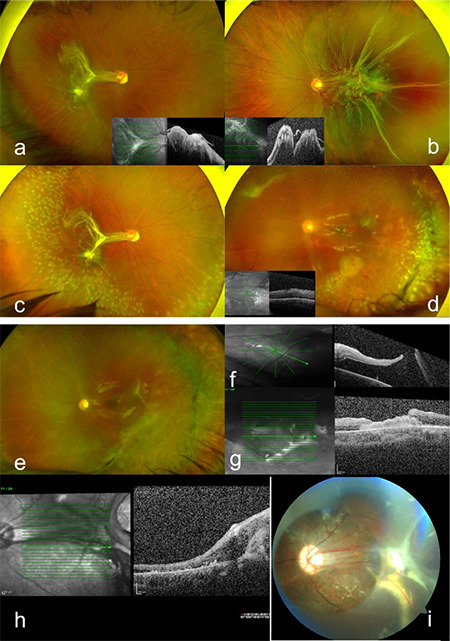
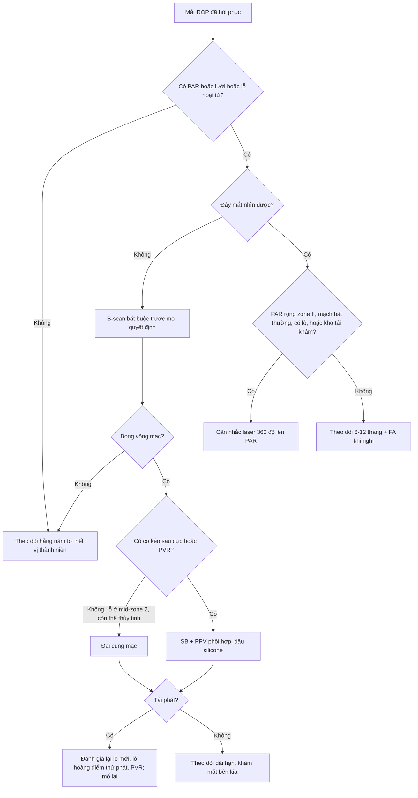
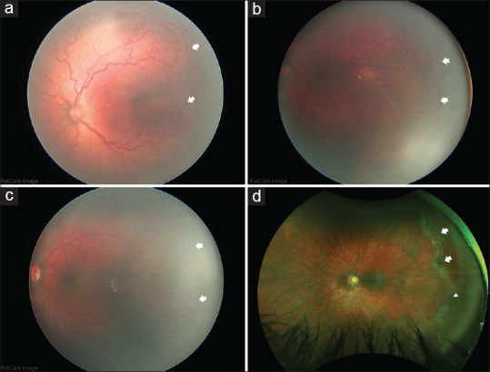

# 1415 — Bong võng mạc muộn ở mắt ROP đã hồi phục: lỗ hoại tử – rách ở vùng không có mạch, khi nào laser dự phòng và chọn mổ nào / Late rhegmatogenous retinal detachment in regressed retinopathy of prematurity

**Tags:** `pattern:bong-vong-mac` `pattern:rach-vong-mac` `pattern:rop` `pattern:vong-mac-khong-mach` `vung:vong-mac` `vung:dich-kinh` `score:ICROP` `protocol:sieu-am-B-scan` `protocol:laser-du-phong` `incidentaloma:rop`

**Mức chắc chắn (certainty):** tổng hợp y văn (literature synthesis) — tự biên từ 1 thuần tập phẫu thuật **15 mắt/14 bệnh nhân** bong võng mạc có lỗ muộn sau ROP hồi phục (PMC11590703) và 1 tổng quan về **vùng võng mạc không có mạch tồn tại** kèm bảng 7 nghiên cứu FA (PMC13431205); các loạt lớn hơn (Hamad 186 bệnh nhân, Kaiser, Tufail, Sen) được **dẫn lại từ 2 bài này**, không đọc toàn văn trực tiếp — số của chúng lấy đúng như bảng 1 của PMC11590703. Phần chưa có bằng chứng (hiệu quả laser dự phòng, thời điểm laser tối ưu) ghi rõ "chưa rõ".

> **Câu chốt:** mắt ROP "đã hồi phục" **không phải mắt lành** — nó là mắt có **võng mạc ngoại vi không có mạch (persistent avascular retina, PAR)**, mỏng, thoái hóa dạng lưới và dính chắc vào dịch kính cũ; khi nhãn cầu lớn dần, chỗ yếu đó **rách muộn ở tuổi 3–26 (trung bình 12)**. Ba câu quyết định: **(1) mắt có PAR/lưới/lỗ hoại tử chưa? (2) có triệu chứng hay mắt "câm" (trẻ chậm phát triển, không kêu)? (3) nếu đã bong: có co kéo sau cực + PVR không.** Vì **mổ lần đầu thất bại 53%**, **PPV đơn thuần thất bại 100%** trong loạt có PVR, và **thành công giải phẫu cuối chỉ 73% sau trung bình 2,3 lần mổ**.

## 1. Tổng quan bệnh học – cơ chế hình ảnh

- **Vì sao vùng ngoại vi không có mạch (PAR) lại là "điểm yếu chết người":** trong ROP, mạch máu võng mạc ngừng phát triển trước khi tới **ora serrata** (do oxy sau sinh ức chế VEGF, rồi VEGF tăng đột ngột gây tân mạch). Sau khi hồi phục — dù **tự nhiên, laser hay anti-VEGF** — mạch **thường không mọc tiếp tới cùng**, để lại **PAR**. Vùng này **không có hàng rào máu–võng mạc tại chỗ**, mỏng, **thiếu oxy mạn**, nên dễ **thoái hóa dạng lưới (lattice-like degeneration)**, **lỗ hoại tử (atrophic hole)** và **dính chắc vào dịch kính**.
- **TẠI SAO bong xuất hiện MUỘN chứ không ngay:** đây là bài toán **cơ học, không phải viêm**. Võng mạc là mô thần kinh **không tăng sinh theo thể tích nhãn cầu**; khi trẻ lớn, **nhãn cầu dài ra** trong khi võng mạc ngoại vi **dính vào "gờ" xơ cũ (former ridge)**, tạo **lực căng ly tâm thường trực**. Lực này **tích lũy nhiều năm** → rách xuất hiện ở tuổi thiếu niên/người trẻ, đúng như loạt của chúng ta (**3–26 tuổi, trung bình 12**) và các loạt cũ (**8,2–35 tuổi**).
- **Vì sao dịch kính là "mảnh ghép thứ hai":** mắt ROP hồi phục có **màng/dải xơ dính chắc vào võng mạc và gờ cũ**. Khi rách xảy ra, **dịch kính lỏng hóa đi qua lỗ**, nhưng **co kéo tiếp tục** — nên bong vừa **có lỗ (rhegmatogenous)** vừa **có co kéo (tractional)**, và đó là lý do **PVR xuất hiện sớm**: **10/15 mắt (67%)** đã có PVR ngay lúc nhập viện.
- **Ngưỡng định lượng nằm lòng:**
  - **Tần suất rách/bong ở người sống sót sau ROP** (tổng hợp trong phần mở đầu PMC11590703): **rách võng mạc 11–31%**, **bong võng mạc 15–39%**.
  - **PAR là phổ biến, không phải ngoại lệ** (bảng 1 của PMC13431205): sau **anti-VEGF cho ROP type 1/AROP: 31,65–100%**; ở **ROP hồi phục không điều trị: 33,0–62,5%**. Loạt Ling 2023 (trẻ chỉ sinh non, không ROP): **0%** — nghĩa là **PAR gắn với ROP, không gắn với sinh non đơn thuần**.
  - **Ngưỡng gọi là "bất thường" trên FA:** trẻ bình thường có vùng không tưới máu **0,9 đường kính đĩa (DD) phía thái dương (0,5–1,5; SD 0,3)** và **0,6 DD phía mũi (0,25–1,0; SD 0,2)**; do đó **> 2 DD tính từ ora serrata** được coi là **PAR bệnh lý** (Blair, dẫn qua PMC13431205).
  - **Hậu quả của PAR (Hamad, 186 bệnh nhân ≥ 6 tuổi, không điều trị ROP lúc nhỏ):** **170/180 mắt** có vùng không có mạch; **84,1%** trong số đó có **tổn thương ngoại vi kèm theo** (lưới, lỗ, rách). Trong **88 mắt được mổ bong**: **áp lần đầu 62,5%**, **15,9%** còn dầu silicone sau mổ cuối, **8%** không cứu được hoặc **không còn cảm giác sáng (NLP)**.
  - **Loạt mổ của chúng ta (PMC11590703):** **100% bong đã bong hoàng điểm (macula-off)**; **60% bong toàn bộ**, **40% bán phần** (chủ yếu thái dương–dưới); kiểu rách: **nhiều lỗ/rách 67%**, **dialysis 20%**, **rách khổng lồ (giant retinal tear) 7%**, **không thấy lỗ 7%**; **PVR 67%**.
  - **Thành công phẫu thuật:** **thất bại lần đầu 53%** (8/15) — **đai củng mạc (SB) 33%**, **cắt dịch kính (PPV) 100%**, **SB + PPV 40%**; **thành công giải phẫu cuối 73%** sau **trung bình 2,3 lần mổ (1–5)**; theo dõi **47 tháng (10–126)**; **20%** còn dầu silicone, **7%** teo nhãn cầu.
  - **Chức năng:** thị lực **2,1 ± 0,6 logMAR (≈ 20/2500) → 1,4 ± 0,8 logMAR (≈ 20/500)**, cải thiện có ý nghĩa (**p = 0,011**). Nhưng **chỉ nhóm không tái phát** mới cải thiện có ý nghĩa (**−0,89 logMAR, p = 0,04**); nhóm **tái phát** dù áp võng mạc cuối cùng vẫn **không cải thiện** (**−0,31 logMAR, p = 0,1**) — **"áp được" không đồng nghĩa "thấy được"**.
  - **Mắt bên kia (12 mắt) — bằng chứng cho "bệnh hai mắt":** **PAR 33%**, màng dịch kính ở gờ cũ **25%**, **lưới 50%**, **lỗ hoại tử 33%**, **kéo – lệch hoàng điểm (macular ectopia/drag) 25%**, nếp hoàng điểm **7%**, **ly thượng võng mạc co kéo 7%**; **8/12 mắt được laser 360° dự phòng**, **2 mắt đặt đai dự phòng**; khúc xạ cầu tương đương **−3,2 D (−6,50 đến +1,00)**. **Mắt "tốt" vẫn là mắt có bệnh.**
  - **Bảng đối chiếu 6 loạt (Table 1, PMC11590703):** Kaiser 2001 (31 mắt, 26,6 tuổi): SB **73%**, PPV **100%**, phối hợp **100%**, thành công cuối **96%**; Park 2004 (5 mắt, 8,2 tuổi): **0 / 0 / 100%**, cuối **20%**; Tufail 2004 (40 mắt, 22,3 tuổi): **72 / 57 / 75%**, cuối **97%**; Sen 2019 (22 mắt, 10,4 tuổi): **71 / 47 / –**, cuối **73%**; Hamad 2019 (88 mắt, 35 tuổi): **86 / 75 / 26%**, cuối **76%**; loạt này (15 mắt, 12 tuổi): **67 / 0 / 60%**, cuối **73%**.
- **Vì sao "hồi phục" không dừng ở tuổi nhỏ:** tái hoạt ROP sau anti-VEGF đã được báo cáo **muộn 2, 3, 6 và thậm chí 10 năm** sau tiêm; **mọi mắt tái hoạt đều có PAR**, và VEGF từ PAR được coi là nguồn kích thích (PMC13431205). Vì vậy **theo dõi là suốt đời**, không phải "khám tới 1 tuổi là xong".

## 2. Mẫu hình + chẩn đoán phân biệt theo vị trí (gamut)

- **Mẫu hình cần nhận ra (pattern):** võng mạc **bong ở ngoại vi**, **bờ gấp**, **có lỗ/ rách ở vùng mỏng không có mạch**, kèm **dải xơ từ gờ cũ tới đĩa thị/hoàng điểm**; nhãn cầu **cận thị**, **hoàng điểm lệch (drag)**.
- **Gamut theo cơ chế (vì sao bong ở mắt ROP không "một loại"):**
  1. **Lỗ hoại tử trong PAR** (atrophic hole) — hay ở **thái dương**, trên nền **lưới**; thường **bong chậm, khu trú**.
  2. **Rách do co kéo tại gờ cũ** (tractional tear at former ridge) — **dính chắc**, khó bóc; đây là nơi **PVR** sinh ra.
  3. **Dialysis / rách khổng lồ** — lực căng ly tâm lớn, hay gặp ở **trẻ lớn**; **7%** rách khổng lồ trong loạt.
  4. **Ly thượng võng mạc co kéo (tractional retinoschisis)** — **không phải bong**, nhưng **dễ nhầm** và có thể tiến triển thành bong co kéo.
  5. **Bong co kéo thuần (TRD)** do **tái hoạt tân mạch** (muộn sau anti-VEGF) — khác hoàn toàn về xử trí (bài 1406).
  6. **Bong do chấn thương/tự làm hại** — nhóm trẻ **chậm phát triển, hành vi tự hủy hoại** (50% loạt có khuyết tật trí tuệ) — **không được bỏ qua bối cảnh**.
- **Gamut theo tuổi phát hiện:** **nhỏ (3–8 tuổi)** thường do **kéo – lỗ tại gờ**; **lớn (10–26 tuổi)** thường do **lỗ hoại tử/lưới + nhãn cầu dài**.
- **Mnemonic "PAR–LATTICE–TEAR":** **P**ersistent avascular retina → **A**trophic holes → **R**idge traction; **L**attice; **T**ear (dialysis/giant); **T**ractional schisis; **I**atrogenic (laser/cryo, phaco sớm); **C**icatrix posterior (macular drag); **E**arly PVR.

## 3. Bảng so sánh phân biệt (ma trận đối chiếu)

| Thực thể (entity) | Hình ảnh điển hình | Chốt vào (rule-in) | Chốt loại (rule-out) | Gợi ý xác nhận |
|---|---|---|---|---|
| **Bong có lỗ muộn sau ROP hồi phục** | Bong ngoại vi, **bờ gấp**, lỗ/lưới ở **vùng không có mạch**, dải xơ về gờ cũ, nhãn cầu cận thị | **Lỗ nằm trong PAR/lưới + dải xơ tới gờ cũ + bong hoàng điểm** | Không có lỗ và **màng dính đĩa thị di động** theo mắt → nghĩ bong co kéo (TRD) | Soi đáy mắt góc rộng + **B-scan** khi môi trường đục; **FA** đánh giá PAR |
| **Ly thượng võng mạc co kéo (tractional retinoschisis)** | **Tách lớp trong võng mạc**, không có màng di động tự do; **OCT** thấy cầu nối mô | **OCT: khoang tách trong võng mạc, không có lỗ xuyên** | Màng **di động, dính đĩa thị**, lỗ thấy rõ → bong thật | OCT cầm tay; B-scan phân biệt "màng nổi" vs "lớp tách" |
| **Bong co kéo do tái hoạt tân mạch (TRD)** | **Màng fibrovascular dày**, co kéo **dọc**, không lỗ; thường sau anti-VEGF muộn | **Tân mạch hoạt động + màng dày co kéo + không lỗ** | Lỗ hoại tử đơn độc trong PAR → bong có lỗ | FA (dò/tân mạch), siêu âm B |
| **Lỗ hoàng điểm thứ phát sau mổ** | Bong tái phát **sau khi đã áp**, lỗ **trung tâm hoàng điểm**, màng co kéo sau cực | **Lỗ hoàng điểm mới sau mổ + co kéo sau cực** | Bong do hở lỗ ngoại vi chưa bịt → kiểm tra chu vi 360° | OCT; trong loạt: **2 mắt** do lỗ hoàng điểm thứ phát, xử lý bằng **màng ối** |
| **Bong do chấn thương/tự làm hại** | Dialysis, bong lan nhanh, **không tương xứng tổn thương nền** | **Tiền sử chấn thương/hành vi tự hại + dialysis** | Bong tiến triển từ lỗ hoại tử có sẵn | Hỏi kỹ người chăm sóc; khám toàn thân |

*Ca 12 tuổi (32 tuần, 2.000 g): (a, b) kéo – lệch hoàng điểm hai bên + PAR, bong có lỗ thái dương trên mắt trái; (c) laser dự phòng trên lưới có sắc tố ở mắt phải; (d) SB + PPV mắt trái; (e) áp sau 1 tháng; (f) **bong tái phát do lỗ hoàng điểm thứ phát**; (g, h) màng ối bịt lỗ; (i) áp bền sau 8 tháng. Nguồn: Özdemir Zeydanlı E et al., *Turk J Ophthalmol* 2024 (PMC11590703), CC BY-NC-ND 4.0 — nguyên bản, không chỉnh sửa.*

### Dấu hiệu "chốt" trên từng phương thức
- **Siêu âm B-scan:** màng **dính đĩa thị** + **di động theo mắt (aftermovement)** = võng mạc bong; màng **không dính đĩa thị** = màng dịch kính (không mổ). Khi **đục thể thủy tinh/xuất huyết dịch kính** — B-scan là **bắt buộc** trước mổ.
- **OCT cầm tay:** phân biệt **ly thượng võng mạc** với **bong thật**, và phát hiện **co kéo hoàng điểm** khi đáy mắt nhìn được.
- **FA:** đo **diện tích PAR**, tìm **dò/tân mạch**, quyết định **laser bổ sung** thay vì mổ lại.

## 4. Protocol chụp + hệ phân độ & ngưỡng xử trí

- **Theo dõi mắt ROP đã hồi phục (không có triệu chứng):**
  - **Khám đáy mắt giãn đồng tử hằng năm đến hết vị thành niên**, rồi **suốt đời** (nguy cơ rách muộn tới **26 tuổi** trong loạt này; tái hoạt anti-VEGF báo cáo tới **10 năm**).
  - **Chụp đáy mắt góc rộng (RetCam/UWF)** mỗi lần khám: so **chuỗi ảnh** theo thời gian, không đọc 1 ảnh đơn.
  - **FA** khi: PAR **rộng ở zone II**, có **mạch bất thường ngoại vi** (xoắn, phân nhánh bất thường, mạch vòng, rò), **không theo dõi được**, hoặc **đã có lỗ/rách**.
  - **Siêu âm B-scan** khi **không nhìn được đáy mắt** (đục thể thủy tinh, xuất huyết dịch kính) hoặc trẻ **không hợp tác**.
  - **Khám dưới gây mê (EUA)** cho trẻ **chậm phát triển/không nói** — nhóm này **chậm phát hiện bong** vì không kêu; **50%** loạt có khuyết tật trí tuệ.
- **Chỉ định laser dự phòng lên PAR (chưa có bằng chứng cấp 1 — "chưa rõ"):**
  - **Nên cân nhắc** khi: PAR **rộng/zone II**, **bất thường mạch trên FA**, **đã có lỗ hoại tử/lưới**, hoặc **khó tái khám**.
  - **Lợi ích – giá phải cân:** laser **muộn (> 60 tuần tuổi sau kinh nguyệt)** sau anti-VEGF cho **cận thị −0,16 ± 2,2 D**, so với laser **nguyên phát −7,4 ± 5,2 D** đo lúc **2–4 tuổi** — tức **chờ mạch mọc thêm rồi laser ít diện hơn** thì **ít cận thị hơn**; nhưng **đánh đổi bằng cửa sổ nguy cơ**.
  - **Thời điểm laser tối ưu: chưa rõ**; thực hành phổ biến **50–60 tuần tuổi sau kinh nguyệt**.
- **Protocol mổ (theo cơ chế, không theo "thói quen"):**
  1. **Đai củng mạc (SB)** khi: **còn thể thủy tinh**, **lỗ xác định được**, **ở mid-zone 2 hoặc trước**, **không co kéo sau cực** → thất bại lần đầu **33%** (thành công **67%**); 4/6 mắt không có bệnh sau cực/PVR **không tái phát**.
  2. **PPV đơn thuần:** **tránh** như chiến lược đầu tay khi có **PVR** — trong loạt này **thất bại 100%**; bóc dịch kính ngoại vi ở mắt ROP **rất khó** vì dính chắc vào võng mạc và gờ cũ.
  3. **SB + PPV phối hợp:** chọn khi **co kéo sau cực, nếp gấp, TRD, PVR** → thất bại lần đầu **40%** dù **80%** nhóm này có PVR và **80%** có co kéo — tốt hơn PPV đơn thuần; **đai** giúp nâng đỡ dịch kính ngoại vi còn sót.
  4. **Bổ trợ:** **cắt thể thủy tinh 40%**, **retinotomy/retinectomy 20%**, **dầu silicone 100%** các ca cắt dịch kính. **Lỗ hoàng điểm thứ phát** (2 mắt) xử lý bằng **màng ối (amniotic membrane graft)**.
- **Ngưỡng tiên lượng (dùng để tư vấn trước mổ):** tái phát **70%** nếu có **PVR** vs **20%** nếu không (**p = 0,06**); **67%** nếu có **biến đổi xơ sau cực** vs **33%** nếu chỉ tổn thương ngoại vi (**p = 0,44**) — **chưa đủ cỡ mẫu để kết luận**, nhưng đủ để **giải thích trước mổ** rằng **mổ 1 lần là may mắn, 2–3 lần là bình thường**.

## 5. Biến thể bình thường và cạm bẫy

- **Biến thể "bình thường" dễ overcall:** **vùng không tưới máu ngoại vi ≤ 2 DD** ở trẻ không ROP là **sinh lý**; **đừng laser** chỉ vì thấy vùng nhợt. Ngược lại, **đừng coi 2 DD là ngưỡng tuyệt đối** ở mắt ROP có lưới/lỗ.
- **Cạm bẫy 1 — ly thượng võng mạc vs bong:** trên B-scan, **ly thượng võng mạc** cho **màng mỏng "nổi" trong võng mạc**, còn **bong** là **màng dính đĩa thị, di động**. Mổ nhầm ly thượng võng mạc = **mù không hồi phục**; bỏ sót bong = **PVR**.
- **Cạm bẫy 2 — "thấy một lỗ là đủ" (satisfaction of search):** **7%** ca có **rách khổng lồ**, **7%** ca **không thấy lỗ**; phải **soi 360°**, đặc biệt **thái dương–dưới**. Bỏ sót lỗ thứ hai = **thất bại lần đầu**.
- **Cạm bẫy 3 — lỗ hoàng điểm thứ phát sau mổ:** bong tái phát trong **1 tháng** sau khi đã áp có thể do **màng co kéo sau cực tạo lỗ hoàng điểm mới** (2 mắt trong loạt) — **không phải "hở lỗ cũ"**; OCT là chốt.
- **Cạm bẫy 4 — trẻ chậm phát triển:** **không phàn nàn mất thị lực**; **tự làm hại** gây chấn thương; gia đình coi là "mắt kém từ bé". **Chỉ số then chốt là so ảnh UWF cũ**, không phải lời kể.
- **Cạm bẫy 5 — coi "đã laser/đã tiêm anti-VEGF" là hết nguy cơ:** laser **không tạo mạch**, chỉ **phá vùng thiếu oxy**; PAR vẫn còn và **vẫn rách**. Anti-VEGF để lại **PAR nhiều hơn** và **tái hoạt muộn** — cần **theo dõi lâu hơn**, không ngắn hơn.
- **Cạm bẫy 6 — dầu silicone "che" tổn thương:** **20%** còn dầu ở lần theo dõi cuối; dầu **gây khó đánh giá ngoại vi** và **làm chậm phát hiện tái bong**. Không được dừng theo dõi vì "đã có dầu".

## 6. Tự lượng giá — Blind Quiz

**Ca 1 — Trẻ 12 tuổi, sinh 32 tuần/2.000 g, không điều trị ROP; mắt trái đột ngột giảm thị lực. Nhìn ảnh, mô tả trước.**

- Gợi ý lâm sàng: thị lực **20/400** mắt phải, **đếm ngón tay 1 m** mắt trái.
- Câu hỏi: (1) Hai bên có gì giống nhau? (2) Mắt trái bong do gì, lỗ ở đâu? (3) Nếu mổ phối hợp mà 1 tháng sau bong lại, nghĩ gì? (4) Mắt phải xử lý thế nào?

<b>Bấm để hiện đáp án (findings + chẩn đoán)</b>

- **Findings:** (a, b) **kéo – lệch hoàng điểm hai bên** + **vùng võng mạc không có mạch ngoại vi**; mắt trái có **bong võng mạc có lỗ ở góc thái dương trên**. (c) **laser dự phòng** trên **lưới có sắc tố** ở vùng không có mạch của mắt phải. (d) **SB + PPV** mắt trái. (e) **áp sau 1 tháng**. (f) **bong tái phát do lỗ hoàng điểm thứ phát** (màng co kéo sau cực). (g, h) **màng ối** bịt lỗ. (i) **áp bền sau 8 tháng** sau khi lấy dầu.
- **Chẩn đoán:** **bong võng mạc có lỗ muộn trên nền ROP hồi phục** — cơ chế **lỗ trong vùng không có mạch + co kéo gờ cũ**, không phải viêm.
- **Phản biện (theo Argon):** ca này **không điển hình ở chỗ** đã mổ **phối hợp** mà vẫn tái bong; nhưng **tái bong do lỗ hoàng điểm thứ phát** đã được mô tả và là lý do phải **OCT sau mổ sớm**, không chỉ nhìn đáy mắt.
- **Thị lực cuối vẫn đếm ngón tay 1 m** dù áp võng mạc — đúng với quy luật: **thành công giải phẫu ≠ thành công chức năng** (nhóm tái phát không cải thiện có ý nghĩa: −0,31 logMAR, p = 0,1).
- Nguồn ảnh: Özdemir Zeydanlı E et al., *Turk J Ophthalmol* 2024 (PMC11590703), Fig. 1, CC BY-NC-ND 4.0.

**Ca 2 — Bốn ảnh đáy mắt của bốn mắt khác nhau. Mắt nào đã từng ROP type 1, mắt nào type 2, và mắt nào đang có nguy cơ rách?**

- Gợi ý: (a) lúc **33 tuần 6 ngày** tuổi sau kinh nguyệt; (b) cùng mắt đó lúc **49 tuần 6 ngày**; (c) lúc **64 tuần 2 ngày**; (d) nữ **34 tuổi**, tiền sử ROP type 2.
- Câu hỏi: (1) Mũi tên chỉ gì? (2) Vì sao (d) là mắt nguy cơ cao dù "chỉ" type 2? (3) Ngưỡng nào gọi là bất thường trên FA?

<b>Bấm để hiện đáp án</b>

- (a) **ROP type 1, stage 3 zone II** ngay lúc điều trị anti-VEGF — mũi tên là **ranh giới võng mạc có mạch**.
- (b) Cùng mắt sau điều trị: **mạch ngừng phát triển (arrested vessels)** và **PAR ở zone III** — đây là "di chứng" của anti-VEGF.
- (c) **ROP type 2** ở **64 tuần 2 ngày**: **PAR zone III** dù **không cần điều trị** — chứng minh PAR **không chỉ do anti-VEGF**.
- (d) Nữ **34 tuổi**: **PAR thái dương + thoái hóa dạng lưới** (mũi tên) và **lỗ hoại tử** (đầu mũi tên) — **nguy cơ bong có lỗ** nhiều thập kỷ sau.
- **Ngưỡng:** **> 2 DD tính từ ora serrata** (bình thường 0,9 DD thái dương, 0,6 DD mũi) — dưới ngưỡng đó **đừng overcall**.
- Nguồn ảnh: Murakami T, Nudleman E, *Taiwan J Ophthalmol* 2026 (PMC13431205), Fig. 1, CC BY-NC-ND 4.0 — nguyên bản.

## Bài liên quan chéo
- [456 – Bệnh võng mạc trẻ sinh non: zone–stage–plus & AP-ROP](../456-benh-vong-mac-tre-sinh-non/lesson.md)
- [458 – Di chứng & theo dõi dài hạn sau ROP](../458-di-chung-theo-doi-dai-han-sau-rop/lesson.md)
- [1406 – Tái bong & co kéo sau mổ ROP giai đoạn 4–5](../1406-tai-bong-co-keo-sau-mo-rop/lesson.md)
- [410 – Giải phẫu học mắt](../410-giai-phau-hoc-mat/lesson.md)

## Ảnh
- `images/1415_bong-vong-mac-muon_Fundus_PMC11590703-Fig1.jpg` — Fig. 1, PMC11590703, **CC BY-NC-ND 4.0**, nguyên bản.
- `images/1415_vong-mac-khong-mach_Fundus_PMC13431205-Fig1.jpg` — Fig. 1, PMC13431205, **CC BY-NC-ND 4.0**, nguyên bản.
- Chi tiết nguồn/giấy phép: `images/CREDITS.md` và `sources.md`.

> Không dùng để chẩn đoán độc lập khi chưa có người hướng dẫn.
