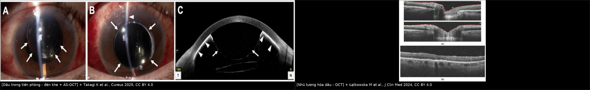
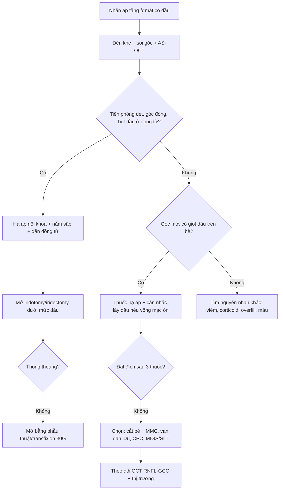
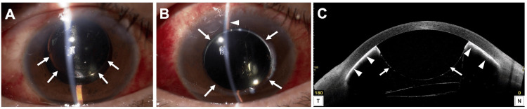
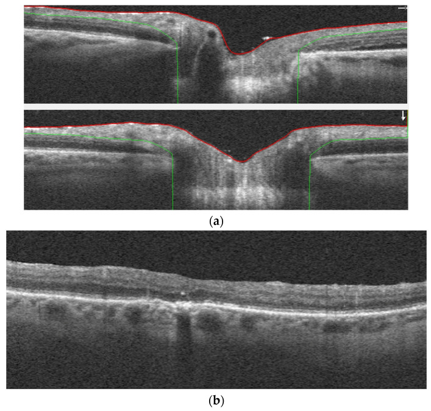
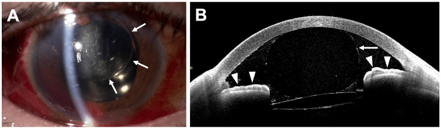

# 1416 — Glôcôm do dầu silicone: pupillary block, glôcôm bít bè do giọt nhũ tương, và chọn lấy dầu – van dẫn lưu – quang đông thể mi / Silicone oil glaucoma

**Tags:** `pattern:tang-nhan-ap` `pattern:dau-tien-phong` `pattern:nhu-tuong-hoa` `pattern:goc-dong` `pattern:bit-be` `vung:tien-phong` `vung:goc-tien-phong` `vung:dich-kinh` `vung:dia-thi` `protocol:AS-OCT` `protocol:UBM` `protocol:gonioscopy` `protocol:PPV` `score:IOP`
**Mức chắc chắn (certainty):** tổng hợp y văn (literature synthesis) — nhóm tự biên từ: tổng quan phẫu thuật glôcôm do dầu (CC BY 4.0, PMC9031548), tổng quan tăng nhãn áp sau bơm dầu (CC BY 4.0, PMC7558829), tổng quan nhũ tương hóa + OCT (CC BY 4.0, PMC11051299), ca pupillary block ngày 2 được xử trí tại đèn khe (CC BY 4.0, PMC12548765), so sánh Ahmed vs EX-PRESS 23 mắt (CC BY 4.0, PMC6031208), Ex-PRESS vs cắt bè 26 mắt (CC BY-NC-SA 3.0, PMC4845615), viscotrabeculotomy vs Ahmed 43 mắt (CC BY 4.0, PMC11826558), quang đông thể mi slow-coag 18 mắt (CC BY-NC-ND 4.0, PMC8404953); số liệu lấy dầu/bong tái phát kế thừa bài **1410** (PMC11321828, PMC11325823, PMC12516905, PMC13019722).

> **Vì sao bài này quan trọng:** bài **1410** dạy *nhận diện* dầu tồn lưu và *khi nào lấy dầu*; bài này trả lời câu hỏi cấp cứu: **nhãn áp tăng ở mắt đang có dầu — cơ chế nào, và xử trí gì trước?** Hai cơ chế chính đòi hai hành động trái ngược nhau: **pupillary block** cần **mở thông đồng tử ngay** (nếu chờ, mù trong vài ngày), còn **bít bè do giọt nhũ tương** cần **hạ áp + tính đến lấy dầu/đặt van**. Tăng nhãn áp sau bơm dầu gặp ở **2,2–56%** mắt, là biến chứng phổ biến thứ hai sau đục thể thủy tinh; **70%** glôcôm sau cắt dịch kính + dầu quy trực tiếp cho dầu. Trong một ca nguyên văn, tiền phòng **ngày 1 bình thường, nhãn áp bình thường**, nhưng **ngày 2 nhãn áp 60 mmHg, tiền phòng dẹt** — tốc độ này là lý do bài phải đọc theo *cơ chế*, không theo *con số nhãn áp*.

## 1. Tổng quan bệnh học – cơ chế hình ảnh – vì sao dầu làm tăng nhãn áp

- **Vật lý của dầu silicone (silicone oil, SO):** polydimethylsiloxane, tỷ trọng **0,97 g/cm³** (nhẹ hơn nước → nổi lên trên, đây là gốc của tamponade tư thế và của việc dầu "bơi" vào tiền phòng khi bệnh nhân nằm ngửa lâu), chiết suất **n = 1,40**, độ nhớt **1.000–5.700 mPa·s**, sức căng bề mặt với không khí **21,2–21,3 mN/m**, **sức căng mặt phân cách với nước ≈ 35 mN/m**. Hai con số "21" và "35" không mâu thuẫn: một là *surface tension* (dầu–khí), một là *interfacial tension* (dầu–nước) — khi đọc y văn phải biết tác giả đang nói mặt phân cách nào.
- **Hai thực thể, hai thời điểm (cách chia quyết định xử trí):**
  1. **Tăng nhãn áp sớm sau mổ (early postoperative ocular hypertension)** — **3–40%**; có thể do góc mở (viêm, corticoid, bít bè) hoặc góc đóng (pupillary block, synechia, tràn dầu quá mức).
  2. **Glôcôm muộn do dầu (late-onset silicone oil glaucoma)** — **3–30%** ở các loạt mới (loạt cũ **20–50%**); cơ chế chủ yếu là **giọt nhũ tương + đại thực bào "silicomacrophage"** bít bè, xơ hóa bè, synechia góc.
- **Quỹ đạo nhãn áp — vì sao "vài giờ" đã nguy hiểm:** nhãn áp trung bình từ **14,7 mmHg** trước mổ lên **21,8 mmHg sau 3 giờ** và **26,0 mmHg sau 48 giờ**. Trong loạt Jabbour, **48%** mắt tăng nhãn áp sau bơm dầu; **61,5%** xảy ra trong **tuần 1**, **28,7%** từ **tuần 1–6**, **9,8%** sau **6 tuần**; tỉ lệ tích lũy tăng nhãn áp **1 năm là 28,4%**. Nhãn áp **> 25 mmHg** gặp ở **73%** số mắt có giảm thị lực — tức tăng áp không "vô hại" chỉ vì bệnh nhân còn đếm ngón tay.
- **TẠI SAO dầu làm tăng nhãn áp — bốn cơ chế, mỗi cơ chế một hình ảnh:**
  - **Pupillary block (góc đóng):** bọt dầu **không nhũ tương** đi qua đồng tử (aphakia, rách bao/zonule, mống mắt–thể thủy tinh không kín) vào tiền phòng; dầu nhẹ hơn nước nên **tích tụ phía trên**, đẩy mống mắt ra sau, nước tiền phòng bị dồn xuống dưới; khi dầu chiếm cả đồng tử, áp sau mống mắt tăng → **mống mắt vồng ra trước, góc đóng**, nhãn áp tăng **rất nhanh** (ca điển hình **60–67 mmHg**). Đây là cơ chế **cấp cứu**.
  - **Bít bè trực tiếp bởi dầu chưa nhũ tương:** dầu lỏng trong tiền phòng dính vào bè, gây viêm tại chỗ; hình ảnh là **giọt dầu óng ánh ở góc** trên gonioscopy, **tăng phản xạ trên AS-OCT** ở mặt mống mắt/góc.
  - **Glôcôm do nhũ tương hóa (silicomacrophagocytic open-angle glaucoma):** dầu bị lực cắt phá thành giọt **< 1 µm** (dưới giới hạn đèn khe), đại thực bào ăn dầu (**silicomacrophage**) rồi bít bè; đồng thời giọt dầu gây **viêm, xơ hóa và xẹp bè**. Đây là lý do **lấy dầu muộn không còn hạ được nhãn áp**: tổn thương bè đã không hồi phục. Nhũ tương hóa gặp ở **0,7–56%**, khởi phát trung bình **13,2 ± 4,8 tháng** (sớm nhất **2 tháng**), tăng theo **thời gian giữ dầu**, **dầu nhớt thấp**, **bơm thiếu thể tích**, **rung giật nhãn cầu**, **còn dịch kính**.
  - **Góc đóng do synechia/rubeosis + yếu tố thuận lợi khác:** viêm mạn tính tạo **PAS**; xuất huyết tiền phòng (**39%** trong một loạt) tạo glôcôm hồng cầu; **corticoid sau mổ** gây đáp ứng tăng nhãn áp; **bơm quá thể tích (overfill)** làm nhãn áp tăng ngay.
- **Vì sao dầu trong tiền phòng lại độc cho giác mạc:** giọt dầu bám nội mô → apoptosis; **confocal phát hiện bất thường nội mô ở tới 75%** mắt có dầu tiền phòng và **~40%** toàn bộ mắt bơm dầu **dù đèn khe bình thường**; bệnh giác mạc do dầu **2–30%**. Nghĩa là "dầu trong tiền phòng" vừa là nguyên nhân glôcôm, vừa là dấu hiệu phải đánh giá nội mô.
- **Vì sao tháo dầu không phải "chữa khỏi":** tháo dầu đơn thuần kiểm soát nhãn áp **62%** lúc 24 tháng (Budenz), **57,1%** (Nguyen), **45,5%** (Honavar — tất cả vẫn cần thuốc), và chỉ **1/11** ca (Moisseiev); trong đoàn hệ 58 mắt, **14/16 ca vẫn cần thuốc hạ nhãn áp sau tháo dầu**. Lý do: bè đã xơ hóa, và tháo dầu làm mất tamponade → **bong tái phát 14,9–22,4%** (bài 1410). Vì vậy câu hỏi đúng không phải "có lấy dầu không" mà là **"bè còn khả năng hồi phục không, và võng mạc có chịu được việc tháo dầu không"**.

## 2. Mẫu hình + chẩn đoán phân biệt theo cơ chế (Gamut)

Ba câu hỏi bắt buộc trước mọi quyết định: **(1) tiền phòng sâu hay dẹt? (2) có dầu/bọt dầu trong tiền phòng không? (3) góc mở hay đóng, có PAS/rubeosis/giọt dầu trên bè không?** — cả ba trả lời bằng **đèn khe + gonioscopy**, AS-OCT/UBM chỉ bổ sung.

- **Nhóm A — góc ĐÓNG (phải mở thông ngay):**
  - **Pupillary block do dầu:** tiền phòng **nông/dẹt**, bọt dầu lớn ở bờ đồng tử, nhãn áp **rất cao**, đau, giác mạc phù nhẹ; mắt **aphakia** hoặc **pseudophakia có rách zonule** là ổ thuận lợi. Bọt dầu ở **phía trên** vì dầu nhẹ hơn nước.
  - **Pupillary block do synechia sau/dính mống mắt–thể thủy tinh:** không thấy bọt dầu tự do nhưng **không có bờ đồng tử thông thoáng**; thường kèm viêm nặng, fibrin.
  - **Góc đóng do PAS/rubeosis:** góc dính từng phần, có mạch bất thường; đây là nhóm **không hồi phục bằng iridotomy**.
- **Nhóm B — góc MỞ (hạ áp nội khoa trước, tính can thiệp sau):**
  - **Tăng áp sớm do viêm/corticoid/bít bè:** tiền phòng sâu, có tế bào, giọt dầu lơ lửng; nhãn áp tăng trong tuần đầu.
  - **Glôcôm do nhũ tương hóa:** góc mở, **giọt dầu trên bè** ("oil droplets in the angle"), nhãn áp tăng dần theo tháng–năm; AS-OCT thấy **điểm tăng phản xạ** trên mặt mống mắt/góc; OCT hậu cực có thể thấy **giọt tăng phản xạ** trong dịch kính/nội võng mạc/đĩa thị.
  - **Bơm quá thể tích:** nhãn áp tăng ngay sau mổ, tiền phòng sâu, không viêm rõ; xử trí bằng **lấy bớt dầu**.
- **Nhóm C — tăng áp "không do dầu" nhưng cùng bối cảnh (đừng bỏ sót):** glôcôm góc mở có sẵn bộc lộ sau mổ, **glôcôm hồng cầu** do xuất huyết tiền phòng, **hội chứng ly giải** sau chấn thương, **tăng áp do thuốc dãn đồng tử/atropine** ở mắt hẹp góc.

*Trái: dầu trong tiền phòng — (A,B) đèn khe, dầu (mũi tên) lấp tiền phòng, phản xạ ánh sáng khác nước; (C) AS-OCT: dầu trong tiền phòng (đầu mũi tên) đẩy mống mắt ra sau, tiền phòng nông. Phải: (a) OCT đĩa thị có **giọt tăng phản xạ** trên đĩa thị; (b) **giọt tăng phản xạ trong võng mạc** kèm bóng. Ảnh ghép letterbox, giữ nguyên aspect. Nguồn: Takagi K et al., *Cureus* 2025 (PMC12548765) Fig. 2, CC BY 4.0; Łątkowska M et al., *J Clin Med* 2024 (PMC11051299) Fig. 2, CC BY 4.0.*

## 3. Bảng so sánh phân biệt (ma trận đối chiếu)

| Thực thể (entity) | Hình ảnh điển hình (đèn khe / AS-OCT / UBM / OCT) | Chốt vào (rule-in) | Chốt loại (rule-out) | Gợi ý xác nhận |
|---|---|---|---|---|
| **Pupillary block do bọt dầu** | Tiền phòng **dẹt/nông**, bọt dầu lớn kẹt bờ đồng tử, dầu **phía trên**; AS-OCT: mống mắt vồng ra trước, góc đóng; nhãn áp **60–67 mmHg** | **Mắt có dầu + nhãn áp tăng cấp + tiền phòng dẹt + bọt dầu ở đồng tử** | Tiền phòng sâu, góc mở, chỉ có giọt nhỏ trên bè → không phải block | Soi góc **trước và sau** khi hạ áp; thử nghiệm **nằm sấp**/dãn đồng tử; mở iridotomy rồi đo lại |
| **Tăng áp sớm góc mở (viêm/corticoid/bít bè)** | Tiền phòng sâu, tế bào/fibrin, giọt dầu lơ lửng; góc mở; xuất hiện **tuần 1** | **Nhãn áp tăng trong 1–2 tuần đầu, góc MỞ, có viêm hoặc đang dùng corticoid** | Góc đóng/PAS; overfill (tiền phòng quá sâu + dầu đầy) | Đáp ứng với thuốc hạ áp + giảm corticoid; theo dõi 3–6 tuần |
| **Glôcôm do nhũ tương hóa (silicomacrophage)** | Góc mở, **giọt dầu vàng óng trên bè**; AS-OCT: điểm tăng phản xạ mặt mống mắt/góc; OCT: giọt tăng phản xạ trong dịch kính/nội võng mạc; tiến triển **tháng–năm** | **Tiền sử dầu ≥ 3 tháng + giọt ở góc + nhãn áp tăng dần + OCT có giọt** | Góc đóng hoàn toàn do PAS; không có giọt dầu và nhãn áp tăng ngay sau mổ | Gonioscopy + AS-OCT + OCT hậu cực; đối chiếu **thời gian giữ dầu** |
| **Góc đóng do PAS/rubeosis** | Góc dính từng phần/toàn bộ, màng xơ hoặc mạch; tiền phòng có thể sâu nhưng góc đóng | **Dính góc thấy rõ + nhãn áp không đáp ứng iridotomy** | Góc mở hoàn toàn, chỉ có giọt dầu | Gonioscopy góc 360°, **AS-OCT góc**, soi mống mắt tìm rubeosis |
| **Bơm dầu quá thể tích (overfill)** | Nhãn áp cao **ngay** sau mổ, tiền phòng sâu, dầu đầy sát thể thủy tinh/IOL, không viêm | **Tương quan thời điểm với mổ + hình ảnh dầu đầy quá mức** | Viêm/bít bè (có tế bào, không quá đầy) | So sánh với phim/ghi chú mổ; **lấy bớt dầu** rồi đo lại |
| **Glôcôm hồng cầu / ly giải (bối cảnh chấn thương)** | Máu tiền phòng, tế bào hồng cầu, có thể **giả tiền phòng**; góc mở nhưng bè bít | **Xuất huyết tiền phòng + chấn thương/mổ phức tạp + nhãn áp tăng** | Dầu trong tiền phòng (phản xạ khác, không lắng hồng cầu) | Đèn khe + AS-OCT; theo dõi hồng cầu; điều trị theo nguyên nhân |

## 4. Protocol chụp/đo + hệ phân độ & thuật toán xử trí

**Đo và chẩn đoán (làm ngay trong cơn):**
- **Nhãn áp:** đo bằng tonometer phù hợp tình trạng giác mạc; ghi nhận **giác mạc phù sau ghép/mổ** có thể làm **đọc thấp giả** — đây là bẫy hay gặp ở mắt đã mổ phức tạp.
- **Đèn khe:** độ sâu tiền phòng, bọt dầu, tế bào/fibrin, vị trí mống mắt, thể thủy tinh/IOL.
- **Gonioscopy (chuẩn vàng):** góc mở/đóng, **PAS 360°**, rubeosis, **giọt dầu trên bè**. Phải làm sau khi hạ áp và làm lại sau can thiệp.
- **AS-OCT tiền phòng:** đo **độ sâu tiền phòng, độ mở góc, khoảng cách mống mắt–giác mạc**, thấy giọt **tăng phản xạ** trên mặt mống mắt/góc; giá trị khi giác mạc phù nhẹ hoặc khi không soi góc được.
- **UBM (50 MHz):** bổ sung khi cần nhìn **thể mi–mống mắt–góc** sau, mống mắt dày, hoặc nghi dầu sau mống mắt.
- **OCT hậu cực/RNFL–GCC:** khi môi trường trong, để phát hiện **giọt tăng phản xạ** và đánh giá tổn thương thị thần kinh; **thị trường** khi bệnh nhân hợp tác.

**Thuật toán xử trí (theo cơ chế trước, theo nhãn áp sau):**

**Ngưỡng và lựa chọn can thiệp (số từ y văn):**
- **Lấy dầu đơn thuần:** thành công **62%**/24 tháng (Budenz), **57,1%** (Nguyen), **45,5%** (Honavar); thất bại chủ yếu do **nhãn áp không kiểm soát (92%)**; khi phối hợp lấy dầu + mổ glôcôm, thất bại chủ yếu do **hạ áp quá mức (75%)** → phải cá thể hóa.
- **Cắt bè + MMC:** thành công hoàn toàn **40%**, thành công có thuốc **60%** lúc 2 năm (Errico); một loạt khác chỉ **21,1%** có thuốc và **15,8%** tuyệt đối lúc 1 năm (Singh) — **kém hơn rõ so với van**; ưu điểm duy nhất là rẻ, nhưng bờ kết mạc đã mổ và dầu trong tiền phòng dễ bít lỗ.
- **Van dẫn lưu (Ahmed/Baerveldt/PAUL):** thành công **62–80%** ở 12–24 tháng; **hạ áp quá mức tới 50%**; **đặt phía dưới** ít bị dầu bít hơn (góc dưới–mũi an toàn hơn); dùng **viscoelastic** trong mổ để chặn dầu đi vào ống.
- **EX-PRESS:** thành công **73%** (không thuốc)/**81,8%** (có thuốc) lúc 2 năm, nhãn áp **33 ± 6,4 → 17,8 ± 6,2 mmHg** (Errico); nhưng một so sánh 23 mắt cho **Ahmed 78,6% vs EX-PRESS 33,3%** lúc 1 năm (PMC6031208) và El-Saied báo EX-PRESS **100%** — **mâu thuẫn nguồn rõ rệt**, nên không dùng một con số để hứa với bệnh nhân.
- **Quang đông thể mi xuyên củng mạc (TSCPC):** thành công **44–81,8%** tùy loạt; **slow-coag** 18 mắt: nhãn áp **29,7 ± 9,6 → 14,6 ± 6,5 mmHg** lúc 12 tháng, thuốc **4,2 ± 0,9 → 1,9 ± 1,3**; **hạ áp quá mức 5,6–13,2%**; cần **lặp tới 4 lần**, cách **6–8 tuần**; mất cảm giác sáng **56%** trong một loạt (thường do bệnh nền, không chắc do tia).
- **Nhẹ hơn (nhãn áp ≤ 25 mmHg, góc mở):** **SLT** giảm ~**20%** lúc 1 năm, thành công **59,5%**; **GATT** hạ **31 ± 4,1 → 15,6 ± 4,6 mmHg** (một loạt), **32,7 ± 5,1 → 13,6 ± 1,8 mmHg**, thành công **93,3%** nhưng phần lớn vẫn cần thuốc.

## 5. Biến thể bình thường và cạm bẫy

- **Tăng nhãn áp thoáng qua sau mổ (không phải glôcôm):** nhãn áp tăng trong **24–72 giờ** do viscoelastic/viêm, tự về bình thường; **không** đặt van vì một lần đo. Ngược lại, **tăng áp kéo dài ≥ 2 lần khám** hoặc **một lần ≥ 25 mmHg** đã là ngưỡng cần điều trị (tiêu chuẩn dùng trong loạt Jabbour để dự báo giảm thị lực).
- **Giọt dầu vs sắc tố/bọc mống mắt trên AS-OCT:** giọt dầu **tăng phản xạ mạnh, bờ tròn, có bóng phía sau**, nằm **trên bề mặt** mống mắt/góc; sắc tố mống mắt là **dải mỏng, không bóng**, bọc mống mắt là **cấu trúc có thành**. So **mắt bên kia** giúp tránh gọi nhầm.
- **Dầu nhũ tương < 1 µm không thấy trên đèn khe:** đèn khe/gonioscopy âm **không loại trừ** nhũ tương hóa; **AS-OCT/OCT** mới thấy (bài 1410). Đừng kết luận "không có dầu trong tiền phòng" chỉ vì không thấy bằng mắt thường.
- **Thỏa mãn tìm kiếm (satisfaction of search):** đã thấy glôcôm do dầu thì dễ bỏ **bong võng mạc tái phát**, **giả phình mạch**, **nhiễm trùng** — luôn khám đáy mắt/B-scan trước khi quyết định lấy dầu.
- **Đo nhãn áp sai ở mắt đã ghép giác mạc/giác mạc phù:** có thể **đọc thấp giả**; dùng nhiều phương pháp và đánh giá **đĩa thị** thay vì tin một con số.
- **Iridotomy đóng lại 11–32%:** một lần mở không đủ; phải khám lại, mở rộng, và điều trị viêm/fibrin (corticoid dưới kết mạc, tPA nội tiền phòng) nếu tái đóng.

## 6. Tự lượng giá — Blind Quiz

**Ca 1 — Nam 51 tuổi, đái tháo đường tăng sinh, mổ phaco + cắt dịch kính + dầu 1 ngày trước, hôm nay đau nhiều.**

- Gợi ý: ngày 1 tiền phòng bình thường, nhãn áp bình thường; ngày 2 tiền phòng dẹt, nhãn áp **60 mmHg**.
- Câu hỏi: (1) Mô tả dấu hiệu chính trên (A), (B), (C). (2) Ba chẩn đoán phân biệt? (3) Dấu hiệu nào chốt cơ chế?

<b>Bấm để hiện đáp án (findings + chẩn đoán)</b>

- Dấu hiệu: (A,B) **dầu silicone trong tiền phòng** (mũi tên) — mức phản xạ khác nước, bờ cong theo giác mạc; (C) **AS-OCT**: dầu/khối tăng phản xạ trong tiền phòng (đầu mũi tên), **mống mắt bị đẩy ra sau**, tiền phòng nông → **góc đóng**.
- Chẩn đoán: **pupillary block do dầu silicone** (dầu đi qua đồng tử, tích tụ phía trên, chặn lưu thông thủy dịch). Phân biệt: viêm mống mắt–thể thủy tinh nặng, bơm quá thể tích, góc đóng nguyên phát có sẵn.
- Chốt: **tiền phòng dẹt + bọt dầu kẹt đồng tử + nhãn áp tăng cấp**; xử trí tại đèn khe: bơm viscoelastic, ấn mống mắt ra sau, rồi **iridotomy xuyên giác mạc bằng lưỡi MVR** — nhãn áp về bình thường, không phải tháo dầu.
- Nguồn ảnh: Takagi K et al., *Cureus* 2025 (PMC12548765) Fig. 2, CC BY 4.0.

**Ca 2 — Bệnh nhân bơm dầu 8 tháng, nhãn áp 28 mmHg, giác mạc trong, không đau.**

- Gợi ý: không có bọt dầu ở đồng tử; soi góc thấy **giọt vàng óng trên bè**.
- Câu hỏi: (1) Hai hình (a) và (b) cho thấy gì? (2) Cơ chế glôcôm ở ca này? (3) Vì sao tháo dầu muộn có thể **không** hạ được nhãn áp?

<b>Bấm để hiện đáp án</b>

- Dấu hiệu: (a) **giọt tăng phản xạ trên đĩa thị**; (b) **giọt tăng phản xạ trong các lớp võng mạc** kèm **bóng** phía sau — dầu nhũ tương đã đi vào nội võng mạc.
- Chẩn đoán: **glôcôm do nhũ tương hóa dầu (silicomacrophagocytic open-angle glaucoma)** — giọt < 1 µm bị đại thực bào ăn, bít bè và gây viêm/xơ bè; nhãn áp tăng dần theo tháng.
- Vì sao tháo dầu muộn kém hiệu quả: bè đã **xơ hóa/xẹp** — tháo dầu chỉ bỏ nguồn giọt mới, không hồi phục bè; các loạt cho thấy tháo dầu đơn thuần chỉ kiểm soát **45,5–62%**, và **14/16** ca vẫn cần thuốc. Do đó cần **van dẫn lưu/CPC** song song, và **theo dõi OCT/AS-OCT** để bắt nhũ tương trước khi bè hỏng.
- Nguồn ảnh: Łątkowska M et al., *J Clin Med* 2024 (PMC11051299) Fig. 2, CC BY 4.0.

**Ca 3 — Ba ngày sau mổ, tiền phòng sâu trở lại nhưng còn dầu ở góc; nhãn áp 18 mmHg.**

- Gợi ý: bệnh nhân đã được mở iridotomy; vẫn thấy **dầu di trú trong tiền phòng**.
- Câu hỏi: (1) Dầu còn trong tiền phòng có nghĩa thất bại? (2) Cần theo dõi gì để phát hiện glôcôm muộn? (3) Khi nào mới cân nhắc lấy dầu?

<b>Bấm để hiện đáp án</b>

- Dấu hiệu: (A) **dầu di trú trong tiền phòng** (mũi tên), tiền phòng **đã sâu**, nhãn áp bình thường; (B) AS-OCT: **giọt dầu ở góc** (đầu mũi tên) nhưng góc mở, không còn block.
- Ý nghĩa: **không** phải thất bại — mục tiêu cấp cứu là **mở thông đồng tử**, không phải làm sạch dầu; dầu còn lại sẽ tiếp tục nhũ tương hóa và có thể gây glôcôm muộn.
- Theo dõi: **nhãn áp mỗi lần khám**, **gonioscopy định kỳ**, **AS-OCT** (giọt ở góc, độ sâu tiền phòng), **OCT RNFL–GCC/thị trường**, đếm tế bào nội mô nếu có máy.
- Cân nhắc lấy dầu khi: **nhãn áp không kiểm soát dù đã dùng 3 thuốc**, **nhũ tương tiến triển**, **bệnh giác mạc do dầu**, hoặc **có kế hoạch mổ glôcôm** — và chỉ khi **võng mạc áp, không co kéo, nguy cơ bong tái phát thấp** (bài 1410).
- Nguồn ảnh: Takagi K et al., *Cureus* 2025 (PMC12548765) Fig. 5, CC BY 4.0.

## Bài liên quan chéo
- [1410 – Lấy dầu silicone & dầu tồn lưu: nhũ tương hóa, giọt tăng phản xạ trên OCT, bong tái phát sau lấy dầu](../1410-lay-dau-silicone-va-dau-ton-luu/lesson.md)
- [1411 – Tăng nhãn áp do corticoid nội nhãn: DEX-I, implant lạc tiền phòng](../1411-tang-nhan-ap-do-corticoid-noi-nhan/lesson.md)
- [1417 – Khi nào GIỮ dầu silicone vĩnh viễn, không lấy dầu](../1417-giu-dau-silicone-vinh-vien/lesson.md)
- [442 – Glôcôm trên OCT: RNFL/GCC và đánh giá tổn thương thị thần kinh](../442-glaucoma-OCT/lesson.md)
- [1402 – Bong võng mạc sau viêm nội nhãn: chọn dầu hay khí](../1402-bong-vong-mac-sau-viem-noi-nhan/lesson.md)

## Ảnh
- `1416_dau-tien-phong_Slitlamp-AS-OCT_PMC12548765-Fig2-CCBY.jpg` — Takagi K et al., *Cureus* 2025 (PMC12548765) Fig. 2, **CC BY 4.0**, nguyên bản.
- `1416_dau-tien-phong-sau-xu-tri_Slitlamp-AS-OCT_PMC12548765-Fig5-CCBY.jpg` — cùng bài, Fig. 5, **CC BY 4.0**, nguyên bản.
- `1416_nhu-tuong-hoa_OCT_PMC11051299-Fig2-CCBY.jpg` — Łątkowska M et al., *J Clin Med* 2024 (PMC11051299) Fig. 2, **CC BY 4.0**, nguyên bản.
- `composite_dau-tien-phong-nhu-tuong-hoa.jpg` — ảnh ghép letterbox từ 2 ảnh CC BY 4.0 ở trên, dải attribution trong ảnh; giữ aspect, không crop/kéo giãn.
- Không tải ảnh từ Radiopaedia/AuntMinnie/Retina Image Bank; chỉ dẫn link ở `sources.md`.

> Không dùng để chẩn đoán độc lập khi chưa có người hướng dẫn.
