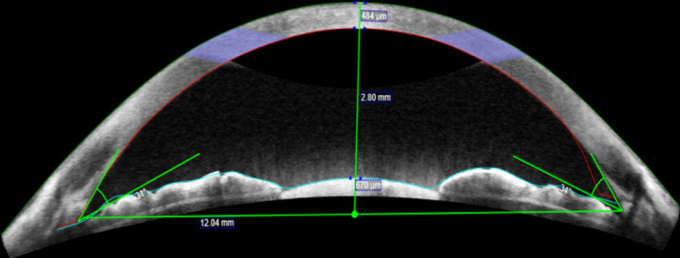
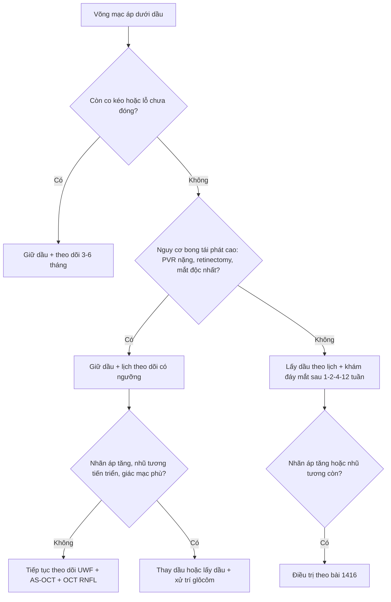
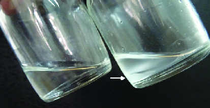
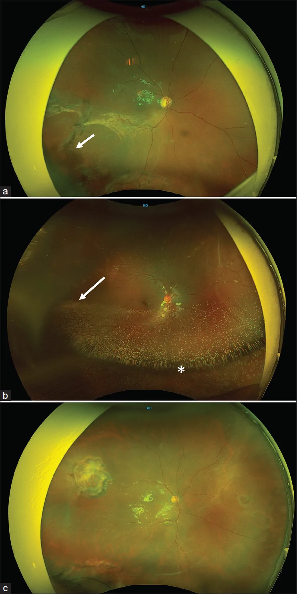

# 1417 — Khi nào GIỮ dầu silicone vĩnh viễn: chọn ca, theo dõi dầu tồn lưu và hậu quả dài hạn / Permanent silicone oil retention

**Tags:** `pattern:dau-silicone` `pattern:dau-ton-luu` `pattern:nhu-tuong-hoa` `pattern:duc-dau` `pattern:tang-nhan-ap` `pattern:bong-tai-phat` `vung:dich-kinh` `vung:tien-phong` `vung:vong-mac` `vung:dia-thi` `score:PVR` `protocol:UWF` `protocol:AS-OCT` `protocol:sieu-am-B-scan` `protocol:OCT-RNFL-GCL`
**Mức chắc chắn (certainty):** tổng hợp y văn (literature synthesis) — nhóm tự biên từ: tổng quan phẫu thuật glôcôm do dầu (CC BY 4.0, PMC9031548), đoàn hệ retinectomy PVR 66 mắt (CC BY 4.0, PMC13339574), nghiên cứu AS-OCT tiền phòng ở mắt giữ dầu > 12 tháng (CC BY 4.0, PMC11762219), ca dầu đục sau 1 năm tồn lưu (CC BY 4.0, PMC8126750), nghiên cứu yếu tố nguy cơ nhũ tương hóa sớm 81 mắt (CC BY-NC-ND 4.0, PMC13674869); số liệu bong tái phát sau lấy dầu kế thừa bài **1410**.

> **Vì sao bài này quan trọng:** bài **1410** và **1416** đều xoay quanh việc *lấy dầu* và *xử trí biến chứng*. Nhưng trong thực hành có một nhóm **cố ý để dầu suốt đời**: võng mạc chỉ áp được nhờ dầu, lấy ra là bong lại. Quyết định này không có "liều an toàn" đã chứng minh — y văn 2026 vẫn ghi **thiếu đồng thuận về thời gian tamponade an toàn**. Cái giá của việc giữ dầu là **nhũ tương hóa tăng theo thời gian**, **glôcôm 2,2–56%**, **bệnh giác mạc 2–30%**, **mất thị lực không giải thích được (SORVL) 3,3–50%** và có thể **dầu đục hoàn toàn** (ca 13 tuổi: 1 năm không tái khám → dầu trắng đục, nhãn áp **48 mmHg**, mất toàn bộ vành thị thần kinh). Vì vậy "giữ dầu" chỉ an toàn khi đi kèm **một lịch theo dõi có ngưỡng ra quyết định**, không phải "bơm rồi quên".

## 1. Tổng quan bệnh học – vì sao giữ dầu là đánh đổi, không phải lựa chọn miễn phí

- **Dầu giữ võng mạc bằng gì:** dầu silicone (polydimethylsiloxane, PDMS) tỷ trọng **0,97 g/cm³**, chiết suất **1,40**, độ nhớt **1.000–5.700 mPa·s**, sức căng mặt phân cách với nước **≈ 35 mN/m**. Dầu **không sinh áp lực** như khí; nó **bịt lỗ rách** và **ép võng mạc vào thành** nhờ sức căng bề mặt, đồng thời **chặn cytokine và tế bào tăng sinh** lan trong khoang dịch kính. Vì thể tích **không đổi theo thời gian**, dầu phù hợp cho **trẻ nhỏ và người không thể nằm sấp** — đây là lý do chính khiến dầu được giữ lâu.
- **TẠI SAO thời gian giữ dầu là biến số độc lực:** ba quá trình chạy song song theo thời gian:
  1. **Nhũ tương hóa (emulsification):** lực cắt khi mắt chuyển động phá dầu thành giọt; giọt **< 1 µm** đi vào bè, nội mô, nội võng mạc và thần kinh thị. Tỉ lệ **0,7–56%**, **tăng theo thời gian giữ dầu**; một nghiên cứu 81 mắt bong võng mạc rách cho thấy **tuổi bệnh nhân (p = 0,032)**, **đai củng mạc (p = 0,006)** và **thời gian tamponade** là yếu tố độc lập; **58%** mắt có **bơm thiếu thể tích (suboptimal fill)** trên ảnh góc rộng — thiếu thể tích làm tăng diện dầu–nước và lực cắt.
  2. **Tương tác bề mặt:** dầu bám nội mô → mất tế bào, phù, **bệnh giác mạc 2–30%**; dầu trong tiền phòng làm bít bè và gây **glôcôm** (bài 1416). Bất thường nội mô trên confocal gặp ở **tới 75%** mắt có dầu tiền phòng dù đèn khe bình thường.
  3. **Độc tính thần kinh–võng mạc:** **SORVL 3,3–50%** (mất > 2 dòng Snellen, không tương xứng tổn thương võng mạc nhìn thấy), mỏng lớp trong hoàng điểm, tổn thương bó nhú–hoàng điểm, giảm mật độ mạch máu hoàng điểm; có giả thuyết dầu hòa tan **lutein/zeaxanthin** làm hoàng điểm mất bảo vệ trước ánh sáng.
- **Dầu "già" còn đổi cả bản chất vật lý:** ca **13 tuổi** bơm dầu **1.000 cS**, tái khám sau **1 năm** với dầu **đục trắng**, **không nhũ tương hóa**, **không còn ánh đáy mắt**; dầu hút ra **nặng hơn dầu bình thường** (lắng xuống dưới lớp dịch truyền) — tức đã **ngậm nước/tạp chất**, không còn là PDMS tinh khiết. Đây là lý do **"dầu đục" và "dầu nhũ tương hóa" là hai hình thái khác nhau**, và cả hai đều là dấu hiệu phải đánh giá lại.
- **Vì sao LẤY dầu cũng nguy hiểm:** dầu đang là "khung" duy nhất giữ võng mạc; bỏ khung khi **PVR còn hoạt động** → bong tái phát **14,9–22,4%** (y văn **5–31,4%**; **OR 4,8** nếu đã có tiền sử mổ thất bại). Trong loạt **66 mắt cắt võng mạc (retinectomy) vì PVR**, tái phát **33,3% (22/66)**, chia đều **12 ca khi còn dầu** và **10 ca sau khi lấy dầu**; thời gian lấy dầu trung bình **5,4 ± 2,3 tháng**; **nhãn áp thấp ≤ 5 mmHg 7,5%**, **nhãn áp > 25 mmHg 7,5%**. Tác giả kết luận: **có thể để dầu tại chỗ ở mắt nguy cơ bong tái phát cao**.
- **Vì sao tháo dầu muộn lại kém:** thời gian giữ dầu càng dài, thị lực sau tháo càng kém (**OR 1,226 mỗi tháng**; 95% CI 1,073–1,402; p = 0,003) và bong tái phát làm thị lực giảm thêm (**OR 3,400**). Nghĩa là quyết định "giữ" phải được **đặt lịch xem lại**, không phải mặc định.

## 2. Mẫu hình + gamut theo tình huống lâm sàng (khi nào giữ, khi nào lấy)

- **Nhóm GIỮ (dầu là phương tiện duy nhất còn lại):**
  1. **PVR nặng / đã cắt võng mạc 360°, đã thất bại nhiều lần:** võng mạc áp chỉ nhờ dầu, **không còn màng co kéo tháo được**, nguy cơ bong tái phát rất cao.
  2. **Mắt độc nhất (single eye)** hoặc mắt còn lại đã mất chức năng: ưu tiên **giữ giải phẫu** hơn mạo hiểm lấy dầu.
  3. **Nhãn áp thấp/tiền phẫu thuật (hypotony)** sau nhiều lần mổ: dầu còn giúp giữ thể tích nhãn cầu, tránh teo nhãn.
  4. **Trẻ nhỏ/người không thể nằm sấp hoặc không hợp tác tư thế:** dầu không cần positioning, thể tích không đổi.
  5. **Bệnh nhân có thể theo dõi được** — đây là **điều kiện bắt buộc**, không phải tiêu chí phụ.
- **Nhóm LẤY (dầu đang gây hại nhiều hơn lợi):**
  1. **Võng mạc áp ổn định ≥ 3–6 tháng, không co kéo, hết lỗ** và nguy cơ bong thấp → lấy theo lịch thường quy.
  2. **Nhũ tương hóa tiến triển + glôcôm không kiểm soát** dù 3 thuốc (bài 1416).
  3. **Bệnh giác mạc do dầu** (phù, giảm tế bào nội mô) hoặc dầu chiếm tiền phòng.
  4. **SORVL tiến triển** (giảm thị lực không giải thích, OCT thấy mỏng lớp trong/bó nhú–hoàng điểm).
  5. **Dầu đục hoàn toàn** che đáy mắt, không còn theo dõi được võng mạc.
- **Nhóm "giữ nhưng đổi kế hoạch":** dầu còn nhưng **nhãn áp bắt đầu tăng**, **nhũ tương độ 2–3**, **bơm thiếu thể tích** → **bổ sung thể tích** hoặc **thay dầu** thay vì lấy hẳn, để vẫn giữ tamponade.

*AS-OCT tiền phòng ở mắt giữ dầu dài hạn: đo **bề dày giác mạc trung tâm 494 µm**, **độ sâu tiền phòng 2,80 mm**, **đường kính tiền phòng 12,04 mm**, **góc mống mắt–giác mạc 52°/56°**. Ở 78 mắt/42 người, nhóm giữ dầu > 12 tháng khác biệt có ý nghĩa về **đường kính tiền phòng** so với mắt PPV không dầu và mắt chưa mổ (p < 0,001) — bằng chứng dầu tồn lưu **thay đổi hình thái tiền phòng**, dù CCT/độ sâu/góc không khác. Nguồn: Singh G et al., Int Ophthalmol 2025 (PMC11762219) Fig. 1, CC BY 4.0.*

## 3. Bảng so sánh phân biệt (ma trận đối chiếu quyết định)

| Tình huống (entity) | Hình ảnh/đo lường điển hình | Chốt vào (rule-in: giữ dầu) | Chốt loại (rule-out: phải lấy/thay) | Gợi ý xác nhận |
|---|---|---|---|---|
| **PVR nặng, retinectomy 360°, đã mổ lại nhiều lần** | Võng mạc áp sát dầu, **màng co kéo không tháo được**, lỗ lớn/ngoại vi; OCT choán chỗ | **Võng mạc chỉ áp nhờ dầu + không còn cách cố định khác** | Có màng co kéo tháo được, lỗ đã đóng, võng mạc áp ≥ 3–6 tháng | UWF + OCT + đối chiếu số lần mổ; hội chẩn võng mạc |
| **Mắt độc nhất** | Mắt bên kia mù/đã bỏ; mắt này thị lực còn | **Nguy cơ mất thị lực cuối cùng nếu bong > lợi ích tháo dầu** | Mắt bên kia còn tốt, nguy cơ bong thấp | Đánh giá chức năng hai mắt + nguyện vọng bệnh nhân |
| **Nhãn áp thấp/teo nhãn cầu** | Nhãn áp **≤ 5 mmHg**, tiền phòng nông, hắc mạc dày | **Dầu giữ thể tích, tránh phthisis** | Nhãn áp bình thường, không teo | Đo nhãn áp lặp lại, siêu âm B-scan |
| **Nhũ tương hóa tiến triển** | Giọt vàng óng ở góc, **AS-OCT điểm tăng phản xạ**, OCT giọt nội võng mạc; **thời gian giữ dầu dài** | **Nhũ tương nhẹ, nhãn áp còn kiểm soát, chưa có bệnh giác mạc** | **Nhãn áp không kiểm soát, phù giác mạc, giọt trên đĩa thị** | AS-OCT + gonioscopy + OCT hậu cực mỗi 6–12 tháng |
| **Dầu đục (opacification)** | Đục trắng, **không ánh đáy mắt**, B-scan vẫn thấy võng mạc; dầu hút ra **nặng hơn bình thường** | **Hiếm khi giữ** — chỉ khi không thể mổ và võng mạc đã ổn định | **Không theo dõi được võng mạc + nhãn áp tăng** → **thay/lấy dầu** | Đèn khe + B-scan; so màu dầu hút ra với lọ chuẩn |
| **Bơm thiếu thể tích** | UWF: mặt thoáng dầu thấp, dầu "lỏng" ở nửa dưới; **58%** mắt trong một loạt | **Bổ sung dầu** nếu võng mạc còn nguy cơ | Không thiếu thể tích, nhũ tương nhẹ | UWF + OCT; đo thể tích ước tính trên ảnh |

## 4. Protocol theo dõi + ngưỡng ra quyết định

**Lịch theo dõi mắt giữ dầu (đề xuất thực hành, dựa trên các ngưỡng đã nêu):**

| Thời điểm | Việc làm | Ngưỡng hành động |
|---|---|---|
| Mỗi lần khám | Nhãn áp, đèn khe (tiền phòng, dầu, giác mạc), **soi góc** | Nhãn áp **≥ 25 mmHg** hoặc tăng **≥ 10 mmHg** so với nền → điều trị/bài 1416 |
| 3–6 tháng | **UWF** đánh giá độ đầy dầu + nhũ tương; **OCT hậu cực** | Nhũ tương tăng độ, giọt trên đĩa thị → cân nhắc thay/lấy dầu |
| 6–12 tháng | **AS-OCT tiền phòng** (CCT, ACD, góc), **OCT RNFL–GCC**, thị trường nếu làm được | Mỏng RNFL/GCC tiến triển **không tương xứng nhãn áp** → tìm SORVL/glôcôm |
| 12 tháng | Đếm tế bào nội mô (nếu có specular/confocal) | Giảm nhanh + dầu tiền phòng → **lấy dầu sớm** |
| Bất kỳ | **B-scan** khi môi trường đục (dầu đục, đục thể thủy tinh) | Không thấy võng mạc → **không thể tiếp tục "giữ mà không theo dõi"** |

**Kỹ thuật khi quyết định lấy/thay dầu:**
- Lấy dầu **kèm laser 360°** và/hoặc khí **không làm giảm tỉ lệ bong tái phát** trong các loạt đã nêu — đừng hứa "laser hàng rào là đủ".
- **Rửa dầu nhũ tương bằng PFCL** (kỹ thuật 20 mắt): sạch hoàn toàn giọt thấy được **85% (17/20)**, không mắt nào nhãn áp > 21 mmHg, **65% tăng ≥ 2 dòng Snellen**, theo dõi 24,2 tháng (bài 1410).
- Nếu **thay dầu** vì thiếu thể tích/nhũ tương: dùng **cùng độ nhớt hoặc cao hơn**, bơm **đầy** (tránh underfill), và **kiểm tra thể tích trên UWF** sau mổ.

## 5. Biến thể bình thường và cạm bẫy

- **"Dầu đục" ≠ "dầu nhũ tương hóa":** dầu đục là **mất độ trong suốt toàn khối** (không thấy đáy mắt), thường kèm **tăng tỷ trọng** do ngậm nước; nhũ tương hóa là **giọt nhỏ** ly ti thể tích. Trên siêu âm B-scan, dầu đục vẫn **hồi âm mạnh** như dầu bình thường → **đừng loại trừ bong võng mạc** chỉ vì "dầu còn đó".
- **Bơm thiếu thể tích trên UWF giả "nhũ tương":** mặt thoáng dầu thấp tạo **dải phản xạ ngang** dễ đọc nhầm là lớp giọt; xem thêm **OCT** và **gonioscopy** trước khi kết luận.
- **Mỏng RNFL/GCC ở mắt giữ dầu:** có thể do **SORVL** (không tương xứng nhãn áp, tổn thương bó nhú–hoàng điểm) chứ không phải glôcôm — đừng tăng thuốc hạ áp vô ích; ngược lại **glôcôm do dầu** có thể **im lặng** vì giác mạc phù/khó đo.
- **Đo nhãn áp ở mắt đã mổ nhiều lần:** giác mạc phù/ghép → **đọc thấp giả**; dùng nhiều phương pháp, đánh giá **đĩa thị** và **OCT**.
- **Ảo ảnh trên AS-OCT:** dầu trong tiền phòng tạo **bóng** che góc; nếu chỉ thấy một phần góc, phải xoay đầu bệnh nhân/làm lại, không kết luận "góc mở".
- **Thỏa mãn tìm kiếm:** đã thấy dầu + võng mạc áp thì dễ bỏ **nhũ tương ở góc**, **giọt trên đĩa thị**, **đục thể thủy tinh** — khám theo trình tự cố định: giác mạc → tiền phòng → góc → thể thủy tinh/IOL → dịch kính/dầu → võng mạc → đĩa thị.

## 6. Tự lượng giá — Blind Quiz

**Ca 1 — Nam 13 tuổi, chấn thương bóng cricket, bơm dầu 1.000 cS; tái khám sau 1 năm vì mờ mắt, nhãn áp 48 mmHg.**

- Gợi ý: đèn khe **không còn ánh đáy mắt**; B-scan vẫn thấy võng mạc áp; dầu hút ra **lắng xuống dưới** lớp dịch truyền.
- Câu hỏi: (1) Dầu trong ảnh có gì bất thường? (2) Vì sao nhãn áp 48 mmHg mà bệnh nhân không đau? (3) Xử trí và bài học theo dõi?

<b>Bấm để hiện đáp án</b>

- Dấu hiệu: **dầu đục trắng** (lọ phải) so với **dầu trong** (lọ trái); dầu đục **nặng hơn** nên lắng xuống dưới, khác dầu bình thường nổi trên. **Không có nhũ tương hóa** trên đèn khe.
- Nhãn áp 48 mmHg: **glôcôm tiến triển âm thầm** ở mắt đã mất cảm giác/đã mổ nhiều lần; dầu đục che đáy mắt nên **không đánh giá được đĩa thị** — đây là cái giá của "giữ mà không theo dõi".
- Xử trí: **lấy dầu** (võng mạc áp), kiểm soát nhãn áp; sau mổ nhãn áp 18 mmHg với thuốc nhưng **mất toàn bộ vành thị** — tổn thương không hồi phục. Bài học: giữ dầu phải có **lịch khám + đo nhãn áp + B-scan/UWF**; "dầu đục" là chỉ định **thay/lấy**, không phải "chờ".
- Nguồn ảnh: Chandra P et al., *J Ophthalmic Vis Res* 2021 (PMC8126750) Fig. 2, CC BY 4.0.

**Ca 2 — Bệnh nhân giữ dầu 14 tháng, thị lực 20/200, nhãn áp 16 mmHg, cần quyết định lấy dầu hay không.**

- Gợi ý: võng mạc áp, không co kéo; không có dấu hiệu nhũ tương ở góc; bệnh nhân hỏi "có nên lấy dầu?".
- Câu hỏi: (1) AS-OCT đo những gì và giá trị bình thường? (2) Ba yếu tố quyết định lấy hay giữ? (3) Nếu lấy, cần tư vấn gì về nguy cơ?

<b>Bấm để hiện đáp án</b>

- AS-OCT đo **CCT 494 µm**, **ACD 2,80 mm**, **đường kính tiền phòng 12,04 mm**, **góc 52°/56°** — hình thái tiền phòng gần bình thường; dầu dài hạn có thể làm **thay đổi đường kính tiền phòng** (p < 0,001) dù CCT/ACD/góc không khác.
- Ba yếu tố: (1) **tình trạng võng mạc** (áp, không co kéo, lỗ đã đóng), (2) **nguy cơ bong tái phát** (PVR, số lần mổ, retinectomy, mắt độc nhất), (3) **biến chứng do dầu** (nhũ tương, glôcôm, giác mạc, SORVL).
- Tư vấn: bong tái phát **14,9–22,4%** (tới 31,4%), **OR 4,8** nếu từng mổ thất bại; có thể cần mổ lại; **theo dõi chặt 1–2–4–12 tuần** sau lấy; nếu nguy cơ quá cao → **giữ dầu + lịch theo dõi có ngưỡng** thay vì lấy.
- Nguồn ảnh: Singh G et al., *Int Ophthalmol* 2025 (PMC11762219) Fig. 1, CC BY 4.0.

**Ca 3 — Mắt giữ dầu 10 tháng, UWF thấy mặt thoáng dầu thấp; nghi "nhũ tương hóa nặng".**

- Gợi ý: bệnh nhân không đau, nhãn áp 15 mmHg; OCT hậu cực không thấy giọt trên đĩa thị.
- Câu hỏi: (1) Hình (a) và (b) khác nhau ở đâu? (2) Vì sao "bơm thiếu thể tích" lại thúc đẩy nhũ tương hóa? (3) Xử trí?

<b>Bấm để hiện đáp án</b>

- Dấu hiệu: (a) **dầu đầy (optimal fill)** nhưng đã có **nhũ tương thấy được** (mũi tên); (b) **dầu thiếu thể tích (suboptimal fill)** với mặt thoáng thấp (dấu hoa thị) và dầu đục/nhũ tương lan rộng hơn — **58%** mắt trong loạt này có bơm thiếu thể tích.
- Vì sao: thiếu thể tích làm **tăng diện tiếp xúc dầu–nước** và **tăng chuyển động tương đối** của dầu trong mắt → lực cắt lớn hơn → nhũ tương hóa sớm hơn; đó là lý do **bơm đầy** là biện pháp dự phòng.
- Xử trí: nếu võng mạc còn nguy cơ → **bổ sung/thay dầu** để đạt thể tích đầy; nếu nhãn áp tăng/giọt ở góc → xử trí như bài 1416; theo dõi UWF + AS-OCT mỗi 6–12 tháng.
- Nguồn ảnh: Mohapatra A et al., *Indian J Ophthalmol* 2026 (PMC13674869) Fig. 1, **CC BY-NC-ND 4.0 — nguyên bản, không crop/ghép**.

## Bài liên quan chéo
- [1410 – Lấy dầu silicone & dầu tồn lưu: nhũ tương hóa, giọt tăng phản xạ trên OCT, bong tái phát sau lấy dầu](../1410-lay-dau-silicone-va-dau-ton-luu/lesson.md)
- [1416 – Glôcôm do dầu silicone: pupillary block, bít bè do nhũ tương, lấy dầu – van – CPC](../1416-glaucom-do-dau-silicone/lesson.md)
- [1402 – Bong võng mạc sau viêm nội nhãn: chọn dầu hay khí](../1402-bong-vong-mac-sau-viem-noi-nhan/lesson.md)
- [445 – Bong võng mạc: tiếp cận chẩn đoán và xử trí](../445-bong-vong-mac/lesson.md)
- [442 – Glôcôm trên OCT: RNFL/GCC](../442-glaucoma-OCT/lesson.md)

## Ảnh
- `1417_tien-phong-dau-lau_AS-OCT_PMC11762219-Fig1-CCBY.jpg` — Singh G et al., *Int Ophthalmol* 2025 (PMC11762219) Fig. 1, **CC BY 4.0**, nguyên bản.
- `1417_dau-thieu-the-tich_UWF_PMC13674869-Fig1-CCBYNCND.webp` — Mohapatra A et al., *Indian J Ophthalmol* 2026 (PMC13674869) Fig. 1, **CC BY-NC-ND 4.0**, **nguyên bản, không crop/ghép**.
- `1417_dau-duc_Syringe_PMC8126750-Fig2-CCBY.jpg` — Chandra P et al., *J Ophthalmic Vis Res* 2021 (PMC8126750) Fig. 2, **CC BY 4.0**, nguyên bản.
- Không tải ảnh từ Radiopaedia/AuntMinnie/Retina Image Bank; chỉ dẫn link ở `sources.md`.

> Không dùng để chẩn đoán độc lập khi chưa có người hướng dẫn.
