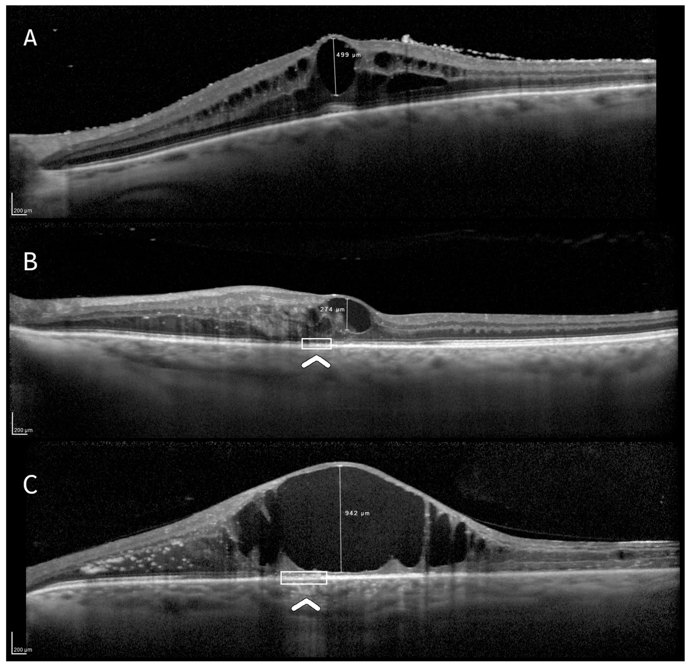
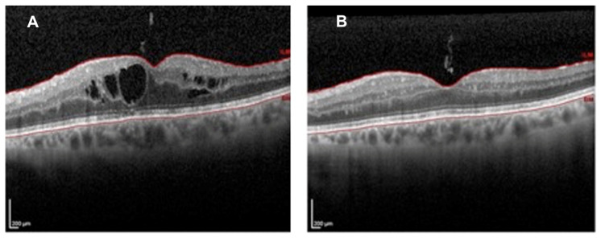
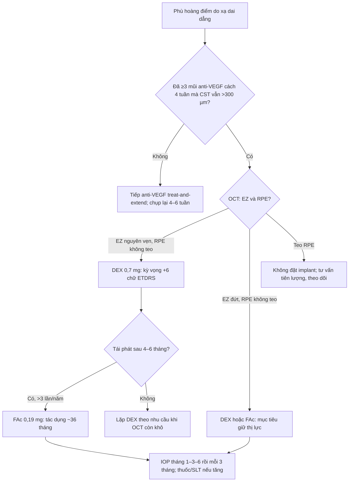
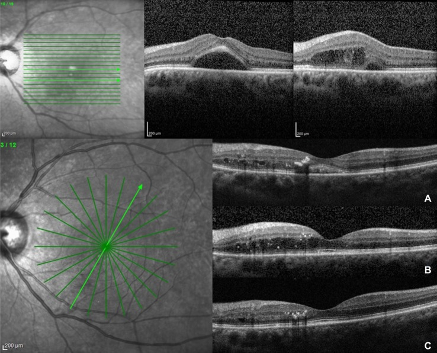
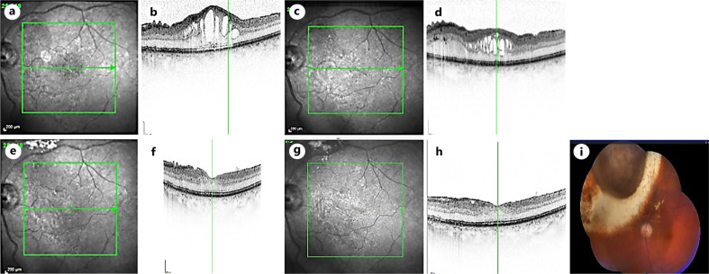

# 1418 — Phù hoàng điểm do xạ dai dẳng, kháng anti-VEGF: chọn implant dexamethasone 0,7 mg hay fluocinolone acetonide 0,19 mg / Recalcitrant radiation maculopathy: dexamethasone 0.7 mg versus fluocinolone acetonide 0.19 mg implant

**Tags:** `pattern:phu-hoang-diem` `pattern:phu-hoang-diem-do-xa` `pattern:khang-anti-vegf` `pattern:thoat-dich` `vung:hoang-diem` `vung:vong-mac` `vung:mat` `protocol:OCT` `protocol:OCTA` `protocol:FA` `protocol:anti-VEGF` `protocol:implant-corticoid` `score:CEA`
**Mức chắc chắn (certainty):** tổng hợp y văn (literature synthesis) — đọc toàn văn các loạt corticoid nội nhãn ở bệnh hoàng điểm do xạ, một nghiên cứu phân loại CEA 50 mắt, loạt fluocinolone 12 mắt và 8 mắt theo dõi 5 năm, cùng dữ liệu an toàn nhãn áp 171 mắt. **Không có RCT** so sánh trực tiếp dexamethasone với fluocinolone trong bệnh hoàng điểm do xạ; phần “chọn implant nào” là **suy luận (inference)** từ dược động học + ngưỡng nhãn áp + tiên lượng tế bào, đã ghi rõ tại chỗ.

> **Vì sao bài này quan trọng:** bài **1409** đã chốt **bệnh võng mạc do xạ** (liều, thời gian ủ bệnh, phân biệt với tái phát u) và dừng ở câu “anti-VEGF là nền tảng, corticoid khi kháng trị”. Nhưng câu hỏi hằng ngày trong phòng khám là: **sau 3–6 mũi anti-VEGF mà hoàng điểm vẫn phù, tiêm tiếp hay đổi sang implant corticoid; nếu đổi thì chọn loại tác dụng 4–6 tháng hay loại 36 tháng; và ai là người KHÔNG nên đặt implant vì đặt cũng không lấy lại được thị lực?** Bài này trả lời ba câu đó bằng ngưỡng định lượng, không bằng cảm tính.

## 1. Tổng quan bệnh học – cơ chế hình ảnh – vì sao “kháng anti-VEGF” là chuyện sinh học, không phải chuyện liều

### 1.1. Chuỗi bệnh học: từ đứt DNA nội mô đến phù dai dẳng

- **Khởi phát:** tia ion hóa gây **đứt sợi đôi DNA** ở **tế bào nội mô mao mạch và tế bào cận mao mạch (pericyte)** — hai loại tế bào phân bào đủ nhanh để tích lũy tổn thương. Hệ quả là **mất dần giường mao mạch, huyết khối vi mạch, thiếu máu võng mạc**, tăng sinh **VEGF**, phá vỡ **hàng rào máu–võng mạc** (*J Clin Med* 2026, PMC13608844; *Clin Ophthalmol* 2021, PMC8436254).
- **Vì sao phù xuất hiện muộn 12–18 tháng (khoảng 6 tháng–3 năm):** mao mạch có **dự trữ chức năng**; chỉ khi số tế bào nội mô mất vượt ngưỡng mới lộ **vùng không tưới máu** và rò huyết tương. Đây là lý do **bệnh sử xạ trị** mới là chốt chẩn đoán, không phải hình thái phù.
- **Vì sao phù kéo dài sau khi đã ức chế VEGF:** ngoài VEGF, còn **viêm thần kinh–võng mạc (neuroinflammation)** do **hoạt hóa microglia** và **loạn điều hòa cytokine**; trên OCT, các **điểm tăng phản xạ nội võng mạc (hyperreflective retinal foci, I-HRF)** là dấu hiệu sớm của thành phần này (*Cancers* 2025, PMC12345670). Anti-VEGF không trúng đích viêm này → **phù giảm một phần rồi tái phát dù tiêm đều**.
- **Vì sao corticoid trúng đích hơn ở giai đoạn này:** glucocorticoid **ức chế phiên mã VEGF**, giảm **IL-6/MCP-1**, tăng biểu hiện **occludin/claudin-5** ở tight junction và giảm bám dính–di chuyển bạch cầu. Đây là tác dụng **đa đích, không phụ thuộc nồng độ VEGF**, nên vẫn hiệu quả khi anti-VEGF thất bại.

### 1.2. Vì sao hai implant khác nhau hoàn toàn về dược động học (và do đó khác nhau về cách theo dõi)

| Đặc điểm | Dexamethasone 0,7 mg (DEX) | Fluocinolone acetonide 0,19 mg (FAc) |
|---|---|---|
| Nền tảng | Polymer **PLGA phân hủy sinh học** | Ống **polyimide không phân hủy**, đầu bịt silicone |
| Động học giải phóng | Bùng phát sớm rồi **giảm dần theo bậc một (first-order)** | **Gần bậc không (near zero-order)** trong ~36 tháng |
| Thời gian tác dụng thực tế | **4–6 tháng** (đỉnh 1–3 tháng) | **~36 tháng**, có dữ liệu tới **5 năm** |
| Đường tiêm | Bơm kim **22 G**, 3,5–4 mm sau rìa giác mạc | Bơm kim **25 G**, cùng đường vào pars plana |
| Hệ quả lâm sàng | **Lặp lại theo nhu cầu**, kiểm soát nhãn áp từng đợt | **Một lần, giảm gánh nặng tiêm**, nhưng nhãn áp phải theo dõi dài |

- **Hệ quả số 1:** DEX hợp với **phù còn hoạt động, cần “thử” đáp ứng** và với mắt **chưa từng tăng nhãn áp do corticoid**; FAc hợp với **phù tái phát ≥ 3 lần/năm**, mắt **đã chứng minh dung nạp corticoid** và bệnh nhân **khó tuân thủ lịch tiêm**.
- **Hệ quả số 2:** cả hai đều **ngoài chỉ định (off-label)** cho bệnh hoàng điểm do xạ — phải nói rõ với bệnh nhân và ghi hồ sơ.

### 1.3. Ngưỡng định lượng phải nhớ

| Biến số | Ngưỡng / con số | Ý nghĩa thực hành | Nguồn |
|---|---|---|---|
| Thời điểm khởi phát | Trung vị **12–18 tháng**; khoảng **6 tháng–3 năm** | Lịch OCT bắt đầu từ **6 tháng** sau xạ, không chờ triệu chứng | PMC12675579; PMC8436254 |
| Tần suất bệnh hoàng điểm do xạ | **25–50%** trong **2–5 năm** | Nhóm nguy cơ cao phải theo dõi chủ động | PMC13608844 |
| Dày trung tâm hoàng điểm (CST) | Bình thường **~250–270 µm**; **≥ 300 µm** = dày có ý nghĩa thực hành | Ngưỡng vào của bài; không phải ngưỡng guideline | Suy luận từ PMC13608844, PMC12675579 |
| “Kháng anti-VEGF” | **≥ 3 mũi anti-VEGF cách 4 tuần** mà CST **vẫn > 300 µm** hoặc **giảm < 10–15%** | Định nghĩa thực hành của bài, dùng để chọn implant | Suy luận (Fallico 2021 tổng quan) |
| DEX — hiệu quả | CST **407 µm (IQR 357–524) → giảm 120 µm** lúc 1 tháng; **+6,5 chữ ETDRS** | Đáp ứng đỉnh sớm; hết tác dụng **4–6 tháng** | Frizziero 2017 (PMID 28404670) |
| DEX — số mũi | **92 mũi / 50 mắt**, trung bình **1,8 mũi** (1–6) | Bệnh thật cần lặp; không tiêm cố định nếu OCT khô | PMC13608844 |
| DEX — nhãn áp | **22,0%** (11/50) tăng nhãn áp, **100%** kiểm soát bằng thuốc | Kiểm tra IOP **tuần 1, tháng 1–2–3** | PMC13608844 |
| FAc — hiệu quả | BCVA cuối **72,5 chữ ETDRS (≈ 20/32)**; CFT **328 µm**; khoảng tiêm **4,2 → 6,5 tháng**; **3,2 → 0,2 mũi/năm** | Giảm gánh nặng tiêm rõ nhất | PMC12675579 |
| FAc — 5 năm | **3/8** cải thiện, **2/8** ổn định, **2/8** giảm, **1/8** mất cảm giác sáng | Không phải “đặt một lần là xong” | PMC13363278 |
| FAc — nhãn áp | Tăng nhãn áp **24,6%** (42/171); **57%** chỉ cần thuốc, **SLT 7,0%**, **mổ 3,5%** | Yếu tố nguy cơ: **tuổi trẻ**, **đã có tăng nhãn áp/glôcôm** | PMC13047022 |
| Tiên lượng theo OCT (CEA) | EZ nguyên vẹn **+6,4 chữ**; EZ đứt **−2,8 chữ**; teo RPE **−11,7 chữ** | Teo RPE là yếu tố tiên lượng xấu mạnh nhất (**p = 0,007**) | PMC13608844 |
| Trần chức năng | BCVA nền **≤ 70 chữ** mới có khả năng tăng **≥ 5 chữ** khi võng mạc ngoài còn nguyên | Đừng hứa cải thiện ở mắt thị lực còn tốt | PMC13608844 |

### 1.4. Vì sao OCT — chứ không phải độ dày hoàng điểm — quyết định “đáng điều trị hay không”

- **Phù là phần chữa được; tế bào quang thụ là phần không chữa được.** Cùng CST 450 µm, một mắt còn **đường sáng ellipsoid (EZ)** sẽ hồi phục thị lực, một mắt đã **đứt EZ + teo biểu mô sắc tố (RPE)** sẽ chỉ hết phù mà không thấy hơn.
- **Phân loại CEA** (*J Clin Med* 2026, PMC13608844) lấy ba biến số trong **1 mm trung tâm**: **C** = đường kính dọc lớn nhất của nang lớn nhất; **E** = đứt EZ; **A** = teo RPE. Ba nhóm tương ứng ba tiên lượng, và đây là công cụ để **trả lời trước khi tiêm**: “hết phù thì thị lực có tăng không?”.
- **Vì sao vẫn phải điều trị dù tiên lượng kém:** phù kéo dài gây **kéo–biến dạng võng mạc**, **xuất tiết cứng**, và **teo tiến triển**; kiểm soát phù có thể **giữ** thị lực và giảm đau/biến dạng, ngay cả khi không tăng chữ.

*Ba mức tiên lượng của cùng một bệnh: (A) võng mạc ngoài còn nguyên → còn “đất” để hồi phục; (B) đứt EZ → hết phù nhưng thị lực thường đứng yên; (C) teo RPE → hết phù vẫn mất thị lực. Nguồn: Tạp chí 2026 (PMC13608844) Fig. 1, **CC BY 4.0**.*

## 2. Mẫu hình + chẩn đoán phân biệt theo “cái gì còn cứu được” (Gamut)

### 2.1. Trước hết, phân loại theo mục tiêu điều trị — không theo độ dày

- **Nhóm A — phù còn hoạt động, võng mạc ngoài nguyên vẹn (CEA: E0 A0):** mục tiêu là **đảo ngược phù và lấy lại thị lực**; đây là nhóm **hưởng lợi nhiều nhất** từ corticoid.
- **Nhóm B — phù + đứt EZ (E1 A0):** mục tiêu là **giữ thị lực, giảm biến dạng**; kỳ vọng **ổn định**, không hứa tăng.
- **Nhóm C — phù + teo RPE (A1):** mục tiêu là **giảm phù triệu chứng**, không kỳ vọng thị lực; **cân nhắc không đặt implant** nếu gánh nặng theo dõi lớn hơn lợi ích.
- **Nhóm D — phù kèm thiếu máu hoàng điểm nặng/FAZ giãn rộng:** corticoid có thể làm phù giảm nhưng **không tái tưới máu**; cần **PRP cho vùng thiếu máu ngoại vi** nếu có tân mạch, và **không kỳ vọng thị lực** từ implant đơn thuần.
- **Nhóm E — phù do nguyên nhân khác chồng lên:** đái tháo đường, tắc nhánh tĩnh mạch, viêm màng bồ đào, hội chứng Irvine-Gass sau mổ thể thủy tinh, màng trước võng mạc — **phải điều trị nguyên nhân song song**, nếu không implant chỉ “che” bệnh.

### 2.2. Gamut theo hình thái OCT

- **Phù dạng nang (cystoid):** điển hình nhất của bệnh hoàng điểm do xạ; nang lớn ở **lớp plexiform trong/INL**, có thể có **dịch dưới võng mạc**.
- **Phù lan tỏa (diffuse):** dày đều không nang; gặp ở thể sớm hoặc sau khi nang vỡ; dễ nhầm với **phù do đái tháo đường**.
- **Dịch dưới võng mạc đơn độc:** nghĩ **CNV do xạ**, **tái phát u**, hoặc **bong thanh dịch** — không phải phù nang thuần.
- **Nang + xuất tiết cứng vòng hoàng điểm:** bệnh đã lâu, tiên lượng xấu hơn; **hard exudates** là lipid thoát theo dịch.
- **Nang + teo RPE/võng mạc ngoài:** nhóm C ở trên.
- **Nang + tăng phản xạ nội võng mạc rải rác (I-HRF):** thành phần viêm thần kinh; gợi ý **corticoid hợp lý hơn anti-VEGF** (suy luận từ PMC12345670).

### 2.3. Gamut chẩn đoán phân biệt — “RADIO”

- **R** — **Recurrence** (tái phát u dưới hoàng điểm): khối dày lên, dịch trên u, siêu âm B-scan thấy u; **không đáp ứng corticoid**.
- **A** — **Atrophy** (teo RPE/võng mạc ngoài): phù ít nhưng thị lực kém; **implant không giúp**.
- **D** — **Diabetes** (phù hoàng điểm đái tháo đường): xuất tiết cứng, vi phình mạch, **đáp ứng cả anti-VEGF và corticoid** nhưng cần kiểm soát đường huyết.
- **I** — **Inflammation** (viêm màng bồ đào, Irvine-Gass): tế bào/flare, phù sau mổ thể thủy tinh; corticoid là điều trị chính.
- **O** — **Occlusion** (tắc tĩnh mạch, thiếu máu): xuất huyết theo vùng, FA thấy vùng không tưới máu; **PRP** cho tân mạch, implant chỉ hỗ trợ phù.

## 3. Bảng so sánh phân biệt (ma trận đối chiếu)

| Thực thể (entity) | Hình ảnh/lâm sàng điển hình | Chốt vào (rule-in) | Chốt loại (rule-out) | Gợi ý xác nhận |
|---|---|---|---|---|
| **Phù do xạ — nhóm A (EZ nguyên vẹn)** | Tiền sử xạ **45–55 Gy** hoặc plaque; phù nang, **EZ liên tục**, không teo RPE; CST **≥ 300 µm** | **EZ nguyên vẹn + không teo RPE + phù nang trung tâm**; đáp ứng kém sau **≥ 3 mũi anti-VEGF** | **Đứt EZ hoặc teo RPE rõ** → nhóm B/C, tiên lượng kém | SD-OCT 6 mm; CEA; so phim cũ |
| **Phù do xạ — nhóm B (đứt EZ)** | Nang + **mất liên tục dải EZ** dưới hố trung tâm; CST cao | **Đứt EZ trên ≥ 2 lát cắt qua hố trung tâm** | **EZ còn liên tục** → nhóm A; **teo RPE** → nhóm C | SD-OCT lát mỏng 3 µm; chụp lại sau 1 tháng |
| **Phù do xạ — nhóm C (teo RPE)** | Nang nhỏ + **teo RPE/võng mạc ngoài**, thị lực kém dù phù ít | **Teo RPE trong 1 mm trung tâm**; OCTA giảm tín hiệu choriocapillaris | **RPE liên tục** → không phải nhóm C | SD-OCT + OCTA; FAF |
| **Tái phát u dưới hoàng điểm** | Khối dày lên, **dịch trên u**, có thể xuất huyết; bờ không đều | **U dày thêm trên B-scan** hoặc **tăng kích thước so phim**; bản đồ liều khớp vị trí | **Không thay đổi kích thước qua 3–6 tháng** + phù kiểu nang → do xạ | B-scan 10–20 MHz; so sánh MRI/ảnh cũ; hội chẩn ung thư |
| **Phù hoàng điểm đái tháo đường** | Xuất tiết cứng vòng hoàng điểm, vi phình mạch, phù lan tỏa | **Đái tháo đường + vi phình mạch + xuất tiết cứng** | **Tiền sử xạ + không có vi phình mạch** → do xạ | FA; OCTA; HbA1c |
| **Irvine-Gass sau mổ thể thủy tinh** | Phù nang xuất hiện **4–12 tuần** sau phaco/PPV; có thể tự khỏi | **Mổ thể thủy tinh gần đây + phù nang không có nguyên nhân khác** | **Tiền sử xạ và tổn thương khớp bản đồ liều** → do xạ | OCT; FA thấy rò từ đĩa thị |
| **Tắc nhánh tĩnh mạch võng mạc** | Xuất huyết theo vùng, phù hoàng điểm, **vùng thiếu máu** trên FA | **Xuất huyết theo lãnh thổ + FA vùng không tưới máu** | **Không xuất huyết theo lãnh thổ** → do xạ | FA/FAF; OCTA |
| **Bệnh hoàng điểm do xạ + tân mạch** | Phù + **tân mạch đĩa/võng mạc**, xuất huyết dịch kính | **Tân mạch trên FA/OCTA** | **Không tân mạch** → chỉ phù | FA toàn bộ; PRP nếu tân mạch |
| **Tăng nhãn áp do corticoid (biến chứng, không phải chẩn đoán phù)** | IOP **≥ 25 mmHg** và/hoặc **tăng ≥ 10 mmHg** so nền sau implant | **IOP tăng sau tiêm, hết sau giảm corticoid** | **IOP không đổi sau nhiều đợt** → ít khả năng do corticoid | Đo IOP tuần 1–tháng 3; gonioscopy |

*(A) Trước tiêm: phù nang trung tâm + dịch dưới võng mạc. (B) Sau 2 tháng: nang xẹp, đường viền hố trung tâm hồi phục. Đây là kiểu đáp ứng “đảo ngược được” của nhóm A; nhóm C hết phù nhưng không lấy lại thị lực. Nguồn: *J Clin Med* 2020 (PMC7693915) Fig. 10, **CC BY 4.0**.*

## 4. Protocol chụp – tiêm – theo dõi + hệ phân độ

### 4.1. Chụp và đo trước khi quyết định

- **SD-OCT hoàng điểm** (khối 6 × 6 mm, lát 3 µm, 19–31 lát) là **bắt buộc**: đo CST, tìm nang, **đứt EZ**, **teo RPE**, **I-HRF**, dịch dưới võng mạc.
- **OCTA 3 × 3 hoặc 6 × 6 mm** khi nghi thiếu máu/ tân mạch: đo **FAZ**, mật độ mao mạch, tín hiệu choriocapillaris.
- **FA/FAF** khi: nghi tân mạch, nghi tái phát u, phù không điển hình, hoặc trước quyết định PRP.
- **B-scan 10–20 MHz** khi phương tiện trong suốt kém (đục thể thủy tinh, xuất huyết dịch kính) — **không được bỏ qua vì OCT không thấy đáy**.
- **Đo IOP, soi góc, khám thể thủy tinh** trước mỗi lần tiêm corticoid; ghi **tiền sử tăng nhãn áp do corticoid** và **glôcôm đang điều trị**.

### 4.2. Chọn implant — lưu đồ

### 4.3. Kỹ thuật và liều

- **DEX 0,7 mg:** tiêm **22 G** qua pars plana **3,5–4 mm** sau rìa giác mạc; **không tiêm nếu có nhiễm trùng hoạt động** hoặc **glôcôm không kiểm soát**. Lặp lại **khi OCT thấy phù tái phát**, thường **4–6 tháng/lần**; không lặp theo lịch cố định nếu hoàng điểm khô.
- **FAc 0,19 mg:** tiêm **25 G** qua pars plana; tác dụng **~36 tháng**. Dùng khi **đã dung nạp corticoid** (không tăng IOP ở đợt DEX trước) và **gánh nặng tiêm > 3 lần/năm**. **Không dùng** ở mắt **đã có glôcôm tiến triển** hoặc **không theo dõi được IOP**.
- **Corticoid khác:** triamcinolone (IVTA) rẻ nhưng tác dụng **2–3 tháng**, nguy cơ tăng IOP tương tự; chỉ dùng khi không có implant.
- **Phối hợp:** **PRP** cho vùng thiếu máu có tân mạch; **focal laser** chỉ cho rò khu trú, không cho phù lan tỏa (kết cục laser đơn thuần kém — Fallico 2021).

### 4.4. Lịch theo dõi (lấy từ các loạt có số)

| Thời điểm | Việc làm | Ngưỡng hành động |
|---|---|---|
| Sau DEX **tuần 1** | IOP, đèn khe, OCT nếu bất thường | IOP **≥ 25 mmHg** hoặc **tăng ≥ 10 mmHg** → thuốc hạ nhãn áp |
| Sau DEX **tháng 1** | OCT + BCVA + IOP | CST giảm < 10% → cân nhắc không lặp DEX |
| Sau DEX **tháng 2–3** | OCT + IOP | Phù tái phát → lặp; IOP còn cao → SLT/thuốc |
| Sau DEX **tháng 4–6** | OCT | Đây là cửa sổ tái phát điển hình (Frizziero) |
| Sau FAc **tháng 1–3–6** | IOP + OCT | IOP **≥ 25 mmHg** → thuốc; **≥ 30 mmHg** hoặc không đáp ứng → SLT/ phẫu thuật |
| Sau FAc **mỗi 3 tháng** | IOP, OCT, BCVA | Tăng nhãn áp muộn vẫn có thể xảy ra; theo dõi tới **36 tháng** |
| Sau **5 năm** | Đánh giá kết cục | **3/8 cải thiện, 2/8 ổn định, 2/8 giảm, 1/8 NPL** — tư vấn trước |

## 5. Biến thể bình thường và cạm bẫy

- **Cạm bẫy 1 — “hết phù = thành công”:** ở nhóm B/C, CST giảm **200 µm** nhưng BCVA **giảm 11,7 chữ**. Phải đặt mục tiêu chức năng trước khi tiêm, và **ghi vào hồ sơ**.
- **Cạm bẫy 2 — nhầm tăng nhãn áp do corticoid với tiến triển bệnh:** IOP tăng sau tiêm **không** có nghĩa là bệnh xấu đi; ngược lại, **giảm liều/ngừng corticoid** có thể làm phù bùng lại. Đo IOP đúng lịch và điều trị **song song**, không đổi chẩn đoán.
- **Cạm bẫy 3 — implant di trú vào tiền phòng:** gặp ở mắt **đã mổ thể thủy tinh không còn bao sau/aphakia**, hoặc **đặt quá trước**. Soi góc sau tiêm; nếu implant nằm trong tiền phòng → **lấy ra** và xử trí như bài **1411** (tăng nhãn áp do corticoid nội nhãn).
- **Cạm bẫy 4 — hiệu ứng mắt đối bên:** DEX có **hấp thu hệ thống**; đã có ca **một mắt tiêm, mắt kia không tiêm 4 năm vẫn cải thiện** (PMC6561037). Đừng gán cải thiện mắt đối bên cho “điều trị thành công” của mắt đó.
- **Cạm bẫy 5 — bỏ sót tái phát u:** phù có thể là **dấu hiệu duy nhất** của u hoạt động dưới hoàng điểm; **luôn so B-scan/MRI với phim cũ** trước khi tiêm corticoid, vì corticoid có thể **che dấu viêm/u** tạm thời.
- **Cạm bẫy 6 — đục thể thủy tinh do corticoid:** tăng nhanh sau nhiều đợt; ở mắt còn thể thủy tinh, **phải tư vấn trước** và phối hợp phaco nếu cần.
- **Cạm bẫy 7 — “anti-VEGF thất bại” vì tiêm không đủ dày:** trước khi kết luận kháng trị, xác nhận **≥ 3 mũi cách 4 tuần** và **không có nguyên nhân khác** (Irvine-Gass, tắc tĩnh mạch, tái phát u).

## 6. Tự lượng giá — Blind Quiz

**Ca 1 — Nam 62 tuổi, plaque I-125 cho melanoma màng mạch 3 năm trước; nhìn mờ 2 tháng. Ảnh OCT dưới đây.**

- Câu hỏi: nang lớn nhất đo bao nhiêu? EZ và RPE còn nguyên không? Nếu đã tiêm 4 mũi aflibercept mà CST vẫn 480 µm, bạn kỳ vọng thị lực tăng bao nhiêu sau implant?

<b>Bấm để hiện đáp án</b>

- Hình **A**: nang **499 µm**, **EZ nguyên vẹn**, **RPE nguyên vẹn** → nhóm A.
- Đây là nhóm **hưởng lợi nhất**: trung bình **+6,4 chữ ETDRS** sau DEX; trần chức năng nếu BCVA nền **≤ 70 chữ**.
- Kế hoạch: **DEX 0,7 mg**, hẹn **tuần 1** đo IOP, **tháng 1** OCT; lặp khi phù tái phát (thường **4–6 tháng**).
- Nguồn ảnh: *J Clin Med* 2026 (PMC13608844) Fig. 1A, **CC BY 4.0**.

**Ca 2 — Nữ 46 tuổi, proton beam cho melanoma màng mạch 25 tháng trước; CST 502 µm, BCVA 6/12. Một mũi DEX. Xem OCT theo thời gian.**

- Câu hỏi: vì sao một mũi lại kéo dài 16 tháng? Khi nào bạn lặp lại? Có nên đặt FAc ngay từ đầu không?

<b>Bấm để hiện đáp án</b>

- (A) Trước tiêm: **dịch dưới võng mạc + nang nội võng mạc**. Sau **2 tháng** (B) và **8 tháng** (C): phù xẹp, hố trung tâm hồi phục; **16 tháng** vẫn giữ.
- Đây là **ngoại lệ thuận lợi**: đa số hết tác dụng **4–6 tháng**. Không có dấu hiệu nào trên OCT dự báo trước “ai kéo dài 16 tháng” → **theo dõi bằng OCT, không lặp theo lịch**.
- **Không đặt FAc ngay** khi mới một mũi và đáp ứng tốt: FAc là lựa chọn khi **tái phát > 3 lần/năm** hoặc **không tuân thủ được**.
- Nguồn ảnh: *Int Med Case Rep J* 2016 (PMC5138021) Fig. 2, **CC BY-NC 3.0 — nguyên bản**.

**Ca 3 — Nữ 58 tuổi, bệnh hoàng điểm do xạ tái phát 5 lần trong 2 năm, đã tiêm 9 mũi anti-VEGF + 3 mũi DEX; IOP nền 16 mmHg, chưa từng tăng nhãn áp; BCVA 68 chữ, CFT 410 µm.**

- Câu hỏi: chọn DEX lần nữa hay FAc? Cần theo dõi gì và trong bao lâu? Kỳ vọng thị lực 5 năm?

<b>Bấm để hiện đáp án</b>

- **FAc 0,19 mg** hợp lý: **> 3 lần/năm**, đã dung nạp DEX, BCVA còn tốt, **chưa có glôcôm**. Kỳ vọng: BCVA cuối **~72 chữ**, CFT **~328 µm**, giảm **3,2 → 0,2 mũi/năm**.
- Theo dõi **IOP tháng 1–3–6 rồi mỗi 3 tháng**: tăng nhãn áp **24,6%**, **57%** chỉ cần thuốc, **SLT 7%**, **mổ 3,5%**; nguy cơ cao ở **tuổi trẻ** và **tiền sử tăng nhãn áp**.
- 5 năm: **3/8 cải thiện, 2/8 ổn định, 2/8 giảm, 1/8 mất cảm giác sáng** → tư vấn trước, không hứa “một lần là xong”.
- Nguồn ảnh: *Ocul Oncol Pathol* 2026 (PMC13363278) Fig. 3, **CC BY-NC 4.0 — nguyên bản**.

## Bài liên quan chéo
- [1409 – Bệnh võng mạc do xạ sau xạ trị u nội nhãn/hốc mắt](../1409-benh-vong-mac-do-xa-sau-xa-tri/lesson.md) (liều, thời gian ủ bệnh, phân biệt với tái phát u)
- [1411 – Tăng nhãn áp do corticoid nội nhãn](../1411-tang-nhan-ap-do-corticoid-noi-nhan/lesson.md) (biến chứng của chính implant)
- [1404 – Biến chứng muộn của anti-VEGF](../1404-bien-chung-man-anti-vegf/lesson.md) (tachyphylaxis, đổi thuốc)
- [1410 – Lấy dầu silicone và dầu tồn lưu](../1410-lay-dau-silicone-va-dau-ton-luu/lesson.md) (mắt đã phẫu thuật nhiều lần)
- [442 – OCT trong glôcôm](../442-glaucoma-OCT/lesson.md) (đo RNFL khi theo dõi corticoid dài hạn)

> Không dùng để chẩn đoán độc lập khi chưa có người hướng dẫn.
