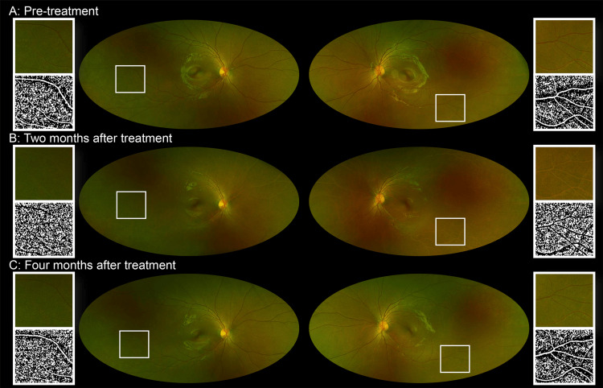
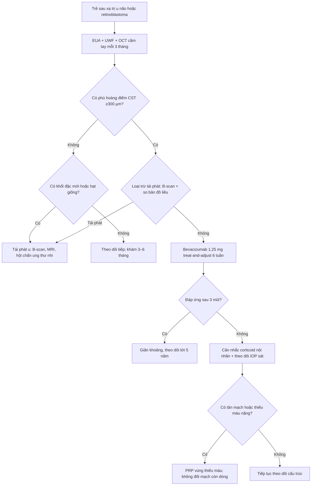
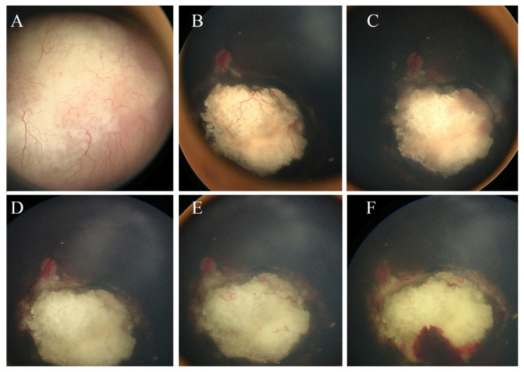
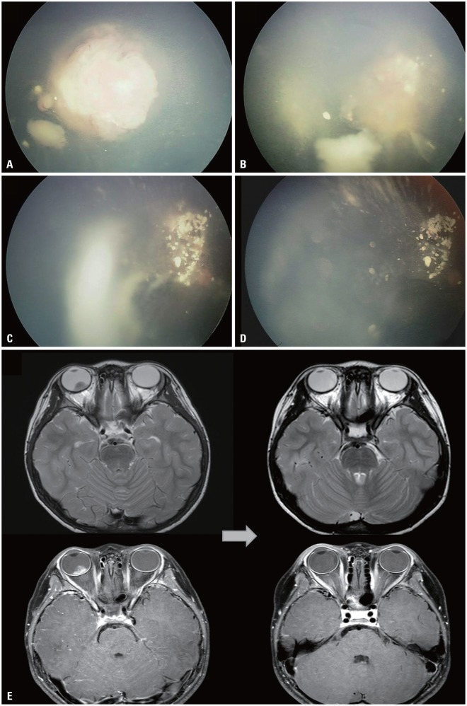
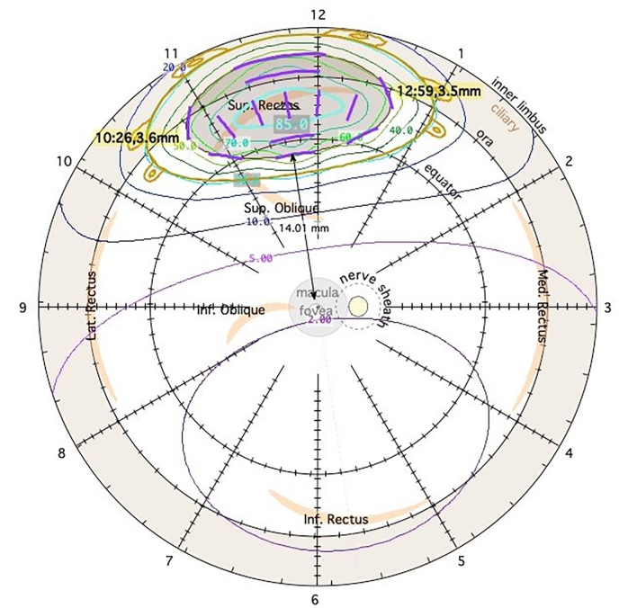

# 1419 — Bệnh võng mạc do xạ ở TRẺ sau xạ trị u não/retinoblastoma: ngưỡng liều, lịch OCT/OCTA, phân biệt tái phát u với biến chứng xạ / Pediatric radiation retinopathy after radiotherapy for brain tumors or retinoblastoma

**Tags:** `pattern:vi-mach-tac` `pattern:phu-hoang-diem` `pattern:xuat-huyet-vong-mac` `pattern:teo-vong-mac` `pattern:tai-phat-u` `vung:vong-mac` `vung:hoang-diem` `vung:dia-thi` `vung:mat` `protocol:OCT-OCTA` `protocol:UWF` `protocol:EUA` `protocol:anti-VEGF` `score:ICRB`
**Mức chắc chắn (certainty):** tổng hợp y văn (literature synthesis) — đọc toàn văn loạt **30 mắt** trẻ sau xạ toàn bộ bằng bevacizumab, loạt **20 mắt** retinoblastoma đặt plaque I-125, một ca **11 tuổi** sau xạ 23,4 Gy, tổng quan hệ thống về liều–tần suất, và các loạt xạ trị retinoblastoma. **Không có RCT riêng cho trẻ**; phần “ngưỡng liều theo tuổi” là **suy luận (inference)** từ sinh học mô đang phát triển + dữ liệu liều–thể tích, đã ghi rõ tại chỗ.

> **Vì sao bài này quan trọng:** bài **1409** viết bệnh võng mạc do xạ ở **người lớn** với ngưỡng **45–55 Gy vào ≥ 1/2 võng mạc**. Trẻ khác ở ba điểm quyết định: **(1) mắt còn lớn dần** nên cùng một liều chiếu vào **thể tích tương đối lớn hơn**; **(2) trẻ không tự báo mờ mắt** — bệnh chỉ được thấy khi chủ động chụp; **(3) sau xạ trị retinoblastoma, một tổn thương mới có thể là TÁI PHÁT U chứ không phải biến chứng xạ** — nhầm hai hướng này dẫn tới **xạ lại/enucleation oan** hoặc **bỏ sót u**. Bài này là bài “đọc đúng thì cứu mắt, đọc sai thì mất mắt” ở trẻ.

## 1. Tổng quan bệnh học – cơ chế hình ảnh – vì sao trẻ không giống người lớn

### 1.1. Cùng một chuỗi bệnh học, nhưng “liều sinh học” khác

- **Bệnh học:** tia ion hóa gây **đứt sợi đôi DNA** ở **nội mô mao mạch và pericyte** → mất dần giường mao mạch, huyết khối vi mạch, thiếu máu, tăng **VEGF**, phá vỡ hàng rào máu–võng mạc (*Clin Ophthalmol* 2021, PMC8436254; *J Clin Med* 2026, PMC13608844). Ở trẻ, mô đích **đang tăng sinh và đang mọc mạch** nên cùng một liều có thể để lại **tổn thương mạch máu lớn hơn về tỷ lệ thể tích** — đây là suy luận sinh học, không phải con số đã đo.
- **Vì sao trẻ có thể phản ứng ở liều thấp hơn ngưỡng người lớn:** ca **11 tuổi** sau xạ **23,4 Gy/13 phân liều (1,8 Gy/lần)** cho u mầm tuyến yên có **trắng mạch máu võng mạc ngoại vi hai bên** sau 2 tháng, **OCTA vẫn có dòng chảy**, thị trường bình thường, và **tự hết sau 2 tháng** (*Cureus* 2025, PMC11973395). Đây **không phải** bệnh võng mạc do xạ điển hình (không thiếu máu, không phù, không tân mạch) — nhưng chứng minh **mạch máu trẻ phản ứng ở liều thấp** và có thể **hồi phục**, nên **không được đốt laser vội**.
- **Vì sao liều theo phân liều quan trọng hơn tổng liều:** với **α/β = 2 Gy** cho tổn thương mạch muộn, **BED₂ = nd(1 + d/2)**:
  - **40 Gy / 20 lần × 2 Gy** → BED₂ = 40 × (1 + 1) = **80 Gy₂**;
  - **23,4 Gy / 13 lần × 1,8 Gy** → BED₂ = 23,4 × (1 + 0,9) = **44,5 Gy₂**.
  - Nghĩa là **23,4 Gy chia nhỏ vẫn “nhẹ” hơn 40 Gy chuẩn**, dù cùng nằm trong “vùng liều thấp”; ngược lại, **một liều lớn mỗi lần** làm BED₂ tăng nhanh — đây là lý do các phác đồ trẻ dùng **1,8–2 Gy/lần**.

### 1.2. Ngưỡng định lượng đã có (và chỗ còn trống)

| Tình huống | Liều / con số | Kết quả định lượng | Nguồn |
|---|---|---|---|
| Xạ ngoài cho retinoblastoma (truyền thống) | **40–50 Gy**, **1,8–2 Gy/lần** | Nhóm được chọn có **30 mắt** đều có phù hoàng điểm do xạ; CST **511 → 389 µm** (2 tháng) → **263 µm** (2 năm) | Villegas 2026 (PMID 42004668) |
| Xạ ngoài liều thấp hơn | **< 36 Gy** | Báo cáo có kiểm soát u, ít di chứng hơn — nhưng **kiểm soát tại chỗ thấp hơn** | *Yonsei Med J* 2015 (PMC4630033) |
| Plaque I-125 ở trẻ (RB kháng trị) | **Liều đỉnh 45 Gy** | **Bệnh võng mạc do xạ 15% (3/20)**; đục thể thủy tinh **35%**; xuất huyết u **30%**; bong võng mạc **20%**; glôcôm tân mạch **5%**; giữ mắt **70%**; theo dõi trung bình **36 tháng** | *J Clin Med* 2025 (PMC11901221) |
| Xạ toàn bộ/trường não–đầu cổ (mọi lứa tuổi) | **< 50 Gy** | **Không ca bệnh võng mạc do xạ** trong tổng quan; **6,0%** bệnh võng mạc, **2,0%** bệnh thần kinh thị; gộp chung **3,8%** | *Cancers* 2023 (PMC10093581) |
| Trẻ 11 tuổi, u mầm tuyến yên | **23,4 Gy / 13 lần** | **Trắng mạch ngoại vi hai bên** sau 2 tháng, **OCTA có dòng**, tự hết sau 2 tháng | *Cureus* 2025 (PMC11973395) |
| Dự phòng bằng anti-VEGF (người lớn) | — | Giảm bệnh hoàng điểm do xạ **OR 0,50** (0,34–0,74); giảm bệnh thần kinh thị **OR 0,62** | *Clin Ophthalmol* 2023 (PMC10577260) |
| Điều trị anti-VEGF ở trẻ sau xạ | **Bevacizumab 1,25 mg**, treat-and-adjust **6 tuần** | **8,2 mũi** năm 1; **7,6 mũi** năm 3; **5,9 mũi** năm 5; CST **511 → 263 µm** lúc 2 năm | Villegas 2026 (PMID 42004668) |

- **Chỗ còn trống (phải nói rõ):** **không có ngưỡng liều riêng cho trẻ** được xác lập bằng nghiên cứu tiến cứu. Ngưỡng **45–55 Gy** là của người lớn; trẻ có thể có thay đổi mạch máu ở liều thấp hơn nhưng **phần lớn là thoáng qua**. Vì vậy **không hạ ngưỡng can thiệp**, chỉ **hạ ngưỡng theo dõi**.

### 1.3. Vì sao “phát hiện sớm” lại quan trọng hơn ở trẻ

- **Trẻ không mô tả được triệu chứng:** nhìn mờ một mắt bị bỏ qua cho tới khi **lác** hoặc **nhược thị** xuất hiện. Ở trẻ còn trong “cửa sổ nhược thị”, **vài tháng phù hoàng điểm** có thể để lại **mất thị lực vĩnh viễn** dù sau đó phù hết.
- **Không có “triệu chứng vàng” nào thay cho OCT:** loạt 30 mắt cho thấy phù có thể **dao động qua nhiều năm** (điều trị tới **năm 5**), nên lịch chụp định kỳ là công cụ duy nhất.
- **Tiên lượng phụ thuộc tế bào quang thụ, không phụ thuộc độ dày:** cùng nguyên tắc **CEA** đã nêu ở bài **1418** — EZ còn nguyên thì còn hồi phục; EZ đứt/teo RPE thì hết phù vẫn mất thị lực.

## 2. Mẫu hình + chẩn đoán phân biệt theo thời gian và theo “u hay không u” (Gamut)

### 2.1. Gamut theo thời điểm sau xạ

- **Trong xạ – vài tuần:** phản ứng viêm cấp, phù đĩa thị nhẹ, có thể **trắng mạch máu thoáng qua** (như ca 23,4 Gy).
- **2–6 tháng:** **trắng mạch ngoại vi**, xuất huyết nhỏ, **phù hoàng điểm sớm**; đây là cửa sổ **can thiệp sớm nhất**.
- **6 tháng–3 năm:** bệnh võng mạc do xạ điển hình — phù nang, xuất tiết cứng, vi phình mạch, **vùng không tưới máu**, tân mạch.
- **> 3–5 năm:** teo võng mạc–hắc mạc, **teo đĩa thị**, glôcôm tân mạch, **đục thể thủy tinh**, xuất huyết dịch kính; ở trẻ còn **nguy cơ u thứ hai** trong trường xạ.

### 2.2. Gamut theo hình thái — “CHILD”

- **C** — **Cataract** (đục thể thủy tinh do xạ): giảm thị lực từ từ, **không phù**; che mất đáy mắt → phải **B-scan**.
- **H** — **Hemorrhage** (xuất huyết võng mạc/dịch kính): do **mạch máu xạ tổn thương** hoặc **tân mạch**; phân biệt với **xuất huyết trong u**.
- **I** — **Ischemia** (vùng không tưới máu): FA/OCTA thấy **mất tín hiệu mao mạch**; có thể dẫn tới tân mạch.
- **L** — **Leakage** (phù hoàng điểm): dấu hiệu **chữa được** và là mục tiêu điều trị chính.
- **D** — **Disc** (bệnh thần kinh thị do xạ): phù đĩa thị, xuất huyết quanh đĩa; khác với **phù đĩa do tăng áp lực nội sọ** hoặc **xâm lấn u**.

### 2.3. Câu hỏi số 1 ở trẻ sau xạ RB: “tổn thương mới là U hay là XẠ?”

- **U tái phát:** khối **đặc, dày lên**, có thể **hạt giống dịch kính (vitreous seeds)**, **tăng kích thước theo tháng**, **ngấm thuốc trên MRI**, **không đáp ứng corticoid**.
- **Biến chứng xạ:** **phù nang**, **xuất huyết rải rác**, **trắng mạch**, **teo võng mạc–hắc mạc**, **không có khối đặc mới**, **ổn định hoặc tự hết** theo thời gian.
- **Bẫy nguy hiểm:** **xuất huyết sau xạ** tại vị trí u đã thoái triển có thể **trông như tái phát**; loạt trẻ đặt plaque cho thấy **xuất huyết u 30%**, thường **trong 6 tháng đầu**, và **tự hết trong 6 tháng** ở ca được mô tả (*J Clin Med* 2025, PMC11901221).

## 3. Bảng so sánh phân biệt (ma trận đối chiếu)

| Thực thể (entity) | Hình ảnh/lâm sàng điển hình | Chốt vào (rule-in) | Chốt loại (rule-out) | Gợi ý xác nhận |
|---|---|---|---|---|
| **Bệnh võng mạc do xạ ở trẻ** | Tiền sử xạ **40–50 Gy** hoặc plaque **45 Gy**; phù nang, xuất huyết, trắng mạch, telangiectasia; **không có khối đặc mới** | **Phù nang + tổn thương mạch máu khớp bản đồ liều, không có khối đặc**; CST **≥ 300 µm** | **Khối đặc dày lên** → tái phát u; **chỉ trắng mạch không thiếu máu** → phản ứng thoáng qua | SD-OCT cầm tay; UWF; OCTA; B-scan |
| **Tái phát retinoblastoma** | Khối **đặc** mới/tái phát, **hạt giống dịch kính**, có thể xuất huyết; tăng kích thước | **Tăng kích thước trên B-scan qua 3–6 tháng**; **ngấm thuốc trên MRI**; hạt giống mới | **Không thay đổi kích thước + phù nang khớp vùng xạ** → biến chứng xạ | B-scan 10–20 MHz; MRI não–hốc mắt; hội chẩn ung thư nhi |
| **Trắng mạch máu thoáng qua sau xạ liều thấp** | Trẻ **11 tuổi**, **23,4 Gy/13 lần**; trắng mạch ngoại vi **2 tháng**, **OCTA có dòng**, thị trường bình thường | **OCTA còn dòng chảy + tự hết trong 2 tháng** | **Mất tín hiệu dòng chảy/OCTA** → thiếu máu thật | OCTA 15 × 15 mm; thị trường; chụp lại 2 tháng |
| **Xuất huyết sau xạ tại u đã thoái triển** | Xuất huyết **tại vị trí u cũ**, thường **≤ 6 tháng** sau plaque/PBT; không có khối mới | **Xuất huyết tự hết trong 6 tháng, không có khối đặc mới** | **Khối đặc + hạt giống** → tái phát | So ảnh màu + B-scan qua 3–6 tháng |
| **Bệnh hoàng điểm do xạ** | Phù nang trung tâm, CST **≥ 300 µm**, có thể dịch dưới võng mạc | **Nang + dày trung tâm hoàng điểm, không có khối u** | **Dịch trên u/khối đặc** → tái phát/u hoạt động | SD-OCT; so bản đồ liều |
| **Bệnh thần kinh thị do xạ** | Phù đĩa thị, xuất huyết quanh đĩa, giảm thị lực **sớm**; thường liều **> 50 Gy** vào đĩa | **Phù đĩa + tổn thương khớp liều, không có khối u ở đĩa** | **Phù đĩa hai bên + tăng áp lực nội sọ** → tìm nguyên nhân khác | MRI; OCT RNFL/GCL; so sánh hai mắt |
| **Glôcôm tân mạch sau xạ** | Nhãn áp cao, tân mạch mống mắt/góc, có thể sau xuất huyết dịch kính | **Tân mạch góc + IOP cao** | **IOP bình thường, không tân mạch** → loại trừ | Soi góc; IOP; FA |
| **Đục thể thủy tinh do xạ** | Mờ dần, **không đau**, đáy mắt khó thấy | **Đục TTT khớp vùng xạ, không có khối sau TTT** | **Đục + khối sau TTT** → phải B-scan loại trừ u | Đèn khe; B-scan |
| **Coats-like exudative response sau xạ** | Xuất tiết cứng nhiều, bong thanh dịch, **telangiectasia**; có thể giống Coats | **Xuất tiết cứng + telangiectasia trong vùng xạ** | **Vôi hóa/khối đặc ở trẻ < 5 tuổi** → nghĩ RB, không phải Coats | FA; B-scan; OCT |

*Chuỗi ảnh siêu rộng (ultra-widefield SLO) trước xạ (A), 2 tháng (B) và 4 tháng (C) sau xạ **23,4 Gy/13 lần**. Ở (B) có **trắng mạch ngoại vi** hai bên — trông như vùng không tưới máu — nhưng **OCTA vẫn có dòng chảy**, thị trường bình thường, và (C) **tự hết**. Đây là cạm bẫy “đốt laser trên mạch còn sống”. Nguồn: *Cureus* 2025 (PMC11973395) Fig. 1, **CC BY 4.0**.*

## 4. Protocol chụp – điều trị – theo dõi ở trẻ

### 4.1. Khung khám và chụp

- **Khám dưới mê (EUA)** là chuẩn ở trẻ nhỏ: **soi đáy mắt gián tiếp + ảnh siêu rộng (RetCam/Optos) + SD-OCT cầm tay + B-scan 10–20 MHz**; thêm **UBM** nếu nghi tổn thương thể mi/góc.
- **Lịch gợi ý (khung thực hành, không phải guideline duy nhất):** **mỗi 3 tháng trong 2 năm đầu**, **mỗi 6 tháng tới 5 năm**, **hằng năm sau đó**; bất kỳ **giảm thị lực, lác mới, hoặc tổn thương mới** → khám ngay.
- **OCT/OCTA:** ưu tiên **OCT cấu trúc** (phát hiện phù, đứt EZ, teo RPE) ở mọi lần khám; **OCTA** khi trẻ hợp tác hoặc khi cần phân biệt **trắng mạch do thiếu máu thật** với **phản ứng thoáng qua**. Ở trẻ nhỏ, OCT cầm tay dưới mê cho **cấu trúc** tốt hơn OCTA.
- **MRI não–hốc mắt** theo phác đồ ung thư (không thay thế OCT): dùng khi nghi **tái phát/xâm lấn**, hoặc tổn thương không giải thích được bằng đáy mắt.

### 4.2. Điều trị

- **Anti-VEGF là bước đầu khi có phù hoàng điểm:** **bevacizumab 1,25 mg** nội nhãn, **treat-and-adjust khởi đầu 6 tuần**, giãn dần khi khô. Loạt trẻ sau xạ cho thấy **8,2 mũi năm 1**, **7,6 mũi năm 3**, **5,9 mũi năm 5**, CST **511 → 263 µm** lúc 2 năm.
- **Điều trị sớm hơn cho kết cục tốt hơn:** tổng quan “bài học” của Finger nhấn mạnh **can thiệp trước khi có tổn thương tế bào quang thụ**, không chờ thị lực giảm (*Eye* 2023, PMC10050069).
- **Corticoid nội nhãn:** dùng **thận trọng** ở trẻ — nguy cơ **tăng nhãn áp**, **đục thể thủy tinh**, và **chưa có dữ liệu lớn ở trẻ**; chỉ cân nhắc khi **kháng anti-VEGF** và đã loại trừ nhiễm trùng/tái phát. Quy tắc chọn implant giống bài **1418**, nhưng ngưỡng theo dõi IOP phải **dày hơn**.
- **Laser:** **PRP** cho **vùng thiếu máu có tân mạch**; **không đốt** vùng chỉ “trắng mạch” mà **OCTA còn dòng**.
- **Đục thể thủy tinh:** phaco + IOL khi ảnh hưởng thị lực/theo dõi; **luôn B-scan trước** để loại trừ u sau thể thủy tinh.

### 4.3. Lưu đồ quyết định

### 4.4. Ngưỡng theo dõi nhãn áp và thị lực

- **IOP:** đo mỗi lần khám; sau tiêm corticoid **tuần 1, tháng 1–2–3**; ngưỡng can thiệp **≥ 25 mmHg** hoặc **tăng ≥ 10 mmHg** so nền (giống bài 1418, áp dụng thận trọng hơn ở trẻ).
- **Thị lực:** đo **theo tuổi** (Teller, Cardiff, HOTV, Snellen); ghi **cả hai mắt** vì **nhược thị** là biến chứng thầm lặng.
- **Khúc xạ:** đo mỗi 6–12 tháng; **sẹo/xạ vùng hoàng điểm** có thể gây **cận thị/lệch khúc xạ** → đeo kính + che mắt nếu nhược thị.

## 5. Biến thể bình thường và cạm bẫy

- **Cạm bẫy 1 — “trắng mạch = thiếu máu = phải laser”:** ca 23,4 Gy cho thấy **OCTA còn dòng**, tự hết sau 2 tháng. **Chỉ đốt khi có tân mạch hoặc vùng không tưới máu thật** trên FA/OCTA.
- **Cạm bẫy 2 — “xuất huyết mới = tái phát”:** xuất huyết sau plaque/PBT có thể xuất hiện **tháng 5–6**, **tự hết**, không kèm khối đặc; **chụp lại 3–6 tháng** thay vì xạ lại/enucleation ngay.
- **Cạm bẫy 3 — bỏ sót u sau đục thể thủy tinh:** đục TTT do xạ tiến triển nhanh; nếu **không thấy đáy mắt**, **B-scan là bắt buộc** trước khi kết luận “chỉ đục TTT”.
- **Cạm bẫy 4 — quên mắt đối bên:** anti-VEGF có **hấp thu hệ thống**; đã có ca **mắt không tiêm cũng cải thiện** (người lớn sau xạ — PMC4617700). Ở trẻ, điều này càng lý do để **theo dõi cả hai mắt** và không nhầm là “đáp ứng tự nhiên”.
- **Cạm bẫy 5 — nhược thị:** phù hoàng điểm kéo dài trong **cửa sổ nhược thị** gây mất thị lực **vĩnh viễn** dù phù hết; phải phối hợp **kính + che mắt**.
- **Cạm bẫy 6 — u thứ hai trong trường xạ:** ở trẻ **RB1**, một khối mới sau nhiều năm có thể là **u thứ hai**, không phải tái phát RB; cần **MRI + hội chẩn ung thư**, không tự xạ lại.
- **Cạm bẫy 7 — áp ngưỡng người lớn cho trẻ:** **< 50 Gy** không loại trừ thay đổi mạch máu ở trẻ (ca 23,4 Gy), nhưng cũng **không chứng minh** mọi trẻ cần điều trị ở liều thấp. Theo dõi, không can thiệp mù.

## 6. Tự lượng giá — Blind Quiz

**Ca 1 — Bé gái 11 tuổi, u mầm tuyến yên, xạ 23,4 Gy/13 lần. Sau 2 tháng khám định kỳ, đáy mắt hai bên có vùng trắng mạch ngoại vi. Bé nhìn tốt, không than phiền.**

- Câu hỏi: đây là bệnh võng mạc do xạ hay phản ứng thoáng qua? Cần làm gì ngay? Có đốt laser không?

<b>Bấm để hiện đáp án</b>

- **Phản ứng thoáng qua, không phải thiếu máu:** **OCTA còn dòng chảy**, thị trường bình thường; tổn thương **tự hết sau 2 tháng** (ảnh C).
- **Không đốt laser.** Kế hoạch: **chụp lại OCTA sau 2 tháng**, theo dõi thị lực/thị trường; nếu xuất hiện **mất tín hiệu dòng** hoặc **tân mạch** mới cân nhắc can thiệp.
- Bài học: liều **23,4 Gy** vẫn có thể gây thay đổi mạch máu ở trẻ, nhưng **không đồng nghĩa bệnh võng mạc do xạ**.
- Nguồn ảnh: *Cureus* 2025 (PMC11973395) Fig. 1, **CC BY 4.0**.

**Ca 2 — Bé gái 2 tuổi, retinoblastoma nhóm D mắt trái, đặt plaque I-125 liều đỉnh 45 Gy sau khi thất bại hóa trị. Sáu tháng sau, xuất huyết tại vùng u đã thoái triển, không có khối mới.**

- Câu hỏi: xuất huyết này là tái phát hay biến chứng xạ? Theo dõi thế nào? Khi nào mới xạ lại?

<b>Bấm để hiện đáp án</b>

- **Biến chứng xạ (xuất huyết sau xạ), không phải tái phát:** không có khối đặc mới; xuất huyết **tự hết dần trong 6 tháng**, và sau **2 năm** không có hoạt động u.
- Theo dõi: **B-scan + ảnh màu mỗi 3 tháng**; chỉ **xạ lại** khi có **khối đặc dày lên/hạt giống mới**.
- Bối cảnh: trong loạt **20 mắt** đặt plaque I-125 **45 Gy**, **xuất huyết u 30%**, **bệnh võng mạc do xạ 15%**, **giữ mắt 70%**.
- Nguồn ảnh: *J Clin Med* 2025 (PMC11901221) Fig. 1, **CC BY 4.0**.

**Ca 3 — Bé trai 5 tuổi, retinoblastoma một mắt, xạ proton. Ảnh dưới là trước xạ và sau xạ 2 tuần – 3 tháng; MRI trước/sau.**

- Câu hỏi: đâu là dấu hiệu đáp ứng điều trị? Cần chụp gì để loại trừ tái phát về sau? Vì sao phải theo dõi tới khi trưởng thành?

<b>Bấm để hiện đáp án</b>

- (A) Trước xạ: khối nội sinh che cực sau + hai khối vệ tinh; (B) đã nhận **23,4 Gy** trong liệu trình: khối chính thoái triển; (C) 2 tuần; (D) 3 tháng: ổn định. MRI trước/sau: khối trong nhãn cầu **mất sau xạ**.
- **Loại trừ tái phát:** **B-scan + MRI** định kỳ; bất kỳ **khối đặc mới/hạt giống** → hội chẩn ung thư.
- Theo dõi lâu dài vì: **bệnh võng mạc do xạ muộn**, **đục thể thủy tinh**, **glôcôm**, **nhược thị**, và ở trẻ **RB1** còn **nguy cơ u thứ hai** trong trường xạ.
- Nguồn ảnh: *Yonsei Med J* 2015 (PMC4630033) Fig. 5, **CC BY-NC 4.0 — nguyên bản**.

**Ca 4 — Bản đồ liều của một trẻ đặt plaque Pd-103 cho retinoblastoma ngoại vi; u cách đĩa thị 3,6 mm, hoàng điểm ở trung tâm bản đồ.**

- Câu hỏi: nhìn đường đồng liều, yếu tố nào quyết định nguy cơ bệnh võng mạc do xạ? Có thể “tránh” hoàng điểm bằng cách nào?

<b>Bấm để hiện đáp án</b>

- Nguy cơ phụ thuộc **liều tại hoàng điểm** và **khoảng cách u–hoàng điểm/đĩa thị**, không chỉ liều đỉnh u. Plaque càng gần hoàng điểm, **đường đồng liều thấp** càng bao lấy hoàng điểm.
- “Tránh” bằng **chọn vị trí đặt plaque, notch, hướng mắt (gaze), và liều đỉnh** — như ca **8 tuổi** đặt Pd-103 **47,4 Gy/5 ngày**, u cách đĩa **3,6 mm**, theo dõi **19 năm** vẫn **20/20**, không tái phát.
- Không có ngưỡng an toàn tuyệt đối cho trẻ; **giảm liều vào hoàng điểm** là mục tiêu của lập kế hoạch.
- Nguồn ảnh: *Am J Ophthalmol Case Rep* 2022 (PMC9254334) Fig. 4, **CC BY-NC-ND 4.0 — nguyên bản, không crop/ghép**.

## Bài liên quan chéo
- [1409 – Bệnh võng mạc do xạ sau xạ trị u nội nhãn/hốc mắt](../1409-benh-vong-mac-do-xa-sau-xa-tri/lesson.md) (người lớn, ngưỡng 45–55 Gy, BED)
- [1418 – Phù hoàng điểm do xạ dai dẳng: chọn implant corticoid](../1418-phu-hoang-diem-xa-khang-anti-vegf/lesson.md) (bước tiếp khi kháng anti-VEGF)
- [412 – U trong nhãn cầu](../412-u-trong-nhan-cau/lesson.md) (vôi hóa, chẩn đoán phân biệt RB)
- [413 – PFV/PHPV dây xơ thể thủy tinh](../413-PFV-PHPV-day-xo-the-thuy-tinh/lesson.md) (khối trắng ở trẻ, không vôi hóa)
- [460 – Can thiệp mắt](../460-can-thiep-mat/lesson.md) (tiêm nội nhãn, theo dõi sau can thiệp)
- [442 – OCT trong glôcôm](../442-glaucoma-OCT/lesson.md) (theo dõi RNFL sau xạ)

> Không dùng để chẩn đoán độc lập khi chưa có người hướng dẫn.
