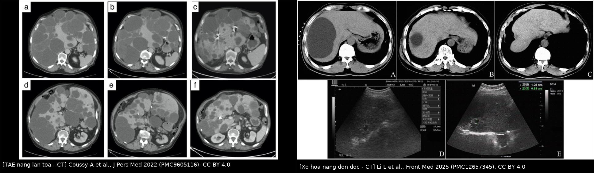
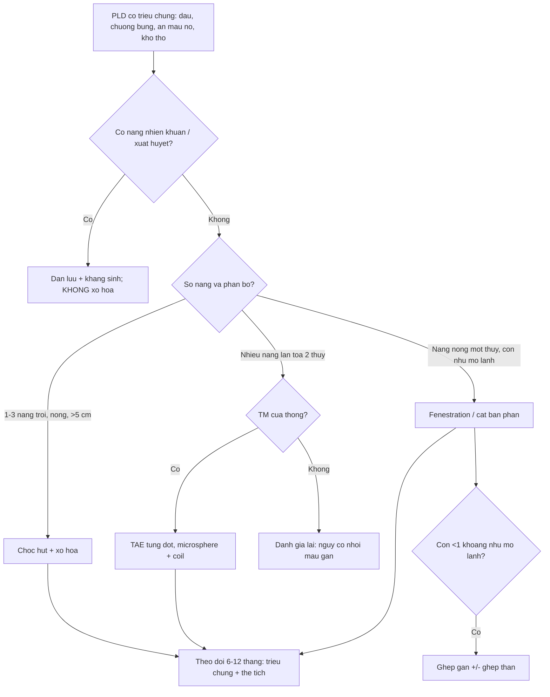
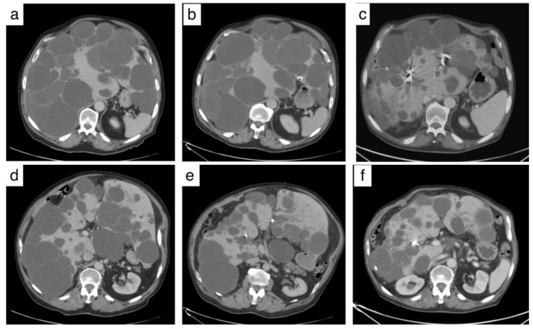
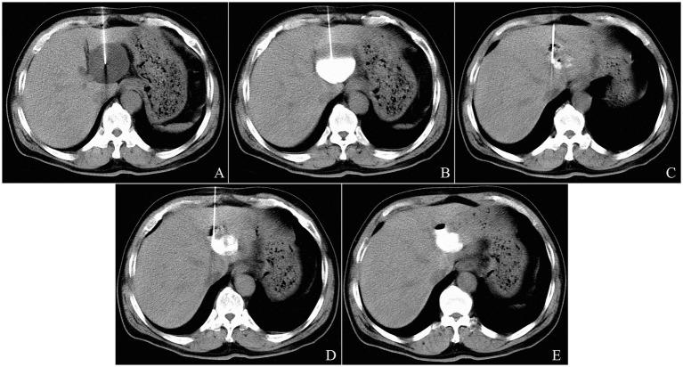
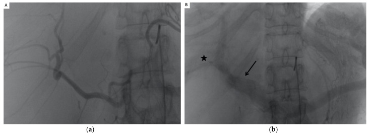

# 142 — Can thiệp giảm thể tích gan trong bệnh gan đa nang: TAE, chọc hút–xơ hóa, fenestration / Volume-reduction interventions in polycystic liver disease

**Tags:** `pattern:gan-da-nang` `vung:gan` `protocol:TAE-dong-mach-gan` `protocol:choc-hut-xo-hoa-nang` `protocol:fenestration` `score:Gigot` `incidentaloma:nang-gan`
**Mức chắc chắn (certainty):** tổng hợp y văn (literature synthesis) — tự biên từ các loạt bệnh mở (CC BY 4.0, CC BY-NC-SA 3.0) và guideline/​meta-analysis; số liệu lấy nguyên từ bài gốc, tên tác giả đối chiếu PMCID.

> **Bài này trả lời câu "can thiệp nào, lúc nào, và đọc gì sau can thiệp" — không phải bài chẩn đoán PLD.**
> [126 – Đo thể tích gan & điều trị nội khoa PLD](../126-the-tich-gan-dieu-tri-noi-khoa-PLD/lesson.md) phủ **định nghĩa, đo TLV/htLV, phân độ Schnelldorfer và thuốc somatostatin**; [123 – Nang gan & bệnh gan đa nang](../123-nang-gan-va-benh-gan-da-nang/lesson.md) phủ **chẩn đoán phân biệt nang gan**; [930 – TACE/đốt u gan](../930-hepatic-oncology-tace-rfa/lesson.md) phủ **can thiệp trong ung thư**. Bài này dành cho **bệnh nhân PLD đã có triệu chứng, đã quyết định can thiệp giảm thể tích**, và cho bác sĩ CĐHA phải **chọn phương thức + đọc đáp ứng/biến chứng trên CT/MRI**.

## 1. Tổng quan bệnh học – cơ chế hình ảnh

### 1.1 Vì sao nang PLD to lên, và vì sao "cắt máu" làm nang xẹp

- **Nang PLD** là nang **không thông với cây mật**, thành là **biểu mô đường mật (cholangiocyte) tăng sinh**, lòng chứa dịch giống huyết tương. Sinh bệnh: **cAMP nội bào tăng** (đột biến *PKD1/PKD2* hoặc *PRKCSH/SEC63*) → bài tiết dịch + tăng sinh biểu mô → nang lớn dần. PLD gặp ở **> 90% người ADPKD trên 35 tuổi**; thể đơn độc ADPLD khoảng **1/158.000**; tổng thể tích gan (TLV) là thước đo bệnh ([126](../126-the-tich-gan-dieu-tri-noi-khoa-PLD/lesson.md)).
- **Mấu chốt can thiệp nằm ở mạch nuôi thành nang:** nang **không có mạch trong lòng**, nhưng **thành nang được nuôi bởi các nhánh động mạch gan**, không phải tĩnh mạch cửa. Vì vậy **nút nhánh động mạch gan (TAE)** gây **thiếu máu thành nang → hoại tử biểu mô nang → xơ hóa, xẹp dần**, trong khi **nhu mô gan còn được tĩnh mạch cửa nuôi** nên ít bị nhồi máu. Đây là lý do TAE hiệu quả ở **nang lan tỏa nhiều ổ** — nơi chọc hút từng nang là bất khả thi.
- **Chọc hút–xơ hóa (aspiration sclerotherapy):** rút dịch làm giảm áp lực, rồi bơm chất gây xơ (ethanol tuyệt đối, polidocanol, bleomycin) **làm biến tính protein và phá hủy lớp biểu mô nang** → viêm dính, xơ hóa, lòng nang bị bít. Chỉ hiệu quả khi **nang còn thông với kim và không thông với đường mật**; nếu thông mật, chất xơ hóa chảy vào ống mật gây **viêm xơ đường mật**.
- **Fenestration (mở "cửa sổ" nang):** cắt bỏ vòm nang nông → dịch chảy vào khoang phúc mạc, áp lực trong nang giảm; chỉ xử lý được **nang nông, đường kính lớn**, còn nang sâu cạnh mạch/đường mật **không được đụng** vì nguy cơ chảy máu/rò mật.
- **TẠI SAO nang trông như "nước" trên hình ảnh:** dịch nang **0–15 HU**, **T1 tối, T2 rất sáng**, **không ngấm cản quang**, vách mỏng. Sau can thiệp, nội dung nang có thể **tăng đậm độ do máu/protein cũ** hoặc có **khí** sau chọc hút — **không được nhầm là áp-xe** nếu không có ngấm viền/sốt.
- **Ngưỡng định lượng nằm lòng (bắt buộc nhớ):**
  - **Chọc hút–xơ hóa:** chỉ định kinh điển cho nang **> 5 cm có triệu chứng**; tỷ lệ đáp ứng hoàn toàn với ethanol **54,4%** (307 bệnh nhân, *Endosc Ultrasound* 2026, PMID 42751671), **thể tích nang ban đầu 233 mL (≈ 7–8 cm)** là ngưỡng dự báo đáp ứng (AUC 0,626) — **nang < 233 mL đáp ứng 70,6% vs 44,1%** ở nang lớn hơn.
  - **Ethanol vs polidocanol:** giảm đường kính nang tương đương **37,5% vs 44,2%** (p = 0,35); giảm triệu chứng **56,6% vs 65,2%**; **ethanol nhiều biến cố hơn (11 vs 3, p = 0,047)**.
  - **TAE bằng microsphere 300–500 µm + microcoil:** hiệu quả lâm sàng **73%**; thể tích gan **−12,6% lúc 3 tháng** và **−27,8% lúc cuối theo dõi 51 ± 15,2 tháng**; VAS đau **5,4 → 2,7**.
  - **TAE bằng NBCA + lipiodol:** cải thiện triệu chứng **86%**; thể tích nang **−36% / −37% / −38%** ở **12 / 24 / 36 tháng**; thể tích gan **−32% / −31% / −33%**; vòng bụng **106 → 87 cm**.
  - **Fenestration nội soi (meta-analysis 62 nghiên cứu, 1.314 bệnh nhân — *Surg Endosc* 2019, PMID 30334152):** giảm triệu chứng **90,2%**, **tái phát triệu chứng 9,6%**, can thiệp lại **7,1%**, biến chứng **10,8%**, biến chứng nặng **3,3%**, tử vong **1,0%**. Ở **nhóm PLD** (n = 146): tái phát **33,7%**, can thiệp lại **26,4%**, biến chứng **29,3%** — **kém hơn hẳn nang đơn độc**.

## 2. Mẫu hình + chẩn đoán phân biệt theo vị trí (gamut)

**Câu hỏi lọc:** *"Nang to nhưng **bao nhiêu nang**, **nang nằm nông hay sâu**, và **còn bao nhiêu nhu mô gan lành**?"* — số lượng + phân bố quyết định phương thức, không phải kích thước đơn thuần.

- **1–3 nang trội, nông, > 5 cm, còn nhiều nhu mô lành:** **chọc hút–xơ hóa** (nang đơn độc) hoặc **fenestration** (nang nông, vòm mỏng).
- **Nhiều nang (≥ 5–10) lan tỏa hai thùy, không có nang "trội" rõ:** **TAE** — can thiệp được nhiều nang cùng lúc, lặp lại theo đợt.
- **Nang tập trung một thùy/phân thùy, còn ≥ 2 "khoang" nhu mô lành:** **cắt gan bán phần ± fenestration** (Schnelldorfer B/C — [126](../126-the-tich-gan-dieu-tri-noi-khoa-PLD/lesson.md)).
- **< 1 khoang nhu mô lành, tăng áp lực cửa, suy dinh dưỡng nặng:** **ghép gan** (phương pháp chữa khỏi duy nhất; sống 5 năm **> 80%**; ghép gan–thận đồng thời khi **eGFR < 30 mL/phút/1,73 m²**).
- **Nang đang nhiễm khuẩn/xuất huyết:** **dẫn lưu + kháng sinh trước**, **không bơm chất xơ hóa** vào nang đang viêm.
- **Nang sán (hydatid) trong vùng dịch tễ:** **tuyệt đối không chọc hút–xơ hóa như nang đơn độc** — nguy cơ sốc phản vệ và gieo rắc; đi theo bài [139](../139-san-la-gan/lesson.md) (albendazole ± PAIR).

**Gamut theo cơ chế "giảm thể tích":** giảm áp lực nang (chọc hút) → phá hủy biểu mô nang (xơ hóa) → cắt máu nuôi thành nang (TAE) → cắt bỏ vòm/nhu mô (fenestration/cắt gan) → thay gan (ghép).

## 3. Bảng so sánh phân biệt (ma trận đối chiếu)

### 3.1 Chọn phương thức can thiệp

| Phương thức | Chỉ định hình ảnh điển hình | Chốt vào (rule-in) | Chốt loại (rule-out) | Theo dõi / xác nhận |
|---|---|---|---|---|
| **Chọc hút + xơ hóa** | **1–3 nang trội, > 5 cm**, nông, dịch đồng nhất, không thông mật | **Nang đơn độc/tối đa 3 nang + triệu chứng chèn ép + kim vào được an toàn** | **Nhiều nang lan tỏa (PLD nặng)** → thất bại cao; **thông đường mật** → cấm xơ hóa; **nang sán** → cấm chọc | CT/MRI 6–12 tháng: nang xẹp > 50%; **đáp ứng = giảm triệu chứng**, không chỉ giảm đường kính |
| **TAE (nút nhánh động mạch gan)** | **Nhiều nang hai thùy**, gan to, không có nang trội; bệnh nhân không mổ được | **≥ 5–10 nang + còn nhu mô lành + tĩnh mạch cửa thông** | **Huyết khối tĩnh mạch cửa** (nguy cơ nhồi máu gan); **nhiễm khuẩn nang đang hoạt động**; **suy gan** | CT 3–6 tháng: thể tích gan giảm **10–30%**; đánh giá lại triệu chứng; có thể lặp đợt |
| **Fenestration nội soi** | **Nang nông, vòm mỏng**, kích thước lớn, một thùy; **≥ 2 khoang nhu mô lành** | **Nang nằm sát mặt gan + còn nhu mô lành + không có nang sâu cần xử lý** | **PLD lan tỏa** (tái phát **33,7%**); **nang sâu cạnh mạch/đường mật** | CT/MRI 6–12 tháng; tái phát triệu chứng **9,6%** (nang đơn độc) |
| **Cắt gan bán phần** | Bệnh khu trú một thùy/phân thùy, còn mô lành | **1 khoang nhu mô lành (Schnelldorfer C)** | **Tổn thương lan tỏa hai thùy**; **tăng áp cửa** | Thể tích gan còn lại; chức năng gan; tái phát nang ở phần còn lại |
| **Ghép gan** | Gan khổng lồ, **< 1 khoang lành**, suy dinh dưỡng, nhiễm khuẩn nang tái diễn | **Schnelldorfer D + biến chứng/suy chức năng** | **Còn ≥ 1 khoang nhu mô lành** → ưu tiên can thiệp bảo tồn | Sống 5 năm **> 80%**; theo dõi miễn dịch, thận, dinh dưỡng |

*Trái: **TAE** — (a,b) trước, (c) sau 3 tháng: gan đa nang khổng lồ chèn ép dạ dày, **coil** ở nhánh động mạch gan, nang xẹp dần (Coussy A et al., J Pers Med 2022, PMC9605116, CC BY 4.0). Phải trên: **chọc hút–xơ hóa nang gan dưới CT** — kim 21 G vào nang, bleomycin trộn cản quang lắng trong nang (Li L et al., Front Med 2025, PMC12657345, CC BY 4.0, Fig. 1). Phải dưới: **đáp ứng thể tích theo thời gian** của một nang đơn thuần 554,4 mL — A trước, B 6 tháng, C 12 tháng, D–E siêu âm 24/36 tháng (cùng bài, Fig. 4). Ảnh ghép letterbox, giữ nguyên tỷ lệ.*

### 3.2 Trước khi can thiệp: đừng nhầm "nang" với thứ khác

| Thực thể | Hình ảnh điển hình | Chốt vào (rule-in) | Chốt loại (rule-out) | Gợi ý xác nhận |
|---|---|---|---|---|
| **Nang gan đơn thuần** | Dịch **0–15 HU**, vách mỏng **< 2 mm**, không ngấm, không vôi hóa | **Dịch thuần nước + vách mỏng đều + không thành phần đặc** | **Vách dày/nốt trong lòng/ngấm** → nghĩ u nhầy hoặc nang sán | Siêu âm + CT; không cần sinh thiết nếu điển hình |
| **PLD** | **≥ 20 nang** (≥ 10 cũng cảnh giác), đa dạng kích thước, hai thùy, thận đa nang | **Nhiều nang + gan to + bối cảnh ADPKD/ADPLD** | **Nang thông cây mật + central dot** → Caroli | MRI/CT đo TLV; gene *PKD1/PKD2/PRKCSH/SEC63* |
| **Nang sán (hydatid)** | Nang có **vỏ xơ**, **vôi hóa thành**, **màng tách/"hoa súng"**, nang con | **Tiền sử dịch tễ + vôi hóa thành + màng tách + huyết thanh dương** | **Nang thuần nước, vách mỏng, không vôi hóa** → nang đơn thuần | **Huyết thanh Echinococcus** trước mọi chọc hút; **không chọc khi chưa loại trừ** |
| **U nhầy đường mật (MCN)** | Nang nhiều vách, **nốt/vách ngấm**, có thể vôi hóa | **Vách dày, thành phần đặc trong lòng, ngấm cản quang** | **Nang thuần nước không ngấm** | MRI/MRCP + sinh thiết/mổ |
| **Caroli** | **Giãn đường mật túi thông cây mật**, **central dot** | **Thông với ống mật + central dot** | **Nang không thông mật** → PLD/đơn thuần | MRCP |
| **Nang nhiễm khuẩn** | Dịch **tăng đậm độ/lơ lửng**, **khí trong nang**, **ngấm viền**, sốt | **Sốt + đau + khí/dịch lơ lửng + ngấm viền** | **Không sốt, dịch trong, không khí** → nang đơn thuần | Cấy dịch nang; **dẫn lưu trước, không xơ hóa** |

## 4. Protocol can thiệp + theo dõi

### 4.1 Chuẩn bị (chung)

- **Hình ảnh:** CT 3 thì hoặc MRI (T2 + T1 sau tiêm) trong **4–6 tuần** trước can thiệp; ghi **số nang, nang trội, vị trí nông/sâu, quan hệ mạch–đường mật, TLV/htLV**. Với nang "không điển hình": **huyết thanh sán lá gan** + MRCP.
- **Xét nghiệm:** công thức máu, đông máu, chức năng gan–thận; **eGFR** (ADPKD thường suy thận) để chọn cản quang/CO₂.
- **Loại trừ nhiễm khuẩn nang** (sốt, CRP, dịch lơ lửng) trước khi bơm chất xơ hóa.

### 4.2 Chọc hút–xơ hóa (aspiration sclerotherapy)

- **Kỹ thuật:** siêu âm/CT; kim **18–20 G** hoặc catheter pigtail **6–8 F**; hút kiệt dịch, **bơm cản quang kiểm tra không thông đường mật/ổ bụng**, rồi bơm chất xơ hóa.
- **Chất xơ hóa:** **bleomycin 5 mg/100 mL dịch nang**, tổng liều **10–50 mg**, **không vượt 0,6–0,8 mg/kg** (loạt 88 bệnh nhân: không có độc tính bleomycin); hoặc **ethanol tuyệt đối** / **polidocanol 1–3%**. Ethanol và polidocanol cho hiệu quả tương đương nhưng **ethanol nhiều biến cố hơn**.
- **Sau thủ thuật:** theo dõi **1–2 giờ**, siêu âm kiểm tra; hẹn **6–12 tháng** đánh giá thể tích nang.

### 4.3 TAE

- **Kỹ thuật:** chọc **động mạch đùi/quay**, chụp động mạch gan chọn lọc; **microcatheter** vào nhánh nuôi nang; **microsphere 300–500 µm** (nút xa) + **microcoil** (nút gần) để tránh tái thông; có thể dùng **NBCA + lipiodol**. Chụp **cone-beam CT** kiểm tra phạm vi.
- **Chiến lược:** **từng đợt, từng thùy** ở bệnh nhân gan rất to/suy gan; lặp lại sau **3–6 tháng** nếu còn triệu chứng (loạt Coussy: **32 lần TAE ở 26 bệnh nhân**).
- **Chống chỉ định/nguy cơ:** **huyết khối tĩnh mạch cửa**, nhiễm khuẩn nang, suy gan; **tránh nút nhầm động mạch túi mật/tá tràng/tụy**.
- **Sau TAE:** hội chứng sau nút mạch (sốt, đau, buồn nôn, tăng men gan) thường **tự giới hạn 3–7 ngày**; sốt cao kéo dài + khí trong nang = **áp-xe**, cần dẫn lưu.

### 4.4 Fenestration / cắt gan

- **Nội soi:** mở vòm các nang **nông nhất**, hút dịch, **kiểm tra rò mật** (xanh methylen), dẫn lưu; **không đụng nang sâu** cạnh mạch/đường mật.
- **Theo dõi:** biến chứng **rò mật, chảy máu, nhiễm trùng, tràn dịch**; ở PLD, **tái phát 33,7%** → tư vấn trước mổ.

### 4.5 Theo dõi đáp ứng (quan trọng hơn "đo nang")

- **Đáp ứng lâm sàng là chính:** trong một RCT 32 bệnh nhân, **giảm đường kính nang không phản ánh thành công** theo bệnh nhân, còn **điểm PLD-Q giảm từ 38 → 18** mới phản ánh; **72% cải thiện lúc 6 tháng**.
- **Hình ảnh:** CT/MRI **cùng phương thức, cùng cách đo** ở **3–6–12 tháng**, sau đó **hằng năm**; báo **thể tích gan (mL/%)** và **thể tích nang**, không chỉ đường kính.

## 5. Biến thể bình thường và cạm bẫy

- **Nang "tăng đậm độ" sau can thiệp không phải áp-xe:** máu/protein cũ làm dịch **20–40 HU**, nhưng **không ngấm viền, không khí, bệnh nhân không sốt**. Chỉ gọi nhiễm khuẩn khi có **khí + ngấm viền + sốt/CRP**.
- **Coil và keo gây giả ảnh (artifact)** trên CT: đừng đọc vùng quanh coil là "u sống"; dùng MRI hoặc CT không cản quang đối chiếu.
- **"Thành công" không đồng nghĩa nang biến mất:** sau xơ hóa, nang thường còn **dải xơ nhỏ**; đánh giá theo **triệu chứng + thể tích**, không đòi hỏi hết hoàn toàn.
- **Bẫy nguy hiểm nhất — chọc nhầm nang sán:** nang sán có thể **không vôi hóa, không màng tách rõ** ở giai đoạn sớm; ở vùng dịch tễ **luôn xét nghiệm huyết thanh trước khi chọc**, và **không bơm ethanol** khi chưa loại trừ.
- **Thông đường mật bỏ sót:** bơm cản quang thấy thuốc vào ống mật = **dừng xơ hóa**; hậu quả là viêm xơ đường mật lan tỏa, vàng da tiến triển.
- **Biến chứng mạch muộn:** chọc hút nang lớn có thể tổn thương nhánh động mạch → **giả phình + xuất huyết trong nang muộn (1 tháng)**; đau đột ngột sau thủ thuật + dịch nang T1 sáng = nghĩ xuất huyết, chụp mạch.
- **Nhiễm khuẩn tối cấp:** đã có ca **sốc nhiễm khuẩn, DIC, tử vong trong 24 giờ** sau chọc hút–xơ hóa nang (PMC13318698) — vô khuẩn tuyệt đối, không xơ hóa nang đang viêm.
- **TAE ở bệnh nhân suy thận:** ADPKD thường kèm CKD; hạn chế cản quang, dùng **CO₂/DSA**, bù dịch theo protocol.

## 6. Tự lượng giác — Blind Quiz

**Ca 1 — Nữ 52 tuổi, ADPKD, bụng to, ăn mau no. CT trước và sau TAE 1 năm.**

- Gợi ý: bệnh nhân đã được nút nhánh động mạch gan bằng microsphere + coil.
- Hỏi: (1) Trước can thiệp có bao nhiêu nang lớn? (2) Dấu hiệu nào trên ảnh sau chứng tỏ đã nút mạch? (3) Thể tích gan kỳ vọng giảm bao nhiêu phần trăm?

<b>Bấm để hiện đáp án (findings + chẩn đoán)</b>

- **Findings:** (a,b,d,e) gan khổng lồ, vô số nang dịch **0–15 HU**, không ngấm; (c,f) sau TAE: **coil** ở nhánh động mạch gan, nang **xẹp và nhỏ hơn**, nhu mô gan còn lại tăng tương đối.
- **Chẩn đoán:** **PLD có triệu chứng, điều trị TAE** — hiệu quả lâm sàng **73%**, thể tích gan **−12,6% lúc 3 tháng**, **−27,8% lúc 51 tháng**.
- **Vì sao:** nang được nuôi bởi **động mạch gan**, không phải tĩnh mạch cửa → nút mạch làm **thiếu máu thành nang** mà không nhồi máu nhu mô.
- **Nguồn ảnh:** Coussy A et al., J Pers Med 2022 (PMC9605116), CC BY 4.0 — Fig. 2 (a–f).

**Ca 2 — Nam 67 tuổi, một nang gan đơn độc thùy trái gây đau, chọc hút–xơ hóa bằng bleomycin dưới CT.**

- Hỏi: (1) Vì sao chọn chọc hút–xơ hóa thay vì TAE? (2) Trước khi bơm bleomycin phải kiểm tra gì? (3) Liều bleomycin tính thế nào?

<b>Bấm để hiện đáp án (findings + chẩn đoán)</b>

- **Findings:** (A) **kim Chiba 21 G dài 10 cm** vào nang thùy trái dưới hướng dẫn CT; (B) sau khi lấy 10 mL dịch gửi xét nghiệm, bơm **10 mL cản quang pha loãng** để **kiểm tra không thông với đường mật**; (C) hút gần kiệt dịch; (D) CT lặp sau bơm **nửa liều bleomycin trộn cản quang** — không rò; (E) sau thủ thuật, **dung dịch bleomycin lưu lại trong lòng nang**.
- **Chẩn đoán:** **nang gan đơn độc có triệu chứng** — chọc hút kiệt + **bleomycin 5 mg/100 mL dịch nang**, tổng **≤ 0,6–0,8 mg/kg** (loạt 96 nang: **không có độc tính bleomycin**, không biến chứng nặng).
- **Vì sao không TAE:** chỉ **một nang trội**, còn nhiều nhu mô lành → xơ hóa ít xâm lấn hơn, giữ mô gan.
- **Bắt buộc kiểm tra:** **bơm cản quang** loại trừ **thông đường mật** và loại trừ **nang sán** (huyết thanh) trước khi bơm chất xơ hóa.
- **Đáp ứng của phương thức này (cùng bài, 96 nang):** đáp ứng kỹ thuật **96,9% lúc 6 tháng**, **100% từ 12 tháng**; đáp ứng tính bằng **tỷ lệ giảm thể tích nang (VRR)**, không bằng đường kính.
- **Nguồn ảnh:** Li L et al., Front Med 2025 (PMC12657345), CC BY 4.0 — Fig. 1 (A–E).

**Ca 3 — Cùng phương thức, nhưng đọc "đáp ứng" trên ảnh: nang đơn thuần 554,4 mL theo dõi 3 năm.**

- Hỏi: (1) Thể tích nang giảm bao nhiêu % ở 6 tháng và 12 tháng? (2) Vì sao phải báo **thể tích** thay vì đường kính? (3) Sau xơ hóa, "còn lại" bao nhiêu thì gọi là đáp ứng tốt?

<b>Bấm để hiện đáp án</b>

- **Findings:** (A) nang **554,4 mL** (12,6 × 8,8 × 10,0 cm); (B) 6 tháng còn **34,3 mL** → **VRR 93,8%**; (C) 12 tháng còn **1,7 mL** → **VRR 99,7%**; (D) 24 tháng **1,2 mL** (99,8%); (E) 36 tháng **0,7 mL** (99,9%).
- **Chẩn đoán:** **nang đơn thuần (ví dụ này ở thận trái) điều trị bằng chọc hút + bleomycin** — minh họa cách báo đáp ứng mà bài gốc dùng cho cả nang gan.
- **Vì sao thể tích:** VRR = (V₀ − V₁)/V₀; đường kính giảm 50% chỉ là giảm **87,5%** thể tích, nên đường kính **đánh giá thấp** đáp ứng và không so sánh được giữa các nang khác hình dạng.
- **Ngưỡng đáp ứng:** bài gốc định nghĩa **đáp ứng = VRR ≥ 50%**; **đáp ứng hoàn toàn = còn < 5% thể tích ban đầu** (định nghĩa dùng trong loạt ethanol sclerotherapy 307 bệnh nhân).
- **Nguồn ảnh:** Li L et al., Front Med 2025 (PMC12657345), CC BY 4.0 — Fig. 4 (A–E), ca nang thận trái đơn thuần nam 69 tuổi.

**Ca 4 — Chụp động mạch gan trước và trong TAE.**

- Hỏi: (1) Ảnh (a) cho thấy gì? (2) Ảnh (b) là thì gì, **dấu sao** và **mũi tên** chỉ gì? (3) Vì sao phải nút thêm đoạn gần bằng coil?

<b>Bấm để hiện đáp án</b>

- **Findings:** (a) **động mạch gan giãn, bị đẩy lệch bởi các nang**, **không có thì nhu mô gan trái** (nhu mô trái đã bị nang thay thế); (b) **chụp tĩnh mạch cửa (portography)**: **tĩnh mạch lách và tĩnh mạch cửa thân chính còn thông**, **tắc tĩnh mạch cửa trái và tĩnh mạch cửa trước phải (mũi tên)**, **còn thông tĩnh mạch cửa sau phải (dấu sao)**.
- **Chẩn đoán:** **TAE chỉ an toàn khi còn ít nhất một phần tĩnh mạch cửa nuôi nhu mô lành** — ở ca này phần sau phải còn thông nên nhu mô đó sống được sau khi nút động mạch.
- **Vì sao coil:** nút **xa bằng microsphere** diệt thành nang, **nút gần bằng coil** ngăn **tái thông** và tránh microsphere trôi ngược.
- **Nguồn ảnh:** Coussy A et al., J Pers Med 2022 (PMC9605116), CC BY 4.0 — Fig. 1 (a,b).

## Bài liên quan chéo
- [126 – Đo thể tích gan & điều trị nội khoa PLD](../126-the-tich-gan-dieu-tri-noi-khoa-PLD/lesson.md)
- [123 – Nang gan & bệnh gan đa nang](../123-nang-gan-va-benh-gan-da-nang/lesson.md)
- [157 – Bệnh thận đa nang ADPKD/ARPKD](../157-benh-than-da-nang-adpkd-arpkd/lesson.md)
- [139 – Sán lá gan (hydatid)](../139-san-la-gan/lesson.md)
- [910 – Dẫn lưu áp-xe, đường mật & thận qua da](../910-abscess-biliary-nephrostomy/lesson.md)
- [930 – TACE, đốt & LR-TR](../930-hepatic-oncology-tace-rfa/lesson.md)

## Ảnh
- `images/142_truoc-sau-TAE_CT_PMC9605116.jpg`, `images/142_TAE-dong-mach-gan_DSA_PMC9605116.jpg` — Coussy A et al., *J Pers Med* 2022 (PMC9605116), **CC BY 4.0**.
- `images/142_choc-hut-xo-hoa_CT_PMC12657345.jpg`, `images/142_xo-hoa-dap-ung_CT_PMC12657345.jpg` — Li L et al., *Front Med* 2025 (PMC12657345), **CC BY 4.0**.
- `images/composite_142_TAE-vs-xo-hoa.jpg` — ảnh ghép từ hai bài CC BY 4.0 trên (letterbox, không crop/kéo giãn).
- Nguồn + giấy phép từng ảnh: [`images/CREDITS.md`](images/CREDITS.md).

> Không dùng để chẩn đoán độc lập khi chưa có người hướng dẫn.
