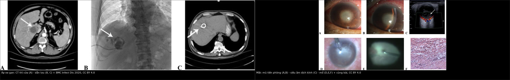
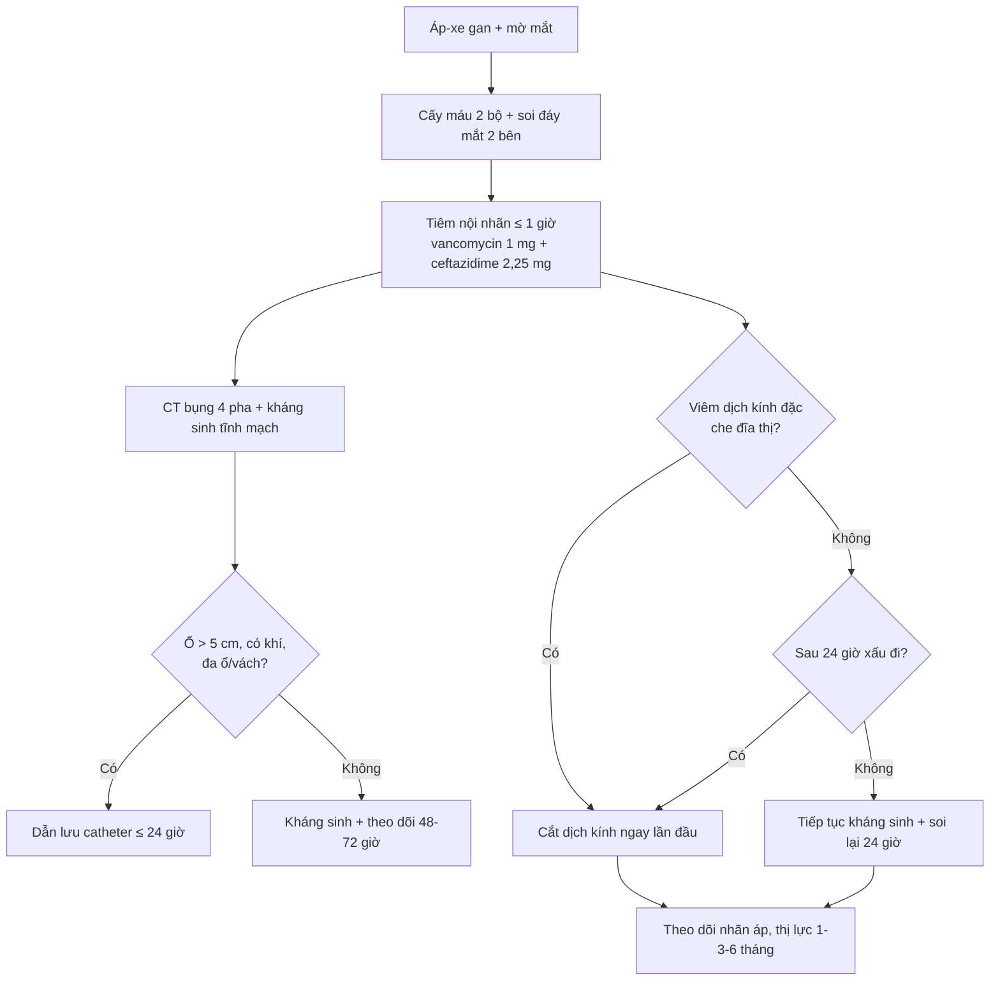
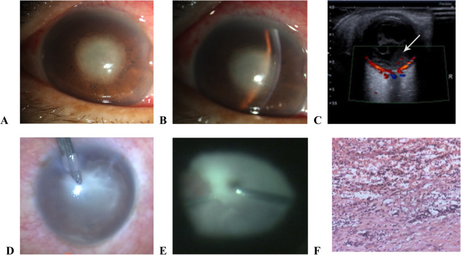
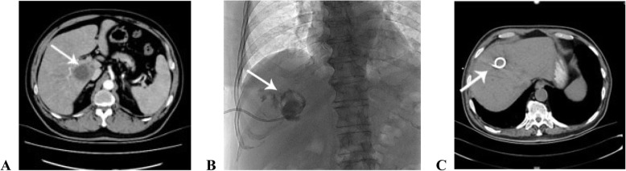

# 1420 — Áp-xe gan do *Klebsiella* kèm viêm nội nhãn nội sinh: thứ tự và cửa sổ can thiệp / *Klebsiella* liver abscess with endogenous endophthalmitis: sequence and timing

**Tags:** `pattern:ap-xe-gan` `pattern:viem-noi-nhan` `pattern:ap-xe-duoi-vong-mac` `pattern:viet-dich-kinh` `vung:gan` `vung:vong-mac` `vung:hac-mac` `score:khong` `protocol:CT-bung` `protocol:soi-day-mat` `protocol:tiem-noi-nhan` `protocol:cat-dich-kinh` `incidentaloma:khong`
**Mức chắc chắn (certainty):** tổng hợp y văn (literature synthesis) — 1 đoàn hệ 16 bệnh nhân/19 mắt viêm nội nhãn do áp-xe gan (BMC Infect Dis 2020, PMC7487656, CC BY 4.0), 1 đồng thuận Đài Loan 2024 về viêm nội nhãn nội sinh (PMC10776529, CC BY-NC 4.0), 1 đoàn hệ *K. pneumoniae* nội nhãn 12 bệnh nhân/15 mắt (PMC11549328, CC BY-NC 3.0), 1 nghiên cứu tiên lượng thị lực theo loại viêm nội nhãn (PMC9714883, CC BY 4.0) và 1 nghiên cứu CT dự báo nguy cơ mắt (PMC9369040, CC BY 4.0). Ca trong quiz là **ca nguyên văn** của PMC7487656 — ghi rõ trong đáp án.

> **Bài này trả lời 4 câu hỏi khi một bệnh nhân áp-xe gan đột nhiên mờ mắt:**
> (1) **Tiêm nội nhãn trước hay dẫn lưu gan trước?** (2) **Cửa sổ vàng là bao nhiêu giờ, và cái gì mất đi khi trễ?** (3) **Khi nào cắt dịch kính — ngay lần khám đầu hay chờ 24 giờ?** (4) **Vì sao đã làm "đủ" mà 1/3 mắt vẫn không đếm được ngón tay?**
> Nối [103 – Áp-xe gan do *Klebsiella*](../103-ap-xe-gan-klebsiella/lesson.md) (đọc CT, ngưỡng dẫn lưu), [475 – Viêm nội nhãn nội sinh do vi khuẩn](../475-viem-noi-nhan-noi-sinh-vi-khuan/lesson.md) (cơ chế "tiền phòng im lặng") và [463 – Viêm nội nhãn nội sinh do nấm](../463-viem-noi-nhan-noi-sinh-nam/lesson.md) (thể tiến triển tuần).

## 1. Tổng quan — vì sao đây là bài toán THỜI GIAN, không phải bài toán chọn kháng sinh

### 1.1 Hai khoang nhiễm, hai dược động học ngược nhau

- **Khoang gan:** ổ mủ lớn (đường kính trung bình 7,93 ± 2,32 cm trong loạt 100 ca — bài 103/PMC7296744), có **vỏ xơ–fibrin** và **không có mao mạch bên trong** → kháng sinh toàn thân **không vào được trung tâm ổ**; cách duy nhất để "giảm tải" vi khuẩn là **dẫn lưu cơ học** (source control).
- **Khoang dịch kính:** gel **vô mạch**, thể tích ~**4 mL**, **không có hệ miễn dịch tại chỗ**; hàng rào máu–dịch kính cản thuốc → kháng sinh tĩnh mạch dù có thấm tốt cũng **đạt nồng độ điều trị chậm trong nhiều giờ** (đồng thuận Đài Loan, PMC10776529). Vì vậy **tiêm nội nhãn (intravitreal injection — IVI)** là bước không thể thay thế, và **không được chờ kết quả cấy**.
- **Hệ quả logic:** dẫn lưu gan **không** làm sạch dịch kính, và tiêm nội nhãn **không** kiểm soát được ổ gan. Hai việc phải chạy **song song trong cùng ngày**, không phải "làm xong gan rồi mới đến mắt".

### 1.2 Vì sao cửa sổ chỉ khoảng 48 giờ

- Thực nghiệm trên thỏ: tế bào cảm thụ ánh sáng (photoreceptor) bị phá hủy **không hồi phục trong 48 giờ** khi *Klebsiella* xâm nhập dịch kính (dẫn qua Lee JJ 2022 trong bài 475).
- Trong loạt 16 bệnh nhân/19 mắt: **tiêm nội nhãn trong 48 giờ** đầu giúp giữ thị lực ở một số mắt; nhóm tiêm **sau 48 giờ** có thị lực cuối **kém hơn** (BMC Infect Dis 2020, PMC7487656). Đây là **mốc sinh học**, không phải mốc hành chính.
- Sau 48 giờ, phẫu thuật vẫn có chỉ định (lấy mủ, cắt màng, giải phóng co kéo) nhưng **không lấy lại được võng mạc đã hoại tử** — giải thích vì sao kết cục vẫn xấu dù "đã mổ".

### 1.3 Ngưỡng định lượng nằm lòng

| Chỉ số | Con số | Nguồn |
|---|---|---|
| Cửa sổ tiêm nội nhãn có lợi | **≤ 48 giờ** từ khởi phát | BMC Infect Dis 2020 (PMC7487656) |
| Thị lực cuối **≥ đếm ngón tay (CF)** trong loạt áp-xe gan | **31% (6/19 mắt)**; chỉ **5% (1/19)** đạt **20/200** | *cùng nguồn* |
| Thị lực cuối **không còn cảm giác ánh sáng (NLP)** | **31% (6/19 mắt)** | *cùng nguồn* |
| Phải **khoét nhãn cầu (evisceration)** | **3/19 mắt (16%)** do viêm tái phát | *cùng nguồn* |
| *K. pneumoniae* trong cấy | **50% (8/16 bệnh nhân)**; cấy âm **32% (5/16)** | *cùng nguồn* |
| Thời gian nằm viện trung bình | **18,75 ngày (6–37)** | *cùng nguồn* |
| Viêm nội nhãn *K. pneumoniae* — **hai mắt** | **25% (3/12 bệnh nhân)** | Risk Manag Healthc Policy 2024 (PMC11549328) |
| **Tăng nhãn áp trong tuần đầu** ở thể *K. pneumoniae* | **73,3% (11/15 mắt)** | *cùng nguồn* |
| **NLP cuối** ở thể *K. pneumoniae* | **66,7% (10/15 mắt)**; khoét nhãn cầu **26,7% (4/15)** | *cùng nguồn* |
| Số mắt **không cải thiện thị lực** ở nhóm viêm nội nhãn nội sinh | Không khác biệt trước–sau điều trị (logMAR) | PLoS One 2022 (PMC9714883) |
| Ngưỡng dẫn lưu ổ gan | **> 5 cm: catheter là first-line**; **< 3 cm: kháng sinh + theo dõi 48–72 giờ** | bài 103 (PMC13170020) |

- **Vì sao thể *K. pneumoniae* tệ hơn thể ngoại sinh:** vỏ polysaccharide + biofilm chống thực bào, thể **tăng độc lực (hvKP)** xuyên hàng rào máu–mắt nhanh; ổ mủ dưới võng mạc lan rộng trước khi tiền phòng phản ứng. Trong loạt PMC11549328, **73,3% mắt đã tăng nhãn áp ngay tuần đầu** — dấu hiệu viêm nặng lan ra thể mi, không phải "viêm nhẹ".
- **TẠI SAO CT bụng lại là công cụ dự báo mắt:** xâm lấn mạch lân cận của ổ áp-xe làm tăng nguy cơ viêm nội nhãn **OR 148,1**; ổ **hai thùy OR 45,1**, **thùy trái OR 19,6**, **đái tháo đường OR 11,6** (PMC9369040). Đây là lý do phải **ghi rõ các dấu hiệu này trong báo cáo CT** — không phải để chẩn đoán mắt, mà để **gọi khám mắt ngay**.

## 2. Mẫu hình + gamut theo THỨ TỰ xuất hiện (khi nào gọi ai)

- **A. "Mắt trước, gan sau" (eye-first):** bệnh nhân vào vì **mờ mắt 1–3 ngày**, sốt nhẹ; chưa ai nghĩ tới gan. Trong loạt 16 ca, **56% (9/16) được chẩn đoán ban đầu là viêm nội nhãn**, chỉ **38% (6/16) là áp-xe gan** (PMC7487656). Đây là kịch bản **bỏ sót ổ gan** nếu chỉ khám mắt.
- **B. "Gan trước, mắt im lặng" (liver-first/silent eye):** đã có áp-xe gan trên CT, bệnh nhân **chưa kêu mờ mắt**. Đồng thuận Đài Loan khuyến cáo **soi đáy mắt giãn đồng tử cho MỌI bệnh nhân áp-xe gan sinh mủ**; **25%** ca *K. pneumoniae* có **hai mắt** (PMC11549328) → phải khám **cả hai mắt**, không chỉ mắt bệnh nhân phàn nàn.
- **C. "Đồng thời" (simultaneous):** sốt + đau hông lưng phải + mờ mắt trong cùng 24–48 giờ; CT và soi đáy mắt cùng lúc. Đây là nhóm **thuận lợi nhất để cứu mắt** vì không mất thời gian tìm nguyên nhân.
- **D. "Xấu đi sau 24 giờ" (deterioration):** đã tiêm nội nhãn + kháng sinh toàn thân, nhưng **viêm dịch kính tăng hoặc thị lực giảm** → **cắt dịch kính (pars plana vitrectomy — PPV)**. Đây là chỉ định theo **đồng thuận**, không phải theo cảm giác.
- **E. "Mắt đã cháy" (burned-out):** NLP, đau, nhãn cầu teo; **khoét nhãn cầu** để giảm đau, nhưng **vẫn phải điều trị ổ gan** vì nguy cơ tử vong do nhiễm trùng huyết.
- **Mnemonic "GAN–MẮT–48":** **G**an (dẫn lưu) · **M**ắt (tiêm nội nhãn ngay) · **48** giờ · **Ắ**p-xe hai thùy/thùy trái (nguy cơ cao) · **T**ăng nhãn áp tuần đầu (dấu hiệu nặng).

## 3. Bảng so sánh phân biệt — chọn hành động theo tình huống lúc vào

| Tình huống lúc vào | Chốt vào (rule-in) | Chốt loại (rule-out) | Hành động + thời hạn | Bằng chứng |
|---|---|---|---|---|
| **Mờ mắt + sốt, chưa rõ ổ ngoài mắt** | **Mủ dịch kính / ổ mủ dưới võng mạc** trên soi đáy mắt; **siêu âm B** có hạt lơ lửng khi không thấy đáy mắt | Tiền phòng sạch **không loại trừ** (tổn thương hậu cực có thể nặng hơn tiền phòng); không có ổ ngoài mắt **không loại trừ** thể ẩn | **Cấy máu 2 bộ + tiêm nội nhãn NGAY (≤ 48 giờ, tốt nhất ≤ 6 giờ)**; **CT bụng 4 pha song song** | PMC7487656; PMC10776529 |
| **Đã biết áp-xe gan, chưa có triệu chứng mắt** | **Soi đáy mắt giãn đồng tử 2 bên**; nếu có dấu viêm → vào nhánh trên | Đáy mắt bình thường 2 bên → chưa loại trừ tuyệt đối, vẫn dặn báo ngay khi mờ mắt | **Soi đáy mắt trong 24 giờ** cho **mọi** áp-xe gan sinh mủ; dặn bệnh nhân báo ngay khi mờ mắt | PMC10776529 (khuyến cáo sàng lọc); PMC11549328 (25% hai mắt) |
| **Cả hai ổ cùng lúc, bệnh nhân sốc nhiễm trùng** | **Huyết áp + lactate + ổ gan có khí**; mắt có viêm dịch kính | Không có sốc → vẫn ưu tiên mắt như nhánh trên | **Tiêm nội nhãn tại giường trước**, kháng sinh tĩnh mạch trong **1 giờ**; **dẫn lưu gan ngay khi huyết động cho phép**, không chờ mắt ổn định | PMC7487656; PMC10776529 |
| **Đã tiêm nội nhãn 24 giờ, thị lực xấu đi** | **Viêm dịch kính tăng** hoặc **thị lực giảm ≥ 1 dòng** so với lúc tiêm | Đang cải thiện rõ + đáy mắt nhìn được → tiếp tục theo dõi | **Cắt dịch kính trong 24 giờ tiếp theo** (không chờ thêm) | PMC10776529 (khuyến cáo mức đồng thuận) |
| **Viêm dịch kính ĐẶC che đĩa thị và cung mạch ngay lần đầu** | **Không thấy đĩa thị/cung mạch** do mủ; **siêu âm B** có màng/dày dịch kính | Còn nhìn rõ đĩa thị → chưa cần mổ ngay | **Cắt dịch kính sớm ngay lần khám đầu**, không chờ 24 giờ | PMC10776529 |
| **Mắt NLP + đau + teo nhãn cầu** | **NLP, nhãn áp thấp, viêm tái phát** dù đã IVI/PPV | Còn cảm giác ánh sáng → còn cơ hội bảo tồn | **Khoét nhãn cầu giảm đau**; **vẫn kiểm soát ổ gan** và kháng sinh | PMC7487656 (3/19 mắt) |

*Trái: CT thì cửa — ổ giảm đậm độ thùy phải có vách (A), dẫn lưu catheter (B), ổ xẹp sau dẫn lưu (C). Phải: mắt cùng bệnh nhân — mủ tiền phòng/fibrin (A, B), siêu âm 3D dịch kính đục (C), mủ tiền phòng và dịch kính khi mổ (D, E), mô bệnh viêm mủ (F). Nguồn: BMC Infect Dis 2020, PMC7487656, CC BY 4.0; ảnh ghép letterbox, không crop.*

### Đọc ảnh — hai bờ của một bệnh, không phải hai ca riêng

- **Ổ gan (A):** giảm đậm độ **không đồng nhất**, bờ **đa cung**, có **vách** — đúng mô tả *Klebsiella* ở bài 103; **không** phải nang đơn thuần. Phải đo **đường kính lớn nhất**, đếm **số ổ**, tìm **khí**, **huyết khối tĩnh mạch gan/cửa** (dấu hiệu xâm lấn — OR 148,1 cho nguy cơ mắt).
- **Dẫn lưu (B, C):** catheter nằm trong ổ, ổ **xẹp** sau dẫn lưu — kiểm tra vị trí bằng X-quang/CT, không mặc định "đã dẫn lưu là xong".
- **Mắt (A, B):** **mủ tiền phòng (hypopyon)** + fibrin; **đừng** dùng mức mủ tiền phòng để ước lượng mức phá hủy hậu cực.
- **Siêu âm (C):** dịch kính có **hạt/dải lơ lửng**; khi không nhìn được đáy mắt, siêu âm là cách duy nhất phát hiện **màng co kéo/bong võng mạc** trước mổ.

## 4. Protocol — timeline 0–48 giờ và phân độ

### 4.1 Timeline tối thiểu (mỗi bước có mốc giờ)

| Mốc | Việc phải làm | Ngưỡng/ghi chú |
|---|---|---|
| **T0 — nghi ngờ** | Cấy máu **2 bộ** trước kháng sinh; soi đáy mắt giãn đồng tử **2 mắt**; siêu âm B nếu không thấy đáy mắt | Không chờ cấy để tiêm |
| **T0 + ≤ 1 giờ** | **IVI:** vancomycin **1 mg/0,1 mL** + ceftazidime **2,25 mg/0,1 mL** ± dexamethasone **0,2 mg/0,1 mL**; kháng sinh tĩnh mạch phổ rộng | Đúng liều trong loạt PMC7487656; **không** dùng liều "ước lượng" |
| **T0 + 0–6 giờ** | **CT bụng 4 pha** (không cản quang, động mạch, cửa, muộn) | Đo ổ, tìm khí, vách, huyết khối tĩnh mạch gan/cửa |
| **T0 + ≤ 24 giờ** | **Dẫn lưu gan** nếu **> 5 cm**, có khí, đa ổ/vách dày; catheter ưu tiên hơn kim | Song song với mắt; không "chờ mổ mắt xong" |
| **12–24 giờ** | **Đánh giá lại thị lực + độ đục dịch kính** | Xấu đi hoặc viêm tăng → **PPV** |
| **24–48 giờ** | Nếu **không** cải thiện và **không** mổ được ngay: IVI lặp lại theo đáp ứng | Cửa sổ vàng đã qua → tư vấn tiên lượng thật |
| **1 tuần** | **Nhãn áp 2 mắt**, soi lại đáy mắt, kiểm tra catheter | **73,3%** thể *K. pneumoniae* tăng nhãn áp tuần đầu (PMC11549328) |
| **1–3–6 tháng** | Thị lực cuối, đánh giá khoét nhãn cầu nếu đau/NLP | Kết cục chốt ở **6 tháng** trong loạt PMC7487656 |

### 4.2 Phân độ và ngưỡng quyết định

- **Phân độ viêm nội nhãn:** dùng **phân loại lâm sàng theo mức dịch kính** (đục nhẹ / đục vừa nhìn được đĩa thị / đục đặc không thấy đĩa thị) — mốc **"không thấy đĩa thị và cung mạch"** là ngưỡng **mổ sớm**, không cần chờ đủ 24 giờ (PMC10776529).
- **Phân độ ổ gan:** theo **kích thước** (> 5 cm / 3–5 cm / < 3 cm) + **khí** + **vách** + **huyết khối mạch** (bài 103).
- **Phân độ toàn thân:** **sốc nhiễm trùng/lactate** quyết định thứ tự ở bệnh nhân không thể nằm mổ mắt ngay — vẫn **tiêm nội nhãn tại giường** trước khi chuyển phòng mổ.

### 4.3 Protocol chẩn đoán hình ảnh (vai trò của CĐHA)

- **CT bụng 4 pha** là chuẩn: mô tả **ổ giảm đậm độ trung tâm ở MỌI thì**, **ngấm viền**, **vách ≥ 1 mm**, **khí**, và **khuyết ngấm trong tĩnh mạch gan/cửa**.
- **Không** dùng CT/MRI sọ–mắt để chẩn đoán viêm nội nhãn thay soi đáy mắt; **MRI hốc mắt** chỉ khi nghi **áp-xe hốc mắt/viêm mô tế bào** (khác bệnh cảnh).
- **Siêu âm B** là bạn của CĐHA khi đục dịch kính: phát hiện **màng, bong võng mạc, dày dịch kính** — giúp chọn mổ.

## 5. Biến thể bình thường và cạm bẫy

- **"Tiền phòng sạch" không loại trừ:** phản ứng tiền phòng **không tỉ lệ** với tổn thương hậu cực; thể *Klebsiella* có thể đã có **ổ mủ dưới hoàng điểm** mà tiền phòng chỉ **hypopyon nhẹ** (bài 475; PMC10776529 Fig. 1). → luôn soi **đáy mắt giãn đồng tử**.
- **"Đợi dẫn lưu gan rồi tiêm mắt":** sai thứ tự. Dẫn lưu gan có thể mất vài giờ (chuẩn bị, gây tê, huyết động); **48 giờ trôi qua trong lúc chờ**. → **IVI trước/đồng thời**, dẫn lưu gan song song.
- **"Chờ kết quả cấy":** cấy máu **âm 32%** trong loạt PMC7487656; cấy dịch kính cũng có thể âm → **âm tính không loại trừ**, và **không được hoãn tiêm**.
- **"Ổ gan nhỏ nên không cần khám mắt":** nguy cơ mắt phụ thuộc **vị trí/xâm lấn mạch** (OR 148,1), **hai thùy** (OR 45,1), **đái tháo đường** (OR 11,6) — không chỉ kích thước. → sàng lọc **mọi** áp-xe gan sinh mủ.
- **"Tăng nhãn áp là do corticoid":** **73,3%** mắt *K. pneumoniae* đã tăng nhãn áp **trong tuần đầu**, trước khi dùng steroid kéo dài → đây là **dấu hiệu viêm nặng**, không phải tác dụng phụ đơn thuần.
- **"Thấy một mắt là đủ":** **25%** ca có **hai mắt**; khám **cả hai mắt** và dặn bệnh nhân báo ngay khi mắt còn lại mờ.
- **Bẫy "đã mổ = đã cứu":** chỉ **31%** đạt **CF hoặc tốt hơn**, **31%** còn **NLP** dù đã tiêm + mổ (PMC7487656) → tư vấn tiên lượng **trước** khi gia đình kỳ vọng quá mức.

## 6. Tự lượng giá — Blind Quiz

**Ca 1 — Nam 56 tuổi, đái tháo đường 8 năm, sốt 5 ngày rồi mờ mắt trái 1 ngày. Nhìn ảnh mắt, mô tả trước khi bấm đáp án.**

- Câu hỏi: (a) Dấu hiệu nào ở tiền phòng, dấu hiệu nào ở dịch kính? (b) Ba chẩn đoán phân biệt? (c) Việc đầu tiên trong 1 giờ tới là gì?

<b>Bấm để hiện đáp án (findings + chẩn đoán)</b>

- **Findings:** (A, B) **mủ tiền phòng (hypopyon)** + **fibrin**, phù giác mạc, xung huyết kết mạc; (C) **siêu âm 3D**: dịch kính đục dạng **hạt/dải**; (D, E) khi mổ: **mủ tiền phòng và dịch kính**, màng fibrin dính chặt; (F) mô bệnh **thấm bạch cầu trung tính lan tỏa, hoại tử từng mảnh**.
- **Chẩn đoán:** **viêm nội nhãn nội sinh do *Klebsiella*** từ **áp-xe gan** — cơ chế: vi khuẩn từ ổ gan vào tuần hoàn → lắng ở hắc mạc (mao mạch có lỗ cửa sổ) → ổ mủ dưới võng mạc → dịch kính.
- **Việc đầu tiên:** **cấy máu 2 bộ + tiêm nội nhãn ngay** (vancomycin 1 mg + ceftazidime 2,25 mg/0,1 mL), **không chờ** CT gan hay kết quả cấy; CT bụng chạy song song.
- **Nguồn:** BMC Infect Dis 2020;20:661, Fig. 2 — PMC7487656, CC BY 4.0. Ca nguyên văn trong loạt 16 bệnh nhân/19 mắt.

**Ca 2 — Cùng bệnh nhân, CT bụng thì cửa. Nhìn ảnh, đo và mô tả trước.**

- Câu hỏi: (a) Mô tả ổ (vị trí, bờ, vách, đậm độ); (b) có chỉ định dẫn lưu không, vì sao? (c) Dẫn lưu gan trước hay tiêm mắt trước?

<b>Bấm để hiện đáp án (findings + chẩn đoán)</b>

- **Findings:** (A) ổ **giảm đậm độ không đồng nhất** ở **thùy phải**, bờ **đa cung**, có **vách**; (B) **catheter dẫn lưu** nằm trong ổ; (C) sau dẫn lưu ổ **xẹp**, catheter đúng vị trí. Không thấy khí trong ổ ở lát này.
- **Chẩn đoán:** **áp-xe gan sinh mủ do *Klebsiella*** — bờ đa cung + cấu trúc không đồng nhất + đái tháo đường là bộ ba gợi ý (bài 103).
- **Chỉ định dẫn lưu:** ổ **lớn hơn 5 cm** (bài 103) → **catheter dẫn lưu** + kháng sinh; ổ **đa ổ/vách dày** cũng ưu tiên catheter hơn chọc hút kim.
- **Thứ tự:** **tiêm nội nhãn trước/đồng thời**, **dẫn lưu gan song song** — không chờ dẫn lưu xong mới tiêm mắt; cửa sổ mắt là **48 giờ**, dẫn lưu gan không phải điều kiện tiên quyết.
- **Nguồn:** BMC Infect Dis 2020;20:661, Fig. 1 — PMC7487656, CC BY 4.0. Ngưỡng dẫn lưu: bài 103.

**Ca 3 — Bệnh nhân áp-xe gan đã dẫn lưu 3 ngày, đột nhiên mờ mắt phải; soi đáy mắt không thấy đĩa thị vì mủ đặc. Bạn làm gì trong 24 giờ?**

<b>Bấm để hiện đáp án</b>

- **Chẩn đoán:** **viêm nội nhãn nội sinh** tiến triển trong lúc điều trị ổ gan — **không** phải "viêm màng bồ đào do kháng sinh".
- **Hành động:** **tiêm nội nhãn ngay** + **cắt dịch kính sớm ngay lần khám đầu** vì **viêm dịch kính đặc che đĩa thị/cung mạch** (khuyến cáo PMC10776529) — **không chờ 24 giờ**.
- **Sau mổ:** kháng sinh toàn thân theo cấy, **nhãn áp** (nguy cơ tăng nhãn áp tuần đầu **73,3%**), soi lại 2 mắt, theo dõi **1–3–6 tháng**.
- **Tiên lượng:** phải nói rõ nguy cơ **NLP 31–67%** tùy loạt và **khoét nhãn cầu 16–27%** — không hứa "mổ là thấy".
- **Nguồn:** PMC10776529; PMC7487656; PMC11549328.

## Bài liên quan chéo
- [103 – Áp-xe gan do *Klebsiella*: đọc CT, phân tầng nguy cơ, ngưỡng dẫn lưu](../103-ap-xe-gan-klebsiella/lesson.md)
- [475 – Viêm nội nhãn nội sinh do vi khuẩn: "tiền phòng im lặng"](../475-viem-noi-nhan-noi-sinh-vi-khuan/lesson.md)
- [463 – Viêm nội nhãn nội sinh do nấm: thể tiến triển tuần](../463-viem-noi-nhan-noi-sinh-nam/lesson.md)
- [474 – Kháng nấm nội nhãn: chọn thuốc theo loại nấm](../474-khang-nam-noi-nhan-chon-thuoc-theo-loai/lesson.md)

> Không dùng để chẩn đoán độc lập khi chưa có người hướng dẫn.
