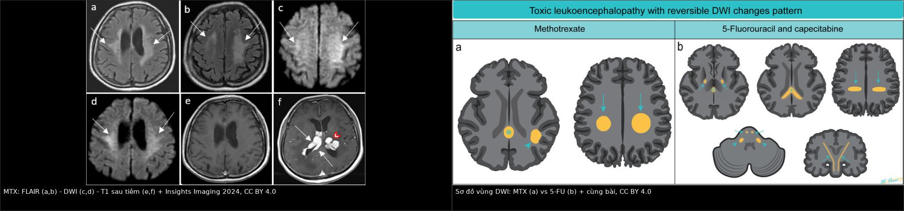
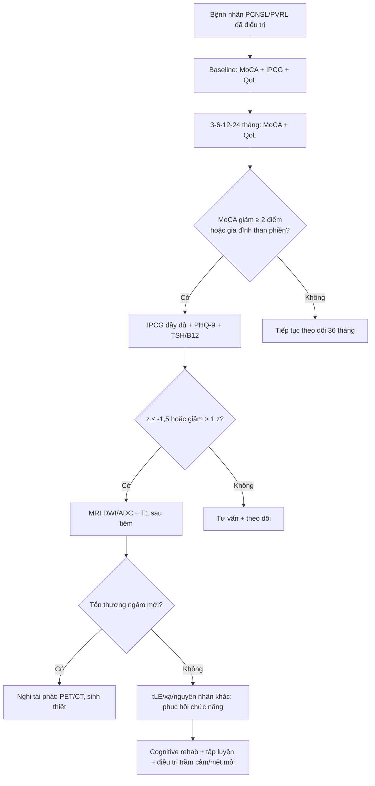
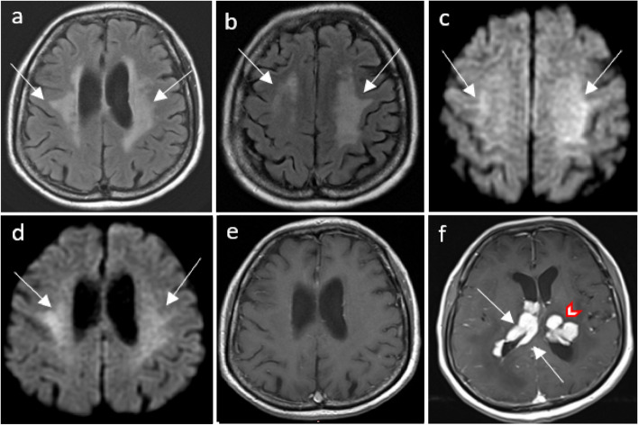
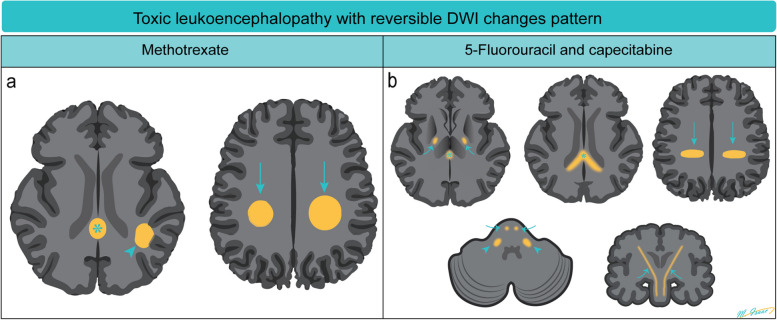

# 1421 — Theo dõi nhận thức và phục hồi chức năng sau độc tính thần kinh do methotrexate / Cognitive surveillance and rehabilitation after methotrexate neurotoxicity

**Tags:** `pattern:suy-giam-nhan-thuc` `pattern:ton-thuong-chat-trang` `pattern:han-che-khuech-tan` `vung:chat-trang` `vung:nao-that` `score:CTCAE` `score:z-score` `protocol:MRI-DWI` `protocol:test-nhan-thuc` `incidentaloma:khong`
**Mức chắc chắn (certainty):** tổng hợp y văn (literature synthesis) — 1 đoàn hệ 126 bệnh nhân u lympho hệ thần kinh trung ương có hình ảnh học và nhận thức (Ann Hematol 2025, PMC11971226, CC BY 4.0), 1 thử nghiệm pha 3 có bộ test nhận thức IPCG (Neuro Oncol 2024, PMC10995504, CC BY 4.0), 1 nghiên cứu 48 trẻ ALL với BRIEF-2/WISC (Cancer Manag Res 2026, PMC13589970, CC BY-NC 4.0 — chỉ trích số liệu), 1 nghiên cứu nhận thức xã hội ở PCNSL (Cancers 2021, PMC7956780, CC BY 4.0), hướng dẫn EHA–ESMO 2024 (PMC11148853, CC BY 4.0), 1 tổng quan về biến chứng muộn (Nat Rev Clin Oncol 2023, PMC10211308, PMC Open Access Subset — chỉ trích số liệu), 1 nghiên cứu chuẩn hóa MoCA (Brain Behav 2026, PMC13159545, CC BY 4.0) và 1 tổng quan hình ảnh (Insights Imaging 2024, PMC10792151, CC BY 4.0).

> **Bài này trả lời 4 câu hỏi khi bệnh nhân đã điều trị u lympho nội nhãn/PCNSL xong và gia đình than "người khác đi":**
> (1) **Đo nhận thức bằng gì — MoCA đủ chưa, và ngưỡng nào là bất thường?** (2) **MRI tồn tại tổn thương chất trắng nhưng bệnh nhân không than phiền — có phải bỏ qua?** (3) **Suy giảm này là di chứng methotrexate, tái phát u, hay trầm cảm–mệt mỏi?** (4) **Có can thiệp nào cải thiện, và theo dõi bao lâu?**
> Nối [494 – Độc thần kinh methotrexate (hình ảnh)](../494-doc-than-kinh-methotrexate/lesson.md) — bài đó dạy **đọc MRI**; bài này dạy **đo và phục hồi chức năng**. Nối tiếp [491 – PVRL: theo dõi & tái phát](../491-pvrl-theo-doi-tai-phat/lesson.md), [462 – U lympho nội nhãn](../462-u-lympho-noi-nhan-PVRL/lesson.md), [493 – U lympho hắc mạc](../493-u-lympho-nguyen-phat-hac-mac/lesson.md).

## 1. Tổng quan — vì sao "hình ảnh còn, triệu chứng mất" và ngược lại

### 1.1 Cơ chế: tổn thương myelin–sợi trục làm hỏng *tốc độ*, không chỉ *nội dung*

- **Mô bệnh:** hủy myelin (demyelination), myelin nhạt màu/không bào, **axonal spheroids**, xâm nhập đại thực bào, hoại tử (Ann Med Surg 2025, PMC11981439). Đây là tổn thương **chất trắng sâu**, không phải ổ nhồi máu.
- **Vì sao suy giảm biểu hiện sớm ở tốc độ xử lý (processing speed) và điều hành (executive):** các sợi liên kết dài giữa vùng trán–đỉnh chạy qua **trung tâm bán bầu dục/vành tia**; myelin bị tổn thương làm **giảm tốc độ dẫn truyền** dù từng vùng vỏ não còn nguyên. Đó là lý do bệnh nhân **vẫn nói đúng từ, nhớ đúng việc** nhưng **chậm, dễ mệt, khó lập kế hoạch** — và vì sao **MMSE 30/30 không loại trừ**.
- **Vì sao hình ảnh tồn tại lâu hơn triệu chứng:** trong loạt 126 bệnh nhân, **33/33** ca có hình ảnh tồn tại ở lần MRI cuối, nhưng chỉ **8/33** có suy giảm nhận thức đáng kể trên lâm sàng, phần lớn **không than phiền** (PMC11971226, dẫn qua bài 494). Hình ảnh phản ánh **mức phơi nhiễm/ tổn thương**, không phản ánh **khả năng bù trừ** của não.
- **Vì sao WBRT là biến số nhiễu:** xạ toàn não làm nặng thêm tổn thương chất trắng và mạch máu nhỏ; trong HOVON 105, bệnh nhân ≤ 60 tuổi được củng cố bằng WBRT giảm liều, và **tốc độ vận động (motor speed) xấu đi từ 24 đến 60 tháng** trong khi các miền khác ổn định (PMC10995504).
- **TẠI SAO phải đo bằng bộ test, không chỉ hỏi:** **8/33** ca suy giảm đáng kể nhưng **phần lớn không than phiền**; ở trẻ ALL, **47,9% (23/48)** có triệu chứng thần kinh nhưng **suy giảm điều hành vẫn hiện diện ở nhóm không triệu chứng** qua BRIEF-2 (PMC13589970). Bệnh nhân **không tự báo** vì mất khả năng nhận ra chính mình chậm — đây là "anosognosia nhẹ" của tổn thương trán.

### 1.2 Ngưỡng định lượng nằm lòng

| Chỉ số | Con số | Nguồn |
|---|---|---|
| Tần suất leukoencephalopathy do điều trị (tLE) | **33/126 (26,2%)**; tích lũy **29,2% sau 2 năm**; trung vị khởi phát **3,0 tháng** | Ann Hematol 2025 (PMC11971226) |
| Yếu tố nguy cơ độc lập của tLE | **MTX nội tủy (IT MTX) HR 4,50 (1,84–10,99)** | *cùng nguồn* |
| Suy giảm nhận thức đáng kể trong nhóm tLE | **8/33** — phần lớn **không than phiền** | *cùng nguồn* (dẫn qua bài 494) |
| Ảnh hưởng lên sống còn | EFS **HR 1,07 (0,50–2,27)** — **không** khác biệt | *cùng nguồn* |
| Bộ test nhận thức chuẩn | **IPCG test battery** (trí nhớ, chú ý/điều hành, tốc độ xử lý, tốc độ vận động) | EHA–ESMO 2024 (PMC11148853); Neuro Oncol 2024 (PMC10995504) |
| Ngưỡng thay đổi có ý nghĩa lâm sàng | **thay đổi z-score > 1** so với nền | Neuro Oncol 2024 (PMC10995504) |
| Lịch đo nhận thức trong thử nghiệm | **trước điều trị, sau hóa trị tấn công/củng cố, 3, 6, 12, 24 tháng** | *cùng nguồn* |
| Tuân thủ test dài hạn | **≥ 60%** ở mọi mốc, riêng **36 tháng 55%** | *cùng nguồn* |
| Xu hướng nhận thức 5 năm | Cải thiện sau điều trị rồi **ổn định đến 60 tháng**, trừ **tốc độ vận động giảm 24→60 tháng** | *cùng nguồn* |
| Trẻ ALL sau hóa trị | **47,9%** có triệu chứng thần kinh; **73,9%** cải thiện nhanh; **83,3%** giảm tổn thương MRI trong **12 tháng** | Cancer Manag Res 2026 (PMC13589970) |
| Suy giảm điều hành ở trẻ (BRIEF-2) | Tăng điểm **tự giám sát, kiểm soát cảm xúc, trí nhớ làm việc, lập kế hoạch** (p < 0,05) | *cùng nguồn* |
| Suy giảm IQ ở trẻ (WISC) | Giảm **IQ tổng, lý luận tri giác, trí nhớ làm việc, tốc độ xử lý** (p < 0,05) | *cùng nguồn* |
| Nhận thức xã hội ở PCNSL lui bệnh | **43 bệnh nhân** CR ≥ 1 năm vs **43 chứng**: suy giảm **đồng cảm và giải quyết vấn đề xã hội** | Cancers 2021 (PMC7956780) |
| MoCA — ngưỡng gốc | **< 26/30** là ngưỡng gốc cho MCI, nhưng **tỷ lệ dương tính giả cao**; ngưỡng MCI **điều chỉnh 23** | Brain Behav 2026 (PMC13159545) |

- **Đọc con số cho đúng:** tLE **không** làm giảm sống còn (EFS HR 1,07) → **không được ngừng/thay phác đồ chỉ vì hình ảnh**; nhưng **phải đo nhận thức** vì 8/33 ca có suy giảm thật. Đây là nguyên tắc "**điều trị ung thư theo khối u, phục hồi theo chức năng**".
- **Vì sao z-score, không phải "có/không":** một người có IQ 130 tụt còn 105 vẫn "trong giới hạn bình thường" nhưng **mất 1,7 SD** so với chính họ. Ngưỡng **z ≤ −1,5** dùng để gọi **suy giảm**, còn **giảm > 1 z** dùng để gọi **thay đổi có ý nghĩa** — hai câu hỏi khác nhau.

## 2. Mẫu hình theo miền nhận thức — gamut nguyên nhân

- **Tốc độ xử lý + điều hành (processing speed/executive):** tLE, WBRT, bệnh mạch nhỏ, thiếu ngủ, mệt mỏi, thuốc chống động kinh. Đây là miền **nhạy nhất** với tổn thương chất trắng.
- **Trí nhớ làm việc (working memory):** tổn thương trán–đỉnh, corticosteroid, mất ngủ, trầm cảm.
- **Trí nhớ dài hạn (episodic memory):** tổn thương hệ viền/hồi hải mã (u, WBRT), trầm cảm, thiếu ngủ, thiếu B12/thyroid.
- **Chú ý duy trì (attention):** mệt mỏi do xạ/hóa trị, thiếu máu, suy giáp, thuốc an thần.
- **Nhận thức xã hội (social cognition):** tổn thương mạng trán–thái dương; **43/43 bệnh nhân PCNSL** có suy giảm dù lui bệnh hoàn toàn (PMC7956780) — **không** bắt được bằng MMSE/MoCA.
- **Ngôn ngữ/thị giác không gian (language/visuospatial):** **cờ đỏ tái phát u hoặc đột quỵ**, nhất là khi **khu trú và tiến triển ngày**.
- **Mnemonic "SPEED–MOOD–MED–SLEEP":** **S**PEED (tốc độ xử lý — chất trắng) · **M**OOD (trầm cảm) · **M**ED (corticoid, chống động kinh) · **S**LEEP (ngưng thở khi ngủ) — 4 nhóm dễ quy sai cho "tuổi".

## 3. Bảng so sánh phân biệt — nguyên nhân suy giảm nhận thức sau điều trị

| Thực thể | Hình ảnh điển hình | Chốt vào (rule-in) | Chốt loại (rule-out) | Gợi ý xác nhận |
|---|---|---|---|---|
| **tLE do MTX** | **T2/FLAIR tăng đối xứng** ở trung tâm bán bầu dục/vành tia, **DWI sáng/ADC tối**, **KHÔNG ngấm**, không hiệu ứng khối; tồn tại sau điều trị | **DWI sáng + không ngấm + đối xứng + sau HD-MTX/IT-MTX** | **Có ngấm hoặc hiệu ứng khối** → không phải tLE đơn thuần | MRI DWI/ADC + so phim trước điều trị; test nhận thức nền |
| **Tái phát u lympho** | Khối **ngấm đồng nhất**, hạn chế khuếch tán **kèm ngấm**, quanh não thất; lớn dần | **Tổn thương ngấm mới/to ra + DWI sáng có ngấm** | Tổn thương **không ngấm, đối xứng, ổn định** → nghĩ tLE | MRI tăng ngấm + PET/CT; sinh thiết nếu chưa rõ |
| **Hoại tử phóng xạ/leukoencephalopathy do xạ** | Tăng T2/FLAIR lan rộng, teo vỏ, **ngấm dạng "swiss cheese"** muộn; thời gian **6–18 tháng** sau xạ | **Tiền sử WBRT + tổn thương trong vùng xạ + teo** | Không tiền sử xạ, tổn thương ngoài vùng chiếu | MRI phổ/ASL; hội chẩn xạ–thần kinh |
| **Trầm cảm/mệt mỏi (pseudodementia)** | MRI **không tương xứng** với mức suy giảm; không tổn thương mới | **PHQ-9 cao + mệt mỏi + test cải thiện khi điều trị** | Tổn thương mới/ngấm → loại trừ tái phát trước | PHQ-9, thang mệt mỏi, hỏi giấc ngủ |
| **Corticosteroid kéo dài** | Teo hồi hải mã (khó thấy trên MRI thường), không tổn thương đặc hiệu | **Dùng prednisone liều cao kéo dài + cải thiện khi giảm liều** | Không dùng corticoid → loại trừ | Rà đơn thuốc, đường huyết, giấc ngủ |
| **Suy giáp/thiếu B12** | Không đặc hiệu; có thể teo não lan tỏa | **TSH cao, B12 thấp, thiếu máu** | TSH/B12 bình thường → loại trừ | Xét nghiệm máu |
| **Ngưng thở khi ngủ (OSA)** | Không đặc hiệu; có thể tăng tín hiệu chất trắng | **AHI ≥ 5 + ngáy/ngừng thở + buồn ngủ ngày** | Không ngáy, không buồn ngủ → ít nghĩ | Đa ký giấc ngủ |
| **Thuốc chống động kinh/benzodiazepine** | Không tổn thương | **Bắt đầu thuốc gần đây + chậm/sa sút** | Không dùng thuốc → loại trừ | Rà đơn, cân nhắc đổi |

*Trái: (a, b) FLAIR tăng tín hiệu đối xứng trung tâm bán bầu dục/vành tia, **chừa U-fiber dưới vỏ**; (c, d) DWI sáng tương ứng; (e, f) T1 sau tiêm: vùng FLAIR/DWI **không ngấm**, trong khi ổ quanh não thất và đồi thị trái **ngấm** — tổn thương u còn lại. Phải: sơ đồ vùng DWI của MTX (a) so với 5-FU/capecitabine (b). Nguồn: Insights Imaging 2024, PMC10792151, CC BY 4.0; ảnh ghép letterbox, không crop.*

### Đọc ảnh — một bức ảnh chứa hai chẩn đoán

- **Phần không ngấm:** FLAIR sáng + DWI sáng + ADC thấp + **không ngấm** + **đối xứng** + **chừa U-fiber** = **tLE**, không phải u.
- **Phần ngấm:** ổ **quanh não thất và đồi thị** ngấm thuốc = **u lympho còn lại**. Trong ca minh họa, hai loại tổn thương **cùng tồn tại** — đây là cạm bẫy "thấy tổn thương mới là nghĩ tái phát" và ngược lại "thấy tổn thương cũ là bỏ qua tổn thương mới".
- **Sơ đồ (phải):** MTX tập trung **trung tâm bán bầu dục/vành tia**, có thể **một bên, hai bên, đối xứng hoặc không**; 5-FU/capecitabine lan **bao trong, bó vỏ–tủy, cuống tiểu não giữa, thể chai** — phân bố giúp phân biệt thuốc nào gây tổn thương.

## 4. Protocol — đo, theo dõi và phục hồi

### 4.1 Bộ công cụ: sàng lọc → đầy đủ

| Bước | Công cụ | Ngưỡng/diễn giải | Ghi chú |
|---|---|---|---|
| **Sàng lọc mỗi lần khám** | **MoCA** (10–15 phút) | **< 26/30** là ngưỡng gốc nhưng **dương tính giả cao**; ngưỡng MCI điều chỉnh **23**; dùng **chuẩn theo tuổi–học vấn** | Không dùng MoCA đơn độc để kết luận |
| **Khi MoCA bất thường hoặc có than phiền** | **IPCG test battery**: trí nhớ (HVLT-R), chú ý/điều hành (Trail A/B), tốc độ xử lý, tốc độ vận động (Grooved Pegboard), ngôn ngữ (COWA) | **z ≤ −1,5** = suy giảm; **giảm > 1 z** = thay đổi có ý nghĩa | Bộ test chuẩn của IPCG/EHA–ESMO |
| **Chất lượng sống** | **EORTC QLQ-C30 + QLQ-BN20** | Mệt mỏi, chức năng xã hội, lo âu | Đo cùng lúc với nhận thức |
| **Tâm lý–giấc ngủ** | **PHQ-9**, thang mệt mỏi, sàng lọc OSA | PHQ-9 ≥ 10 → điều trị trầm cảm trước khi quy cho thuốc | Loại trừ nguyên nhân điều trị được |
| **Xét nghiệm** | TSH, B12, ferritin, đường huyết | Bất thường → sửa trước | Không bỏ qua vì "đã có MRI" |
| **Phân độ độc tính** | **CTCAE v5.0 — cognitive disturbance** | Độ 1–4 theo mức ảnh hưởng chức năng | Dùng để báo cáo, không thay test |

### 4.2 Lịch theo dõi (lấy từ thử nghiệm có bộ test IPCG)

- **Trước điều trị (baseline):** MoCA + IPCG nếu có thể + QoL — **bắt buộc**, vì không có nền thì không biết ai đã giảm.
- **Sau hóa trị tấn công và sau củng cố:** lặp bộ test.
- **3, 6, 12, 24 tháng:** lặp; từ **24–36 tháng** chú ý **tốc độ vận động** (giảm dần trong HOVON 105).
- **36 tháng:** chấp nhận **tuân thủ thấp hơn (~55%)** — hẹn qua điện thoại/video nếu cần, không bỏ mốc.
- **MRI:** chụp cùng mốc khi có **triệu chứng mới, cơn động kinh, thay đổi thần kinh khu trú**, hoặc trước khi quyết định đổi điều trị; không chụp thay cho test nhận thức.

### 4.3 Phục hồi chức năng — bằng chứng và thứ tự

- **Giáo dục bệnh nhân + gia đình:** giải thích **"không phải tại bệnh nhân lười"**; giảm tự trách, tăng tuân thủ.
- **Huấn luyện nhận thức (cognitive training/rehabilitation):** được khuyến cáo sau khi chẩn đoán suy giảm nhận thức do ung thư; chương trình **trên máy tính** cải thiện **triệu chứng tự báo** trong nghiên cứu sơ bộ (Nat Rev Clin Oncol 2023, PMC10211308).
- **Tập luyện thể chất:** can thiệp có bằng chứng nhất cho **mệt mỏi và chức năng**; nên là "đơn thuốc" phối hợp, không thay thế điều trị ung thư.
- **Liệu pháp thân–tâm (mind–body):** yoga, thái cực quyền, chánh niệm — hỗ trợ mệt mỏi/lo âu; bằng chứng còn hạn chế nhưng an toàn.
- **Điều trị nguyên nhân điều trị được:** trầm cảm, thiếu ngủ, suy giáp, thiếu B12, cai thuốc an thần.
- **Tư vấn nghề nghiệp/lái xe:** đánh giá **tốc độ phản ứng** và **chức năng điều hành** trước khi trở lại lái xe/nghề vận hành máy; ghi vào hồ sơ.

## 5. Biến thể bình thường và cạm bẫy

- **Hiệu ứng luyện tập (practice effect):** làm MoCA nhiều lần có thể **tăng 1–3 điểm** dù bệnh không cải thiện; dùng **bộ test song song** hoặc so với **z-score chuẩn**, không so điểm thô giữa các lần.
- **Học vấn/văn hóa:** MoCA **< 26** có **dương tính giả cao** ở người học vấn thấp/tuổi cao; phải dùng **chuẩn tuổi–học vấn**, không "một ngưỡng cho tất cả" (PMC13159545).
- **MMSE trần (ceiling):** bệnh nhân **30/30** vẫn có thể suy giảm **tốc độ xử lý/nhận thức xã hội**; MMSE không đo các miền này.
- **"MRI bình thường = nhận thức bình thường":** sai. Tổn thương **mạng chức năng** có thể không thấy trên MRI thường; ngược lại **tLE tồn tại 33/33** nhưng chỉ 8/33 có suy giảm — **hình ảnh và chức năng không thay thế nhau**.
- **Quy cho "tuổi" hoặc "trầm cảm" quá sớm:** trầm cảm là nguyên nhân **điều trị được**, nhưng **không loại trừ tái phát**; phải có MRI khi có cờ đỏ.
- **Đo trong lúc mệt/đang dùng corticoid liều cao:** có thể **giảm giả tạo**; hẹn lại sau đợt cấp nếu có thể, ghi rõ điều kiện đo.
- **Bỏ sót nhận thức xã hội:** bệnh nhân có thể **vẫn làm test giấy bình thường** nhưng **mất khả năng đọc cảm xúc/giải quyết xung đột** — hỏi người chăm sóc, không chỉ hỏi bệnh nhân (PMC7956780).
- **Nhầm "không than phiền" = "không suy giảm":** 8/33 ca trong loạt tLE có suy giảm **nhưng phần lớn không than phiền** — chủ động test, đừng chờ bệnh nhân kêu.

## 6. Tự lượng giá — Blind Quiz

**Ca 1 — Nữ 64 tuổi, PCNSL, đang HD-MTX tuần thứ 2, đột ngột yếu và tê hai tay, khó nuốt. Nhìn ảnh, mô tả trước.**

- Câu hỏi: (a) Vùng nào là độc tính, vùng nào là u? (b) Dấu hiệu nào chốt? (c) Có nên ngừng MTX không?

<b>Bấm để hiện đáp án (findings + chẩn đoán)</b>

- **Findings:** (a, b) FLAIR **tăng đối xứng** ở **trung tâm bán bầu dục/vành tia**, **chừa U-fiber dưới vỏ**; (c, d) DWI **sáng tương ứng**, ADC thấp (không hiển thị); vùng này **không ngấm** sau tiêm (e, f). Ngược lại, (f) có ổ **ngấm quanh não thất và đồi thị trái** — tổn thương u lympho.
- **Chẩn đoán:** **tLE do MTX** (DWI sáng + không ngấm + đối xứng) **cùng tồn tại** với **u còn lại** (ổ ngấm).
- **Có nên ngừng MTX?** **Không ngừng chỉ vì hình ảnh**: tLE phần lớn **không triệu chứng**, EFS/OS **không khác** (HR 1,07). Việc cần làm: **đo nhận thức có công cụ**, xử trí triệu chứng, và **đếm số lần IT-MTX** cho các đợt sau (HR 4,50). Quyết định giảm/ngừng phải do hội chẩn ung thư–thần kinh, không do hình ảnh đơn thuần.
- **Nguồn:** Insights Imaging 2024;15:12, Fig. 1 — PMC10792151, CC BY 4.0. Số liệu: PMC11971226; PMC10995504.

**Ca 2 — Cùng bệnh nhân, sơ đồ vùng DWI. Nhìn sơ đồ, phân biệt thuốc nào gây tổn thương ở đâu.**

- Câu hỏi: (a) MTX thường tổn thương vùng nào? (b) 5-FU/capecitabine khác ở đâu? (c) Vì sao phân bố lại quan trọng trên lâm sàng?

<b>Bấm để hiện đáp án</b>

- **MTX (a):** **trung tâm bán bầu dục và vành tia**, có thể **một bên/hai bên/đối xứng/không đối xứng**; hiếm gặp tổn thương **thể chai (reversible splenial lesion)**.
- **5-FU/capecitabine (b):** **vành tia, chất trắng sâu, bó vỏ–tủy, cuống tiểu não giữa, thể chai**; hiếm khi **hạch nền/đồi thị**.
- **Vì sao quan trọng:** xác định **thuốc nào là thủ phạm** khi bệnh nhân dùng nhiều phác đồ; tránh **đổ lỗi cho MTX** và cắt oan một thuốc cần thiết, hoặc ngược lại **bỏ qua capecitabine** đang gây triệu chứng.
- **Nguồn:** Insights Imaging 2024;15:12, Fig. 4 — PMC10792151, CC BY 4.0.

**Ca 3 — Nữ 55 tuổi, PCNSL lui bệnh hoàn toàn 2 năm. Gia đình nói "bà ấy không còn như trước": chậm, dễ cáu, hiểu sai ý người khác. MoCA 27/30, MRI ổn định. Bạn làm gì tiếp?**

<b>Bấm để hiện đáp án</b>

- **Không được trấn an bằng MoCA 27/30:** MoCA **< 26** chỉ là ngưỡng sàng lọc, **dương tính giả cao**, và **không đo nhận thức xã hội**. Điểm 27 vẫn có thể kèm suy giảm **tốc độ xử lý/điều hành/nhận thức xã hội**.
- **Bước tiếp:** **IPCG battery đầy đủ** (kể cả test nhận thức xã hội/đồng cảm), **PHQ-9**, sàng lọc **mệt mỏi/giấc ngủ**, **TSH/B12**; hỏi **người chăm sóc** (bệnh nhân có thể không tự nhận).
- **Chẩn đoán:** nhiều khả năng **di chứng nhận thức sau điều trị** (tLE/WBRT) ± trầm cảm; **không loại trừ tái phát** nếu có cờ đỏ mới → MRI có **DWI/T1 sau tiêm**.
- **Can thiệp:** giáo dục gia đình, **cognitive rehab**, tập luyện, điều trị trầm cảm/mệt mỏi, tư vấn nghề nghiệp/lái xe. Theo dõi **3–6–12 tháng** bằng cùng bộ test.
- **Nguồn:** PMC7956780 (43 bệnh nhân CR ≥ 1 năm); PMC13159545 (MoCA); PMC11148853 (IPCG battery); PMC10211308 (phục hồi chức năng).

## Bài liên quan chéo
- [494 – Độc thần kinh methotrexate: đọc MRI DWI/ADC, phân biệt tái phát](../494-doc-than-kinh-methotrexate/lesson.md)
- [491 – PVRL: theo dõi & tái phát](../491-pvrl-theo-doi-tai-phat/lesson.md)
- [462 – U lympho nội nhãn (PVRL)](../462-u-lympho-noi-nhan-PVRL/lesson.md)
- [493 – U lympho nguyên phát hắc mạc](../493-u-lympho-nguyen-phat-hac-mac/lesson.md)
- [242 – PACNS: duy trì & theo dõi](../242-pacns-duy-tri-theo-doi/lesson.md)

> Không dùng để chẩn đoán độc lập khi chưa có người hướng dẫn.
