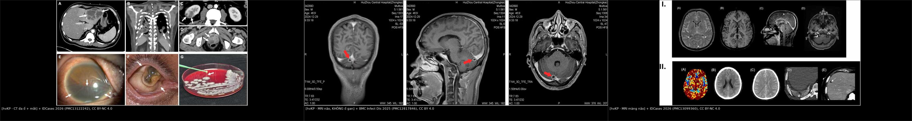
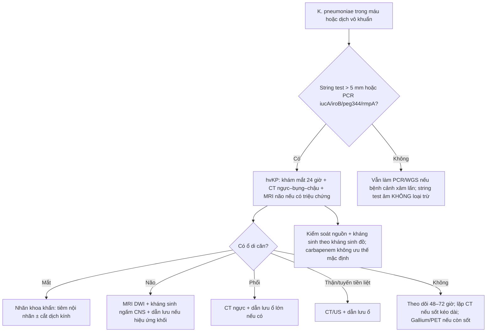
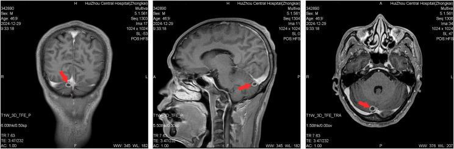
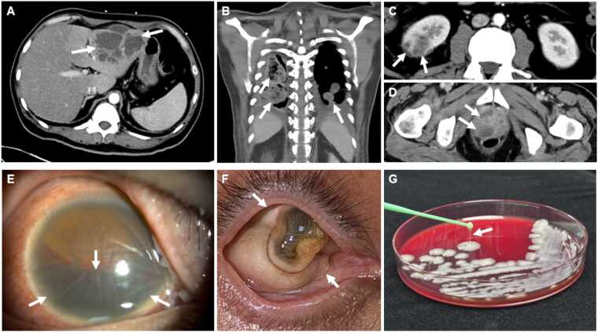
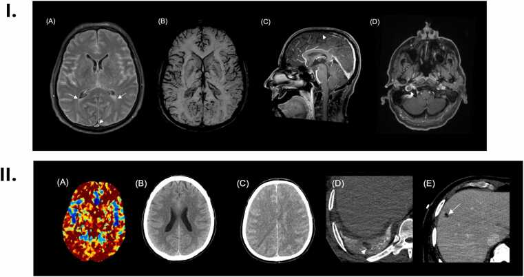

# 1422 — Nhiễm khuẩn huyết do *Klebsiella pneumoniae* tăng độc lực (hvKP) **không có ổ gan**: bản đồ ổ di căn ẩn và bộ ba tầm soát mắt–não–phổi

**Tags:** `pattern:viem-nhiem` `pattern:ap-xe` `pattern:nhieu-o` `pattern:viem-noi-nhan` `pattern:ap-xe-nao` `pattern:viem-mang-nao` `pattern:di-can` `vung:gan` `vung:phoi` `vung:nao` `vung:mat` `vung:than` `vung:tuyen-tien-liet` `protocol:CT-nguc-bung-chau` `protocol:MRI-nao` `protocol:soi-day-mat` `protocol:cay-mau`
**Mức chắc chắn (certainty):** tổng hợp y văn (literature synthesis) — **tổng quan hệ thống 778 ca/376 báo cáo** (2026, PMC13291180), **đoàn hệ Vancouver 38 ca hvKP** có PCR/giải trình tự (PMC13660691), **meta-analysis viêm nội nhãn nội sinh** (15 nghiên cứu/11.889 ca áp-xe gan, PMID 33035676; 17 nghiên cứu/219 ca, PMID 41483529), **nghiên cứu carbapenem vs không carbapenem** (236 ca, PMID 41251372), và ba ca nguyên văn có ảnh (PMC12817846, PMC13122242, PMC13099360). Số nào nguồn không đưa thì ghi "chưa rõ".

> **Câu chốt:** **không thấy áp-xe gan không loại trừ hvKP.** Trong 778 ca hvKP được báo cáo, **chỉ 39,0% có tổn thương gan** — nghĩa là **475 ca (61,1%) không có ổ gan được ghi nhận**, trong khi **46,1% có nhiễm khuẩn huyết** và **22,9% có tổn thương não**. Ổ di căn có thể là **mắt, màng não/não, phổi, thận, tuyến tiền liệt, da–mô mềm** và có thể **im lặng**. Vì vậy khi cấy máu ra *K. pneumoniae* ở bệnh nhân đái tháo đường/từ vùng dịch tễ, câu hỏi không phải "có áp-xe gan không" mà là **"đã khám mắt, chụp não và phổi chưa"**.
> Nối [103 – Áp-xe gan do *Klebsiella* & hvKP](../103-ap-xe-gan-klebsiella/lesson.md) (đọc CT gan, ngưỡng dẫn lưu), [1420 – Áp-xe gan + viêm nội nhãn nội sinh](../1420-ap-xe-gan-klebsiella-va-viem-noi-nhan/lesson.md) (thứ tự can thiệp mắt–gan) và [475 – Viêm nội nhãn nội sinh do vi khuẩn](../475-viem-noi-nhan-noi-sinh-vi-khuan/lesson.md) (cơ chế "tiền phòng im lặng").

## 1. Tổng quan bệnh học – cơ chế hình ảnh

### 1.1 hvKP là gì — định nghĩa đang dùng và ngưỡng định danh

- **Hai dòng *K. pneumoniae*:** **cKP** (classical, thường bệnh viện, đa kháng) và **hvKP** (hypervirulent, thường cộng đồng, **người khỏe mạnh không suy giảm miễn dịch vẫn mắc**). Tỷ lệ hvKP trong các chủng *K. pneumoniae* khoảng **15,2%**, có nơi châu Á **> 40%** (PMC13291180).
- **Định nghĩa thực hành (không có tiêu chuẩn duy nhất):**
  - **Kiểu hình:** **string test dương** khi khuẩn lạc kéo thành sợi **> 5 mm** (Vancouver dùng ngưỡng này, PMC13660691).
  - **Kiểu gen:** mang **iucA** (aerobactin), **iroB** (salmochelin), **peg-344**, **rmpA/rmpA2** (điều hòa nhầy) — bộ 5 gen được xem là dấu ấn mạnh nhất (PMC13291180, PMC13141873).
  - **Giải trình tự:** **Kleborate virulence score ≥ 3** được dùng làm chuẩn tham chiếu trong đoàn hệ Vancouver (PMC13660691).
- **Giá trị của xét nghiệm:** PCR (peg-344 + iucA trong đoàn hệ Vancouver) có **độ nhạy 100%, độ đặc hiệu 98,8%** so với giải trình tự; **chỉ 13% ca hvKP được nghĩ tới lúc phân lập** — tức **87% bị bỏ sót nếu chỉ dựa vào lâm sàng** (PMC13660691). String test **không đủ**: độ nhạy **92%** nhưng độ đặc hiệu chỉ **54,5%**, PPV **82,1%**, NPV **75%**; **78% (28/36)** chủng hvKP string test dương (cùng nguồn).

### 1.2 Sinh bệnh học — vì sao "không gan" vẫn di căn

- **Vỏ polysaccharide K1/K2** chống thực bào và chống ly giải bổ thể; **K1 38,4%**, **K2 27,3%** trong 778 ca (PMC13291180). K1 là yếu tố nguy cơ độc lập của viêm nội nhãn nội sinh (PMID 33035676).
- **Hệ thống siderophore:** aerobactin (iucA), salmochelin (iroB), yersiniabactin — lấy sắt từ transferrin của vật chủ, giúp **tăng sinh trong máu** và **xâm nhập mô**.
- **rmpA/rmpA2** làm tăng sinh nhầy (hypermucoid), tạo **màng sinh học** và kháng thực bào; đây là lý do ổ áp-xe **nhầy, khó hút, dễ tái phát**.
- **Đường vào không nhất thiết là gan:** **đường niệu** (ca 46 tuổi: UTI → nhiễm khuẩn huyết → màng não, **không có ổ gan**), **phổi**, **tuyến tiền liệt**, **catheter**, **da–mô mềm**. Từ máu, vi khuẩn bám vào **mao mạch mắt, não, phổi, thận** — nơi có giường mao mạch rộng và dòng chảy chậm.
- **Vì sao ổ gan vắng mặt:** có thể **không bao giờ hình thành** (đường vào khác), **đã dẫn lưu/tự vỡ trước khi chụp**, hoặc **quá nhỏ** dưới ngưỡng CT. Vì vậy "CT gan âm" **không phải bằng chứng loại trừ**.

### 1.3 Ngưỡng định lượng nằm lòng

| Chỉ số | Con số | Nguồn |
|---|---|---|
| Quần thể báo cáo | **778 ca / 376 báo cáo / 40 quốc gia**; tuổi trung bình **55,67 ± 19,07** | PMC13291180 |
| Vị trí phân lập | **máu 46,1% (359)**, **gan 39,0% (303)**, **phổi 35,0% (272)**, **não 22,9% (178)**, **mắt 16,8% (131)**, **niệu–sinh dục 16,1% (125)**, **da 15,3% (119)**, khác 11,3% (88) | *cùng nguồn* |
| **Không có ổ gan** | **475/778 = 61,1%** (303 ca có gan) | *tính từ cùng nguồn* |
| Tử vong chung | **34,2% (200/585)**; hồi phục hoàn toàn **46,5%**, di chứng **19,3%** | *cùng nguồn* |
| Tử vong theo ổ | **não 39,2%**, **phổi 38,0%**, **máu 36,3%**, **da 26,1%**, **niệu–sinh dục 18,6%**, **gan 17,1%**, **mắt 3,5%** | *cùng nguồn* |
| Di chứng mắt | **66,4%** (mù/giảm thị lực nặng) dù tử vong thấp | *cùng nguồn* |
| Tái phát | **19,0% (16/84)**; da **28,0%**, máu **24,3%**, ổ khác **50,0%** | *cùng nguồn* |
| Chẩn đoán muộn | chỉ **13%** ca hvKP được nghĩ tới lúc phân lập | PMC13660691 |
| Viêm nội nhãn nội sinh trong áp-xe gan | **4,5% (95% CI 2,4–8,2%)**; 15 nghiên cứu/**11.889 ca** | PMID 33035676 |
| Thị lực cuối ở viêm nội nhãn | **77,9% < 3/60**; đái tháo đường **67,4%** | PMID 41483529 |
| Kháng sinh | carbapenem **không** tốt hơn: tử vong 28 ngày **23,1% vs 10,3%** (p = 0,016); OR đa biến **1,39 (0,47–4,10)** | PMID 41251372 |

## 2. Mẫu hình + chẩn đoán phân biệt theo vị trí (Gamut)

- **Mắt (131 ca):** thể **viêm nội nhãn nội sinh** — mờ mắt, đau, **hypopyon**, viêm dịch kính; có thể **không đau** và bị bỏ qua. Ổ nguồn gan chỉ chiếm một phần; **4,5%** áp-xe gan có viêm nội nhãn, nhưng hvKP **không ổ gan vẫn có** (đường niệu/phổi). **K1** là yếu tố nguy cơ; **77,9%** thị lực cuối < 3/60.
- **Não/màng não (178 ca):** **áp-xe não** (ổ viền ngấm thuốc, hạn chế khuếch tán), **viêm màng não–não thất**, **huyết khối xoang/tĩnh mạch cảnh trong** do viêm lan. Tử vong **39,2%** — cao nhất trong các ổ. **50 ca chỉ có não** (không gan, không phổi) — đây là nhóm dễ bỏ sót nhất.
- **Phổi (272 ca):** **nốt/hang ngoại vi hai bên**, thuyên tắc nhiễm khuẩn (septic emboli), áp-xe phổi; bệnh nhân có thể chỉ sốt và ho. Tử vong **38,0%**.
- **Gan (303 ca):** áp-xe **đa thùy, vách, khí trong ổ**, ngấm viền; nhưng **39%** không có — đừng dừng khảo sát khi gan sạch.
- **Thận/tuyến tiền liệt (125 ca):** áp-xe thận, áp-xe tuyến tiền liệt **im lặng** (ca 47 tuổi chỉ lộ ra trên **Gallium-67** sau khi sốt kéo dài dù đã dẫn lưu gan).
- **Da–mô mềm (119 ca):** **viêm cân mạc hoại tử**, áp-xe dưới da, viêm bao gân — có thể là ổ vào hoặc ổ di căn.
- **Mnemonic "M–N–P–T–D":** **M**ắt, **N**ão, **P**hổi, **T**hận/tuyến tiền liệt, **D**a — khám/chụp theo thứ tự này ở mọi ca hvKP bacteremia, kể cả khi gan âm.

## 3. Bảng so sánh phân biệt (ma trận đối chiếu)

| Thực thể (entity) | Hình ảnh điển hình | Chốt vào (rule-in) | Chốt loại (rule-out) | Gợi ý xác nhận |
|---|---|---|---|---|
| **hvKP bacteremia KHÔNG ổ gan** | Không có ổ gan trên CT; **ổ di căn mắt/não/phổi/thận/tuyến tiền liệt** | **K. pneumoniae ở máu/dịch vô khuẩn + string test/PCR hvKP + ổ di căn** | PCR âm và không có gen tăng độc lực → nghĩ cKP; cấy lại loại nhiễm bẩn | PCR 5 gen/WGS; khám mắt; CT ngực–bụng–chậu; MRI não |
| **hvKP có ổ gan** | Áp-xe gan đa thùy, vách, khí; ± ổ di căn | **Áp-xe gan + K1/K2 + string/PCR dương** | Không có vi khuẩn trong ổ (amip), thanh mạc đơn thuần → không phải hvKP | Chọc hút/cấy ổ; PCR; CT 4 pha |
| **cKP bacteremia** | Thường bệnh viện, catheter, đa kháng; ít ổ di căn | **Cấy máu + kháng sinh đồ + không có gen hvKP** | Có iucA/iroB/rmpA → hvKP dù string test âm | PCR/WGS; bối cảnh dịch tễ |
| **Thuyên tắc phổi nhiễm khuẩn (từ viêm nội tâm mạc)** | Nốt/hang ngoại vi hai bên, mạch nuôi; **van tim có vegetation** | **Siêu âm tim có vegetation + cấy máu dương** | Echo âm, không ổ van → nghĩ hvKP nguyên phát | Echo TTE/TEE; cấy máu |
| **Di căn ung thư** | Nốt phổi/cảnh, ổ não viền ngấm thuốc; **không sốt, không cấy dương** | **Tiền sử ung thư + tổn thương đa ổ tiến triển** | Cấy máu dương + sốt cao → nhiễm trùng | Sinh thiết; PET-CT |
| **Áp-xe gan do amip** | Ổ gan đơn độc, không vách, không khí; **huyết thanh amip dương** | **Huyết thanh/ PCR amip dương; ổ "anchovy paste"** | Cấy mủ có vi khuẩn + hvKP gen → áp-xe vi khuẩn | Huyết thanh amip; chọc hút |

*Trái: CT đa ổ (gan, phổi, thận, tuyến tiền liệt) + mắt + string test. Giữa: MRI não ca hvKP **không có ổ gan** — nốt 10 mm ở tiểu não phải. Phải: MRI màng não–não thất + huyết khối xoang. Nguồn: IDCases 2026 (PMC13122242), BMC Infect Dis 2025 (PMC12817846), IDCases 2026 (PMC13099360) — CC BY-NC 4.0/CC BY 4.0. Ảnh ghép letterbox, không crop.*

### 3.1 Đọc hình ảnh theo ổ — dấu hiệu nào thật sự đổi xử trí

- **Mắt:** **hypopyon, viêm dịch kính, ổ mủ dưới võng mạc** trên soi đáy mắt; siêu âm B-scan khi không thấy đáy mắt. **Không chờ mờ mắt mới khám** — ổ ngoại vi có thể im lặng.
- **Não:** **áp-xe** = ổ viền ngấm thuốc + **hạn chế khuếch tán trung tâm** + phù quanh; **viêm màng não** = ngấm màng não mềm; **não thất** = mủ lắng/mức dịch–mủ, ngấm màng nội tủy. **Huyết khối xoang** = khuyết thuốc trên CTV/MRV — đừng bỏ qua khi có nhức đầu/giảm tri giác.
- **Phổi:** **nốt/hang ngoại vi hai bên** gợi ý **thuyên tắc nhiễm khuẩn**; mạch nuôi đến nốt (feeding vessel) là dấu phụ. Hang thành mỏng + mức khí–dịch có thể là áp-xe phổi.
- **Thận/tuyến tiền liệt:** ổ giảm đậm độ không đồng nhất, viền ngấm thuốc; tuyến tiền liệt **dễ bỏ sót** vì triệu chứng niệu dục kín đáo. **Gallium-67/FDG-PET** hữu ích khi sốt kéo dài và CT bụng–chậu âm (ca 47 tuổi).
- **Gan:** ổ **giảm đậm độ đa thùy**, vách, **khí trong ổ**, ngấm viền; nhưng **không có ổ gan không loại trừ**.

## 4. Protocol chụp + định danh + flowchart

### 4.1 Protocol chẩn đoán

- **Cấy máu 2 bộ trước kháng sinh** (nếu đã dùng kháng sinh, vẫn cấy và ghi rõ — ca 46 tuổi có cấy máu âm sau thuốc nhưng cấy dịch ổ dương).
- **Trên chủng phân lập:** **string test > 5 mm** + **PCR iucA/iroB/peg-344/rmpA/rmpA2** (hoặc WGS/Kleborate ≥ 3). **Không bỏ PCR vì string test âm** (Se 92%, Sp 54,5%).
- **Khám mắt** trong **24 giờ** ở mọi ca hvKP bacteremia; khám khẩn nếu mờ mắt/đau.
- **CT ngực–bụng–chậu có cản quang** (CT được dùng ở **92,0%** ca trong tổng quan; MRI **32,8%**, siêu âm **32,5%**). Với ổ đầu–cổ/não: **MRI não có DWI + chuỗi ngấm thuốc**.
- **MRI não** khi: triệu chứng thần kinh mới, co giật, giảm tri giác, đau đầu dai dẳng, hoặc sốt không giải thích dù CT bụng âm. **LP** sau khi loại hiệu ứng khối/ phù não; đo **áp lực mở**, protein, glucose, tế bào, Gram/cấy, PCR mNGS nếu có.
- **Siêu âm tim** khi có tiếng thổi, thuyên tắc hệ thống, hoặc cấy máu kéo dài dương.
- **Gallium-67 hoặc FDG-PET** khi sốt kéo dài + CT/MRI âm; ca 47 tuổi **chỉ Gallium-67** phát hiện áp-xe tuyến tiền liệt, dẫn tới chọc hút điều trị.
- **Lặp CT 48–72 giờ** nếu sốt không giảm sau dẫn lưu/kháng sinh — tìm ổ mới hoặc dẫn lưu chưa đủ.

### 4.2 Định danh / phân tầng

- **Kleborate virulence score ≥ 3** (Vancouver) — dùng khi có WGS; không thay thế PCR tại chỗ.
- **K1/K2** là yếu tố nguy cơ viêm nội nhãn nội sinh (K1) và độc lực; không phải tiêu chuẩn chẩn đoán.
- **Không có RADS cho hvKP**; phân tầng theo **ổ di căn + độ nặng sepsis/APACHE II + khả năng kiểm soát nguồn**.

### 4.3 Điều trị — điều gì có số liệu, điều gì còn tranh luận

- **Kiểm soát nguồn là trụ cột:** trong 488 ca có dữ liệu điều trị, **62,1%** được **phẫu thuật/can thiệp + kháng sinh**, **34,6%** chỉ kháng sinh, **3,3%** chỉ phẫu thuật/can thiệp (PMC13291180). Tỷ lệ phối hợp cao ở **mắt 80,5%**, **gan 74,4%**, **da 74,5%**, **máu 67,3%**.
- **Dẫn lưu ổ gan:** có lợi khi ổ **≥ 5 cm** (dẫn qua tổng quan, Nie 2022); dùng catheter **lớn nhất có thể** vì mủ nhầy dễ tắc (PMC13141873). Ổ não: dẫn lưu khi có hiệu ứng khối/ổ lớn; ổ mắt: **tiêm nội nhãn + cắt dịch kính sớm** (đặc biệt khi mủ đặc, thị lực rất kém).
- **Kháng sinh:** **carbapenem không tốt hơn non-carbapenem** ở hvKP bacteremia (tử vong 28 ngày **23,1% vs 10,3%**, OR **1,39; 0,47–4,10**; cả ở APACHE II ≥ 15) — chọn theo **kháng sinh đồ**, không mặc định carbapenem (PMID 41251372). Nếu ESBL/carbapenemase: theo cơ chế, cân nhắc carbapenem/newer β-lactam.
- **Thời gian:** **không có RCT**; các ca nguyên văn dùng **8 tuần** (47 tuổi, đa ổ), **32 ngày IV + uống** (46 tuổi, màng não), **2 tháng** (Nebraska). Nguyên tắc: **ổ di căn = kéo dài hơn bacteremia đơn thuần**, theo đáp ứng hình ảnh và lâm sàng; hội chẩn truyền nhiễm.
- **Theo dõi tái phát:** **19,0%** tái phát trong 84 ca có dữ liệu; cao ở da (28,0%) và máu (24,3%) — hẹn khám và chụp lại, đặc biệt 3–6 tháng đầu.

## 5. Biến thể bình thường và cạm bẫy

- **Cấy máu âm sau kháng sinh:** ca 46 tuổi có **1 bộ cấy máu âm** sau khi đã dùng kháng sinh; chẩn đoán nhờ **cấy dịch ổ + mNGS**. Đừng loại trừ hvKP vì cấy máu âm.
- **String test âm:** **22% (8/36)** chủng hvKP string test âm trong đoàn hệ Vancouver; độ đặc hiệu chỉ **54,5%**. **PCR/WGS mới là chốt**, không phải string test.
- **"hvKP = áp-xe gan":** **61,1%** ca không có ổ gan; bỏ khám mắt/chụp não vì "gan sạch" là sai lầm chết người.
- **Áp-xe gan đã dẫn lưu trước khi cấy:** mất ổ nguồn để định danh; luôn lấy **mẫu mủ trước dẫn lưu** nếu có thể.
- **Viêm nội nhãn im lặng:** bệnh nhân có thể chỉ "nhìn mờ nhẹ"; **77,9%** thị lực cuối < 3/60 — khám đáy mắt sớm là việc rẻ nhất cứu mắt.
- **Áp-xe tuyến tiền liệt/thận bị bỏ sót:** CT bụng–chậu có thể âm nếu ổ nhỏ; **Gallium-67/FDG-PET** khi sốt kéo dài (ca 47 tuổi).
- **Hang phổi hai bên:** dễ chẩn đoán nhầm lao/nấm; bối cảnh **sốt cấp + cấy máu Kp + ổ ngoài phổi** gợi ý thuyên tắc nhiễm khuẩn.
- **Ổ não giống di căn:** hỏi tiền sử ung thư; **DWI hạn chế khuếch tán + sốt + cấy dương** nghiêng nhiễm trùng; không sinh thiết mù khi chưa loại nhiễm.
- **Trẻ em/người trẻ khỏe mạnh:** hvKP vẫn xảy ra ở người **không đái tháo đường**; không có yếu tố nguy cơ không loại trừ.

## 6. Tự lượng giá — Blind Quiz

**Ca 1 — Nam 46 tuổi, sốt 3 ngày, tiểu buốt, sau đó **nghe kém hai bên** và lú lẫn; CT bụng–chậu không có ổ gan.**

- Gợi ý: đái tháo đường mới phát hiện, HbA1c 12,2%; DKA; dịch não tủy đục, áp lực mở > 330 mmH₂O.
- Hỏi: (1) Ổ nguyên phát ở đâu? (2) Vì sao không có áp-xe gan vẫn là hvKP? (3) Xét nghiệm nào chốt định danh?

<b>Bấm để hiện đáp án (findings + chẩn đoán)</b>

- **Findings:** MRI T1 sau tiêm: **nốt 10 mm ngấm thuốc viền ở tiểu não phải** (mũi tên), phù hợp **thuyên tắc nhiễm khuẩn/ổ di căn**; ổ thứ hai ở thùy thái dương trái. CSF: **áp lực > 330 mmH₂O**, protein **8.668,4 mg/L**, glucose **1,43 mmol/L**, WBC **> 40/vi trường** — màng não mủ.
- **Ổ nguyên phát:** **đường niệu** (UTI → bacteremia), không phải gan; CT ngực–bụng–chậu **không có ổ gan**.
- **Định danh:** cấy máu/nước tiểu/CSF ra *K. pneumoniae* **string test dương**, **PCR dương rmpA + iucA**; mNGS CSF xác nhận. Đây là hvKP **không ổ gan**.
- **Kết cục:** điều trị 32 ngày, ra viện; **điếc hai bên vĩnh viễn** — di chứng điển hình của viêm màng não do hvKP.
- **Nguồn:** BMC Infect Dis 2025 (PMC12817846), CC BY 4.0; ca nguyên văn.

**Ca 2 — Nam 47 tuổi, đái tháo đường, sốt + mờ mắt phải; CT thấy nhiều ổ.**

- Hỏi: (1) Kể tên các ổ trên CT? (2) Vì sao sốt vẫn kéo dài dù đã dẫn lưu gan? (3) Ổ nào quyết định mất mắt?

<b>Bấm để hiện đáp án</b>

- **Findings:** (A) **áp-xe gan 8,8 cm**; (B) **nhiều áp-xe phổi hai bên**; (C) **áp-xe thận phải 2 cm**; (D) **áp-xe tuyến tiền liệt 2,7 cm**; (E–F) **viêm nội nhãn nội sinh** (hypopyon, viêm dịch kính); (G) **string test dương** trên thạch máu.
- **Vì sao sốt kéo dài:** **áp-xe tuyến tiền liệt im lặng** không được dẫn lưu; **Gallium-67** phát hiện, sau đó **chọc hút qua trực tràng** mới kiểm soát được nguồn.
- **Mắt:** viêm nội nhãn tiến triển **phthisis bulbi, mất hoàn toàn cảm giác sáng** dù đã tiêm nội nhãn — cho thấy **thời điểm can thiệp** quan trọng hơn "đã điều trị".
- **Điều trị:** ceftriaxone → **ciprofloxacin uống**, tổng **8 tuần**; 11 tháng không tái phát.
- **Nguồn:** IDCases 2026 (PMC13122242), CC BY-NC 4.0; ca nguyên văn.

**Ca 3 — Nam 58 tuổi, đái tháo đường, lú lẫn 2 ngày; dịch não tủy mủ; MRI có tổn thương màng não – não thất.**

- Hỏi: (1) Ngoài viêm màng não, còn biến chứng nào trên MRI? (2) Vì sao phải tìm ổ ngoài màng não? (3) Điều gì quyết định tiên lượng?

<b>Bấm để hiện đáp án</b>

- **Findings:** MRI FLAIR/T1 sau tiêm: **ngấm màng não mềm lan tỏa**, **viêm não thất** (mức dịch–mủ, ngấm màng nội tủy), và **huyết khối không tắc hoàn toàn tĩnh mạch cảnh trong phải + xoang dọc trên**. CT bụng phát hiện **áp-xe gan** kèm theo.
- **Vì sao tìm ổ ngoài màng não:** hvKP lan theo máu; ổ gan/phổi/mắt có thể **im lặng** nhưng là nguồn tái nhiễm và quyết định kháng sinh/dẫn lưu. Trong ca này, ổ gan là manh mối chẩn đoán hvKP.
- **Tiên lượng:** diễn tiến **phù não lan tỏa, mất tưới máu não**, tử vong dù kháng sinh và hồi sức — phù hợp tử vong **39,2%** của nhóm có tổn thương não trong tổng quan.
- **Bài học:** hvKP có thể **khởi phát như nhiễm trùng huyết không ổ**; **LP + MRI não + CT bụng** là bộ ba không tách rời.
- **Nguồn:** IDCases 2026 (PMC13099360), CC BY-NC 4.0; ca nguyên văn.

## Bài liên quan chéo

- [103 – Áp-xe gan do *Klebsiella pneumoniae* & thể tăng độc lực](../103-ap-xe-gan-klebsiella/lesson.md)
- [1420 – Áp-xe gan + viêm nội nhãn nội sinh: thứ tự can thiệp](../1420-ap-xe-gan-klebsiella-va-viem-noi-nhan/lesson.md)
- [475 – Viêm nội nhãn nội sinh do vi khuẩn](../475-viem-noi-nhan-noi-sinh-vi-khuan/lesson.md)
- [1659 – Di căn màng não–nội tủy](../1659-di-can-mang-nao-noi-tuy/lesson.md) (chẩn đoán phân biệt ngấm màng não)
- [091 – Ho ra máu & nút mạch động mạch phế quản](../091-ho-ra-mau-oat-nut-mach-dong-mach-phe-quan/lesson.md) (chẩn đoán phân biệt hang phổi)
- [070 – Thuyên tắc phổi cấp](../070-thuyen-tac-phoi-dmc-cap/lesson.md) (chẩn đoán phân biệt khuyết thuốc mạch phổi)

## Ảnh

- `1422_hvkp_CT-da-o_PMC13122242.jpg` — CT đa ổ (gan, phổi, thận, tuyến tiền liệt) + mắt + string test; **IDCases 2026 (PMC13122242), CC BY-NC 4.0**.
- `1422_hvkp_MRI-nao_PMC12817846.jpg` — MRI não ca hvKP **không có ổ gan**: nốt 10 mm tiểu não phải; **BMC Infect Dis 2025 (PMC12817846), CC BY 4.0**.
- `1422_hvkp_MRI-mang-nao_PMC13099360.jpg` — MRI viêm màng não–não thất + huyết khối xoang; **IDCases 2026 (PMC13099360), CC BY-NC 4.0**.
- `1422_hvkp_CT-phoi-gan_PMC13141873.jpg` — CT hang phổi hai bên + áp-xe gan + string test (minh họa kiểu hình); **ASM Case Reports 2026 (PMC13141873), CC BY 4.0**.
- `composite_1422_di-can-hvkp.jpg` — ảnh ghép letterbox từ 3 ảnh đầu (không crop, không kéo giãn); attribution trong dải đen.
- Chi tiết giấy phép từng file: `images/CREDITS.md`.

> Không dùng để chẩn đoán độc lập khi chưa có người hướng dẫn.
