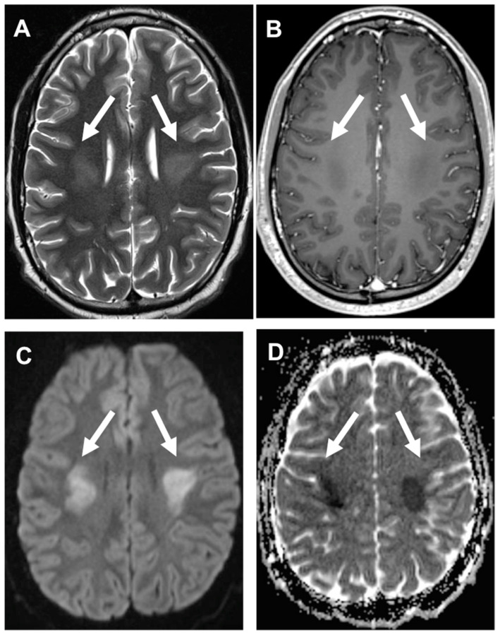
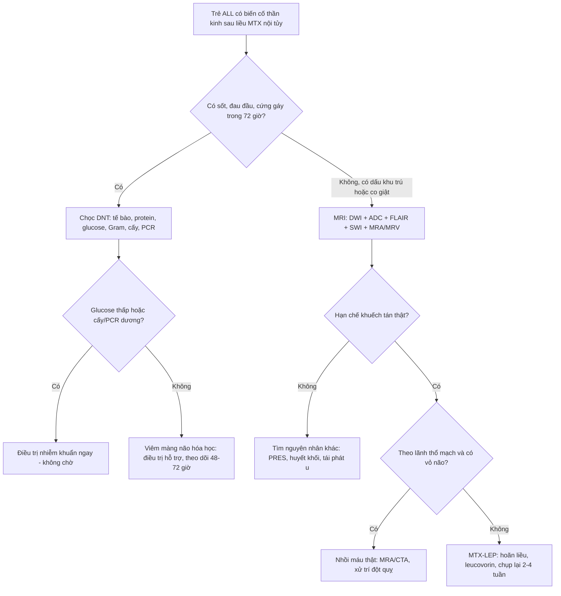
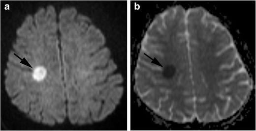
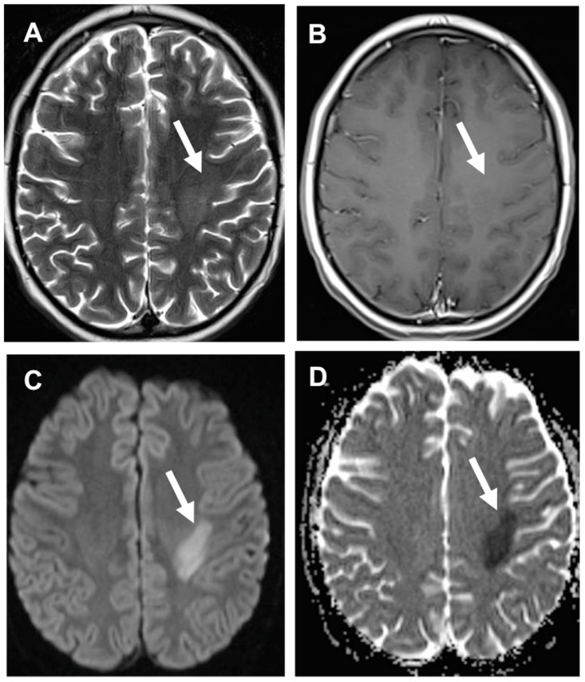
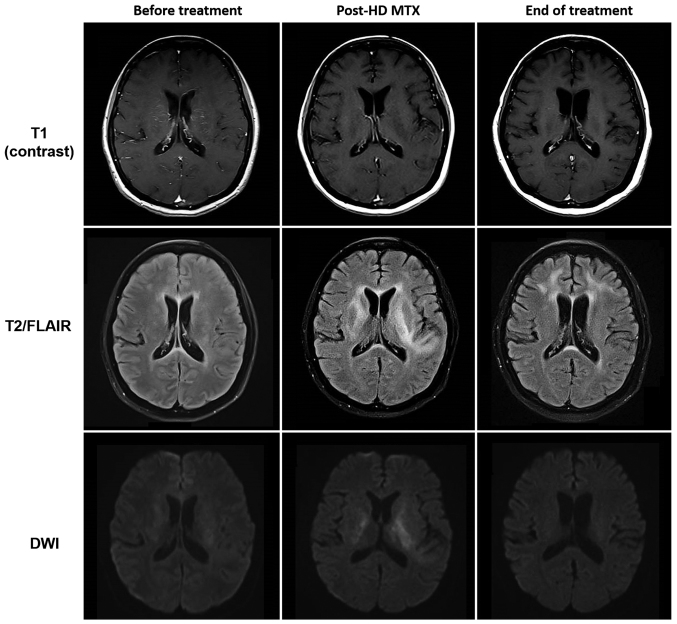

# 1423 — Độc tính của methotrexate nội tủy: viêm màng não hóa học, bệnh não chất trắng cấp & ức chế tủy / *Intrathecal methotrexate neurotoxicity: chemical meningitis, acute leukoencephalopathy, myelosuppression*

**Tags:** `pattern:ton-thuong-chat-trang` `pattern:han-che-khuech-tan` `vung:chat-trang` `score:CTCAE` `protocol:MRI-DWI` `protocol:choc-DNT`
**Mức chắc chắn (certainty):** tổng hợp y văn (literature synthesis) — ghép 1 đoàn hệ 1.251 trẻ ALL (Haematologica 2022, PMC8883571, CC BY-NC 4.0), 1 đoàn hệ 33 trẻ (2023, PMID 37565568 — chỉ trích số liệu), 1 tổng quan điều trị (2025, PMC11981439, CC BY 4.0), 1 tổng quan biến chứng TKTW ở trẻ (Cancers 2022, PMC8946171, CC BY 4.0), 1 ca viêm màng não vô khuẩn sau IT MTX (2022, PMC9484505, CC BY-NC-SA 4.0) và 1 ca quá liều nội tủy 240 mg (2018, PMID 30672361 — chỉ trích số liệu). Số nào nguồn không đưa thì ghi "chưa rõ", không bịa.

> **Bài này trả lời 4 câu hỏi của buổi trực có bệnh nhân vừa được tiêm MTX nội tủy:**
> (1) **Đau đầu + sốt + cứng gáy sau tiêm 6–48 giờ — viêm màng não hóa học hay nhiễm khuẩn?** (2) **Yếu nửa người/sốc giọng 3–8 ngày sau liều — đột quỵ thật hay bắt chước đột quỵ?** (3) **Có được tiêm lại (re-challenge) và có được bỏ MTX nội tủy không?** (4) **Bao giờ thì ức chế tủy đủ nặng để hoãn liều và xử trí quá liều thế nào?**
> Khác với [494 – MTX leukoencephalopathy](../494-doc-than-kinh-methotrexate/lesson.md) (thể mạn/di chứng hình ảnh ở người lớn sau điều trị PCNSL, tập trung vào **phân biệt tái phát u**) và [1421 – theo dõi nhận thức](../1421-nhan-thuc-sau-doc-than-kinh-mtx/lesson.md): bài này lo **phần cấp tính của chính đường nội tủy** — màng não, tủy xương, và ngưỡng hoãn/giảm liều.

## 1. Tổng quan bệnh học – cơ chế hình ảnh

### 1.1 Vì sao MTX nội tủy vừa "đánh vào màng não" vừa "đánh vào chất trắng"

- MTX là kháng folate: vào tế bào qua **reduced folate carrier (RFC)**, bị polyglutamate hóa, ức chế **dihydrofolate reductase (DHFR)** → cạn FH4 → ngừng tổng hợp **purine + thymidine**. Hệ quả sinh hóa đo được: **homocysteine tăng**, adenosine và các axit amin kích thích (excitatory amino acids) tăng — đây là nền của cả **độc tính myelin** và **kích thích thần kinh (co giật)**.
- **Đường nội tủy** đưa thuốc trực tiếp vào khoang dưới nhện: nồng độ đỉnh trong dịch não tủy (DNT) cao gấp nhiều lần đường tĩnh mạch, **thanh thải khỏi DNT chậm** (phụ thuộc dòng dịch và resorption qua hạt màng nhện) → niêm mạc màng não và lớp myelin dưới vỏ tiếp xúc nồng độ cao trong nhiều giờ. Đó là lý do **độc tính màng não (hóa học) và độc tính chất trắng cùng tồn tại** ở một bệnh nhân.
- **Viêm màng não hóa học (chemical/aseptic meningitis):** phản ứng viêm không nhiễm trùng của màng não với **pH, tá dược (preservative), nồng độ thẩm thấu và bản thân thuốc**, khởi phát **vài giờ đến 72 giờ** sau tiêm; hình ảnh học thường **bình thường** — chẩn đoán nằm ở **DNT**.
- **Bệnh não chất trắng nhiễm độc cấp (acute toxic leukoencephalopathy — MTX-LEP):** tổn thương myelin (myelin pallor, myelin vacuolation), phù nội bào của myelin và tế bào hình sao → **giảm khoảng ngoại bào** → **hạn chế khuếch tán** trên DWI/ADC.
- **TẠI SAO DWI sáng + ADC tối mà T2/FLAIR lại bình thường trong 24–72 giờ đầu:** phù myelin là phù **nội bào** — nước chuyển từ khoảng ngoại bào vào trong tế bào/myelin, làm **giảm chuyển động ngẫu nhiên của phân tử nước** (ADC thấp) trong khi **tổng lượng nước mô chưa tăng đủ** để đổi tín hiệu T2. Vì vậy **DWI dương tính trước T2/FLAIR khoảng 1–2 tuần**; đây là lý do bắt buộc chụp DWI/ADC ở lần chụp đầu.
- **TẠI SAO không theo lãnh thổ mạch và chừa vỏ não:** tổn thương do thuốc khu trú ở **chất trắng sâu có tốc độ chuyển hóa/myelin cao** (trung tâm bán bầu dục, vành tia, thể chai), không phụ thuộc tưới máu động mạch; vỏ não (chất xám) hầu như không bị. Đây là **chốt loại** mạnh nhất để không tiêu sợi huyết oan.

### 1.2 Ngưỡng định lượng nằm lòng (bắt buộc nhớ)

| Đại lượng | Con số | Nguồn |
|---|---|---|
| Độc tính thần kinh MTX **có triệu chứng** ở trẻ ALL | **7,6% (95/1.251)**, trung vị **4 tháng** từ chẩn đoán, **8 ngày** sau liều IV/IT | PMC8883571 |
| Cùng biến cố ở một đoàn hệ khác | **1,25% (33 trẻ)**, stroke-like **36,4% (12/33)**, co giật **30,3% (10/33)**, 23 ca có hình ảnh LEP | PMID 37565568 |
| Tần suất MTX-LEP nói chung | **3–10%**, phụ thuộc liều/đường/lịch | PMC11981439 |
| Yếu tố nguy cơ độc lập | **tuổi ≥ 10**; **AST độ 3 trong tấn công/củng cố: OR 2,31 (1,28–4,16), P = 0,005** | PMC8883571 |
| Tái phát khi **tiếp tục** IT MTX | **12,9%** | PMC8883571 |
| Bỏ IT MTX sau biến cố đầu | sống không tái phát TKTW 5 năm **89,2% vs 95,4%** (P = 0,047) | PMC8883571 |
| Thời gian hồi phục lâm sàng điển hình | vài giờ–**3 ngày**; hình ảnh hồi phục **~3 tuần** | PMC11981439 |
| Quá liều nội tủy (ca nguyên văn) | **240 mg thay vì 12 mg (20 lần)** → co giật, viêm màng nhện độc | PMID 30672361 |
| Ngưỡng xử trí quá liều IT MTX | **< 100 mg**: ít can thiệp; **100–500 mg**: rửa/thay DNT; **> 500 mg**: can thiệp không hiệu quả | PMID 8689347 |
| **Cấm** | leucovorin **nội tủy** — ca tử vong sau 20 mg IT MTX + leucovorin IT | PMID 8689347 |

- **DNT trong viêm màng não hóa học (ca điển hình):** **24% bạch cầu hạt trung tính, 60% lympho, 3% đại thực bào**, cấy âm, PCR HSV/VZV/Lyme/West Nile âm, glucose bình thường. Tế bào tăng nhưng **không có vi khuẩn** — chốt loại nhiễm trùng chỉ khi **cấy + PCR âm và bệnh nhân không có ổ nhiễm** (xem cạm bẫy ở mục 5).

## 2. Mẫu hình + chẩn đoán phân biệt theo vị trí (gamut)

**Mẫu hình A — "đột quỵ bắt chước" ở trẻ đang điều trị ALL:**
- **Đối xứng hai bên, vành tia/trung tâm bán bầu dục** → MTX-LEP (thể đối xứng); phân biệt **PRES** (ưu thế chẩm–đỉnh, T2/FLAIR nổi bật, thường không hạn chế khuếch tán trừ khi nặng), **bệnh mạch máu nhỏ do xạ** (chỉ khi có tiền sử xạ, tiềm tàng nhiều tháng–năm).
- **Một bên, dạng đốm < 20 mm, chừa vỏ não, không theo lãnh thổ** → MTX-LEP thể khu trú; phân biệt **nhồi máu động mạch** (theo lãnh thổ, **có vỏ não**, T2/FLAIR đổi sớm hơn, mạch lớn bất thường trên MRA), **huyết khối xoang/tĩnh mạch** (nhồi máu tĩnh mạch + xuất huyết, MRV tắc), **di căn/tái phát u** (ngấm thuốc, phù, choán chỗ).
- **Quanh não thất + thể chai** → MTX-LEP, cũng gặp trong **viêm não tự miễn, ADEM** (bệnh sử vaccine/nhiễm trước đó).

**Mẫu hình B — "màng não" sau tiêm 0–72 giờ:**
- **Đau đầu + sốt + cứng gáy, DNT tăng tế bào, glucose bình thường** → viêm màng não hóa học; phân biệt **viêm màng não vi khuẩn ở trẻ giảm bạch cầu hạt** (có thể **rất ít tế bào** vì không có bạch cầu để tạo mủ — bẫy chết người), **viêm màng não do virus**, **xuất huyết dưới nhện** (DNT đỏ, xanthochromia), **bệnh màng não do bạch cầu** (tế bào ác tính trong DNT).
- **Không sốt, chỉ đau lưng/đau đầu thoáng qua sau tiêm** → phản ứng thoáng qua, không cần chọc lại.

**Gamut theo cơ chế (nhớ nhanh):** **M**yelotoxicity (ức chế tủy), **E**ncephalopathy (chất trắng), **N**europathy/myelopathy (tủy sống — hiếm, sau IT nhiều lần), **I**nfection (phải loại trước), **N**ausea/headache (hội chứng sau chọc dò), **G**liosis/leukoencephalopathy muộn, **I**atrogenic overdose, **T**hrombosis (xoang), **I**schemic stroke thật, **S**eizure.

## 3. Bảng so sánh phân biệt (ma trận đối chiếu)

| Thực thể (entity) | Hình ảnh điển hình | Chốt vào (rule-in) | Chốt loại (rule-out) | Gợi ý xác nhận |
|---|---|---|---|---|
| **MTX-LEP cấp (stroke-like)** | DWI sáng + **ADC tối**, chất trắng sâu, **đối xứng hoặc một bên dạng đốm**, **chừa vỏ não**, không ngấm thuốc, T2/FLAIR có thể bình thường 24–72 giờ | **Hạn chế khuếch tán + không theo lãnh thổ + chừa vỏ + xuất hiện 3–8 ngày sau liều MTX** | Có vỏ não + theo lãnh thổ + tắc mạch trên MRA → nhồi máu thật | DWI/ADC trong 24–72 giờ; lặp lại 2–4 tuần thấy **hồi phục** |
| **Nhồi máu động mạch cấp** | Hạn chế khuếch tán **theo lãnh thổ**, gồm vỏ não, T2/FLAIR đổi sớm hơn, mạch lớn có thể tắc | **Territorial + cortex + tắc mạch trên MRA/CTA** | Chừa vỏ, hai bên đối xứng, không lãnh thổ → không phải nhồi máu | MRA/CTA, siêu âm tim nếu trẻ có bệnh tim |
| **Viêm màng não hóa học do IT MTX** | MRI thường **bình thường**; có thể ngấm màng não nhẹ, giãn não thất thoáng qua | **DNT tăng tế bào, glucose bình thường, cấy/PCR âm, khởi phát < 72 giờ sau tiêm, tự khỏi 2–4 ngày** | Glucose thấp + cấy dương + bệnh nặng lên → nhiễm khuẩn | DNT + cấy + PCR; theo dõi 48–72 giờ |
| **Viêm màng não vi khuẩn ở trẻ giảm BC hạt** | Màng não ngấm thuốc, ổ áp-xe, giãn não thất | **Sốt + neutropenia + CRP/PCT tăng + cấy dương** | DNT **có thể chỉ vài tế bào** → không được loại trừ bằng tế bào thấp | Cấy máu + DNT, kháng sinh theo giờ |
| **PRES** | T2/FLAIR **tăng ưu thế chẩm–đỉnh**, đối xứng, thường **không** hạn chế khuếch tán; xuất huyết điểm có thể có | **Tăng huyết áp + thuốc ức chế miễn dịch/tacrolimus + phân bố chẩm–đỉnh** | Hạn chế khuếch tán đơn độc ở vành tia, HA bình thường → nghĩ MTX-LEP | MRI + theo dõi HA; hồi phục sau kiểm soát HA |
| **Huyết khối xoang tĩnh mạch** | Nhồi máu **không theo lãnh thổ động mạch**, thường có xuất huyết, xoang tăng tín hiệu/T2* tối | **MRV/CTV tắc xoang + nhồi máu tĩnh mạch + xuất huyết** | Hạn chế khuếch tán đối xứng, không xuất huyết, MRV bình thường → loại | MRV/CTV |
| **Tái phát u / di căn màng não** | Khối **ngấm thuốc**, phù, choán chỗ; màng não dày ngấm; tế bào ác tính trong DNT | **Ngấm thuốc + phù + lớn dần; tế bào học DNT dương** | DWI đốm không ngấm, tự hết 3 tuần → không phải u | T1+Gd, tế bào học DNT, PET nếu cần |
| **Di chứng xạ trị (RIL)** | T2/FLAIR tăng lan tỏa quanh não thất–sâu, **không hạn chế khuếch tán**, tiến triển **> 6 tháng** sau xạ | **Tiền sử xạ + tiềm tàng nhiều tháng + không hạn chế khuếch tán** | Khởi phát 3–8 ngày sau MTX → không phải RIL | So sánh mốc thời gian; xem [261](../261-benh-nao-chat-trang-do-xa-tri/lesson.md) |

*Bốn ô của cùng một trẻ ALL sau MTX: (A) T2 — tăng tín hiệu vành tia hai bên; (B) T1 sau tiêm — **không ngấm thuốc**; (C) DWI — sáng đối xứng; (D) ADC — **tối**, tức hạn chế khuếch tán thật. Nguồn: Cancers 2022 (PMC8946171), CC BY 4.0.*

### Ba câu hỏi đọc phim theo thứ tự
1. **Có hạn chế khuếch tán thật không?** DWI sáng **và** ADC tối; DWI sáng + ADC sáng = hiệu ứng T2 shine-through (không phải phù độc).
2. **Có theo lãnh thổ mạch/có vỏ não không?** Có → nhồi máu; không → thuốc/độc/chuyển hóa.
3. **Mốc thời gian so với liều MTX?** 3–8 ngày sau liều = MTX-LEP; > 6 tháng sau xạ = RIL; vài giờ–3 ngày + sốt = viêm màng não hóa học.

## 4. Protocol chụp + phân độ + ngưỡng xử trí

### 4.1 Protocol MRI khi có biến cố thần kinh
- **DWI (b = 1.000) + ADC map ngay** — bắt buộc, không thay bằng FLAIR.
- **FLAIR + T2 + T1 ± gadolinium + SWI/T2\***: SWI để loại **xuất huyết** (đốm tối) và huyết khối; T1+Gd để loại **u/tái phát**.
- **MRA (TOF) + MRV** khi triệu chứng **đột quỵ**: phân biệt nhồi máu thật/huyết khối xoang.
- **Thời điểm:** trong **24–72 giờ** đầu (DWI dương trước T2); **lặp lại 2–4 tuần** — hồi phục hạn chế khuếch tán là bằng chứng ủng hộ MTX-LEP.
- Không cần cản quang khi chỉ có sốt + đau đầu + DNT điển hình (tránh thêm thủ thuật), nhưng **phải chụp** nếu có dấu thần kinh khu trú, co giật kéo dài, hoặc tri giác giảm.

### 4.2 Phân độ và ngưỡng xử trí (thực hành, không phải RADS)
- **Độc tính thần kinh theo CTCAE:** độ 1 (nhẹ, không can thiệp) → độ 2 (giới hạn sinh hoạt) → độ 3 (nặng, cần can thiệp/nhập viện) → độ 4 (đe dọa tính mạng) → độ 5 (tử vong). Ghi độ vào hồ sơ mỗi biến cố để so sánh giữa các đợt.
- **Viêm màng não hóa học:** điều trị **hỗ trợ** (giảm đau, hạ sốt, dịch); **dexamethasone** theo phác đồ nếu đau đầu nặng; **không** dùng kháng sinh kéo dài khi cấy/PCR âm và bệnh nhân **không giảm bạch cầu hạt** — nhưng ở trẻ **neutropenic**, kháng sinh theo giờ cho tới khi loại trừ nhiễm khuẩn.
- **MTX-LEP:** ngừng/hoãn liều tiếp theo, **leucovorin (acid folinic) theo phác đồ**, theo dõi thần kinh; **không tiêu sợi huyết**; hồi phục thường trong vài ngày–3 tuần.
- **Quá liều nội tủy:** gọi ngay kíp ung thư + can thiệp; **rút/thay DNT (CSF exchange)** sớm; **glucarpidase (carboxypeptidase-G2) nội tủy** nếu có; **leucovorin tĩnh mạch** liều cao; **corticoid**; **tuyệt đối không leucovorin nội tủy**.
- **Ngưỡng hoãn liều IT (thực hành, chưa có RCT — mức chắc chắn: suy luận):** **ANC < 0,5 × 10⁹/L**, **tiểu cầu < 50 × 10⁹/L**, sốt đang hoạt động, hoặc DNT còn tăng tế bào chưa giải thích; ghi rõ lý do hoãn và hẹn tiêm lại, **không bỏ hẳn** IT (xem 1.2: bỏ IT làm tăng tái phát TKTW).

## 5. Biến thể bình thường và cạm bẫy

- **DWI sáng do T2 shine-through:** ổ nhầy/dịch kén, u có T2 rất sáng → **luôn đọc kèm ADC**; chỉ gọi hạn chế khuếch tán khi ADC tối.
- **Hematoma/áp-xe cũng hạn chế khuếch tán:** máu cấp và mủ có ADC thấp; phân biệt bằng **SWI/T2\* (máu), ngấm viền + mức dịch (áp-xe), sốt + ổ nhiễm**.
- **"Satisfaction of search" sau khi thấy ổ đột quỵ giả:** phải soát **xoang tĩnh mạch, màng não, não thất** — bệnh nhân ALL có thể vừa huyết khối xoang vừa MTX-LEP.
- **Viêm màng não hóa học có thể tái diễn sau mỗi liều** — đừng đổi sang kháng sinh kéo dài; ghi nhận và **tiền mê dexamethasone** theo phác đồ nếu được chỉ định.
- **Trẻ giảm bạch cầu hạt: DNT có thể "sạch" giả tạo** — số tế bào thấp không loại trừ nhiễm khuẩn; dựa vào **Gram, cấy, CRP/PCT, diễn tiến 6–12 giờ**.
- **Hình ảnh có thể âm tính trong 24 giờ đầu** — MRI bình thường không loại trừ MTX-LEP; chụp lại nếu triệu chứng tiếp diễn.
- **Không nhầm MTX-LEP với tái phát u để xạ lại/mổ** — tổn thương không ngấm thuốc, tự hồi phục; sinh thiết trong giai đoạn cấp có thể gây hại.
- **Ommaya reservoir:** nhiễm trùng/dò dịch quanh reservoir là hàng DDx của "đau đầu sau tiêm" — khám vùng da đầu, siêu âm/CT nếu sưng.

## 6. Tự lượng giá — Blind Quiz

**Ca 1 — Bé gái 14 tuổi ALL, yếu nửa người trái 5 ngày sau liều MTX nội tủy thứ ba.**

- Gợi ý: không sốt, không đau đầu; khám có yếu nửa người trái, tri giác tỉnh.
- Hỏi: ổ tổn thương ở đâu, kích thước bao nhiêu? DWI/ADC nói gì? Có nên tiêu sợi huyết không?

<b>Bấm để hiện đáp án (findings + chẩn đoán)</b>

- **Findings:** ổ **~10 mm** tăng tín hiệu trên DWI (a) và **giảm tín hiệu trên ADC** (b) ở **trung tâm bán bầu dục phải**, **không theo lãnh thổ mạch**, **không chạm vỏ não**.
- **Chẩn đoán:** **MTX-LEP cấp (stroke-like)** — phù myelin nội bào gây hạn chế khuếch tán; không phải nhồi máu.
- **Xử trí:** **không tiêu sợi huyết**, hoãn liều IT, leucovorin theo phác đồ; chụp lại 2–4 tuần thấy hồi phục.
- Nguồn: Insights Imaging 2018 (PMC5991004), CC BY 4.0.

**Ca 2 — Bé trai 9 tuổi ALL, co giật cục bộ rồi liệt nửa người phải 6 ngày sau MTX tĩnh mạch liều cao + nội tủy.**

- Gợi ý: HA bình thường, không sốt, không rối loạn đông máu.
- Hỏi: tổn thương đối xứng hay một bên? Chuỗi nào chốt chẩn đoán? Chẩn đoán phân biệt thứ hai là gì?

<b>Bấm để hiện đáp án (findings + chẩn đoán)</b>

- **Findings:** (A) T2 tăng tín hiệu **một bên** vành tia/trung tâm bán bầu dục trái; (B) T1 sau tiêm **không ngấm**; (C) DWI sáng; (D) ADC tối.
- **Chẩn đoán:** **MTX-LEP thể khu trú** — hạn chế khuếch tán một bên, chừa vỏ, không ngấm thuốc.
- **DDx thứ hai:** nhồi máu động mạch (loại vì không theo lãnh thổ, không có vỏ não, MRA bình thường) và **huyết khối xoang** (loại vì MRV bình thường, không xuất huyết).
- Nguồn: Cancers 2022 (PMC8946171), CC BY 4.0.

**Ca 3 — Bệnh nhân 46 tuổi u lympho, co giật + múa vờn (choreoathetosis) sau liều MTX liều cao; ảnh chụp trước điều trị, sau liều và cuối đợt.**

- Gợi ý: triệu chứng xuất hiện vài ngày sau liều, sau đó giảm dần mà không can thiệp mạch.
- Hỏi: tổn thương ở đâu, có ngấm thuốc không? Vì sao ảnh cuối đợt gần như bình thường?

<b>Bấm để hiện đáp án (findings + chẩn đoán)</b>

- **Findings:** hàng giữa (T2/FLAIR) — vùng tăng tín hiệu **quanh não thất/vành tia bên trái** xuất hiện sau liều MTX; hàng dưới (DWI) — sáng tương ứng; hàng trên (T1+Gd) — **không ngấm**; ảnh cuối đợt **hồi phục gần hoàn toàn**.
- **Chẩn đoán:** **bệnh não chất trắng nhiễm độc methotrexate có hồi phục** — phù myelin, không phải nhồi máu/không phải tái phát u.
- **Điểm dạy:** chuỗi ảnh theo thời gian là bằng chứng mạnh nhất; không cần sinh thiết.
- Nguồn: Mol Clin Oncol 2019 (PMC6719254), CC BY 4.0.

## Bài liên quan chéo
- [494 – Độc thần kinh methotrexate: hình ảnh & phân biệt tái phát](../494-doc-than-kinh-methotrexate/lesson.md)
- [1421 – Theo dõi nhận thức sau độc tính MTX](../1421-nhan-thuc-sau-doc-than-kinh-mtx/lesson.md)
- [462 – U lympho nội nhãn (PVRL)](../462-u-lympho-noi-nhan-PVRL/lesson.md)
- [261 – Bệnh não chất trắng do xạ trị](../261-benh-nao-chat-trang-do-xa-tri/lesson.md)
- [268 – Bệnh tủy do xạ trị](../268-benh-tuy-do-xa-tri/lesson.md)
- [204 – Hoại tử phóng xạ sau xạ trị u não](../204-hoai-tu-phong-xa-sau-xa-tri-u-nao/lesson.md)

## Ảnh
- 4 ảnh, tất cả CC BY 4.0, không crop, không ghép; nguồn + giấy phép từng file trong `images/CREDITS.md`.

> Không dùng để chẩn đoán độc lập khi chưa có người hướng dẫn.
