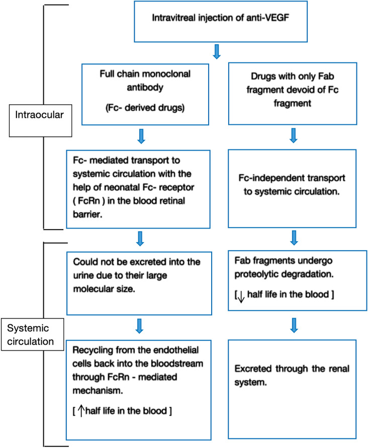
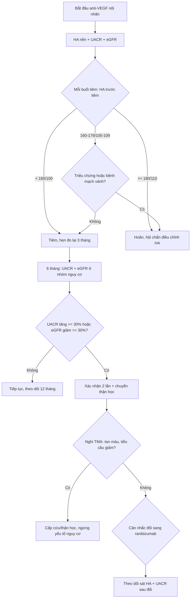
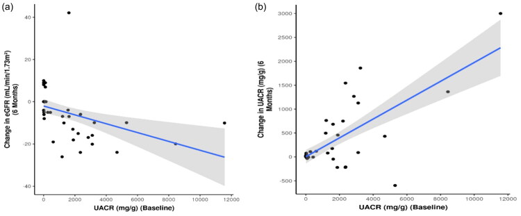
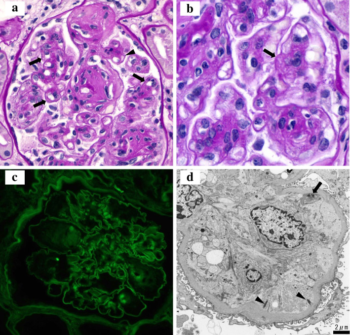
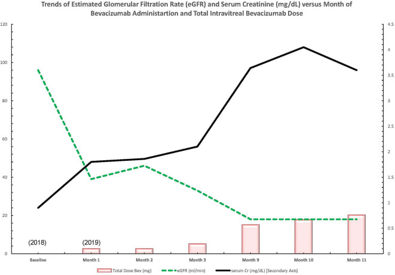

# 1424 — Tăng huyết áp và biến cố tim mạch–thận toàn thân sau tiêm anti-VEGF nội nhãn

**Tags:** `pattern:tang-huyet-ap` `pattern:protein-nieu` `pattern:bien-co-tim-mach` `vung:mat` `vung:than` `protocol:anti-VEGF` `protocol:theo-doi-huyet-ap` `protocol:UACR`
**Mức chắc chắn (certainty):** tổng hợp y văn — đoàn hệ quốc gia, nghiên cứu tiến cứu quan sát, ca lâm sàng và tổng quan; **không** có thử nghiệm ngẫu nhiên được thiết kế đủ lực để phát hiện biến cố tim mạch hiếm.

## 1. Tổng quan — vì sao 0,05 mL trong mắt lại thành chuyện huyết áp và thận

**Vật lý – dược động học: thuốc không ở lại trong mắt.**

- Sau tiêm nội dịch kính, một phần thuốc **thoát qua lưới bè – tĩnh mạch thượng củng mạc** và **qua hàng rào máu–võng mạc bị phá vỡ**, vào tuần hoàn chung. Nồng độ trong huyết thanh thấp hơn hàng nghìn lần so với truyền tĩnh mạch trong ung thư, nhưng **đủ để ức chế VEGF tự do toàn thân** trong nhiều tuần (PMC12271010).
- **Phân tử quyết định mức phơi nhiễm** (PMC12271010):
  - **Bevacizumab** — kháng thể đơn dòng toàn phần **149 kDa, có Fc** → **thời gian bán thải huyết tương ~21 ngày**, nồng độ toàn thân cao nhất trong nhóm.
  - **Aflibercept** — protein dung hợp **115 kDa, có Fc** → nồng độ huyết thanh **cao hơn IC50 trong tới 30 ngày**; ức chế VEGF kéo dài nhất.
  - **Ranibizumab** — mảnh Fab **48 kDa, không Fc** → thời gian bán thải huyết tương **~0,25 ngày**, phơi nhiễm toàn thân thấp nhất.
- **FcRn** tái chế IgG kéo dài thời gian lưu của phân tử có Fc — đây là lý do **cùng "1 mũi tiêm"** nhưng ba thuốc có ba mức ức chế VEGF toàn thân khác nhau.

**Cơ chế gây hại:**

1. **Mạch máu:** VEGF duy trì **eNOS/NO và prostacyclin** ở nội mô; ức chế VEGF → giảm giãn mạch, tăng trương lực mạch, **tăng huyết áp**; kéo dài gây **thưa mao mạch (capillary rarefaction)**.
2. **Thận:** VEGF do **podocyte** tiết ra là yếu tố sống còn của nội mô cầu thận. Ức chế VEGF → **endotheliosis**, **vi huyết khối (thrombotic microangiopathy, TMA)**, mất chọn lọc lỗ lọc → **protein niệu**, giảm eGFR (PMC7577346).
3. **Phơi nhiễm tích lũy:** bệnh nhân nhận **6–12 mũi/năm**, có người **> 50 mũi**; tiêm **hai mắt cùng ngày** làm **gấp đôi liều toàn thân** trong một lần.

**Nhưng có một bẫy lớn:** phần lớn "tăng huyết áp tại buổi tiêm" **không phải do thuốc** mà do **lo lắng – đau – thủ thuật**. Nghiên cứu 302 bệnh nhân đo huyết áp trước – trong – sau tiêm: huyết áp tâm thu **tăng 25,7 ± 21,0 mmHg** ngay lúc tiêm; **83,8%** tăng ≥ 10 mmHg, **69,5%** tăng ≥ 20 mmHg, **49,0%** tăng ≥ 30 mmHg; **13,6%** có **cơn tăng huyết áp cấp cứu (hypertensive urgency)** và **6/41** không hồi phục sau 1 giờ (PMC9019388). Đây là **tăng huyết áp do thủ thuật**, không phải bằng chứng thuốc gây tăng huyết áp mạn.

## 2. Ba kiểu hình cần phân biệt (gamut theo trục thời gian)

- **Kiểu A — tăng huyết áp cấp do thủ thuật (phút):** tăng vọt lúc tiêm, hết trong vài giờ; **không kèm protein niệu mới**; xử trí bằng **giảm lo lắng, giảm đau, nghỉ, đo lại**; hiếm khi phải hoãn.
- **Kiểu B — tăng huyết áp mạn do thuốc (tuần–tháng):** tăng dần qua nhiều mũi, **không triệu chứng**, phát hiện khi đo tại nhà/phòng khám; có thể kèm **đau đầu, phù**; cần **theo dõi xu hướng**, không dựa một lần đo.
- **Kiểu C — bệnh thận do ức chế VEGF (tháng):** **protein niệu mới/tăng**, eGFR giảm, có thể **phù, tăng huyết áp, hội chứng thận nhiễm mỡ**; nặng nhất là **TMA** trên sinh thiết (PMC7577346, PMC9618189).

**Ai là nhóm nguy cơ cao (nơi "trung bình quần thể" không bảo vệ được ai):**

- **Đái tháo đường có bệnh thận (DKD)** — baseline UACR cao là **yếu tố dự báo mạnh nhất** của xấu đi (PMC13003856).
- **Tăng huyết áp có sẵn, bệnh mạch vành, tiền sử đột quỵ/nhồi máu cơ tim.**
- **Cao tuổi** — mỗi 10 tuổi thêm làm mức tăng huyết áp lúc tiêm lớn hơn (PMC9019388).
- **Phơi nhiễm cao:** tiêm hàng tháng, **hai mắt cùng ngày**, phối hợp **aflibercept/bevacizumab** (ức chế VEGF toàn thân mạnh nhất).
- **Trẻ sinh non (ROP)** — cân nặng và thể tích phân bố rất nhỏ, hệ mạch chưa trưởng thành (xem dưới).

## 3. Ma trận đối chiếu

| Thực thể | Thời điểm | Dấu hiệu chốt | Chốt vào (rule-in) | Chốt loại (rule-out) | Cạm bẫy |
|---|---|---|---|---|---|
| **Tăng HA do thủ thuật** | Ngay lúc tiêm, hết < vài giờ | SBP tăng **25,7 mmHg**, có khi ≥ 180/120 | Đo trước – trong – sau; **về gần baseline** khi hết lo/đau | Không về sau 1–2 giờ, hoặc tăng dần qua các lần | Gọi là "do thuốc" rồi đổi thuốc vô ích; bỏ qua **cơn tăng HA** (13,6%) |
| **Tăng HA do anti-VEGF** | Tuần–tháng, tích lũy | Xu hướng tăng qua nhiều lần đo, không triệu chứng | **≥ 2 lần đo** tăng so baseline; loại trừ đau/lo lắng/đo sai | Một lần đo cao duy nhất; huyết áp về bình thường khi nghỉ | Đo ngay sau tiêm rồi kết luận; không có huyết áp nền |
| **Bệnh thận do anti-VEGF** | 1–6 tháng | **UACR tăng**, eGFR giảm; có thể phù | UACR tăng **≥ 30%** hoặc eGFR giảm **≥ 30%** so baseline, lặp lại xác nhận | UACR/eGFR ổn định qua 2 lần | Quy hết cho "đái tháo đường tiến triển" |
| **TMA do thuốc** | **6–11 tháng** sau bắt đầu (ca báo) | Thiếu máu tan máu vi mạch, giảm tiểu cầu, **protein niệu nặng**, tăng HA | **Schistocyte, LDH cao, haptoglobin thấp, tiểu cầu giảm** + tổn thương thận | Không có tan máu/giảm tiểu cầu | Chờ "đủ tiêu chuẩn" rồi bỏ lỡ; sinh thiết muộn |
| **Bệnh thận do ĐTĐ** | Nhiều năm | Protein niệu tiến triển chậm, có retinopathy | Bối cảnh, thời gian, không thay đổi theo mũi tiêm | **Không loại trừ** được chỉ bằng bối cảnh | DKD và anti-VEGF **cộng hưởng**, không loại trừ nhau |
| **Biến cố tim mạch chung** | 28 ngày – 5 năm | Nhồi máu cơ tim, đột quỵ, tử vong | Bệnh cảnh lâm sàng + ECG/hình ảnh | **Không** tăng có ý nghĩa trong đoàn hệ 334.663 ca (aRR 0,96) | Dùng "trung bình không tăng" để trấn an **nhóm nguy cơ cao** |

**Bằng chứng định lượng hai chiều (rất quan trọng để không cực đoan):**

- **Đoàn hệ toàn quốc Pháp** (2010–2016): **334.663** bệnh nhân tiêm anti-VEGF so với **981.172** người chứng mổ đục thủy tinh thể; biến cố (NMCT/đột quỵ/tử vong) trong **28 ngày: 0,2% ở cả hai nhóm**; **aRR 0,96 (95% CI 0,88–1,05)**; không tăng ở **đái tháo đường** hay **tiền sử đột quỵ/NMCT**; ranibizumab **0,97**, aflibercept **0,82** (PMC13000704). → **Không có tín hiệu tăng biến cố cấp** ở quần thể chung.
- **Nhưng thận thì có tín hiệu:** 50 bệnh nhân ĐTĐ tiêm bevacizumab, theo dõi 6 tháng — eGFR trung vị **75,5 → 72,5 mL/min/1,73 m²**, mức thay đổi **−5,00 (p < 0,001)**; UACR **111,5 → 119,0 mg/g**, thay đổi **+11,5 (p < 0,001)**; **1 tháng chưa khác biệt**, **70% có DKD** và nhóm DKD giảm eGFR nhiều hơn (**p = 0,002**); huyết áp trong nghiên cứu **không đổi** (PMC13003856).
- **Mâu thuẫn có thật:** nghiên cứu 40 bệnh nhân ĐTĐ chỉ theo dõi **1 tháng** thấy **không đổi** UACR/eGFR, nhưng **huyết áp tâm trương tăng** có ý nghĩa (PMC8344120); nghiên cứu 53 bệnh nhân thấy **~80% không hại thêm** về albumin niệu, nhưng người **đã có UACR cao nền** thì tăng thêm (PMC7396195). → Hiệu ứng **nhỏ, muộn, phụ thuộc nền bệnh thận**, không phải "ai cũng tăng".

## 4. Protocol theo dõi & ngưỡng thực hành

**Trước khi bắt đầu (mọi bệnh nhân):**

1. **Đo huyết áp** và ghi vào hồ sơ (đây là baseline, không phải "thủ tục").
2. **Xét nghiệm nước tiểu: UACR** (không chỉ protein niệu que) + **creatinine/eGFR** — bắt buộc ở **đái tháo đường, tăng huyết áp, bệnh thận mạn**; nên làm ở mọi người chuẩn bị điều trị dài hạn.
3. **Rà soát thuốc/ bệnh nền:** bệnh mạch vành, đột quỵ, suy tim, hẹp động mạch thận; ghi **loại thuốc sẽ dùng** (bevacizumab/aflibercept có phơi nhiễm cao hơn ranibizumab).
4. **Tư vấn:** "thuốc có thể làm tăng huyết áp và protein niệu ở một số người; chúng ta sẽ đo lại, không phải ngừng thuốc ngay."

**Theo dõi trong điều trị:**

| Thời điểm | Việc làm | Lý do |
|---|---|---|
| Mỗi buổi tiêm | Đo HA **trước** tiêm; nếu tăng vọt, **nghỉ 5–10 phút, đo lại** | Phân biệt lo lắng với tăng HA thật (PMC9019388) |
| 3 tháng | HA + hỏi phù/đau đầu | Bắt tín hiệu mạn sớm |
| 6 tháng | **UACR + eGFR** ở nhóm nguy cơ (ĐTĐ/DKD/THA) | Tổn thương thận xuất hiện **sau 1 tháng**, rõ ở **6 tháng** (PMC13003856) |
| 12 tháng | UACR/eGFR + đánh giá phơi nhiễm tích lũy | Bệnh thận/TMA có thể muộn 6–11 tháng (PMC7577346) |
| Bất kỳ lúc nào | Nghi TMA: CTM, LDH, haptoglobin, schistocyte, tiểu cầu | Tan máu vi mạch là dấu hiệu báo động |

**Ngưỡng hành động (đề xuất thực hành, không phải khuyến cáo tuyệt đối):**

- **HA ≥ 180/110 mmHg** trước tiêm điện có kế hoạch → **hoãn**, hội chẩn/điều chỉnh; **≥ 160/100** → cân nhắc hoãn nếu có triệu chứng hoặc bệnh mạch vành.
- **UACR tăng ≥ 30%** hoặc **eGFR giảm ≥ 30%** so baseline, xác nhận 2 lần → **chuyển thận học**, rà soát nguyên nhân khác (ĐTĐ, thuốc, nhiễm trùng).
- **Nghi TMA** → **không tự xử lý tại phòng tiêm**: chuyển cấp cứu/thận học, ngừng các yếu tố nguy cơ khác.
- **Đổi thuốc** là lựa chọn **khi có bằng chứng tổn thương thận/tăng HA kéo dài** và vẫn cần điều trị mắt: chuyển sang **ranibizumab** (phơi nhiễm thấp nhất) đã được báo cáo cải thiện cả huyết áp và protein niệu (PMC7026818).
- **Không ngừng anti-VEGF chỉ vì một lần HA cao** — nguy cơ mất thị lực do bệnh võng mạc hoạt động là thật; quyết định phải **cân bằng hai bên**.

**Nhóm đặc biệt:**

- **Trẻ sinh non (ROP):** tổng quan hệ thống 12 RCT + 58 nghiên cứu quan sát, **10.516 trẻ**: anti-VEGF so với laser có **tử vong RR 1,68 (1,23–2,30)** khi gộp chung, nhưng **chỉ ở nghiên cứu quan sát (1,85; 1,32–2,60)**; **RCT: 1,02 (0,46–2,26)** — không khác biệt. Đồng thời giảm **bong võng mạc (0,36)**, **phẫu thuật (0,38)**, **cận thị (0,67)**; **phát triển thần kinh không khác** (1,05; 0,96–1,15) (PMC12803688). → Tín hiệu tử vong nhiều khả năng do **yếu tố nhiễu**, nhưng phải theo dõi sát trẻ nhỏ.
- **Thai kỳ – cho con bú:** xem bài **1408** — vấn đề là **FcRn và qua nhau thai**, không phải huyết áp.
- **Hai mắt cùng ngày:** tăng liều toàn thân gấp đôi; với người có bệnh thận/tim mạch, **cân nhắc tách ngày**.

## 5. Biến thể bình thường & cạm bẫy

- **"Huyết áp tăng sau tiêm" thường là lo lắng**, không phải thuốc: 83,8% tăng ≥ 10 mmHg ngay lúc tiêm, nhưng chỉ **0,2%** có biến cố tim mạch trong 28 ngày ở đoàn hệ lớn (PMC9019388, PMC13000704). Đừng đổi phác đồ vì một con số đo trong buồng tiêm.
- **Nhưng đừng bỏ qua cơn tăng huyết áp:** **13,6%** có hypertensive urgency, **6/41** không hồi phục sau 1 giờ — cần **đo lại và xử trí**, không cho về ngay.
- **"Không tăng biến cố trung bình" ≠ "an toàn tuyệt đối":** đoàn hệ Pháp loại trừ tăng **cấp** ở quần thể chung, không loại trừ tổn thương **thận** (eGFR −5 mL/min sau 6 tháng) hay TMA hiếm.
- **Protein niệu bị quy cho ĐTĐ:** bệnh thận ĐTĐ và độc tính anti-VEGF **cộng hưởng**; baseline UACR cao là yếu tố dự báo xấu đi — phải có **UACR nền** mới biết cái gì thay đổi.
- **TMA xuất hiện muộn 6–11 tháng**, không chỉ sau mũi đầu; đừng "theo dõi 1 tháng bình thường" rồi kết luận an toàn (PMC7577346).
- **Aflibercept ức chế VEGF toàn thân kéo dài tới 30 ngày** — với bệnh nhân có bệnh thận, đây là lý do cân nhắc thuốc có phơi nhiễm thấp hơn, không chỉ nhìn "hiệu quả kéo dài".
- **Bevacizumab "rẻ" không đồng nghĩa "ít độc"**: đây là thuốc có **phơi nhiễm toàn thân cao nhất** trong nhóm; ngược lại dữ liệu FAERS không cho thấy tín hiệu xấu hơn ranibizumab (phân tích báo cáo tự nguyện, không chứng minh nhân quả) (PMC13420126).
- **Đừng dùng huyết áp để đánh giá đáp ứng mắt** và đừng dùng thị lực để quyết định huyết áp — hai trục độc lập.

## 6. Tự lượng giá

**Câu 1.** Bệnh nhân 72 tuổi, ĐTĐ type 2, DKD (UACR nền 300 mg/g), chuẩn bị tiêm aflibercept. Huyết áp tại phòng tiêm 178/102 mmHg, không triệu chứng, đo lại sau 10 phút 150/88. Xử trí nào hợp lý nhất?

Đáp án

**Tiêm được** nếu không có triệu chứng và bệnh mạch vành nặng — con số 178/102 ban đầu là **tăng do lo lắng**, đã giảm khi nghỉ. Nhưng phải: (1) ghi **HA nền thật** trước tiêm, (2) hẹn **UACR + eGFR ở 6 tháng** vì DKD là nhóm nguy cơ cao nhất, (3) tư vấn theo dõi phù/đau đầu. Không hoãn vô ích, nhưng cũng không bỏ theo dõi thận.

**Câu 2.** Bệnh nhân nAMD, tiêm ranibizumab 8 tháng, phù hai chân, UACR tăng từ 40 lên 420 mg/g, eGFR 62 → 48. Huyết áp 158/96. Bước tiếp theo?

Đáp án

**Nghi bệnh thận do ức chế VEGF** (protein niệu tăng > 10 lần, eGFR giảm > 20%). Cần: xác nhận UACR/eGFR lần 2, **CTM + LDH + haptoglobin + schistocyte + tiểu cầu** để loại TMA, **chuyển thận học**, rà soát nguyên nhân khác. Nếu vẫn cần điều trị mắt, **cân nhắc đổi sang thuốc phơi nhiễm thấp hơn** và theo dõi sát — không tự ngừng thuốc mà không có kế hoạch.

**Câu 3.** Đoàn hệ 334.663 bệnh nhân cho thấy **không tăng** NMCT/đột quỵ/tử vong (aRR 0,96). Vậy có thể kết luận "anti-VEGF nội nhãn không có tác dụng toàn thân" không?

Đáp án

**Không.** Đoàn hệ có lực phát hiện biến cố **cấp/không phổ biến**, nhưng: (1) tổn thương **thận** (eGFR −5 mL/min/6 tháng, UACR tăng) không nằm trong tiêu chí; (2) **TMA** hiếm, xuất hiện muộn 6–11 tháng; (3) nhóm nguy cơ cao (DKD, suy tim) có thể bị "pha loãng" trong quần thể chung. Kết luận đúng: **an toàn tim mạch cấp ở mức quần thể**, nhưng vẫn phải **theo dõi huyết áp và thận** ở nhóm nguy cơ.

---

## Bài liên quan chéo

- **1404** — Biến chứng mạn của tiêm anti-VEGF (tăng nhãn áp, teo hoàng điểm, rách RPE): phần **tại mắt**.
- **1408** — Anti-VEGF trong thai kỳ và cho con bú: phần **FcRn – nhau thai – sữa**.
- **1425** — Viêm nội nhãn sau tiêm nội nhãn: phần **nhiễm trùng cấp**.
- **937/935** — Liều và an toàn bức xạ: nguyên tắc "lợi ích – nguy cơ" tương tự khi quyết định tiếp tục thuốc.

*Không dùng để chẩn đoán độc lập khi chưa có người hướng dẫn. Ngưỡng hành động trong bài là đề xuất thực hành dựa trên bằng chứng quan sát, không thay thế hướng dẫn của cơ sở hay hội chuyên khoa.*
