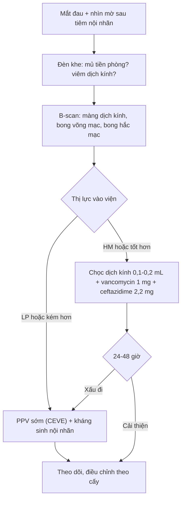
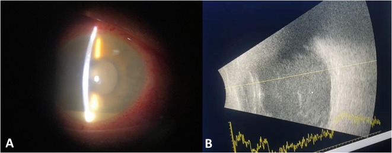
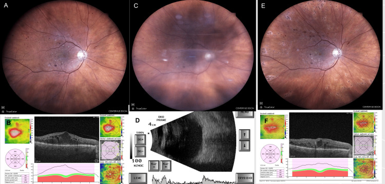
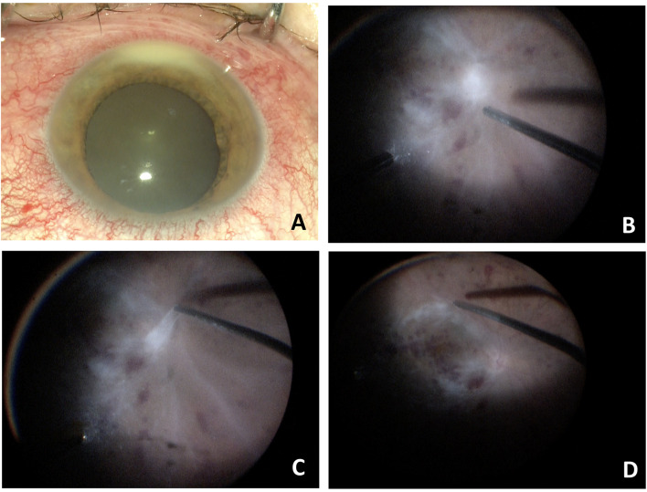

# 1425 — Viêm nội nhãn sau tiêm nội nhãn: mủ tiền phòng – viêm dịch kính / Post-injection endophthalmitis

**Tags:** `pattern:viem-noi-nhan` `pattern:mu-tien-phong` `pattern:viem-dich-kinh` `vung:nhan-cau` `vung:tien-phong` `vung:dich-kinh` `protocol:sieu-am-B-scan` `protocol:OCT` `protocol:tiem-noi-nhan` `protocol:PPV`

**Mức chắc chắn (certainty):** tổng hợp y văn (literature synthesis) — đọc trực tiếp toàn văn 9 bài mở qua Europe PMC/PMC (2023–2026). **Hai ca nguyên văn** (verbatim case) có ảnh dùng cho Blind Quiz. Phần **phân định viêm vô khuẩn với nhiễm trùng trên lâm sàng–siêu âm** là **suy luận (inference)** từ cơ chế và các loạt ca, ghi rõ tại chỗ: không có xét nghiệm hình ảnh nào phân biệt được hai thể.

## 1. Tổng quan bệnh học – cơ chế hình ảnh

### 1.1. Vì sao tiêm nội nhãn gây viêm nội nhãn — và vì sao trong 1–3 ngày

- **Bệnh học (pathology):** vi khuẩn xâm nhập khoang dịch kính theo 3 đường: (1) **hệ vi khuẩn thường trú ở kết mạc/mi** (chủ yếu *Staphylococcus* coagulase âm) bị kim đẩy qua nút củng mạc; (2) **giọt bắn từ đường hô hấp của người tiêm** (*Streptococcus* miệng — nhóm nguy hiểm nhất); (3) **thuốc/dụng cụ nhiễm** (lọ đa liều, bơm tiêm, đầu kim).
- **Vì sao tiến triển nhanh:** dịch kính là **khoang miễn dịch đặc quyền** — không có mạch máu, ít đại thực bào, nồng độ bổ thể/opsonin thấp, lại là gel giàu hyaluronan nên vi khuẩn **nhân lên tự do**. Chỉ cần **vài chục CFU** là đủ gây viêm; vì vậy **thời gian ủ 1–3 ngày** (trung vị loạt 21.339 mũi tiêm: **7,6 ± 3,4 ngày**, khoảng 2–14 ngày; thể vô khuẩn **24–48 giờ**).
- **Vì sao có mủ tiền phòng (hypopyon):** viêm làm **vỡ hàng rào máu–thủy dịch**, bạch cầu và fibrin tràn vào tiền phòng rồi **lắng theo trọng lực** → mức ngang vàng ở đáy tiền phòng. Đây là dấu hiệu **của phản ứng viêm**, không phải bằng chứng nhiễm khuẩn.

### 1.2. Vì sao B-scan là phương thức chốt khi không soi được đáy mắt

| Hiện tượng | Cơ chế mô – vật lý | Dấu hiệu trên hình ảnh |
|---|---|---|
| **Viêm dịch kính (vitritis)** | Tế bào viêm + fibrin làm tăng **trở kháng âm** trong dịch kính vốn đồng nhất → tăng hồi âm | B-scan: **đốm/màng tăng hồi âm** trong dịch kính; **màng 70%**, **khu trú (loculated) 36%** |
| **Màng dịch kính sau dày, giả màng võng mạc** | Fibrin đông đặc + tế bào dính vào hyaloid | Dải tăng hồi âm **di động**, không có tưới máu trên Doppler màu → khác bong võng mạc |
| **Bong võng mạc kèm theo** | Co kéo + viêm | **8%** ca viêm nội nhãn có bong võng mạc — tiên lượng xấu hơn; **phải loại trừ trước và sau khi tiêm kháng sinh** |
| **Bong/ dày hắc mạc** | Thấm dịch qua màng Bruch bị viêm | **Bong hắc mạc 14,8%**, **dày hắc mạc 16,7%**, **dịch dưới bao Tenon 13%** |
| **Mủ tiền phòng** | Bạch cầu lắng | Đèn khe: mức ngang vàng; **siêu âm cao tần/UBM** nếu tiền phòng đục |

- **Vì sao không dùng OCT làm đầu tay:** khi dịch kính đục, tín hiệu quang bị tán xạ và **không qua được** → OCT chỉ dùng khi môi trường trong, để thấy **đốm tăng phản xạ ("rainstorm")**, màng trước võng mạc, phù hoàng điểm.
- **Vì sao không dùng CT/MRI thường quy:** tổn thương nằm trong **vài mL dịch kính**, dưới ngưỡng phân giải; CT/MRI chỉ để tìm **ổ nhiễm ngoài mắt/hốc mắt** hoặc biến chứng (viêm mô tế bào, áp-xe hốc mắt) — và **MRI phải loại trừ dị vật kim loại** trước.

### 1.3. Ngưỡng định lượng bắt buộc

- **Tần suất chung:** **0,02–0,2%** mỗi mũi tiêm; gộp **43 bài / 350.535 mũi anti-VEGF = 0,056%**; loạt 307.349 mũi tiêm **0,033% (101 ca)**; loạt 21.339 mũi **0,081% (13 ca, 8,1/10.000)**; loạt 18.365 mũi **0,038% (7 ca)**.
- **Nguy cơ tích lũy:** tiêm hằng tháng kéo dài → **tới ~1% sau 2 năm** (không phải 1% mỗi mũi).
- **Theo thuốc:** dexamethasone implant **0,125% (15/11.954)** vs anti-VEGF **0,033% (106/318.618)**, **p = 2,3 × 10⁻⁷**; triamcinolone **0,532% (5/939)** vs anti-VEGF **0,011% (2/17.426)**, **OR 46,64** — phần lớn ca sau steroid là **viêm vô khuẩn**, không phải nhiễm.
- **Bơm tiêm đóng sẵn (prefilled syringe) vs lọ đa liều:** **0,017% vs 0,052%**, **RR 0,320 (0,198–0,518)**.
- **Kháng sinh dự phòng tại chỗ sau tiêm:** **5,3 vs 4,4/10.000**, khác biệt **không có ý nghĩa** → không khuyến cáo.
- **Khẩu trang:** **0,032% vs 0,037%**, **p = 0,779**; loạt 307.349 mũi **RR 0,953 (0,616–1,473)** → không chứng minh giảm nguy cơ, nhưng **không loại trừ được lợi ích nhỏ** ở ca do *Streptococcus*.
- **Povidone-iodine (PVP-I) 2,5% vs 5%:** **0/3.826 vs 3/3.534 (0,08%)** — hiệu quả tương đương trong loạt hồi cứu.

## 2. Mẫu hình + chẩn đoán phân biệt theo thời điểm (gamut)

Mẫu hình chốt: **mắt đau + nhìn mờ + mủ tiền phòng ± viêm dịch kính, sau tiêm nội nhãn**. Gamut xếp theo **thời gian khởi phát** — đây là biến số mạnh nhất, mạnh hơn hình thái:

- **< 24 giờ:** **viêm vô khuẩn/độc (sterile–toxic)** do endotoxin, protein kết tụ, tá dược, giọt silicone/triamcinolone tồn lưu; đau **ít**, mủ tiền phòng nhẹ, **cấy âm**, tự giảm trong 1–2 tuần.
- **1–3 ngày:** **vi khuẩn gram dương** — *S. aureus*, *Streptococcus* (đặc biệt *S. pneumoniae*, *S. salivarius*); thể **tối cấp**, mủ đặc, đau nhiều.
- **3–7 ngày:** ***Staphylococcus* coagulase âm** (CoNS) — thể **bán cấp**, viêm dịch kính nhẹ, hay bị đánh giá thấp.
- **> 1–2 tuần:** **nấm** (*Candida*, *Aspergillus*) hoặc *Cutibacterium acnes*; viêm **khu trú, hạt**, tiến triển chậm; sau implant dexamethasone có thể **muộn hơn**.
- **Bệnh cảnh giả (masquerade) sau tiêm:** **đợt bùng phát viêm màng bồ đào** sẵn có, **u lympho nội nhãn**, **u nguyên bào võng mạc** (trẻ), **hoại tử u** — không đau, không mủ đặc, không đáp ứng kháng sinh.

**Gamut theo tác nhân (loạt 25 năm, 1.423 mắt):** cấy dương **63,03%**; gram dương **42,94%** — *S. epidermidis* **23,93%**, *S. aureus* **11,03%**, **liên cầu 10,54%**, gram âm **7,87%**, hỗn hợp **6,89%**, nấm **4,36%**; **37% cấy âm**. Loạt 18 năm khác: CoNS **42%**, gram âm **9,4%**, cấy dương **56%**.

**Vì sao *Streptococcus* đáng sợ:** 38 mắt viêm nội nhãn do *S. pneumoniae* — **mủ tiền phòng 89%**, **thị lực cuối NLP 79%**, dù 39% được cắt dịch kính. Đây là lý do ca khởi phát **< 48 giờ, đau nhiều, mủ đặc** phải xử trí như tối cấp.

## 3. Bảng so sánh phân biệt (ma trận đối chiếu)

| Thực thể (entity) | Hình ảnh điển hình | Chốt vào (rule-in) | Chốt loại (rule-out) | Gợi ý xác nhận |
|---|---|---|---|---|
| **Viêm nội nhãn nhiễm khuẩn (Staph/Strep)** | Mủ tiền phòng + viêm dịch kính đặc; B-scan **màng/dải tăng hồi âm**, có thể bong võng mạc | **Đau tăng + mủ tiền phòng + viêm dịch kính trong 1–7 ngày + cấy dương** | **Không đau, khởi phát < 24 giờ, tự giảm, cấy âm** → nghĩ vô khuẩn | Chọc dịch kính 0,1–0,2 mL: Gram, cấy, PCR 16S |
| **Do *Streptococcus* (flora miệng)** | Thể **tối cấp** < 48 giờ, mủ đặc, đau nhiều, có khi **vòng thấm giác mạc** | **Khởi phát < 48 giờ + mủ đặc + đau nhiều + tiền sử nói chuyện/không khẩu trang khi tiêm** | Diễn tiến chậm > 1 tuần, viêm nhẹ → không phải liên cầu | Cấy máu thạch, PCR; **PPV sớm** |
| **Viêm vô khuẩn/độc (sterile–toxic)** | Viêm nhẹ–vừa, **đau ít**, mủ tiền phòng mỏng, B-scan đục dịch kính lan tỏa | **24–48 giờ + đau ít + cấy âm + đáp ứng corticoid** | **Mủ đặc + đau tăng + đục dịch kính tăng nhanh** → không phải vô khuẩn | Theo dõi 24–48 giờ, cấy âm, loại trừ nhiễm |
| **Viêm nội nhãn do nấm** | Viêm **khu trú**, "fluff ball" trước võng mạc, chuỗi ngọc trai; B-scan đốm rời | **> 2 tuần + tổn thương khu trú + yếu tố nguy cơ (đái tháo đường, catheter, TPN)** | Khởi phát < 72 giờ, mủ lan tỏa → nghĩ vi khuẩn | Cấy nấm, β-D-glucan; **không chờ cấy mới điều trị** |
| **Bùng phát viêm màng bồ đào / masquerade** | Viêm tiền phòng ± dịch kính, **không mủ đặc**, có thể hai bên | **Tiền sử viêm màng bồ đào/u lympho + không đau + tái diễn cùng kiểu** | **Mủ mới + đau + một bên sau tiêm** → không phải masquerade | Đáp ứng corticoid, tế bào học dịch kính nếu kéo dài |

- **Ảnh đối chiếu:** ca nhiễm (mủ tiền phòng + B-scan đục dịch kính) và ca vô khuẩn (đáy mắt mờ + B-scan đục dịch kính nhưng **hết sau 1 tháng**) đặt cạnh nhau ở mục 6.

## 4. Protocol chụp + hệ phân độ/điểm chuẩn hóa

### 4.1. Protocol hình ảnh

- **B-scan (10–15 MHz)** là **bắt buộc** khi không soi được đáy mắt: đầu dò **gián tiếp qua gel**, quét **kinh trục + ngang + dọc**, **gain cao 90 dB** để thấy hyaloid rồi **giảm 65 dB** để phân biệt màng; **Doppler màu** khi cần phân biệt màng dịch kính (không có dòng) với bong võng mạc (có dòng).
- **Đo và ghi:** độ dày/di động màng dịch kính, có/không bong võng mạc, bong hắc mạc, dày củng mạc sau, dịch dưới bao Tenon.
- **OCT** chỉ khi môi trường trong: đốm tăng phản xạ dịch kính, màng trước võng mạc, phù hoàng điểm.
- **UBM** khi cần đánh giá tiền phòng/góc (mủ, dính mống mắt).
- **CT/MRI:** **không thường quy**; chỉ khi nghi viêm mô tế bào/áp-xe hốc mắt, hoặc tìm ổ nhiễm nội sinh. **MRI: loại trừ dị vật kim loại** trước.
- **Vệ sinh đầu dò** sau mỗi lần quét mắt viêm nội nhãn (nguy cơ lây chéo).

### 4.2. Phân tầng xử trí (theo EVS + CEVE)

- **EVS (420 mắt sau mổ đục thể thủy tinh):** cắt dịch kính (PPV) **chỉ lợi rõ khi thị lực vào viện là "light perception" (LP)**; **"hand motions" (HM) trở lên: chọc–tiêm tương đương PPV**; kháng sinh toàn thân **không thêm lợi ích**.
- **CEVE (complete and early vitrectomy):** PPV sớm + tiêm kháng sinh trong mổ + lấy mẫu — được dùng cho cả ca **vô khuẩn nặng** vì không thể loại trừ nhiễm tại giường.
- **Liều tiêm nội nhãn:** **vancomycin 1 mg/0,1 mL** + **ceftazidime 2,2 mg/0,1 mL** (kinh nghiệm); **moxifloxacin 500 µg/0,1 mL**; **amphotericin B 5 µg/0,1 mL** (nấm); **cefuroxime 1 mg/0,1 mL**; **amikacin 0,4 mg/0,1 mL**.
- **Theo dõi:** khám lại **24 giờ**; nếu xấu đi → **PPV**. B-scan lại **trước và sau** tiêm kháng sinh/PPV.

### 4.3. Dự phòng (bằng chứng 2023–2026)

- **PVP-I bắt buộc** (2,5–10%, tiếp xúc ≥ 30 giây) — **không có kháng sinh dự phòng thay thế**.
- **Không kê kháng sinh tại chỗ sau tiêm** (không giảm nguy cơ, tăng đề kháng).
- **Bơm tiêm đóng sẵn** giảm nguy cơ (RR 0,32).
- **Khẩu trang:** chưa chứng minh giảm nguy cơ, nhưng **hạn chế nói chuyện trong khi tiêm** là biện pháp rẻ, hợp lý về cơ chế (giọt bắn *Streptococcus*).

## 5. Biến thể bình thường và cạm bẫy

- **Cấy âm không loại trừ nhiễm:** **37–44%** ca cấy âm (đã dùng kháng sinh, thể tích mẫu ít, vi khuẩn khó mọc). Quyết định dựa **lâm sàng + diễn tiến**, không dựa cấy.
- **B-scan không phân biệt vô khuẩn với nhiễm:** cùng một hình "đục dịch kính"; **thời gian khởi phát + mức đau + cấy** mới là chốt.
- **Bỏ sót bong võng mạc (8%):** nếu tiêm kháng sinh mà không biết có bong võng mạc → tiên lượng xấu; **luôn B-scan trước và sau**.
- **Giả mủ tiền phòng (pseudo-hypopyon):** tinh thể cholesterol, tế bào u, vật liệu thể thủy tinh — **không đau, không viêm dịch kính**, bệnh sử khác.
- **Viêm vô khuẩn sau implant dexamethasone:** hay gặp hơn anti-VEGF (0,125% vs 0,033%); **tháo implant** là một phần xử trí; đừng mặc định nhiễm.
- **"Satisfaction of search":** đau mắt sau tiêm còn do **trầy giác mạc, tăng nhãn áp cấp, loét giác mạc** — khám đèn khe đủ trước khi kết luận.
- **Tái phát có thật:** đã báo ca **viêm nội nhãn lần hai sau 2 năm** ở cùng mắt — theo dõi dài, không coi là "miễn nhiễm".

## 6. Tự lượng giá — Blind Quiz

**Ca 1 — Nam 66 tuổi, tiêm dexamethasone implant 0,7 mg cho phù hoàng điểm do tắc nhánh tĩnh mạch võng mạc, ngày thứ 3 đau và nhìn mờ nhiều.**

- Hỏi: mô tả tiền phòng và dịch kính trên B-scan? Ba chẩn đoán phân biệt? Dấu hiệu nào chốt hướng điều trị?

<b>Bấm để hiện đáp án (findings + chẩn đoán)</b>

- **Dấu hiệu:** (A) đèn khe — **sung huyết kết mạc, mủ tiền phòng**, mống mắt mờ; (B) B-scan — **đục dịch kính lan tỏa, dày đặc** với dải tăng hồi âm phía sau (màng dịch kính/viêm), không thấy bong võng mạc rõ.
- **Chẩn đoán:** **viêm nội nhãn nhiễm khuẩn sau tiêm implant dexamethasone** — mủ + viêm dịch kính ở ngày 3 là bệnh cảnh điển hình; cần **chọc dịch kính + vancomycin 1 mg + ceftazidime 2,2 mg**, và **PPV** nếu thị lực LP hoặc xấu đi trong 24 giờ.
- **Vì sao không phải chỉ "viêm vô khuẩn do implant":** thể vô khuẩn thường **đau ít, khởi phát 24–48 giờ**, nhưng **không thể loại trừ nhiễm tại giường** — mủ đặc + đau tăng nghiêng về nhiễm.
- **Nguồn ảnh:** *BMC Ophthalmology* 2025; Fig. 1 — PMC12057116, **CC BY-NC-ND 4.0** (nguyên bản, không chỉnh sửa).

**Ca 2 — Nam 64 tuổi, đái tháo đường, tiêm bevacizumab mũi thứ 6 cho phù hoàng điểm; 24 giờ sau nhìn mờ nhanh, đau nhẹ.**

- Hỏi: khác biệt nào giữa ảnh trước và sau tiêm? B-scan nói gì? Vì sao cấy âm mà vẫn phải mổ?

<b>Bấm để hiện đáp án (findings + chẩn đoán)</b>

- **Dấu hiệu:** (A–B) trước tiêm — phù hoàng điểm; (C) 24 giờ sau — **đáy mắt mờ do viêm dịch kính**, không thấy rõ hoàng điểm; (D) **B-scan: đục dịch kính dày đặc**, không bong võng mạc; (E–F) 1–2 tháng sau **CEVE** — đáy mắt trong, phù hoàng điểm tồn dư.
- **Chẩn đoán:** **viêm nội nhãn vô khuẩn (sterile endophthalmitis) sau bevacizumab** — khởi phát **24 giờ**, **đau nhẹ**, cấy dịch kính và lọ thuốc **âm**, hồi phục thị lực nền trong **30 ngày** sau CEVE.
- **Vì sao vẫn mổ:** không có xét nghiệm nào loại trừ nhiễm trong 24 giờ đầu; **CEVE** vừa lấy mẫu vừa giải áp mủ/fibrin — ở loạt 5 ca, viêm tan và thị lực về nền.
- **Nguồn ảnh:** *Cureus* 2025; Figure 1 — PMC12507134, **CC BY 4.0**.

**Ca 3 — Bệnh nhân viêm nội nhãn sau tiêm, trong mổ cắt dịch kính.**

- Hỏi: (A) mô tả tiền phòng; (B–D) tổn thương võng mạc là gì? Ý nghĩa tiên lượng?

<b>Bấm để hiện đáp án (findings + chẩn đoán)</b>

- **Dấu hiệu:** (A) **sung huyết kết mạc + mủ tiền phòng**; (B–D) sau bóc màng trước võng mạc: **xuất huyết võng mạc rải rác, thâm nhiễm trắng, mạch máu "ma" (ghost vessels)** — dấu hiệu **tắc mạch do viêm**.
- **Chẩn đoán:** **viêm nội nhãn nhiễm khuẩn nặng có thiếu máu võng mạc** — tiên lượng thị lực xấu; cần **PPV + kháng sinh nội nhãn**, theo dõi bong võng mạc (8%) và tái phát.
- **Nguồn ảnh:** *BMC Ophthalmology* 2025; Fig. 3 — PMC12057116, **CC BY-NC-ND 4.0**.

## Bài liên quan chéo
- [495 – Viêm nội nhãn do nấm ngoại sinh sau mổ/tiêm vs TASS](../495-viem-noi-nhan-nam-ngoai-sinh-vs-TASS/lesson.md)
- [475 – Viêm nội nhãn nội sinh do vi khuẩn](../475-viem-noi-nhan-noi-sinh-vi-khuan/lesson.md)
- [463 – Viêm nội nhãn nội sinh do nấm](../463-viem-noi-nhan-noi-sinh-nam/lesson.md)
- [411 – Siêu âm nhãn cầu](../411-sieu-am-nhan-cau/lesson.md)
- [1420 – Áp-xe gan do Klebsiella + viêm nội nhãn nội sinh](../1420-ap-xe-gan-klebsiella-va-viem-noi-nhan/lesson.md)
- [492 – Sinh thiết hắc–võng mạc & lấy mẫu dịch kính](../492-sinh-thiet-hac-vong-mac-dich-kinh/lesson.md)
- [400 – Tổng quan Mắt & thị giác](../400-tong-quan-mat-thi-giac/lesson.md)

## Ảnh
- `1425_viem-noi-nhan-sau-tiem_AnteriorSegment-Bscan_PMC12057116.jpg` — *BMC Ophthalmology* 2025, Fig. 1, **CC BY-NC-ND 4.0**.
- `1425_viem-noi-nhan-sau-tiem_Fundus-OCT-Bscan_PMC12507134.jpg` — *Cureus* 2025, Figure 1, **CC BY 4.0**.
- `1425_viem-noi-nhan-sau-tiem_Vitrectomy_PMC12057116.jpg` — *BMC Ophthalmology* 2025, Fig. 3, **CC BY-NC-ND 4.0**.
- Nguồn + giấy phép từng ảnh: `images/CREDITS.md`; link bài gốc: `sources.md`.

> Không dùng để chẩn đoán độc lập khi chưa có người hướng dẫn.
