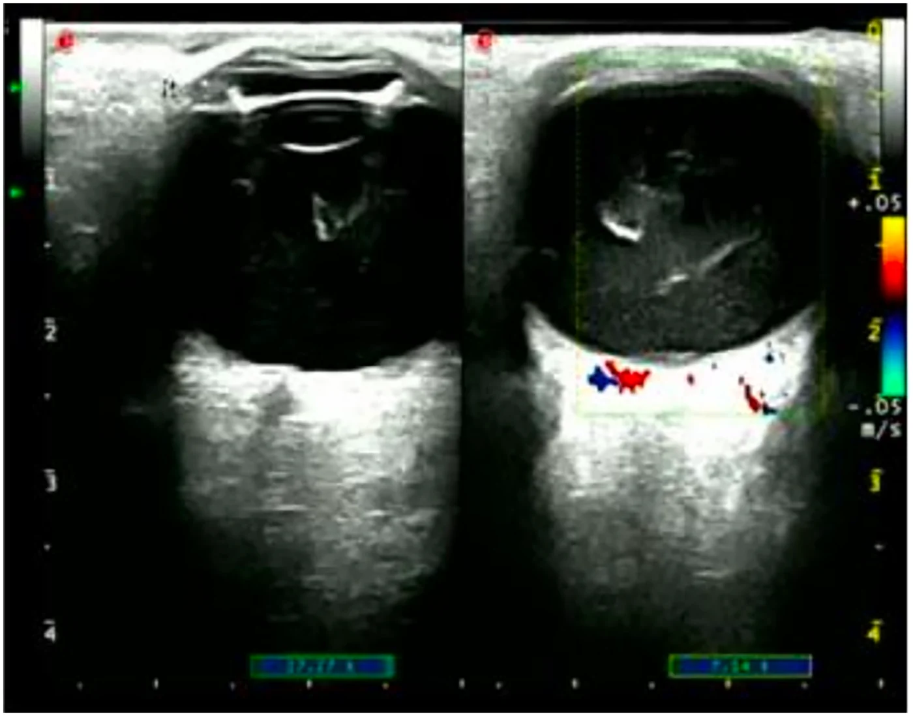
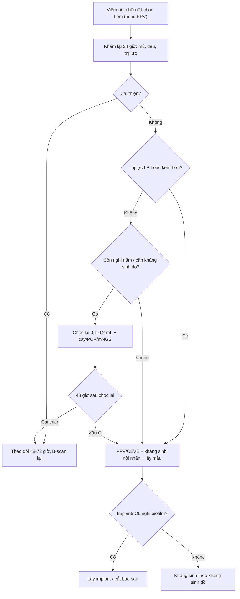
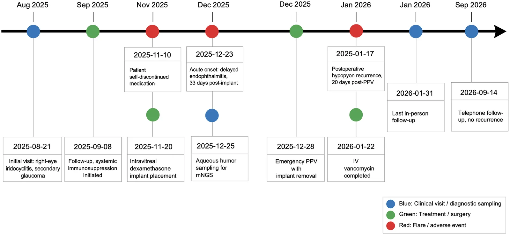
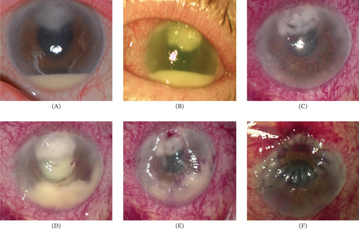
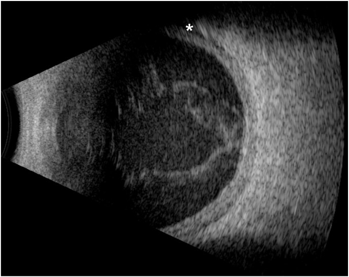

# 1426 — Viêm nội nhãn sau tiêm nội nhãn tái phát hoặc không đáp ứng / Recurrent and refractory post-injection endophthalmitis

**Tags:** `pattern:viem-noi-nhan` `pattern:mu-tien-phong` `pattern:viem-dich-kinh` `pattern:tai-phat` `pattern:khong-dap-ung` `vung:nhan-cau` `vung:tien-phong` `vung:dich-kinh` `vung:the-thuy-tinh` `protocol:B-scan` `protocol:PPV` `protocol:cay-vi-sinh` `protocol:mNGS` `score:EVS`

**Mức chắc chắn (certainty):** tổng hợp y văn (literature synthesis) — đọc toàn văn 6 bài mở 2022–2026 qua Europe PMC/PMC, trong đó **3 ca nguyên văn (verbatim case) có ảnh** dùng cho Blind Quiz. Phần **phân tầng "chọc lại hay mổ lại"** là **suy luận (inference)** từ cơ chế nhiễm trùng và các đoàn hệ quan sát, ghi rõ tại chỗ: **không có thử nghiệm ngẫu nhiên nào** trả lời câu hỏi này.

## 1. Tổng quan bệnh học – cơ chế hình ảnh

### 1.1. Vì sao viêm nội nhãn sau tiêm "tái phát" chứ không phải "khỏi rồi mắc lại"

- **Ổ nhiễm kín (sequestered nidus):** mủ và fibrin đông trong **dịch kính dạng gel** tạo **khoang kín** — kháng sinh tiêm vào khuyếch tán kém vào khối fibrin, nên **nồng độ diệt khuẩn tại ổ thấp** dù nồng độ trong dịch kính tự do đủ. Đây là lý do **cắt dịch kính (PPV)** vừa lấy mẫu vừa **mở khoang mủ**.
- **Màng sinh học (biofilm) trên vật liệu:** **implant dexamethasone (Ozurdex)** và **thể thủy tinh nhân tạo (IOL)** là giá thể cho *Staphylococcus* coagulase âm bám và tạo biofilm — kháng sinh **không diệt được vi khuẩn trong biofilm**; **không lấy implant** thì ổ nhiễm tồn tại. Ca nguyên văn: viêm nội nhãn **33 ngày sau implant**, **tái phát mủ 20 ngày sau PPV đã lấy implant** — chứng tỏ màng sinh học có thể còn trên bao thể thủy tinh/vỏ bao sau.
- **Đáp ứng viêm tự duy trì:** fibrin, mảnh võng mạc hoại tử và **protein của thuốc** tiếp tục kích thích bạch cầu; mủ tiền phòng quay lại **không đồng nghĩa vi khuẩn còn sống** (xem 1.3).
- **Vì sao khởi phát muộn với implant:** kim **22G** của implant lớn hơn kim anti-VEGF (30–32G) → **vết thương rộng hơn**, cộng **ức chế miễn dịch tại chỗ** của corticoid → vi khuẩn ít gây viêm cấp, biểu hiện **sau 4–12 tuần**. Tần suất: implant dexamethasone **0,125% (15/11.954)** so với anti-VEGF **0,033% (106/318.618)**, **RR 3,77 (2,20–6,47)**, **p = 2,29 × 10⁻⁷**.

### 1.2. Vì sao "không đáp ứng" là một thực thể riêng, không phải "nhiễm trùng nặng hơn"

- Sau chọc–tiêm kháng sinh, **phản ứng viêm đỉnh ở 24–48 giờ** rồi phải **giảm dần**. Không giảm (hoặc nặng lên) sau **48–72 giờ** = **kiểm soát ổ nhiễm thất bại**, do 4 khả năng: **ổ kín chưa mở**, **vi khuẩn kháng vancomycin**, **nấm**, hoặc **chẩn đoán không phải nhiễm khuẩn**.
- **Số liệu định lượng:**
  - Loạt 13 ca sau tiêm tại một trung tâm: **85% (11/13) phải PPV trong 24 giờ**, **64% (7/11)** đặt dầu silicone — cho thấy tỷ lệ "không đáp ứng chọc–tiêm" rất cao khi chỉ định mổ được đặt sớm.
  - Đoàn hệ 125 ca đa nguyên nhân: **40,8% chọc–tiêm đơn thuần**, **25% PPV ngay**, **34,2% chọc–tiêm rồi PPV trong 7 ngày**; **thị lực cuối không khác nhau giữa 3 nhóm**, nhưng nhóm **chọc–tiêm → PPV phục hồi thị lực CHẬM hơn**.
  - Vi khuẩn gram dương **kháng vancomycin**: **14/126 (11,1%)** ca cấy dương tại Ấn Độ; **100% đa kháng ≥ 3 nhóm**; thị lực cuối **≥ 20/200 chỉ 50% (7/14)**.
- **Vì sao cấy lần hai thường âm:** bệnh nhân **đã dùng kháng sinh** (làm giảm độ nhạy Gram/cấy), **thể tích mẫu 0,1–0,2 mL**, vi khuẩn **trong biofilm** khó mọc. Vì vậy **cấy âm lần hai KHÔNG loại trừ nhiễm** — ca nguyên văn dùng **mNGS dịch tiền phòng** mới ra *S. epidermidis* **24.904 reads (99,96%)**, trong khi cấy thường âm.

### 1.3. Vì sao hình ảnh không phân biệt được "nhiễm còn sống" với "viêm tồn dư"

| Hiện tượng | Bản chất mô – vật lý | Dấu hiệu trên hình ảnh |
|---|---|---|
| **Mủ tiền phòng (hypopyon)** | Bạch cầu + fibrin lắng theo trọng lực | Đèn khe: **mức ngang vàng** ở đáy tiền phòng; **không phân biệt** vô khuẩn/nhiễm |
| **Viêm dịch kính** | Tế bào + fibrin làm **tăng trở kháng âm** trong dịch kính đồng nhất | B-scan: **đốm và màng tăng hồi âm**, dày màng dịch kính sau |
| **Màng xơ – co kéo** | Fibrin tổ chức hóa, không có mạch | B-scan: dải **dày, di động kém**; **Doppler màu không có dòng** (khác bong võng mạc có dòng) |
| **Bong hắc mạc** | Thấm dịch qua màng Bruch bị viêm | B-scan: **vòm hắc mạc dày, trơn**, có thể kèm dịch dưới bao Tenon |
| **Bong võng mạc** | Co kéo + viêm | **Màng mỏng, di động mạnh**, dính vào đĩa thị; **8%** ca viêm nội nhãn sau tiêm có bong võng mạc |

- **Vì sao OCT chỉ dùng khi môi trường trong:** tế bào viêm **tán xạ ánh sáng** → tín hiệu không tới võng mạc; khi trong, OCT thấy **đốm tăng phản xạ dịch kính** và phù hoàng điểm.
- **Vì sao MRI/CT không thường quy:** tổn thương nằm trong **vài mL dịch kính**, dưới ngưỡng phân giải; chỉ dùng khi nghi **viêm mô tế bào/áp-xe hốc mắt** hoặc ổ nhiễm nội sinh.

*(A) B-mode: đục dịch kính dạng **màng + đốm**, dày thành sau; (B) Doppler màu: **dòng chỉ ở thành củng mạc/hắc mạc**, không có dòng trong khối mủ — khác bong võng mạc. Nguồn: PMC13683054 Figure 2, CC BY 4.0.*

## 2. Mẫu hình + chẩn đoán phân biệt theo diễn tiến (gamut)

Mẫu hình chốt: **mắt đã được chọc–tiêm kháng sinh (hoặc PPV) vì viêm nội nhãn, nay mủ/viêm dịch kính quay lại hoặc không giảm**. Gamut xếp theo **mốc thời gian so với lần điều trị đầu** — biến số mạnh hơn hình thái:

- **0–48 giờ, không cải thiện:** **ổ kín chưa mở** (mủ fibrin), **vi khuẩn kháng vancomycin** (*Enterococcus*, VRSA), **gram âm kháng ceftazidime**, hoặc **chẩn đoán sai** (viêm màng bồ đào bùng phát).
- **48 giờ–2 tuần, cải thiện rồi xấu lại:** **biofilm trên IOL/implant/vỏ bao**, **mảnh hoại tử còn sót**, **áp-xe dịch kính khu trú**.
- **2–12 tuần, khởi phát muộn:** **implant dexamethasone** (kim **22G**, lớn hơn 30–32G của anti-VEGF), ***Cutibacterium acnes***, **nấm** (*Candida*, *Aspergillus*).
- **Hàng tháng–hàng năm, "mắc lại":** **đợt nhiễm mới** do tiêm lại — **1,5% (8/535)** bệnh nhân có tiền sử viêm nội nhãn bị đợt thứ hai sau khi đã hết viêm hoàn toàn; ca nguyên văn thứ hai cách **2 năm**, cùng mắt, sau aflibercept.
- **Bệnh cảnh giả (masquerade):** **bùng phát viêm màng bồ đào**, **u lympho nội nhãn**, **hoại tử u**, **dị vật/mảnh thể thủy tinh** — không đau nhiều, **không đáp ứng kháng sinh**, tái diễn cùng kiểu.

**Gamut theo tác nhân (loạt lớn):** cấy dương **56–63%**; *S. epidermidis* **24%**, *S. aureus* **11%**, **liên cầu 10,5%**, gram âm **7,9%**, nấm **4,4%**; **37–44% cấy âm**. *Streptococcus* là nhóm **khởi phát < 48 giờ, mủ đặc, tiên lượng xấu nhất**.

## 3. Bảng so sánh phân biệt (ma trận đối chiếu)

| Thực thể (entity) | Hình ảnh điển hình | Chốt vào (rule-in) | Chốt loại (rule-out) | Gợi ý xác nhận |
|---|---|---|---|---|
| **Nhiễm khuẩn tồn tại do ổ kín** | Mủ tiền phòng dai dẳng + **màng/dải fibrin** trong dịch kính trên B-scan | **Không giảm sau 48–72 giờ** + mủ đặc + đau tăng + cấy lần đầu dương | Mủ mỏng, đau giảm dần, cấy âm → nghĩ viêm tồn dư | **PPV + làm lại cấy**; B-scan trước/sau |
| **Kháng vancomycin (VRE/VRSA)** | Không khác hình thái; **mủ quay lại sau khi đã lấy mủ** | **Cấy dương gram dương + kháng vancomycin (MIC)**; tiền sử dùng vancomycin nội nhãn/dự phòng | Đáp ứng rõ sau vancomycin 48 giờ → ít nghĩ kháng | Kháng sinh đồ; **linezolid/daptomycin** nội nhãn theo ca |
| **Biofilm trên implant/IOL** | Viêm **khu trú quanh implant/vỏ bao**, mủ tái phát **nhiều tuần** | **Implant/IOL còn tại chỗ + tái phát cùng kiểu**; mNGS/PCR dương | Không có vật liệu, một đợt duy nhất → không phải biofilm | **Lấy implant**; PPV + cắt bao sau |
| **Nấm (Candida/Aspergillus)** | Viêm **khu trú, "fluff ball"**, đốm rời trên B-scan; tiến triển **chậm** | **> 2 tuần + tổn thương khu trú + yếu tố nguy cơ** | Khởi phát < 72 giờ, mủ lan tỏa → nghĩ vi khuẩn | Cấy nấm, β-D-glucan; **amphotericin B 5 µg/0,1 mL** |
| **Viêm vô khuẩn/độc** | Mủ mỏng, đau ít, đục dịch kính lan tỏa **đối xứng** | **24–48 giờ + cấy âm + giảm nhanh với corticoid** | **Mủ đặc + đau tăng + tái phát sau PPV** → không phải vô khuẩn | Theo dõi 24–48 giờ; loại trừ nhiễm trước |
| **Masquerade (uviết/u lympho)** | Viêm tiền phòng ± dịch kính, **không mủ đặc**, có thể hai bên | **Tiền sử uviết/u lympho + tái diễn cùng kiểu + cấy âm nhiều lần** | **Mủ mới + đau + một bên sau tiêm** → không phải masquerade | Tế bào học dịch kính; đáp ứng corticoid |

## 4. Protocol chụp + phân tầng xử trí

### 4.1. Protocol hình ảnh

- **Đèn khe + soi đáy mắt** mỗi lần khám: ghi **chiều cao mủ (mm)**, tế bào tiền phòng, fibrin, phản ứng mống mắt.
- **B-scan 10–15 MHz BẮT BUỘC** khi không soi được đáy mắt: quét **kinh trục + ngang + dọc**, **gain cao ~90 dB** để thấy hyaloid rồi **giảm ~65 dB** để phân biệt màng; **Doppler màu** phân biệt màng xơ (không dòng) với bong võng mạc (có dòng).
- **Đo và ghi:** màng dịch kính, **bong võng mạc**, **bong hắc mạc**, dày củng mạc sau, dịch dưới bao Tenon.
- **OCT** khi môi trường trong (đốm dịch kính, phù hoàng điểm); **UBM** khi cần đánh giá tiền phòng/góc.
- **CT/MRI hốc mắt** chỉ khi nghi viêm mô tế bào/áp-xe hốc mắt; **loại trừ dị vật kim loại** trước MRI.

### 4.2. Phân tầng: chọc lại hay mổ lại

- **Mốc đánh giá: 24 giờ và 48–72 giờ.** Đáp ứng = **đau giảm, mủ giảm, viêm dịch kính giảm**.
- **Chỉ định PPV (mổ lại/CEVE):** **thị lực LP hoặc kém hơn**; **không cải thiện sau 48–72 giờ**; **mủ tăng**; **B-scan có màng/mủ tổ chức hóa**; **implant/IOL còn nghi biofilm**.
- **Chọc lại (second tap) chỉ khi:** chẩn đoán còn nghi ngờ (lần đầu lấy mẫu **sau** kháng sinh), **nghi nấm**, hoặc cần **kháng sinh đồ** để đổi thuốc — **không chọc lại "theo lịch"** vì **độ nhạy cấy lần hai rất thấp** và chọc vào mắt đang viêm có nguy cơ bong võng mạc.
- **Liều nội nhãn kinh điển:** **vancomycin 1 mg/0,1 mL** + **ceftazidime 2,25 mg/0,1 mL**; **moxifloxacin 500 µg/0,1 mL**; **amphotericin B 5 µg/0,1 mL** (nấm); **cefuroxime 1 mg/0,1 mL**.
- **Kháng vancomycin (ca/loạt nhỏ):** **linezolid 1 mg/0,1 mL** hoặc **daptomycin 200 µg/0,1 mL** (an toàn trên mô hình thỏ) — **không có khuyến cáo chính thức**, phải có **kháng sinh đồ** và **PPV**.
- **Corticoid nội nhãn:** **không dùng thường quy**. Gộp **265 mắt** (126 dexamethasone + kháng sinh vs 139 kháng sinh đơn thuần): **không lợi ích thị lực**; **thời gian bán thải dexamethasone ~5,5 giờ** nên không thể "dập" viêm kéo dài. Nếu dùng, **không thay thế kiểm soát ổ nhiễm**.
- **Bỏ mắt (evisceration/enucleation):** đau không kiểm soát, **NLP + teo nhãn cầu**, **thủng/mủ giác mạc lan**. 66 mắt do học viên mổ: **98% lắp được mắt giả**; **evisceration trong panophthalmitis** có **nguy cơ lộ/thải implant cao (aOR 38,38)** → cân nhắc **enucleation**.

### 4.3. Ngưỡng "thất bại điều trị" dùng để ghi hồ sơ

- **Thất bại vi sinh:** cấy/PCR còn dương **sau 7 ngày** kháng sinh phù hợp.
- **Thất bại lâm sàng:** mủ **không giảm sau 72 giờ** hoặc **tái phát sau khi đã hết**.
- **Thất bại giải phẫu:** **bong võng mạc**, **teo nhãn cầu**, **mất cảm giác sáng**.

## 5. Biến thể bình thường và cạm bẫy

- **Cấy âm không loại trừ nhiễm:** **37–44%** ca cấy âm; **cấy lần hai còn thấp hơn**. Quyết định dựa **diễn tiến lâm sàng + B-scan**.
- **B-scan không phân biệt vô khuẩn/nhiễm:** cùng hình "đục dịch kính"; **thời gian + mức đau + đáp ứng điều trị** mới là chốt.
- **Mủ tiền phòng giả:** tinh thể cholesterol, tế bào u, **vật liệu silicone/triamcinolone** — **không đau, không viêm dịch kính**.
- **Không bỏ sót bong võng mạc:** **8%** ca viêm nội nhãn có bong võng mạc; **B-scan trước và sau** mỗi lần tiêm/mổ.
- **Implant dexamethasone:** viêm nội nhãn **có thể xuất hiện 33 ngày sau tiêm** và **tái phát sau PPV đã lấy implant** — phải **theo dõi dài**, không coi "lấy implant là xong".
- **Độc tính vancomycin:** lặp liều dày có thể gây **hoại tử võng mạc/thiếu máu**; khoảng cách và liều phải theo **nồng độ – thời gian bán thải**, không tiêm nhắc mù.
- **"Satisfaction of search":** đau mắt sau tiêm còn do **trầy giác mạc, tăng nhãn áp cấp, loét giác mạc, viêm củng mạc** — khám đèn khe đủ trước khi kết luận.

## 6. Tự lượng giá — Blind Quiz

**Ca 1 — Nam 51 tuổi, uviết trước tiêm tái diễn, tiêm implant dexamethasone 0,7 mg; 33 ngày sau đau, mủ tiền phòng; đã PPV lấy implant và dùng kháng sinh toàn thân.**

- Gợi ý: nhìn các mốc đỏ (biến cố) và xanh (điều trị).
- Câu hỏi: biến cố nào xảy ra **20 ngày sau PPV**? Vì sao "đã lấy implant" mà vẫn tái phát? Hai xét nghiệm nào giúp tìm tác nhân khi cấy âm?

<b>Bấm để hiện đáp án (findings + chẩn đoán)</b>

- **Dấu hiệu:** dòng thời gian ghi **23/12/2025 viêm nội nhãn khởi phát muộn 33 ngày sau implant**; **28/12 PPV khẩn lấy implant**; **17/01/2026 mủ tiền phòng tái phát 20 ngày sau PPV**.
- **Chẩn đoán:** **viêm nội nhãn nhiễm khuẩn tái phát sau PPV** do *S. epidermidis* — **mNGS dịch tiền phòng 24.904 reads (99,96%)**, không gen kháng; thị lực cuối **20/33**.
- **Vì sao tái phát:** biofilm/ổ fibrin còn trên **vỏ bao sau** dù đã lấy implant; kháng sinh không thấm vào màng sinh học → cần **PPV + cắt bao sau**, không chỉ lấy implant.
- **Nguồn ảnh:** *Frontiers in Medicine* 2026; Figure 4 — PMC13683054, **CC BY 4.0**.

**Ca 2 — Bệnh nhân sau mổ đục thể thủy tinh, viêm nội nhãn do *Staphylococcus hominis* kháng vancomycin (không đáp ứng chọc–tiêm).**

- Gợi ý: (A) vào viện; (B) sau khi tăng kháng sinh; (C–E) diễn tiến; (F) sau ghép giác mạc.
- Câu hỏi: dấu hiệu nào cho thấy **kiểm soát ổ nhiễm thất bại**? Khi nào phải **ghép giác mạc tạm (tectonic)**?

<b>Bấm để hiện đáp án (findings + chẩn đoán)</b>

- **Dấu hiệu:** (A) **thâm nhiễm vết mổ + mủ tiền phòng + phù mô đệm**; (B) mủ **tăng** dù đổi kháng sinh → **không đáp ứng**; (C–E) **mủ đặc, thâm nhiễm lan, mô giác mạc mỏng đi**; (F) sau **ghép giác mạc tectonic** — giác mạc trong, mủ hết.
- **Chẩn đoán:** **viêm nội nhãn do *S. hominis* kháng vancomycin, có biến chứng giác mạc** — phải **PPV + kháng sinh theo kháng sinh đồ (linezolid/daptomycin)** và **ghép giác mạc** để cứu nhãn cầu.
- **Vì sao không chờ:** mủ tăng sau 48 giờ + thâm nhiễm giác mạc = **nguy cơ thủng**; chờ thêm là mất mắt.
- **Nguồn ảnh:** *Case Reports in Ophthalmological Medicine* 2026; Figure 2 — PMC13338094, **CC BY 4.0**.

**Ca 3 — Nam 83 tuổi, 1 ngày sau tiêm aflibercept 2 mg: đau, thị lực cảm giác sáng; B-scan dưới đây.**

- Gợi ý: chú ý mũi tên (màng trong dịch kính) và dấu hoa thị (khoang dưới hắc mạc).
- Câu hỏi: hai dấu hiệu trên B-scan là gì? Vì sao **vẫn phải mổ** dù chọc–tiêm đã làm ngay?

<b>Bấm để hiện đáp án (findings + chẩn đoán)</b>

- **Dấu hiệu:** **đục dịch kính + màng fibrin (mũi tên)** và **bong hắc mạc nông (hoa thị)**; không thấy bong võng mạc.
- **Chẩn đoán:** **viêm nội nhãn nhiễm khuẩn sau tiêm** — bệnh nhân được **chọc–tiêm vancomycin + ceftazidime + dexamethasone**, nhưng **thị lực vẫn LP** và **không cải thiện sau 1 ngày** → **PPV + bóc màng hyaloid**, tiêm lại kháng sinh; **2 năm sau có đợt thứ hai** sau aflibercept 8 mg, thị lực cuối **20/50**.
- **Vì sao mổ:** **LP + màng fibrin tổ chức hóa + bong hắc mạc** = ổ kín, kháng sinh không tới; **EVS** chỉ định PPV khi **LP**, và **không cải thiện sau 24 giờ** củng cố chỉ định.
- **Nguồn ảnh:** *American Journal of Ophthalmology Case Reports* 2026; Fig. 1 — PMC12914102, **CC BY 4.0**.

## Bài liên quan chéo
- [1425 – Viêm nội nhãn sau tiêm nội nhãn: chẩn đoán và phân tầng lần đầu](../1425-viem-noi-nhan-sau-tiem-noi-nhan/lesson.md)
- [1433 – Viêm nội nhãn ở mắt bơm dầu silicone: cấy dầu–dịch, lấy dầu hay giữ](../1433-viem-noi-nhan-mat-bom-dau/lesson.md)
- [495 – Viêm nội nhãn do nấm ngoại sinh sau mổ/tiêm vs TASS](../495-viem-noi-nhan-nam-ngoai-sinh-vs-TASS/lesson.md)
- [475 – Viêm nội nhãn nội sinh do vi khuẩn](../475-viem-noi-nhan-noi-sinh-vi-khuan/lesson.md)
- [492 – Sinh thiết hắc–võng mạc & lấy mẫu dịch kính](../492-sinh-thiet-hac-vong-mac-dich-kinh/lesson.md)
- [411 – Siêu âm nhãn cầu](../411-sieu-am-nhan-cau/lesson.md)
- [400 – Tổng quan Mắt & thị giác](../400-tong-quan-mat-thi-giac/lesson.md)

## Ảnh
- `1426_viem-noi-nhan-tai-phat_Timeline_PMC13683054.webp` — *Frontiers in Medicine* 2026, Figure 4, **CC BY 4.0**.
- `1426_viem-noi-nhan-tai-phat_AnteriorSegment_PMC13338094.jpg` — *Case Reports in Ophthalmological Medicine* 2026, Figure 2, **CC BY 4.0**.
- `1426_viem-noi-nhan-tai-phat_Bscan_PMC12914102.jpg` — *American Journal of Ophthalmology Case Reports* 2026, Fig. 1, **CC BY 4.0**.
- `1426_viem-noi-nhan-tai-phat_Bscan-Doppler_PMC13683054.webp` — *Frontiers in Medicine* 2026, Figure 2, **CC BY 4.0**.
- Nguồn + giấy phép từng ảnh: `images/CREDITS.md`; link bài gốc: `sources.md`.

> Không dùng để chẩn đoán độc lập khi chưa có người hướng dẫn.
