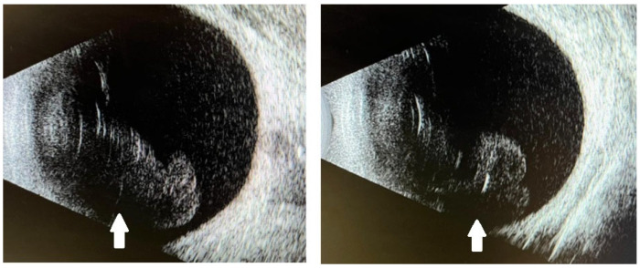
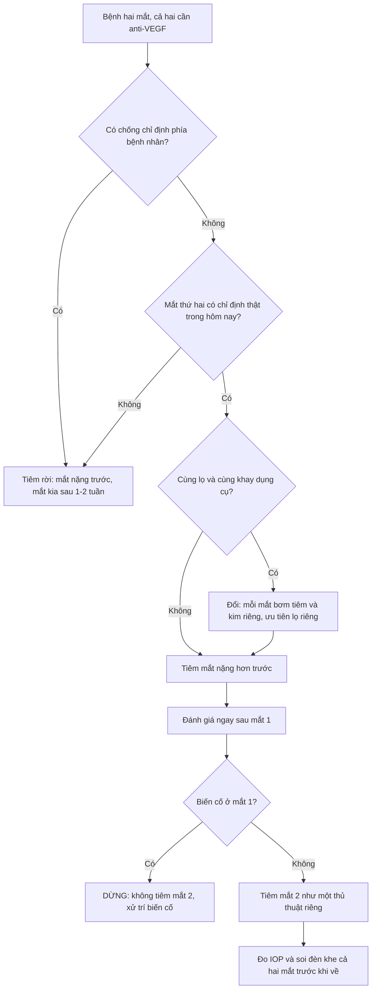
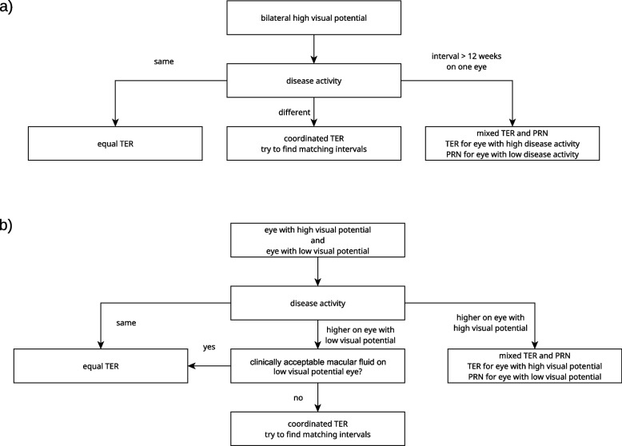
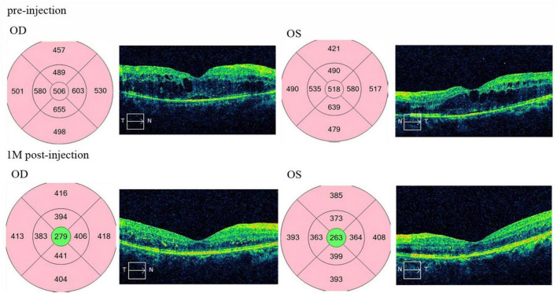

# 1427 — Tiêm anti-VEGF nội dịch kính HAI MẮT CÙNG NGÀY / Same-day bilateral intravitreal anti-VEGF injection

**Tags:** `pattern:viem-tien-phong-vo-khuan` `pattern:viet-dich-kinh` `pattern:viem-noi-nhan` `vung:mat` `vung:dich-kinh` `vung:tien-phong` `protocol:anti-VEGF` `protocol:tiem-noi-nhan` `protocol:vo-khuan-hai-mat` `score:TER` `score:IOP`

**Mức chắc chắn (certainty):** **tổng hợp y văn** (literature synthesis) cho phần chỉ định–an toàn–protocol, biên từ toàn văn 6 bài mở và 2 tổng quan hệ thống (2024–2026); **một ca nguyên văn** (verbatim case) dùng cho Blind Quiz có ảnh (PMC12736422). Các quy tắc vận hành **không có trong bài gốc** (thứ tự tiêm, quy tắc dừng sau mắt thứ nhất, cách ly lô thuốc) được ghi rõ **suy luận (inference)** tại chỗ — không có thử nghiệm ngẫu nhiên nào so sánh hai cách tiêm.

> **Câu chốt:** Tiêm hai mắt cùng ngày **không phải "hai mũi tiêm rời"** mà là **một buổi can thiệp có hai cơ quan đích**: (1) nguy cơ **nhân đôi** cho từng mắt, (2) nguy cơ **chia sẻ nguồn nhiễm** (lọ thuốc, bơm tiêm, người tiêm, lô pha chế) → **mù hai mắt trong một lần**, và (3) **gấp đôi liều toàn thân** trong cùng một ngày. Dữ liệu hiện có (69.239 buổi tiêm hai mắt, **0 ca viêm nội nhãn hai bên**) cho thấy thủ thuật **an toàn trong tay người làm đúng quy trình** — nhưng chính vì biến cố hiếm, quyết định phải dựa trên **cấu trúc nguy cơ** chứ không dựa vào "chưa thấy ca nào".

## 1. Tổng quan — vì sao "hai mắt cùng ngày" là bài toán khác, không phải 2 lần tiêm gộp

### 1.1. Vì sao nhu cầu có thật: bệnh hai mắt + gánh nặng tái khám

- Thoái hóa hoàng điểm tuổi già (age-related macular degeneration, AMD) **thể tân mạch hai bên** rất phổ biến: ước tính **≥ 30% ở châu Á và 45% ở châu Âu**; **26%** bệnh nhân AMD một bên sẽ xuất hiện tân mạch hắc mạc (choroidal neovascularization, CNV) ở mắt đối diện **trong 5 năm** (PMC3913980).
- Với phác đồ **4 tuần/mũi** (treat-and-extend khởi đầu), mỗi mắt cần **13 mũi/năm**; tiêm rời hai mắt = **26 buổi/năm** cho một bệnh nhân thường **> 70 tuổi**, nhiều người **không tự đi lại được**. Tiêm hai mắt cùng ngày đưa về **13 buổi/năm** — đây là động lực thực hành chính, và cũng là lý do thủ thuật **được làm rộng rãi dù nằm ngoài nhãn (off-label)**: các thử nghiệm then chốt đều chỉ tiêm **một mắt** (PMC12351889).
- Hệ quả ngược cần nhớ: giảm số buổi **không** được phép làm giảm số mũi của mắt đang hoạt động bệnh — xem mục 4.3 (phối hợp khoảng cách treat-and-extend).

### 1.2. Vật lý – dược động: 0,05 mL mỗi mắt nhưng **một** tuần hoàn chung

- **Thể tích:** một mũi anti-VEGF chuẩn là **0,05 mL** (ranibizumab 0,5 mg; aflibercept 2 mg; bevacizumab 1,25 mg) vào **thể tích dịch kính ~4 mL** → pha loãng ~1:80 trong mắt. Tiêm hai mắt **không** làm tăng nồng độ trong một mắt, nhưng làm **tăng gấp đôi lượng thuốc vào tuần hoàn** vì mỗi mắt đều thoát thuốc qua **lưới bè – tĩnh mạch thượng củng mạc** và qua hàng rào máu–võng mạc bị phá vỡ.
- **Phân tử quyết định mức phơi nhiễm toàn thân** (chi tiết ở [1424](../1424-tang-ha-va-bien-co-toan-than-anti-vegf/lesson.md), nguồn PMC12271010):
  - **Bevacizumab** — kháng thể toàn phần **149 kDa, có Fc** → nửa đời huyết tương **~21 ngày**, phơi nhiễm toàn thân cao nhất.
  - **Aflibercept** — protein dung hợp **115 kDa, có Fc** → ức chế VEGF huyết thanh **trên IC50 tới 30 ngày**.
  - **Ranibizumab** — mảnh Fab **48 kDa, không Fc** → nửa đời **~0,25 ngày**, phơi nhiễm thấp nhất.
  - **FcRn** tái chế IgG → phân tử **có Fc** lưu lâu hơn; tiêm hai mắt **cùng lúc** nghĩa là đỉnh huyết thanh **gấp đôi** ở cùng một thời điểm, không phải hai đỉnh cách nhau vài tuần.
- **Bằng chứng trực tiếp — và một kết quả đi ngược trực giác:** ở **20 bệnh nhân tiêm bevacizumab hai mắt** so với **20 bệnh nhân tiêm một mắt**, VEGF huyết thanh (pg/mL) giảm từ **235,75 ± 183,16 → 153,88 ± 113,26** (hai mắt) và **252,53 ± 233,52 → 189,42 ± 251,72** (một mắt) sau 1 tháng; **khác biệt giữa hai nhóm p = 0,771** (PMC3913980). Nghĩa là **liều gấp đôi KHÔNG cho mức ức chế VEGF huyết thanh gấp đôi** — phù hợp với **bão hòa thải trừ/dung lượng đích**.
  - **Phản biện (bắt buộc):** n = 20 + 20, bevacizumab, thời điểm 1 tháng, không đủ lực cho biến cố lâm sàng; một nghiên cứu **không** chứng minh "an toàn toàn thân", chỉ chứng minh **không có bùng nổ ức chế VEGF** trong mẫu nhỏ.
- **Vì sao vẫn phải coi trọng phơi nhiễm toàn thân:** huyết áp, protein niệu và biến cố huyết khối–tim mạch là **phụ thuộc tổng liều – thời gian**; bệnh nhân tiêm hai mắt thường là người **đã tiêm nhiều năm**. Đây là lý do phải **đo huyết áp và xét nghiệm nước tiểu định kỳ** như bài 1424, không phải chỉ vì "hôm nay tiêm 2 mũi".

### 1.3. Ba nguồn nguy cơ của **một buổi** tiêm hai mắt

| Nguồn nguy cơ | Cơ chế | Hệ quả lâm sàng | Cách chặn |
|---|---|---|---|
| **Nhân đôi nguy cơ mỗi mắt** | Hai lần chọc kim, hai lần đặt speculum, hai lần povidone-iodine | Viêm nội nhãn **một mắt** tăng gấp đôi **theo buổi** (2 × 0,03–0,08% ≈ **0,06–0,16%/buổi**) | Kỹ thuật vô khuẩn giống hệt nhau cho **từng mắt**, không "tiêm nhanh cho xong" |
| **Chia sẻ nguồn nhiễm** | Cùng **lọ thuốc**, cùng lô pha chế, cùng khay dụng cụ, cùng người tiêm | Nếu lọ/lô nhiễm → **cả hai mắt viêm nội nhãn trong cùng 24–72 giờ** = mù hai bên | Mỗi mắt **bơm tiêm/kim riêng**; ưu tiên **lọ riêng** hoặc lọ đơn liều; nghi ngờ → **cách ly lô + báo dược** |
| **Gấp đôi liều toàn thân** | Hai mắt cùng hấp thu vào tuần hoàn | Đỉnh ức chế VEGF toàn thân cao hơn, kéo dài hơn | Tầm soát tim mạch–thận trước; cân nhắc **ranibizumab** (không Fc) ở người nguy cơ cao |

- **Con số nền để không hoảng loạn:** viêm nội nhãn sau tiêm nội nhãn **0,02–0,2%/mũi** (bài [1425](../1425-viem-noi-nhan-sau-tiem-noi-nhan/lesson.md)); tổng quan hệ thống riêng cho tiêm hai mắt cùng ngày: **138.478 mũi = 69.239 buổi**, 7.579 bệnh nhân, **33 ca viêm nội nhãn**, **0 ca hai bên** (Int Ophthalmol 2024, PMID 38332399).
- **Con số nền để không chủ quan:** 69.239 buổi là **chưa đủ** để loại trừ một biến cố có tần suất **1/100.000 buổi**; khoảng tin cậy của "0 ca" vẫn cho phép **vài ca/một triệu buổi**, và ca hai bên **đã được báo cáo riêng lẻ** trong y văn.

## 2. Mẫu hình + chẩn đoán phân biệt theo **thời điểm** sau tiêm hai mắt

Mẫu hình cần nhận ra: **hai mắt cùng triệu chứng, cùng thời điểm khởi phát, sau một buổi tiêm chung**. Thời gian khởi phát là biến số mạnh nhất — mạnh hơn mức độ viêm.

- **< 30 phút (ngay tại phòng tiêm):** **tăng nhãn áp cấp** do thể tích 0,05 mL ± chèn ép củng mạc (đau, nhìn mờ, thấy quầng); **xuất huyết dưới kết mạc** (đỏ, không đau, không giảm thị lực); **xước giác mạc do speculum** (đau, chảy nước mắt, fluorescein +); **phản ứng vasovagal**.
- **12–48 giờ:** **viêm nội nhãn vô khuẩn/độc (sterile/toxic)** — dạng **TASS-like** sau tiêm: viêm tiền phòng **hai bên đối xứng**, **kết mạc yên tĩnh**, đau **ít**, **không mủ đặc**, cấy âm, đáp ứng corticoid tại chỗ.
- **1–4 ngày:** **viêm nội nhãn vô khuẩn muộn hơn** (thường gặp sau **aflibercept 8 mg**: **3,7%/mũi, 12,2%/bệnh nhân** trong loạt 41 bệnh nhân/136 mũi) **vs** **viêm nội nhãn nhiễm khuẩn** (đau nhiều, mủ tiền phòng, viêm dịch kính tăng nhanh) — đây là **ngã ba quyết định** của cả bài.
- **5–14 ngày:** **nhiễm khuẩn chậm** (*Staphylococcus* coagulase âm), **viêm màng bồ đào bùng phát**, **bong võng mạc** (hiếm, thường **một mắt**).
- **> 2 tuần:** **nấm**, *Cutibacterium acnes*, **viêm nội nhãn muộn quanh implant**, **đục bao sau tiến triển**, **tăng nhãn áp kéo dài** (bài [1404](../1404-bien-chung-man-anti-vegf/lesson.md)).

**Gamut theo tính đối xứng — mẹo định hướng trước khi có cấy:**

- **Đối xứng hoàn toàn hai mắt + kết mạc yên + đau ít** → nghiêng về **thuốc/lô/phản ứng miễn dịch** (vô khuẩn).
- **Một mắt nặng hơn rõ + mủ tiền phòng + đau tăng theo giờ** → nghiêng về **nhiễm khuẩn** (dù mắt kia cũng viêm nhẹ do phản ứng chéo hoặc do cùng lô).
- **Hai mắt nặng như nhau, khởi phát < 24 giờ, cùng lô, đau nhiều, mủ đặc** → **phải coi là nhiễm khuẩn từ lọ/lô** cho tới khi loại trừ: cấy **cả hai mắt**, kháng sinh nội nhãn **cả hai mắt**, cách ly lô.

## 3. Bảng so sánh phân biệt (ma trận đối chiếu)

| Thực thể (entity) | Hình ảnh/lâm sàng điển hình | Chốt vào (rule-in) | Chốt loại (rule-out) | Gợi ý xác nhận |
|---|---|---|---|---|
| **Viêm nội nhãn vô khuẩn sau tiêm (sterile/toxic IOI)** | **Hai mắt đối xứng**, viêm tiền phòng 1–4+, viêm dịch kính nhẹ–vừa, **kết mạc yên**, đau ít, khởi phát 1–4 ngày | **Đối xứng hai bên + không đau + cấy âm + giảm nhanh trong 24–72 giờ với corticoid tại chỗ** | Mủ đặc, đau tăng, một mắt nặng hơn, cấy dương → nhiễm khuẩn | Đèn khe, B-scan (vôi hóa dịch kính), cấy khi không điển hình |
| **Viêm nội nhãn nhiễm khuẩn** | Đau nhiều, **mủ tiền phòng**, viêm dịch kính đặc, thị lực giảm nhanh, 1–7 ngày | **Mủ + đau + tiến triển theo giờ**; cùng lô → hai mắt | Hai mắt đối xứng, không đau, tự giảm → vô khuẩn | Chọc tiền phòng/dịch kính **trước kháng sinh**, cấy + nhuộm Gram |
| **TASS sau tiêm (độc tố nội nhãn)** | **12–48 giờ**, viêm tiền phòng lan tỏa, **không viêm dịch kính sâu**, nhiều ca cùng lô | **Nhiều bệnh nhân cùng ngày/cùng lô + cấy âm + đáp ứng corticoid** | Có viêm dịch kính đặc, mủ khu trú → nhiễm khuẩn | Điều tra lô, đối chiếu các ca trong ngày |
| **Tăng nhãn áp cấp sau tiêm** | Đau, nhìn mờ, **IOP tăng ngay**, giác mạc hơi phù, tiền phòng sâu | **IOP đo được tăng ngay sau tiêm, giảm sau khi giải phóng dịch kính/ thuốc hạ áp** | IOP bình thường → tìm nguyên nhân khác | Đo IOP **cả hai mắt** trước khi cho về |
| **Xuất huyết dưới kết mạc** | Đỏ khu trú, **không đau, không giảm thị lực**, tự hết 1–2 tuần | **Đỏ + thị lực không đổi + tiền phòng trong** | Đau + mủ + viêm dịch kính → không phải | Đèn khe |
| **Bong võng mạc sau tiêm** | Bóng/ruồi bay, **mất thị trường**, B-scan: màng tăng hồi âm di động | **Khiếm khuyết thị trường tương ứng + B-scan màng di động** | B-scan bình thường, triệu chứng thoáng qua | B-scan, soi đáy mắt khi môi trường trong |
| **Viêm màng bồ đào bùng phát (đợt cấp bệnh nền)** | Tiền sử VKH/uveitis, **hai mắt nhưng không đối xứng**, không mủ | **Tiền sử + đáp ứng corticoid toàn thân + không liên quan lô** | Khởi phát đúng 1–4 ngày sau tiêm, đối xứng → nghiêng vô khuẩn | Tiền sử, OCT hắc mạc (dày), đáp ứng điều trị |

*B-scan **hai mắt** của ca viêm nội nhãn **vô khuẩn hai bên** sau tiêm aflibercept 8 mg **cùng ngày**: võng mạc **áp**, đục dịch kính **đối xứng** (mũi tên trắng). Đây là hình ảnh "chốt loại" bong võng mạc và là dấu hiệu **gợi ý thuốc/lô** hơn là nhiễm khuẩn một mắt. Nguồn: *Reports* 2025 (PMC12736422), CC BY 4.0; dùng nguyên bản.*

### 3.1. Ba câu hỏi đọc ảnh theo thứ tự (dùng cho mọi ca hai mắt)

1. **Võng mạc có áp không?** (B-scan: màng tăng hồi âm **di động** = bong; đục dịch kính **đối xứng** = viêm) — bỏ sót bong võng mạc là sai lầm nặng nhất vì **mổ khác hoàn toàn**.
2. **Viêm nằm ở đâu?** (tiền phòng đơn thuần + không viêm dịch kính sâu → TASS/vô khuẩn; viêm dịch kính đặc + mủ → nhiễm khuẩn).
3. **Hai mắt có đối xứng không?** (đối xứng + kết mạc yên + đau ít → **thuốc/lô**; bất đối xứng → **một mắt**).

## 4. Protocol + hệ phân độ: quyết định, kỹ thuật, phối hợp treat-and-extend, theo dõi

### 4.1. Cây quyết định "có tiêm hai mắt cùng ngày không"

- **Chống chỉ định/hoãn (mục 4.5)** là **cửa đầu tiên** — không phải bước cuối.

### 4.2. "Hai mắt = hai thủ thuật riêng": danh mục bắt buộc

| Hạng mục | Mắt 1 | Mắt 2 | Vì sao (cơ chế) |
|---|---|---|---|
| **Povidone-iodine** | 5% (hoặc 2,5%) vào cùng đồ kết mạc, **≥ 30 giây** | **Lặp lại đầy đủ**, không dùng lại gạc | PVP-I là yếu tố dự phòng **duy nhất** có bằng chứng nhất quán; giảm nồng độ/nửa vời làm mất tác dụng |
| **Speculum, khay, gạc** | Bộ riêng | **Bộ mới** | Tránh mang vi khuẩn từ mắt 1 sang mắt 2 |
| **Găng tay** | Vô khuẩn | **Thay găng** | Cùng lý do |
| **Bơm tiêm/kim** | Mới | **Mới** | Kim cùn + nhiễm khuẩn từ mắt 1 |
| **Lọ thuốc** | Lọ A | **Lọ A hoặc B** — nếu dùng chung: **không chạm đầu kim vào lọ**, thao tác một lần | Lọ chung là **nguồn nhiễm chung** duy nhất có thể làm **cả hai mắt** nhiễm |
| **Thứ tự** | **Mắt nặng hơn / cần điều trị hơn** | Mắt còn lại | Nếu mắt 1 có biến cố, mắt 2 **chưa bị ảnh hưởng** — quy tắc dừng (suy luận) |
| **Kiểm tra sau tiêm** | IOP, đếm ngón tay, soi đèn khe | **Lặp lại** | Tăng IOP và xước giác mạc xảy ra **ngay**, không chờ hôm sau |

- **Không dùng kháng sinh dự phòng tại chỗ sau tiêm:** loạt 21.339 mũi cho thấy **5,3 vs 4,4/10.000**, không có ý nghĩa (bài 1425, PMC12057116).
- **Dữ liệu về "một lọ cho hai mắt" còn mỏng:** loạt **34 bệnh nhân/102 mũi** tiêm hai mắt **từ một lọ** cho DME **không ghi nhận biến chứng nặng** (PMC12589019) — nhưng đây là **case series nhỏ, một trung tâm**, không đủ để coi "dùng chung lọ" là an toàn phổ quát. **Suy luận:** nguyên tắc là **giảm số lần chọc vào lọ**, không phải "chứng minh an toàn".

### 4.3. Phối hợp khoảng cách treat-and-extend (TER) — 4 kiểu và khi nào chọn

*Sơ đồ của loạt 428 bệnh nhân/15.825 mũi: (a) hai mắt **tiềm năng thị lực cao** — hoạt độ **giống nhau → equal TER**, **khác nhau → coordinated TER**, một mắt cần **> 12 tuần → mixed TER + PRN**; (b) hai mắt **khác tiềm năng thị lực** — quyết định theo việc **dịch hoàng điểm ở mắt tiềm năng thấp có chấp nhận được** hay không. Nguồn: *BMC Ophthalmology* 2025 (PMC12351889), CC BY-NC-ND 4.0; **ảnh nguyên bản, không chỉnh sửa**.*

| Kiểu phối hợp | Cách làm | Chọn khi | Cạm bẫy |
|---|---|---|---|
| **Equal TER** | Hai mắt **cùng khoảng**, tiêm chung mỗi lần | Hoạt độ bệnh **giống nhau**, tiềm năng thị lực **giống nhau** | Kéo dài khoảng theo mắt "tốt" → **mắt nặng tái phát** |
| **Coordinated TER** | Khoảng **khác nhưng khớp** (vd 4 và 8 tuần → tiêm chung mỗi 8 tuần) | Hoạt độ **hơi khác**, cả hai tiềm năng cao | Mắt 4 tuần bị **thiếu mũi** nếu không có buổi bù |
| **Mixed TER + PRN** | Mắt hoạt động **TER**, mắt kia **theo dõi + tiêm khi cần** | Một mắt cần **> 12 tuần**, mắt kia ngắn hơn | Bỏ sót tái phát ở mắt PRN vì không chụp OCT mỗi lần |
| **Async TER** | Hai mắt **độc lập hoàn toàn** | Sau khi cố phối hợp **thất bại** hoặc bệnh rất khác nhau | Quay lại **gánh nặng 2 buổi/tháng** — mất lợi ích ban đầu |

- **Con số thực hành:** trong loạt trên, **4.766 buổi** tiêm hai mắt so với **6.293 mũi tiêm một mắt** trong **cùng nhóm bệnh nhân**; **158/428 (36,9%)** phải **ngừng** tiêm hai mắt trong 5 năm (lý do: chuyển nơi điều trị 9,5%, bệnh/nhập viện hoặc tử vong 10,9%, mất theo dõi 4,4%, bệnh nhân từ chối 3,2%) (PMC12351889).

### 4.4. An toàn đo được — đọc đúng mẫu số

| Nguồn | Thiết kế | Liều lượng | Biến cố chính |
|---|---|---|---|
| **BMC Ophthalmol 2025** (PMC12351889) | Hồi cứu 428 bệnh nhân/856 mắt, 5 năm | **4.766 buổi hai mắt** + 6.293 mũi một mắt | Viêm nội nhãn **1/15.825 mũi (0,0063%)**, **0 ca hai bên**; xuất huyết dưới kết mạc **49 vs 33**; khô mắt **93 vs 85**; tăng IOP **11 vs 8**; viêm màng bồ đào trước **5 vs 6**; **đột quỵ 3 vs 3, nhồi máu cơ tim 2 vs 1, tử vong 13 vs 10**; biến cố thuyên tắc động mạch **0,0632** |
| **Clin Ophthalmol 2020** (PMC7567572) | Hồi cứu 323 bệnh nhân/646 mắt | **1.418 buổi hai mắt** | **0 viêm nội nhãn**; xuất huyết dưới kết mạc **22**; tăng IOP thoáng qua **17**; **21 ca viêm nội nhãn vô khuẩn**, hết trong **2 tuần** |
| **Pak J Med Sci 2022** (PMC9676582) | So sánh trong một trung tâm | **15.338 mũi hai mắt**/30.258 mũi | Viêm nội nhãn **4/30.258 (0,013%)**; sau tiêm hai mắt **1/15.338 (0,0065%)** |
| **Ophthalmol Ther 2025** (PMC12270979) | Hồi cứu 50 bệnh nhân/100 mắt, faricimab | **487 mũi** hai mắt | **0 viêm nội nhãn**, **0 biến cố tim mạch–thuyên tắc**, 5 bệnh nhân (10%) vấn đề nhỏ |
| **BMC Ophthalmol 2026** (PMC13147599) | Hồi cứu 95 bệnh nhân/190 mắt, **implant dexamethasone** | **293 lần** đặt hai mắt cùng ngày | IOP ≥ 25 mmHg **7 mắt (3,6%)**; đục thể thủy tinh cần mổ **41 mắt (21,6%)**; bong võng mạc **3 (1,6%)**; **0 viêm nội nhãn** |
| **Tổng quan hệ thống 2024** (PMID 38332399) | 17 nghiên cứu | **69.239 buổi**/138.478 mũi, 7.579 bệnh nhân | **33 ca viêm nội nhãn**, **0 ca hai bên**; tần suất **0–0,53%/mũi** |
| **Tổng quan hệ thống 2024** (PMID 38194112) | 7 nghiên cứu | **6.703 buổi**/13.406 mũi, 689 bệnh nhân | **2 biến cố tim không tử vong/12.964 mũi**; **12 tử vong/6.233 buổi** |

- **Cách đọc bảng này (quan trọng hơn số):** các loạt **không** có nhóm chứng ngẫu nhiên, **không** đủ lực cho biến cố hiếm, và **mẫu số khác nhau** (mũi vs buổi). Kết luận trung thực: **"không thấy tăng biến cố có ý nghĩa" ≠ "đã chứng minh an toàn"**.
- **Ngưỡng theo dõi tại chỗ:** đo IOP **cả hai mắt** trước khi về; dặn bệnh nhân **quay lại ngay** nếu đau tăng, thị lực giảm, hoặc mủ; khám lại **1–3 ngày** ở người **một mắt độc nhất**, **đái tháo đường kiểm soát kém**, **suy giảm miễn dịch**.

### 4.5. Khi nào KHÔNG tiêm hai mắt cùng ngày (ma trận quyết định)

| Tình huống | Chốt vào (rule-in) để **hoãn/tiêm rời** | Chốt loại (rule-out) — vẫn tiêm hai mắt được | Gợi ý xác nhận |
|---|---|---|---|
| **Mắt độc nhất (chỉ còn một mắt thấy)** | Mắt còn lại **đếm ngón tay hoặc kém hơn**, mắt kia là **mắt duy nhất** | Hai mắt đều còn thị lực hữu ích **và** bệnh nhân hiểu nguy cơ | Hỏi thị lực mắt kia, xác nhận bằng hồ sơ |
| **Nhiễm trùng bề mặt đang hoạt động** | **Viêm bờ mi, viêm kết mạc mủ, lẹo, dacryocystitis** cùng bên | Chỉ **khô mắt**, **viêm bờ mi nhẹ mạn** đã điều trị | Đèn khe, ấn túi lệ |
| **Tiền sử viêm nội nhãn/viêm nội nhãn vô khuẩn** | **Đã từng** viêm nội nhãn hoặc **IOI sau tiêm** (nhất là sau **aflibercept 8 mg**) | Chưa từng, và **đã dung nạp cùng thuốc ≥ 3 mũi** | Hồ sơ tiêm, loại thuốc – lô |
| **Không thể tái khám/không tuân thủ** | **Không có người đưa đi**, ở xa, **không liên lạc được** | Có người chăm sóc, có điện thoại, khoảng cách hợp lý | Hỏi trực tiếp, ghi hồ sơ |
| **Suy giảm miễn dịch nặng/đang nhiễm khuẩn toàn thân** | **Bạch cầu hạt < 1.000/mm³**, sốt đang hoạt động | Đái tháo đường kiểm soát, HIV ổn định | Công thức máu, hỏi sốt |
| **Lô thuốc mới/pha chế tại chỗ chưa dùng** | **Lô đầu tiên**, không rõ nguồn pha chế | Lọ thương mại đóng sẵn, đã dùng cho mắt khác trong ngày **không biến cố** | Đối chiếu số lô, ngày pha |

## 5. Biến thể bình thường và cạm bẫy

- **Cạm bẫy 1 — "hai mắt viêm = nhiễm khuẩn hai mắt".** Ngược lại mới đúng trong phần lớn ca: **đối xứng + kết mạc yên + đau ít** nghiêng về **vô khuẩn/thuốc**. Ca nguyên văn: bệnh nhân **89 tuổi** sau tiêm aflibercept 8 mg **hai mắt**, **ngày 4** nhập viện với thị lực **20/63 → 20/125 (OD)** và **20/200 → 20/400 (OS)**, tiền phòng **4+ tế bào**, dịch kính **2+ tế bào, 3+ haze**, B-scan **võng mạc áp + đục dịch kính đối xứng**; điều trị **corticoid tại chỗ + kháng sinh + liệt thể mi**, **hết hoàn toàn trong 4 ngày**, thị lực về nền (PMC12736422).
- **Cạm bẫy 2 — "đối xứng thì chắc chắn vô khuẩn".** Lọ/lô nhiễm cho **hai mắt gần như cùng lúc**; nếu **đau nhiều + mủ đặc + xấu đi trong 24–48 giờ**, phải **cấy cả hai mắt và tiêm kháng sinh nội nhãn cả hai mắt**, đồng thời **cách ly lô** và báo dược. Bỏ sót ở đây là **mù hai bên trong vài ngày**.
- **Cạm bẫy 3 — nhầm "mũi" với "buổi".** 0,03–0,08% là **mỗi mũi**; một buổi hai mắt là **2 mũi** → nguy cơ **mỗi buổi** gấp đôi. Khi tư vấn, nói **nguy cơ mỗi buổi**, không nói "mỗi mũi" (bệnh nhân hiểu sai là "một lần tiêm").
- **Cạm bẫy 4 — coi B-scan là đủ.** Trong viêm dịch kính đặc, B-scan **không loại trừ** bong võng mạc và **không phân biệt** mủ với fibrin; nếu nghi bong, phải **soi đáy mắt khi môi trường cho phép** hoặc **cắt dịch kính chẩn đoán**.
- **Cạm bẫy 5 — "cùng lọ cho tiện".** Không có bằng chứng đủ mạnh; nguy cơ nhiễm chung là **nguy cơ hai mắt**. Dùng **bơm tiêm đóng sẵn** khi có (RR viêm nội nhãn **0,32** so với lọ đa liều — bài 1425).
- **Cạm bẫy 6 — quên rằng đây là chỉ định off-label.** Phải **giải thích – đồng ý – ghi hồ sơ**; không được biến "tiện cho phòng tiêm" thành chỉ định y khoa.
- **Biến thể bình thường:** **xuất huyết dưới kết mạc** hai bên (đỏ, không đau) và **tăng IOP thoáng qua** sau tiêm (thường tự hết trong 30 phút) **không phải** biến cố — đừng leo thang điều trị, nhưng **phải đo IOP** để phân biệt với tăng nhãn áp thật.

## 6. Tự lượng giá — Blind Quiz

**Ca 1 — Cụ bà 89 tuổi, AMD tân mạch hai mắt, tiêm aflibercept 8 mg hai mắt cùng ngày. Ngày thứ 4: nhìn mờ hai mắt, đau nhẹ.**

- Gợi ý lâm sàng: thị lực **20/63 → 20/125 (OD)**, **20/200 → 20/400 (OS)**; kết mạc **yên**; tiền phòng **4+ tế bào**; dịch kính **2+ tế bào, 3+ haze**; IOP bình thường.
- Câu hỏi: (1) Mô tả dấu hiệu trên B-scan? (2) Ba chẩn đoán phân biệt? (3) Dấu hiệu nào **chốt** hướng vô khuẩn, và bước tiếp theo?

<b>Bấm để hiện đáp án (findings + chẩn đoán)</b>

- **Dấu hiệu:** võng mạc **áp** ở cả hai mắt, **đục dịch kính đối xứng** (mũi tên trắng), không có màng co kéo, không có bong.
- **Chẩn đoán:** **viêm nội nhãn vô khuẩn hai bên sau aflibercept 8 mg** (ca nguyên văn). Phân biệt: (1) viêm nội nhãn **nhiễm khuẩn** (đau nhiều, mủ đặc, xấu nhanh); (2) **TASS/độc tố** (12–48 giờ, nhiều ca cùng lô); (3) **bùng phát viêm màng bồ đào** nền.
- **Chốt vô khuẩn:** **đối xứng hai bên + kết mạc yên + đau nhẹ + tiền sử đã dung nạp aflibercept 2 mg**; xử trí **corticoid tại chỗ + kháng sinh + liệt thể mi**, **hết trong 4 ngày**. Nếu **mủ đặc, đau tăng, một mắt nặng hơn** → đổi hướng sang nhiễm khuẩn: **cấy + kháng sinh nội nhãn cả hai mắt**.
- Nguồn ảnh: *Reports* 2025 (PMC12736422), CC BY 4.0.

**Ca 2 — Nam 38 tuổi, đái tháo đường 5 năm kiểm soát kém, phù hoàng điểm hai mắt. Tiêm anti-VEGF hai mắt cùng ngày, cùng một lọ.**

- Gợi ý: thị lực **47 chữ (OD)**, **52 chữ (OS)**; OCT: phù lan tỏa + nang + dịch dưới võng mạc, DRIL, EZ gián đoạn từng điểm.
- Câu hỏi: (1) Độ dày trung tâm hoàng điểm thay đổi thế nào? (2) Đây có phải bằng chứng "an toàn" cho việc dùng chung lọ? (3) Điều gì còn thiếu để kết luận?

<b>Bấm để hiện đáp án (findings + chẩn đoán)</b>

- **Dấu hiệu:** OCT **trước tiêm** dày hoàng điểm hai bên (**trung tâm 655 µm OD, 639 µm OS** trong hình); **1 tháng sau** còn **279 µm OD, 263 µm OS**, hết nang, hút dịch dưới võng mạc, cấu trúc lớp trong hồi phục; thị lực **76 chữ (OD), 80 chữ (OS)**.
- **Chẩn đoán:** phù hoàng điểm đái tháo đường hai bên, **đáp ứng tốt với tiêm đồng thời từ một lọ** (n = 34 bệnh nhân/102 mũi, so với 93 bệnh nhân/210 mũi tiêm một mắt; **+8,0 vs +5,5 chữ**, p = 0,009).
- **Phản biện:** **case series hồi cứu, một trung tâm, không đối chứng ngẫu nhiên**; "không có biến chứng nặng" trong 102 mũi **không** chứng minh dùng chung lọ an toàn — nguy cơ nhiễm chung là **nguy cơ hai mắt**, nên nguyên tắc vẫn là **giảm thao tác chạm vào lọ** và **ưu tiên bơm tiêm đóng sẵn**.
- Nguồn ảnh: *Front Med* 2025 (PMC12589019), CC BY.

**Ca 3 — Bệnh nhân AMD hai mắt: mắt phải 4 tuần/mũi, mắt trái 8 tuần/mũi, cả hai còn tiềm năng thị lực tốt. Lên lịch thế nào?**

- Câu hỏi: Chọn kiểu phối hợp nào? Nếu mắt trái đang **êm** nhưng mắt phải **còn dịch** thì xử trí ra sao?

<b>Bấm để hiện đáp án</b>

- **Coordinated TER:** giữ mắt phải 4 tuần, mắt trái 8 tuần, **tiêm chung mỗi 8 tuần** và **tiêm bù mắt phải ở giữa kỳ** — hoặc chấp nhận **kéo dài mắt trái** để đồng bộ, **chỉ khi** mắt trái không tái phát.
- **Nguyên tắc:** **không hy sinh mắt đang hoạt động** để có lịch đẹp; nếu mắt phải còn dịch, **ưu tiên mắt phải** và dùng **mixed TER + PRN** cho mắt trái.
- Nguồn sơ đồ: *BMC Ophthalmology* 2025 (PMC12351889), CC BY-NC-ND 4.0.

## Bài liên quan chéo

- [1424 – Tăng huyết áp & biến cố tim mạch–thận toàn thân sau tiêm anti-VEGF](../1424-tang-ha-va-bien-co-toan-than-anti-vegf/lesson.md) (liều toàn thân, chọn phân tử theo Fc)
- [1425 – Viêm nội nhãn sau tiêm nội nhãn](../1425-viem-noi-nhan-sau-tiem-noi-nhan/lesson.md) (0,033–0,081%/mũi; vô khuẩn vs nhiễm; EVS)
- [1426 – Viêm nội nhãn sau tiêm tái phát/không đáp ứng](../1426-viem-noi-nhan-tai-phat-khong-dap-ung/lesson.md) (khi nào PPV)
- [1404 – Biến chứng mạn của tiêm anti-VEGF](../1404-bien-chung-man-anti-vegf/lesson.md) (tăng nhãn áp kéo dài, teo hoàng điểm)
- [1408 – Anti-VEGF trong thai kỳ & cho con bú](../1408-anti-vegf-thai-ky-cho-con-bu/lesson.md) (chọn thuốc theo Fc)
- [461 – Chọn thuốc & phác đồ anti-VEGF cho ROP](../461-chon-thuoc-phac-do-anti-vegf-cho-rop/lesson.md) (tiêm hai mắt tuần tự ở trẻ)
- [1428 – Implant corticoid lạc tiền phòng](../1428-phu-giac-mac-sau-implant-tien-phong/lesson.md) (biến cố sau tiêm nội nhãn)
- [400 – Tổng quan Mắt & thị giác](../400-tong-quan-mat-thi-giac/lesson.md)

## Ảnh

- `images/1427_tiem-hai-mat_Bscan_bilateral_PMC12736422.jpg` — B-scan hai mắt, *Reports* 2025, **CC BY 4.0**.
- `images/1427_tiem-hai-mat_OCT-bilateral_PMC12589019.jpg` — OCT hai mắt trước/sau tiêm, *Front Med* 2025, **CC BY**.
- `images/1427_tiem-hai-mat_So-do-phoi-hop_PMC12351889.jpg` — sơ đồ phối hợp TER, *BMC Ophthalmology* 2025, **CC BY-NC-ND 4.0** (nguyên bản, không chỉnh sửa).
- Chi tiết nguồn – giấy phép từng file: `images/CREDITS.md`; danh sách bài gốc: `sources.md`.

> Không dùng để chẩn đoán độc lập khi chưa có người hướng dẫn.
