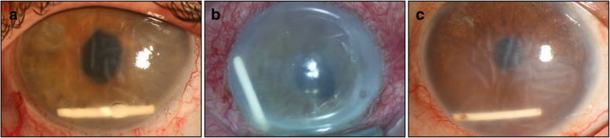
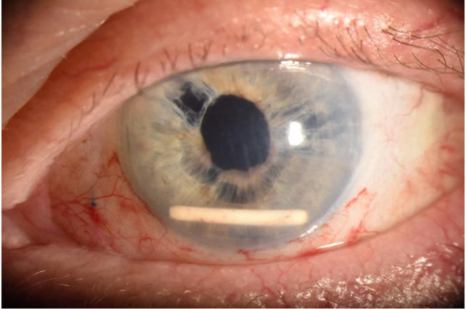
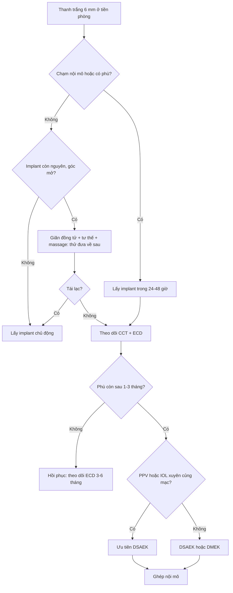
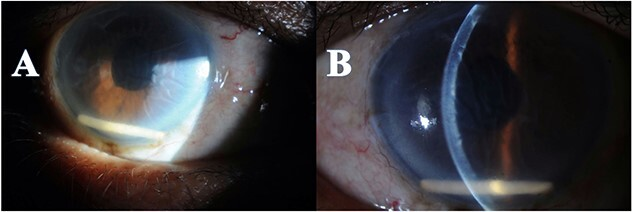
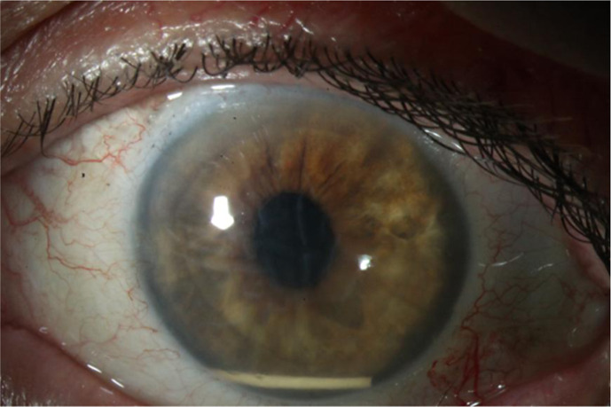

# 1428 — Phù giác mạc mất bù sau implant corticoid lạc vào tiền phòng / Corneal decompensation after anterior chamber migration of a dexamethasone implant

**Tags:** `pattern:phu-giac-mac` `pattern:vat-the-tien-phong` `pattern:nep-descemet` `pattern:mat-mot-ben` `pattern:giam-thi-luc-dot-ngot` `pattern:bong-bieu-mo` `vung:mat` `vung:giac-mac` `vung:tien-phong` `vung:goc-tien-phong` `vung:dich-kinh` `protocol:slit-lamp` `protocol:AS-OCT` `protocol:pachymetry` `protocol:specular-microscopy` `protocol:UBM` `protocol:B-scan` `protocol:OCT-hoang-diem` `score:ECD` `score:CCT` `incidentaloma:implant-lac`
**Mức chắc chắn (certainty):** tổng hợp y văn (literature synthesis) — 1 nghiên cứu đa trung tâm về **tỉ lệ lạc** (468 bệnh nhân), 1 tổng quan **59 bệnh nhân**, 1 loạt ca **32 ca** tập trung vào **tỉ lệ ghép giác mạc**, 2 ca nguyên văn có ảnh, và 2 nghiên cứu về **nội mô khi KHÔNG lạc**. Toàn bộ bằng chứng là **ca báo cáo/đoàn hệ hồi cứu**, không có RCT.

> **Vì sao bài này quan trọng:** đây là biến cố **hiếm nhưng để lại di chứng vĩnh viễn** của một thủ thuật được làm hằng ngày. Bệnh nhân đến với **mờ mắt không đau một bên, vài ngày đến vài tuần sau tiêm**; nếu bác sĩ không yêu cầu bệnh nhân **nhìn xuống và soi khe sáng vùng góc dưới**, tổn thương nội mô tiếp tục trong khi **giác mạc vẫn trong** — và khi đã phù rõ thì **37,5% phải ghép giác mạc**. Bài **1411** đã phủ **tăng nhãn áp do corticoid**; bài này phủ **tai biến cơ học** của cùng loại thuốc — hai biến cố hay đi cùng và **xử trí ngược nhau** (bài 1411: theo dõi/giảm liều; bài này: **lấy implant ngay**).

## 1. Tổng quan bệnh học – cơ chế hình ảnh

- **Vật thể gây bệnh:** implant dexamethasone (Ozurdex) = **0,7 mg dexamethasone** trong ma trận **PLGA** (acid poly-lactic-co-glycolic), kích thước **0,46 mm đường kính × 6 mm chiều dài**, đưa vào bằng kim **22 G**, nhả thuốc tới **6 tháng**, **tự tan** sau đó. Đây là một **thanh cứng**, không mềm như thuốc nước.
- **Vì sao nó đi ra trước — hai điều kiện phải cùng có:**
  1. **Có đường đi:** khuyết bao sau/bao trước, **đứt dây chằng Zinn (zonular dialysis)**, **mống mắt dựng (iris claw)**, **lỗ mống mắt/basal iridectomy**, **lỗ YAG**, hoặc **khoảng trống giữa mống mắt và mặt trước thấu kính nhân tạo**. Trong ca có implant **Carlevale** (IOL xuyên củng mạc thế hệ mới, đường kính 13,4 mm), tác giả giải thích chính **độ dày 0,46 mm** của implant "gần bằng một nửa khoảng trống quan sát được giữa đồng tử và mặt phẳng thấu kính" — nghĩa là IOL "chắn tốt hơn" vẫn **không đủ**.
  2. **Mất giá đỡ:** **cắt dịch kính (PPV)** làm dịch kính hóa lỏng, mất khung gel giữ implant → **dòng đối lưu + chuyển động mắt** đẩy implant về trước. Vì vậy **PPV là yếu tố nguy cơ mạnh nhất**, và **vô nhãn (aphakia)** là mức độ nặng nhất của "mất giá đỡ".
- **Tại sao nó nằm ở GÓC DƯỚI:** trong **thủy dịch** (nước), thanh PLGA **nặng hơn nước** → chìm xuống **6 giờ** của tiền phòng. Hệ quả thực hành: **phù giác mạc khu trú vùng dưới**, và **đo độ dày trung tâm (CCT) có thể bình thường** trong khi vùng dưới đã mất bù.
- **Tại sao giác mạc phù:** nội mô là **một lớp tế bào lục giác đơn**, bơm **Na⁺/K⁺-ATPase** hút nước ra khỏi mô đệm; người trưởng thành có **ECD ≈ 2.200–2.500 tế bào/mm²** và **giảm ~0,6%/năm**, **không tái sinh**. Thanh implant **cọ cơ học** vào nội mô → **chết tế bào tại chỗ** → vùng đó **mất bơm**, mô đệm **hydrat hóa** → **dày lên và tán xạ ánh sáng**. Trình tự hình ảnh: **nếp Descemet (striate keratopathy)** → **phù vi nang** → **bọng nước biểu mô (bullous keratopathy)**.
- **Vì sao trên khe sáng implant TRẮNG đục:** ma trận polymer và tinh thể dexamethasone có **chiết suất khác thủy dịch** → tán xạ mạnh; implant **không cản quang** nên **CT không thấy**, **MRI không có tín hiệu** — chẩn đoán **hoàn toàn bằng đèn khe**.
- **Vì sao phù có thể KHÔNG hồi phục dù đã lấy implant:** nội mô chết **không mọc lại**; các tế bào còn sống **to ra và di chuyển** bù (CV tăng, hexagonality giảm) nhưng **không đủ** khi mất quá nhiều. Vì vậy **thời gian từ khởi phát đến can thiệp** là biến số tiên lượng: trong loạt 32 ca, nhóm phải ghép giác mạc có **khoảng cách từ khởi phát triệu chứng đến mổ dài hơn có ý nghĩa (p = 0,007)**.
- **Số liệu định lượng cốt lõi:**
  - **Tỉ lệ lạc:** **1,6%** tính trên số lần tiêm ở **468 bệnh nhân** (đa trung tâm Pan-American); **mắt đã cắt dịch kính 4,8%** so với **1,6%** ở mắt không cắt dịch kính; liên quan **phẫu thuật đục thủy tinh thể (p = 0,043)** và **tình trạng IOL (p = 0,005)**, xu hướng với **cắt dịch kính (p = 0,057)**.
  - **Thời điểm phát hiện:** trung bình **19,4 ± 14,5 ngày** sau tiêm (32 ca); có ca **7 ngày** (Carlevale) và **8 ngày**; muộn hơn cũng gặp.
  - **Hậu quả:** tổng quan **59 bệnh nhân**: **98%** có ít nhất 1 yếu tố nguy cơ, **83%** có biến chứng nặng; loạt **32 ca**: **65,6%** phải lấy implant, **18,8%** đưa về dịch kính, **12,5%** theo dõi, **37,5% (12/32) phải ghép giác mạc**, **6,3%** phải ghép lần hai.
  - **Khi KHÔNG lạc, tổn thương nội mô rất nhẹ:** **22 mắt** tiêm Ozurdex vì tắc tĩnh mạch võng mạc: **ECD 2.211,7 ± 370,6 → 2.207,1 → 2.163,8 tế bào/mm²** lúc 3 tháng (**−2,2%**, p = 0,013 và p = 0,009), **CV và hexagonality không đổi**, **CCT 567,5 → 556,5 µm không đổi**. Kết luận: **thuốc trong dịch kính không phá nội mô; chỉ khi implant CHẠM nội mô mới phá**.
  - **Tăng nhãn áp là "đòn thứ hai":** cùng đoàn hệ trên, **IOP 14,73 → 17,05 mmHg** lúc 1 tháng (p = 0,002) và **17,15 mmHg** lúc 3 tháng (p = 0,003).
  - **Tín hiệu dược cảnh giác:** phân tích **1.588 báo cáo** FAERS 2010–2024 xác định **"corneal decompensation"** là biến cố **không có trên nhãn thuốc** (nhóm rối loạn mắt ROR **45,11**, PRR **23,71**).

## 2. Mẫu hình + chẩn đoán phân biệt theo vị trí (Gamut)

**Mẫu hình chốt:** *mắt một bên, đã mổ đục thủy tinh thể ± cắt dịch kính, mờ mắt không đau 1–4 tuần sau tiêm nội dịch kính → thấy **thanh trắng bo tròn hai đầu, dài ~6 mm, nằm ngang ở góc dưới tiền phòng**, kèm **phù giác mạc vùng dưới** và **nếp Descemet**.*

- **Theo vị trí implant (quyết định cách xử trí):**
  - **Góc dưới tiền phòng, chạm nội mô** — thể thường gặp nhất, **phải lấy sớm**.
  - **Tự do trước mống mắt / trong đồng tử** — có thể **đưa về sau** bằng giãn đồng tử + tư thế.
  - **Sau mống mắt / trong rãnh thể mi (sulcus)** — **không thấy trên đèn khe**, cần **UBM**; nguy cơ **teo mống mắt, dính**, và vẫn có thể gây viêm mạn.
  - **Trong bao túi (in-the-bag) hoặc trong buồng dịch kính** — chưa phải biến cố, nhưng là **nguồn dự trữ** cho lần lạc sau.
- **Gamut "thanh trắng trong tiền phòng":** implant dexamethasone; **mảnh thể thủy tinh/bao còn sót**; **vòng Soemmering**; **đầu ống dẫn lưu (tube shunt)**; **mảnh ống cannula/silicon**; **mảnh ghép nội mô DMEK bong**; **giọt dầu silicon** (không phải thanh); **dị vật nội nhãn**.
- **Gamut "phù giác mạc MỘT BÊN ở mắt đã mổ":** implant chạm nội mô; **mảnh thể thủy tinh còn sót**; **TASS (toxic anterior segment syndrome)**; **viêm nội mô do HSV/CMV**; **góc đóng cấp**; **tăng nhãn áp do corticoid**; **bong mảnh ghép DSAEK/DMEK**; **hội chứng UGH**; **thiếu nội mô do chấn thương mổ**.
- **Ba câu hỏi lâm sàng (thay cho mnemonic gượng):** (1) **Có tiêm nội dịch kính trong 4 tuần qua không?** (2) **Mắt có PPV/vô nhãn/khuyết bao–dây chằng không?** (3) **Có thanh trắng ở góc dưới, kèm nếp Descemet vùng dưới không?** — "có" cả 3 → **implant lạc** cho tới khi chứng minh ngược.

- Ảnh: 3 mắt sau tiêm Ozurdex, implant nằm ngang ở **6 giờ**, mức phù từ nhẹ (a) đến phù lan tỏa + nếp Descemet rõ (b, c). Nguồn *BMC Ophthalmol* 2019 (PMC6537356), **CC BY 4.0**.

## 3. Bảng so sánh phân biệt (ma trận đối chiếu)

| Thực thể (entity) | Hình ảnh điển hình | Chốt vào (rule-in) | Chốt loại (rule-out) | Gợi ý xác nhận |
|---|---|---|---|---|
| **Implant dexamethasone lạc tiền phòng** | **Thanh trắng 6 × 0,46 mm**, hai đầu bo tròn, nằm ngang **góc dưới**, **phù giác mạc vùng dưới + nếp Descemet**; đèn khe thấy **bóng đổ ra sau** | **Tiền sử tiêm Ozurdex ≤ 4 tuần** + **thanh trắng đúng kích thước** ở góc dưới + mắt **pseudophakic/PPV** | **Không có tiền sử tiêm**; thanh **dài ≠ 6 mm** hoặc **bờ nham nhở**; implant **còn nguyên trong dịch kính trên B-scan** | Đèn khe + **B-scan** (loại implant sau) + **AS-OCT** đo khoảng cách implant–nội mô |
| **Mảnh thể thủy tinh/bao sau còn sót** | Khối **trắng xốp, bờ nham nhở**, kích thước không đều, thường **dính mống mắt** hoặc ở **góc trên** | **Mổ đục thủy tinh thể gần đây**, mảnh **không đối xứng**, **không di động theo tư thế** | **Hình que đều, bo tròn, đúng 6 mm**, di động khi nghiêng đầu → loại | Soi kỹ bờ; **không** chọc hút mù |
| **Vòng Soemmering** | **Vòng trắng sau mống mắt**, trung tâm, **cố định**, thấy rõ khi giãn đồng tử | **Vòng liên tục** sau mống mắt, không ở góc, không di động | Nằm **góc dưới**, **hình thanh rời** → loại | Giãn đồng tử + chụp **retroillumination** |
| **Đầu ống dẫn lưu (tube shunt)** | Ống **trong mờ**, **cố định**, chạy từ góc **trên–thái dương** về **van dưới kết mạc**; có **bóng khí/van** | Thấy **đường ống liên tục ra sau kết mạc**; tiền sử đặt van | **Không nối với kết mạc**, đầu **bo tròn tự do** → loại | Đèn khe + **UBM** dọc đường ống |
| **Mảnh ống cannula/silicon** | Mảnh **nhựa trong**, bờ **sắc cạnh**, thường ở **góc phụ thuộc** | Tiền sử **mổ nội nhãn ngay trước đó**, mảnh **không đều**, có thể **nhọn** | Bờ **bo tròn đều**, đúng kích thước implant → loại | Đèn khe; ghi nhận vật liệu dùng trong mổ |
| **Mảnh ghép DMEK bong** | **Mảnh mờ hình đĩa**, **mép cuộn**, nằm **sát nội mô** sau ghép | Tiền sử **DMEK/DSAEK**, mảnh **hình đĩa**, **không phải thanh** | **Hình thanh 6 mm** → loại | **AS-OCT** thấy mảnh ghép tách khỏi mặt sau giác mạc |
| **Giọt dầu silicon** | **Hình cầu trong suốt**, khúc xạ, **không trắng đục**; thường nổi ở **góc trên** | Tiền sử **bơm dầu**, thấy **mặt phân cách dầu–nước** | **Thanh trắng đục** → loại | Đèn khe; **không** nhầm với implant |
| **Phù giác mạc do nguyên nhân khác** | Phù **lan tỏa** hoặc **khu trú**, **không có thanh lạ** | **Không vật thể**; có **nguyên nhân riêng** (HSV: giảm cảm giác + tế bào; góc đóng: tiền phòng nông; TASS: 24–48 giờ sau mổ) | **Thấy thanh trắng ở góc dưới** → loại | Đèn khe, **soi góc**, PCR dịch tiền phòng khi nghi nhiễm |

- Ảnh minh họa vị trí: implant nằm ngang ở góc dưới, phía trên là **gai IOL xuyên củng mạc (intrascleral haptic)** — bẫy điển hình: gai IOL cũng là "đường trắng" và dễ bị nhầm.

- Ảnh: *Int Med Case Rep J* 2021 (PMC8458021), **CC BY-NC 4.0** — chỉ dùng phi thương mại, nguyên bản.

## 4. Protocol chụp + hệ phân độ/điểm chuẩn hóa

**Chẩn đoán (làm ngay, không cần chờ):**
- **Đèn khe (slit-lamp):** soi **góc dưới** ở **tư thế bệnh nhân nhìn xuống**, dùng **khe sáng mỏng quét từ trên xuống**; đánh giá (1) vị trí implant, (2) **có chạm nội mô không**, (3) **nếp Descemet**, (4) **tế bào/flare**, (5) **IOP**.
- **AS-OCT (anterior segment OCT):** đo **CCT** và **khoảng cách implant–nội mô**; implant là **thanh tăng phản xạ có bóng đổ phía sau**; theo dõi được **kể cả khi giác mạc đục** (khác soi nội mô).
- **Siêu âm B-scan:** xác nhận **đã hết implant trong buồng dịch kính** (bắt buộc trước khi kết luận "đã lấy hết").
- **UBM (35–50 MHz):** khi **không thấy implant ở tiền phòng** nhưng bệnh cảnh gợi ý → tìm ở **rãnh thể mi/sau mống mắt**.
- **Soi nội mô (specular microscopy):** chỉ làm được khi giác mạc **còn trong**; cho **ECD, CV, % lục giác**. Khi đã phù, **không đáng tin** — đừng dùng để quyết định.
- **OCT hoàng điểm:** loại **phù hoàng điểm tái phát** (lý do tiêm) và **bong võng mạc**.

**Ngưỡng định lượng dùng trong theo dõi (kinh điển, không phải thang riêng của biến cố này):**
- **CCT bình thường 540 ± 30 µm**; **CCT > 700 µm** = phù nặng, nguy cơ **bọng nước**; ca Carlevale: **655 µm** kèm **thị lực 20/400**.
- **ECD:** mất **> 50%** hoặc **ECD < 500–1.000 tế bào/mm²** → **không còn dự trữ**, phù sẽ **không hồi phục** dù lấy implant.
- **Đánh giá mức độ (mô tả, không có thang được xác nhận riêng):** *nhẹ* = nếp Descemet, CCT < 600 µm; *trung bình* = phù vi nang, CCT 600–700 µm; *nặng* = phù đại thể/bọng nước, CCT > 700 µm.

**Xử trí (thuật toán):**

- **Lấy implant — kỹ thuật:** paracentesis **1 mm** ở **rìa giác mạc**, bơm **viscoelastic** để **tách implant khỏi nội mô và bảo vệ nội mô**, rồi hút bằng **catheter 20 G gắn bơm 3 mL** hoặc **forceps** — mục tiêu **lấy nguyên khối**, không làm vỡ (mảnh PLGA gây viêm mạn). Trong ca Carlevale, **viscoelastic + catheter 20 G** lấy được **một mảnh**; thị lực **20/400 → 20/100 sau 7 ngày → 20/32 sau 1 tháng**, **CCT 655 → 560 µm**.
- **Đưa về sau không mổ:** giãn đồng tử + **tư thế đầu thấp (reverse Trendelenburg)** + **massage nhẹ** — thành công **14%** trong tổng quan 59 ca; **3/32 ca tái lạc** sau khi đưa về sau → phải theo dõi tiếp.
- **Theo dõi để implant tự tan:** **4 ca** trong loạt 32; **2 ca vẫn phải ghép giác mạc** → **không phải lựa chọn an toàn** khi đã có phù/chạm nội mô.
- **Ghép giác mạc:** **DSAEK** (mảnh dày hơn, dễ thao tác) thường được chọn ở mắt **đã PPV / IOL xuyên củng mạc** vì mất **phản áp của mống mắt–thể thủy tinh** làm mở và định vị mảnh ghép khó — nhiều phẫu thuật viên **chuyển sang DSAEK** đúng vì lý do này; **DMEK** cho thị lực tốt hơn và vẫn làm được ở mắt đã cắt dịch kính bằng **kỹ thuật áp lực liên tục từ ngoài**, nhưng **rebubble 37,5% (3/8)**; ngoài ra **IOL xuyên củng mạc** làm **khí dễ đi ra dịch kính sau**, là **nguyên nhân quan trọng của bong mảnh ghép**; **PKP** chỉ khi **sẹo đậm/loạn dưỡng nặng**. Ở mắt có van lọc (Ahmed), sống mảnh ghép **1 năm 87% (DSAEK) vs 91% (DMEK)**, **2 năm 78% vs 74%** — **tương đương**.
- **Mốc thời gian:** quyết định ghép trong loạt 32 ca được đưa ra **1–16 tháng** sau xử trí implant; **không hứa hồi phục** trước **3 tháng** vì nội mô còn đang bù.

## 5. Biến thể bình thường và cạm bẫy

- **"Giác mạc còn trong" KHÔNG loại trừ tổn thương nội mô:** ECD dự trữ cho phép bù trong nhiều tuần; **nếp Descemet là dấu hiệu sớm nhất**, xuất hiện trước khi CCT tăng rõ.
- **Chỉ đo CCT trung tâm:** implant nằm **6 giờ** → phù **khu trú vùng dưới**; đo trung tâm có thể **bình thường**. Phải soi **toàn bộ giác mạc**, chụp **bản đồ độ dày** nếu có.
- **Nhầm "đường trắng":** **gai IOL xuyên củng mạc**, **cạnh IOL**, **đầu ống dẫn lưu**, **vòng Soemmering** đều trắng. Phân biệt bằng **kích thước (6 mm)**, **độ bo tròn đầu**, **vị trí góc dưới**, và **tiền sử tiêm**.
- **Implant có thể nằm SAU mống mắt:** không thấy trên đèn khe, bệnh nhân vẫn đau/viêm → **UBM** là bắt buộc khi nghi.
- **Chỉ 3/32 bệnh nhân tự thấy "đường trắng"** khi soi gương → **không thể dựa vào triệu chứng của bệnh nhân**; phải **dặn trước** và hẹn khám sớm.
- **Sau khi đưa implant về sau vẫn có thể tái lạc (3/32)** — hẹn khám lại **1 tuần**, **1 tháng**; dặn bệnh nhân quay lại ngay nếu mờ lại.
- **Implant tự tan trong tiền phòng không đồng nghĩa lành:** 2/4 ca theo dõi vẫn phải ghép.
- **Bẫy "thỏa mãn tìm kiếm":** đã thấy implant là dừng — **bỏ sót** tăng nhãn áp do corticoid, **bong võng mạc**, **phù hoàng điểm tái phát**, hoặc **viêm nội nhãn** (cùng mắt, cùng thời điểm).
- **Không chọc hút bằng kim nhỏ xuyên giác mạc trung tâm:** thêm tổn thương nội mô và nguy cơ làm vỡ implant; dùng **đường rìa + viscoelastic**.
- **CT/MRI không giúp:** implant không cản quang, không có tín hiệu — đừng đặt bệnh nhân vào máy để "tìm dị vật".

## 6. Tự lượng giá — Blind Quiz ngay trên trang tĩnh

**Ca 1 — nam 66 tuổi, mờ mắt phải 2 tuần sau tiêm**

- **Bối cảnh:** mắt phải đã **phaco + IOL xuyên củng mạc** (do IOL lệch sau chấn thương); 7 tháng sau mổ xuất hiện **phù hoàng điểm** (độ dày trung tâm **856 µm**) → tiêm **Ozurdex**. Hai tuần sau: **mờ mắt không đau**, thấy **"vật trắng sau giác mạc"**.
- **Câu hỏi:** (1) Dấu hiệu chính ở tiền phòng và giác mạc? (2) Ba chẩn đoán phân biệt? (3) Dấu hiệu nào **chốt** chẩn đoán?

<b>Bấm để hiện đáp án (findings + chẩn đoán)</b>

- **Dấu hiệu:** **thanh trắng 6 mm, hai đầu bo tròn, nằm ngang ở 6 giờ tiền phòng** (A); **khe sáng** cho thấy **nếp Descemet** và **phù mô đệm** (B); **B-scan không còn implant trong buồng dịch kính**.
- **Chẩn đoán:** **implant dexamethasone lạc tiền phòng**, biến chứng của tiêm nội dịch kính ở mắt **đã cắt dịch kính + IOL xuyên củng mạc** (mất giá đỡ dịch kính + khoảng trống quanh IOL).
- **Xử trí trong ca:** **nằm ngửa + liệt điều tiết (cycloplegic)** → implant **tự về sau**, **không phải mổ**; đây là **ngoại lệ**, không phải chuẩn — nếu **chạm nội mô/phù** thì **lấy ngay**.
- **Nguồn ảnh:** *J Surg Case Rep* 2024 (PMC10924725), **CC BY 4.0**.

**Ca 2 — nam 74 tuổi, 31 lần tiêm Ozurdex, mờ mắt 7 ngày sau mũi 32**

- **Bối cảnh:** phù hoàng điểm do tắc tĩnh mạch võng mạc, tiêm mỗi 4 tháng; sau mũi 31 **IOL lệch vào dịch kính** → **cắt dịch kính 25 G + IOL Carlevale**; 1 tháng sau tiêm lại; **7 ngày sau: thị lực 20/400, IOP 9 mmHg, CCT 655 µm**.
- **Câu hỏi:** (1) Vì sao IOL "chắn tốt hơn" vẫn để implant đi qua? (2) Có nên theo dõi? (3) Nếu phù không hết, chọn ghép gì và vì sao?

<b>Bấm để hiện đáp án (findings + chẩn đoán)</b>

- **Dấu hiệu:** implant ở **góc dưới**, **phù giác mạc + nếp Descemet**; **CCT 655 µm**; **ME đã hết**.
- **Vì sao vẫn lạc:** **độ dày implant 0,46 mm** gần bằng **một nửa khoảng trống giữa đồng tử và mặt phẳng IOL** → Carlevale (13,4 mm) chỉ **giảm**, không **loại** đường đi; mắt đã **PPV** nên mất giá đỡ.
- **Xử trí:** **lấy implant ngày hôm sau** bằng **viscoelastic + catheter 20 G**; **7 ngày: 20/100**, **1 tháng: 20/32, CCT 560 µm**, nếp Descemet hết.
- **Nếu phù dai dẳng:** **DSAEK** (mảnh dày, dễ thao tác khi mất phản áp mống mắt–thể thủy tinh) hợp hơn **DMEK** ở mắt **PPV + IOL xuyên củng mạc**; **DMEK** vẫn làm được nhưng **nguy cơ khí ra dịch kính → bong mảnh ghép** cao hơn.
- **Nguồn ảnh:** *Case Rep Ophthalmol* 2026 (PMC12851610), **CC BY-NC 4.0** — phi thương mại, nguyên bản.

**Ca 3 — câu hỏi quyết định (không cần ảnh)**

- **Bối cảnh:** bệnh nhân đã **lấy implant 6 tuần**, **CCT còn 640 µm**, **giác mạc phù nhẹ**, **không đau**, **ECD đo được 700 tế bào/mm²**.
- **Câu hỏi:** Theo dõi thêm hay **ghép nội mô**? Vì sao?

<b>Bấm để hiện đáp án</b>

- **Ghép nội mô (DSAEK/DMEK)** là hợp lý: **ECD 700 tế bào/mm²** nằm trong vùng **mất dự trữ (< 1.000)**, phù **đã kéo dài 6 tuần**; nội mô **không tái sinh** nên chờ thêm **không tạo thêm tế bào**. Trong loạt 32 ca, quyết định ghép được đưa ra **1–16 tháng** sau xử trí — nghĩa là **theo dõi có giới hạn**, không chờ vô hạn.
- **Phản biện:** nếu **giác mạc còn trong và CCT < 600 µm**, có thể theo dõi **3 tháng** vì một số mắt **hồi phục một phần**; nhưng **ECD < 1.000** là dấu hiệu **không còn khả năng bù**.

## Bài liên quan chéo
- [1411 – Tăng nhãn áp do corticoid nội nhãn](../1411-tang-nhan-ap-do-corticoid-noi-nhan/lesson.md) — **cùng thuốc, biến cố khác**: theo dõi IOP, không lấy implant.
- [1410 – Lấy dầu silicone và dầu tồn lưu](../1410-lay-dau-silicone-va-dau-ton-luu/lesson.md) — **vật liệu nội nhãn** và biến chứng cơ học trên giác mạc.
- [442 – Đánh giá glôcôm bằng OCT](../442-glaucoma-OCT/lesson.md) — kỹ thuật **AS-OCT** dùng cho đo độ dày giác mạc/góc.
- [1437 – Viêm màng bồ đào do ICI](../1437-viem-mang-bo-dao-do-uc-che-diem-kiem-mien-dich/lesson.md), [1438 – Viêm màng bồ đào giao cảm](../1438-viem-mang-bo-dao-giao-cam/lesson.md) — **viêm nội nhãn vô khuẩn** sau can thiệp nội nhãn.

## Ảnh
- `images/1428_phu-giac-mac-implant_AnteriorSegment3-cases_PMC6537356-Fig1-CCBY.jpg` — 3 mắt, ba mức phù, **CC BY 4.0**.
- `images/1428_phu-giac-mac-implant_AnteriorSegment_PMC8458021-Fig1-CCBYNC.jpg` — implant + gai IOL, **CC BY-NC 4.0**.
- `images/1428_phu-giac-mac-implant_AnteriorSegment_PMC10924725-Fig2-CCBY.jpg` — quiz ca 1, **CC BY 4.0**.
- `images/1428_phu-giac-mac-implant_AnteriorSegment_PMC12851610-Fig2-CCBYNC.jpg` — quiz ca 2, **CC BY-NC 4.0**.
- Chi tiết nguồn/giấy phép từng ảnh: `images/CREDITS.md`.

> Không dùng để chẩn đoán độc lập khi chưa có người hướng dẫn.
