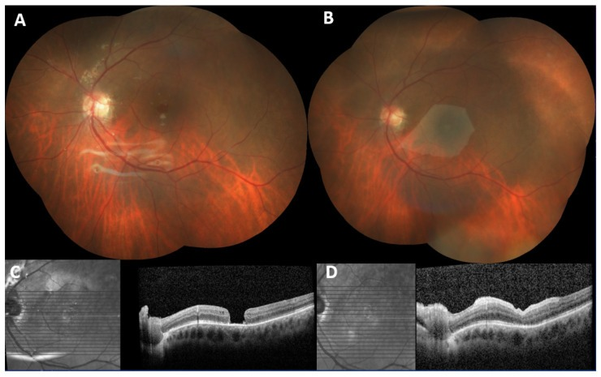
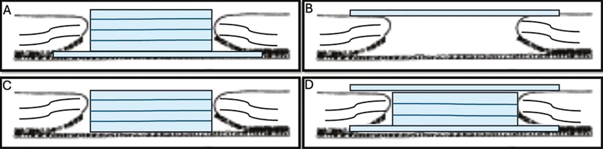
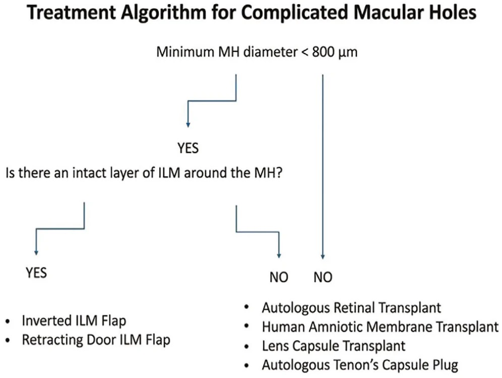
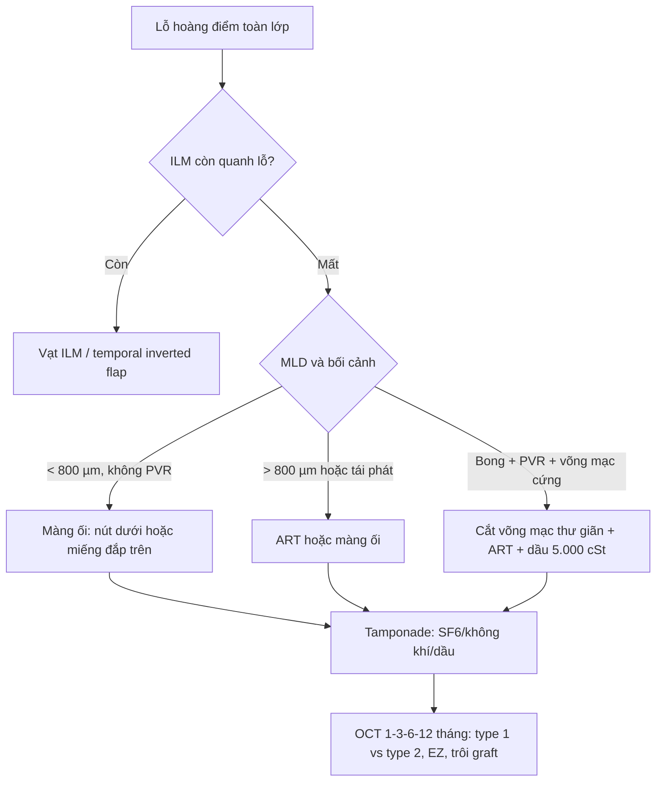
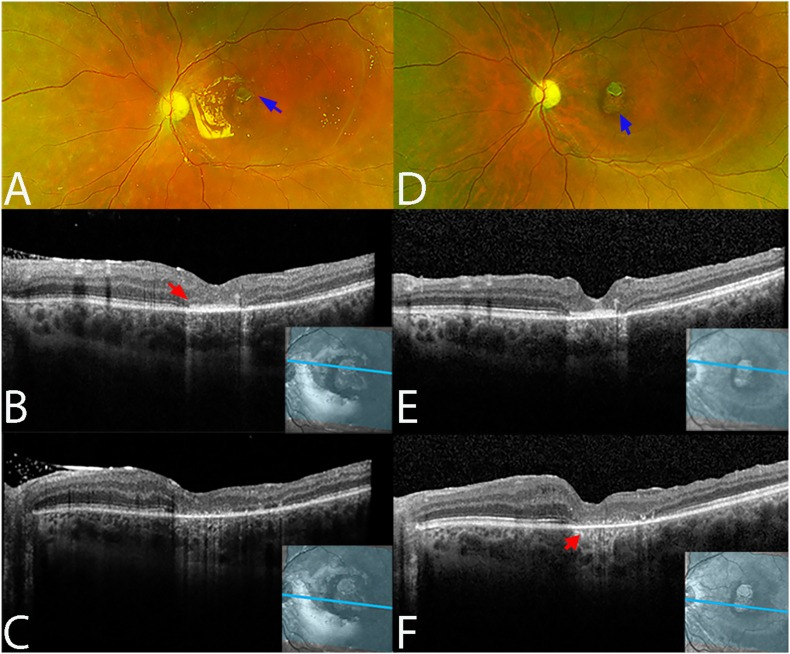
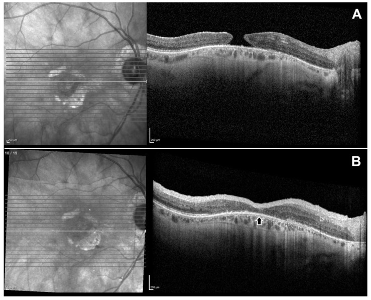
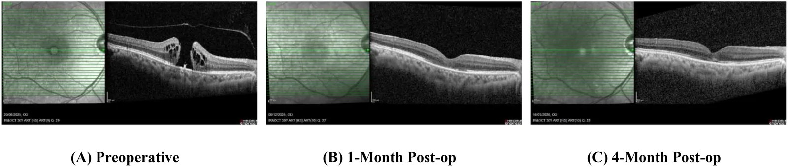

# 1429 — Lỗ hoàng điểm thứ phát sau mổ ROP/bong võng mạc phức tạp: màng ối & vật liệu sinh học bịt lỗ / Secondary macular hole: amniotic membrane and biologic scaffolds

**Tags:** `pattern:lo-hoang-diem` `pattern:lo-hoang-diem-thu-phat` `pattern:bung-teo-vong-mac` `pattern:thieu-ILM` `pattern:co-keo-sau-cuc` `vung:hoang-diem` `vung:vong-mac` `vung:dich-kinh` `protocol:OCT` `protocol:PPV` `protocol:ILM-peel` `protocol:manh-oi` `protocol:dau-silicone` `score:Gass` `score:CLOSE`

**Mức chắc chắn (certainty):** tổng hợp y văn (literature synthesis) — số liệu lấy từ 1 tổng quan hệ thống **18 nghiên cứu/221 mắt** dùng màng ối (human amniotic membrane, hAM), 1 loạt **10 mắt** màng ối đặt trên võng mạc (epiretinal), 1 ca đầu tay dùng hydrogel màng ối bơm, 1 ca nhi, 1 loạt **3 ca** cắt võng mạc thư giãn + ghép võng mạc tự thân, và 1 bài tổng quan kỹ thuật. **Không có RCT** so sánh trực tiếp màng ối với ghép võng mạc tự thân (autologous retinal transplant, ART) hay vạt ILM; phần chọn kỹ thuật là tổng hợp có suy luận, đã ghi rõ. Ca ROP cụ thể lấy từ bài **1415** (2 mắt lỗ hoàng điểm thứ phát trong 15 mắt bong võng mạc muộn sau ROP).

> **Vì sao bài này quan trọng:** bài **1415** vừa chốt rằng mắt ROP “đã hồi phục” vẫn có thể bong muộn và **2/15 mắt (13%)** bong tái phát vì **lỗ hoàng điểm thứ phát**, được xử lý bằng màng ối — nhưng chỉ ở mức một hàng ma trận. Khi lỗ hoàng điểm xuất hiện trên mắt **đã mất ILM, đã bơm dầu, có co kéo sau cực**, kỹ thuật chuẩn (bóc ILM + vạt ILM) **không còn áp dụng được**: đây là lúc phải chọn giữa **màng ối, ghép võng mạc tự thân, cắt võng mạc thư giãn** hoặc chấp nhận theo dõi. Chọn sai dẫn tới **mổ lần 3–4, dầu tồn lưu, teo nhãn cầu**; chọn đúng thì **91–100% lỗ đóng** nhưng **chỉ 66% cải thiện thị lực** — con số này phải nói trước với gia đình.

## 1. Tổng quan bệnh học – cơ chế hình ảnh – vì sao “đã mổ bong võng mạc” lại sinh lỗ hoàng điểm

- **Tần suất:** lỗ hoàng điểm (macular hole, MH) xuất hiện sau bong võng mạc có lỗ (rhegmatogenous retinal detachment, RRD) ở **1–3%** ca; tỷ lệ tăng khi có **tăng sinh thể kính–võng mạc (proliferative vitreoretinopathy, PVR)** — PVR là yếu tố nguy cơ được ghi nhận rõ. Trong loạt **15 mắt** bong muộn sau bệnh võng mạc sinh non (retinopathy of prematurity, ROP) đã hồi phục, **2 mắt (13%)** bong tái phát do **lỗ hoàng điểm thứ phát** sau khi đã áp võng mạc; cả 15 mắt đều được **cắt dịch kính + dầu silicone**.
- **Vì sao lỗ hình thành:** hoàng điểm là điểm mỏng nhất của võng mạc (**~0,25 mm** ở hố trung tâm) và **không có mạch máu**. Sau bong, lớp photoreceptor mất dinh dưỡng, lớp sợi thần kinh và màng giới hạn trong (internal limiting membrane, ILM) bị co kéo; khi võng mạc áp lại, vùng hoàng điểm có thể **teo, mỏng, dính chắc vào dịch kính còn sót** — một lực nhỏ cũng đủ xé thủng. Ở mắt ROP, thêm **võng mạc ngoại vi không có mạch (persistent avascular retina)** và nhãn cầu dài ra theo tuổi, tạo lực căng ly tâm mạn tính.
- **Vì sao mổ chuẩn thất bại:** kỹ thuật kinh điển là **bóc ILM + vạt ILM + khí**. Nhưng ở mắt đã mổ bong võng mạc/ROP, **ILM đã bị bóc gần hết** — không còn “vật liệu” để làm vạt; bờ lỗ **teo, cứng, thiếu biểu mô sắc tố (RPE) lành**, nên mép không thể trượt vào giữa. Bài tổng quan kỹ thuật ghi rõ: vạt ILM **không thể dùng khi ILM đã bị lấy hoàn toàn**; tỷ lệ phải mổ lại sau thất bại vạt ILM chỉ **4–5%**, nhưng khi đã thất bại thì phải chuyển sang vật liệu khác.
- **Vì sao màng ối thay được ILM:** hAM là lớp trong cùng của màng thai, gồm **1 lớp biểu mô + màng đáy dày + chất nền không mạch**. Màng đáy chứa **collagen IV/VII, laminin, fibronectin** — đúng thành phần ILM; chất nền tiết **EGF, bFGF** kích thích biểu mô và tế bào Müller; hAM **ức chế TGF-β** (giảm xơ hóa, giảm co kéo) và có **IL-1 receptor antagonist** (giảm viêm). hAM **không biểu hiện kháng nguyên HLA** nên ít bị thải. Vì vậy hAM vừa là **giá đỡ** cho tế bào trượt vào, vừa là **nút bịt cơ học** chặn dịch đi qua lỗ.
- **Vì sao thấy được trên OCT:** hAM là **mô collagen không mạch**, phản xạ cao hơn võng mạc thần kinh và **không có tín hiệu mạch máu**. Trên OCT, graft là **dải tăng phản xạ** nằm dưới hoặc trên võng mạc, hòa vào bờ lỗ; khi lỗ đóng, đường viền hoàng điểm được tái lập nhưng **lớp ellipsoid zone (EZ) thường khuyết** vì photoreceptor đã mất. Vì vậy **“đóng” trên OCT không đồng nghĩa “nhìn thấy”**.
- **Ngưỡng định lượng nằm lòng:**
  - **Kích thước lỗ:** đường kính tối thiểu (minimum linear diameter, MLD) **> 400 µm** = lỗ lớn; **≥ 535 µm** = X-large theo CLOSE; **800 < MLD ≤ 1.000 µm** = XX-large; **> 1.000 µm** = giant. Loạt màng ối epiretinal có **MLD 715 ± 212 µm**, đường kính đáy **1.114 ± 258 µm** — tức toàn lỗ rất lớn.
  - **Kết quả màng ối (gộp):** **18 nghiên cứu/221 mắt**, đóng lỗ chung **93% (206/221)**; **lỗ tái phát/không đóng sau mổ: 91% (163 mắt)**; **lỗ kèm bong võng mạc: 95% (42 mắt)**; **lỗ lớn: 100% (17 mắt)**; **cận thị nặng: 92% (96 mắt)**. Cải thiện thị lực: **66%** ở nhóm tái phát/không đóng, **93%** ở nhóm lỗ kèm bong võng mạc.
  - **Biến chứng gộp:** chỉ **7 ca** trong 221 mắt — **rách võng mạc ngoại vi 1**, **teo toàn lớp 1**, **tân mạch hắc mạc 1**, **phù hoàng điểm dạng nang 2**, **dầu silicone dưới võng mạc 1**.
  - **Loạt epiretinal 10 mắt:** đóng **100%**; **70%** có sắp xếp lại lớp trong/ngoài; logMAR **1,60 ± 0,37 → 1,00 ± 0,45** (p < 0,001); theo dõi **7 tháng (3–14)**; **không** trôi graft, không thải.
  - **Hydrogel màng ối bơm (ca đầu tay):** lỗ **572 µm** (Gass 4); đóng type 1 sau **1 tháng**; thị lực **20/200 → 20/80 (1 tháng) → 20/40+1 (4 tháng)**; mfERG ring 1 **34,19 nV/deg²**, N1 **40,2 ms** (bình thường 36,8–46,4 ms).
  - **Màng ối ở trẻ:** ca lỗ hoàng điểm mạn tính, graft **nhét dưới võng mạc**, dầu silicone; thị lực cuối **20/70**, graft tích hợp, **lớp ngoài võng mạc còn khuyết**.

## 2. Mẫu hình + chẩn đoán phân biệt theo bối cảnh (Gamut)

Bốn câu hỏi trước khi mổ: **(1) lỗ thật hay giả? (2) ILM còn hay đã mất? (3) có bong võng mạc/PVR/co kéo không? (4) mắt đang có dầu, khí hay không?**

- **Nhóm A — lỗ thứ phát sau bong võng mạc/ROP (bài này):** lỗ trung tâm, bờ **teo và dày**, thường **không còn ILM**, có **dầu silicone** và/hoặc **đai củng mạc**; bong có thể đã áp nhưng lỗ vẫn mở. Đây là nhóm **không thể vạt ILM**.
- **Nhóm B — lỗ tái phát sau bóc ILM:** lỗ không đóng sau mổ đầu, bờ **tròn, cứng, mất ILM**, không co kéo nặng; màng ối hoặc ART là lựa chọn.
- **Nhóm C — lỗ lớn nguyên phát:** MLD **> 800 µm**, bờ mỏng nhưng còn ILM; có thể vạt ILM hoặc màng ối/ART.
- **Nhóm D — lỗ + bong võng mạc/PVR:** có **màng co kéo, dây xơ, võng mạc cứng**; cần **cắt võng mạc thư giãn (relaxing retinectomy)** ± ghép võng mạc tự thân; màng ối đơn thuần không giải quyết lực co.
- **Nhóm E — lỗ do chấn thương:** bờ **rách, phù, có thể kèm bong hắc mạc/vỡ nhãn cầu**; chờ vết thương ổn định, thường cần màng ối/ART.
- **Nhóm F — lỗ do cận thị nặng/staphyloma:** **cầu sau lồi, võng mạc mỏng, axial length > 26,5 mm**; màng ối/ART, kết quả kém hơn.
- **Nhóm G — lỗ do macular telangiectasia type 2:** lỗ **kèm mạch máu bất thường, sắc tố, màng neovascular**; cần OCT-A/FA trước khi can thiệp.
- **Nhóm H — bắt chước (không phải lỗ thật):** **pseudohole do màng trước võng mạc (ERM)** — OCT có **lõm nhưng võng mạc ngoài còn liên tục**; **lamellar hole** — khuyết một phần, không thủng; **nang hoàng điểm** — thành nang, không mất mô trung tâm. Nhóm này **không mổ**.

*Ca lỗ hoàng điểm không đóng sau mổ bong võng mạc + dầu silicone. (A) Đáy mắt trước mổ: võng mạc áp, còn dầu trong dịch kính, lỗ hoàng điểm lớn. (B) Sau mổ: **mảng màng ối lớn** phủ hoàng điểm. (C) OCT trước mổ: lỗ toàn lớp, bờ teo. (D) OCT sau 2 tháng: **lỗ đóng hoàn toàn**, graft tích hợp, các lớp trong/ngoài sắp xếp lại. Nguồn: Doguizi S et al., J Clin Med 2026 (PMC12942158) Fig. 2, **CC BY 4.0**.*

## 3. Bảng so sánh phân biệt (ma trận đối chiếu)

| Thực thể (entity) | Hình ảnh điển hình (OCT/đáy mắt) | Chốt vào (rule-in) | Chốt loại (rule-out) | Gợi ý xác nhận |
|---|---|---|---|---|
| **Màng ối — nút dưới võng mạc (subretinal hAM plug)** | Graft tăng phản xạ **nằm dưới bờ lỗ**, lấp kín defect; bờ lỗ áp vào graft | **Lỗ toàn lớp, ILM đã mất, MLD ≥ 400–700 µm**; đóng **91%** ở lỗ tái phát và **95%** ở lỗ kèm bong | **Võng mạc còn ILM tốt + lỗ < 400 µm** → vạt ILM đơn giản hơn; **nhiễm trùng/thiếu máu võng mạc** → không đặt graft | OCT qua trung tâm; đo MLD/đường kính đáy; kiểm tra ILM 360° |
| **Màng ối — miếng đắp trên võng mạc (epiretinal hAM patch)** | **Mảng tăng phản xạ phủ mặt trong hoàng điểm**, bờ lỗ áp lại; graft có thể thấy rõ nhiều tháng | **ILM đã mất, lỗ lớn, bờ teo**, cần che phủ rộng; đóng **100% (10/10)**, logMAR **1,60 → 1,00** | **Có màng co kéo/PVR dày** → cần cắt màng/thư giãn trước; **lỗ nhỏ còn ILM** → không cần | OCT mặt cắt + en face; chụp lại 1–3–6 tháng |
| **Vạt ILM (inverted ILM flap)** | Vạt ILM phủ lỗ, tăng phản xạ nông; lỗ đóng **> 90%** ở lỗ đơn giản | **Còn ILM quanh lỗ**, MLD **< 800 µm**, không có PVR | **ILM đã bóc hoàn toàn** → không thể làm vạt (đây là lý do chính thất bại ở mắt đã mổ) | Bóc ILM xanh; OCT trước mổ xác nhận ILM còn |
| **Ghép võng mạc tự thân (ART)** | Miếng võng mạc toàn lớp **dày, tăng phản xạ**, lấp lỗ; donor site ở ngoại vi | **Lỗ XXL/giant (> 800–1.000 µm)**, lỗ tái phát, **lỗ + bong võng mạc**; đóng **91% nguyên phát, 93% tái phát, 88% kèm bong** | **Bệnh võng mạc thiếu máu/tân mạch/viêm**, **sẹo hắc mạc lan rộng** (không đủ mô cho) | OCT; siêu âm B-scan nếu không thấy đáy; theo dõi donor site |
| **Cắt võng mạc thư giãn + ART** | Võng mạc được cắt bớt hình vòng cung, graft từ mép cắt **nhét vào lỗ**; dầu 5.000 cSt | **Bong phức tạp + PVR + lỗ hoàng điểm**, võng mạc cứng/co ngắn; **3/3 ca** đóng lỗ + áp võng mạc | **Võng mạc áp, bờ lỗ di động, không PVR** → màng ối/ART đơn thuần | OCT + B-scan; đánh giá PVR trước mổ; theo dõi áp võng mạc |
| **Vật liệu khác: vỏ thể thủy tinh, bao Tenon, lenticule giác mạc** | Mô tự thân tăng phản xạ trong lỗ; kỹ thuật mới, loạt nhỏ | **Không có màng ối**, lỗ tái phát, cần vật liệu thay thế | **Chưa có bằng chứng so sánh**; không dùng khi nhiễm trùng/thiếu mô | OCT; chỉ trong nghiên cứu/kinh nghiệm |
| **Theo dõi (không mổ)** | Lỗ toàn lớp nhưng **không có triệu chứng, mắt không còn khả năng thị lực**, hoặc lỗ đã đóng type 2 | **Bệnh nhân lớn tuổi, mắt độc nhất kém, không còn chỉ định chức năng** | **Lỗ mới, thị lực còn, mắt còn tiềm năng** → can thiệp | OCT 3–6 tháng; hỏi triệu chứng |

*Sơ đồ mặt cắt: (A) nút màng ối **dưới võng mạc**; (B) **miếng đắp trên võng mạc**; (C) nút **không xuống dưới võng mạc**; (D) kỹ thuật **hai lớp**. Chọn kiểu nào phụ thuộc độ lớn lỗ, độ dày bờ và khả năng tiếp cận dưới võng mạc. Nguồn: Avcı R et al., Turk J Ophthalmol 2026 (PMC13514483) Fig. 4, **CC BY-NC-ND 4.0 — nguyên bản, không crop/ghép**.*

## 4. Protocol: chọn bệnh nhân, kỹ thuật, tamponade và theo dõi

**Trước mổ (bắt buộc):**
- **SD-OCT hoàng điểm** (61 lát, khoảng cách 120 µm + 6 lát xuyên tâm): đo **MLD**, **đường kính đáy**, chiều cao lỗ, độ dày bờ, **EZ/ELM còn hay mất**, **ILM còn quanh lỗ hay không**.
- **Đáy mắt góc rộng (UWF) + B-scan** nếu không thấy đáy: tìm **bong võng mạc, PVR, dầu, đai củng mạc, lỗ ngoại vi**.
- **Sinh trắc trục nhãn cầu (axial length)** nếu cận thị; **nhãn áp**; đánh giá **tình trạng dầu** (nhũ tương, thiếu thể tích).
- **Đồng thuận trước mổ:** nói rõ **đóng lỗ 91–100% nhưng cải thiện thị lực chỉ ~66%** ở lỗ tái phát; **có thể cần 2–3 lần mổ**; **dầu có thể phải giữ**.

**Kỹ thuật (tóm tắt thực hành):**
1. **25G PPV** (hoặc 23G), lấy **dầu silicone** nếu đang có và cần thao tác; bóc **ERM/PVR** triệt để, cắt dây co kéo.
2. **Xác nhận ILM:** nếu còn ILM quanh lỗ → cân nhắc **vạt ILM**; nếu **ILM đã mất** → chuyển **màng ối/ART**.
3. **Màng ối:** cắt miếng **1–3 mm** (lớn hơn lỗ ~1–2 mm mỗi bên); phân biệt mặt **stroma dính** (đặt về phía võng mạc/RPE) và mặt **màng đáy**; đưa qua trocar 23–25G.
   - **Nút dưới võng mạc:** tạo bong nhẹ hoặc dùng mép lỗ, **nhét graft xuống dưới võng mạc**, mặt chorion dính quay về RPE.
   - **Miếng đắp trên võng mạc:** đặt graft **phủ lên lỗ**, mặt stroma quay về võng mạc; đơn giản hơn, ít can thiệp RPE.
4. **PFCL** (perfluoro-n-octane) để dàn phẳng graft và bờ lỗ; **trao đổi PFCL–khí/dầu**.
5. **Tamponade:** **SF6 20%** là lựa chọn phổ biến nhất, sau đó **không khí, dầu silicone, C3F8**; nếu có **bong võng mạc/PVR** → **dầu silicone 5.000 cSt**.
6. **Tư thế:** nằm sấp **1–3 ngày** (tùy khí/dầu và vị trí lỗ); trẻ nhỏ/không hợp tác → cân nhắc dầu thay khí.

**Sau mổ:**
- **OCT 1–3–6–12 tháng**: phân loại đóng **type 1** (võng mạc liên tục) vs **type 2** (bờ dính nhưng đáy phẳng, không có võng mạc trung tâm); đo **EZ/ELM**; tìm **trôi graft**, **dầu dưới võng mạc**, **lỗ tái mở**.
- **Lấy dầu** khi võng mạc ổn định **2–6 tháng** (hoặc sớm hơn nếu nhũ tương/tăng nhãn áp); theo dõi **nhãn áp, đục dầu, dầu tiền phòng**.
- **Thất bại:** trôi graft **3–6%** (gộp), **cao hơn ở lỗ lớn/PVR**; có thể **đặt lại graft** hoặc chuyển **ART**.

*Phác đồ: lỗ **< 800 µm** → kiểm tra **ILM còn quanh lỗ**; **còn** → vạt ILM; **mất** → ART, màng ối, vỏ thể thủy tinh, bao Tenon. Lỗ **≥ 800 µm** → nhánh không vạt ILM. Đây là khung tham khảo, không phải luật tuyệt đối. Nguồn: Avcı R et al., Turk J Ophthalmol 2026 (PMC13514483) Fig. 6, **CC BY-NC-ND 4.0 — nguyên bản**.*

## 5. Biến thể bình thường và cạm bẫy

- **Pseudohole do ERM:** OCT có **lõm trung tâm nhưng võng mạc ngoài liên tục**, không có dịch xuyên qua; **không mổ**. Đây là bẫy hay gặp ở mắt đã mổ bong võng mạc vì ERM sau mổ rất phổ biến.
- **Lamellar hole:** khuyết **một phần** bề dày, đáy còn võng mạc; đừng đo MLD như lỗ toàn lớp.
- **Graft màng ối trên OCT:** dải **tăng phản xạ** có thể bị đọc nhầm là **máu dưới võng mạc, xơ hóa, hoặc dầu dưới võng mạc**. Graft thường **không có bóng lưng (shadowing)**; dầu dưới võng mạc là **giọt tròn, tăng phản xạ mạnh, có bóng**. So sánh ảnh 1 tháng và 3 tháng: graft mờ dần và hòa vào võng mạc.
- **Đóng type 2:** bờ lỗ dính vào RPE nhưng **không có võng mạc thần kinh trung tâm** — trên OCT là **đáy phẳng, mất lớp ngoài**; đừng gọi là “đóng hoàn toàn” nếu chưa thấy võng mạc liên tục qua trung tâm.
- **Dầu silicone dưới võng mạc:** biến chứng đã gặp trong gộp (**1/221**); trên OCT là **giọt tăng phản xạ, bóng lưng**, có thể gây **thị lực kém, phù hoàng điểm**; cần lấy dầu/bơm PFCL.
- **Trôi graft:** thường **trong tháng đầu**, trên OCT thấy **mảng tăng phản xạ lệch khỏi lỗ**; tỷ lệ gộp **6%**, màng ối tươi đông lạnh **3%**; lỗ lớn/PVR cao hơn. Đừng chờ “tự đóng” nếu graft đã trôi.
- **Trẻ nhỏ:** **nhược thị** là giới hạn chính; dầu silicone giúp tránh tư thế nhưng **không thay được tập nhược thị**; theo dõi **nhãn áp, dầu, refractions**.
- **Không dùng màng ối khi:** **nhiễm trùng nội nhãn, võng mạc thiếu máu/tân mạch hoạt động, sẹo hắc mạc lan rộng** (không đủ mô lành để graft tích hợp).
- **Phản biện quan trọng:** phân tích gộp CLOSE cho thấy ở **lỗ giant**, **ART cải thiện thị lực có ý nghĩa còn hAM và hydrodissection thì không** — nghĩa là **đóng lỗ bằng màng ối rất tốt về giải phẫu, nhưng lợi ích chức năng chưa chắc bằng ART**. Đừng hứa “nhìn lại được” chỉ vì lỗ đóng.

*Ca trẻ có lỗ hoàng điểm mạn tính: (A) đáy mắt 1 tháng sau mổ, dưới dầu — **nút màng ối** (mũi tên xanh) tích hợp; (B, C) OCT: lỗ đóng, đường viền hoàng điểm tái lập nhưng **lớp ngoài võng mạc teo**; (D–F) 7 tháng sau lấy dầu: graft còn đúng vị trí, sắc tố dưới hoàng điểm, lỗ đóng, lớp ngoài còn khuyết. Nguồn: Ownagh V et al., Am J Ophthalmol Case Rep 2025 (PMC11788725) Fig. 3, **CC BY-NC-ND 4.0 — nguyên bản**.*

## 6. Tự lượng giá — Blind Quiz

**Ca 1 — Nam trưởng thành, đã mổ bong võng mạc, còn dầu silicone, lỗ hoàng điểm không đóng. Nhìn ảnh, mô tả trước khi mở đáp án.**

- Gợi ý: mắt đã mổ bong võng mạc + dầu; lỗ lớn, bờ teo; đã bóc ILM.
- Hỏi: (1) Dấu hiệu chính trên OCT? (2) Vì sao không làm vạt ILM? (3) Ba lựa chọn thay thế và tiêu chí chọn?

<b>Bấm để hiện đáp án (findings + chẩn đoán)</b>

- **Findings:** (A) võng mạc áp dưới dầu, lỗ hoàng điểm lớn; (C) OCT: **lỗ toàn lớp, bờ teo, không thấy ILM quanh lỗ**; (B) sau mổ có **mảng màng ối lớn** phủ hoàng điểm; (D) OCT 2 tháng: **lỗ đóng hoàn toàn**, graft tích hợp, lớp trong/ngoài sắp xếp lại.
- **Chẩn đoán:** lỗ hoàng điểm thứ phát sau mổ bong võng mạc, điều trị bằng **màng ối đặt trên võng mạc (epiretinal hAM patch) + C3F8**.
- **Vì sao không vạt ILM:** ILM đã bị bóc ở lần mổ trước; không còn mô để làm vạt.
- **Ba lựa chọn:** màng ối (đóng 91–100%, đơn giản), ART (lỗ XXL/giant, đóng 88–93%), cắt võng mạc thư giãn + ART (nếu có PVR/bong). Chọn màng ối vì lỗ lớn nhưng **không có PVR hoạt động**, bờ còn di động.
- **Nguồn ảnh:** Doguizi S et al., J Clin Med 2026 (PMC12942158) Fig. 2, CC BY 4.0.

**Ca 2 — Bệnh nhân lớn tuổi, lỗ hoàng điểm tái phát sau 2 lần mổ, bờ lỗ trắng teo. OCT trước và sau màng ối:**

- Hỏi: (1) Bờ lỗ có đặc điểm gì? (2) Vì sao đóng lỗ vẫn có thể không cải thiện thị lực? (3) Theo dõi gì trên OCT sau mổ?

<b>Bấm để hiện đáp án</b>

- **Findings:** (A) lỗ toàn lớp, **bờ teo, mất lớp ngoài**, không có ILM; (B) sau 2 tháng: **lỗ đóng**, graft tích hợp, đường viền hoàng điểm tái lập (mũi tên), nhưng **EZ/ELM còn khuyết**.
- **Chẩn đoán:** lỗ hoàng điểm tái phát/không đóng, điều trị màng ối; đóng giải phẫu nhưng **thị lực phụ thuộc vào photoreceptor còn lại**, không phải vào độ kín của lỗ.
- **Theo dõi:** type 1 vs type 2, **EZ/ELM**, trôi graft, dầu dưới võng mạc, lỗ tái mở; đo lại MLD nếu lỗ mở.
- **Nguồn ảnh:** Doguizi S et al., J Clin Med 2026 (PMC12942158) Fig. 1, CC BY 4.0.

**Ca 3 — Nam 62 tuổi, lỗ hoàng điểm 572 µm, được bơm một chất lỏng vào mắt thay vì đặt màng ối. Nhìn OCT theo thời gian:**

- Hỏi: (1) Chất được bơm là gì? (2) Vì sao 1 tháng sau không còn thấy chất trên OCT? (3) Dấu hiệu nào cho thấy phục hồi chức năng?

<b>Bấm để hiện đáp án</b>

- **Findings:** (A) lỗ toàn lớp **572 µm**, nang trong võng mạc; (B) 1 tháng: **đóng type 1**, đường viền hoàng điểm tái lập, **hydrogel không còn thấy**; (C) 4 tháng: đóng type 1 duy trì, **EZ hồi phục dần**.
- **Chẩn đoán:** hydrogel màng ối khử tế bào (decellularized amniotic membrane hydrogel, 10 mg/mL) bơm vào sau bóc ILM + SF6; chất **tự phân tán/tan**, không phải graft nguyên tấm, nên không thấy như dải tăng phản xạ.
- **Phục hồi chức năng:** thị lực **20/200 → 20/80 → 20/40+1**; mfERG ring 1 **34,19 nV/deg²**, N1 **40,2 ms**; không biến chứng.
- **Nguồn ảnh:** Juhong J et al., Int J Retina Vitreous 2026 (PMC13563838) Fig. 1, CC BY 4.0.

## Bài liên quan chéo
- [1415 – Bong võng mạc muộn ở mắt ROP đã hồi phục](../1415-bong-vong-mac-muon-rop-da-hoi-phuc/lesson.md) (2 mắt lỗ hoàng điểm thứ phát, xử lý bằng màng ối)
- [1406 – Tái bong co kéo sau mổ ROP](../1406-tai-bong-co-keo-sau-mo-rop/lesson.md)
- [1402 – Bong võng mạc sau viêm nội nhãn](../1402-bong-vong-mac-sau-viem-noi-nhan/lesson.md)
- [1432 – Thay dầu silicone](../1432-thay-dau-silicone/lesson.md) (bơm thiếu thể tích, nhũ tương)
- [1433 – Viêm nội nhãn ở mắt bơm dầu](../1433-viem-noi-nhan-mat-bom-dau/lesson.md)
- [1417 – Khi nào giữ dầu silicone vĩnh viễn](../1417-giu-dau-silicone-vinh-vien/lesson.md)

> Không dùng để chẩn đoán độc lập khi chưa có người hướng dẫn.
