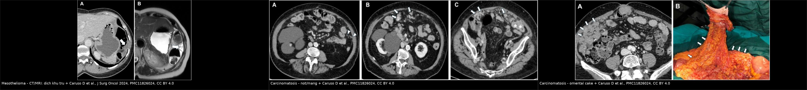
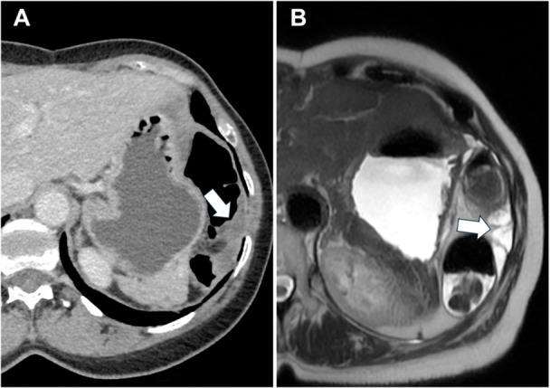
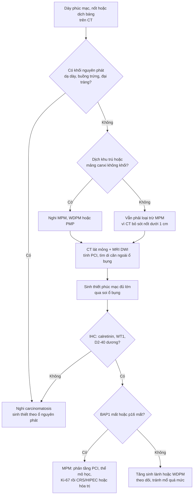
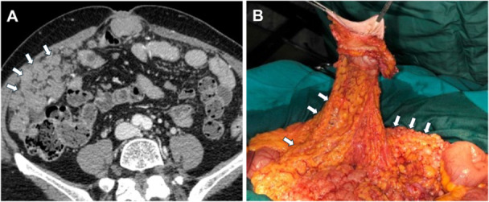
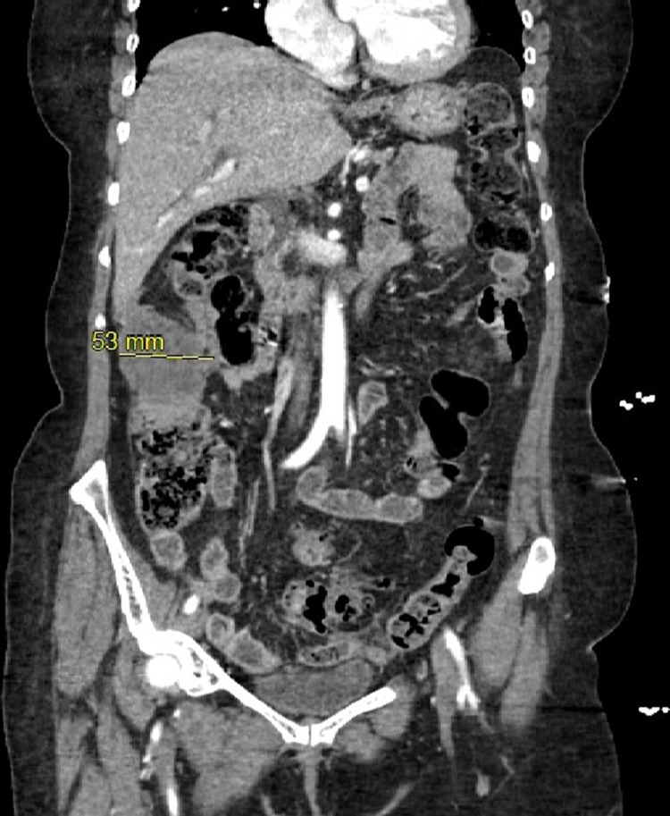

# 143 — U trung biểu mô phúc mạc ác vs carcinomatosis phúc mạc: mảng canxi hóa, BAP1 & PCI / Malignant peritoneal mesothelioma vs peritoneal carcinomatosis

**Tags:** `pattern:day-phuc-mac` `pattern:not` `vung:phuc-mac` `vung:o-bung` `score:PCI` `protocol:CT-bung-co-can-quang` `protocol:MRI-bung`
**Mức chắc chắn (certainty):** tổng hợp y văn (literature synthesis) — số liệu từ tổng quan hình ảnh (PMC11826024), ca bệnh có mô bệnh (PMC8960911), tổng quan chẩn đoán (PMC13322104), đoàn hệ toàn quốc Đức (PMC12930597), nghiên cứu bệnh–chứng amiăng (PMC12703297) và dữ liệu SEER (PMC13462530). Không suy diễn ngoài nguồn; chỗ chưa có số liệu ghi "chưa rõ".

> Bài này trả lời **một câu hỏi hẹp**: khi thấy phúc mạc dày/nốt/dịch ở ổ bụng, **làm sao phân biệt u trung biểu mô phúc mạc ác (malignant peritoneal mesothelioma, MPM) với carcinomatosis** (gieo rắc từ ung thư dạ dày/buồng trứng/đại tràng), và **khi nào cần sinh thiết – IHC – đánh giá PCI**. Nốt phúc mạc không xác định ở [549](../549-not-phuc-mac-khong-xac-dinh/lesson.md); phúc mạc và dịch ổ bụng cơ bản ở [141](../141-phuc-mac/lesson.md); u nhầy ruột thừa/pseudomyxoma ở [539](../539-pseudomyxoma-peritonei/lesson.md).

*Trái: **MPM** — dịch **khu trú (loculated)** tạo dấu "gặm/vát" bờ gan–lách trên CT (A) và dịch T2 rất sáng có vách trên MRI (B). Giữa: **carcinomatosis** — nốt nhỏ (A), nốt lớn hơn (B) và **mảng phúc mạc** (C, dấu sao) từ ung thư dạ dày. Phải: **omental cake** (mạc nối dày thành bánh, mũi tên) trên CT (A) và bệnh phẩm tương ứng (B). Ba mẫu hình này **chồng lấp** — nhưng "dịch khu trú" và "mảng canxi hóa không khối" nghiêng về MPM/PMP, còn "omental cake" nghiêng về carcinomatosis. Nguồn: Caruso D et al., J Surg Oncol 2024, PMC11826024, Fig. 2/4/7, CC BY 4.0 (nguyên bản, ghép letterbox).*

## 1. Tổng quan bệnh học – cơ chế hình ảnh

- **Bản chất:** MPM phát sinh từ **tế bào trung biểu mô (mesothelial cells)** của phúc mạc — u **nguyên phát**, không có ổ ngoài phúc mạc. Carcinomatosis là **di căn/gieo rắc thứ phát** từ dạ dày, buồng trứng, đại tràng, tụy… Hai bệnh **khác hoàn toàn về điều trị**: MPM có thể được **cắt phúc mạc triệt để + HIPEC**, carcinomatosis cần **hóa trị theo ung thư gốc**.
- **Dịch tễ (số cần nhớ):**
  - MPM chiếm **10–15%** các ca mesothelioma, khoảng **600 ca mới/năm** tại Hoa Kỳ (PMC12598357).
  - Tại Đức 2019–2024: **3.394 ca**, tỉ lệ mới mắc trung bình **0,68/100.000 dân/năm**; chỉ **9%** được HIPEC, **15%** được cắt phúc mạc, **5%** PIPAC — tổng **20%** được phẫu thuật (PMC12930597).
  - **Amiăng (asbestos)** là yếu tố nguy cơ chính dù tỉ lệ quy thuộc thấp hơn màng phổi: nghiên cứu bệnh–chứng Ý 2000–2021 (1.591 ca) cho **OR 3,66 (95% CI 3,21–4,18)**, **45,4%** ca có phơi nhiễm nghề nghiệp (PMC12703297).
  - **Thể mô học:** thể biểu mô (epithelioid) phổ biến nhất và tiên lượng tốt nhất; **thể hỗn hợp (biphasic) < 25%**; thể sarcomatoid hiếm và ác nhất; **biphasic không điều trị sống < 6 tháng** (PMC8960911, PMC12930597).
- **TẠI SAO hình ảnh trông như vậy (vật lý – mô bệnh):**
  - **Tế bào u bám theo mặt phúc mạc** → hình **mảng (plaque-like)**, **nốt (nodular)** hoặc **khối (> 5 cm)** khi nhiều nốt hòa vào nhau (PMC11826024).
  - **Dịch khu trú** xuất hiện vì tế bào u **bít đường dẫn lưu bạch huyết** và gây viêm xơ dính → dịch bị nhốt trong các khoang nhỏ, tạo **scalloping (gặm vát) bờ gan/lách**; đây là dấu **rất gợi ý MPM hoặc pseudomyxoma**, ít gặp ở carcinomatosis thông thường (PMC11826024).
  - **Canxi hóa:** mảng canxi **không kèm khối mô mềm**, ở phúc mạc tạng và thành → gợi ý **u trung biểu mô nhú biệt hóa tốt (well-differentiated papillary mesothelioma, WDPM)**; canxi trong **nốt** sau hóa trị là dấu đáp ứng (PMC11826024).
  - **Vì sao CT bỏ sót nốt nhỏ:** độ phân giải không gian và độ tương phản mô mềm giới hạn — với tổn thương **< 1 cm**, độ nhạy CT chỉ **9,1%–50%**, và với ngưỡng phát hiện **5 mm** độ nhạy khoảng **11%** (PMC11826024). Đây là lý do **không bao giờ loại trừ MPM chỉ vì CT "sạch"**.
  - **Vì sao PET có thể âm tính giả:** thể **biểu mô và thể nang nhầy** thường **ít ngấm FDG**, trong khi **biphasic/sarcomatoid** ngấm mạnh (PMC13322104).
- **Ngưỡng và điểm số cần nhớ:**
  - **PCI (Peritoneal Cancer Index) 0–39**, chia **13 vùng**; PCI **> 17** là yếu tố tiên lượng xấu, cùng với **thể biphasic** và **Ki-67 > 9%** → cân nhắc **hóa trị tân bổ trợ trước CRS/HIPEC** (PMC12930597; PMC11826024).
  - **BAP1 mất biểu hiện** và **mất p16/CDKN2A** là dấu hiệu **ác tính** giúp phân biệt với tăng sinh trung biểu mô lành; độ nhạy giảm khi mẫu ít tế bào (PMC13322104).

## 2. Mẫu hình + chẩn đoán phân biệt theo hình thái và vị trí (Gamut)

- **Dày phúc mạc dạng mảng (plaque-like thickening):** MPM thể lan tỏa, **WDPM** (có canxi mảng), lao phúc mạc, xơ hóa sau mổ/viêm, di căn buồng trứng.
- **Nốt nhỏ rải rác (< 1 cm):** carcinomatosis (dạ dày, buồng trứng, đại tràng), MPM lan tỏa, lao phúc mạc, **splenosis** (nếu có tiền sử vỡ lách — xem [549](../549-not-phuc-mac-khong-xac-dinh/lesson.md)).
- **Khối lớn đơn độc (> 5 cm):** MPM thể khu trú (localized), ung thư buồng trứng, GIST ngoài thành, desmoid, u mô đệm.
- **Omental cake (mạc nối dày thành bánh):** **carcinomatosis** dạ dày/buồng trứng là hàng đầu; MPM ít khi tạo omental cake điển hình (PMC11826024).
- **Implant dạng nang (cystic):** **pseudomyxoma peritonei (PMP)** từ u nhầy ruột thừa, **u trung biểu mô nang lành (benign multicystic peritoneal mesothelioma)** — khác hẳn MPM đặc.
- **Dịch khu trú + scalloping:** MPM, PMP, lao phúc mạc, carcinomatosis nhầy.
- **Canxi hóa phúc mạc:** **mảng canxi không khối → WDPM**; canxi trong nốt → di căn buồng trứng thanh dịch/điều trị; canxi hóa lách → splenosis.
- **Gợi nhớ "PLAQUE":** **P** – **P**laque (mảng) · **L** – **L**oculated ascites · **A** – **A**sbestos (tiền sử) · **Q** – **Q**uiet PET (âm tính giả ở thể biểu mô) · **U** – **U**nderlying primary (phải tìm ổ nguyên phát dạ dày/buồng trứng) · **E** – **E**pithelioid/BAP1.

## 3. Bảng so sánh phân biệt (ma trận đối chiếu)

| Thực thể (entity) | Hình ảnh điển hình | Chốt vào (rule-in) | Chốt loại (rule-out) | Gợi ý xác nhận |
|---|---|---|---|---|
| **MPM lan tỏa** | Dày phúc mạc **dạng mảng + nốt**, **dịch khu trú**, scalloping gan/lách, có thể canxi mảng; không có ổ nguyên phát | **Dịch khu trú + mảng phúc mạc + không tìm thấy u nguyên phát** | Có khối u dạ dày/buồng trứng rõ + omental cake → carcinomatosis | Sinh thiết phúc mạc + IHC: **calretinin, WT1, CK5/6, D2-40 dương; BAP1 mất; p16 mất** |
| **Carcinomatosis (dạ dày/buồng trứng/đại tràng)** | **Nốt nhỏ rải rác**, **omental cake**, dày mạc treo, dịch tự do; có khối nguyên phát | **Omental cake + khối nguyên phát + nốt nhỏ nhiều ổ** | Mảng canxi không khối + dịch khu trú → nghĩ MPM/WDPM | CT ngực–bụng–khung chậu, nội soi ± sinh thiết; IHC theo ung thư gốc (CK20, CDX2, PAX8) |
| **PMP (u nhầy ruột thừa)** | **Implant dạng nang**, dịch nhầy **khu trú**, canxi vòng, ruột thừa bất thường | **Dịch nhầy + nang nhiều ổ + bất thường ruột thừa** | Tổn thương đặc, không nhầy → MPM/carcinomatosis | MRI/CT bụng; sinh thiết + mucin; xem [539](../539-pseudomyxoma-peritonei/lesson.md) |
| **WDPM (u trung biểu mô nhú biệt hóa tốt)** | **Mảng canxi hóa phúc mạc không có khối mô mềm**, tiến triển chậm | **Canxi mảng + không khối + mô học nhú** | Có khối/nốt đặc, BAP1 mất → MPM ác | Sinh thiết; theo dõi dài hạn |
| **Lao phúc mạc** | Dày phúc mạc đều, hạch hoại tử, dịch tự do, dày mạc nối | **Bối cảnh lao + ADA dịch báng tăng** (ngưỡng tham khảo ở [549](../549-not-phuc-mac-khong-xac-dinh/lesson.md)) | Không có bằng chứng lao, IHC trung biểu mô dương → MPM | Soi ổ bụng sinh thiết; PCR lao; **CA-125 cao không loại trừ lao** |
| **Splenosis** | Nốt **0,8–2,5 cm**, ngấm như lách, tiền sử vỡ/cắt lách | **Tiền sử vỡ lách + nốt ngấm kiểu lách** | Không tiền sử lách, nốt phúc mạc mới → u | Tc-99m HDRBC, **không sinh thiết mù** |

*Nữ 56 tuổi, MPM: (A) CT thì tĩnh mạch cửa — dịch **khu trú** (mũi tên) gây gặm vát bờ tạng; (B) MRI T2 — dịch rất sáng, có vách mảnh. "Dịch không nằm tự do" là dấu định hướng mạnh, nhưng **không đặc hiệu** (PMP, lao cũng có). Nguồn: Caruso D et al., J Surg Oncol 2024, PMC11826024, Fig. 7, CC BY 4.0.*

### Phân biệt MPM với tăng sinh trung biểu mô lành (điểm quyết định mô học)
- **IHC dương tính trung biểu mô:** calretinin, WT1, CK5/6, D2-40.
- **Dấu hiệu ác tính:** **mất BAP1** và **mất p16/CDKN2A** (PMC13322104). Mất BAP1 **không** gặp ở tăng sinh lành; nhưng nếu mẫu ít tế bào, **âm tính giả** có thể xảy ra → cần mẫu đủ lớn (sinh thiết sâu/soi ổ bụng), không dựa vào FNA nhỏ.
- **Loại trừ ung thư biểu mô:** dương tính **CK20/CDX2** (đại tràng), **PAX8** (buồng trứng), **TTF-1** (phổi) → hướng carcinomatosis.

## 4. Protocol: chẩn đoán → phân giai đoạn → chọn điều trị

### 4.1 Hình ảnh

- **CT bụng–khung chậu có cản quang thì tĩnh mạch cửa, lát ≤ 2 mm:** phương thức đầu tay; đánh giá **13 vùng PCI**, mạc nối, mạc treo, bề mặt gan/lách, túi cùng, rốn gan. Ghi rõ: **dịch tự do hay khu trú**, **mảng/nốt/khối**, **canxi hóa**, **dày mạc treo**.
- **MRI bụng (T1/T2 fat-sat, DWI):** bổ trợ khi CT không rõ hoặc nghi tổn thương **nhỏ/dính mạc treo**; DWI giúp phát hiện implant tế bào đặc (PMC11826024). Dịch T2 rất sáng + vách mảnh gợi ý khu trú.
- **PET/CT ¹⁸F-FDG:** tìm **di căn ngoài ổ bụng** và hướng dẫn sinh thiết; **âm tính giả ở thể biểu mô/nang nhầy** (PMC13322104) → **PET âm không loại trừ MPM**.
- **Giới hạn phải nói với phẫu thuật viên:** CT **dưới giai đoạn** so với mổ, đặc biệt nốt **< 1 cm** (Se **9,1–50%**; ngưỡng 5 mm ~**11%**) (PMC11826024).

### 4.2 Chẩn đoán mô học (bắt buộc)

- **Sinh thiết phúc mạc qua soi ổ bụng** (hoặc qua da dưới hướng dẫn khi tổn thương dày, tránh ruột): lấy **mẫu đủ lớn** để IHC; **tế bào học dịch báng thường âm tính** trong MPM (PMC13322104).
- **Bộ IHC tối thiểu:** calretinin, WT1, CK5/6, D2-40 (trung biểu mô); **BAP1, p16** (ác tính); CK20/CDX2, PAX8, TTF-1 (loại trừ ung thư biểu mô).
- **Đừng chẩn đoán "carcinomatosis chưa rõ nguyên phát"** khi chưa làm đủ IHC — đây là lỗi dẫn tới điều trị sai hoàn toàn.

### 4.3 Phân tầng điều trị (số liệu)

- **PCI 0–39 (13 vùng)** là ngôn ngữ chung với phẫu thuật; **PCI > 17** + **biphasic** + **Ki-67 > 9%** là các yếu tố xấu, cân nhắc **hóa trị tân bổ trợ** trước CRS/HIPEC (PMC12930597).
- **CRS + HIPEC** dành cho bệnh **khu trú trong ổ bụng, mổ được**: tại Đức chỉ **9%** bệnh nhân được HIPEC, **20%** được phẫu thuật — khoảng cách lớn giữa khuyến cáo và thực hành (PMC12930597).
- **Hóa trị toàn thân:** dữ liệu SEER 1.549 bệnh nhân cho thấy hóa trị **liên quan sống sót tổng thể dài hơn** sau phân tích ghép cặp (PMC13462530) — nhưng đây là dữ liệu quan sát, không phải RCT.
- **Theo dõi:** khám lâm sàng + CT ngực–bụng định kỳ; **lịch cụ thể chưa được chuẩn hóa** trong các nguồn đã đọc (ghi "chưa rõ" thay vì bịa khoảng thời gian).

### 4.4 Điểm khác biệt then chốt so với carcinomatosis

- **Không có ổ nguyên phát** trên CT ngực–bụng–khung chậu là dấu **âm** quan trọng, nhưng không đủ.
- **Dịch khu trú + mảng canxi không khối + không omental cake** → nghĩ MPM/WDPM/PMP.
- **Omental cake + nốt nhỏ nhiều ổ + khối nguyên phát** → carcinomatosis; **vẫn có thể trùng** với MPM thể lan tỏa.

## 5. Biến thể bình thường và cạm bẫy

- **"CT bình thường" không loại trừ MPM:** nốt **< 1 cm** có độ nhạy CT **9,1–50%**; **5 mm** chỉ ~**11%** (PMC11826024).
- **PET âm tính giả ở thể biểu mô** — thể phổ biến nhất; đừng bỏ sinh thiết vì PET âm (PMC13322104).
- **Tế bào học dịch báng âm tính** thường gặp trong MPM — **không** được dùng để loại trừ (PMC13322104).
- **Canxi hóa phúc mạc** có thể là **WDPM lành tính** hoặc di căn buồng trứng đã điều trị — đừng mặc định là "MPM giai đoạn cuối".
- **U trung biểu mô nang lành (benign multicystic mesothelioma)** trông giống PMP nhưng **không phải u ác** — điều trị khác hẳn; cần mô học.
- **Bẫy IHC trên mẫu nhỏ:** BAP1 có thể **âm tính giả** khi ít tế bào → sinh thiết lại thay vì kết luận.
- **Bẫy "dịch báng do xơ gan"** ở bệnh nhân có bệnh gan nền: dịch khu trú + scalloping phải gợi ý u, không quy hết cho xơ gan.
- **Bẫy "omental cake = carcinomatosis"**: MPM thể lan tỏa hiếm khi tạo omental cake điển hình, nhưng **có thể**; hình thái không thay thế mô học.

## 6. Tự lượng giá — Blind Quiz

**Ca 1 — Nữ 56 tuổi, bụng to, không rõ tiền sử ung thư. CT/MRI bụng:**

- Câu hỏi: Dịch tự do hay khu trú? Dấu hiệu nào gợi ý? Ba chẩn đoán phân biệt và bước xác nhận?

<b>Bấm để hiện đáp án (findings + chẩn đoán)</b>

- Dấu hiệu: (A) CT thì tĩnh mạch cửa — dịch **khu trú**, bờ tạng bị **gặm vát (scalloping)**; (B) MRI T2 — dịch **rất sáng**, có **vách mảnh**.
- Chẩn đoán: **u trung biểu mô phúc mạc ác (MPM)** — dịch khu trú do u bít đường bạch huyết.
- Phân biệt: **PMP** (dịch nhầy, implant nang, ruột thừa bất thường), **lao phúc mạc** (dày đều, hạch hoại tử), **carcinomatosis** (thường omental cake + khối nguyên phát).
- Xác nhận: **sinh thiết phúc mạc qua soi ổ bụng** + IHC (calretinin/WT1/D2-40; **BAP1, p16**); PET/CT tìm di căn ngoài ổ bụng.
- Nguồn: Caruso D et al., J Surg Oncol 2024, PMC11826024, Fig. 7, CC BY 4.0.

**Ca 2 — Nam 68 tuổi, gầy sút, CT bụng có mạc nối dày:**

- Câu hỏi: Mô tả tổn thương mạc nối. Chẩn đoán nào hàng đầu? Cần tìm gì để xác định nguồn?

<b>Bấm để hiện đáp án (findings + chẩn đoán)</b>

- Dấu hiệu: (A) CT — mạc nối dày, thấm infiltrate thành **bánh (omental cake)**, có nốt; (B) bệnh phẩm — mạc nối dày cứng, nốt rải rác.
- Chẩn đoán: **carcinomatosis phúc mạc** (hình này từ ung thư dạ dày) — omental cake là dấu **gợi ý carcinomatosis** hơn là MPM.
- Cần tìm: **khối nguyên phát** dạ dày/buồng trứng/đại tràng trên CT ngực–bụng–khung chậu; nội soi tiêu hóa; sinh thiết + IHC (CK20/CDX2, PAX8) để xác định nguồn.
- Nguồn: Caruso D et al., J Surg Oncol 2024, PMC11826024, Fig. 4, CC BY 4.0.

**Ca 3 — Bệnh nhân đau bụng âm ỉ, CT bụng thấy khối 53 mm:**

- Câu hỏi: Khối nằm ở đâu? Một khối đơn độc như vậy có loại trừ MPM không? Bước tiếp theo?

<b>Bấm để hiện đáp án (findings + chẩn đoán)</b>

- Dấu hiệu: CT coronal có thước đo **53 mm** — khối mô mềm trong ổ bụng, bờ không đều, không thấy rõ cơ quan gốc.
- Chẩn đoán: ca này sau mổ là **u trung biểu mô phúc mạc thể hỗn hợp (biphasic)**; thể này chiếm **< 25%** MPM và **tiên lượng xấu, không điều trị sống < 6 tháng**.
- Trả lời: **không** — MPM có thể biểu hiện **khối khu trú** (localized) chứ không chỉ dày lan tỏa; cần **sinh thiết + IHC** và tìm ổ nguyên phát.
- Nguồn: Waheed A et al., Cureus 2022, PMC8960911, Fig. 1, CC BY 4.0.

## Bài liên quan chéo

- [100 – Tổng quan hệ Bụng](../100-tong-quan-he-bung/lesson.md)
- [141 – Phúc mạc](../141-phuc-mac/lesson.md)
- [549 – Nốt phúc mạc không xác định](../549-not-phuc-mac-khong-xac-dinh/lesson.md)
- [539 – Pseudomyxoma peritonei & carcinomatosis](../539-pseudomyxoma-peritonei/lesson.md)
- [535 – Ung thư buồng trứng, phúc mạc & Krukenberg](../535-ung-thu-buong-trung-phuc-mac-krukenberg/lesson.md)
- [577 – Theo dõi & phát hiện tái phát ung thư phụ khoa](../577-theo-doi-tai-phat-ung-thu-phu-khoa/lesson.md)

## Ảnh

- `images/143_mesothelioma-loculated_CT-MRI_PMC11826024-Fig7.jpg` — MPM: dịch khu trú CT/MRI, CC BY 4.0.
- `images/143_nodule-plaque_CT_PMC11826024-Fig2.jpg` — carcinomatosis dạ dày: nốt và mảng phúc mạc, CC BY 4.0.
- `images/143_omental-cake_CT_PMC11826024-Fig4.jpg` — omental cake + bệnh phẩm, CC BY 4.0.
- `images/143_mesothelioma-mass_CT_PMC8960911-Fig1.jpg` — MPM thể biphasic, khối 53 mm, CC BY 4.0.
- `images/composite_mesothelioma-vs-carcinomatosis.jpg` — ảnh ghép letterbox 3 mẫu hình, CC BY 4.0 (nguyên bản, không crop).
- Nguồn + giấy phép từng ảnh: `images/CREDITS.md`.

> Không dùng để chẩn đoán độc lập khi chưa có người hướng dẫn.
