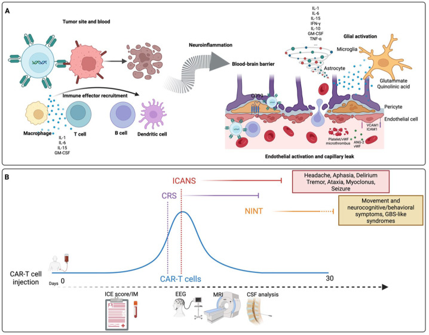
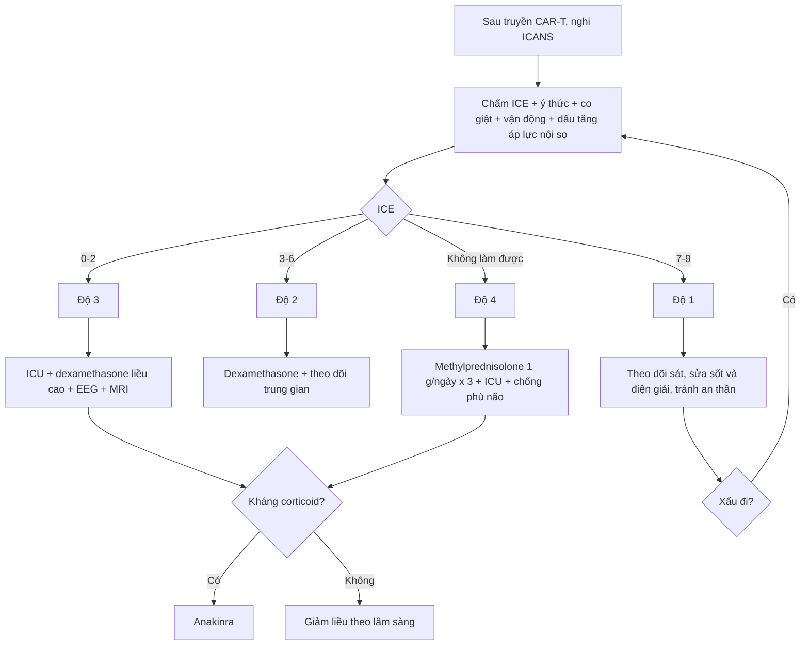
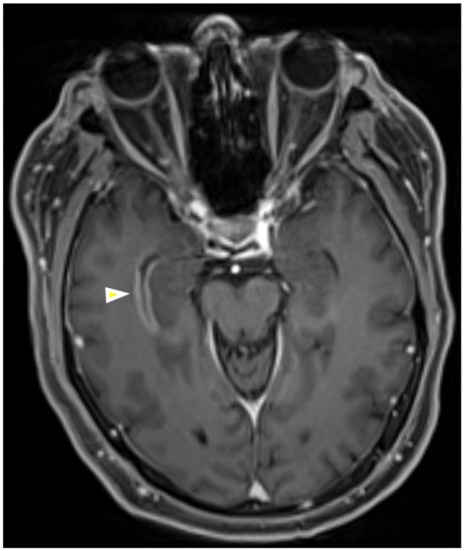
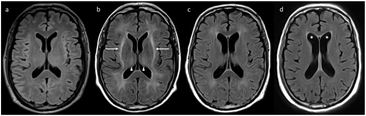
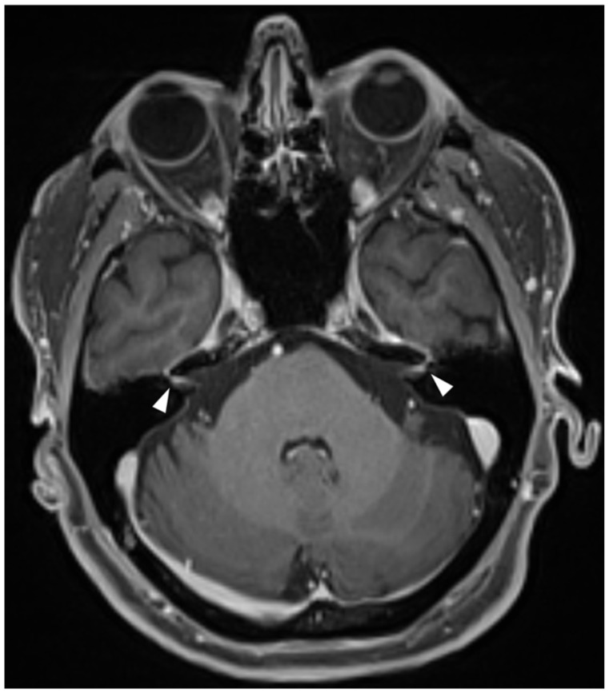
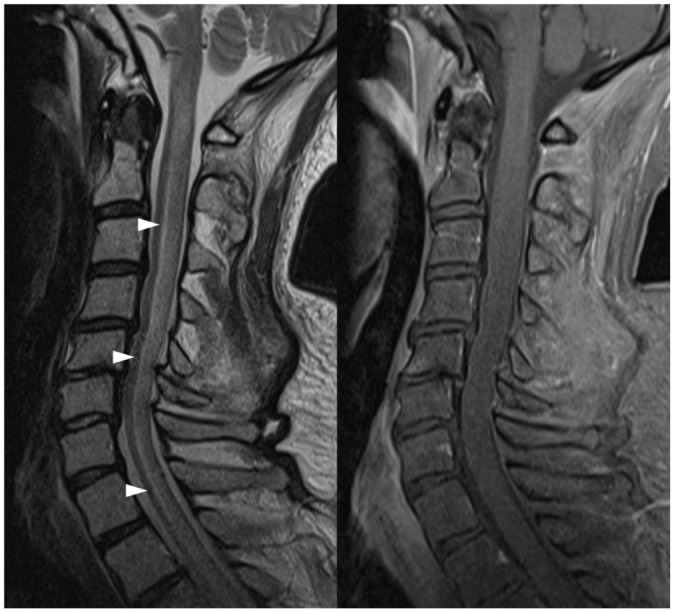

# 1430 — Độc tính thần kinh sau liệu pháp tế bào CAR-T (ICANS) / *Immune effector cell-associated neurotoxicity syndrome*

**Tags:** `pattern:benh-nao-lan-toa` `pattern:ton-thuong-chat-trang` `pattern:han-che-khuech-tan` `pattern:vi-xuat-huyet` `vung:nao` `vung:chat-trang` `vung:tuy-song` `score:ASTCT-ICANS` `score:ICE` `protocol:MRI-DWI` `protocol:MRI-SWI` `protocol:EEG` `protocol:choc-DNT`

**Mức chắc chắn (certainty):** tổng hợp y văn (literature synthesis) — ghép 2 tổng quan 2026 về hình ảnh/sinh lý bệnh (**Lasocki A và cs., *Ther Adv Neurol Disord* 2026, PMC12796132, CC BY-NC 4.0**; **Pagliuca S và cs., cùng tạp chí 2026, PMC13180172, CC BY-NC 4.0**) với 2 tổng quan thực hành (**Kim J., *Blood Res* 2026, PMC13558536, CC BY-NC-ND 4.0**; **Alesefir W và cs., *Front Neurol* 2026, PMC13714708, CC BY 4.0**). Các tỉ lệ dưới đây là **số tổng hợp từ các tổng quan này dẫn lại nghiên cứu gốc**; chỗ nguồn không đưa con số thì ghi "chưa rõ", không bịa.

> **Bài này trả lời 4 câu hỏi của buổi trực sau truyền CAR-T:**
> (1) **Bệnh nhân lú lẫn/thất ngôn ngày 3–6 sau truyền — ICANS hay nhiễm trùng/đột quỵ?** (2) **MRI bình thường có loại trừ ICANS không?** (3) **Chấm độ nào và khi nào dùng corticoid, khi nào KHÔNG dùng tocilizumab?** (4) **Co giật, phù não, yếu chi, liệt mặt — dấu hiệu nào đổi xử trí ngay?**
> Khác với [1423 – độc tính methotrexate nội tủy](../1423-doc-tinh-methotrexate-noi-tuy/lesson.md) (tổn thương chất trắng do thuốc hóa trị, không có “cơn bão cytokine”) và [494 – MTX leukoencephalopathy](../494-doc-than-kinh-methotrexate/lesson.md): ICANS là **hội chứng viêm nội mạch–hàng rào máu não do tế bào miễn dịch hoạt hóa**, có **thang độ riêng** và **điều trị miễn dịch riêng**.

## 1. Tổng quan bệnh học – cơ chế hình ảnh

### 1.1 Sinh lý bệnh: từ “bão cytokine” đến hàng rào máu não

- Sau khi CAR-T gắn kháng nguyên và giết tế bào u, một **đợt bùng phát cytokine hệ thống** (IL-1, IL-6, IFN-γ, TNF-α, GM-CSF, IL-10, IL-15) xuất hiện, kèm **vòng khuếch đại tuỷ xương** (bạch cầu đơn nhân/đại thực bào tiết IL-1 và IL-6).
- Cytokine tác động lên **đơn vị mạch–thần kinh (neurovascular unit)**: tăng tỉ lệ **Ang-2/Ang-1**, giải phóng **vWF**, tăng **ICAM-1/VCAM-1**, MMP và VEGF → **hoạt hóa nội mô, tăng tính thấm mao mạch, rò rỉ hàng rào máu não (BBB) và hàng rào máu–dịch não tủy (BCSFB)**.
- Trong não, **tế bào hình sao và vi bào đệm** hoạt hóa, giải phóng **glutamate và acid quinolinic** → **kích thích độc thần kinh (excitotoxicity)**; đồng thời **huyết khối vi mạch do tiểu cầu/vWF** hình thành.
- Một cơ chế đặc thù: **CD19 có thể biểu hiện trên tế bào quanh mạch (pericyte) và cơ trơn mạch máu não** → CAR-T CD19 có thể **tấn công trực tiếp** thành mạch, làm hàng rào vốn đã rò rỉ càng yếu hơn.
- **Hệ quả hình ảnh — giải thích TẠI SAO:**
  - **Phù mạch (vasogenic)**: huyết tương giàu protein thoát vào khoảng kẽ → **FLAIR/T2 sáng**, T1 tối, **KHÔNG hạn chế khuếch tán** (ADC cao) vì nước còn ở ngoại bào.
  - **Phù độc tế bào/kích thích**: nước chuyển vào trong tế bào → **DWI sáng, ADC tối**; có thể chỉ thấy ở **vỏ não** và có thể **thoáng qua**.
  - **Vi xuất huyết**: hồng cầu thoát mạch → **hemosiderin có từ tính** → **mất tín hiệu “blooming” trên SWI**, trong khi CT thường bình thường vì tổn thương cỡ vài mm.
  - **Ngấm thuốc màng mềm/màng nội tủy**: rò rỉ BBB/BCSFB tại bề mặt não – não thất.
  - **MRI bình thường**: không có rò rỉ đủ lớn để tạo tín hiệu — **không loại trừ ICANS** (xem mục 5).

### 1.2 Vì sao tocilizumab KHÔNG dùng đơn thuần cho ICANS

- Tocilizumab là kháng thể kháng **thụ thể IL-6**, phân tử lớn, **ít vào hệ thần kinh trung ương**; IL-6 chỉ là **một nhánh** của mạng cytokine, và **IL-1/IL-6 tại chỗ do đại thực bào** mới là bộ khuếch đại chính trong não.
- Vì vậy: **CRS + ICANS đồng thời** → điều trị CRS bằng tocilizumab **và** ICANS bằng **corticoid**; **ICANS đơn độc** → **corticoid là trục**, không thay bằng tocilizumab.
- **Anakinra (kháng IL-1)** là lựa chọn khi **kháng corticoid**, nhất là khi có phù não tiến triển.

### 1.3 Ngưỡng định lượng nằm lòng (bắt buộc nhớ)

| Đại lượng | Con số | Nguồn |
|---|---|---|
| ICANS ở CAR-T CD19 (u lympho/B-ALL) | **20% đến > 60%** tuỳ sản phẩm | Pagliuca 2026 |
| ICANS **độ ≥ 3** | **10–30%**; cao hơn với **miền đồng kích thích CD28** (axi-cel) so với **4-1BB** (tisa-cel) | Pagliuca 2026 |
| Khởi phát – đỉnh – hồi phục | **ngày 3–6**, đỉnh **ngày 7–8**, hồi phục trong **1–2 tuần** | Pagliuca 2026; Lasocki 2026 |
| Co giật (lâm sàng + điện não) | **5–10%** chung; **0–30%** với CD28; **3–14%** với 4-1BB | Pagliuca 2026 |
| Phù não (cerebral edema) | **~1–2%** ở người nhận CAR-T CD19 | Pagliuca 2026 |
| EEG bất thường lúc khởi phát ICANS | **89%**; có **IED** → **50%** tiến triển nặng hơn trong **24 giờ** | Đoàn hệ Tây Ban Nha, dẫn trong Pagliuca 2026 |
| FIRDA (nhịp delta chậm đều từng đợt vùng trán) | **Độ nhạy 88%**, **NPV 100%** cho ICANS | Pagliuca 2026 |
| EEG delta tự động | Phát hiện ICANS **trước triệu chứng trung vị 68 giờ** | Kim 2026 |
| MRI quanh ngày 7 | **32,5%** có bất thường “có ý nghĩa lâm sàng” | Pagliuca 2026 |
| Kiểu bất thường MRI | FLAIR **~50%**, hạn chế khuếch tán **~22,5%**, ngấm thuốc **~18,8%**, phù **~8,2%**, xuất huyết **~4,1%** | Pagliuca 2026 |
| Vị trí ưu tiên | quanh não thất **21,4%**, đồi thị **19,4%**, cầu não **19,4%**, hành não **17,3%**, hải mã **11,2%**, màng mềm **~10%** | Pagliuca 2026 |
| Protein dịch não tủy | **80–110 mg/dL** (đôi khi > 1.000 mg/dL), **tăng theo độ nặng** | Pagliuca 2026 |
| ICE score | Thang **10 điểm**: **7–9 nhẹ**, **3–6 trung bình**, **0–2 nặng** | Pagliuca 2026; Kim 2026 |
| Corticoid | **dexamethasone 10–20 mg IV mỗi 6 giờ**; độ 4: **methylprednisolone 1 g/ngày × ~3 ngày** | Pagliuca 2026 |
| Kháng corticoid | **anakinra** **100 mg mỗi 6–8 giờ** hoặc **2–12 mg/kg/ngày** | Pagliuca 2026 |

## 2. Mẫu hình + chẩn đoán phân biệt theo vị trí (gamut)

- **Chất trắng lan tỏa, đối xứng, không theo lãnh thổ mạch:** ICANS · PRES · bệnh não do nhiễm khuẩn huyết · rối loạn chuyển hóa (hạ natri, tăng CO₂) · **độc tính fludarabine** (hóa trị chuẩn bị trước CAR-T) · viêm não virus.
- **Vỏ não hạn chế khuếch tán:** ICANS thể kích thích độc · **cơn động kinh** (thay đổi sau cơn) · nhồi máu cấp · viêm não Herpes/CJD.
- **Thân não/tiểu não:** ICANS · **hội chứng hủy myelin thẩm thấu** · Wernicke · nhồi máu thân não · viêm não thân não.
- **Màng não/màng nội tủy:** ICANS (ngấm thoáng qua) · **nhiễm trùng màng não** · **di căn màng não (LMD)** · lymphoma thần kinh trung ương.
- **Tủy sống:** **myelopathy do ICANS** · NMO/MOG · viêm tủy do xạ · dò động–tĩnh mạch màng cứng (SDAVF) · nhiễm trùng.
- **Dây thần kinh sọ:** **tổn thương dây sọ sau CAR-T (đặc biệt BCMA)** · Lyme · sarcoid · LMD · liệt Bell.

## 3. Bảng so sánh phân biệt (ma trận đối chiếu)

| Thực thể (entity) | Hình ảnh điển hình (MRI) | Chốt vào (rule-in) | Chốt loại (rule-out) | Gợi ý xác nhận |
|---|---|---|---|---|
| **ICANS** | Thường **bình thường**; FLAIR chất trắng lan tỏa, đồi thị/thân não; DWI vỏ não; SWI vi xuất huyết; ngấm màng mềm thoáng qua | **Bối cảnh 3–6 ngày sau CAR-T + ICE giảm + thất ngôn/viết sai + không ổ nhiễm khuẩn**; phù **khu trú = độ 3**, **lan tỏa = độ 4** | MRI bình thường **không** loại trừ; dịch não tủy **không** có tế bào ác tính/nhiễm | Chấm ICE 8–12 giờ/lần; EEG; MRI có DWI/SWI; đáp ứng corticoid |
| **Nhiễm trùng thần kinh trung ương** | Ngấm màng não/màng nội tủy, áp-xe viền ngấm, ổ dịch | **Sốt + cứng gáy + DNT có tế bào/đường thấp/vi khuẩn**; khởi phát có thể cùng lúc | Ngấm màng mềm **đơn thuần** không loại trừ ICANS; cấy âm không loại trừ virus/nấm | Chọc dò dịch não tủy **trước khi tăng corticoid** nếu an toàn; PCR; cấy |
| **Nhồi máu não cấp** | Hạn chế khuếch tán **theo lãnh thổ mạch**, vỏ + chất trắng | **Khởi phát đột ngột, khuyết thiếu khu trú, DWI/ADC khớp mạch** | Hạn chế khuếch tán **đối xứng vỏ não** hoặc **không theo mạch** → không phải nhồi máu | MRA/CTA; theo dõi ADC; siêu âm tim |
| **PRES** | Phù **vasogenic** vùng chẩm–đỉnh, đối xứng, FLAIR sáng, ADC cao | **Tăng huyết áp + thuốc ức chế miễn dịch + nhìn mờ/co giật**; phù **không hạn chế khuếch tán** | ICANS thường **không có** ưu thế chẩm–đỉnh rõ; ADC **thấp** ở vỏ não | Đo huyết áp; ngừng thuốc gây; MRI lặp sau 1–2 tuần |
| **Độc tính fludarabine (leukoencephalopathy)** | Chất trắng **đối xứng**, hạn chế khuếch tán, **xuất hiện sau hóa trị chuẩn bị**, không ngấm | **Sau fludarabine, trước đỉnh cytokine của CAR-T**, rối loạn tri giác tiến triển | ICANS gắn với **đỉnh cytokine** và **cửa sổ ngày 3–6**; không có “cửa sổ fludarabine” | Mốc thời gian dùng thuốc; MRI lặp |
| **Di căn màng não (LMD)** | Ngấm **màng nội tủy/màng mềm dày, nốt**, có thể **xuất hiện muộn** | **Ngấm màng nội tủy mới sau nhiều tuần + tế bào ác tính trong DNT** | Ngấm màng **mỏng thoáng qua** trong ICANS cấp không đủ chẩn đoán LMD | DNT tế bào học/lưu lượng; MRI toàn trục; PET |
| **MNT do BCMA (rối loạn vận động/nhận thức muộn)** | Thường **bình thường** hoặc teo nhẹ; không có phù cấp | **Khởi phát sau nhiều tuần–tháng, parkinson, chậm chạp, thay đổi nhân cách** | **Không có đỉnh cytokine cấp**, không đáp ứng corticoid | Chấm vận động; DAT-SPECT; theo dõi dài hạn |
| **Cơn động kinh / thay đổi sau cơn** | Hạn chế khuếch tán **vỏ não khu trú**, thoáng qua; FLAIR có thể bình thường | **Có cơn trên lâm sàng/EEG + thay đổi DWI khớp vùng vỏ** | DWI **lan tỏa đối xứng** không phải cơn; EEG bình thường không loại trừ cơn kín đáo | EEG khẩn; DWI lặp sau 48–72 giờ |

## 4. Protocol chụp + hệ phân độ/điểm chuẩn hóa

### 4.1 Protocol hình ảnh và xét nghiệm

| Bước | Nội dung | Ngưỡng/thời điểm |
|---|---|---|
| MRI sọ | **DWI/ADC + T2-FLAIR + SWI + T1 trước/sau tiêm**, lát ≤ 5 mm (≤ 3 mm nếu nghi thân não) | Ngay khi có triệu chứng thần kinh **mới**; lặp nếu xấu đi |
| MRI tủy | **T2 sagittal + STIR + T1 sau tiêm** toàn trục | Khi yếu chi, rối loạn cơ vòng, dị cảm |
| EEG | **≥ 20–30 phút**, ưu tiên **continuous 24–48 giờ** nếu rối loạn tri giác dao động | Khi độ ≥ 2 hoặc nghi cơn kín đáo; tìm **FIRDA, IED, NCSE** |
| Chọc dò dịch não tủy | Tế bào, protein, glucose, cấy, PCR virus, tế bào học | **Sau** khi loại trừ khối/nguy cơ thoát vị; tiểu cầu và đông máu trong ngưỡng an toàn theo quy trình đơn vị (thường dùng tiểu cầu **> 50 × 10⁹/L**, INR **< 1,7**) |
| ICE | Chấm **mỗi 8–12 giờ** trong cửa sổ nguy cơ | Điểm **10** = bình thường; ghi cả **chữ viết tay** |

### 4.2 Thang độ ASTCT 2019 (chấm theo **mức nặng nhất**)

| Độ | ICE | Ý thức | Co giật | Vận động | Phù não / tăng áp lực nội sọ |
|---|---|---|---|---|---|
| **1** | 7–9 | Không rối loạn | Không | Không | Không |
| **2** | 3–6 | Ngủ gà nhẹ, đánh thức bằng giọng | Không | Không | Không |
| **3** | 0–2 | Không đánh thức được bằng giọng | Cơn khu trú/toàn thể thoái lui nhanh, hoặc NCSE | Không | Phù **khu trú** trên hình ảnh |
| **4** | 0 (không làm được) | Hôn mê | Cơn **> 5 phút** hoặc tái diễn không hồi phục | Liệt nửa người/2 chi, tư thế mất vỏ | Phù **lan tỏa**, thoát vị, tam chứng Cushing |

### 4.3 Điều trị theo độ (người lớn)

| Độ | Xử trí | Ghi chú |
|---|---|---|
| **1** | Theo dõi sát, ICE 8–12 giờ, sửa sốt/hypoxia/điện giải, **giảm/ngừng thuốc an thần**, khám thần kinh | Corticoid nếu **tiến triển** hoặc có yếu tố nguy cơ cao |
| **2** | **Dexamethasone 10 mg IV mỗi 6 giờ**, theo dõi ICU/trung gian, EEG khi dao động tri giác | Không dùng tocilizumab nếu **không có CRS** |
| **3** | **Dexamethasone 10–20 mg IV mỗi 6 giờ**, ICU, EEG, MRI, chống co giật khi có cơn; chọc dò khi an toàn | Phù **khu trú** đã đủ xếp độ 3 theo hình ảnh |
| **4** | **Methylprednisolone 1 g/ngày × 3 ngày** rồi giảm; ICU/đặt nội khí quản; **hypertonic saline/mannitol** nếu phù não; **anakinra** nếu kháng corticoid | Hội chẩn thần kinh–hồi sức khẩn |
| **CRS đồng thời** | **Tocilizumab** cho CRS + **corticoid** cho ICANS | Không thay corticoid bằng tocilizumab |
| **Co giật** | **Levetiracetam** nạp **20 mg/kg**, duy trì **500–1.000 mg mỗi 12 giờ** (người lớn) | **Không dự phòng thường quy** cho mọi bệnh nhân |

## 5. Biến thể bình thường và cạm bẫy

- **MRI bình thường là chuyện thường:** chỉ **~32,5%** có bất thường “có ý nghĩa” quanh ngày 7; **MRI bình thường không loại trừ ICANS** và không được trì hoãn điều trị.
- **Ngấm màng nội tủy muộn không phải ICANS:** hình dưới là bệnh nhân **7 tuần** sau CAR-T CD19, ngấm màng nội tủy mới dọc sừng thái dương → **di căn màng não**, không phải đợt ICANS muộn.

- **Vi xuất huyết trên SWI không phải di căn:** trong ICANS, các đốm mất tín hiệu nhỏ, rải rác, **không có phù quanh** và **không có khối**; di căn thường có phù vasogenic và ngấm thuốc.
- **Hạn chế khuếch tán vỏ não sau cơn động kinh** có thể bắt chước nhồi máu; DWI lặp sau 48–72 giờ giúp phân biệt.
- **“Ổ sáng quanh não thất” ở người lớn tuổi** thường là bệnh mạch máu nhỏ mạn, không phải phù cấp; so sánh với phim nền là bắt buộc.
- **ICE có giới hạn:** không hợp lệ ở người **đặt nội khí quản**, **không nói tiếng bản ngữ**, **sa sút trí tuệ nền**, hoặc trẻ nhỏ; khi đó dùng **CAM-ICU/AVPU** và đánh giá chữ viết/ngôn ngữ theo dõi dọc.
- **Sốt, thiếu oxy, rối loạn điện giải, thuốc an thần** làm nặng bệnh não do ICANS; sửa các yếu tố này trước khi kết luận “ICANS kháng trị”.
- **Triệu chứng sau ngày 28–30** ít khả năng là ICANS điển hình: nghĩ **nhiễm trùng, tái phát u, LMD, MNT do BCMA**.
- **Corticoid che nhiễm trùng:** nếu tăng corticoid mà không cải thiện hoặc sốt dai dẳng, phải chọc dò dịch não tủy và tìm ổ nhiễm.

## 6. Tự lượng giá — Blind Quiz

**Ca 1 — Bệnh nhân u lympho tế bào B lớn sau truyền CAR-T CD19**

- Bối cảnh: u lympho tế bào B lớn tái phát, vài ngày sau truyền CAR-T CD19, lú lẫn và khó tìm từ.
- Câu hỏi: (a) Mô tả bất thường trên FLAIR và vị trí? (b) Hình ảnh này xếp độ mấy theo ASTCT? (c) Hai chẩn đoán phân biệt cần loại trừ?

<b>Bấm để hiện đáp án (findings + chẩn đoán)</b>

- Dấu hiệu: (b) **tăng tín hiệu FLAIR lan tỏa đối xứng ở chất trắng hai bán cầu** (mũi tên), chừa vỏ não; các mốc sau (c, d) cho thấy **giảm dần và còn giãn não thất**.
- Chẩn đoán: **ICANS với phù chất trắng lan tỏa** — theo ASTCT, **phù lan tỏa trên hình ảnh = độ 4** (phù khu trú = độ 3); độ lâm sàng lấy mức nặng nhất trong các lĩnh vực.
- Phân biệt: **nhiễm trùng thần kinh trung ương** (sốt, DNT) và **PRES** (tăng huyết áp, ưu thế chẩm–đỉnh, ADC cao); loại trừ thêm nhồi máu và độc tính fludarabine.
- Cơ chế: cytokine → rò rỉ BBB → phù vasogenic giàu protein → FLAIR sáng, **không hạn chế khuếch tán**.
- Nguồn ảnh: Lasocki A và cs., *Ther Adv Neurol Disord* 2026, **PMC12796132**, Fig 1 — CC BY-NC 4.0.

**Ca 2 — Liệt mặt hai bên sau CAR-T BCMA ở bệnh nhân đa u tủy**

- Bối cảnh: đa u tủy xương, sau truyền CAR-T nhắm **BCMA**, liệt mặt hai bên.
- Câu hỏi: (a) Dấu hiệu trên T1 sau tiêm? (b) Đây có phải ICANS điển hình không? (c) Ba nguyên nhân khác cần loại trừ?

<b>Bấm để hiện đáp án (findings + chẩn đoán)</b>

- Dấu hiệu: **ngấm thuốc dây thần kinh mặt hai bên** ở đoạn trong ống tai trong và **hạch gối** (mũi tên).
- Chẩn đoán: **tổn thương dây thần kinh sọ sau CAR-T BCMA** — nằm trong phổ độc thần kinh của CAR-T nhưng **không phải ICANS điển hình** (không có rối loạn tri giác/ICE giảm).
- Phân biệt: **Lyme**, **sarcoid**, **di căn màng não**, **liệt Bell hai bên**; thêm viêm màng não do virus và bệnh lý thân não.
- Cơ chế: viêm quanh sợi trục/ngấm thuốc do rò rỉ hàng rào máu–dây thần kinh; có thể hồi phục một phần.
- Nguồn ảnh: Lasocki A và cs., *Ther Adv Neurol Disord* 2026, **PMC12796132**, Fig 3 — CC BY-NC 4.0.

**Ca 3 — Triệu chứng tủy kèm ICANS độ 4**

- Bối cảnh: u lympho tế bào B lớn, sau CAR-T CD19, hôn mê (ICANS độ 4) và triệu chứng tủy.
- Câu hỏi: (a) Dấu hiệu trên T2 tủy cổ? (b) Chẩn đoán? (c) Phân biệt với ba nguyên nhân tủy khác?

<b>Bấm để hiện đáp án (findings + chẩn đoán)</b>

- Dấu hiệu: **tăng tín hiệu T2 dài đoạn trong tủy cổ** (đầu mũi tên), lan xuống tủy ngực; ảnh phải là **T1 sau tiêm xóa mỡ: KHÔNG ngấm thuốc**.
- Chẩn đoán: **myelopathy do ICANS** (biến thể tủy của cùng phổ độc thần kinh); **không ngấm thuốc** giúp loại trừ lymphoma xâm lấn tủy.
- Phân biệt: **NMO/MOG**, **viêm tủy do xạ**, **nhồi máu tủy**, **dò động–tĩnh mạch màng cứng**, nhiễm trùng (HSV, VZV).
- Cơ chế: phù tủy do rò rỉ BBB và viêm; hình ảnh có thể hồi phục theo lâm sàng.
- Nguồn ảnh: Lasocki A và cs., *Ther Adv Neurol Disord* 2026, **PMC12796132**, Fig 4 — CC BY-NC 4.0.

## Bài liên quan chéo

- [1423 – Độc tính methotrexate nội tủy](../1423-doc-tinh-methotrexate-noi-tuy/lesson.md): bệnh não chất trắng cấp sau hóa trị, không có bão cytokine.
- [494 – Độc thần kinh của methotrexate](../494-doc-than-kinh-methotrexate/lesson.md): tổn thương chất trắng mạn/di chứng, phân biệt tái phát u.
- [211 – Đột quỵ não](../211-dot-quy-nao/lesson.md): hạn chế khuếch tán theo lãnh thổ mạch.
- [206 – PML và IRIS](../206-pml-va-iris-uc-che-mien-dich/lesson.md): bệnh não chất trắng ở người suy giảm miễn dịch.
- [1659 – Di căn màng não – nội tủy](../1659-di-can-mang-nao-noi-tuy/lesson.md): ngấm màng nội tủy muộn sau CAR-T.
- [264 – U màng não do xạ](../264-u-mang-nao-do-xa/lesson.md): tổn thương trong trường chiếu cũ, không phải ICANS.

## Ảnh

- 6 ảnh đều lấy từ bài **CC BY-NC 4.0**, nguyên bản (không crop/ghép); nguồn và giấy phép từng file ở `images/CREDITS.md`.
- Sơ đồ sinh lý bệnh: Pagliuca S và cs., *Ther Adv Neurol Disord* 2026, PMC13180172, Fig 1.
- 5 ảnh MRI: Lasocki A và cs., *Ther Adv Neurol Disord* 2026, PMC12796132, Fig 1–5.

> **Disclaimer y tế:** Bài học chỉ phục vụ đào tạo và tra cứu; không dùng để chẩn đoán hoặc điều trị độc lập khi chưa có người hướng dẫn và chưa đối chiếu bệnh cảnh cụ thể.
