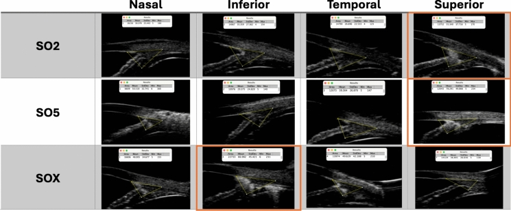
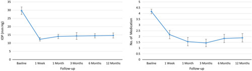
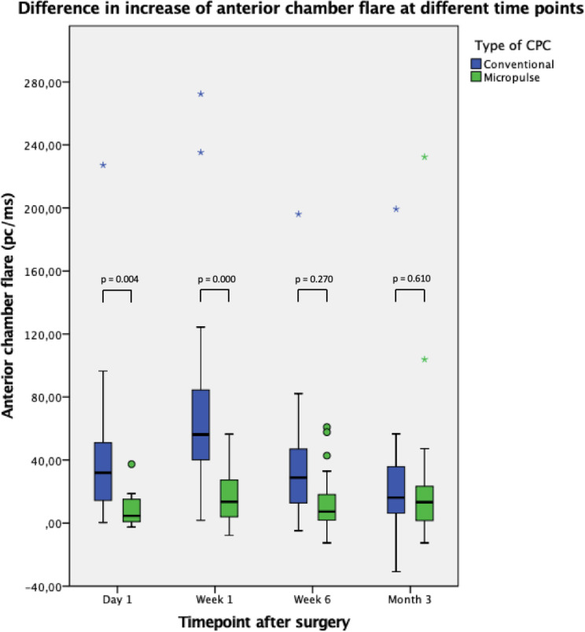
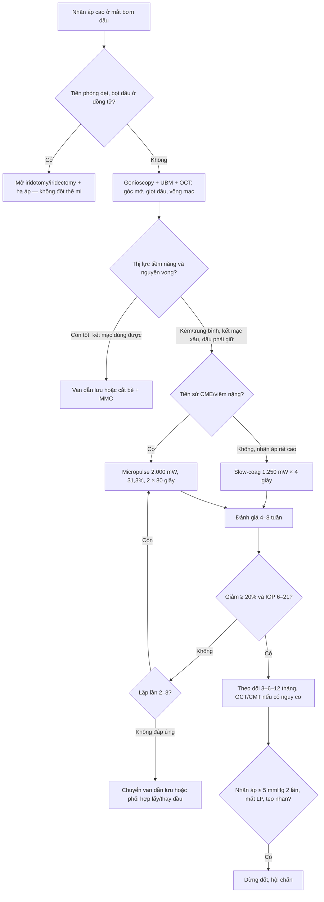
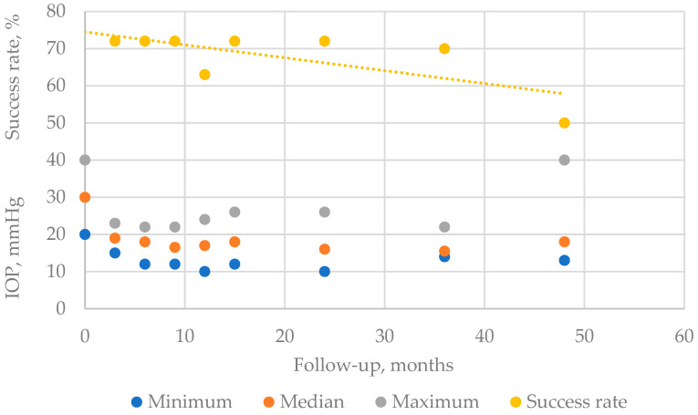
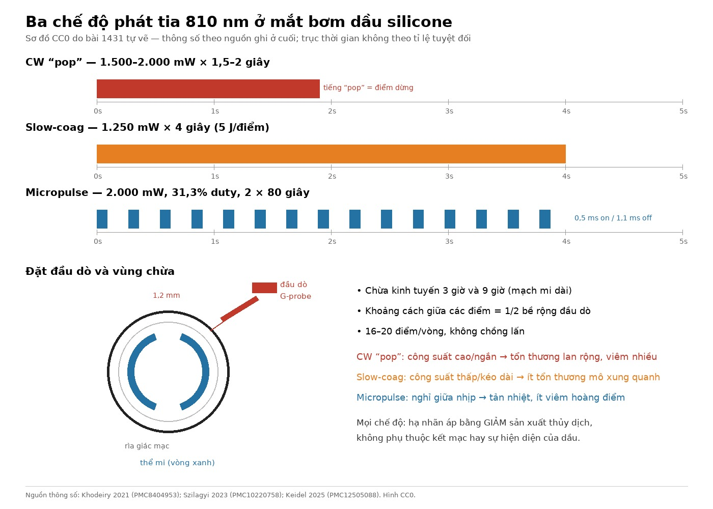

# 1431 — Quang đông thể mi ở mắt bơm dầu silicone: slow-coag, micropulse hay CW “pop” / Cyclophotocoagulation in silicone oil-filled eyes

**Tags:** `pattern:tang-nhan-ap` `pattern:dau-silicone` `pattern:bit-be` `pattern:vien-tien-phong` `pattern:ha-nhan-ap-qua-muc` `vung:the-mi` `vung:goc-tien-phong` `vung:tien-phong` `vung:dia-thi` `protocol:TSCPC` `protocol:UBM` `protocol:AS-OCT` `protocol:gonioscopy` `score:IOP`
**Mức chắc chắn (certainty):** tổng hợp y văn (literature synthesis) — nhóm tự biên từ các loạt mắt bơm dầu được điều trị bằng ba chế độ quang đông thể mi, một RCT so sánh viêm sau CW và micropulse, và các nghiên cứu lặp tia; phần “khi nào chọn chế độ nào” là tổng hợp có suy luận, không có RCT đầu-đối-đầu riêng cho mắt bơm dầu.

> **Vì sao bài này quan trọng:** bài **1416** trả lời *nhãn áp tăng ở mắt có dầu do cơ chế nào* (pupillary block, bít bè do nhũ tương, PAS, bơm quá thể tích). Bài này trả lời câu hỏi tiếp theo trong cùng buổi khám: **khi đã quyết định quang đông thể mi, chọn chế độ nào, đặt bao nhiêu điểm, đợi bao lâu mới lặp, và làm sao không biến một mắt còn thị lực thành mắt teo?** Đây không phải câu hỏi hàn lâm: sau bơm dầu, **2,2–56%** mắt tăng nhãn áp và **70%** glôcôm sau cắt dịch kính + dầu được quy trực tiếp cho dầu (số liệu tổng quan ở bài 1416); thuốc kiểm soát được **30–78%**, phần còn lại cần can thiệp. Ba chế độ có cùng đích (phá thể mi giảm sản xuất thủy dịch) nhưng **khác nhau ở lượng mô lành bị đốt**, và đó là khác biệt quyết định giữa “hạ được áp” và “mất cảm giác sáng”.

## 1. Tổng quan bệnh học – cơ chế hình ảnh – vì sao mắt bơm dầu là mắt “khó đốt”

- **Mục tiêu giải phẫu:** thể mi nằm **1,2 mm sau rìa giác mạc (limbus)**, sát góc tiền phòng; tia diode **810 nm** bị **melanin ở biểu mô sắc tố thể mi** hấp thụ → **đông hoại tế bào biểu mô thể mi** → giảm sản xuất thủy dịch. Vì đích là sắc tố chứ không phải mạch máu, hiệu quả phụ thuộc **lượng sắc tố, độ dày củng mạc và vị trí thể mi**, không phụ thuộc việc mắt có dầu hay không.
- **Vì sao dầu làm phức tạp:** dầu silicone (polydimethylsiloxane, PDMS) tỷ trọng **0,97 g/cm³**, chiết suất **1,40**, sức căng mặt phân cách với nước **≈ 35 mN/m**; bản thân dầu **không chặn tia 810 nm** đáng kể. Cái thay đổi là **giải phẫu và mô học**: mắt đã cắt dịch kính mất “giá đỡ” dịch kính nên thể mi có xu hướng **dịch ra sau**, củng mạc có thể mỏng hơn sau nhiều lần mổ, kết mạc xơ dính, và góc tiền phòng thường đã bị tổn thương bởi dầu nhũ tương. Vì vậy **đặt đầu dò theo rìa giác mạc 1,2 mm là ước lệ**, không phải bảo đảm trúng thể mi; UBM trước thủ thuật giúp xác nhận thể mi và góc.
- **Tổn thương thể mi “âm thầm” do dầu:** UBM 33 bệnh nhân/66 mắt (nhóm dầu 2.000 cS, 5.000 cS và dầu nặng) cho thấy **hồi âm tăng ở góc trên** với dầu 2.000 cS (**p = 0,04**) và 5.000 cS (**p = 0,02**), **góc dưới** với dầu nặng (**p < 0,01**) so với mắt bên, **dù không thấy nhũ tương bằng đèn khe**; ở nhóm 2.000 cS, **thời gian giữ dầu càng dài càng nhiều góc tăng hồi âm** (**p < 0,01**). Nghĩa là “góc sạch” trên đèn khe không loại trừ dầu đã thấm vào bè — đây là lý do nhiều mắt đã tổn thương bè không hồi phục trước khi nhãn áp tăng.
- **Bốn cơ chế tăng nhãn áp sau dầu (phải phân biệt trước khi đốt):** (1) **pupillary block** do bọt dầu — tiền phòng dẹt, nhãn áp tăng cấp, xử trí bằng mở thông đồng tử chứ **không** phải đốt thể mi; (2) **bít bè do giọt nhũ tương + đại thực bào** — góc mở, giọt vàng óng trên bè; (3) **PAS/rubeosis** — góc đóng không hồi phục; (4) **bơm quá thể tích** — nhãn áp tăng ngay sau mổ, tiền phòng sâu. Quang đông thể mi chỉ là điều trị đúng cho (2) và một phần (3) khi thuốc thất bại.
- **Vì sao “đốt ít mà đủ” lại khó:** thể mi nằm sát **mạch mi dài** ở 3 và 9 giờ và sát **võng mạc chu biên**; đốt quá tay gây **viêm nặng, phù hoàng điểm, hạ nhãn áp, teo nhãn cầu**, trong khi đốt quá nhẹ thì **không hạ áp** và phải lặp. Ba chế độ là ba cách cân bằng khác nhau giữa **nhiệt độ đỉnh** và **thời gian truyền nhiệt**:
  - **CW “pop”:** công suất cao (**1.500–2.000 mW**) trong thời gian ngắn (**1,5–2 giây**), tăng đến khi nghe tiếng “pop” (hiện tượng sôi/bốc hơi mô) → **đỉnh nhiệt rất cao**, mô xung quanh bị đốt lan.
  - **Slow-coag:** công suất thấp cố định (**1.250 mW**) trong **4 giây** (**5 J/điểm**) → nhiệt dàn đều hơn, ít “nổ” mô, thời gian truyền nhiệt dài hơn nhưng đỉnh thấp hơn.
  - **Micropulse:** **2.000 mW** nhưng chia thành nhịp **0,5 ms bật / 1,1 ms tắt** (**duty cycle 31,3%**) → giữa các nhịp mô có thời gian **tản nhiệt**, nên ít tổn thương lan và ít viêm hơn; tổng thời gian thường **2 × 80 giây** (**160 giây**, tương đương **~100 J**).
- **Ngưỡng định lượng cần nhớ:** thành công thường định nghĩa **nhãn áp 6–21 mmHg và giảm ≥ 20%** so với nền, không mổ glôcôm lại, không mất cảm giác sáng; hạ nhãn áp quá mức là **≤ 5 mmHg** trên **2 lần khám liên tiếp**; viêm tiền phòng đo bằng **flare (pc/ms)**, phù hoàng điểm đo **độ dày trung tâm (µm)**.

## 2. Mẫu hình + chẩn đoán phân biệt theo cơ chế và tiềm năng thị lực (Gamut)

Ba câu hỏi phải trả lời **trước khi chọn chế độ**: **(1) góc đóng hay mở? (2) võng mạc có còn khả năng theo dõi/điều trị không? (3) thị lực tiềm năng còn bao nhiêu?**

- **Nhóm A — góc ĐÓNG do bọt dầu (cấp cứu, không đốt):** tiền phòng dẹt, bọt dầu ở bờ đồng tử, nhãn áp **60–67 mmHg** (ca điển hình ở bài 1416). Xử trí: hạ áp + nằm sấp + **iridotomy/iridectomy**; nếu thất bại mới tính phẫu thuật. Đốt thể mi ở đây là **sai thứ tự** vì nguyên nhân là tắc lưu thông, không phải tăng sản xuất.
- **Nhóm B — góc MỞ, nhũ tương hóa, còn thị lực tiềm năng:** giọt dầu trên bè, nhãn áp tăng dần theo tháng. Ưu tiên **thuốc hạ áp** + cân nhắc **lấy/thay dầu** nếu võng mạc cho phép; nếu vẫn cao, **van dẫn lưu** hoặc **quang đông thể mi** tùy tình trạng kết mạc và nguyện vọng.
- **Nhóm C — góc MỞ/PAS, kết mạc xấu, dầu phải giữ, thị lực kém–trung bình:** đây là **nhóm chỉ định chính của quang đông thể mi**: không phụ thuộc kết mạc, không cần mở nhãn cầu, lặp được, và không làm mất tamponade. Trong loạt slow-coag, **44,4%** mắt đã có **≥ 2 lần mổ dịch kính**, dầu đã nằm trung bình **9,3 ± 6,6 tháng** — đúng chân dung nhóm này.
- **Nhóm D — glôcôm tân mạch sau dầu:** cần **anti-VEGF + PRP** song song; quang đông thể mi có thể làm **cầu nối** khi nhãn áp rất cao và thị lực đã kém, nhưng phải chấp nhận nguy cơ **viêm và phù hoàng điểm** cao hơn.
- **Nhóm E — nguy cơ hạ áp/teo nhãn cao:** mắt đã đốt thể mi trước đó, củng mạc mỏng, tiền sử hạ áp, một mắt độc nhất, thị lực còn tốt. Chọn **micropulse** hoặc **slow-coag liều thấp**, tránh CW “pop”, và **không lặp quá sớm**.
- **Nhóm F — “không phải thể mi”: tăng áp do corticoid, do dầu trong tiền phòng, do overfill:** hình ảnh và bối cảnh khác; đốt thể mi sẽ **che mất nguyên nhân điều trị được** (giảm corticoid, lấy bớt dầu).

*UBM 4 hướng (mũi–dưới–thái dương–trên) ở ba nhóm dầu: SO2 (2.000 cS), SO5 (5.000 cS), SOX (dầu nặng). Vùng ROI vàng dùng đo hồi âm; hồi âm tăng ở góc trên với SO2/SO5 và góc dưới với SOX — bằng chứng dầu thấm vào cấu trúc dẫn lưu **trước khi** nhũ tương thấy được. Nguồn: Mora P et al., Int Ophthalmol 2025 (PMC11971159) Fig. 2, CC BY 4.0.*

## 3. Bảng so sánh phân biệt (ma trận đối chiếu)

| Thực thể (entity) | Hình ảnh/thông số điển hình | Chốt vào (rule-in) | Chốt loại (rule-out) | Gợi ý xác nhận |
|---|---|---|---|---|
| **CW “pop” truyền thống** | 810 nm, **1.500–2.000 mW × 1,5–2 giây**, 16–20 điểm, dừng khi nghe “pop”; hiệu quả **44–81,8%** ở mắt có dầu (Sivagnanavel 44%, Albahlal 53,8%, Bloom 72%, Ghazi-Nouri 73,7%) | **Nhãn áp rất cao, thị lực kém, kết mạc xấu, không có tiền sử phù hoàng điểm**, cần hạ áp nhanh | **Còn thị lực tốt, tiền sử CME/viêm nặng, một mắt độc nhất** → chọn chế độ ít viêm hơn | Ghi nhận số điểm, công suất, có “pop” hay không; đo flare/CMT sau 1 tuần nếu nghi |
| **Slow-coag CW** | **1.250 mW × 4 giây** (5 J/điểm), khoảng cách 1/2 bề rộng đầu dò, chừa 3 và 9 giờ; 18 mắt: **29,7 ± 9,6 → 14,6 ± 6,5 mmHg** lúc 12 tháng, thuốc **4,2 ± 0,9 → 1,9 ± 1,3**, thành công **72,2%** | **Cần hạ áp bền, không cần “pop”, muốn giảm đau/viêm**; nhãn áp nền cao nhưng thị lực còn đếm ngón tay | **Nhãn áp chỉ tăng nhẹ, góc đóng do bọt dầu, hoặc nguyên nhân không phải thể mi** | Theo dõi nhãn áp 1 tuần–1–3–6–12 tháng; không đánh giá thất bại ở ngày 1 |
| **Micropulse (MP-TSCPC)** | **2.000 mW, 31,3% duty (0,5 ms on/1,1 ms off), 2 × 80 giây**, 3 mm sau rìa, quét 10 giây/nửa cầu; 11 mắt dầu 1.300 cS: thành công **73%** lúc 2 năm, **27%** phải lặp | **Có tiền sử CME/viêm, thị lực còn tốt, cần giảm viêm tối đa**; hoặc muốn lặp nhiều lần | **Nhãn áp rất cao cần hạ nhanh, sẹo kết mạc dày, không hợp tác nằm yên** | So sánh flare/CMT với CW; đánh giá lại 4–8 tuần |
| **Van dẫn lưu (Ahmed/Baerveldt)** | Ống vào tiền phòng, đĩa dưới kết mạc; thành công **62–80%** ở mắt có dầu; hạ áp quá mức tới **50%** | **Còn thị lực tiềm năng, cần hạ áp sâu và bền**, kết mạc còn dùng được | **Kết mạc xơ nặng, mắt đã mổ nhiều lần, dầu trong tiền phòng dễ bít ống** | Soi góc/AS-OCT sau mổ; kiểm tra ống, đĩa, nhãn áp |
| **Cắt bè + MMC** | Lỗ dẫn lưu củng mạc–kết mạc; thành công **40%** tuyệt đối và **60%** có thuốc lúc 2 năm (Errico); loạt khác chỉ **21,1%** có thuốc lúc 1 năm | **Ít can thiệp, chi phí thấp, góc mở**, chưa mổ nhiều | **Kết mạc đã mổ, dầu trong tiền phòng, viêm mạn** → thất bại cao | Theo dõi bọng kết mạc, nhãn áp, biến chứng |
| **Lấy/thay dầu** | Nhãn áp có thể về bình thường nếu bè chưa xơ; tháo dầu đơn thuần kiểm soát **45,5–62%**, **14/16** vẫn cần thuốc | **Dầu quá thể tích, nhũ tương tiến triển, giác mạc bị dầu**, võng mạc ổn định | **Võng mạc chỉ áp nhờ dầu, PVR hoạt động, nguy cơ bong cao** | UWF + OCT + đánh giá võng mạc; hội chẩn võng mạc (bài 1410, 1417) |

## 4. Protocol chụp/đo + thông số đốt + thuật toán lặp

**Trước thủ thuật (bắt buộc):**
- **Nhãn áp** nhiều phương pháp nếu giác mạc phù/đã ghép; ghi số thuốc và **thuốc uống**.
- **Đèn khe + gonioscopy:** góc mở/đóng, **giọt dầu trên bè**, PAS, rubeosis, bọt dầu ở đồng tử.
- **UBM** khi nghi thể mi lệch sau/cần đo độ dày củng mạc hoặc khi không soi được góc; **AS-OCT** đo độ sâu tiền phòng và giọt dầu.
- **UWF/OCT hậu cực** để loại trừ bong võng mạc, phù hoàng điểm, giọt dầu trên đĩa thị; **B-scan** nếu môi trường đục.
- **Tiềm năng thị lực:** còn **cảm giác sáng (LP)** hay không quyết định mức độ “được phép” đánh đổi; ghi rõ trong hồ sơ.

**Thông số ba chế độ (bảng thực hành):**

| Chế độ | Công suất | Thời gian | Duty cycle | Số điểm/vùng | Điểm kết thúc | Bằng chứng chính |
|---|---|---|---|---|---|---|
| CW “pop” | 1.500–2.000 mW | 1,5–2 giây/điểm | liên tục | 16–20 điểm, chừa 3 và 9 giờ | nghe “pop” | Thành công 44–81,8% ở mắt có dầu; Bloom 72%, giảm nhãn áp 51% |
| Slow-coag | **1.250 mW** | **4 giây/điểm** | liên tục | 1/2 bề rộng đầu dò, 1 vòng | **không cần “pop”** | 18 mắt: **72,2%** thành công, **29,7 → 14,6 mmHg**, thuốc **4,2 → 1,9** |
| Micropulse | **2.000 mW** | **2 × 80 giây** | **31,3%** (0,5 ms on/1,1 ms off) | 3 mm sau rìa, quét 10 giây/nửa cầu | không “pop”; theo dõi đỏ da/đau | 11 mắt dầu: **73%** lúc 2 năm, **27%** lặp; không hạ áp/teo |

**Theo dõi sau đốt:**
- **Corticoid tại chỗ 6–8 lần/ngày** giảm dần trong **3–4 tuần**; cycloplegic nếu viêm mạnh; giảm đau theo nhu cầu.
- **Nhãn áp:** ngày 1, tuần 1, tháng 1–3–6–12; **không đánh giá thất bại ở ngày 1** vì viêm/corticoid có thể làm tăng áp thoáng qua.
- **Đáy mắt/OCT** ở tuần 1 và tháng 1 nếu có tiền sử CME; **flare** nếu nghi viêm nặng.
- **Ngưỡng dừng:** nhãn áp **≤ 5 mmHg** hai lần liên tiếp, **mất cảm giác sáng**, hoặc **teo nhãn cầu** → không lặp, hội chẩn.
- **Lặp:** đánh giá sau **4–8 tuần**; micropulse có thể lặp **6–14 tháng** (27% trong loạt 11 mắt); tối đa **2–3 lần** rồi chuyển van nếu không đáp ứng.

**Kết quả lặp tia (76 mắt, 7 mắt có tiền sử dầu):** thành công theo kiểu đáp ứng — **không đáp ứng 39,4%**, **mất tác dụng sớm 33,3%**, **mất tác dụng muộn 41,7%**, **cần tăng hiệu quả 60,0%**; **28,9%** phải mổ glôcôm khác; **1,3%** hạ áp dai dẳng (một ca teo nhãn ở năm thứ 5). Kết luận thực hành: **lặp có ích nhất ở mắt đã đáp ứng lần đầu**, không phải ở mắt hoàn toàn không đáp ứng.

**Tổng năng lượng khi lặp (82 mắt, 31 mắt do dầu):** giảm nhãn áp 12 tháng **26 ± 27%** (< 120 J), **39 ± 32%** (120–200 J), **49 ± 33%** (> 200 J), khác biệt **không có ý nghĩa (p = 0,17)**; mắt có dầu **đáp ứng mạnh hơn**; hạ áp có phù hoàng điểm **2%**, giảm thị lực ≥ 3 dòng **31%**, mất cảm giác sáng **5 ca** trong 12 tháng — đây là giá phải tư vấn trước.

*Slow-coag 1.250 mW × 4 giây, 18 mắt: nhãn áp **29,7 → 14,6 mmHg** và thuốc **4,2 → 1,9** lúc 12 tháng; **6 mắt (33,3%)** không còn thuốc. Nguồn: Khodeiry MM et al., J Glaucoma 2021 (PMC8404953) Fig. 1, **CC BY-NC-ND 4.0 — nguyên bản, không crop/ghép**.*

*RCT 60 mắt: flare tiền phòng sau CW cao hơn micropulse rõ ở **ngày 1 (p = 0,004)** và **tuần 1 (p = 0,000)**, bằng nhau ở tuần 6 và tháng 3; độ dày hoàng điểm tăng **165,5 µm** với CW so với **55,8 µm** với micropulse. Đau và chất lượng sống **không khác**. Nguồn: Keidel LF et al., Br J Ophthalmol 2025 (PMC12505088) Fig. 1, CC BY-NC 4.0.*

## 5. Biến thể bình thường và cạm bẫy

- **Tăng nhãn áp ngày 1 sau đốt không phải thất bại:** viêm thể mi + corticoid có thể làm nhãn áp tăng **24–72 giờ** rồi giảm; đừng lặp tia trong tuần đầu. Ngược lại, **nhãn áp ≤ 5 mmHg** kéo dài là dấu hiệu **giảm sản xuất quá mức**, không phải “thành công”.
- **Không có tiếng “pop” ở slow-coag/micropulse là bình thường:** “pop” là dấu hiệu mô sôi ở CW công suất cao, không phải mục tiêu. Tìm “pop” ở slow-coag là **đốt quá liều**.
- **Hồi âm tăng ở góc trên UBM không phải sắc tố bình thường:** ở mắt bơm dầu, vùng tăng hồi âm tương ứng **dầu thấm vào bè**, có thể xuất hiện **trước nhũ tương thấy được**; đừng gọi là “pigment dispersion” rồi bỏ qua.
- **Giọt dầu trong tiền phòng gây tăng áp độc lập với thể mi:** nếu tiền phòng đầy dầu, hạ áp bằng đốt thể mi sẽ **thất bại**; cần lấy bớt dầu/rửa tiền phòng.
- **Viêm sau đốt giả endophthalmitis:** đau, tyndall, fibrin sau 24–72 giờ có thể do phản ứng nhiệt; chỉ cấy/chích nội nhãn khi có **giảm thị lực nặng, mủ tiền phòng, đau tăng dần** — không cấy máu mắt vì “tiền phòng đục”.
- **Củng mạc mỏng sau nhiều lần mổ/đốt trước:** đặt đầu dò quá mạnh có thể **thủng củng mạc** hoặc đốt quá sâu; dùng lực nhẹ, kiểm tra đỏ da, tránh vùng sẹo mỏng.
- **Thỏa mãn tìm kiếm:** đã thấy dầu + nhãn áp cao thì dễ bỏ **bong võng mạc tái phát**, **phù hoàng điểm**, **dầu trên đĩa thị**; khám theo trình tự: giác mạc → tiền phòng → góc → thể thủy tinh/IOL → dầu → võng mạc → đĩa thị.
- **Đo nhãn áp sai ở mắt đã ghép giác mạc/giác mạc phù:** có thể **đọc thấp giả**; dùng nhiều phương pháp và đánh giá **đĩa thị/RNFL** thay vì tin một con số.

## 6. Tự lượng giá — Blind Quiz

**Ca 1 — Nam 58 tuổi, bong võng mạc PVR đã cắt dịch kính + dầu 9 tháng; nhãn áp 32 mmHg dù 4 thuốc, góc mở, thị lực đếm ngón tay.**

- Gợi ý: không có bọt dầu ở đồng tử; gonioscopy thấy ít giọt dầu trên bè; OCT không phù hoàng điểm.
- Câu hỏi: (1) Hai đường cong cho thấy gì? (2) Chọn chế độ nào và vì sao? (3) Ba ngưỡng phải theo dõi sau đốt?

<b>Bấm để hiện đáp án (findings + chẩn đoán)</b>

- Dấu hiệu: nhãn áp giảm từ **29,7 ± 9,6** xuống **14,6 ± 6,5 mmHg** lúc 12 tháng; số thuốc từ **4,2 ± 0,9** còn **1,9 ± 1,3**; **6/18 mắt (33,3%)** không còn thuốc; thành công **72,2%**.
- Chẩn đoán: glôcôm thứ phát sau dầu, góc mở, còn thị lực đếm ngón tay → **slow-coag 1.250 mW × 4 giây** là lựa chọn hợp lý vì hạ áp bền mà **không cần “pop”**, ít viêm hơn CW; có thể lặp nhưng không tính là thất bại.
- Ngưỡng theo dõi: (1) nhãn áp **6–21 mmHg và giảm ≥ 20%**; (2) **≤ 5 mmHg** hai lần liên tiếp = hạ áp quá mức; (3) **mất cảm giác sáng/teo nhãn** = dừng. Cảnh báo: 3 bệnh nhân giảm ≥ 2 dòng thị lực (2 do glôcôm tiến triển, 1 do CME).
- Nguồn ảnh: Khodeiry MM et al., J Glaucoma 2021 (PMC8404953) Fig. 1, **CC BY-NC-ND 4.0 — nguyên bản**.

**Ca 2 — Nữ 47 tuổi, dầu 1.300 cS 14 tháng, nhãn áp 28 mmHg, đã từng phù hoàng điểm sau mổ; muốn tránh viêm nặng.**

- Gợi ý: góc mở, không bọt dầu, OCT hoàng điểm mỏng nhẹ; bệnh nhân sợ đau và sợ mờ thêm.
- Câu hỏi: (1) Đường cong gợi ý chế độ nào? (2) Thông số và số lần lặp dự kiến? (3) Vì sao không chọn CW “pop” ở ca này?

<b>Bấm để hiện đáp án</b>

- Dấu hiệu: nhãn áp trung vị quanh **15–16 mmHg** sau đốt, tỉ lệ thành công **72% → 50%** từ 24 đến 48 tháng; không có ca hạ áp/teo nhãn trong 11 mắt.
- Chẩn đoán: chọn **micropulse 2.000 mW, 31,3% duty, 2 × 80 giây**, 3 mm sau rìa, quét 10 giây/nửa cầu; **27% (3/11)** phải lặp lúc **6, 8, 14 tháng**.
- Vì sao không CW: RCT cho thấy CW gây **flare cao hơn** ở ngày 1/tuần 1 và **phù hoàng điểm nhiều hơn** (độ dày trung tâm tăng **165,5 vs 55,8 µm**); ở người có tiền sử CME, micropulse là lựa chọn an toàn hơn dù hiệu quả hạ áp tương đương.
- Nguồn ảnh: Szilagyi Z et al., Life (Basel) 2023 (PMC10220758) Fig. 2, CC BY 4.0.

**Ca 3 — Đọc sơ đồ ba chế độ phát tia (ảnh do bài tự vẽ).**

- Gợi ý: trục ngang là thời gian; ba hàng là ba kiểu bật/tắt.
- Câu hỏi: (1) Hàng nào là CW “pop”, slow-coag, micropulse? (2) Chế độ nào ít viêm nhất và vì sao? (3) Điểm đặt đầu dò cách rìa bao nhiêu và chừa kinh tuyến nào?

<b>Bấm để hiện đáp án</b>

- Hàng đỏ: **CW “pop”** (1.500–2.000 mW × 1,5–2 giây, dừng khi “pop”); hàng cam: **slow-coag** (1.250 mW × 4 giây, 5 J/điểm); hàng xanh: **micropulse** (2.000 mW, 0,5 ms on/1,1 ms off, 31,3% duty, 2 × 80 giây).
- Ít viêm nhất: **micropulse** — nhịp tắt 1,1 ms cho mô tản nhiệt, giảm tổn thương lan; bằng chứng: flare thấp hơn CW ở ngày 1/tuần 1, CMT tăng ít hơn.
- Đầu dò: bờ cong sát rìa, chùm tia hướng ra sau **1,2 mm**, chừa **3 giờ và 9 giờ** (mạch mi dài), các điểm cách nhau **1/2 bề rộng đầu dò**, **16–20 điểm/vòng**.
- Nguồn: sơ đồ CC0 do bài 1431 tự vẽ; thông số theo Khodeiry 2021 (PMC8404953), Szilagyi 2023 (PMC10220758), Keidel 2025 (PMC12505088).

## Bài liên quan chéo
- [1416 – Glôcôm do dầu silicone: pupillary block, bít bè do nhũ tương, lấy dầu – van – CPC](../1416-glaucom-do-dau-silicone/lesson.md)
- [1410 – Lấy dầu silicone & dầu tồn lưu: nhũ tương hóa, giọt tăng phản xạ trên OCT, bong tái phát](../1410-lay-dau-silicone-va-dau-ton-luu/lesson.md)
- [1417 – Khi nào GIỮ dầu silicone vĩnh viễn: chọn ca, theo dõi dầu tồn lưu](../1417-giu-dau-silicone-vinh-vien/lesson.md)
- [1432 – Thay dầu silicone: bơm thiếu thể tích, nhũ tương nặng, độ nhớt 1.000 vs 5.000 cS](../1432-thay-dau-silicone/lesson.md)
- [442 – Glôcôm trên OCT: RNFL/GCC và đánh giá tổn thương thị thần kinh](../442-glaucoma-OCT/lesson.md)
- [1411 – Tăng nhãn áp do corticoid nội nhãn: DEX-I, implant lạc tiền phòng](../1411-tang-nhan-ap-do-corticoid-noi-nhan/lesson.md)

## Ảnh
- `1431_nhan-ap-slowcoag_Bieu-do_PMC8404953-Fig1-CCBYNCND.jpg` — Khodeiry MM et al., *J Glaucoma* 2021 (PMC8404953) Fig. 1, **CC BY-NC-ND 4.0**, nguyên bản, không crop/ghép.
- `1431_nhan-ap-micropulse_Bieu-do_PMC10220758-Fig2-CCBY.jpg` — Szilagyi Z et al., *Life (Basel)* 2023 (PMC10220758) Fig. 2, **CC BY 4.0**, nguyên bản.
- `1431_vien-tien-phong_Bieu-do_PMC12505088-Fig1-CCBYNC.jpg` — Keidel LF et al., *Br J Ophthalmol* 2025 (PMC12505088) Fig. 1, **CC BY-NC 4.0**, nguyên bản.
- `1431_the-mi_UBM_PMC11971159-Fig2-CCBY.jpg` — Mora P et al., *Int Ophthalmol* 2025 (PMC11971159) Fig. 2, **CC BY 4.0**, nguyên bản.
- `1431_so-do-che-do-tia_CC0.jpg` — sơ đồ do bài 1431 tự vẽ, **CC0**, không dùng ảnh nguồn ngoài.
- Không tải ảnh từ Radiopaedia/AuntMinnie/Retina Image Bank; chỉ dẫn link ở `sources.md`.

> Không dùng để chẩn đoán độc lập khi chưa có người hướng dẫn.
