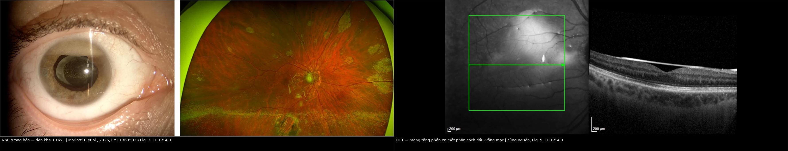
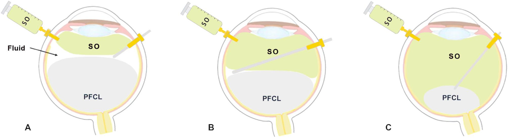
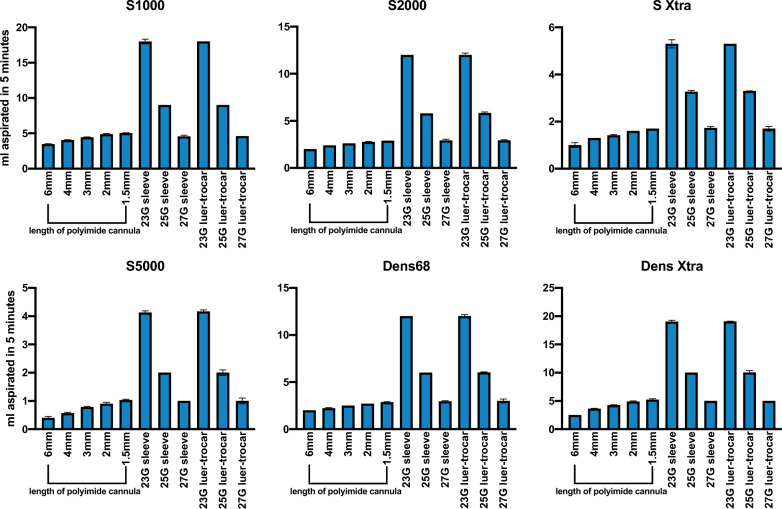
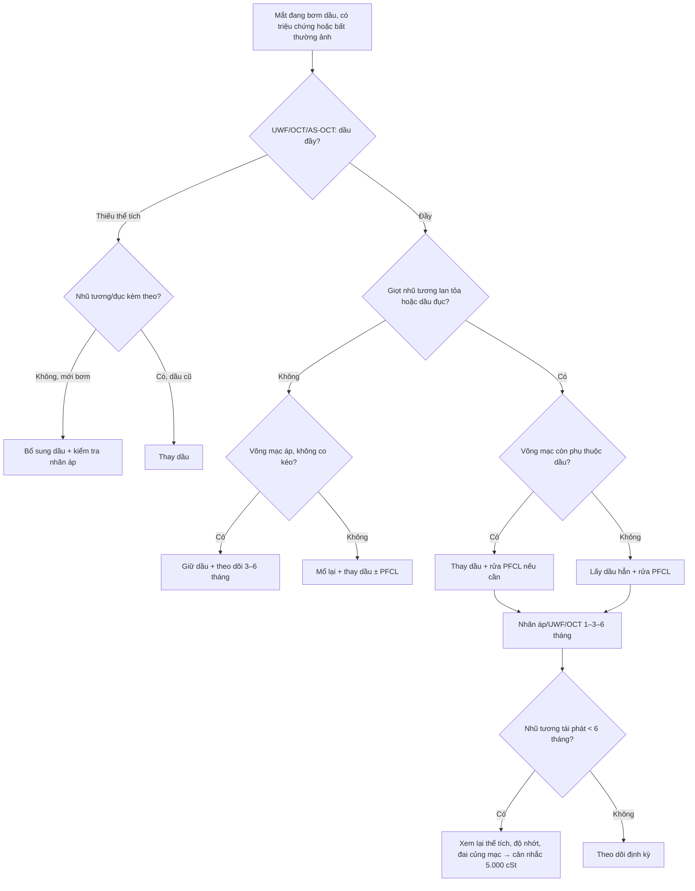
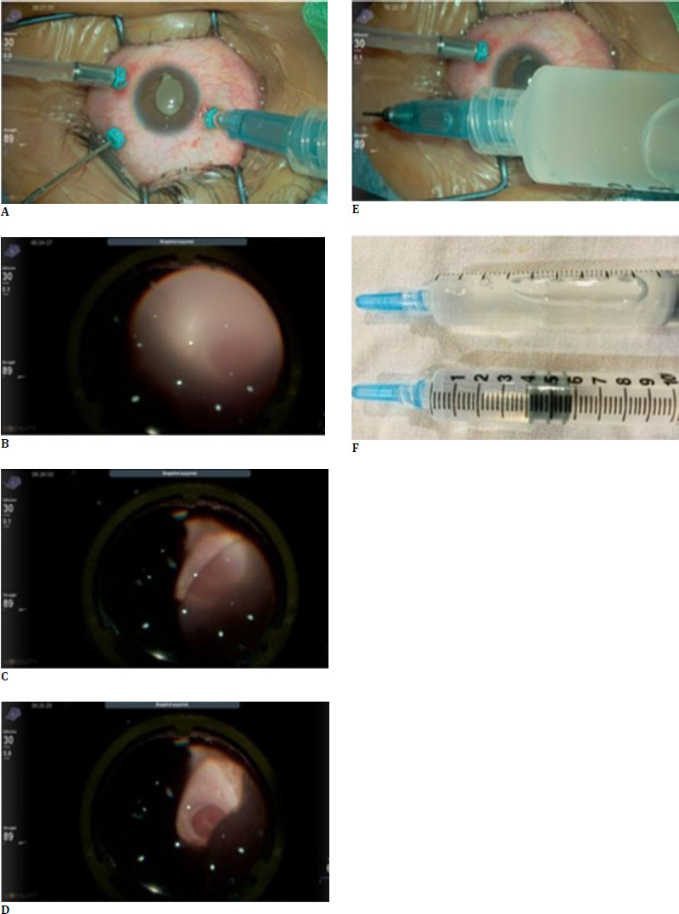
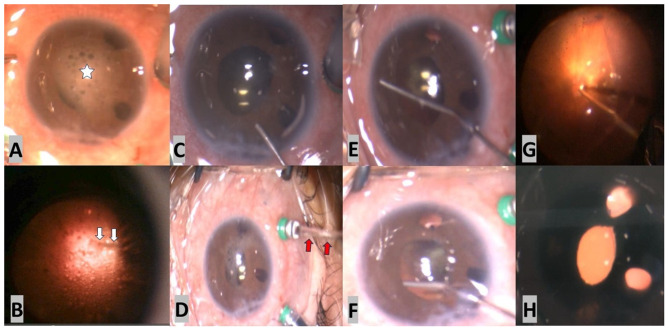

# 1432 — Thay dầu silicone: bơm thiếu thể tích, nhũ tương nặng, dầu đục / Silicone oil exchange

**Tags:** `pattern:dau-silicone` `pattern:nhu-tuong-hoa` `pattern:dau-duc` `pattern:thieu-the-tich` `pattern:bong-tai-phat` `pattern:tang-nhan-ap` `vung:dich-kinh` `vung:vong-mac` `vung:tien-phong` `vung:the-thuy-tinh` `protocol:UWF` `protocol:OCT` `protocol:AS-OCT` `protocol:PPV` `protocol:PFCL` `score:PVR`
**Mức chắc chắn (certainty):** tổng hợp y văn (literature synthesis) — số liệu lấy từ các loạt kỹ thuật trao đổi PFCL–dầu, nghiên cứu thể tích khoang dịch kính, yếu tố nguy cơ nhũ tương hóa, ca dầu đục và tổng quan về dầu silicone. **Chưa có RCT so sánh trực tiếp “thay dầu” với “lấy dầu hẳn”**; phần chỉ định thay dầu là tổng hợp có suy luận, đã ghi rõ chỗ nào là suy luận.

> **Vì sao bài này quan trọng:** bài **1417** trả lời “giữ hay lấy dầu”; bài này trả lời lựa chọn thứ ba mà thực hành hay bỏ qua: **thay dầu** — lấy dầu cũ ra, bơm dầu mới, giữ nguyên tamponade. Câu hỏi hằng ngày rất cụ thể: *bơm thiếu thể tích thì bổ sung hay thay? Nhũ tương nặng thì rửa bằng PFCL rồi thay, hay lấy hẳn? Dầu đục 4 năm thì xử trí gì?* Chọn sai một trong hai hướng đều có giá: **lấy hẳn** ở mắt phụ thuộc dầu → bong tái phát; **giữ nguyên** ở mắt đã nhũ tương/thiếu thể tích → glôcôm, bệnh giác mạc và bong tiến triển. Bài này đưa ra **ngưỡng quyết định + kỹ thuật + con số** để chọn đúng.

## 1. Tổng quan bệnh học – cơ chế hình ảnh – vì sao “thay” khác “lấy”

- **Vật lý của dầu:** PDMS tỷ trọng **0,97 g/cm³** (nổi trên nước), sức căng mặt phân cách với nước **≈ 35 mN/m**, độ nhớt **1.000–5.000 cSt**. Lực tamponade do **sức căng mặt phân cách** quyết định, **không do độ nhớt**; độ nhớt chỉ quyết định dầu dễ hay khó bơm/hút và xu hướng nhũ tương hóa. Vì vậy “dầu đặc hơn” không tự động giữ võng mạc tốt hơn.
- **Vì sao bơm thiếu thể tích lại nguy hiểm:** dầu tạo một **bong bóng lớn**; muốn tamponade tối đa, khoang dịch kính phải **gần đầy**. Thiếu thể tích để lại **lớp dịch mỏng giữa dầu và võng mạc**, làm vùng võng mạc không được nâng đỡ → **bong tái phát và PVR**. Trong một đoàn hệ 81 mắt bong võng mạc rách, **58,0%** có bơm thiếu thể tích trên ảnh góc rộng; ở nhóm giữ dầu **< 6 tháng**, thiếu thể tích liên quan có ý nghĩa với **nhũ tương hóa sớm (p = 0,025)**.
- **Thể tích cần bơm — con số thay cho “bơm đầy theo cảm giác”:** khoang dịch kính sau cắt dịch kính trung bình **4,46 ± 0,83 mL** (khoảng **2,8–8,1 mL**) ở 103 mắt, với **AL 23,43 ± 1,54 mm**. Công thức hồi quy đơn giản: **V (mL) = −4,16 + 0,37 × AL (mm)**, sai số chuẩn **0,60 mL**. Ví dụ AL **24 mm** → **4,72 mL**; AL **26 mm** → **5,46 mL**. Đây là ước lượng để tránh thiếu/thừa, không thay thế quan sát “bong bóng khí nhỏ xuất hiện” khi bơm.
- **Vì sao nhũ tương hóa:** lực cắt ở mặt phân cách dầu–nước + surfactant nội sinh (protein, phospholipid, máu) phá dầu thành giọt; giọt **< 1 µm** đi vào bè, nội mô giác mạc, nội võng mạc. Nhũ tương gặp **tới 70%** khi dầu lưu **> 6 tháng**, phần lớn trong **6–12 tháng**; yếu tố nguy cơ gồm **tuổi bệnh nhân (p = 0,032)**, **đai củng mạc (p = 0,006)**, **thời gian giữ dầu (p = 0,015)** và **bơm thiếu thể tích**.
- **Vì sao “thay” khác “lấy”:**
  - **Lấy dầu hẳn** = bỏ tamponade, trả khoang dịch kính về dịch/khí; nguy cơ **bong tái phát 22%** trong một đoàn hệ 58 mắt, và **14,9–22,4%** trong các loạt trước (bài 1410). Chỉ làm khi võng mạc đã ổn định và nguy cơ bong thấp.
  - **Thay dầu** = lấy dầu cũ nhưng **bơm dầu mới ngay**, giữ tamponade; giải quyết được **nhũ tương, dầu đục, thiếu thể tích, đổi độ nhớt** mà không mạo hiểm bỏ tamponade. Cái giá là **một cuộc mổ nữa**, nguy cơ **tăng nhãn áp thoáng qua, viêm, bong trong lúc thao tác**, và **nhũ tương tái phát** nếu vẫn còn nguyên yếu tố nguy cơ.
- **Vì sao “dầu đục” không phải “nhũ tương”:**
  - **Nhũ tương** = dầu vỡ thành **giọt nhỏ** phân tán; đèn khe thấy giọt lấp lánh ở tiền phòng/góc, OCT thấy **điểm tăng phản xạ**.
  - **Đục (opacification)** = dầu **mất độ trong suốt toàn khối**, **không** vỡ giọt; ca 4 năm cho thấy dầu trắng đục, **không nhũ tương**, không thấy đáy mắt; phân tích FTIR phát hiện thêm **nhóm Si-OH** và các đỉnh N–H/C≡N, gợi ý tạp chất/ngậm nước. Đây là chỉ định **thay/lấy dầu**, không phải “chờ nhũ tương”.
- **Độ nhớt 1.000 vs 5.000 cSt — bằng chứng không đồng nhất:**
  - **Trong ống nghiệm:** dầu **5.000 cSt ít nhũ tương hơn** 1.000 cSt; nhưng một số nghiên cứu in vitro cho rằng **độ nhớt cắt không phải yếu tố chính**, vai trò lớn thuộc về **surfactant**.
  - **Trên lâm sàng:** Soheilian (82 mắt) thấy nhóm **5.000 cSt** có thị lực cuối kém hơn và **bong tái phát nhiều hơn**, nhưng nhóm này **nhiều ca phức tạp hơn (85% có IOFB/PVR vs 70%)** và giữ dầu lâu hơn — **nhiễu rõ**; Scott lại thấy **kết cục tương đương**. Kết luận trung thực: **không có bằng chứng chắc chắn rằng đổi sang 5.000 cSt cải thiện kết cục**; lợi ích chính là **ít nhũ tương hơn trong mô hình**, cái giá là **khó bơm/hút hơn** và có thể **tăng nguy cơ bệnh giác mạc**.
  - **Tốc độ hút (thực nghiệm trên mắt heo):** với cannula 23G + sleeve, **~18 mL/5 phút** với dầu 1.000 cSt nhưng chỉ **~4 mL/5 phút** với dầu 5.000 cSt — chênh **hơn 4 lần**, nên thay sang dầu đặc cần **cannula ngắn hơn/sleeve** và thời gian mổ dài hơn.

*Trái: giọt dầu nhũ tương ở tiền phòng (đèn khe) và rải rác trên ảnh góc rộng. Phải: OCT cho thấy **màng tăng phản xạ mặt phân cách dầu–võng mạc** và bề mặt võng mạc; đây là dấu hiệu định lượng để theo dõi trước/sau thay dầu. Ảnh ghép letterbox từ Mariotti C et al., Graefes Arch Clin Exp Ophthalmol 2026 (PMC13635028) Fig. 3 và Fig. 5, CC BY 4.0.*

## 2. Mẫu hình + chẩn đoán phân biệt theo chỉ định (Gamut)

Bốn câu hỏi trước khi chọn: **(1) dầu còn đầy không? (2) nhũ tương ở đâu, mức nào? (3) võng mạc có đang bong/co kéo không? (4) mắt có phụ thuộc dầu không?**

- **Nhóm A — thiếu thể tích (underfill), võng mạc còn áp:** mặt thoáng dầu thấp trên UWF, dầu “lỏng” ở nửa dưới, **58%** trong một loạt. Nếu mới bơm/thiếu nhẹ → **bổ sung dầu (top-up)**; nếu dầu đã cũ, nhũ tương kèm theo → **thay dầu**.
- **Nhóm B — nhũ tương hóa nặng, có giọt ở tiền phòng/góc:** giọt vàng óng, tăng nhãn áp, có thể phù giác mạc. **Thay/lấy dầu + rửa PFCL** để lấy giọt; nếu võng mạc ổn và không phụ thuộc dầu → **lấy hẳn**; nếu còn nguy cơ bong → **thay dầu**.
- **Nhóm C — dầu đục (opacification):** không thấy đáy mắt, B-scan còn thấy võng mạc, **không có giọt nhũ tương**. Đây là chỉ định **thay/lấy** vì không còn theo dõi được võng mạc và dầu đã biến chất.
- **Nhóm D — bong tái phát/PVR khi còn dầu:** cần **mổ lại + thay dầu** (đôi khi kèm PFCL, cắt màng, retinectomy); thay dầu giữ tamponade trong khi chờ võng mạc ổn định.
- **Nhóm E — bong tái phát sau khi đã lấy dầu:** **bơm lại dầu** là lựa chọn; trong 53 mắt bong võng mạc do lỗ hoàng điểm ở mắt cận thị, sau lấy dầu **11,3% (6/53)** bong lại, **4/5 (80%)** gắn lại được nhờ **bơm lại dầu**, 1 thất bại.
- **Nhóm F — mắt phụ thuộc dầu, võng mạc áp, không biến chứng:** **không thay** — theo dõi theo bài 1417; thay dầu chỉ vì “đã đến lịch” là can thiệp không có chỉ định.
- **Nhóm G — nghi nhiễm trùng trong mắt có dầu:** sốt/đau/giảm thị lực, mủ tiền phòng; cần **lấy mẫu + kháng sinh**, cân nhắc **lấy/thay dầu** để kiểm soát ổ nhiễm — không trì hoãn vì “dầu còn tốt”.

## 3. Bảng so sánh phân biệt (ma trận đối chiếu)

| Thực thể (entity) | Hình ảnh/đo lường điển hình | Chốt vào (rule-in) | Chốt loại (rule-out) | Gợi ý xác nhận |
|---|---|---|---|---|
| **Bổ sung dầu (top-up)** | UWF: mặt thoáng thấp, dầu thiếu ở nửa dưới; OCT võng mạc áp; dầu còn trong | **Thiếu thể tích mới, nhũ tương nhẹ, võng mạc ổn, dầu chưa cũ** | **Nhũ tương lan tỏa, dầu đục, dầu đã > 6–12 tháng** → thay/lấy | Đo lại thể tích/thị trường dầu trên UWF sau bơm; kiểm tra nhãn áp ngày 1 |
| **Thay dầu cùng độ nhớt** | Lấy dầu cũ, bơm dầu mới; hình ảnh sau mổ giống “dầu đầy” nhưng hết giọt | **Nhũ tương nặng + còn nguy cơ bong + muốn giữ tamponade** | **Võng mạc đã ổn định, không còn nguy cơ bong** → lấy hẳn | So UWF/OCT trước–sau; đếm giọt tiền phòng; nhãn áp 1–7–30 ngày |
| **Thay sang dầu 5.000 cSt** | Dầu đặc hơn, bơm/hút chậm; ít nhũ tương hơn trong mô hình | **Nhũ tương tái phát sớm với 1.000 cSt, kèm yếu tố nguy cơ (trẻ, đai củng mạc, rung giật)** | **Cần thao tác nhanh, củng mạc yếu, nguy cơ bệnh giác mạc** → cân nhắc | Không có bằng chứng chắc chắn cải thiện kết cục; theo dõi nhũ tương 3–6 tháng |
| **Lấy dầu hẳn** | Khoang dịch kính còn dịch/khí; võng mạc áp; không còn tamponade | **Võng mạc áp ≥ 3–6 tháng, không co kéo, nhũ tương/glôcôm tiến triển** | **PVR hoạt động, retinectomy, mắt độc nhất, bong tái phát nhiều lần** | Bong tái phát **22%**; khám 1–2–4–12 tuần; OCT/ UWF |
| **Giữ nguyên dầu** | Dầu đầy, võng mạc áp, không giọt, nhãn áp ổn | **Mắt phụ thuộc dầu, không biến chứng, theo dõi được** | **Thiếu thể tích, nhũ tương tiến triển, dầu đục, nhãn áp tăng** | Lịch UWF/AS-OCT/OCT 3–6–12 tháng (bài 1417) |
| **Rửa PFCL + thay/lấy dầu** | PFCL gom giọt dầu nổi; 20 mắt: **85%** sạch hoàn toàn, **65%** tăng ≥ 2 dòng | **Giọt nhũ tương lan tỏa, đặc biệt ở tiền phòng và mặt võng mạc** | **Chỉ có giọt lẻ tẻ, không tăng nhãn áp** → theo dõi | Đèn khe/gonioscopy sau mổ; OCT tìm giọt nội võng mạc |

## 4. Protocol: chuẩn bị, thể tích, kỹ thuật trao đổi và theo dõi

**Trước mổ:**
- **UWF** đánh giá độ đầy dầu, mặt thoáng, giọt nhũ tương; **OCT hoàng điểm** tìm giọt nội võng mạc/màng mặt phân cách; **AS-OCT/gonioscopy** tìm giọt ở góc.
- **Nhãn áp, đếm tế bào nội mô** (nếu có), **B-scan** khi không thấy đáy mắt.
- **Siêu âm sinh trắc/AL** để ước tính thể tích: **V = −4,16 + 0,37 × AL**, hoặc dùng **4,46 ± 0,83 mL** làm mốc.
- Xác nhận **võng mạc áp/không co kéo** và **mức phụ thuộc dầu**; hội chẩn võng mạc–glôcôm nếu mắt phức tạp.

**Kỹ thuật trao đổi (3 lựa chọn):**
1. **Trao đổi trực tiếp PFCL–dầu tự động:** 23G, đặt dầu vào infusion; bật **dual active injection/extrusion**; **30–40 psi** cho bơm dầu, **150–250 mmHg** hút PFCL; 25G tăng hút **250–300 mmHg**; với dầu **5.000 cSt** đặt **150–200 mmHg**. Áp dụng cho **24 ca** (6 rách khổng lồ, 18 retinectomy), **không có tăng nhãn áp trong mổ**, lấy hết PFCL.
2. **Kỹ thuật hai tay 3 cổng (bimanual):** một tay bơm dầu, một tay hút PFCL/dịch; so với trao đổi khí–dịch (AFE) ở **51 mắt PVR độ C**: thời gian mổ **82,09 ± 10,73 vs 97,61 ± 8,56 phút**; **sa võng mạc trong mổ 8,7% vs 42,9% (p = 0,007)**; thành công giải phẫu **86,9% vs 85,7% (p = 0,898)**.
3. **Rửa PFCL khi nhũ tương nặng:** PFCL gom giọt dầu; **20 mắt** cho **85% sạch hoàn toàn**, **65% tăng ≥ 2 dòng Snellen**, **không mắt nào nhãn áp > 21 mmHg** sau **24,2 tháng**.

**Điểm kết thúc và tránh quá thể tích:**
- Bơm cho đến khi thấy **bong bóng khí nhỏ** hoặc **mạch ở đĩa thị đập** rồi hoàn tất; tránh bơm thêm khi đã đầy.
- **Quá thể tích** gây tăng nhãn áp ngay, tiền phòng nông, mống mắt vồi, thậm chí **sa mống mắt qua vết mổ**; xử trí bằng **lấy bớt dầu**.
- Đóng củng mạc kỹ (dầu rò qua sclerotomy), kiểm tra **nhãn áp trước khi rời phòng mổ**.

**Theo dõi:**
- Ngày 1: nhãn áp, tiền phòng, đáy mắt; tuần 1: nhãn áp, viêm, võng mạc.
- Tháng 1–3: **UWF/OCT** đánh giá độ đầy, nhũ tương, võng mạc; **gonioscopy** nếu nhãn áp tăng.
- Nếu **nhũ tương tái phát trong 6 tháng**: xem lại yếu tố nguy cơ (thiếu thể tích, đai củng mạc, dầu 1.000 cSt) trước khi quyết định thay lần nữa.

*Ba thì của kỹ thuật hai tay: (A) bơm dầu trong khi hút lớp dịch trên PFCL; (B) tiếp tục bơm dầu, hút PFCL qua cannula; (C) dầu lấp đầy, PFCL còn lại được hút nốt. Nguồn: Zhang Z et al., BMC Ophthalmol 2025 (PMC12323066) Fig. 3, **CC BY-NC-ND 4.0 — nguyên bản, không crop/ghép**.*

*Thực nghiệm trên mắt heo: với 23G + sleeve, dầu 1.000 cSt hút được **~18 mL/5 phút**, dầu 5.000 cSt chỉ **~4 mL/5 phút**; cannula polyimide ngắn và luer-trocar tăng tốc độ. Nguồn: Hammer M et al., Int J Retina Vitreous 2023 (PMC10367316) Fig. 2, CC BY 4.0.*

## 5. Biến thể bình thường và cạm bẫy

- **“Thiếu thể tích” trên UWF không đồng nghĩa “nhũ tương”:** mặt thoáng thấp tạo **dải phản xạ ngang** dễ đọc nhầm là lớp giọt; xem thêm **OCT** và **gonioscopy**, và so với ảnh ngay sau bơm.
- **Dầu đục ≠ nhũ tương:** dầu đục làm mất toàn bộ ánh đáy mắt nhưng **không có giọt**; B-scan vẫn thấy võng mạc. Đừng chẩn đoán “nhũ tương nặng” rồi chỉ rửa tiền phòng — phải **thay/lấy dầu**.
- **Giọt dầu ở tiền phòng có thể là dấu hiệu cũ:** giọt tồn tại sau lần bơm trước, không nhất thiết phản ánh nhũ tương đang hoạt động; đối chiếu thời gian, triệu chứng, nhãn áp và OCT.
- **5.000 cSt không phải “bảo hiểm” chống bong:** tamponade do **sức căng mặt phân cách**, không do độ nhớt; bằng chứng lâm sàng về lợi ích của 5.000 cSt **không đồng nhất**, và dầu đặc **khó hút hơn ~4 lần**, dễ sót dầu.
- **Không khí làm giọt dầu bám chặt hơn:** khi rửa nhũ tương, **ưu tiên PFCL** thay vì trao đổi khí–dịch đơn thuần; PFCL gom giọt nổi và hạn chế bám vào võng mạc.
- **Quá thể tích sau thay:** nhãn áp tăng ngay, tiền phòng nông, mống mắt vồi; đừng nhầm với pupillary block do dầu (bài 1416) — kiểm tra lượng dầu và **lấy bớt**.
- **Bỏ sót bong võng mạc vì “dầu còn đó”:** dầu đục/nhũ tương che đáy mắt; luôn **B-scan** khi không thấy võng mạc, và **OCT** khi còn ánh đáy mắt.
- **Phối hợp phaco–lấy dầu:** so sánh 272 mắt cho thấy cách **hai thì** có **phù hoàng điểm 23% vs 3%** và **tăng nhãn áp 23% vs 7%** so với một thì (nhóm hai thì nhỏ, 26 mắt) — không kết luận nhân quả, nhưng nhắc rằng **thời điểm và cách phối hợp** ảnh hưởng biến chứng.

## 6. Tự lượng giá — Blind Quiz

**Ca 1 — Nam 28 tuổi, bơm dầu 4 năm, mất theo dõi; hôm nay mắt mờ, nhãn áp 18 mmHg, không đau, không thấy đáy mắt.**

- Gợi ý: đèn khe **không có giọt nhũ tương**; B-scan vẫn thấy võng mạc áp; dầu hút ra **trắng đục**.
- Câu hỏi: (1) Chẩn đoán và phân biệt với nhũ tương? (2) Vì sao nhãn áp 18 mmHg mà vẫn phải can thiệp? (3) Xử trí và theo dõi?

<b>Bấm để hiện đáp án (findings + chẩn đoán)</b>

- Dấu hiệu: (A,B) **không còn ánh đáy mắt** do dầu đục; (C–D) khi lấy dầu, chi tiết đáy mắt hiện dần; dầu lấy ra **trắng đục** (F) so với dầu trong.
- Chẩn đoán: **dầu silicone bị đục (opacification), không phải nhũ tương** — không có giọt, FTIR cho thấy thêm nhóm **Si-OH** và tạp chất; nhãn áp bình thường không loại trừ vì dầu đục **che mất khả năng theo dõi võng mạc/đĩa thị**.
- Xử trí: **lấy/thay dầu**; sau mổ võng mạc áp; theo dõi nhãn áp, OCT, UWF. Bài học: “dầu đục” là chỉ định can thiệp, không phải “chờ nhũ tương”.
- Nguồn ảnh: Markan A et al., Rom J Ophthalmol 2025 (PMC12580666) Fig. 1, CC BY 4.0.

**Ca 2 — Nữ 60 tuổi, dầu 1.000 cS 18 tháng, thấy giọt lấp lánh ở tiền phòng và mặt võng mạc, nhãn áp 26 mmHg.**

- Gợi ý: giác mạc còn trong; góc có giọt dầu; OCT hoàng điểm không phù.
- Câu hỏi: (1) Mô tả các thì A–H. (2) Vì sao dùng PFCL thay vì trao đổi khí–dịch? (3) Kết quả mong đợi và theo dõi?

<b>Bấm để hiện đáp án</b>

- Dấu hiệu: (A) giọt dầu nhũ tương ở tiền phòng (dấu sao); (B) giọt trên mặt võng mạc (mũi tên); (C–E) bơm PFCL và thao tác gom giọt; (F–H) dầu/PFCL được hút ra, đáy mắt rõ dần.
- Vì sao PFCL: PFCL nặng hơn nước, **gom và đẩy giọt dầu nổi lên** để hút; trao đổi khí–dịch có thể làm giọt **bám chặt vào võng mạc** hơn.
- Kết quả: **85% (17/20)** sạch hoàn toàn giọt thấy được, **15%** còn giọt nhỏ không triệu chứng; **65%** tăng ≥ 2 dòng; **không mắt nào nhãn áp > 21 mmHg** sau **24,2 tháng**.
- Theo dõi: nhãn áp ngày 1/tuần 1/tháng 1–3; gonioscopy + OCT tìm giọt còn lại; nếu nhũ tương tái phát nhanh, xem lại **độ đầy và độ nhớt**.
- Nguồn ảnh: Abdullah OO, Clin Ophthalmol 2026 (PMC13050964) Fig. 1, CC BY-NC 4.0.

**Ca 3 — Nam 55 tuổi, PVR độ C tái phát khi còn dầu; phải thay dầu và giữ võng mạc áp trong lúc thao tác.**

- Gợi ý: võng mạc đã trải PFCL, cần tránh sa võng mạc khi hút PFCL.
- Câu hỏi: (1) Ba thì A–C làm gì? (2) Ưu điểm so với trao đổi khí–dịch? (3) Thông số bơm/hút?

<b>Bấm để hiện đáp án</b>

- Ba thì: (A) bơm dầu trong khi hút lớp dịch trên PFCL; (B) tiếp tục bơm dầu, hút PFCL bằng cannula thứ hai; (C) dầu lấp đầy, PFCL còn lại được hút nốt — võng mạc luôn được giữ áp.
- Ưu điểm: so với AFE ở **51 mắt**, thời gian mổ **82,09 vs 97,61 phút**, **sa võng mạc trong mổ 8,7% vs 42,9% (p = 0,007)**, thành công giải phẫu tương đương (**86,9% vs 85,7%**), ít lệch IOL hơn.
- Thông số: **30–40 psi** bơm dầu; **150–250 mmHg** hút PFCL; 25G **250–300 mmHg**; dầu **5.000 cSt** dùng **150–200 mmHg**; theo dõi mạch đĩa thị và bong bóng khí nhỏ để tránh quá thể tích.
- Nguồn ảnh: Zhang Z et al., BMC Ophthalmol 2025 (PMC12323066) Fig. 3, **CC BY-NC-ND 4.0 — nguyên bản**.

## Bài liên quan chéo
- [1410 – Lấy dầu silicone & dầu tồn lưu: nhũ tương hóa, giọt tăng phản xạ trên OCT, bong tái phát](../1410-lay-dau-silicone-va-dau-ton-luu/lesson.md)
- [1417 – Khi nào GIỮ dầu silicone vĩnh viễn: chọn ca, theo dõi dầu tồn lưu](../1417-giu-dau-silicone-vinh-vien/lesson.md)
- [1416 – Glôcôm do dầu silicone: pupillary block, bít bè do nhũ tương, lấy dầu – van – CPC](../1416-glaucom-do-dau-silicone/lesson.md)
- [1431 – Quang đông thể mi ở mắt bơm dầu: slow-coag, micropulse hay CW “pop”](../1431-quang-dong-the-mi-mat-bom-dau/lesson.md)
- [445 – Bong võng mạc: tiếp cận chẩn đoán và xử trí](../445-bong-vong-mac/lesson.md)
- [1402 – Bong võng mạc sau viêm nội nhãn: chọn dầu hay khí](../1402-bong-vong-mac-sau-viem-noi-nhan/lesson.md)

## Ảnh
- `composite_nhu-tuong-hoa-dai-the-oct.jpg` — ảnh ghép letterbox từ Mariotti C et al., *Graefes Arch Clin Exp Ophthalmol* 2026 (PMC13635028) Fig. 3 và Fig. 5, **CC BY 4.0**, giữ aspect, không crop/kéo giãn.
- `1432_nhu-tuong-hoa_Lam-sang_PMC13635028-Fig3-CCBY.webp` và `1432_dau-tren-vong-mac_OCT_PMC13635028-Fig5-CCBY.webp` — hai ảnh nguồn của composite, cùng bài/cùng giấy phép **CC BY 4.0**, không hiển thị riêng.- `1432_dau-duc_Phau-thuat_PMC12580666-Fig1-CCBY.jpg` — Markan A et al., *Rom J Ophthalmol* 2025 (PMC12580666) Fig. 1, **CC BY 4.0**, nguyên bản.
- `1432_thao-dau-PFCL_Phau-thuat_PMC13050964-Fig1-CCBYNC.jpg` — Abdullah OO, *Clin Ophthalmol* 2026 (PMC13050964) Fig. 1, **CC BY-NC 4.0**, nguyên bản.
- `1432_trao-doi-PFCL-dau_So-do_PMC12323066-Fig3-CCBYNCND.jpg` — Zhang Z et al., *BMC Ophthalmol* 2025 (PMC12323066) Fig. 3, **CC BY-NC-ND 4.0**, nguyên bản, không crop/ghép.
- `1432_lay-dau-5000_Thuc-nghiem_PMC10367316-Fig2-CCBY.jpg` — Hammer M et al., *Int J Retina Vitreous* 2023 (PMC10367316) Fig. 2, **CC BY 4.0**, nguyên bản.
- Không tải ảnh từ Radiopaedia/AuntMinnie/Retina Image Bank; chỉ dẫn link ở `sources.md`.

> Không dùng để chẩn đoán độc lập khi chưa có người hướng dẫn.
