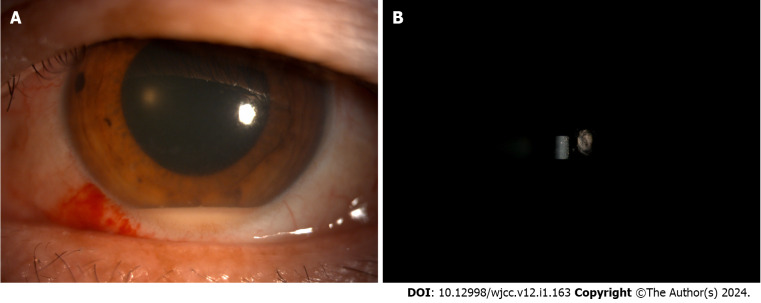
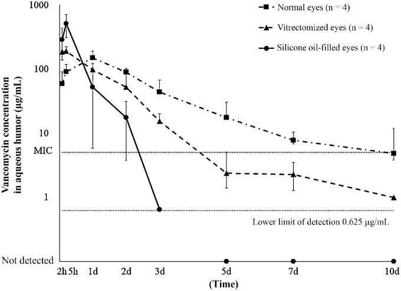
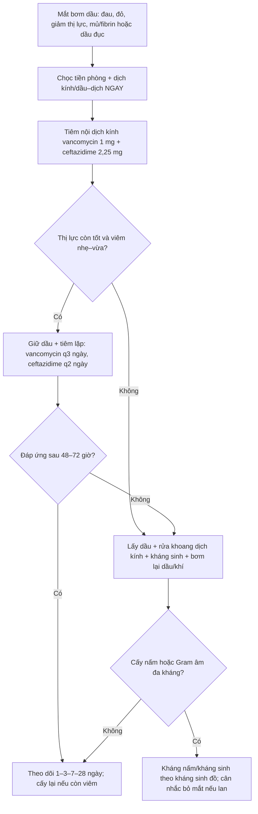
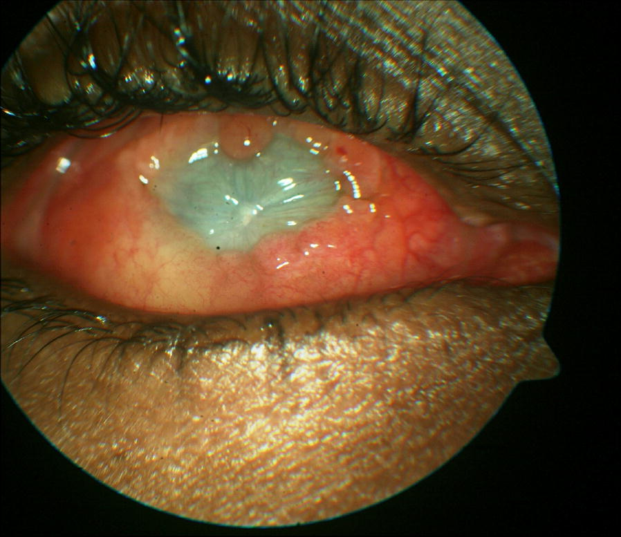
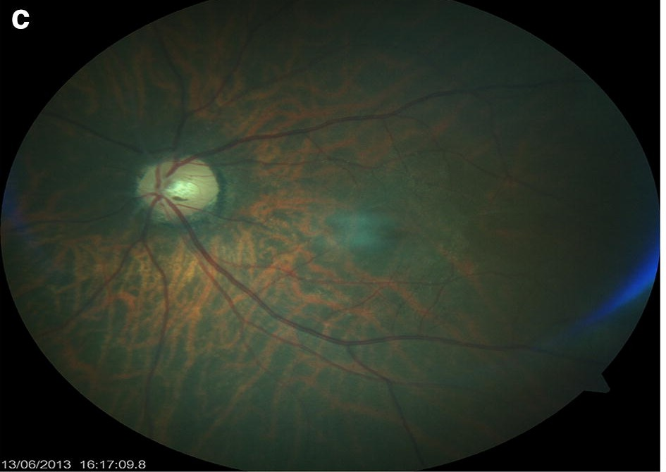

# 1433 — Viêm nội nhãn ở mắt bơm dầu silicone: chẩn đoán bị che, cấy dầu–dịch, lấy dầu hay giữ / Endophthalmitis in a silicone oil-filled eye

**Tags:** `pattern:viem-noi-nhan` `pattern:mu-tien-phong` `pattern:dau-duc` `pattern:dau-silicone` `pattern:gia-giac-viem` `vung:dich-kinh` `vung:tien-phong` `vung:vong-mac` `protocol:PPV` `protocol:choc-dich-kinh` `protocol:cay-vi-sinh` `protocol:B-scan` `score:EVS`
**Mức chắc chắn (certainty):** tổng hợp y văn (literature synthesis) — số liệu từ một tổng quan hệ thống về vai trò dầu silicone trong viêm nội nhãn, một tổng quan chuyên biệt về viêm nội nhãn trong mắt bơm dầu, các chuỗi ca (gồm cụm 5 mắt nhiễm cùng lô dầu), ca lâm sàng có ảnh, và nghiên cứu dược động học trên mắt khỉ. **Không có RCT** so sánh “lấy dầu” với “giữ dầu + tiêm kháng sinh”; phần chọn hướng là tổng hợp có suy luận, đã ghi rõ.

> **Vì sao bài này quan trọng:** bài **1432** vừa nêu nhóm “nghi nhiễm trùng trong mắt có dầu” nhưng dừng ở một hàng ma trận. Bài này trả lời câu hỏi sống còn khi mắt đang bơm dầu mà đỏ–đau–mờ: **mủ tiền phòng có thể ít hoặc bị dầu che, cấy dịch kính rất khó, 62% cấy âm, và quyết định “lấy dầu ngay hay tiêm kháng sinh tại chỗ” thay đổi kết cục từ 6/9 xuống teo nhãn cầu**. Đây là mặt tối của chính dầu silicone: dầu được quảng cáo có “tính kháng khuẩn”, nên bác sĩ dễ trấn an và bỏ qua viêm nội nhãn đang tiến triển dưới lớp dầu đục.

## 1. Tổng quan bệnh học – cơ chế hình ảnh – vì sao “có dầu” không có nghĩa “an toàn”

- **Tần suất — hiếm nhưng không bằng 0:** viêm nội nhãn sau cắt dịch kính (pars plana vitrectomy, PPV) khoảng **0,02–0,13%**; trong mắt bơm dầu còn hiếm hơn, các loạt ghi **0,039–0,07%**. Một nghiên cứu gộp Pan-American (PACORES) **không có ca nào trên 7.357 mắt bơm dầu** — nhưng đây là “hiếm”, không phải “không thể”, và các cụm dịch do nhiễm lô dầu đã được báo cáo. Trong **111.876 ca PPV** tại một trung tâm Ấn Độ, viêm nội nhãn là **0,040%** (45 ca), cấy dương **53,3%**, **73,4%** khởi phát trong tuần đầu, fibrin gặp **93,3%**, mủ tiền phòng **53,3%**.
- **Ai bị:** tuổi trung bình **44** (trung vị 49; 2–73), nam:nữ **3,5:1**; **78%** chỉ định ban đầu là bong võng mạc rách (rhegmatogenous retinal detachment, RRD), thường kèm PVR. Đây đúng là nhóm mắt đã mổ nhiều lần, mô miễn dịch tại chỗ yếu, dễ bị bỏ qua vì “viêm sau mổ là bình thường”.
- **Vì sao dầu không bảo vệ:** dầu silicone (polydimethylsiloxane, PDMS) **kỵ nước**, tỷ trọng **0,97 g/cm³**, sức căng mặt phân cách với nước **≈ 35 mN/m**. Vi khuẩn không “tan” trong dầu; chúng sống trong **lớp dịch mỏng giữa dầu và võng mạc**, trong tiền phòng, và ở mặt phân cách dầu–dịch — nơi có dưỡng chất và đại thực bào. Dầu chỉ tạo **bất lợi dinh dưỡng** và có một số tác dụng ức chế in vitro (nhất là dầu nặng), nhưng **không diệt khuẩn đáng tin**: *Propionibacterium acnes* sống được trong dầu, *Burkholderia cepacia* và *Pseudomonas* đã gây nhiễm cả lô dầu, và nấm (*Fusarium*, *Mucor*) không bị ức chế đủ.
- **Vì sao chẩn đoán bị che:** (1) **dầu đục** làm mất ánh đáy mắt — tổng quan ghi **50%** ca có “không thấy đáy mắt vì dầu đục”; (2) **mủ tiền phòng có thể ít**, chỉ **61%** ca có dấu hiệu tiền phòng (tế bào, KPs, fibrin hoặc mủ), và dầu trong tiền phòng có thể che một phần mủ; (3) **đau không hằng định** — **44%** có đau, **22%** không đau; (4) phản xạ đầu tiên của bác sĩ là “viêm vô khuẩn sau mổ”, nên **trì hoãn lấy dầu 6 tuần–3,5 tháng** trong cụm 5 ca — hậu quả là **2 mắt teo nhãn cầu**, phần còn lại thị lực bàn tay–không cảm giác sáng.
- **Vì sao dùng kháng sinh trong mắt có dầu lại khác:** vancomycin và ceftazidime **tan trong nước, không tan trong dầu**. Ở mắt bơm dầu, **thể tích phân bố nước rất nhỏ** (chỉ còn lớp dịch quanh dầu), nên sau tiêm nội dịch kính: **nồng độ đỉnh rất cao** nhưng **thải rất nhanh**. Trên khỉ: vancomycin **Cmax 543,5 µg/mL, t½ 6,8 giờ** (mắt bình thường **151,4 µg/mL, 29,4 giờ**); ceftazidime **Cmax 1.176,3 µg/mL, t½ 3,1 giờ** (bình thường **64,6 µg/mL, 20,4 giờ**). Vì vậy **liều chuẩn 1 mg vancomycin + 2,25 mg ceftazidime** có thể vừa **độc võng mạc** vừa **hết tác dụng sau 2–3 ngày** — phải tiêm lặp, không được “một mũi rồi chờ”.
- **Ngưỡng định lượng cần nhớ:** nghi nhiễm khi **đau tăng + đỏ vượt mức + thị lực giảm sau giai đoạn ổn định**, kèm **mủ/fibrin tiền phòng**, **dầu đục**, **cấy dương 38%** (âm **62%**). Điều trị chuẩn: **vancomycin 1 mg/0,1 mL + ceftazidime 2,25 mg/0,1 mL** nội dịch kính; nếu giữ dầu, **vancomycin lặp mỗi 3 ngày, ceftazidime mỗi 2 ngày** theo mô phỏng dược động học.

## 2. Mẫu hình + chẩn đoán phân biệt theo thời điểm và tác nhân (Gamut)

Bốn câu hỏi trước khi chọc: **(1) mổ cách đây bao lâu? (2) đau/đỏ có vượt mức không? (3) có mủ–fibrin tiền phòng hay dầu đục? (4) có yếu tố “bắt chước” nào (lens touch, TASS, dầu nhũ tương) không?**

- **Nhóm A — sớm ≤ 1 tuần (80% ca):** đau, đỏ, giảm thị lực, mủ tiền phòng; tác nhân thường gặp là **Staphylococcus coagulase-negative**, *S. aureus*, *Pseudomonas*. Đây là nhóm dễ nhầm với **TASS** (xem mục 3), nhưng TASS có **phù giác mạc limbus-to-limbus** và **dịch kính trong**.
- **Nhóm B — 1–4 tuần (10%):** triệu chứng kín đáo hơn, mủ ít, dầu hơi đục; nghĩ **CoNS**, *P. acnes* (thể chậm), hoặc phản ứng do lens.
- **Nhóm C — > 1 tháng (10%):** thể mạn, dầu đục dần, fibrin dai; nghĩ **P. acnes**, nấm, hoặc nhiễm từ lô dầu. Cụm 5 mắt cùng lô 5.000 cSt nhiễm **B. cepacia** (4 mắt) và **P. aeruginosa** (1 mắt) là ví dụ điển hình.
- **Nhóm D — cấy âm (62%):** vẫn phải điều trị như nhiễm nếu bệnh cảnh phù hợp; cấy âm không loại trừ. Nhiều ca chỉ cấy dương từ **mẫu trộn dầu + dịch**, không phải dầu nguyên chất.
- **Nhóm E — nấm:** *Mucor*, *Aspergillus*, *Fusarium*; tiên lượng rất xấu, dầu không có tác dụng diệt nấm đáng tin; **cân nhắc lấy dầu + kháng nấm toàn thân/nội nhãn**, không chỉ tiêm kháng sinh.
- **Nhóm F — bắt chước vô khuẩn:** **TASS** (12–48 giờ, phù limbus-to-limbus, dịch kính trong), **phản ứng phacoantigenic** sau **lens touch** (2 tuần, mủ 2 mm, **mảng trắng mặt sau thể thủy tinh**, tự cải thiện khi thể thủy tinh thoát ra sau), **dầu đục đơn thuần** (không giọt nhũ tương, không mủ, B-scan còn thấy võng mạc), **viêm do dầu/nhũ tương**. Đây là các chẩn đoán “đừng mổ oan”, nhưng cũng là nơi dễ bỏ sót nhiễm thật.

*Ca nam 39 tuổi, ngày 2 sau PPV + dầu silicone: (A) mủ tiền phòng 2 mm và tế bào; (B) tế bào tiền phòng. Mủ có thể mỏng và bị dầu trong tiền phòng che — phải soi kỹ, không chờ “mủ đầy”. Nguồn: Yan HC et al., World J Clin Cases 2024 (PMC10824177) Fig. 1, **CC BY-NC 4.0**, nguyên bản.*

## 3. Bảng so sánh phân biệt (ma trận đối chiếu)

| Thực thể (entity) | Hình ảnh/lâm sàng điển hình | Chốt vào (rule-in) | Chốt loại (rule-out) | Gợi ý xác nhận |
|---|---|---|---|---|
| **SORE do Gram dương** (CoNS, *S. aureus*, *S. pneumoniae*) | Đau–đỏ–giảm thị lực, mủ/fibrin tiền phòng, dầu hơi đục; khởi phát **≤ 1 tuần** | **Mủ + fibrin + cấy dương từ dịch kính/dầu–dịch**; đau tăng sau ổn định | **Dịch kính trong + phù limbus-to-limbus 12–48 giờ** → TASS | Cấy + Gram + PCR 16S; **chọc tiền phòng/dịch kính trước khi tiêm** |
| **SORE do Gram âm** (*Pseudomonas*, *B. cepacia*, *Citrobacter*) | Đau nhiều, đỏ, mủ, **dầu đục nhanh**, có thể cùng lô dầu; tiến triển nặng trong vài ngày | **Cấy dầu + dịch ra cùng một loài**; cụm nhiều mắt cùng lô | **Cấy âm nhưng bệnh cảnh nhẹ, tự khỏi** → theo dõi | Cấy mẫu **trộn dầu–dịch**; kháng sinh theo kháng sinh đồ |
| **SORE do nấm** (*Mucor*, *Aspergillus*, *Fusarium*) | Đau, mủ, dầu đục, có thể **mảng trắng trên võng mạc**; tiến triển chậm 1–4 tuần | **Sợi nấm trên soi tươi/cấy**; bệnh cảnh không đáp ứng kháng sinh | **Đáp ứng nhanh với kháng sinh nội nhãn** → ít nghĩ nấm | Nhuộm Calcofluor/ PAS, cấy nấm, PCR 18S; **lấy dầu** nếu nặng |
| **TASS (toxic anterior segment syndrome)** | **12–48 giờ**, đau ít, **phù giác mạc limbus-to-limbus**, mủ tiền phòng nhưng **dịch kính trong** | **Khởi phát rất sớm + phù toàn giác mạc + đáp ứng corticoid** | **Đau nhiều, dầu đục, fibrin dày, cấy dương** → nhiễm | Soi đáy mắt/B-scan; cấy âm; hỏi dung dịch/thiết bị mổ |
| **Phản ứng phacoantigenic** | **2 tuần** sau PPV ở mắt còn thể thủy tinh, có **lens touch**; mủ 2 mm, **mảng trắng mặt sau thể thủy tinh** | **Tiền sử lens touch + mảng trắng trên bao sau + tự giảm khi thể thủy tinh thoát ra** | **Cấy dương, mủ tăng dần, dầu đục** → nhiễm | Soi sinh hiển vi; theo dõi đáp ứng corticoid; cấy để loại trừ |
| **Dầu đục không nhiễm** | Mất ánh đáy mắt, dầu trắng đục, **không mủ, không đau, nhãn áp bình thường**, B-scan còn thấy võng mạc | **Không có dấu viêm tiền phòng; cấy âm; dầu đục đơn thuần** | **Đau + mủ + fibrin + cấy dương** → SORE | B-scan/UWF; FTIR nếu cần; **thay/lấy dầu vì mất theo dõi**, không phải vì nhiễm |
| **Viêm nội nhãn nội sinh** | Sốt/ổ nhiễm, **hai mắt** hoặc mắt còn lại có focus, mủ tiền phòng, dầu đục; thường không liên quan lô dầu | **Cấy máu/dịch ổ nhiễm cùng loài; bệnh cảnh toàn thân** | **Chỉ một mắt sau PPV, không ổ nhiễm** → ngoại sinh | Cấy máu, CT/MRI ổ nhiễm, siêu âm tim nếu nghi |

*Nồng độ vancomycin trong thủy dịch sau tiêm nội dịch kính ở mắt bình thường, mắt đã cắt dịch kính và mắt bơm dầu. Mắt bơm dầu có **Cmax 543,5 µg/mL** nhưng **t½ 6,8 giờ**, tụt dưới MIC sau **3 ngày** — lý do phải tiêm lặp mỗi 3 ngày nếu giữ dầu. Nguồn: Imamura T et al., Transl Vis Sci Technol 2021 (PMC7938004) Fig. 1, **CC BY-NC-ND 4.0 — nguyên bản, không crop/ghép**.*

## 4. Protocol: chẩn đoán, lấy mẫu, lấy dầu hay giữ, và lặp kháng sinh

**Chẩn đoán (làm ngay, không chờ cấy):**
- **Đèn khe:** tế bào/flare, KPs, fibrin, **mủ tiền phòng** (đo mm), dầu trong tiền phòng, phù giác mạc; **nhãn áp** (có thể thấp, bình thường hoặc cao).
- **Đáy mắt/UWF:** mất ánh đáy, dầu đục, mảng trắng trên võng mạc; **B-scan** nếu không thấy đáy mắt — tìm màng/đục dịch kính, bong võng mạc, dày hắc mạc.
- **Lấy mẫu:** chọc tiền phòng **0,1–0,2 mL** + chọc dịch kính **0,2–0,5 mL** nếu an toàn; với mắt có dầu, lấy **hỗn hợp dầu + dịch** (không chỉ dầu nguyên chất — dầu nguyên chất có thể không bắt màu Gram và không nuôi được vi khuẩn). Gửi **soi tươi, Gram, cấy hiếu khí/ky khí/nấm, PCR 16S/18S** nếu có.
- **Không trì hoãn điều trị vì chờ kết quả.** Cấy âm **62%** không loại trừ nhiễm.

**Điều trị — hai hướng, chọn theo mức nặng và khả năng mổ:**

1. **Lấy dầu + rửa khoang dịch kính + kháng sinh nội nhãn + bơm lại dầu/khí (chuẩn truyền thống).**
   - Mở 23G/25G, **hút dầu**, rửa khoang dịch kính bằng dung dịch kháng sinh pha loãng (ca đã báo dùng **vancomycin 20 µg/mL + ceftazidime 40 µg/mL**), lấy mẫu trước khi rửa.
   - Tiêm nội dịch kính **vancomycin 1 mg + ceftazidime 2,25 mg** (thêm **dexamethasone 0,4 mg** sau khi đã kiểm soát nhiễm, không thay kháng sinh).
   - **Độc tính không đồng nhất:** trên thỏ, **nửa/đầy đủ liều** có độc võng mạc còn **1/4 liều** an toàn; trên khỉ, **liều đầy đủ** không làm đổi ERG. Không tăng liều tùy tiện; theo dõi OCT/ERG khi lặp nhiều mũi.
   - Bơm lại **dầu silicone** nếu võng mạc cần tamponade, hoặc **C3F8 10–14%** nếu không cần dầu.
   - Chỉ định mạnh: **dầu đục nhiều, mủ/fibrin dày, nghi Gram âm/B. cepacia, nấm, không đáp ứng sau 48–72 giờ**, hoặc cần lấy mẫu mô học.
2. **Giữ dầu + tiêm kháng sinh nội dịch kính tại phòng khám (khi mắt còn thị lực, viêm nhẹ–vừa, chưa có chỉ định mổ ngay).**
   - Steinmetz: **2 ca** tiêm **nửa liều** (vancomycin 0,5 mg + ceftazidime 1,13 mg) hoặc **liều đầy đủ** (1 mg + 2,25 mg) vào khoang dầu, **không lấy dầu**, hết viêm, thị lực cuối **20/80 và 20/400**, không độc võng mạc.
   - Ca 39 tuổi (ảnh mục 2): **3 lần tiêm đầy đủ + 2 lần rửa tiền phòng**, cấy âm, hết viêm, thị lực **20/100** sau 1 tuần, không độc.
   - **Lặp theo dược động học:** nếu giữ dầu, **vancomycin mỗi 3 ngày**, **ceftazidime mỗi 2 ngày** (mô phỏng trên khỉ); theo dõi đáp ứng, không tiêm mù quá nhiều lần.
3. **Kháng sinh toàn thân:** còn tranh luận; **EVS 1995** không thấy lợi ích của ceftazidime/amikacin toàn thân trong viêm nội nhãn sau mổ. Dùng khi **nội sinh, nghi lan ngoài nhãn, hoặc tác nhân đặc biệt** — không thay thế đường nội nhãn.
4. **Corticoid:** giảm viêm nhưng có thể che nhiễm; chỉ dùng sau khi đã có kháng sinh và theo dõi sát. Trong ca 39 tuổi, dexamethasone được **hoãn** đến khi cấy âm và bệnh cảnh ổn định.
5. **Bỏ mắt (enucleation/evisceration):** chỉ khi mắt không còn khả năng cứu, nhiễm lan ngoài nhãn, hoặc đau không kiểm soát; **không phải lựa chọn đầu tay**.

**Theo dõi:**
- Ngày 1–3: đau, thị lực, tiền phòng, nhãn áp; **B-scan** nếu không thấy đáy mắt.
- Ngày 3–7: đáp ứng lâm sàng; nếu **không cải thiện sau 48–72 giờ** → **mổ lấy dầu + rửa + đổi kháng sinh theo cấy**.
- Tuần 1–4: cấy lại nếu còn viêm; kiểm tra độc võng mạc (OCT, ERG nếu có), nhãn áp, võng mạc.

## 5. Biến thể bình thường và cạm bẫy

- **“Cấy âm nên không phải nhiễm”:** sai — **62%** ca trong mắt bơm dầu cấy âm; mẫu dầu nguyên chất càng dễ âm. Luôn lấy **dầu + dịch**, cấy lại, PCR.
- **“Dầu có tính kháng khuẩn nên khó nhiễm”:** đúng một phần trong ống nghiệm, nhưng **B. cepacia, P. aeruginosa, P. acnes** và nấm vẫn gây bệnh; đã có cụm 5 mắt nhiễm cùng lô dầu.
- **“Không đau là không nhiễm”:** **22%** ca không đau; đau chỉ **44%**. Đừng chờ đau.
- **“Mủ ít là nhẹ”:** dầu trong tiền phòng có thể che mủ; fibrin và tế bào có thể là dấu hiệu duy nhất. Soi kỹ góc, chọc tiền phòng khi nghi.
- **“Dầu đục = nhũ tương”:** dầu đục do biến chất (Si-OH, tạp chất) **không có giọt nhũ tương** và **có thể che viêm nội nhãn**. Phân biệt bằng đèn khe/B-scan; nếu có đau/mủ/fibrin thì phải loại trừ nhiễm trước khi gọi “dầu đục đơn thuần”.
- **“Tiêm một liều kháng sinh là đủ”:** ở mắt bơm dầu, **t½ 3,1–6,8 giờ**, tụt dưới MIC sau **2–3 ngày**; phải lặp theo lịch, và theo dõi độc võng mạc do **Cmax rất cao**.
- **“Chờ cấy rồi mới mổ”:** trì hoãn làm tăng nguy cơ teo nhãn; trong cụm 5 ca, lấy dầu muộn **6 tuần–3,5 tháng** → **2 mắt teo nhãn cầu**, thị lực xấu; ca lấy dầu **2 tuần** → **6/9**.
- **“Phải lấy dầu ở mọi ca”:** không tuyệt đối; ca nhẹ có thể điều trị bằng tiêm nội nhãn tại phòng khám, nhưng phải theo dõi sát và chuyển mổ nếu không đáp ứng.
- **Bắt chước vô khuẩn:** TASS (12–48 giờ, phù limbus-to-limbus, dịch kính trong) và **phản ứng phacoantigenic** sau lens touch (2 tuần, mủ 2 mm, mảng trắng mặt sau thể thủy tinh) — hỏi kỹ kỹ thuật mổ, soi thể thủy tinh, đừng mổ oan nhưng cũng đừng bỏ sót nhiễm.

## 6. Tự lượng giá — Blind Quiz

**Ca 1 — Nam 39 tuổi, đái tháo đường 20 năm, ngày 1 sau PPV + dầu silicone vì bong võng mạc co kéo; đau tăng, thị lực đếm ngón tay, tiền phòng có mủ 2 mm.**

- Gợi ý: cấy thủy dịch **âm**; đáy mắt mờ; không sốt, không ổ nhiễm.
- Câu hỏi: (1) Chẩn đoán và vì sao cấy âm không loại trừ? (2) Chọn lấy dầu hay tiêm kháng sinh? (3) Vì sao phải tiêm lặp?

<b>Bấm để hiện đáp án (findings + chẩn đoán)</b>

- Dấu hiệu: mủ tiền phòng **2 mm**, tế bào 2+, fibrin; cấy thủy dịch **3 lần âm**; dầu còn trong, đáy mắt mờ.
- Chẩn đoán: **viêm nội nhãn ở mắt bơm dầu, cấy âm** — phù hợp bệnh cảnh và **62%** ca cấy âm; không có ổ nhiễm toàn thân nên ít nghĩ nội sinh.
- Xử trí trong ca: **vancomycin 1 mg + ceftazidime 2 mg** nội dịch kính, **2 lần rửa tiền phòng** (vancomycin 20 µg/mL + ceftazidime 40 µg/mL), tổng **3 mũi kháng sinh**; hết viêm, thị lực **20/100** sau 1 tuần, không độc võng mạc.
- Vì sao lặp: mắt bơm dầu có **Cmax cao, t½ ngắn** (vancomycin 6,8 giờ; ceftazidime 3,1 giờ) → tụt dưới MIC sau 2–3 ngày. Nếu giữ dầu: **vancomycin mỗi 3 ngày, ceftazidime mỗi 2 ngày**.
- Nguồn ảnh: Yan HC et al., World J Clin Cases 2024 (PMC10824177) Fig. 1, **CC BY-NC 4.0**, nguyên bản.

**Ca 2 — Cụm 5 mắt cùng nhận một lô dầu 5.000 cSt; 4 mắt đầu được chẩn đoán “viêm vô khuẩn”, chỉ lấy dầu sau 6 tuần–3,5 tháng; mắt thứ 5 lấy dầu sau 2 tuần.**

- Gợi ý: 4 mắt đầu đau–đỏ, mủ, **dầu đục**; cấy mẫu trộn dầu + dịch ra **B. cepacia** (3 mắt) và **P. aeruginosa** (1 mắt).
- Câu hỏi: (1) Vì sao cùng một lô dầu lại gây nhiễm? (2) Yếu tố nào quyết định kết cục? (3) Mắt thứ 5 khác gì?

<b>Bấm để hiện đáp án</b>

- Cơ chế: dầu **không diệt khuẩn đáng tin**; lô dầu bị nhiễm là nguồn cấy — vi khuẩn **sống trong lớp dịch/dầu**, rồi lan vào khoang dịch kính. Gram âm (**B. cepacia**) có thể sống trong dầu và kháng nhiều kháng sinh thường dùng.
- Kết cục: 4 mắt lấy dầu muộn **6 tuần–3,5 tháng** → thị lực bàn tay/PL/NPL, **2 mắt teo nhãn cầu**, PVR nặng; đây là bằng chứng mạnh nhất cho **lấy dầu sớm khi nghi nhiễm**.
- Mắt thứ 5: lấy dầu **2 tuần**, rửa khoang dịch kính bằng vancomycin + ceftazidime, tiêm nội nhãn + steroid, bơm C3F8 → **thị lực 6/9**, võng mạc áp.

*Ô c của Fig. 4: võng mạc áp sau lấy dầu sớm và điều trị đúng — đối chiếu với mắt teo nhãn ở trên. Nguồn: Okonkwo ON et al., Int J Retina Vitreous 2018 (PMC6156949) Fig. 4c, **CC BY 4.0**; đã cắt một ô từ hình gốc, không chỉnh nội dung.*

**Ca 3 — Mắt bơm dầu, nghi viêm nội nhãn; bác sĩ định tiêm vancomycin 1 mg + ceftazidime 2,25 mg một lần rồi cho về.**

- Gợi ý: đường đậm là mắt bơm dầu; đường chấm là mắt đã cắt dịch kính; đường đứt là mắt bình thường.
- Câu hỏi: (1) Đọc ba đường cong. (2) Vì sao không được chỉ tiêm một lần? (3) Ngưỡng MIC và lịch lặp?

<b>Bấm để hiện đáp án</b>

- Đường mắt bơm dầu: **Cmax 543,5 µg/mL** (cao hơn nhiều mắt bình thường **151,4 µg/mL**) nhưng **t½ 6,8 giờ** (bình thường **29,4 giờ**), tụt dưới **MIC 5 µg/mL** sau **3 ngày**.
- Vì sao: vancomycin **tan nước, không tan dầu**; thể tích phân bố nước rất nhỏ → đỉnh cao (nguy cơ độc) và thải nhanh (nguy cơ tái phát). Ceftazidime còn nhanh hơn: **Cmax 1.176,3 µg/mL, t½ 3,1 giờ**, dưới MIC sau **2 ngày**.
- Lịch: giữ dầu → **vancomycin mỗi 3 ngày, ceftazidime mỗi 2 ngày**; theo dõi đáp ứng, không tiêm quá nhiều mà không đánh giá lại. Nếu không đáp ứng sau 48–72 giờ → **lấy dầu + rửa + đổi kháng sinh**.
- Nguồn ảnh: Imamura T et al., Transl Vis Sci Technol 2021 (PMC7938004) Fig. 1, **CC BY-NC-ND 4.0**, nguyên bản.

## Bài liên quan chéo
- [1432 – Thay dầu silicone: bơm thiếu thể tích, nhũ tương nặng, dầu đục](../1432-thay-dau-silicone/lesson.md)
- [1410 – Lấy dầu silicone & dầu tồn lưu: nhũ tương hóa, giọt tăng phản xạ trên OCT](../1410-lay-dau-silicone-va-dau-ton-luu/lesson.md)
- [1417 – Khi nào GIỮ dầu silicone vĩnh viễn](../1417-giu-dau-silicone-vinh-vien/lesson.md)
- [1416 – Glôcôm do dầu silicone: pupillary block, bít bè do nhũ tương](../1416-glaucom-do-dau-silicone/lesson.md)
- [1431 – Quang đông thể mi ở mắt bơm dầu](../1431-quang-dong-the-mi-mat-bom-dau/lesson.md)
- [1420 – Áp-xe gan Klebsiella và viêm nội nhãn nội sinh](../1420-ap-xe-gan-klebsiella-va-viem-noi-nhan/lesson.md)
- [1425 – Viêm nội nhãn sau tiêm nội nhãn: tần suất, tác nhân, xử trí](../1425-viem-noi-nhan-sau-tiem-noi-nhan/lesson.md)
- [475 – Viêm nội nhãn nội sinh do vi khuẩn](../475-viem-noi-nhan-noi-sinh-vi-khuan/lesson.md)
- [495 – Viêm nội nhãn do nấm ngoại sinh vs TASS](../495-viem-noi-nhan-nam-ngoai-sinh-vs-TASS/lesson.md)
- [1402 – Bong võng mạc sau viêm nội nhãn: chọn dầu hay khí](../1402-bong-vong-mac-sau-viem-noi-nhan/lesson.md)

## Ảnh
- `1433_viem-noi-nhan_Hypopyon_PMC10824177-Fig1-CCBYNC.jpg` — Yan HC et al., *World J Clin Cases* 2024;12(1):163–168 (PMC10824177) Fig. 1, **CC BY-NC 4.0**, nguyên bản.
- `1433_duoc-dong-hoc_Vancomycin_Bieu-do_PMC7938004-Fig1-CCBYNCND.jpg` — Imamura T et al., *Transl Vis Sci Technol* 2021;10(3):1 (PMC7938004) Fig. 1, **CC BY-NC-ND 4.0**, nguyên bản, không crop/ghép.
- `1433_teo-nhan-cau_Phau-thuat_PMC6156949-Fig3-CCBY.jpg` — Okonkwo ON et al., *Int J Retina Vitreous* 2018;4:35 (PMC6156949) Fig. 3, **CC BY 4.0**, nguyên bản.
- `1433_vong-mac-ap_Phau-thuat_PMC6156949-Fig4c-CCBY.jpg` — Okonkwo ON et al., *Int J Retina Vitreous* 2018;4:35 (PMC6156949) Fig. 4c, **CC BY 4.0**, cắt một ô từ hình 4 ô, không chỉnh nội dung.
- Không tải ảnh từ Radiopaedia/AuntMinnie/Retina Image Bank; chỉ dẫn link ở `sources.md`.

> Không dùng để chẩn đoán độc lập khi chưa có người hướng dẫn.
