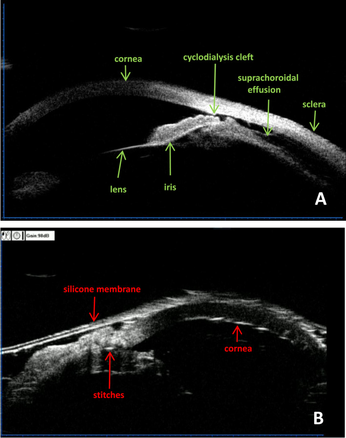
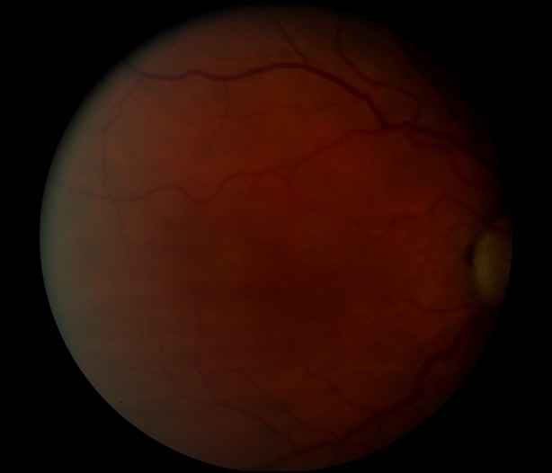
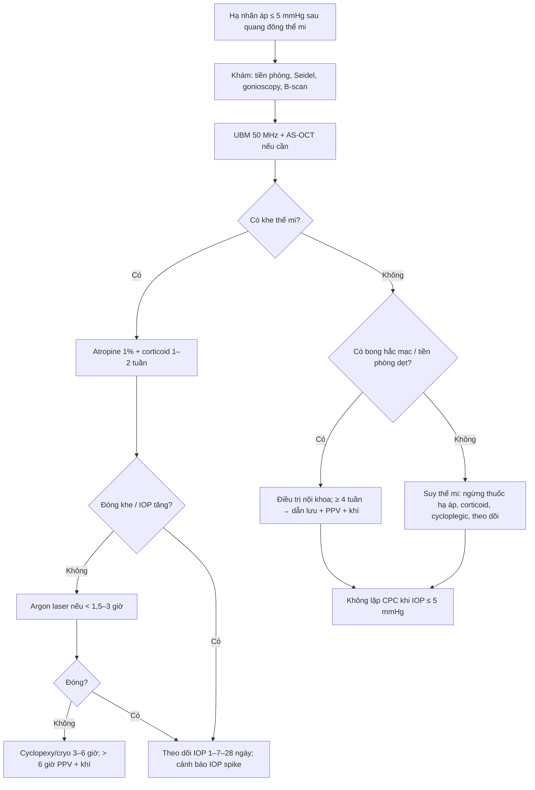
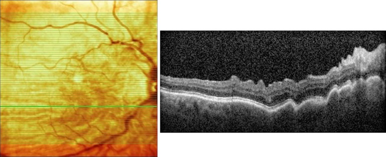

# 1434 — Hạ nhãn áp sau quang đông thể mi & rách thể mi (cyclodialysis cleft): phân biệt giảm sản xuất với rò nội bộ / Hypotony after cyclophotocoagulation and cyclodialysis cleft

**Tags:** `pattern:ha-nhan-ap` `pattern:tien-phong-nong` `pattern:bong-hac-mac` `pattern:rach-the-mi` `pattern:teo-nhan-cau` `pattern:ha-nhan-ap-qua-muc` `vung:the-mi` `vung:goc-tien-phong` `vung:hac-mac` `vung:mat` `protocol:UBM` `protocol:AS-OCT` `protocol:gonioscopy` `protocol:B-scan` `score:IOP`
**Mức chắc chắn (certainty):** tổng hợp y văn (literature synthesis) — số liệu từ các loạt quang đông thể mi dài hạn, tổng quan về xử trí rách thể mi, loạt phẫu thuật cyclopexy, nghiên cứu argon laser, và loạt mắt hạ áp có bong hắc mạc dai dẳng sau mổ glôcôm. **Không có RCT** so sánh “đóng khe” với “điều trị nội khoa kéo dài”; phần chọn hướng là tổng hợp có suy luận, đã ghi rõ.

> **Vì sao bài này quan trọng:** bài **1431** vừa chốt **hạ áp thoáng qua 5,6%** và **hạ áp dai dẳng 1,3%** sau quang đông thể mi, nhưng dừng ở một dòng “nhãn áp ≤ 5 mmHg kéo dài là giảm sản xuất quá mức”. Bài này trả lời câu hỏi tiếp theo trong buổi khám: **khi nhãn áp ≤ 5 mmHg sau đốt thể mi, đó là “thành công quá mức” hay là một rách thể mi chữa được?** Hai bệnh cảnh cùng có tiền phòng nông, cùng có bong hắc mạc, cùng có nếp võng mạc — nhưng một bên **không có khe**, một bên **có khe thông tiền phòng–khoang trên hắc mạc**; bỏ sót khe dẫn tới **teo nhãn cầu**, còn đóng khe sai cách có thể gây **tăng nhãn áp dữ dội 40–50 mmHg** ngay ngày đầu.

> **Sửa tiền đề của backlog (trung thực nguồn):** y văn **không mô tả rách thể mi điển hình do chính quang đông thể mi**; cơ chế hạ áp của quang đông thể mi là **phá hủy biểu mô thể mi → giảm sản xuất thủy dịch**, không phải mở một đường rò. Vì vậy bài này không viết “cleft sau CPC” như một thực thể thường gặp; nó viết **chẩn đoán phân biệt hạ áp sau CPC**, trong đó **cleft là nguyên nhân chữa được cần loại trừ**, đặc biệt ở mắt đã có phẫu thuật tiền phòng, chấn thương, hoặc MIGS trước đó. Cách trình bày này giữ đúng cả mục tiêu lâm sàng của backlog và tính trung thực của nguồn.

## 1. Tổng quan bệnh học – cơ chế hình ảnh – vì sao “thấp” chưa chắc “tốt”

- **Định nghĩa:** hạ nhãn áp (ocular hypotony) là **IOP ≤ 5 mmHg**; hạ áp mạn là **< 6 mmHg kéo dài ≥ 3 tháng**. Hạ áp “có ý nghĩa lâm sàng” là khi có **thay đổi chức năng/thực thể**: nếp võng mạc–hắc mạc, phù đĩa thị, đục thể thủy tinh, bong hắc mạc, phù giác mạc, cận thị hóa do nhãn cầu xẹp.
- **Vì sao quang đông thể mi gây hạ áp:** tia diode **810 nm** bị **melanin ở biểu mô sắc tố thể mi** hấp thụ → **đông hoại biểu mô thể mi và mô đệm** → giảm sản xuất thủy dịch. Tác dụng **không tức thì**: phải chờ mô hoại tử và tái cấu trúc, nên hạ áp thường xuất hiện **sau 2–6 tuần**, đôi khi muộn hơn. Vì đích là **khối lượng thể mi bị phá**, hạ áp phụ thuộc **tổng năng lượng, số điểm, số độ cung được đốt và số lần lặp** — không phụ thuộc “có nghe pop hay không”.
- **Tần suất thực tế:** một loạt **87 mắt** đốt diode một lần (1.500 mW × 1.500 ms, 10 điểm/góc phần, 180–360°) có **5,3% hạ áp** (5/87); trong 5 ca đó **3 ca glôcôm tân mạch, 2 ca glôcôm thứ phát khác**, đều dùng **90–120 J** và **180–360°**, hạ áp kéo dài **6–9 tháng**, **2 ca mất cảm giác sáng**. Loạt slow-coag báo **10,7% (3/28)** hạ áp dai dẳng nhưng **không ca nào có maculopathy/bong hắc mạc**. Tổng quan TSCPC chuẩn ghi **maculopathy do hạ áp 1–25%**, **teo nhãn cầu 0–10%**. Micropulse có nguy cơ hạ áp **thấp hơn** CW (LogOR **−1,21**; 95% CI −2,26 đến −0,16).
- **Vì sao rách thể mi gây hạ áp:** các sợi **cơ thể mi hướng tâm (meridional ciliary muscle)** bong khỏi **scleral spur**, tạo **đường thông trực tiếp giữa tiền phòng và khoang trên hắc mạc** → thủy dịch thoát thêm ra ngoài, **lưu lượng qua bè giảm**; đồng thời **thể mi giảm tưới máu** nên sản xuất cũng giảm. Điểm phản trực giác: **không có tương quan giữa kích thước khe và mức hạ áp** — khe nhỏ vẫn có thể hạ áp nặng vì phần “giảm sản xuất” mới là yếu tố quyết định.
- **Vì sao hạ áp làm mất thị lực:** nhãn cầu xẹp làm **củng mạc lún vào trong** → **nếp gấp hắc mạc–võng mạc** ở hoàng điểm → tế bào quang thụ bị **biến dạng cơ học** và **thay đổi trục**, gây nhìn mờ, biến dạng, cận thị hóa. Cơ chế này giải thích vì sao **người trẻ, cận thị, củng mạc mỏng** dễ có maculopathy hơn; và vì sao **hạ áp kéo dài** có thể để lại nếp vĩnh viễn dù sau đó IOP về bình thường.
- **Vì sao UBM là chốt:** UBM tần số **35–50 MHz**, độ phân giải **~50 µm**, xuyên **4–5 mm**, **không phụ thuộc môi trường trong suốt** → thấy **scleral spur, thể mi, khoang trên hắc mạc** và **khe thông**. AS-OCT (kể cả CASIA2 360°) có độ phân giải cao hơn nhưng **xuyên nông** và **không hiển thị đầy đủ thể mi**, nên có thể **bỏ sót khe**; gonioscopy vẫn là chuẩn lâm sàng nhưng **khó ở mắt mềm, tiền phòng nông, giác mạc phù**.
- **Ngưỡng định lượng cần nhớ:** hạ áp = **≤ 5 mmHg**; hạ áp mạn = **< 6 mmHg × 3 tháng**; thành công sau đốt thể mi = **6–21 mmHg và giảm ≥ 20–30%**, không mất cảm giác sáng; sau đóng khe, **67%** có **IOP > 24 mmHg** (đỉnh trung bình **40,9 ± 10,13 mmHg**), thường trong **vài ngày đầu**.

## 2. Mẫu hình + chẩn đoán phân biệt theo cơ chế (Gamut)

Bốn câu hỏi trước khi kết luận “hạ áp do đốt thể mi”: **(1) tiền phòng nông hay sâu? (2) có bong hắc mạc thanh dịch không? (3) soi góc có thấy khe không? (4) UBM/AS-OCT có thấy đường thông tiền phòng–khoang trên hắc mạc không?**

- **Nhóm A — suy thể mi sau quang đông (phổ biến nhất):** tiền sử đốt thể mi, thường **glôcôm tân mạch hoặc glôcôm thứ phát**, đã đốt **nhiều điểm/nhiều độ cung/lặp lại**; IOP thấp nhưng **không có khe** trên gonioscopy/UBM; thể mi **mỏng, teo, hồi âm không đều**. Đây là **hạ áp do giảm sản xuất**, không phải rò.
- **Nhóm B — rách thể mi (cyclodialysis cleft):** tiền sử **chấn thương đụng dập**, **phaco + IOL**, **trabeculectomy**, **MIGS (goniotomy, trabeculotomy, KDB)**, **Yamane**, hoặc **tiêm nội nhãn** hiếm gặp; IOP thấp, tiền phòng nông, có thể **bong hắc mạc**; **gonioscopy/UBM thấy khe** ở scleral spur. Khe có thể **bị PAS che** hoặc **nhiều khe nhỏ hai bên một khe lớn**.
- **Nhóm C — bong hắc mạc thanh dịch (serous choroidal detachment):** có thể là **hậu quả** của hạ áp hoặc **nguyên nhân** làm hạ áp thêm; tiền phòng nông, **“kissing bullae”**, B-scan thấy dịch dưới hắc mạc. Nếu kéo dài **≥ 4 tuần**, có thể cần **dẫn lưu dịch + PPV + khí**.
- **Nhóm D — rò vết mổ/bọng lọc hoặc van quá tải:** **Seidel dương**, bọng lọc quá to, van không có van/đặt sai; IOP thấp nhưng **tiền phòng có thể sâu**, không có khe.
- **Nhóm E — viêm làm “tắt” thể mi:** viêm nội nhãn, viêm màng bồ đào, bong thể mi; IOP thấp kèm **tế bào/ flare**, đau, dấu viêm; điều trị viêm trước khi nghĩ đến can thiệp hạ áp.
- **Nhóm F — bong võng mạc:** IOP thấp kèm **bong võng mạc** (B-scan), có thể sau chấn thương/phẫu thuật; xử trí bong trước.
- **Nhóm G — maculopathy do hạ áp:** đây là **biến chứng**, không phải nguyên nhân; nếp võng mạc–hắc mạc, phù đĩa thị; cần điều trị nguyên nhân hạ áp, không chỉ theo dõi.

*UBM trước mổ (A) và trong mổ (B) ở mắt chấn thương đụng dập: (A) khe thể mi (cyclodialysis cleft) giữa thể mi và củng mạc, kèm dịch trên hắc mạc; (B) sau đặt màng silicone/khâu — đầu dò UBM đánh giá lại độ áp của thể mi. Đây là dấu chốt phân biệt với **suy thể mi đơn thuần** (không có đường thông). Nguồn: Wang F et al., BMC Ophthalmol 2025 (PMC12369265) Fig. 2, **CC BY-NC-ND 4.0 — nguyên bản, không crop/ghép**.*

## 3. Bảng so sánh phân biệt (ma trận đối chiếu)

| Thực thể (entity) | Hình ảnh/lâm sàng điển hình | Chốt vào (rule-in) | Chốt loại (rule-out) | Gợi ý xác nhận |
|---|---|---|---|---|
| **Suy thể mi sau quang đông** | Tiền sử đốt thể mi, IOP **≤ 5 mmHg**, tiền phòng nông, bong hắc mạc thanh dịch; **không khe** trên gonioscopy/UBM; thể mi mỏng/teo | **Không có đường thông tiền phòng–khoang trên hắc mạc; bối cảnh đốt nhiều/lặp** | **Thấy khe ở scleral spur, có tiền sử chấn thương/phẫu thuật tiền phòng** → cleft | UBM 50 MHz; AS-OCT; gonioscopy; theo dõi IOP |
| **Rách thể mi (cyclodialysis cleft)** | Tiền sử chấn thương/phaco/MIGS/trabeculectomy; IOP thấp, tiền phòng nông, có thể bong hắc mạc; **khe trên UBM** | **Đường thông trực tiếp tiền phòng → khoang trên hắc mạc tại scleral spur**; Shah test dương (IOP ≤ 6 mmHg sau soi góc) | **Không thấy khe nhưng vẫn hạ áp** → suy thể mi hoặc nguyên nhân khác | Gonioscopy có viscoelastic/pilocarpine; UBM; AS-OCT 360° |
| **Bong hắc mạc thanh dịch** | Tiền phòng nông, **kissing bullae**, B-scan dịch dưới hắc mạc; IOP thấp | **Dịch dưới hắc mạc trên B-scan/UBM, không có khe** | **Khe + dịch** → cleft là nguyên nhân; **mủ/tế bào** → viêm | B-scan, UBM; đo độ dày hắc mạc; theo dõi 2–4 tuần |
| **Rò bọng lọc/vết mổ** | Bọng lọc quá to, **Seidel dương**, tiền phòng nông hoặc sâu, IOP thấp | **Seidel dương + bọng lọc quá mức** | **Seidel âm, không bọng lọc** → loại trừ rò | Seidel test, đèn khe, AS-OCT vết mổ |
| **Van dẫn lưu quá tải** | Tiền sử đặt van, IOP thấp, tiền phòng nông, có thể bong hắc mạc | **Van không có buồng/van, ống quá ngắn, đĩa bị bóc** | **Van còn hoạt động, IOP ổn** → không phải nguyên nhân | Siêu âm/AS-OCT ống van; X-quang nếu cần |
| **Viêm thể mi/nội nhãn** | Đau, đỏ, tế bào/flare, mủ tiền phòng, IOP thấp | **Dấu viêm rõ + cấy dương** | **Không viêm, không mủ** → loại trừ | Đèn khe, cấy, PCR; điều trị viêm trước |
| **Bong võng mạc** | IOP thấp, không thấy đáy mắt, B-scan có màng | **Bong võng mạc trên B-scan** | **Võng mạc áp** → loại trừ | B-scan; UWF nếu thấy |
| **Maculopathy do hạ áp** | Nhìn mờ/biến dạng, **nếp võng mạc–hắc mạc**, phù đĩa thị; OCT thấy nếp | **Nếp hoàng điểm + IOP thấp** | **OCT bình thường** → không phải maculopathy | OCT hoàng điểm; theo dõi sau nâng IOP |

*Ảnh đáy mắt mắt hạ áp: nếp hắc mạc–võng mạc ở cực sau, hướng nan hoa từ hoàng điểm. Đây là lý do phải điều trị **nguyên nhân** hạ áp sớm, trước khi nếp thành xơ. Nguồn: Thomas M et al., Ophthalmol Ther 2015 (PMC4675727) Fig. 1, **CC BY-NC 4.0**, nguyên bản.*

## 4. Protocol: đo, hình ảnh, chẩn đoán nguyên nhân và thuật toán xử trí

**Đo và khám (làm đủ trước khi can thiệp):**
- **Nhãn áp Goldmann** nhiều lần, ghi cả **thuốc hạ áp đang dùng** (thuốc là nguyên nhân gây hạ áp iatrogenic — phải ngừng trước khi đổ lỗi cho thể mi).
- **Đèn khe:** độ sâu tiền phòng, mống mắt–giác mạc có chạm, **Seidel**, tế bào/flare, thể thủy tinh, dầu/khí trong mắt.
- **Gonioscopy:** soi toàn chu vi; nếu mắt mềm/tiền phòng nông, nhỏ **pilocarpine 1% 30 phút trước** hoặc bơm **viscoelastic** để mở góc; tìm **khe**, PAS, dị vật, rò góc. **Shah test:** soi góc làm IOP tụt **≤ 6 mmHg** và xuất hiện nếp Bowman — gợi ý khe ẩn.
- **B-scan:** bong hắc mạc, bong võng mạc, màng dịch kính; bắt buộc khi không thấy đáy mắt.
- **UBM 50 MHz:** đo **vị trí, số độ cung, độ sâu khe**, độ dày thể mi, dịch trên hắc mạc; đây là **chuẩn** để chẩn đoán và theo dõi sau đóng khe. **AS-OCT/CASIA2 360°** bổ sung khi cần hình ảnh góc độ phân giải cao, nhưng **không thay UBM** vì xuyên nông và không thấy hết thể mi.

**Điều trị theo nguyên nhân:**

1. **Nếu là rách thể mi (cleft):**
   - **Bước 1 — nội khoa:** **atropine 1%** (cycloplegia làm thể mi áp sát củng mạc) + **corticoid tại chỗ** giảm viêm; **giảm steroid từ từ** để cho phản ứng xơ dính đóng khe; theo dõi IOP **1–2 tuần**. Bằng chứng: chỉ **1/16 (6,3%)** ca đóng khe chỉ bằng atropine trong một loạt — đừng chờ quá lâu nếu có maculopathy.
   - **Bước 2 — laser argon:** khe **< 1,5–3 giờ**. Thông số tham khảo: **300–500 µm, 0,3–0,5 giây, 800–1.000 mW** vào củng mạc trần, rồi **100 µm, 0,1–0,2 giây, 600–800 mW** vào gốc mống mắt/thể mi bong, tổng **80–100 điểm**, đích là **bọt khí nhẹ**; sau laser dùng atropine 1 tháng. Loạt 7 mắt: IOP **4,4 ± 2,4 → 14,5 ± 3,1 mmHg**, đỉnh sau laser **30,4 ± 13,4 mmHg** xuất hiện sau **9,6 ngày** trung bình; **7/7** đóng khe, không biến chứng.
   - **Bước 3 — cyclopexy/cryo:** khe **3–6 giờ** hoặc laser thất bại. Cyclopexy khâu thể mi vào củng mạc dưới vạt củng mạc; cryo cho khe nhỏ. Loạt 18 mắt: **một lần mổ đóng 9/18 (50%)**, cyclopexy **6/11**, cryo **3/6**, sau các lần tiếp theo **18/18** đạt IOP sinh lý; **67%** có IOP > 24 mmHg sau đóng (đỉnh **40,9 ± 10,13 mmHg**), thường vài ngày, kiểm soát bằng thuốc.
   - **Bước 4 — khe lớn > 6 giờ / phức tạp:** **PPV + khí/silicone oil** hoặc kỹ thuật endocyclopexy/cyclotamponade; có thể kèm phaco/IOL. Loạt 4 mắt UBM-guided: IOP trước **7 mmHg (6–9)** → ngày 3 **16,5 mmHg (11–22)**, đóng khe **4/4**, nhưng **1 mắt vẫn hạ áp sau đóng vì suy chức năng thể mi** — bài học: đóng khe không bảo đảm IOP hồi phục nếu thể mi đã mất chức năng.
2. **Nếu là suy thể mi sau quang đông:**
   - **Ngừng ngay thuốc hạ áp** (đặc biệt ức chế carbonic anhydrase, beta-blocker) — chúng làm hạ áp nặng thêm.
   - **Corticoid tại chỗ** giảm viêm, **cycloplegic** (atropine) làm giãn thể mi; bù dịch/thận trọng nếu có rối loạn điện giải.
   - **Bong hắc mạc thanh dịch dai dẳng ≥ 4 tuần + tiền phòng dẹt/kissing:** cân nhắc **dẫn lưu dịch trên hắc mạc + PPV + khí SF6 20%**; loạt 6 mắt (2 mắt sau CPC): IOP **5 ± 2,1 → 11,3 ± 3,7 mmHg** lúc 6 tháng, dịch hết ở **5/6 trong 1 tháng**, nhưng **5/6 cần thêm mổ** để nâng IOP.
   - **Không lặp quang đông thể mi khi IOP đang ≤ 5 mmHg**; nếu glôcôm vẫn không kiểm soát, đợi thể mi hồi phục hoặc chuyển hướng (van, phẫu thuật khác) — lặp sớm làm tăng nguy cơ **teo nhãn cầu**.
3. **Nếu là rò bọng lọc/vết mổ:** **Seidel (+) →** bandage contact lens, khâu chèn, keo fibrin, hoặc sửa bọng; ngừng thuốc chống đông nếu được.
4. **Nếu van quá tải:** thắt ống, đặt van áp lực, hoặc sửa ống; kiểm tra vị trí đĩa.
5. **Nếu viêm/nội nhãn:** điều trị nhiễm trùng theo bài 1433/1425 trước khi can thiệp hạ áp.

**Theo dõi:**
- Ngày 1, tuần 1, tháng 1–3: IOP, tiền phòng, đáy mắt/OCT; **UBM sau 1 tuần** nếu đã đóng khe.
- Sau đóng khe: cảnh báo **IOP tăng 40–50 mmHg** trong vài ngày đầu; dùng thuốc hạ áp ngắn hạn, theo dõi thị lực.
- Sau ngừng CPC: theo dõi **teo nhãn cầu** (nhãn cầu nhỏ, đục giác mạc, mất cảm giác sáng) — dấu hiệu thất bại không hồi phục.

## 5. Biến thể bình thường và cạm bẫy

- **“IOP thấp = đốt thành công”:** sai. Hạ áp **≤ 5 mmHg** trên **2 lần khám** là **quá mức**, đặc biệt khi có **nếp võng mạc, phù đĩa thị, bong hắc mạc**. Thành công là **6–21 mmHg, giảm ≥ 20–30%, không mất cảm giác sáng**.
- **“Khe nhỏ thì hạ áp nhẹ”:** sai — **không có tương quan giữa kích thước khe và mức hạ áp**; phần **giảm sản xuất do thể mi thiếu máu** mới quyết định.
- **“AS-OCT bình thường là không có khe”:** sai — AS-OCT xuyên nông, **không thấy hết thể mi**, dễ bỏ sót khe sau/ngoại vi; **UBM là chuẩn**.
- **“Soi góc ở mắt mềm dễ”:** sai — tiền phòng nông, giác mạc phù, mống mắt sát giác mạc làm soi góc khó; dùng **pilocarpine/viscoelastic**, và **Shah test** khi nghi khe ẩn.
- **“Atropine đóng được mọi khe”:** chỉ **6,3%** trong loạt nhỏ; đừng chờ quá **2–4 tuần** nếu có maculopathy — chuyển laser/cyclopexy.
- **“IOP tăng sau đóng khe = thất bại”:** không — **67%** có IOP > 24 mmHg, đỉnh **40,9 mmHg**, thường vài ngày đầu; đây là dấu hiệu khe đã đóng, cần kiểm soát bằng thuốc.
- **“Hạ áp sau đóng khe = mổ hỏng”:** không — có thể do **suy chức năng thể mi** (ca 4 trong loạt UBM-guided vẫn IOP 7 mmHg dù khe đã đóng); đánh giá lại bằng UBM trước khi mổ lại.
- **“Lặp CPC để ‘đốt bù’ cho mắt còn cao”:** nếu IOP đang thấp, **không lặp**; đợi hồi phục và đánh giá lại. Lặp sớm ở mắt đã hạ áp làm tăng **teo nhãn cầu**.
- **“Corticoid kéo dài là vô hại”:** corticoid làm chậm xơ dính — trong điều trị khe, **giảm steroid từ từ** để cho khe đóng; kéo dài có thể duy trì hạ áp.
- **“Maculopathy hết ngay khi IOP về bình thường”:** nếp có thể tồn tại **nhiều tuần–tháng**, và để lại di chứng nếu điều trị muộn; mục tiêu là **nâng IOP sớm**, không chờ nếp tự hết.

*OCT hoàng điểm: nếp võng mạc–hắc mạc dạng sóng, có thể thấy rõ hơn trên ảnh đáy mắt; OCT là công cụ theo dõi hồi phục sau khi nâng IOP. Nguồn: Thomas M et al., Ophthalmol Ther 2015 (PMC4675727) Fig. 2, **CC BY-NC 4.0**, nguyên bản.*

## 6. Tự lượng giá — Blind Quiz

**Ca 1 — Nữ 68 tuổi, glôcôm tân mạch đã đốt thể mi 2 lần cách 3 tháng; nay IOP 3 mmHg, tiền phòng nông, không đau, B-scan có bong hắc mạc thanh dịch.**

- Gợi ý: không có tiền sử chấn thương; gonioscopy không thấy khe; UBM cho thấy thể mi mỏng, **không có đường thông** tiền phòng–khoang trên hắc mạc.
- Câu hỏi: (1) Cơ chế hạ áp? (2) Có phải “thành công quá mức” không? (3) Xử trí trước và sau 4 tuần?

<b>Bấm để hiện đáp án (findings + chẩn đoán)</b>

- Dấu hiệu: IOP **3 mmHg**, tiền phòng nông, bong hắc mạc thanh dịch; **không khe** trên UBM; thể mi mỏng/teo; tiền sử **2 lần CPC**.
- Chẩn đoán: **suy thể mi sau quang đông + bong hắc mạc thanh dịch** — hạ áp do **giảm sản xuất**, không phải rò nội bộ. Đây **không phải thành công** vì đã có thay đổi thực thể (bong hắc mạc, tiền phòng nông).
- Xử trí: **ngừng thuốc hạ áp**, corticoid tại chỗ, atropine, theo dõi; nếu bong hắc mạc **≥ 4 tuần** và tiền phòng dẹt/kissing → **dẫn lưu dịch trên hắc mạc + PPV + SF6 20%**. **Không lặp CPC** khi IOP còn ≤ 5 mmHg. Theo dõi teo nhãn cầu.

**Ca 2 — Nam 31 tuổi, chấn thương đụng dập mắt phải 3 tuần trước; IOP 4 mmHg, tiền phòng nông, thị lực 20/200; UBM thấy khe thể mi 2 giờ ở góc dưới.**

- Gợi ý: không có rò vết mổ; B-scan không bong võng mạc; atropine 1% + corticoid 2 tuần không cải thiện.
- Câu hỏi: (1) Chẩn đoán và vì sao khe 2 giờ vẫn gây hạ áp nặng? (2) Bước tiếp theo? (3) Thông số laser/cyclopexy và cảnh báo sau đóng?

<b>Bấm để hiện đáp án</b>

- Chẩn đoán: **rách thể mi (cyclodialysis cleft) sau chấn thương** — UBM thấy đường thông tiền phòng → khoang trên hắc mạc; khe **2 giờ** nhưng hạ áp nặng vì kèm **giảm sản xuất/tưới máu thể mi**; **không có tương quan kích thước–IOP**.
- Bước tiếp: atropine thất bại + có maculopathy/thị lực giảm → **argon laser** (khe < 1,5–3 giờ): **300–500 µm, 0,3–0,5 giây, 800–1.000 mW** vào củng mạc trần, rồi **100 µm, 0,1–0,2 giây, 600–800 mW** vào gốc mống mắt/thể mi bong, **80–100 điểm**, đích bọt khí nhẹ. Nếu thất bại → **cyclopexy** (3–6 giờ) hoặc **PPV + khí** (khe lớn).
- Sau đóng: **67%** IOP > 24 mmHg, đỉnh **40,9 mmHg** trong vài ngày; dùng thuốc hạ áp ngắn hạn, theo dõi **UBM 1 tuần**. IOP có thể vẫn thấp nếu thể mi đã mất chức năng — đánh giá lại trước khi mổ tiếp.
- Nguồn ảnh: Wang F et al., BMC Ophthalmol 2025 (PMC12369265) Fig. 2, **CC BY-NC-ND 4.0**, nguyên bản.

**Ca 3 — Nam 48 tuổi, 6 tuần sau trabeculectomy + MMC; IOP 2 mmHg, thị lực 20/200, nhìn biến dạng; đáy mắt có nếp hướng nan hoa từ hoàng điểm.**

- Gợi ý: bọng lọc căng, **Seidel âm**; OCT hoàng điểm có nếp.
- Câu hỏi: (1) Chẩn đoán? (2) Cơ chế mất thị lực? (3) Xử trí và tiên lượng?

<b>Bấm để hiện đáp án</b>

- Chẩn đoán: **maculopathy do hạ áp** sau trabeculectomy; nguyên nhân hạ áp có thể do **bọng lọc quá mức**, **rò ẩn**, hoặc **hội chứng thể mi**; cần soi góc/UBM để loại trừ khe.
- Cơ chế: nhãn cầu xẹp → củng mạc lún → **nếp hắc mạc–võng mạc** → tế bào quang thụ biến dạng; người trẻ/cận thị/củng mạc mỏng dễ hơn. OCT là chốt vì đáy mắt có thể khó thấy.
- Xử trí: điều trị nguyên nhân (khâu bọng, bandage lens, sửa van, đóng khe); nâng IOP sớm để nếp hồi phục; nếu nếp đã xơ, thị lực có thể không hồi phục hoàn toàn. Theo dõi OCT sau 1–3 tháng.

- Nguồn ảnh: Thomas M et al., Ophthalmol Ther 2015 (PMC4675727) Fig. 1 và Fig. 2, **CC BY-NC 4.0**, nguyên bản.

## Bài liên quan chéo
- [1431 – Quang đông thể mi ở mắt bơm dầu: slow-coag, micropulse, CW “pop”](../1431-quang-dong-the-mi-mat-bom-dau/lesson.md)
- [1416 – Glôcôm do dầu silicone: pupillary block, bít bè do nhũ tương, lấy dầu – van – CPC](../1416-glaucom-do-dau-silicone/lesson.md)
- [1417 – Khi nào GIỮ dầu silicone vĩnh viễn](../1417-giu-dau-silicone-vinh-vien/lesson.md)
- [1410 – Lấy dầu silicone & dầu tồn lưu: nhũ tương hóa, giọt tăng phản xạ trên OCT](../1410-lay-dau-silicone-va-dau-ton-luu/lesson.md)
- [1432 – Thay dầu silicone: bơm thiếu thể tích, nhũ tương nặng, dầu đục](../1432-thay-dau-silicone/lesson.md)
- [1433 – Viêm nội nhãn ở mắt bơm dầu silicone](../1433-viem-noi-nhan-mat-bom-dau/lesson.md)
- [442 – Glôcôm trên OCT: RNFL/GCC và đánh giá tổn thương thị thần kinh](../442-glaucoma-OCT/lesson.md)
- [445 – Bong võng mạc: tiếp cận chẩn đoán và xử trí](../445-bong-vong-mac/lesson.md)

## Ảnh
- `1434_rach-the-mi_UBM_PMC12369265-Fig2-CCBYNCND.jpg` — Wang F et al., *BMC Ophthalmol* 2025;25:479 (PMC12369265) Fig. 2, **CC BY-NC-ND 4.0**, nguyên bản, không crop/ghép.
- `1434_ha-nhan-ap_Vong-mac_PMC4675727-Fig1-CCBYNC.jpg` — Thomas M et al., *Ophthalmol Ther* 2015;4(2):79–88 (PMC4675727) Fig. 1, **CC BY-NC 4.0**, nguyên bản.
- `1434_ha-nhan-ap_OCT_PMC4675727-Fig2-CCBYNC.jpg` — Thomas M et al., *Ophthalmol Ther* 2015;4(2):79–88 (PMC4675727) Fig. 2, **CC BY-NC 4.0**, nguyên bản.
- Không tải ảnh từ Radiopaedia/AuntMinnie/Retina Image Bank; chỉ dẫn link ở `sources.md`.

> Không dùng để chẩn đoán độc lập khi chưa có người hướng dẫn.
