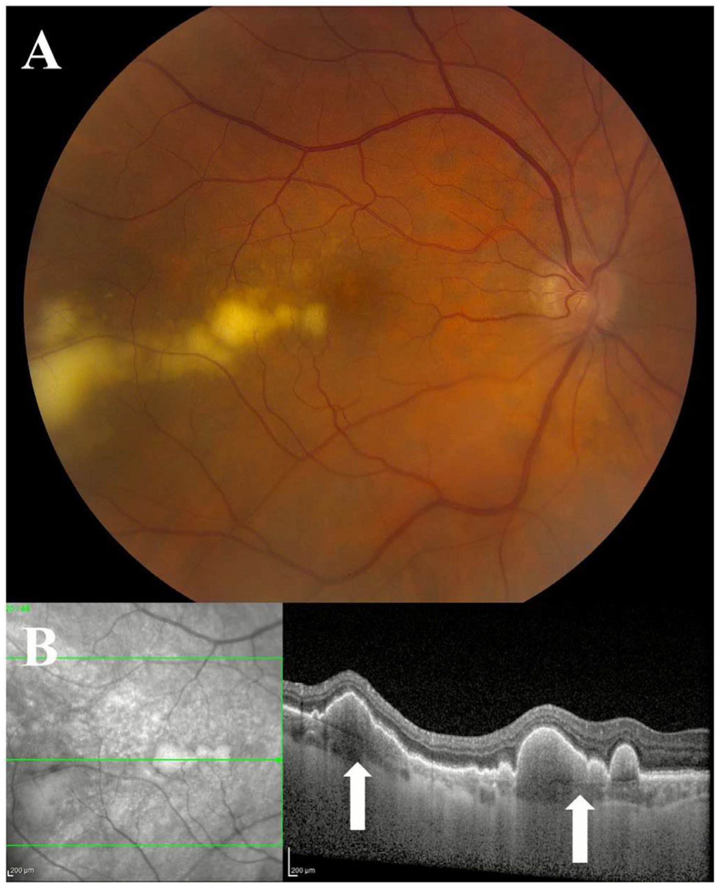
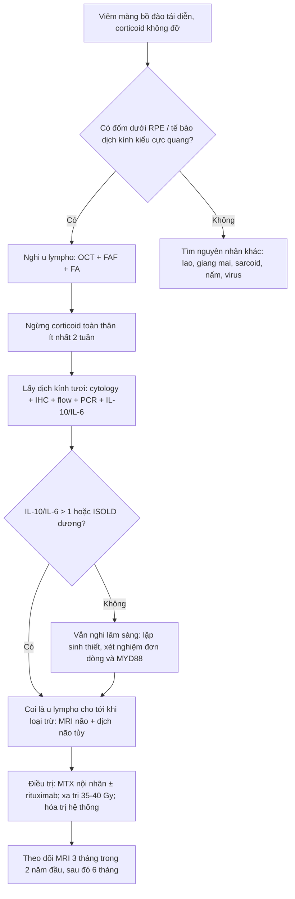
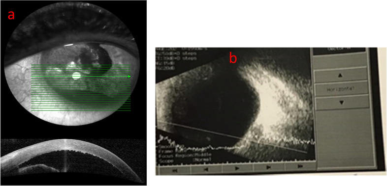
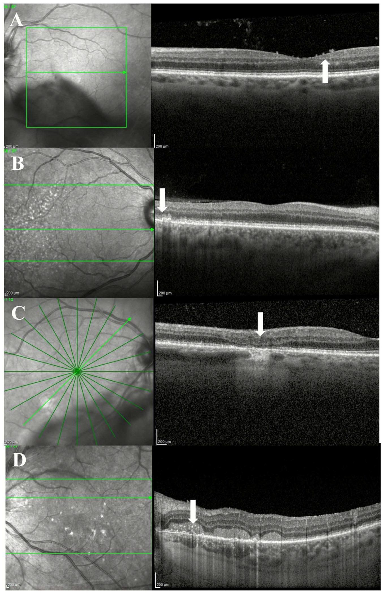
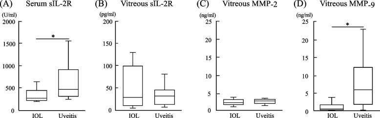
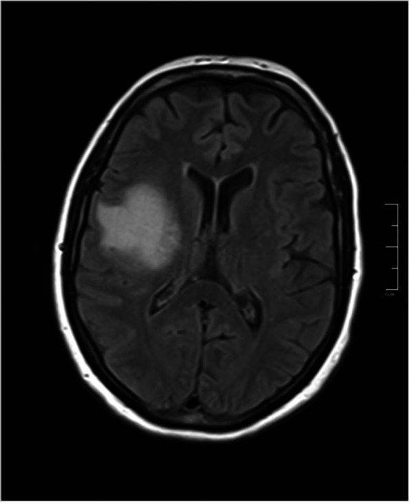

# 1435 — Hội chứng masquerade nội nhãn: u lympho nội nhãn giả viêm màng bồ đào / Intraocular lymphoma masquerading as uveitis

**Tags:** `pattern:viem-mang-bao-dau` `pattern:viet-duoi-rpe` `pattern:te-bao-dich-kinh` `pattern:pseudohypopyon` `pattern:u-lympho` `pattern:thamn-nhiem-hac-mac` `pattern:hoang-diem-khong-dap-ung` `vung:mat` `vung:dich-kinh` `vung:vong-mac` `vung:mong-mat` `vung:hac-mac` `vung:tien-phong` `protocol:OCT` `protocol:FAF` `protocol:FA` `protocol:ICGA` `protocol:UBM` `protocol:B-scan` `protocol:sinh-thiet-dich-kinh` `protocol:MRI-so-nao` `score:ISOLD` `score:IL-10-IL-6`
**Mức chắc chắn (certainty):** tổng hợp y văn (literature synthesis) — số liệu lấy từ 2 tổng quan có hệ thống/tổng quan ảnh học, 1 phân tích dân số SEER, 1 đoàn hệ thực hành, 1 ca nguyên văn, và các nghiên cứu cytokine. **Không có RCT** cho chẩn đoán u lympho nội nhãn; phần ngưỡng cytokine là tổng hợp từ nhiều đoàn hệ khác nhau (đã ghi rõ cỡ mẫu), không trộn thành một "chuẩn" duy nhất.

> **Vì sao bài này quan trọng:** bài **1425/1426** vừa chốt **viêm nội nhãn cấp và tái phát**, **1433** chốt viêm nội nhãn trên mắt bơm dầu; nhưng bệnh nhân **viêm màng bồ đào tái diễn, đã dùng corticoid mà vẫn xấu đi** là nhóm mà mọi "kháng sinh + corticoid" đều thất bại vì chẩn đoán sai. Bỏ sót u lympho không chỉ làm **mù mắt** mà còn bỏ mất cửa sổ điều trị **trước khi di căn não** — trong khi **58%** bệnh nhân sẽ có tổn thương hệ thần kinh trung ương (CNS) trong quá trình bệnh.

> **Sửa tiền đề của backlog (trung thực nguồn):** backlog ghi "IL-10/IL-6 > 1" như một ngưỡng duy nhất. Y văn thực tế dùng **ba cách khác nhau**: ngưỡng tuyệt đối IL-10 (dịch kính **65 pg/mL**, tiền phòng **30 pg/mL**), **tỉ lệ IL-10/IL-6** (dịch kính **> 1**, tiền phòng **> 1,55**), và **điểm ISOLD** (công thức logistic). Bài này trình bày cả ba, kèm AUC và cỡ mẫu, thay vì gộp thành một con số.

## 1. Tổng quan bệnh học – cơ chế hình ảnh – vì sao "viêm" mà không đáp ứng corticoid

- **Bệnh học:** đa số u lympho nội nhãn là **u lympho tế bào B lớn lan tỏa (DLBCL)**; u lympho vùng rìa (MALT) chiếm phần lớn ở người **< 60 tuổi** và ở **hắc mạc/thể mi** (thể tiến triển chậm, tiên lượng tốt hơn). U lympho nội nhãn **nguyên phát (PIOL/PVRL)** được xem là **một phần của u lympho hệ thần kinh trung ương nguyên phát (PCNSL)**: tế bào u "trú" trong mắt trước khi lan vào não.
- **Dịch tễ định lượng:** Mỹ 1995–2018: **0,245 ca/triệu dân/năm**, sống tích lũy 5 năm **70,6%**; SEER 1992–2018: **0,23/triệu**, xu hướng tăng **APC +2,35%/năm**, **326 bệnh nhân**, tuổi trung bình **66,1**, **72,1% ≥ 60 tuổi**; vị trí nguyên phát: **dịch kính 68,7% · thể mi 20,2% · hắc mạc 7,4% · võng mạc 3,7%**. Sống đặc hiệu bệnh **74,2% (5 năm) / 61,5% (10 năm)**; **phẫu thuật, xạ trị và hóa trị không cải thiện sống** trong mô hình SEER — nghĩa là **chẩn đoán sớm** mới là biến số can thiệp được.
- **Vì sao chẩn đoán muộn:** gộp **87 nghiên cứu / 1.484 bệnh nhân**: **85%** bị chẩn đoán muộn, **64%** bị chẩn đoán nhầm; **19%** đã có tổn thương CNS ngay lần đầu, **58%** trong toàn bộ quá trình; thời gian từ triệu chứng đến chẩn đoán **6–40 tháng** (đoàn hệ thực hành: trung vị **10,8 tháng**, **57,1%** từng được điều trị như viêm màng bồ đào, trong đó **9 ca corticoid toàn thân** và **2 ca adalimumab**).
- **TẠI SAO tế bào u "biến mất" sau corticoid:** corticoid gây **ly giải lympho bào** → mẫu dịch kính **nghèo tế bào**, tế bào **dễ vỡ, thoái hóa nhanh** (phải chuyển mẫu **tươi, không cố định**, đến phòng xét nghiệm ngay, dùng **cell block**). Đây là lý do **dịch kính dương tính chỉ ~50%** dù bệnh có thật, và lý do phải **ngừng corticoid toàn thân ≥ 2 tuần** trước lấy mẫu.
- **TẠI SAO IL-10 phân biệt được:** tế bào lympho B ác tính **sản xuất IL-10** (yếu tố tăng trưởng tự tiết), còn **IL-6** do tế bào viêm tiết ra. Vì vậy u lympho cho **IL-10 cao + IL-6 thấp → tỉ lệ > 1**, còn viêm màng bồ đào cho **IL-6 cao** → tỉ lệ **< 1**. Ngưỡng tuyệt đối IL-10 cũng tách được: dịch kính **65 pg/mL** (Se **93%**, Sp **100%**), tiền phòng **30 pg/mL** (Se **78%**, Sp **97%**); tiền phòng **IL-10/IL-6 > 1,55** cho Se **94,1%** / Sp **100%**; gộp 87 nghiên cứu: **IL-10/IL-6 > 1** là xét nghiệm có tỉ lệ dương cao nhất (**93%**), tiếp theo **IL-10 > 50 pg/mL 88%**, **flow cytometry 88%**, **PCR IgH đơn dòng 85,1%**, **MYD88 L265P 70%**, **CD79B 35,09%**.
- **TẠI SAO ảnh OCT là chốt sàng lọc:** OCT phân giải **~5–7 µm** nên thấy được **lắng đọng tăng phản hồi dưới biểu mô sắc tố (sub-RPE)** — nơi tế bào u cư trú giữa RPE và màng Bruch — trong khi **siêu âm B** (phân giải ~100 µm) **không thấy**. Vì tế bào u nằm **dưới RPE**, tổn thương hiện trên ảnh màu là **đốm vàng-kem "sâu"** chứ không phải ổ viêm bông; trên **FAF** các đốm này **tăng tự phát huỳnh quang** do rối loạn chuyển hóa RPE; trên **ICGA** chúng **chặn huỳnh quang** (đốm giảm huỳnh quang).
- **Ngưỡng định lượng cần nhớ:** hạch **dưới RPE 91%** mắt VRL (loạt **182 mắt**), **dưới RPE ± dưới võng mạc = 85%** ở lần khám đầu; **lắng đọng trước võng mạc** đặc hiệu **92,5%** (tỉ lệ gặp 13–44,4%); **lắng đọng trong võng mạc lan tỏa** đặc hiệu **100%**; **đường tăng phản hồi dọc trong võng mạc (VHRL) thể đầy đủ/hỗn hợp** đặc hiệu **100%**; **EZ đứt gãy 52,3–73,3%**; **thâm nhiễm hắc mạc trong** gặp **97,5%** ở viêm màng bồ đào vs **44,4%** ở VRL (dùng để **loại** u lympho).

## 2. Mẫu hình + chẩn đoán phân biệt theo vị trí (Gamut)

Câu hỏi đầu tiên khi gặp "viêm màng bồ đào không đáp ứng corticoid": **(1) tổn thương ở khoang nào? (2) có tổn thương dưới RPE/trong võng mạc không? (3) tế bào dịch kính kiểu gì? (4) có bất thường hắc mạc/thể mi/mống mắt không?**

- **A. Thể dịch kính–võng mạc (VRL, hay gặp nhất ~70%):** tế bào dịch kính + **lắng đọng dưới RPE**; kiểu dịch kính **"cực quang" (aurora borealis)** — sợi mảnh xếp theo trục phát sáng — là **đặc hiệu nhất**, gặp **~1/3** mắt; kiểu **"chuỗi ngọc" (string of pearls)** không đặc hiệu (gặp cả sarcoid/nhiễm trùng); **90%** mắt có một trong ba kiểu; thâm nhiễm dịch kính có thể là **dấu hiệu duy nhất** của tổn thương hậu đoạn ở **40%** mắt. Thị lực **có thể vẫn tốt** dù dịch kính đục nhiều — **ngược với viêm màng bồ đào** (thường phù hoàng điểm, thị lực giảm rõ).
- **B. Thể dưới RPE/võng mạc:** đốm kem-vàng "sâu", có thể **hợp thành hình da báo (leopard spot)** — gặp **9–21%**; tổn thương dưới võng mạc gặp tới **81%** mắt.
- **C. Thể tiền phòng/mống mắt (masquerade tiền phòng):** **giả mủ tiền phòng (pseudohypopyon)**, **mống mắt phồng**, **KPs không dạng "mỡ cừu"**, **không có viêm dịch kính** trên B-scan; glôcôm thứ phát tới **29%**; đây là thể **dễ bị gọi là viêm màng bồ đào trước** và **dễ bị chọc hút tiền phòng nhiều lần**.
- **D. Thể thể mi:** trên **UBM** — thâm nhiễm **đặc, đồng nhất, phản hồi thấp, hình vòng 360° ("ring lymphoma")**; khác melanoma thể mi ở **không có khoang dịch, không "rỗng", bờ đều**.
- **E. Thể hắc mạc (choroidal lymphoma):** **thâm nhiễm vàng-trắng 100% mắt**, **dày hắc mạc lan tỏa 47,1%**, **nếp gấp hắc mạc 11,8%**; OCT bề mặt hắc mạc **phẳng (calm) / gợn sóng nhỏ (mini-wavy) / lượn sóng (maxi-wavy = "seasick")** — **calm** ứng với u dày trung bình **1,7 mm**, **undulating** ứng với **4,1 mm**; **B-scan phát hiện xâm lấn ngoài củng mạc ~76%** mắt nhưng **đo dày quá 66%** so với EDI-OCT.

**Gamut theo "một bên – tái phát – corticoid không cứu":** u lympho, lao nội nhãn, giang mai, nhiễm virus (CMV/HSV/VZV), nấm nội sinh, sarcoidosis, bệnh Vogt–Koyanagi–Harada (thường hai bên), viêm màng bồ đào giao cảm, u hắc mạc (melanoma không sắc tố/di căn), **u nguyên bào võng mạc ở trẻ**, dị vật nội nhãn bỏ sót.

## 3. Bảng so sánh phân biệt (ma trận đối chiếu)

| Thực thể (entity) | Hình ảnh điển hình | Chốt vào (rule-in) | Chốt loại (rule-out) | Gợi ý xác nhận |
|---|---|---|---|---|
| **U lympho dịch kính–võng mạc (VRL)** | Tế bào dịch kính kiểu **cực quang**, **đốm kem-vàng dưới RPE**, OCT: **lắng đọng tăng phản hồi dưới RPE** + PED dạng vòm, **VHRL** | **Đốm dưới RPE + tăng phản hồi dưới RPE trên OCT**; **IL-10/IL-6 > 1**; **VHRL đầy đủ/hỗn hợp (Sp 100%)** | **Thâm nhiễm hắc mạc trong 97,5% ở viêm** → nếu thấy nhiều thì nghiêng viêm; **thị lực rất kém + phù hoàng điểm** nghiêng viêm | Cytology + IHC (CD19/CD20), flow cytometry, PCR IgH/IGK, **IL-10/IL-6**, MYD88 L265P |
| **Viêm màng bồ đào sarcoidosis** | Viêm dạng hạt, **nốt Koeppe/Busacca**, **nang mống mắt**, bạch mạch quanh mạch máu ("candle-wax dripping") | **Tổn thương da/ hạch/ X-quang ngực** + tăng ACE; **IL-6 trội** | **Đốm dưới RPE lan tỏa + IL-10/IL-6 > 1** → loại sarcoid | CT ngực, ACE, sinh thiết hạch/da; cytokine dịch kính |
| **Lao nội nhãn** | Nốt lao hắc mạc, viêm mạch, **dày hắc mạc** | **IGRA dương + tổn thương lao nơi khác**, đáp ứng lao đồ | **IL-10 rất cao + tế bào dị không điển hình** → loại lao | IGRA, PCR lao, đáp ứng điều trị |
| **Giang mai mắt** | **Viêm hắc võng mạc thể đám (placoid)**, viêm mạch, viêm thần kinh thị | **Huyết thanh RPR/TPHA dương**, đáp ứng penicillin | **Đốt dưới RPE + tỉ lệ IL-10/IL-6 > 1** → loại giang mai | RPR/TPHA, HIV, đáp ứng điều trị |
| **Viêm nội nhãn/áp-xe tiền phòng** | **Mủ tiền phòng thật**, fibrin, **viêm dịch kính** trên B-scan, đau nhiều | **Khởi phát cấp < 1 tuần sau can thiệp**, cấy dương | **Không đau, không viêm dịch kính, tái diễn nhiều tháng** → loại nhiễm | Cấy/PCR thủy dịch–dịch kính; **B-scan** |
| **U lympho hắc mạc** | Thâm nhiễm vàng-trắng, **hắc mạc lượn sóng "seasick"**, xâm lấn ngoài củng mạc | **Bề mặt hắc mạc lượn sóng + dày > 4 mm**; EDI-OCT thấy thâm nhiễm sâu | **Melanoma: khối khu trú, vôi hóa, không "seasick"** | EDI-OCT, B-scan, sinh thiết củng mạc/hắc mạc |
| **U lympho thể mi** | **"Ring lymphoma" 360°**, phản hồi thấp đồng nhất trên UBM | **Thâm nhiễm vòng quanh thể mi + giả mủ tiền phòng** | **Melanoma thể mi: bờ không đều, khoang dịch, rỗng** | UBM + sinh thiết/cytology thủy dịch |
| **Melanoma hắc mạc không sắc tố** | Khối dày khu trú, **vôi hóa**, võng mạc trên bị đẩy | **Khối khu trú + vôi hóa + siêu âm phản hồi trung bình–cao** | **Thâm nhiễm lan tỏa hai bên + tổn thương dưới RPE** → loại melanoma | Siêu âm, EDI-OCT, sinh thiết |

*U lympho dịch kính–võng mạc: (A) ảnh màu — tổn thương vàng-kem "sâu" dưới võng mạc/dưới biểu mô sắc tố ở cực sau; (B) OCT — mũi tên chỉ **lắng đọng tăng phản hồi dưới RPE** và **bong biểu mô sắc tố dạng vòm (PED)**; đây là dấu chốt để phân biệt với viêm màng bồ đào. Nguồn: Ibrahim A et al., *Clin Exp Ophthalmol* 2026 (PMC12863966) Fig. 2, **CC BY 4.0**.*

### Các dấu hiệu OCT dùng để "chốt vào" (theo thứ tự đặc hiệu)

- **Đường tăng phản hồi dọc trong võng mạc (VHRL)** — thể **đầy đủ** (từ RPE đến lớp tế bào hạch) và **hỗn hợp**: **đặc hiệu 100%**; thể **không đầy đủ** cũng gặp ở viêm hắc võng mạc giang mai thể đám, viêm màng bồ đào giao cảm mạn, viêm hắc mạc đa ổ vô căn → **không đặc hiệu**.
- **Lắng đọng trong võng mạc lan tỏa:** **đặc hiệu 100%**, nhưng chỉ gặp **7%** mắt trong loạt lớn nhất (**182 mắt**) → **độ nhạy thấp**.
- **Lắng đọng trước võng mạc:** **đặc hiệu 92,5%**, gặp **13–44,4%**; biến mất sau cắt dịch kính.
- **Lắng đọng trong võng mạc xuất hiện MUỘN** = tiến triển/tái phát: **17% → 50%** mắt ở lúc tiến triển, **7% → 47%** lúc tái phát; thâm nhiễm trong võng mạc liên quan **tổn thương CNS sau đó (OR 4,3)**.

## 4. Protocol chụp – xét nghiệm + thuật toán chẩn đoán

**Bộ ảnh học tối thiểu (mọi ca nghi masquerade hậu đoạn):** ảnh màu **góc rộng (UWF)** — phát hiện thêm tổn thương ở **47%** mắt so với ảnh 30°; **OCT hoàng điểm + OCT qua tổn thương**; **FAF**; **FA**; **ICGA** khi nghi hắc mạc; **B-scan** khi phương tiện đục; **UBM** khi nghi thể mi/mống mắt; **EDI-OCT** khi nghi hắc mạc.

**Xét nghiệm (thứ tự ưu tiên):**
1. **Cytology + hóa mô miễn dịch (CD19, CD20, CD3, Ki-67)** trên **dịch kính không pha loãng**, chuyển **tươi** trong 1 giờ, dùng **cell block**; PPV **25G, ≤ 15.000 CPM**; **ngừng corticoid toàn thân ≥ 2 tuần** trước lấy mẫu.
2. **Cytokine:** IL-10, IL-6 trên **dịch kính** (và **thủy dịch** nếu không lấy được dịch kính) → **IL-10 > 65 pg/mL** (dịch kính), **> 30 pg/mL** (thủy dịch), **IL-10/IL-6 > 1** (dịch kính) hoặc **> 1,55** (thủy dịch).
3. **Điểm ISOLD** (Interleukin Score for IntraOcular Lymphoma Diagnosis) — công thức logistic theo IL-10 và IL-6:
   - Thủy dịch: **−12,871 + 5,533 × log([IL-10]+1) − 1,614 × log([IL-6]+1)**
   - Dịch kính: **−12,208 + 4,648 × log([IL-10]+1) − 1,669 × log([IL-6]+1)**
   - Đoàn hệ gốc (Costopoulos, đa trung tâm châu Âu): **Se 93% / Sp 95%**; đoàn hệ Trung Quốc (**65 mẫu dịch kính**): ngưỡng **−9,97** → **Se 95,9% / Sp 93,7%**, **AUC 0,95** (IL-10 đơn thuần AUC **0,93**; tỉ lệ IL-10/IL-6 AUC **0,954**).
4. **Đơn dòng:** flow cytometry (**Se 88%**), PCR **IgH/IGK** (**Se 85,1%**; IGK đặc hiệu **94,12%** vs IGH **78,95%**), **MYD88 L265P** (thủy dịch **67%**, dịch kính **75%**, **Sp 100%**).
5. **Lan hệ thống:** **MRI não có cản từ** + **dịch não tủy**; **16,9%** ca có dịch não tủy nghi ngờ **dù MRI âm**; **IL-10 dịch não tủy tăng ở 90,2%** bệnh nhân VRL và liên quan tổn thương nội sọ.

**Điều trị (để hiểu vì sao chẩn đoán sớm quan trọng):** **MTX nội nhãn 400 µg/0,1 mL** — **2 lần/tuần × 8 tuần**, rồi **1 lần/tuần × 8 tuần**, rồi **1 lần/tháng × 9 tháng** (**25 mũi/năm**); **rituximab 1 mg/0,1 mL**; **xạ trị ngoài 35–40 Gy/15 lần × 2 Gy**; tổn thương CNS dùng **HD-MTX 3,5 g/m²** ± cytarabine, **MATRix** cho người **< 70 tuổi**; **WBRT để dành cho cứu cánh** vì độc thần kinh muộn.

## 5. Biến thể bình thường và cạm bẫy

- **Cạm bẫy 1 — corticoid làm âm tính giả:** đây là cạm bẫy số 1. **57,1%** bệnh nhân trong đoàn hệ thực hành đã được điều trị như viêm màng bồ đào trước khi chẩn đoán; **2 lần lấy mẫu âm** vẫn có thể là u lympho (ca nguyên văn dưới đây: **3 lần** mới dương).
- **Cạm bẫy 2 — "mủ tiền phòng" bị coi là nhiễm trùng:** giả mủ tiền phòng trong u lympho **không đau, không viêm dịch kính**, tái diễn nhiều tháng, **không đáp ứng kháng sinh**. B-scan **bình thường** ở thể tiền phòng đơn thuần → đừng vì B-scan sạch mà loại u.
- **Cạm bẫy 3 — dùng sIL-2R huyết thanh để "loại" u lympho:** **sai**. Trong nghiên cứu **25 mắt u lympho vs 15 mắt viêm màng bồ đào**, sIL-2R huyết thanh **thấp hơn** ở u lympho (**424 ± 482,9 vs 659 ± 410,1 U/mL, p < 0,05**) và chỉ **20%** ca u lympho tăng (so với **66,7%** ca viêm). sIL-2R **dịch kính** cao hơn (180 vs 35 pg/mL) nhưng **không có ý nghĩa (p = 0,80)**. Kết luận của chính tác giả: **sIL-2R huyết thanh không dùng được để chẩn đoán u lympho nội nhãn**.
- **Cạm bẫy 4 — thị lực tốt bị dùng để loại bệnh:** VRL có thể có **thị lực tốt bất ngờ** dù dịch kính đục; viêm màng bồ đào thường giảm thị lực do **phù hoàng điểm**. Đừng lấy thị lực tốt làm bằng chứng "không phải u".
- **Cạm bẫy 5 — hắc mạc "lượn sóng" bị đọc là bong hắc mạc thanh dịch/CSC:** hình **"seasick"** đặc trưng cho u lympho hắc mạc; **B-scan đo dày quá 66%** so với EDI-OCT → **luôn đối chiếu EDI-OCT** trước khi kết luận độ dày và trước khi xạ trị.
- **Cạm bẫy 6 — bỏ sót não:** MRI não âm **không loại** tổn thương CNS (**16,9%** có dịch não tủy nghi ngờ khi MRI âm) → vẫn phải chọc dịch não tủy và theo dõi **MRI 3 tháng/lần trong 2 năm đầu**.
- **Biến thể "lành tính" dễ nhầm:** **drusen cứng** (đốm vàng nhỏ, tăng tự phát huỳnh quang, nhưng **không có tế bào dịch kính**, OCT là lắng đọng **trên** RPE chứ không phải **dưới** RPE); **di căn hắc mạc** (nhiều ổ, có tiền sử ung thư); **u máu hắc mạc** (OCT: dày hắc mạc + mạch máu trên ICGA).

## 6. Tự lượng giá — Blind Quiz ngay trên trang tĩnh

**Ca 1 — nữ 55 tuổi, "viêm màng bồ đào trước một bên" tái diễn**

- Gợi ý lâm sàng: **55 tuổi**, **giảm thị lực phải 2 tháng**, đỏ và đau mắt, **mủ tiền phòng 0,2 mm**, KPs không dạng mỡ cừu, **mống mắt phồng ra phía dưới mũi**; đã dùng corticoid tại chỗ + toàn thân, kháng virus và kháng khuẩn **không đỡ**; xét nghiệm lao, giang mai, HLA-B27, cấy máu đều âm.
- Câu hỏi: (a) Mô tả dấu hiệu trên AS-OCT và B-scan? (b) Ba chẩn đoán phân biệt? (c) Dấu hiệu nào **chốt** hướng đi tiếp theo?

<b>Bấm để hiện đáp án (findings + chẩn đoán)</b>

- **Dấu hiệu:** AS-OCT — **vật liệu tăng phản hồi dày trên nội mô giác mạc** (mủ dính nội mô, không phải mủ lắng đáy) và **bề mặt mống mắt tăng phản hồi, phồng lên, phía dưới giảm phản hồi**; **B-scan — KHÔNG có viêm dịch kính** dù tiền phòng mủ nặng.
- **Chẩn đoán:** **u lympho tế bào B lớn nội nhãn thể tiền phòng** — chẩn đoán xác định ở **lần lấy mẫu thứ 3** (cytology + flow: **CD19+, CD20+**), sau 2 lần âm tính. Điều trị **MTX nội nhãn 0,4 mg/0,1 mL** (tuần × 1 tháng, sau đó tháng × 5) + **rituximab 1 mg/0,1 mL** (2 tháng) → hết mủ, thị lực **20/32 → 20/40**; **MRI não lần 3 sau 6 tháng** phát hiện tổn thương chất trắng quanh não thất; theo dõi 18 tháng thị lực **20/30**, mắt yên.
- **Bài học:** mủ tiền phòng **không kèm viêm dịch kính** + không đáp ứng kháng sinh/kháng virus = **phải lấy mẫu lặp lại**; tế bào lympho dễ vỡ nên **một lần âm không loại trừ**.
- **Phản biện (trung thực nguồn):** đây là thể **rất không điển hình** (chỉ tiền phòng, một bên, kéo dài 18 tháng không lan hậu đoạn) — tác giả cũng ghi rõ như vậy; không dùng ca này để mô tả "thể thường gặp".
- Nguồn ảnh: Zamani G et al., *J Ophthalmic Inflamm Infect* 2022 (PMC9334462) Fig. 2, **CC BY 4.0**.

**Ca 2 — nam 68 tuổi, "viêm màng bồ đào trung gian" 8 tháng, thị lực vẫn 20/25**

- Gợi ý lâm sàng: **68 tuổi**, ruồi bay + mờ nhẹ **8 tháng**, đã dùng corticoid uống **3 đợt** (mỗi đợt đỡ rồi tái phát), **không đau**, **thị lực 20/25**, dịch kính có tế bào.
- Câu hỏi: (a) Bốn kiểu tổn thương trên OCT (A–D) là gì? (b) Kiểu nào **đặc hiệu 100%** cho u lympho? (c) Bước tiếp theo cần làm gì **trước** khi lấy dịch kính?

<b>Bấm để hiện đáp án (findings + chẩn đoán)</b>

- **Dấu hiệu:** (A) **lắng đọng trước võng mạc** — vật liệu tăng phản hồi nằm **trên** lớp võng mạc trong (đặc hiệu **92,5%**); (B) **bờ ngoài võng mạc mờ + RPE dạng nốt**; (C) **teo võng mạc ngoài/đứt EZ** (gặp **52,3–73,3%** mắt, thường tồn tại sau điều trị); (D) **lắng đọng dưới võng mạc/dưới RPE** dạng nốt.
- **Kiểu đặc hiệu 100%:** **lắng đọng trong võng mạc lan tỏa** và **VHRL thể đầy đủ/hỗn hợp** (không có trong 4 ô này).
- **Chẩn đoán:** **u lympho dịch kính–võng mạc (VRL)** — thị lực tốt + đốm dưới RPE + corticoid chỉ đỡ tạm là bộ ba gợi ý.
- **Trước khi lấy dịch kính:** **ngừng corticoid toàn thân ≥ 2 tuần**, lên kế hoạch **PPV 25G** lấy dịch kính **không pha loãng**, chuyển **tươi** đến phòng xét nghiệm có kinh nghiệm, đồng thời gửi **IL-10/IL-6** và **flow cytometry/PCR**.
- Nguồn ảnh: Ibrahim A et al., *Clin Exp Ophthalmol* 2026 (PMC12863966) Fig. 4, **CC BY 4.0**.

**Ca 3 — bệnh nhân 70 tuổi, "đã loại u lympho vì sIL-2R bình thường"**

- Gợi ý lâm sàng: **70 tuổi**, dịch kính đục nhiều một bên, **sIL-2R huyết thanh 380 U/mL** (trong giới hạn bình thường **< 459 U/mL**) → bác sĩ kết luận "không phải u lympho" và tiếp tục corticoid.
- Câu hỏi: (a) Biểu đồ nói gì về sIL-2R huyết thanh? (b) Có được dùng sIL-2R bình thường để loại u lympho không? (c) Nên làm gì?

<b>Bấm để hiện đáp án (findings + chẩn đoán)</b>

- **Dấu hiệu:** sIL-2R **huyết thanh** ở u lympho **thấp hơn** viêm màng bồ đào (**424 ± 482,9 vs 659 ± 410,1 U/mL, p < 0,05**); chỉ **20%** u lympho tăng trên ngưỡng (vs **66,7%** viêm). sIL-2R **dịch kính** cao hơn ở u lympho (**180 vs 35 pg/mL**) nhưng **p = 0,80**.
- **Trả lời:** **KHÔNG** — sIL-2R huyết thanh **không phải** chỉ dấu loại trừ; bình thường vẫn có thể là u lympho. Ngược lại, sIL-2R tăng lại nghiêng về **viêm/sarcoid**.
- **Nên làm:** **lấy dịch kính** (cytology + IHC + flow + PCR + **IL-10/IL-6**), không dựa vào huyết thanh; nếu **IL-10/IL-6 > 1** hoặc **ISOLD** dương → coi là u lympho cho tới khi loại trừ, **MRI não + dịch não tủy**.
- Nguồn ảnh: Suzuki K et al., *BMC Ophthalmol* 2022 (PMC9648008) Fig. 1, **CC BY 4.0**.

**Ca 4 (nối hệ thống) — MRI não 6 tháng sau chẩn đoán mắt**

- Gợi ý: bệnh nhân ca 1, mắt đã yên sau điều trị nội nhãn, **6 tháng sau** xuất hiện **run toàn thân**.
- Câu hỏi: Dấu hiệu trên FLAIR? Vì sao vẫn phải theo dõi MRI dù mắt đã sạch?

<b>Bấm để hiện đáp án (findings + chẩn đoán)</b>

- **Dấu hiệu:** **tăng tín hiệu FLAIR ở chất trắng quanh não thất và dưới vỏ** — tổn thương CNS, phù hợp u lympho thần kinh trung ương thứ phát.
- **Vì sao:** **19%** đã có CNS lúc chẩn đoán và **58%** sẽ có trong quá trình bệnh; điều trị nội nhãn **không phòng được** lan CNS → **MRI 3 tháng/lần trong 2 năm đầu**, sau đó **6 tháng/lần**.
- Nguồn ảnh: Zamani G et al., *J Ophthalmic Inflamm Infect* 2022 (PMC9334462) Fig. 5, **CC BY 4.0**.

## Bài liên quan chéo
- [1425 – Viêm nội nhãn sau tiêm nội nhãn](../1425-viem-noi-nhan-sau-tiem-noi-nhan/lesson.md)
- [1426 – Viêm nội nhãn tái phát/không đáp ứng](../1426-viem-noi-nhan-tai-phat-khong-dap-ung/lesson.md)
- [1433 – Viêm nội nhãn ở mắt bơm dầu silicone](../1433-viem-noi-nhan-mat-bom-dau/lesson.md)
- [492 – Sinh thiết hắc vọng mạc–dịch kính](../492-sinh-thiet-hac-vong-mac-dich-kinh/lesson.md)
- [400 – Tổng quan Mắt & thị giác](../400-tong-quan-mat-thi-giac/lesson.md)

## Ảnh
- `images/1435_u-lympho-noi-nhan_Anh-mau-OCT_PMC12863966-Fig2-CCBY.jpg` — ảnh màu + OCT tổn thương dưới RPE.
- `images/1435_u-lympho-noi-nhan_OCT_PMC12863966-Fig4-CCBY.jpg` — 4 kiểu tổn thương OCT.
- `images/1435_u-lympho-noi-nhan_AS-OCT-Bscan_PMC9334462-Fig2-CCBY.jpg` — AS-OCT + B-scan thể tiền phòng.
- `images/1435_u-lympho-noi-nhan_MRI-so-nao_PMC9334462-Fig5-CCBY.jpg` — MRI FLAIR não.
- `images/1435_u-lympho-noi-nhan_sIL-2R_PMC9648008-Fig1-CCBY.jpg` — biểu đồ sIL-2R.
- Nguồn + giấy phép từng ảnh: `images/CREDITS.md`.

> Không dùng để chẩn đoán độc lập khi chưa có người hướng dẫn.
