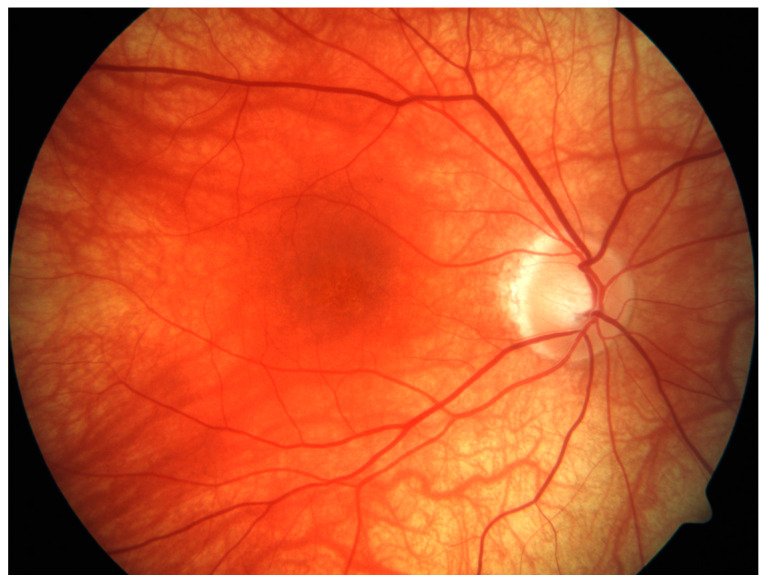
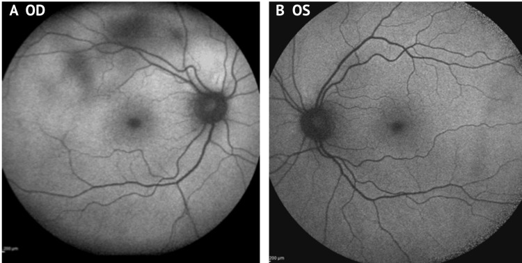
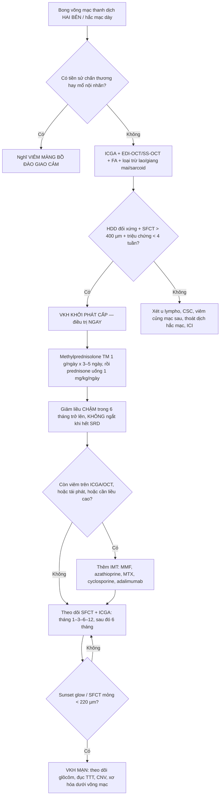
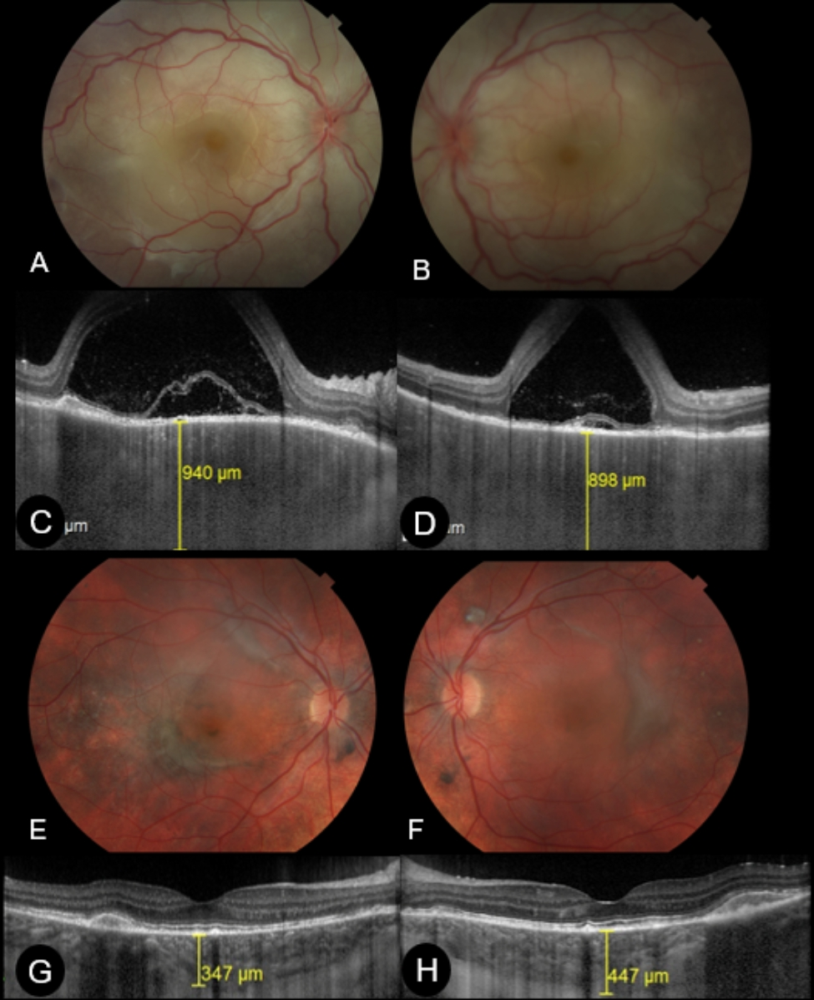
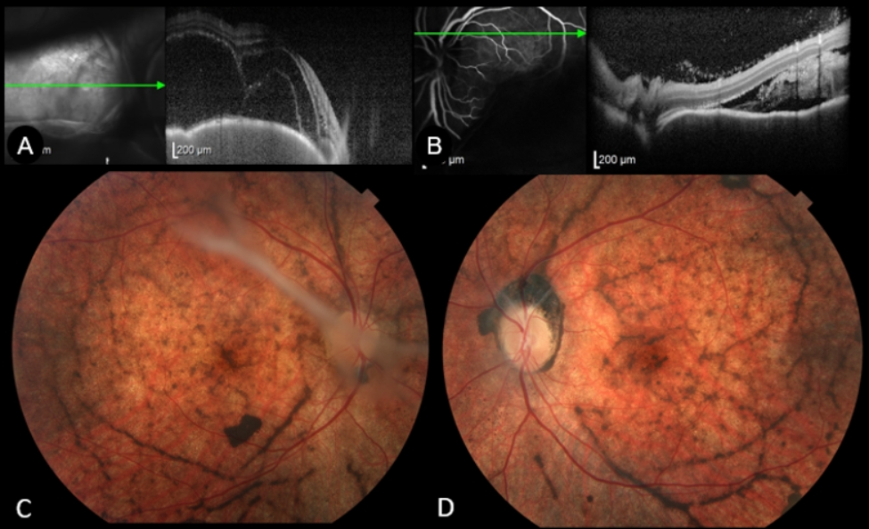
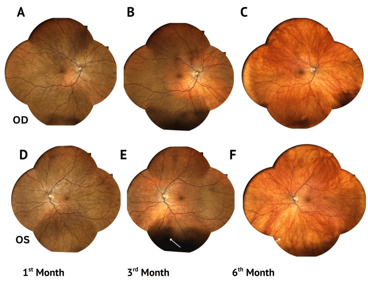
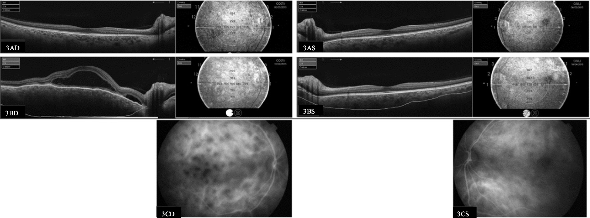
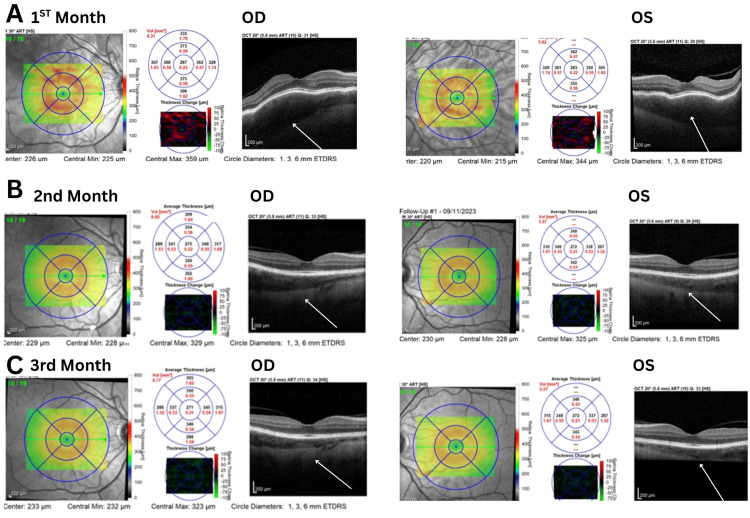

# 1436 — Bệnh Vogt–Koyanagi–Harada (VKH): viêm toàn hắc mạc hai bên + bong võng mạc thanh dịch / Vogt-Koyanagi-Harada disease

**Tags:** `pattern:viem-hac-mac` `pattern:bong-vong-mac-thanh-dich` `pattern:day-hac-mac` `pattern:sunset-glow` `pattern:balad` `pattern:viem-mang-bao-dau` `pattern:hai-ben` `pattern:viem-toan-hac-mac` `vung:mat` `vung:hac-mac` `vung:vong-mac` `vung:mong-mat` `vung:dia-thi` `vung:tien-phong` `protocol:OCT` `protocol:EDI-OCT` `protocol:FA` `protocol:ICGA` `protocol:FAF` `protocol:B-scan` `protocol:MRI-so-nao` `score:Read-2001` `score:SUN-2021`

**Mức chắc chắn (certainty):** tổng hợp y văn (literature synthesis) — số liệu lấy từ 2 đoàn hệ có đối chứng/thời gian theo dõi dài (Brazil 33 bệnh nhân, Ý 38 bệnh nhân), 1 nghiên cứu đoàn hệ Nhật 72 bệnh nhân, 1 đoàn hệ Hàn 55 bệnh nhân, 1 loạt 646 bệnh nhân Ấn Độ (thể bong bóng nước), 1 tổng quan cơ chế–chẩn đoán của Herbort, và 2 bộ tiêu chuẩn (Read 2001, SUN 2021). **Không có RCT** cho liều corticoid ban đầu; phần "pulse vs half-pulse" là nghiên cứu hồi cứu **âm tính** (không khác biệt) — đã ghi rõ.

> **Vì sao bài này quan trọng:** bài **1435** vừa chốt **masquerade do u lympho** — bệnh nhân "viêm màng bồ đào tái diễn, corticoid không đỡ". VKH là **hình ảnh ngược lại**: **hai bên, đáp ứng rất tốt với corticoid**, nhưng **chỉ khi điều trị trong 2–4 tuần đầu**. Bỏ sót hoặc điều trị muộn không làm mù ngay, mà để lại **sunset glow + xơ hóa dưới võng mạc** — mất thị lực **vĩnh viễn và không hồi phục** dù viêm đã hết. Đây cũng là chẩn đoán phân biệt **bắt buộc** của **viêm màng bồ đào giao cảm** (khác ở chỗ **có tiền sử chấn thương/phẫu thuật**).

> **Sửa tiền đề của backlog (trung thực nguồn):** backlog ghi "PRES/ARIA" như một hàng chẩn đoán phân biệt. Trong y văn VKH **không có thực thể tên "ARIA"**; tôi **không đưa vào** ma trận để tránh bịa. Hàng phân biệt thay thế có thật trong nguồn: **viêm hắc mạc do thuốc ức chế điểm kiểm miễn dịch (ICI-VKH-like)**, **viêm màng bồ đào giao cảm**, **viêm củng mạc sau (posterior scleritis)**, **hội chứng thoát dịch hắc mạc (uveal effusion syndrome)**, **CSC hai bên** và **u lympho nội nhãn (1435)**.

## 1. Tổng quan bệnh học – cơ chế hình ảnh – vì sao "hắc mạc" mới là chỗ khởi phát

- **Bệnh học:** VKH là bệnh tự miễn qua trung gian tế bào T **chống lại kháng nguyên tế bào hắc tố** (họ tyrosinase: **TYR, TRP1, TRP2**). Tế bào T (Th1 tiết IFN-γ, **Th17 tiết IL-17**) thâm nhập **mô đệm hắc mạc**; tế bào T điều hòa (Treg, IL-10/TGF-β) gắn với giai đoạn lui bệnh. Yếu tố nguy cơ di truyền mạnh nhất: **HLA-DRB1\*0405 và DRB1\*0410** — peptide tyrosinase gắn ưu tiên vào các phân tử này.
- **Vì sao hắc mạc, không phải mống mắt:** hắc mạc chứa **lớp tế bào hắc tố dày nhất cơ thể** và nhận **~80% lưu lượng máu mắt**. Viêm **bắt đầu ở mô đệm hắc mạc** (stromal choroiditis), rồi mới lan ra mống mắt/thể mi (viêm màng bồ đào trước) và màng não–tai trong–da. Vì vậy **viêm màng bồ đào trước đơn thuần không bao giờ là VKH**; và **hình ảnh hắc mạc là bằng chứng bắt buộc**.
- **TẠI SAO hắc mạc DÀY trên EDI-OCT/SS-OCT:** viêm mô đệm → **phù + thâm nhiễm tế bào + giãn mạch**. Bề dày hắc mạc dưới hoàng điểm (SFCT) bình thường **220–360 µm** (nhóm chứng 17 mắt, SS-OCT); trong VKH cấp **940 µm và 898 µm** (ca nguyên văn dưới đây), tức **gấp 2,5–4 lần**. Điều trị hiệu quả → SFCT tụt còn **347 / 447 µm** sau 1 tháng. Đây là **biến số định lượng** tốt nhất để theo dõi, vì thay đổi **trước khi** thị lực đổi.
- **TẠI SAO có bong võng mạc thanh dịch (SRD):** tăng tính thấm mao mạch hắc mạc vượt khả năng bơm của RPE → dịch tích **dưới võng mạc cảm thụ**. Trên OCT: vùng **giảm phản hồi dưới võng mạc, bờ võng mạc ngoài còn nguyên** (khác bong võng mạc do rách: có nếp gấp, màng dịch kính dính). Trên **FA**: **điểm rò rỉ (pinpoint leakage)** + **đọng thuốc (pooling)** ở thì muộn. Tần suất trong VKH cấp: **96,4%** mắt lúc vào viện, còn **42,4%** ở tháng 1, **9,1%** tháng 3, **4,5%** tháng 6, **3,0%** tháng 9.
- **TẠI SAO "BALAD" là dấu hiệu đặc trưng:** *bacillary layer detachment* = tách **tại ranh giới myoid/ellipsoid** (lớp "bacillary" của tế bào cảm thụ), do **áp lực dịch dưới võng mạc tăng rất nhanh** trong viêm hắc mạc cấp. Gặp **48,2%** mắt lúc vào viện nhưng chỉ **6,1%** ở tháng 1 — nó **không phải** bong võng mạc thanh dịch thông thường và **không phải** lỗ hoàng điểm. BALAD là **yếu tố tiên lượng xấu độc lập**: **OR 12,04** cho xơ hóa dưới võng mạc (SRFib) và **OR 14,78** cho sunset glow ở tháng 12.
- **TẠI SAO "sunset glow" (quầng hoàng hôn):** tế bào hắc tố hắc mạc **bị phá hủy** → mất sắc tố nâu → ánh **cam-đỏ** của máu trong mạch hắc mạc chiếu qua RPE mỏng. Đây là dấu **di chứng**, không phải viêm đang hoạt động. Gặp **60–70%** bệnh nhân VKH mạn, **nhiều hơn ở người châu Á**; xuất hiện **2–6 tháng** sau khởi phát. Trong thể bong bóng nước, sunset glow lên tới **72%** mắt (17/22).
- **Vì sao thời gian là biến số quyết định:** "cửa sổ cơ hội" điều trị là **2–4 tuần** sau khởi phát. Trong đoàn hệ Brazil, mỗi **1 ngày** chậm điều trị làm tăng **OR 1,17** cho xơ hóa dưới võng mạc (nhóm xơ hóa điều trị sau **32 ngày** so với **17 ngày**). Dù điều trị sớm bằng corticoid liều cao, **22,5–79%** vẫn chuyển VKH mạn; **38%** trong số đó tiến tới xơ hóa dưới võng mạc.
- **Ngưỡng định lượng cần nhớ:** SFCT bình thường **220–360 µm**; VKH cấp **900–940 µm**; SFCT **tăng 100 µm** ở tái phát có triệu chứng, **126 µm** ở tái phát **không triệu chứng**; SS-OCT phát hiện **41,6%** tái phát không triệu chứng ở nhóm đang hồi phục và **25%** ở nhóm "yên" — nên **theo dõi bằng số, không bằng cảm giác**.

## 2. Mẫu hình + chẩn đoán phân biệt theo vị trí và theo giai đoạn (Gamut)

Câu hỏi đầu tiên: **(1) hai bên không? (2) có tiền sử chấn thương/phẫu thuật không? (3) viêm ở hắc mạc (dày, HDD trên ICGA) hay chỉ ở tiền phòng? (4) đang ở giai đoạn nào (khởi phát < 4 tuần / mạn > 4 tuần)?**

- **A. Thể khởi phát cấp (initial-onset, < 4 tuần):** **bong võng mạc thanh dịch hai bên** (96,4%), **BALAD** (48,2%), **dày hắc mạc lan tỏa** (900–940 µm), **phù đĩa thị**, tiền phòng có thể **rất ít tế bào** (dễ bị gọi là "bệnh hắc mạc trung tâm"). Kèm **tiền triệu**: đau đầu, cứng gáy, ù tai, giảm thính lực, tăng nhạy cảm da đầu — hỏi **trực tiếp**, vì bệnh nhân thường không tự khai.
- **B. Thể bong bóng nước (bullous ERD) — hiếm nhưng nặng:** **12/646 bệnh nhân (1,86%)**, **10/12 hai bên**, thị lực vào **1,74 logMAR** → ra **0,84 logMAR**; bề dày hắc mạc trên **B-scan 1,79 mm (1,04–3,57 mm)**; bùng phát cấp **27%** mắt, tái phát **22,7%**; cuối theo dõi: **sunset glow 72%**, **glôcôm thứ phát 36,3%**, **xơ hóa dưới võng mạc 41%**.
- **C. Thể hồi phục (convalescent, 4 tuần–6 tháng):** SRD hết, xuất hiện **sắc tố lốm đốm**, **nốt Dalen–Fuchs-like**, **sunset glow** bắt đầu; **Sugiura sign** (bạch biến quanh rìa giác mạc — *perilimbal vitiligo*) là dấu **rất dễ bỏ sót** nhưng **đặc hiệu cao**.
- **D. Thể mạn tái phát (chronic recurrent, > 4 tuần chưa điều trị đủ):** **viêm màng bồ đào trước hạt hai bên tái diễn**, **sunset glow**, **teo hắc mạc**, biến chứng: **đục thể thủy tinh, glôcôm, CNV, xơ hóa dưới võng mạc, nhãn áp thấp**. Tái phát viêm màng bồ đào trước tích lũy **39,3% ở 10 năm**; **dính mống mắt sau khu trú (focal posterior synechiae)** lúc chẩn đoán làm tăng nguy cơ tái phát **6,97 lần**.

**Gamut "bong võng mạc thanh dịch HAI BÊN + hắc mạc dày":**
VKH · **viêm màng bồ đào giao cảm** (phải có tiền sử chấn thương/mổ) · **viêm hắc mạc do ICI (ức chế điểm kiểm miễn dịch)** · **viêm củng mạc sau** · **hội chứng thoát dịch hắc mạc (uveal effusion)** · **CSC hai bên/mạn** · **u lympho nội nhãn (1435)** · **sarcoidosis, lao, giang mai** · **bệnh tăng sinh hắc mạc lan tỏa hai bên (BIUMP)** · **di căn hắc mạc** · **bệnh thận–mắt (hypertensive choroidopathy)**.

## 3. Bảng so sánh phân biệt (ma trận đối chiếu)

| Thực thể (entity) | Hình ảnh điển hình | Chốt vào (rule-in) | Chốt loại (rule-out) | Gợi ý xác nhận |
|---|---|---|---|---|
| **VKH khởi phát cấp** | SRD hai bên + **BALAD**, **SFCT 900–940 µm**, FA **pinpoint + pooling**, ICGA **HDD rải đều toàn đáy mắt** | **Hai bên + hắc mạc dày lan tỏa + không tiền sử chấn thương/mổ**; **HDD đối xứng trên ICGA**; BALAD (OR 12,04 cho xơ hóa) | **Tiền sử chấn thương/mổ nội nhãn → loại VKH, nghĩ viêm giao cảm**; **IGRA/RPR dương → loại** | ICGA + EDI-OCT/SS-OCT; FA; tiêu chuẩn **Read 2001 / SUN 2021** |
| **VKH mạn (sunset glow)** | **Cam-đỏ lan tỏa**, teo RPE quanh đĩa, **SFCT mỏng < 220 µm**, HDD tồn tại | **Sunset glow + Sugiura sign + bạch biến/rụng tóc/bạc lông**; **tiền sử giai đoạn cấp** | **Hắc mạc dày + SRD đang hoạt động → không phải thể mạn thuần** | Ảnh màu góc rộng, FAF, SS-OCT |
| **Viêm màng bồ đào giao cảm (sympathetic ophthalmia)** | Giống VKH: **SRD hai bên, hắc mạc dày, Dalen–Fuchs nổi bật**, viêm trước hạt | **Tiền sử chấn thương xuyên thấu hoặc phẫu thuật nội nhãn ở mắt kia** (kể cả **YAG, cyclophotocoagulation**) | **Không tiền sử can thiệp → nghiêng VKH** | Hỏi kỹ tiền sử mổ **mắt bên kia**; tỉ lệ sau chấn thương hiện đại **0,072–0,8%** |
| **Viêm củng mạc sau (posterior scleritis)** | Củng mạc dày, **dấu "T" trên B-scan**, nếp gấp hắc mạc, đau dữ dội khi liếc | **Củng mạc dày > 2 mm + dấu T + đau khi vận nhãn** | **SFCT tăng nhưng củng mạc bình thường + không đau → nghiêng VKH** | B-scan đo củng mạc, CT/MRI hốc mắt |
| **Hội chứng thoát dịch hắc mạc (uveal effusion)** | SRD **dịch di chuyển**, hắc mạc dày **không viêm**, nhãn cầu ngắn, củng mạc dày | **Không tế bào tiền phòng/dịch kính + nhãn cầu ngắn (AL < 21 mm) + củng mạc dày** | **HDD trên ICGA + tế bào → loại** | AL, B-scan, ICGA (không có viêm) |
| **CSC hai bên / mạn** | Bong thanh dịch **khu trú hoàng điểm**, hắc mạc dày, **không viêm** | **Không tế bào, không HDD, tự khỏi/dao động**; ứ dịch nhỏ, ranh giới rõ | **HDD rải rác + SRD lan rộng hai bên + tiền triệu thần kinh → loại CSC** | ICGA (không HDD), OCT (PED nhỏ) |
| **Viêm hắc mạc do ICI (ICI-VKH-like)** | Giống VKH **hoàn toàn**, thường **khởi phát sau 1–3 chu kỳ** thuốc | **Dùng anti-PD-1/PD-L1/anti-CTLA-4 + hội chứng VKH đầy đủ** | **Không dùng ICI → loại** | Ngưng thuốc + corticoid; phối hợp ung thư |
| **U lympho nội nhãn (1435)** | Tế bào dịch kính, **đốm dưới RPE**, **corticoid chỉ đỡ tạm rồi nặng lên** | **IL-10/IL-6 > 1** hoặc **ISOLD dương**; **tổn thương dưới RPE** | **Hai bên đối xứng + SFCT 900 µm + đáp ứng corticoid ngoạn mục → loại** | Cytology dịch kính, IL-10/IL-6, MRI não |
| **Lao / giang mai / sarcoid hắc mạc** | Nốt hắc mạc, viêm mạch, dày hắc mạc | **IGRA/PCR lao dương**, **RPR/TPHA dương**, **ACE + tổn thương phổi/hạch** | **Xét nghiệm âm + HDD đối xứng + đáp ứng corticoid đơn thuần** | IGRA, RPR/TPHA, CT ngực |

*Sunset glow fundus điển hình: đổi màu **cam-đỏ lan tỏa** toàn đáy mắt, teo quanh đĩa thị và **lốm đốm sắc tố vùng hoàng điểm**. Đây là **di chứng** của mất tế bào hắc tố hắc mạc, không phải viêm đang hoạt động — nhưng vẫn phải loại tái phát bằng ICGA/SS-OCT. Nguồn: Accorinti M et al., *J Clin Med* 2022;11:3632 (PMC9267436) Fig. 1, **CC BY 4.0**.*

*FAF (autofluorescence) hai mắt: **đốm giảm tự phát huỳnh quang (tối)** ở cực sau, tương ứng vùng **hắc mạc dày** và rối loạn chuyển hóa RPE. FAF **không thay thế** ICGA trong VKH nhưng rẻ, nhanh, lặp lại được — dùng để theo dõi **di chứng RPE** và phát hiện tổn thương bỏ sót ngoài hoàng điểm. Nguồn: Nicolaou N et al., *Cureus* 2025;17(7):e98983 (PMC12790421) Fig. 2, **CC BY 4.0**.*

## 4. Protocol chụp – bộ tiêu chuẩn chẩn đoán – thuật toán điều trị

### 4.1 Bộ ảnh học tối thiểu (mọi ca nghi VKH)

1. **Ảnh màu góc rộng (UWF)** hai mắt — phát hiện SRD ngoại vi mà ảnh 30° bỏ sót.
2. **EDI-OCT hoặc SS-OCT**: đo **SFCT** và tìm **BALAD**, **nếp gấp hắc mạc**, **phù đĩa thị**. Lưu ý: **tới 26% mắt** không xác định được ranh giới hắc mạc–củng mạc trên EDI-OCT → phải đo tay hoặc dùng **SS-OCT tự động**.
3. **FA**: **pinpoint leakage + pooling** (chốt SRD hoạt động), **phù đĩa thị**, **viêm mạch**.
4. **ICGA — tiêu chuẩn vàng của viêm mô đệm hắc mạc.** **4 dấu hiệu** (Herbort): (a) **HDD — hypofluorescent dark dots** rải đều, kích thước đều, toàn đáy mắt (dấu **biểu cảm và định lượng được nhất**); (b) **mạch hắc mạc mờ/nhòe (indistinct choroidal vessels)**; (c) **tăng huỳnh quang hắc mạc lan tỏa thì muộn** (che một phần HDD); (d) **tăng huỳnh quang đĩa thị** (đĩa thị **vốn giảm huỳnh quang** trên ICGA → tăng là dấu viêm nặng). ICGA cho **cái nhìn toàn đáy mắt**, **EDI-OCT chỉ tới cực sau**.
5. **B-scan** khi phương tiện đục: đo bề dày hắc mạc (thể bong bóng nước **1,79 mm**), loại u.
6. **MRI não có cản từ ± chọc dịch não tủy** khi có triệu chứng thần kinh/ù tai — vừa để xác nhận **viêm màng não vô khuẩn**, vừa **loại u lympho/masquerade**.

### 4.2 Hai bộ tiêu chuẩn (dùng đúng bộ, đừng trộn)

**A. Tiêu chuẩn sửa đổi 2001 (Read et al.) — bộ phân loại cổ điển:**
1. **Không** có tiền sử chấn thương xuyên thấu hoặc phẫu thuật mắt trước khởi phát.
2. **Không** có bằng chứng lâm sàng/xét nghiệm của bệnh mắt khác.
3. **Tổn thương hai bên** — (a) *sớm*: viêm hắc mạc lan tỏa (kèm/không kèm viêm trước, tế bào dịch kính, sung huyết đĩa thị), biểu hiện **dịch dưới võng mạc khu trú** hoặc **bong thanh dịch bóng nước**; (b) *muộn*: **sunset glow**, **Sugiura sign**, hoặc **sẹo mất sắc tố hình đồng xu** ± tụ/migrate RPE.
4. **Triệu chứng thần kinh/thính giác:** cứng gáy, ù tai, **tăng tế bào dịch não tủy**.
5. **Da–niêm:** rụng tóc, bạc lông, bạch biến (**không** xuất hiện trước bệnh mắt/thần kinh).

→ **Hoàn chỉnh (complete)** = 1–5; **Không hoàn chỉnh (incomplete)** = 1–3 + (4 **hoặc** 5); **Nghi ngờ (probable)** = **chỉ 1–3** (bệnh mắt đơn thuần).

**B. Tiêu chuẩn SUN 2021 (Am J Ophthalmol) — bộ phân loại dựa trên máy học:** 1.012 ca viêm toàn màng bồ đào, gồm **156 ca VKH sớm** và **103 ca VKH muộn**; độ chính xác **96,3% (tập huấn luyện)** và **94,0% (tập kiểm chứng, KTC 95%: 89,0–96,8)**; tỉ lệ phân loại sai VKH sớm **8,0% / 7,7%**, VKH muộn **1,0% / 12%**.
- **VKH sớm** = (1) **bong võng mạc thanh dịch có hình thái đặc trưng trên FA hoặc OCT**, **hoặc** (2) **viêm toàn màng bồ đào + ≥ 2 trong 5 triệu chứng/dấu hiệu thần kinh**.
- **VKH muộn** = **tiền sử VKH sớm** + (1) **sunset glow**, **hoặc** (2) **viêm + ≥ 1 trong 3 dấu hiệu da**.

**C. Tiêu chuẩn Herbort (tách khởi phát vs mạn) — dùng khi cần quyết định điều trị:** khởi phát cấp cần **4 tiêu chí thiết yếu**: không chấn thương/mổ; **hai bên (xác nhận bằng ICGA và/hoặc EDI-OCT)**; loại trừ lao/sarcoid/giang mai; **viêm hắc mạc lan tỏa trên ICGA/EDI-OCT**; **triệu chứng < 4 tuần**; **không có dấu hiệu mạn** (sunset glow, dấu da). Thể mạn: **> 4 tuần trước điều trị** + mất sắc tố/teo hắc mạc + **chịu trị (refractory): không giảm 2 bậc viêm sau 4–6 tuần điều trị toàn thân**.

### 4.3 Điều trị — các con số quyết định

- **Corticoid là nền tảng, nhưng ĐƯỜNG DÙNG quan trọng:** **IV methylprednisolone 1.000 mg/ngày × 3–5 ngày** rồi **prednisone uống 1 mg/kg/ngày** giảm dần. So với **prednisone uống 1 mg/kg/ngày** từ đầu (đoàn hệ Ý, 38 bệnh nhân): tái phát **3,72 ± 3,6 vs 7,8 ± 6,6** lần/bệnh nhân (**p = 0,026**), tỉ lệ tái phát/bệnh nhân/tháng **0,02 vs 0,06** (**p < 0,0001**), **không tái phát sau đợt đầu 44,4% vs 5%** (**p = 0,007**), **sunset glow 33,3% vs 55%**.
- **"Pulse" có cần đủ 1.000 mg?** Nghiên cứu Nhật 72 bệnh nhân (**1.000 mg vs 500 mg**): tái phát **41% vs 34%** (**p = 0,48**), số đợt tái phát **1,9 ± 1,2 vs 1,5 ± 0,9** (p = 0,42) — **không khác biệt**; xu hướng **đục thể thủy tinh cần mổ nhiều hơn** ở nhóm 1.000 mg. → **Đây là bằng chứng hồi cứu, không phải RCT**; nhưng đủ để **không tăng liều mù quáng** ở người có nguy cơ (đái tháo đường, loãng xương, nhiễm trùng).
- **Giảm liều sai = tái phát.** Nguyên tắc: **giảm rất chậm, tổng thời gian ≥ 6 tháng**, và **không ngắt khi SRD đã hết** — vì viêm mô đệm hắc mạc **vẫn còn trên ICGA** khi đáy mắt đã "sạch".
- **IMT (thuốc ức chế miễn dịch không corticoid):** **MMF**, **azathioprine 2–3 mg/kg/ngày**, **MTX 20 mg/tuần**, **cyclosporine A 5 mg/kg/ngày**, **adalimumab 40 mg mỗi 2 tuần**. Đoàn hệ 26 bệnh nhân (20 năm): **81% (21/26)** đạt ổn định bệnh với **IMT + corticoid liều thấp** ở 24 tháng, thị lực **0,3 → 0,0 logMAR** (p = 0,0001); thời gian từ chẩn đoán tới IMT trung bình **2,1 tháng**; **50%** bệnh nhân dùng **MMF đơn thuần không đạt kiểm soát**.
- **IMT muộn vẫn có ích:** trong đoàn hệ Ý, IMT khởi động **trung vị 180 ngày** (khoảng 7–2.880 ngày) vẫn **giảm tỉ lệ sunset glow** và cải thiện thị lực cuối — nghĩa là **đừng bỏ cuộc vì đã muộn**.
- **Yếu tố tiên lượng sunset glow (đoàn hệ Nhật, 70 bệnh nhân/139 mắt, đều đã pulse):** điểm cắt tối ưu — **logMAR BCVA > 0,261**; **khúc xạ cầu tương đương > −2,813 D**; **độ sâu tiền phòng ngoại vi < 2,138 mm**; **góc tiền phòng < 40,55°**; **đường kính đồng tử > 3,040 mm**; **bề dày giác mạc > 579,5 µm**; kèm **cứng gáy (p = 0,004)**, **thể không hoàn chỉnh (p = 0,035)**, **hút thuốc (p = 0,010)**.
- **Điều trị thể bong bóng nước:** cần **liều tấn công mạnh hơn + IMT duy trì lâu hơn** vì bùng phát **27%**, tái phát **22,7%**, glôcôm **36,3%**.

## 5. Biến thể bình thường và cạm bẫy

- **Cạm bẫy 1 — "thị lực tốt nên không phải VKH":** ca nguyên văn dưới đây có **thị lực 6/6 hai mắt**, **không có SRD**, chỉ **nếp gấp hắc mạc** và **vài tế bào tiền phòng** — vẫn tiến triển thành sunset glow. Thị lực tốt **không loại** VKH (khác với u lympho ở 1435, nơi thị lực tốt cũng là bẫy — nhưng cơ chế khác).
- **Cạm bẫy 2 — bỏ qua tiền triệu:** đau đầu/cứng gáy/ù tai bị coi là "cảm cúm". Phải **hỏi chủ động**; thiếu 2/5 triệu chứng thần kinh là **mất một nhánh của tiêu chuẩn SUN 2021**.
- **Cạm bẫy 3 — gọi là CSC hai bên:** CSC **không có HDD trên ICGA**, không có tế bào, và **không có dày hắc mạc 900 µm**. Nếu ICGA có HDD đối xứng → **là VKH**.
- **Cạm bẫy 4 — tiêm corticoid dưới Tenon/uống ngắn ngày rồi dừng:** đây là cách tạo ra **VKH mạn**. SRD hết sau 2 tuần là **dấu hiệu thuốc có tác dụng**, không phải **dấu hiệu được ngừng thuốc**.
- **Cạm bẫy 5 — dùng corticoid liều cao trước khi loại lao/giang mai:** bệnh nhân lao hắc mạc có thể bùng phát. **IGRA + RPR/TPHA trước**, trừ khi tình trạng mắt đe dọa thị lực tức thì (khi đó làm song song, không chờ).
- **Cạm bẫy 6 — đọc EDI-OCT là "bình thường" vì không thấy ranh giới hắc mạc–củng mạc:** **tới 26% mắt** không xác định được ranh giới này trên EDI-OCT → **đo sai thấp**. Dùng **SS-OCT tự động** hoặc đối chiếu **ICGA**.
- **Cạm bẫy 7 — bỏ sót Sugiura sign:** bạch biến **quanh rìa giác mạc** rất nhỏ, dễ bị coi là "vòng rìa bình thường". Soi **đèn khe ở độ phóng đại cao, cả 4 góc phần tư**.
- **Biến thể "lành tính" dễ nhầm:** **drusen** (tăng tự phát huỳnh quang, **không dày hắc mạc**, không tế bào); **nếp gấp hắc mạc do nhãn áp thấp** (không HDD, có tiền sử mổ); **Dalen–Fuchs thật** (u hạt RPE, gặp cả trong sarcoid/viêm giao cảm) khác **sẹo Dalen–Fuchs-like** của VKH mạn.
- **Biến thể thể lâm sàng:** **một bên** (hiếm, thường chuyển hai bên trong vài tuần — **không được chốt "một bên"**), **khởi phát ở người cao tuổi** với dấu hệ thống **nhẹ/muộn**, **VKH-like do ICI** (tiên lượng và xử trí khác: phải phối hợp ung thư).

## 6. Tự lượng giá — Blind Quiz ngay trên trang tĩnh

**Ca 1 — nam 26 tuổi, mờ mắt hai bên 1 tháng, đau đầu và ù tai**

- Gợi ý lâm sàng: **26 tuổi**, **mờ mắt hai bên** tăng dần trong **32 ngày**, kèm **đau đầu, cứng gáy, ù tai hai bên**; **không** chấn thương, **không** phẫu thuật mắt; thị lực **đếm ngón tay hai mắt**.
- Câu hỏi: (a) Mô tả dấu hiệu ở ảnh màu A–B và OCT C–D? (b) Con số **940 µm / 898 µm** là gì, bình thường bao nhiêu? (c) Ba chẩn đoán phân biệt và dấu hiệu **chốt**?

<b>Bấm để hiện đáp án (findings + chẩn đoán)</b>

- **Dấu hiệu:** (A–B) **bong võng mạc thanh dịch hai bên** — vùng võng mạc nhợt, mờ, ranh giới trôi; (C–D) OCT: **dịch dưới võng mạc giảm phản hồi** + **BALAD** (tách lớp tại ranh giới myoid/ellipsoid) + **hắc mạc dày lan tỏa** đo được **940 µm (phải)** và **898 µm (trái)**. (E–H) sau **1 tháng** điều trị: dịch hết, đáy mắt **bắt đầu mất sắc tố**, SFCT còn **347 / 447 µm**.
- **Con số:** **SFCT** = bề dày hắc mạc dưới hoàng điểm. Bình thường **220–360 µm** (nhóm chứng SS-OCT) → ở đây **gấp 2,5–4 lần**.
- **Chẩn đoán:** **VKH khởi phát cấp, thể không hoàn chỉnh** (đủ 1–4, chưa có dấu da). Điều trị **methylprednisolone 1 g/ngày × 3 ngày** rồi **prednisone 50 mg/ngày (1 mg/kg)** giảm dần.
- **Dấu hiệu chốt:** **hai bên + hắc mạc dày lan tỏa + SRD + không tiền sử chấn thương/mổ**; trên ICGA sẽ thấy **HDD rải đều đối xứng**.
- **Phân biệt:** viêm màng bồ đào giao cảm (**loại vì không tiền sử chấn thương/mổ**), u lympho nội nhãn (**không đáp ứng corticoid ngoạn mục, có đốm dưới RPE**), CSC hai bên (**không HDD, không tế bào**).
- Nguồn ảnh: Missaka RFBG et al., *Int J Retina Vitreous* 2025;11:50 (PMC12013148) Fig. 2, **CC BY 4.0**.

**Ca 2 — nữ 39 tuổi, OCT có "vật liệu lạ" dưới võng mạc**

- Gợi ý lâm sàng: **39 tuổi**, mờ mắt hai bên **2 tuần**, **không đau**, không chấn thương; OCT cho thấy **một lớp tách rời** ở mắt phải và **vật liệu tăng phản hồi không rõ bờ** dưới võng mạc ở mắt trái.
- Câu hỏi: (a) Lớp tách rời ở A là gì và tách ở đâu? (b) Nó khác bong võng mạc thanh dịch thế nào? (c) Vì sao nó **đổi tiên lượng**?

<b>Bấm để hiện đáp án (findings + chẩn đoán)</b>

- **Dấu hiệu:** (A) **BALAD** — tách **tại ranh giới myoid/ellipsoid** (lớp "bacillary" của tế bào cảm thụ), tạo **khoang dịch hình vòm** với **vật liệu tăng phản hồi lơ lửng** bên trong; (B) mắt trái: **vật liệu tăng phản hồi dưới võng mạc không rõ bờ** (dạng sớm của cùng quá trình). (C–D) ảnh màu giai đoạn muộn: **sẹo mất sắc tố hình đồng xu** và **sunset glow**.
- **Khác SRD:** SRD là dịch **giữa võng mạc cảm thụ và RPE** (bờ võng mạc ngoài còn nguyên); BALAD là **tách bên trong võng mạc cảm thụ** — nhìn giống "bong võng mạc trong bong võng mạc".
- **Vì sao đổi tiên lượng:** BALAD lúc vào viện là **yếu tố tiên lượng xấu độc lập** — **OR 12,04** cho **xơ hóa dưới võng mạc** và **OR 14,78** cho **sunset glow** ở tháng 12; kèm **diện SRD lớn hơn** (p = 0,036). → phải **điều trị mạnh hơn và theo dõi sát hơn**, không được coi là "SRD thường".
- Nguồn ảnh: Missaka RFBG et al., *Int J Retina Vitreous* 2025 (PMC12013148) Fig. 3, **CC BY 4.0**.

**Ca 3 — nữ 60 tuổi, "viêm màng bồ đào trước" nhưng thị lực vẫn 6/6**

- Gợi ý lâm sàng: **60 tuổi**, được chuyển vì "viêm hắc võng mạc" sau **1 tháng** điều trị viêm màng bồ đào trước; **thị lực 6/6 hai mắt**; **không** chấn thương, **không** mổ; tiền phòng chỉ **vài tế bào**, **đồng tử không đều nhẹ**, **nếp gấp hắc mạc**, **KHÔNG có bong võng mạc thanh dịch**.
- Câu hỏi: (a) Chuỗi ảnh A→C (mắt phải) và D→F (mắt trái) cho thấy gì? (b) Vì sao ban đầu chỉ chẩn đoán "VKH **nghi ngờ**"? (c) Dấu hiệu nào nâng lên **VKH không hoàn chỉnh**?

<b>Bấm để hiện đáp án (findings + chẩn đoán)</b>

- **Dấu hiệu:** (A, D) tháng 1 — đáy mắt còn sắc tố tương đối; (B, E) tháng 3 — **mất sắc tố lan tỏa**, lộ rõ **mạch hắc mạc**, **teo quanh đĩa thị**, có **đốm mất sắc tố khu trú** (mũi tên ở E); (C, F) tháng 6 — **sunset glow fundus** điển hình hai mắt, ánh cam-đỏ.
- **Vì sao "nghi ngờ":** đủ **1–3** của Read 2001 (hai bên, viêm hắc mạc, không chấn thương) nhưng **không có triệu chứng thần kinh/thính giác (4)** và **không có dấu da (5)** → **probable VKH**.
- **Dấu hiệu nâng bậc:** **một mảng bạch biến ở trán** xuất hiện sau đó → đủ tiêu chí **5** → **VKH không hoàn chỉnh (incomplete)**. Đây là lý do phải **hỏi và khám lại da** mỗi lần tái khám, không chỉ khám mắt.
- **Bài học:** **thị lực 6/6 + không SRD vẫn là VKH**; và **sunset glow có thể xuất hiện dù bệnh nhân chỉ dùng corticoid tại chỗ** — nên **không được coi "nhẹ" là "không cần toàn thân"** khi đã có dày hắc mạc.
- **Phản biện (trung thực nguồn):** đây là ca **rất không điển hình** (người cao tuổi, không SRD, chỉ corticoid tại chỗ, bạch biến xuất hiện muộn); tác giả cũng nêu rõ như vậy. Không dùng ca này để mô tả thể thường gặp — thể thường gặp là ca 1.
- Nguồn ảnh: Nicolaou N et al., *Cureus* 2025 (PMC12790421) Fig. 3, **CC BY 4.0**.

**Ca 4 — bệnh nhân VKH mạn, "đáy mắt trông yên" nhưng hắc mạc đang dày lên**

- Gợi ý lâm sàng: bệnh nhân VKH mạn, tái khám định kỳ; **không than phiền gì**, thị lực **không đổi**; máy SS-OCT tự động báo **bề dày hắc mạc tăng** so với lần trước.
- Câu hỏi: (a) OCT 3BD cho thấy gì? (b) ICGA 3CD/3CS cho thấy gì? (c) Vì sao "không triệu chứng" vẫn phải điều trị?

<b>Bấm để hiện đáp án (findings + chẩn đoán)</b>

- **Dấu hiệu:** (3BD) **bong võng mạc thanh dịch mới** + **hắc mạc dày lên rõ** (bản đồ bề dày kèm theo); (3AD/3AS) trước đó hắc mạc mỏng hơn, không có dịch. ICGA (3CD/3CS): **đốm giảm huỳnh quang (HDD) lốm đốm** và **vùng tăng huỳnh quang thì muộn** — viêm mô đệm hắc mạc đang hoạt động.
- **Vì sao phải điều trị:** đây là **tái phát hậu đoạn không triệu chứng**. SFCT **tăng 126 µm** ở nhóm không triệu chứng (so với **100 µm** ở nhóm có triệu chứng); **SS-OCT phát hiện 41,6%** tái phát không triệu chứng ở nhóm đang hồi phục và **25%** ở nhóm "yên". Bỏ qua → **sunset glow tiến triển + xơ hóa dưới võng mạc**.
- **Quy tắc thực hành:** **đo SFCT mỗi lần tái khám** và so với **chính bệnh nhân đó**; **tăng ≥ 50–100 µm** là đủ để nâng liều/thêm IMT, kể cả khi ICGA chưa làm được.
- Nguồn ảnh: Yamamoto-Rodríguez L et al., *J Ophthalmic Inflamm Infect* 2024;14:45 (PMC11612052) Fig. 3, **CC BY 4.0**.

**Ca 5 — bề dày hắc mạc giảm dần sau điều trị: theo dõi bằng số**

- Gợi ý: cùng bệnh nhân ca 3; EDI-OCT lặp lại ở **tháng 1, 2, 3**; mũi tên trắng chỉ bề dày hắc mạc dưới hoàng điểm.
- Câu hỏi: Đọc **chiều hướng** bề dày hắc mạc (trung tâm và tối đa) qua 3 tháng; con số này dùng để làm gì trên lâm sàng?

<b>Bấm để hiện đáp án (findings + chẩn đoán)</b>

- **Dấu hiệu:** bề dày hắc mạc **trung tâm 228 → 229 → 233 µm**, **tối đa 359 → 329 → 323 µm**; mắt trái **tối đa 344 → 325 → 323 µm** — **giảm dần**, phù hợp **lui viêm** dưới corticoid. Không còn dịch dưới võng mạc ở tháng 3.
- **Dùng để làm gì:** (1) xác nhận **đáp ứng điều trị** trước khi giảm liều; (2) **phát hiện tái phát sớm** (tăng ≥ 50–100 µm) trước khi có triệu chứng; (3) phân biệt **hắc mạc mỏng do teo (VKH mạn)** với **hắc mạc dày do viêm** — hai hướng xử trí ngược nhau.
- Nguồn ảnh: Nicolaou N et al., *Cureus* 2025 (PMC12790421) Fig. 1, **CC BY 4.0**.

## Bài liên quan chéo
- [1435 – Hội chứng masquerade nội nhãn: u lympho nội nhãn giả viêm màng bồ đào](../1435-hoi-chung-masquerade-u-lympho-noi-nhan/lesson.md) — **đối cực**: một bên, corticoid chỉ đỡ tạm, IL-10/IL-6 > 1.
- [1425 – Viêm nội nhãn sau tiêm nội nhãn](../1425-viem-noi-nhan-sau-tiem-noi-nhan/lesson.md)
- [1426 – Viêm nội nhãn tái phát/không đáp ứng điều trị](../1426-viem-noi-nhan-tai-phat-khong-dap-ung/lesson.md)
- [492 – Sinh thiết hắc vọng mạc–dịch kính](../492-sinh-thiet-hac-vong-mac-dich-kinh/lesson.md)
- [400 – Tổng quan Mắt & thị giác](../400-tong-quan-mat-thi-giac/lesson.md)
- [411 – Siêu âm nhãn cầu](../411-sieu-am-nhan-cau/lesson.md) — dấu T của viêm củng mạc sau (phân biệt).

## Ảnh
- `images/1436_vkh_Anh-mau-FA-OCT_PMC12013148-Fig2-CCBY.jpg` — đáy mắt + OCT trước/sau điều trị (940/898 → 347/447 µm).
- `images/1436_vkh_OCT-BALAD_PMC12013148-Fig3-CCBY.jpg` — BALAD và sẹo mất sắc tố hình đồng xu.
- `images/1436_vkh_EDI-OCT_PMC12790421-Fig1-CCBY.jpg` — EDI-OCT theo dõi bề dày hắc mạc 3 tháng.
- `images/1436_vkh_FAF_PMC12790421-Fig2-CCBY.jpg` — FAF: đốm giảm tự phát huỳnh quang.
- `images/1436_vkh_Sunset-glow_PMC12790421-Fig3-CCBY.jpg` — diễn tiến sunset glow 1 → 3 → 6 tháng.
- `images/1436_vkh_Sunset-glow-dien-hinh_PMC9267436-Fig1-CCBY.jpg` — sunset glow điển hình.
- `images/1436_vkh_SS-OCT-ICGA_PMC11612052-Fig3-CCBY.png` — SS-OCT + ICGA của tái phát hậu đoạn.
- Nguồn + giấy phép từng ảnh: `images/CREDITS.md`.

> Không dùng để chẩn đoán độc lập khi chưa có người hướng dẫn.
